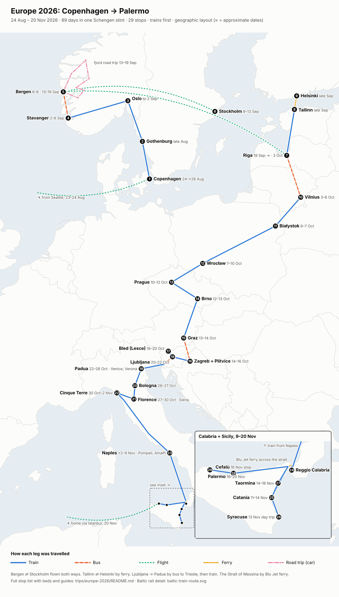

# Sabbatical travel: trip logs, guides and an AI-assisted planning toolkit

Long, solo, budget, train-first trips, planned with AI agents and browser automation. Each trip has a route log and one guide per place (food, drinks, sights, hikes, getting around, where to sleep). The toolkit behind the planning is here too: fare and booking recipes, Google Maps list automation, and expense tracking.

## Trips

| Trip | Dates | Countries | Status |
|---|---|---|---|
| [**Europe 2026**](trips/europe-2026/README.md) · [budget forecast](trips/europe-2026/budget-forecast.md) · [actual spend](trips/europe-2026/budget-actual.md): Scandinavia → Baltics → Central Europe → Slovenia/Croatia → Italy → Sicily | 24 Aug – 20 Nov 2026 (89 days, one Schengen stint) | Denmark, Sweden, Norway, Finland, Estonia, Latvia, Lithuania, Poland, Czechia, Austria, Croatia, Slovenia, Italy | ✅ Done |
| [**Latin America**](trips/latam/README.md) | — | — | 🧭 Next: planning |

## City and region guides (Europe 2026)

| Region | Guides |
|---|---|
| Scandinavia | [Copenhagen](trips/europe-2026/guides/copenhagen.md) · [Gothenburg](trips/europe-2026/guides/gothenburg.md) · [Oslo](trips/europe-2026/guides/oslo.md) · [Oslo → Stavanger stopovers](trips/europe-2026/guides/oslo-stavanger-stopovers.md) · [Stavanger](trips/europe-2026/guides/stavanger.md) · [Bergen and the fjords](trips/europe-2026/guides/bergen.md) · [Stockholm](trips/europe-2026/guides/stockholm.md) · [Helsinki](trips/europe-2026/guides/helsinki.md) |
| Scandinavia, cross-cutting | [Transit](trips/europe-2026/guides/scandinavia-transit.md) · [Money savers](trips/europe-2026/guides/scandinavia-money.md) · [Off the beaten track](trips/europe-2026/guides/scandinavia-offbeat.md) |
| Baltics | [Tallinn](trips/europe-2026/guides/tallinn.md) · [Riga](trips/europe-2026/guides/riga.md) · [Vilnius](trips/europe-2026/guides/vilnius.md) · [Baltic train spine](trips/europe-2026/guides/baltics-train-spine.md) |
| Central Europe | [Białystok](trips/europe-2026/guides/bialystok.md) · [Wrocław](trips/europe-2026/guides/wroclaw.md) · [Prague](trips/europe-2026/guides/prague.md) · [Brno](trips/europe-2026/guides/brno.md) · [Graz](trips/europe-2026/guides/graz.md) |
| Croatia and Slovenia | [Croatia (Zagreb, Plitvice, Split, Dubrovnik)](trips/europe-2026/guides/croatia.md) · [Slovenia (Ljubljana, Bled, Bohinj)](trips/europe-2026/guides/slovenia.md) · [Trieste](trips/europe-2026/guides/trieste.md) |
| Italy | [Italy, mainland north to south](trips/europe-2026/guides/italy.md) (Padua, Venice, Verona, Bologna, Florence, Cinque Terre, Naples, Calabria) · [Sicily](trips/europe-2026/guides/sicily.md) (Catania, Syracuse, Taormina, Cefalù, Palermo) |

## Research notes

- [Flights: points vs cash](research/flights-points-vs-cash.md): when award flights beat cash, and how to sweep gateways
- [Hyatt points in Scandinavia](research/hyatt-points-scandinavia.md)
- [Europe hikes and cammini](research/europe-hikes-cammini.md): long-distance walking routes
- [A year-long base in Europe](research/europe-year-base-nomad.md): visas and city shortlist for a longer stay
- [Spain non-lucrative visa vs French visitor visa](research/spain-nlv-vs-france-visitor.md)
- [Packing list](research/packing-list.md)

## Toolkit

| Path | What it does |
|---|---|
| [`AGENTS.md`](AGENTS.md) | Rules for the AI agents doing the planning: **API first** (replay each site's own requests instead of clicking), a table of working recipes (Google Flights, airline award searches, Booking/Agoda/Hostelworld prices and reviews, rail operators across Europe, ferries, buses, Google Maps), throttling guardrails, and the traveller's preferences |
| [`.github/copilot-instructions.md`](.github/copilot-instructions.md) | How trip files and guides are laid out and kept up to date |
| [`skills/google-maps-saved-places`](skills/google-maps-saved-places/) | Bulk-save places to Google Maps lists, with visible notes, through Maps' own web endpoints |
| [`skills/google-maps-labels`](skills/google-maps-labels/) | Add personal labels to map pins that have no business listing (apartments, private rooms) |
| [`skills/google-ai-mode-research`](skills/google-ai-mode-research/) | Fast research with Google AI Mode in a signed-in browser (always confirmed on official sites) |
| [`skills/google-sheets-edit`](skills/google-sheets-edit/) | Read and write a Google Sheet from a signed-in browser, with no OAuth setup |
| [`skills/card-expense-sync`](skills/card-expense-sync/) | Pull card transactions, sort them into food, lodging, transport and other, and spread hotel costs per night. Personal data stays outside the repo |
| [`tools/route-map`](tools/route-map/make_map.py) | Draws a trip's route map as an SVG (stops numbered, legs coloured by mode, light and dark mode, optional zoomed inset) from Natural Earth outlines |
| [`or-cost-monitor/`](or-cost-monitor/) | A VS Code extension showing real-time OpenRouter API spend |

## How a trip is planned

1. **Route by weather and season:** the best-weather region gets the late, long slot. Big events (marathons, trade fairs) are checked before dates are fixed.
2. **Every leg on the ground first:** trains (buses only when trains are much slower), compared on time and price and bought from the operator. Flights only for long hops, after a full gateway × date fare sweep.
3. **Every bed priced everywhere:** Google Maps, Booking, Agoda, Hostelworld and the property's own booking engine, compared on **checkout totals including city tax and coupons**, and vetted on the full review spread.
4. **Everything saved to Google Maps:** sights, food and craft beer, with icon lists for walks, hikes and bike routes, so the plan is there on the phone.
