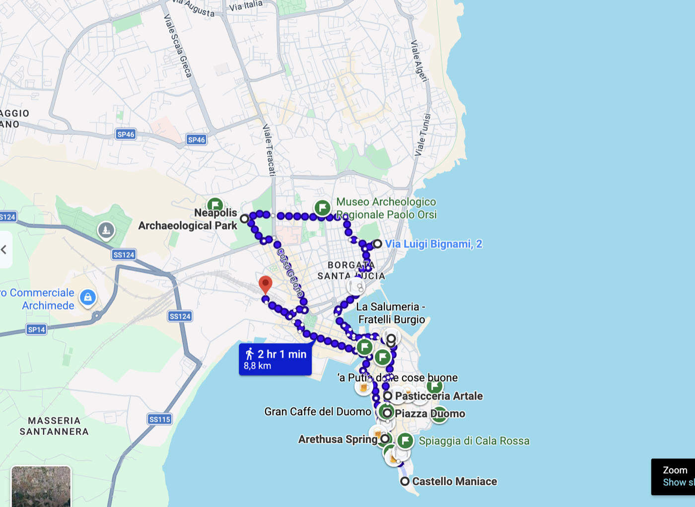

# Syracuse day trip — Fri 13 Nov 2026 (from Catania)

**▶ [Open the whole day route in Google Maps (walking, 10 stops)](https://www.google.com/maps/dir/Stazione+di+Siracusa/Neapolis+Archaeological+Park,+Siracusa/Via+Luigi+Bignami+2,+Siracusa/Ortigia+Street+Market,+Siracusa/Caseificio+Borderi,+Siracusa/Pasticceria+Artale,+Siracusa/Castello+Maniace,+Siracusa/Piazza+Duomo,+Siracusa/Fonte+Aretusa,+Siracusa/Stazione+di+Siracusa/data=!4m2!4m1!3e2)**: 8.8 km, about 2 h of walking in total.

The same route in parts, for phone browsers that drop stops:
[Morning](https://www.google.com/maps/dir/?api=1&origin=Siracusa+station%2C+Siracusa&destination=Caseificio+Borderi%2C+Siracusa&waypoints=Neapolis+Archaeological+Park%2C+Siracusa%7CVia+Luigi+Bignami+2%2C+Siracusa%7COrtigia+Street+Market%2C+Siracusa&travelmode=walking) ·
[Afternoon](https://www.google.com/maps/dir/?api=1&origin=Caseificio+Borderi%2C+Siracusa&destination=Fonte+Aretusa%2C+Siracusa&waypoints=Pasticceria+Artale%2C+Siracusa%7CCastello+Maniace%2C+Siracusa%7CPiazza+Duomo%2C+Siracusa&travelmode=walking) ·
[Back to station](https://www.google.com/maps/dir/?api=1&origin=Fonte+Aretusa%2C+Siracusa&destination=Siracusa+station%2C+Siracusa&travelmode=walking)

| Time | Stop | Notes |
|---|---|---|
| 08:56 → 09:49 | Train Catania C.le → Siracusa | Trenitalia, €8.80 |
| ~10:05–11:45 | **Neapolis Archaeological Park** | 15 min walk. Open Fri 08:30–15:30. Includes the Ear of Dionysius |
| ~12:05 | **Ravo Mattoni mural** (Caravaggio copy), Via Luigi Bignami 2 | Outdoor and free. On the way to Ortigia |
| ~12:25–13:30 | **Ortigia Street Market** + lunch at **Caseificio Borderi** | Stalls Mon–Sat 07:00–13:45. Borderi 09:00–16:00. Fratelli Burgio next door for a deli board + wine |
| ~13:45 | **Fontana di Diana** (Piazza Archimede) + **Pasticceria Artale** | Almond/pistachio granita, cannoli. Artale closes 16:00 |
| ~14:15–15:15 | **Castello Maniace** (optional, paid) | Closes 15:45 |
| ~15:30–16:20 | **Piazza Duomo** | Late-afternoon golden light |
| 16:25–16:55 | **Fonte Aretusa** | **Sunset 16:50**. Starling murmurations just before dusk |

## Getting back to Catania

The walk from Fonte Aretusa to the station takes about 25 min. The options after sunset:

- **Interbus** ~17:45, about 1 h 20. Leaves from the bus stops by the station. **Buy online in advance**, because a full bus takes no standing passengers.
- **Trenitalia 17:28 → 19:19** (€8.80). This is a replacement bus the whole way, so Interbus is quicker.
- Trenitalia 18:19 → 20:22 (also a bus).
- The 17:10 → 18:28 only works if you skip the sunset.

## Optional extras

- Papyrus Museum (€5). This is the one thing unique to Syracuse; the free version is the papyrus growing in Fonte Aretusa.
- Seafood dinner at L'Ancora da Giancarlo (Fri 12–15, 19:30–23). This means taking a late bus back.
- Skippable: the puppet museum (Palermo does it better), the Leonardo/Archimede museum, the catacombs, and the churches.

All stops are tagged in Google Maps: sights in *Want to go*, food in *Restaurants*.
