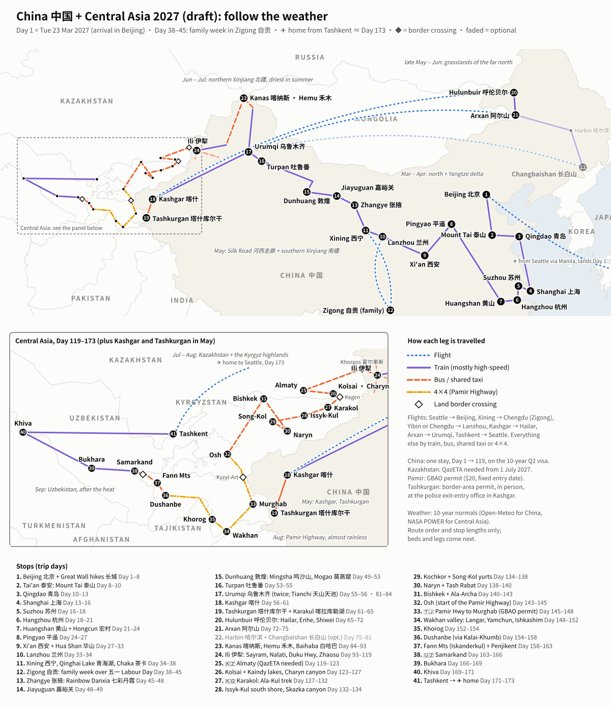

# China 中国 + Central Asia 2027 (draft): follow the weather, late March → September

> 🧭 **Status: second draft (27 Nov 2026).** Route order and stop lengths only. Beds, train legs and day plans come next, stop by stop.
> **Day 1 = arrival in Beijing 北京** (the flight leaves Seattle two days earlier; the date line eats a day). Trip days only below, so the plan can slide; fixed events (holidays) keep real dates.

**Assumptions** (user, 27 Nov 2026):
- About 4–5 months in China, then Central Asia, with no fixed date home ("we can come home later … we can also fly from there"). Home ≈ **Day 172**, from Tashkent.
- Entering China on a US passport with a **10-year Q2 visa 探亲签证** (family visit).
- **Family in Zigong 自贡, Sichuan 四川:** a week there over the Labour Day holiday 五一 (Day 38 → 45).
- **Yunnan 云南, Guilin 桂林, Sichuan 四川 and Chongqing 重庆 already visited**, so they're left out. Central Asia is all new.

## How the route was chosen

- **Weather:** 10 years of daily data (2016–2025) by half-month: average high/low and the share of days with ≥ 1 mm of rain. China: Open-Meteo, 48 places. Central Asia: NASA POWER, 21 places.
- **Spring goes to the dry north 华北**, not the south: in late March and April, Beijing, Mount Tai, Pingyao and Xi'an have 5–24% wet days, while the south-east is already in its wet half of the year (Hangzhou 37–47%, Huangshan 44–54%).
- **The Yangtze delta 江南 fits only in early April**, before the plum rains 梅雨 (Shanghai 27% wet in early April against 67% in late June).
- **May is the month for the Silk Road 河西走廊 and southern Xinjiang 南疆** (Zhangye 14%, Dunhuang 3–9%, Kashgar 8–16%), before Turpan and Kashgar pass 33–40 °C in June.
- **Late May and early June go to the far north** (Hulunbuir 20/6 °C, 21% wet), which turns showery from July (41–46%).
- **Northern Xinjiang 北疆** (Kanas and Ili: 9–20% wet days in Jun–Jul) gets the long slot, and Ili leads straight into Kazakhstan at Khorgos.
- **Central Asia follows its own seasons:**
  - **The Kyrgyz highlands** (Song-Kol, Kochkor) are driest from late July (9–16% wet).
  - **The Pamirs** are almost rainless in August (Murghab, Khorog and the Wakhan: 0–8%).
  - **Uzbekistan** comes last, once the 38–41 °C of July–August has eased: about 31–33 °C in early September, 0–2% wet.
- **Left for an autumn trip** (their best months fall outside this window):
  - Fujian 福建 (Wuyishan 武夷山, the tulou 土楼), Hunan 湖南 (Zhangjiajie 张家界), and Huangshan 黄山 at its best.
  - Hainan 海南 is only at its best in March (Sanya 三亚 18% wet) and was dropped.
  - Tibet 西藏 needs a permit and a guided tour on a US passport; it's an optional add-on.

## Route

| Days | Stop | Nights | Weather (high/low · wet days) |
|---|---|---|---|
| | ***🏯 Spring in the north*** | | |
| Day 1 → 8 | Beijing 北京 + Great Wall hikes 长城 (Jiankou 箭扣 → Mutianyu 慕田峪, Gubeikou 古北口 → Jinshanling 金山岭) | 7 | 17/3 °C · 11% wet |
| Day 8 → 10 | Tai'an 泰安: Mount Tai 泰山 | 2 | 17/4 °C · 7% wet |
| Day 10 → 13 | Qingdao 青岛 | 3 | 15/8 °C · 17% wet |
| | ***🌸 Yangtze delta*** | | |
| Day 13 → 16 | Shanghai 上海 | 3 | 20/10 °C · 27% wet |
| Day 16 → 18 | Suzhou 苏州 | 2 | 20/10 °C · 29% wet |
| Day 18 → 21 | Hangzhou 杭州 | 3 | 22/11 °C · 37% wet |
| Day 21 → 24 | Huangshan 黄山 + Hongcun 宏村 | 3 | 12/2 °C · 44% wet |
| | ***🏯 Spring in the north*** | | |
| Day 24 → 27 | Pingyao 平遥 | 3 | 22/8 °C · 17% wet |
| Day 27 → 33 | Xi'an 西安 + Hua Shan 华山 | 6 | 25/12 °C · 24% wet |
| | ***🏜️ Silk Road: Gansu 甘肃 + Qinghai 青海*** | | |
| Day 33 → 34 | Lanzhou 兰州 | 1 | 21/8 °C · 20% wet |
| Day 34 → 38 | Xining 西宁, Qinghai Lake 青海湖, Chaka salt lake 茶卡盐湖 | 4 | 16/2 °C · 25% wet |
| | ***👪 Family*** | | |
| Day 38 → 45 | Zigong 自贡, Sichuan 四川: family over the Labour Day holiday 五一 (✈ Xining → Chengdu, then high-speed train; out via Yibin 宜宾 or Chengdu → ✈ Lanzhou) | 7 | 26/17 °C · 54% wet |
| | ***🏜️ Silk Road: Gansu 甘肃*** | | |
| Day 45 → 48 | Zhangye 张掖: Rainbow Danxia 七彩丹霞, Binggou Danxia 冰沟丹霞 | 3 | 23/8 °C · 16% wet |
| Day 48 → 49 | Jiayuguan 嘉峪关 | 1 | 23/8 °C · 16% wet |
| Day 49 → 53 | Dunhuang 敦煌: Mingsha dunes + Crescent Lake 鸣沙山月牙泉, Mogao Caves 莫高窟 | 4 | 26/12 °C · 9% wet |
| | ***🏜️ Southern Xinjiang 南疆*** | | |
| Day 53 → 54 | Turpan 吐鲁番 | 1 | 32/20 °C · 3% wet |
| Day 54 → 55 | Urumqi 乌鲁木齐 (transit) | 1 | 23/11 °C · 23% wet |
| Day 55 → 60 | Kashgar 喀什 | 5 | 29/15 °C · 16% wet |
| Day 60 → 64 | Tashkurgan 塔什库尔干 + Karakul Lake 喀拉库勒湖 on the Karakoram Highway 中巴公路 | 4 | 14/4 °C · 31% wet |
| | ***🌾 Far north*** | | |
| Day 64 → 71 | Hulunbuir 呼伦贝尔: Hailar 海拉尔, Enhe 恩和, Shiwei 室韦 | 7 | 20/6 °C · 21% wet |
| Day 71 → 74 | Arxan 阿尔山 | 3 | 19/8 °C · 51% wet |
| Day 74 → 80 | (optional) Harbin 哈尔滨 + Changbaishan 长白山 | 6 | 21/11 °C · 52% wet |
| | ***🏔️ Northern Xinjiang 北疆*** | | |
| Day 80 → 83 | Urumqi 乌鲁木齐 + Tianshan Tianchi 天山天池 | 3 | 29/17 °C · 10% wet |
| Day 83 → 92 | Kanas 喀纳斯, Hemu 禾木, Baihaba 白哈巴 | 9 | 26/13 °C · 20% wet |
| Day 92 → 118 | Ili 伊犁: Sayram Lake 赛里木湖, Nalati 那拉提, Bayanbulak 巴音布鲁克, Duku Highway 独库公路, Kalajun 喀拉峻, Zhaosu 昭苏 (Wusun Ancient Road trek 乌孙古道 optional); leave China at Khorgos 霍尔果斯口岸 | 26 | 32/19 °C · 14% wet |
| | ***🇰🇿 Kazakhstan*** | | |
| Day 118 → 122 | Almaty: Big Almaty Lake, Kok-Zhailau | 4 | 22% wet † |
| Day 122 → 125 | Kolsai and Kaindy lakes | 3 | 32% wet † |
| Day 125 → 126 | Charyn canyon | 1 | 33/19 °C · 22% wet † |
| | ***🇰🇬 Kyrgyzstan*** | | |
| Day 126 → 131 | Karakol: Ala-Kul trek, Altyn-Arashan, Jeti-Oguz | 5 | 42% wet † |
| Day 131 → 133 | Issyk-Kul south shore: Skazka canyon, Bokonbaevo | 2 | 22/6 °C · 14% wet † |
| Day 133 → 137 | Kochkor + Song-Kol (yurt nights) | 4 | 21/6 °C · 9% wet † |
| Day 137 → 139 | Naryn + Tash Rabat | 2 | 19/6 °C · 21% wet † |
| Day 139 → 142 | Bishkek + Ala-Archa | 3 | 35/21 °C · 9% wet † |
| Day 142 → 144 | Osh | 2 | 34/21 °C · 1% wet † |
| | ***🇹🇯 Tajikistan: Pamir Highway*** | | |
| Day 144 → 147 | Sary-Tash → Karakul → Murghab | 3 | 17/1 °C · 3% wet † |
| Day 147 → 151 | Wakhan valley: Langar, Yamchun, Ishkashim | 4 | 12/-1 °C · 8% wet † |
| Day 151 → 153 | Khorog | 2 | 19/4 °C · 3% wet † |
| Day 153 → 157 | Khorog → Kalai-Khumb → Dushanbe (drive), Dushanbe | 4 | 32/17 °C · 1% wet † |
| Day 157 → 161 | Fann Mountains: Iskanderkul, Seven Lakes | 4 | 19/5 °C · 3% wet † |
| Day 161 → 162 | Penjikent | 1 | 33/17 °C · 2% wet † |
| | ***🇺🇿 Uzbekistan*** | | |
| Day 162 → 165 | Samarkand | 3 | 32/16 °C · 2% wet † |
| Day 165 → 168 | Bukhara | 3 | 33/16 °C · 0% wet † |
| Day 168 → 170 | Khiva | 2 | 31/16 °C · 0% wet † |
| Day 170 → 172 | Tashkent → fly home | 2 | 30/16 °C · 1% wet † |

† NASA POWER averages a ~50 km cell, so mountain cells run cold for valley towns: Almaty, Karakol and the Kolsai lakes show wet days only.

**Home ≈ Day 172.** Dropping the optional Harbin + Changbaishan stop (52% wet days in early June) frees 6 days. Spending them in Central Asia pushes Uzbekistan later and cooler.

## Weather by month

Average high/low (°C) · share of days with ≥ 1 mm of rain. **Bold** = mild (15–30 °C) and ≤ 20% wet days. China: Open-Meteo archive; mountain stations sit lower than the summits, so summits are colder. Central Asia: NASA POWER (†, coarser).

| Place | Mar | Apr | May | Jun | Jul | Aug | Sep |
|---|---|---|---|---|---|---|---|
| ***North China plain 华北*** | | | | | | | |
| Beijing 北京 | **15/1 · 9%** | **22/8 · 10%** | **28/14 · 15%** | 33/20 · 20% | 32/23 · 48% | 30/21 · 38% | **27/16 · 18%** |
| Tai'an 泰安 (Mount Tai 泰山) | **15/3 · 8%** | **21/9 · 18%** | **26/14 · 16%** | 31/20 · 26% | 30/23 · 49% | 30/22 · 46% | 26/17 · 23% |
| Qingdao 青岛 | 11/4 · 11% | **16/9 · 17%** | **21/14 · 20%** | 25/19 · 26% | 28/24 · 39% | 29/24 · 45% | 26/20 · 23% |
| Pingyao 平遥 | **16/1 · 8%** | **22/8 · 17%** | **27/13 · 16%** | 32/18 · 20% | 32/21 · 38% | 30/20 · 34% | 25/15 · 23% |
| Xi'an 西安 | **18/5 · 13%** | 24/11 · 24% | 28/15 · 22% | 32/20 · 26% | 33/23 · 33% | 33/23 · 32% | 26/18 · 36% |
| ***Yangtze delta 江南*** | | | | | | | |
| Shanghai 上海 | 16/7 · 33% | 21/12 · 32% | 25/16 · 37% | 28/21 · 57% | 32/26 · 59% | 33/26 · 48% | 28/22 · 48% |
| Suzhou 苏州 | 16/7 · 34% | 22/12 · 35% | 26/17 · 37% | 29/21 · 52% | 32/26 · 54% | 33/26 · 46% | 28/21 · 44% |
| Hangzhou 杭州 | 17/8 · 42% | 23/13 · 42% | 27/17 · 44% | 29/22 · 62% | 33/26 · 54% | 34/26 · 49% | 29/22 · 47% |
| Huangshan 黄山 | 7/-1 · 50% | 13/4 · 49% | 16/8 · 55% | 19/12 · 71% | 22/16 · 67% | 23/16 · 60% | 19/12 · 54% |
| ***Gansu 甘肃 + Qinghai 青海*** | | | | | | | |
| Lanzhou 兰州 | 14/1 · 6% | **20/6 · 17%** | **24/11 · 18%** | 28/16 · 22% | 30/18 · 27% | 28/18 · 33% | 24/13 · 35% |
| Xining 西宁 | 10/-4 · 9% | 15/1 · 26% | 20/6 · 35% | 23/10 · 44% | 25/13 · 39% | 24/13 · 48% | 19/9 · 47% |
| Xiahe 夏河 (Gannan 甘南) | 5/-8 · 26% | 9/-4 · 40% | 12/0 · 54% | 15/5 · 66% | 18/8 · 62% | 18/8 · 65% | 14/4 · 66% |
| Zhangye 张掖 | 13/-3 · 5% | **19/3 · 12%** | **25/9 · 15%** | **29/14 · 17%** | 31/17 · 23% | 29/16 · 27% | **25/11 · 14%** |
| Dunhuang 敦煌 | 14/0 · 1% | **21/7 · 3%** | **27/13 · 7%** | 32/19 · 6% | 34/22 · 6% | 32/20 · 9% | **27/14 · 2%** |
| ***Xinjiang 新疆*** | | | | | | | |
| Turpan 吐鲁番 | **19/6 · 1%** | **28/15 · 4%** | 34/21 · 3% | 40/27 · 3% | 41/30 · 3% | 39/28 · 4% | 33/21 · 1% |
| Urumqi 乌鲁木齐 | 7/-3 · 14% | **18/6 · 19%** | 24/12 · 21% | **29/17 · 15%** | 31/20 · 14% | **29/18 · 17%** | **23/12 · 17%** |
| Kashgar 喀什 | **16/3 · 7%** | **23/10 · 12%** | **28/15 · 12%** | 32/18 · 10% | 34/22 · 9% | 31/19 · 13% | **27/15 · 11%** |
| Tashkurgan 塔什库尔干 | 2/-7 · 18% | 7/-2 · 22% | 13/3 · 26% | 17/6 · 51% | 20/10 · 45% | 19/9 · 48% | 15/5 · 34% |
| Yining 伊宁 (Ili 伊犁) | 14/0 · 21% | 21/8 · 24% | 26/13 · 25% | 30/18 · 21% | 32/20 · 12% | 31/18 · 11% | **26/13 · 16%** |
| Altay 阿勒泰 (Kanas 喀纳斯) | 3/-7 · 20% | 14/0 · 17% | **20/7 · 20%** | **26/13 · 20%** | **28/15 · 20%** | **26/13 · 17%** | 19/7 · 26% |
| ***Far north 东北 + 内蒙古*** | | | | | | | |
| Hailar 海拉尔 (Hulunbuir 呼伦贝尔) | 0/-13 · 10% | 10/-3 · 17% | 18/4 · 22% | 24/11 · 31% | 27/16 · 43% | 23/13 · 40% | 18/7 · 28% |
| Arxan 阿尔山 | -1/-13 · 20% | 8/-3 · 20% | 16/4 · 30% | 21/11 · 49% | 24/15 · 47% | 21/12 · 46% | 16/7 · 32% |
| Harbin 哈尔滨 | 5/-6 · 12% | 14/2 · 19% | 21/9 · 31% | 25/15 · 49% | 28/20 · 48% | 26/18 · 46% | 21/12 · 35% |
| Changbaishan 长白山 | 4/-7 · 23% | 12/0 · 35% | 18/7 · 43% | 22/12 · 53% | 26/17 · 57% | 24/16 · 64% | 20/10 · 35% |
| ***Central Asia (NASA POWER †)*** | | | | | | | |
| Bishkek | 16/3 · 32% | 21/9 · 32% | 27/13 · 26% | 33/19 · 19% | 36/22 · 14% | 33/20 · 7% | **28/15 · 9%** |
| Song-Kol | 1/-10 · 25% | 8/-3 · 27% | 13/0 · 27% | 16/4 · 27% | 20/6 · 21% | **20/5 · 9%** | **16/1 · 10%** |
| Naryn | 1/-9 · 17% | 7/-3 · 23% | 12/0 · 30% | 15/3 · 34% | 19/6 · 26% | 18/4 · 23% | **15/1 · 14%** |
| Osh | 15/5 · 25% | 20/9 · 23% | **26/14 · 20%** | 31/18 · 16% | 35/22 · 9% | 33/20 · 5% | **28/16 · 5%** |
| Murghab | -4/-16 · 8% | 1/-10 · 11% | 7/-5 · 6% | 11/-3 · 14% | **16/1 · 7%** | **16/0 · 3%** | 11/-4 · 2% |
| Khorog | 0/-8 · 26% | 7/-3 · 25% | 11/0 · 15% | **16/3 · 7%** | **21/6 · 2%** | **20/5 · 2%** | **16/2 · 1%** |
| Ishkashim (Wakhan) | -5/-14 · 28% | 0/-9 · 32% | 5/-5 · 16% | 9/-2 · 6% | 14/0 · 5% | 13/-1 · 5% | 10/-3 · 2% |
| Iskanderkul | 0/-9 · 40% | 7/-3 · 32% | 12/1 · 34% | **17/5 · 16%** | **21/8 · 9%** | **20/6 · 4%** | **16/3 · 4%** |
| Dushanbe | 13/3 · 37% | 19/8 · 30% | 25/13 · 30% | 32/17 · 8% | 36/21 · 4% | 33/19 · 1% | **28/14 · 3%** |
| Samarkand | 15/3 · 34% | 21/8 · 28% | 27/13 · 24% | 34/18 · 5% | 37/21 · 1% | 34/19 · 1% | **29/14 · 3%** |
| Bukhara | **18/4 · 18%** | **25/10 · 14%** | 32/17 · 11% | 38/22 · 1% | 40/24 · 0% | 37/21 · 0% | 31/15 · 0% |
| Khiva | 14/1 · 14% | **23/9 · 9%** | 31/16 · 9% | 37/21 · 4% | 40/24 · 1% | 36/21 · 1% | **29/14 · 0%** |
| Tashkent | 14/4 · 37% | 20/9 · 27% | 27/14 · 22% | 34/19 · 7% | 38/23 · 3% | 35/20 · 4% | **29/15 · 3%** |
| ***Not in this plan*** | | | | | | | |
| Kunming 昆明 | 22/8 · 21% | 24/12 · 32% | 25/14 · 45% | 24/16 · 82% | 24/16 · 86% | 24/16 · 83% | 22/14 · 74% |
| Dali 大理 | **21/8 · 11%** | 23/11 · 21% | 25/14 · 28% | 26/17 · 61% | 25/17 · 79% | 24/17 · 82% | 23/16 · 64% |
| Guilin 桂林 / Yangshuo 阳朔 | 21/13 · 59% | 25/17 · 66% | 28/20 · 70% | 30/24 · 79% | 32/25 · 63% | 32/25 · 68% | 32/23 · 46% |
| Chengdu 成都 | 19/10 · 42% | 24/14 · 42% | 27/18 · 44% | 30/21 · 42% | 31/23 · 66% | 31/23 · 59% | 27/20 · 54% |
| Sanya 三亚 | **27/22 · 18%** | 29/24 · 34% | 31/26 · 61% | 31/27 · 78% | 30/27 · 78% | 30/27 · 76% | 30/26 · 72% |
| Xiamen 厦门 | 21/14 · 38% | 25/18 · 38% | 28/22 · 49% | 30/25 · 67% | 33/27 · 51% | 32/26 · 62% | 32/25 · 48% |
| Wuyishan 武夷山 | 19/9 · 51% | 24/13 · 54% | 27/18 · 58% | 29/21 · 72% | 34/24 · 51% | 34/24 · 50% | 32/21 · 38% |
| Zhangjiajie 张家界 | 18/9 · 45% | 23/14 · 50% | 26/18 · 48% | 29/22 · 58% | 33/25 · 56% | 33/25 · 48% | 29/22 · 35% |
| Guangzhou 广州 | 24/16 · 47% | 27/20 · 57% | 30/23 · 71% | 31/25 · 86% | 33/26 · 76% | 32/26 · 83% | 31/25 · 67% |
| Hong Kong 香港 | 22/17 · 42% | 25/20 · 54% | 27/23 · 70% | 29/26 · 91% | 30/26 · 84% | 29/26 · 86% | 29/25 · 72% |
| Lhasa 拉萨 | 12/-1 · 17% | 15/2 · 32% | 19/6 · 43% | 23/11 · 51% | 22/12 · 70% | 21/12 · 66% | 20/10 · 53% |

## Getting there (one way, March 2027)

- **Pick: Philippine Airlines PR125 + PR358, Seattle → Manila → Beijing 北京首都 (PEK)**, leaves Sun 22:30, lands Day 1 at 11:55 (2 h 55 connection in Manila, 22 h 25 total). **$316** on BudgetAir, **$323** on Trip.com (checked on its own site, "< 9 left"), $405 on Philippine Airlines' own site. Carry-on and first checked bag included. ✅ 27 Nov. [Google Flights](https://www.google.com/travel/flights/search?tfs=GhoSCjIwMjctMDMtMjFqBRIDU0VBcgUSA1BFS0ABSAGYAQI&curr=USD&hl=en) · [Trip.com](https://us.trip.com/flights/showfarefirst?dcity=sea&acity=bjs&ddate=2027-03-21&triptype=ow&class=y&quantity=1&locale=en-US&curr=USD)
- Same fare one week later (leaves Sun 23:55). Shanghai 上海 instead: $336–355 on the same airline.
- **How it was found:** every March date from Seattle and Vancouver on Google Flights' Cheapest tab (China as the destination), Google price calendars from Portland, San Francisco, Los Angeles, Managua, San José, Panama City and Mexico City, Kiwi.com's month search, Trip.com, and Alaska awards (best 42,500 miles + $26 to Hong Kong: poor value against $316).
- Seattle → Kunming 昆明 would have cost $483–538; Vancouver → Shenzhen 深圳 → Beijing $338.

## Getting home (September)

- **Tashkent → Seattle: from $742** in early September (Google price calendar, 27 Nov). Almaty → Seattle is $715, Samarkand $852, Dushanbe $900. Osh → Seattle is $1,467+, so don't end there.
- Kiwi.com's cheapest month-wide options (Uzbekistan $750, Kazakhstan $617, Kyrgyzstan $637) are self-transfers with bag re-checks and overnight layovers.
- Ending in China instead would have cost $624–796 in early August.
- Price it again in spring; look at award options too.

## Visas and border crossings

**China: 10-year Q2 visa 探亲签证 (user, 27 Nov 2026).**
- US citizens' 10-year Q2 visas usually allow **120 days per entry**; some are issued with 180. Confirm the figure printed under *Duration of each stay* 入境后可停留.
- The count starts on the day after entry ✅ [Chinese Consulate-General in San Francisco, FAQ](https://sanfrancisco.china-consulate.gov.cn/lsfw/qianzhen/zgqz/201502/t20150212_10389353.htm).
- **The whole China part is one stay:** Day 1 → 118, leaving at Khorgos 霍尔果斯口岸. That's 117 days after the entry day, inside 120, so **no mid-trip exit is needed**. The May trip to Osh is gone, and its 6 days went to the family week in Zigong 自贡.
- **Buffer:** a local police exit-entry office 公安机关出入境管理部门 can extend the stay. Extensions may add up to the visa's own stay length (120 days) in total ✅ [National Immigration Administration reply on a 120-day Q2](https://www.nia.gov.cn/Enquiry/publish/showQuestion.jsp?MZ=Dsq799Zl%2BmJ2BIahe95J%2BA%3D%3D), Sep 2023.
- A Q2 is issued for visiting relatives; the Zigong week matches that purpose if a border officer asks.

**Central Asia (US passport):**

| Country | Rule | Days in the plan | Source |
|---|---|---|---|
| 🇰🇿 Kazakhstan | Visa-free up to 30 days per visit, 90 in any 180. **From 1 July 2027 every foreigner also needs a QazETA** e-travel authorization: free, apply ≥ 72 h ahead on qazeta.kz or its app, valid 180 days, multiple entry; without it you're refused entry | 8 (Day 118 → 126); the entry falls after 1 July, so QazETA is required | ✅ US Embassy Kazakhstan ([visa-free](https://kz.usembassy.gov/visa-free-travel-to-kazakhstan/), [QazETA](https://kz.usembassy.gov/services/electronic-travel-authorization-qazeta/)), read 27 Nov |
| 🇰🇬 Kyrgyzstan | Visa-free up to **30 days within any 60**; overstays need a fine and an exit visa | 18 (Day 126 → 144) | ✅ [US Embassy Bishkek](https://kg.usembassy.gov/traveling-to-the-kyrgyz-republic/), updated 8 Jan 2026 |
| 🇹🇯 Tajikistan | Visa-free up to 30 days. **The Pamir (GBAO) needs a permit: $20, single entry, on a fixed entry date**, applied for on evisa.tj (the form has a "GBAO Permit" option and lists the United States) | 18 (Day 144 → 162) | ✅ travel.state.gov; ✅ [evisa.tj](https://www.evisa.tj/#/help) FAQ, read 27 Nov |
| 🇺🇿 Uzbekistan | Visa-free up to 30 days since 1 Jan 2026 | 10 (Day 162 → 172) | ✅ gov.uz |

**China's border management areas 边境管理区** (Tashkurgan 塔什库尔干 and the Karakoram Highway; probably also Baihaba 白哈巴 and Shiwei 室韦/Enhe 恩和):
- Since 15 Apr 2026 the permit is electronic: the **电子边境管理区通行证**. It's free.
- **Foreigners must apply in person** at a county-level public security exit-entry office 出入境管理机构 or a designated police station, with their passport. If the papers are complete it's issued on the spot; otherwise it takes up to 10 working days. Only mainland residents can apply online in the 移民局12367 app. ✅ National Immigration Administration 国家移民管理局, [notice No. 2 of 2026](https://en.nia.gov.cn/n147418/n147468/c199270/content.html) and its [service guide](https://www.nia.gov.cn/n741445/n741604/n1787214/c1792376/content.html).
- **What this means for the plan:**
  - Use one Kashgar 喀什 morning for the Tashkurgan permit, before Day 60.
  - Do the same in Burqin 布尔津 or Altay 阿勒泰 for Baihaba, and in Hailar 海拉尔 or Ergun 额尔古纳 for Shiwei/Enhe.
  - Ask there whether those villages are open to foreigners at all. Local police pages add that areas **not open to foreigners** also need an Alien Travel Permit 外国人旅行证.
  - Kanas 喀纳斯 and Hemu 禾木 need only a passport and an entry ticket (traveller guides; lead).

**Land border crossings:**

| Crossing | Status | Source |
|---|---|---|
| Irkeshtam 伊尔克什坦口岸 (Kashgar ↔ Osh) | **No longer needed** with the Q2 visa; kept as an option for a Kyrgyz side trip from Kashgar. Open to foreign travellers on **weekdays only** (about 09:00–11:00 and 14:00–18:00), closed on Chinese and Kyrgyz public holidays | ✅ Xinjiang border inspection station's holiday-closure notices 新疆边检总站 (Sep 2026); hours from Caravanistan (Jul 2026; lead) |
| Khorgos 霍尔果斯口岸 (Ili → Almaty), Day 118 | Passenger crossing in daily use: 977,000 travellers in Jan–Oct 2026. Buses Yining 伊宁 ↔ Almaty Sayran terminal | ✅ Chinese customs figures via the press; bus times from traveller reports (lead) |
| Kegen / Karkara (Kazakhstan → Karakol), Day 126 | Open all year, 24/7 since 2025 (it used to be May–Oct only) | Caravanistan, Oct 2026, and a Sep 2026 traveller report (lead) |
| Kyzyl-Art (Kyrgyzstan → Tajikistan on the Pamir Highway), Day 144 | Open to foreigners; no special permit for the crossing itself (you still need the GBAO permit) | Caravanistan forum, Mar 2026; Pamir guides, Oct 2026 (lead) |
| Penjikent / Sarazm → Samarkand / Jartepa, Day 162 | Passenger crossing, open 24 h | Uzbek operators' guides, Oct 2026 (lead) |

## 2027 public holidays in China (State Council notice, 5 Nov 2026)

| Holiday | Dates | Where the plan has you | What to do |
|---|---|---|---|
| Qingming 清明节 | 3–5 Apr | Qingdao 青岛 → Shanghai 上海 (Day 12–14) | Mount Tai 泰山 comes before it, on weekdays |
| **Labour Day 劳动节 (五一)** | **1–5 May** | **With family in Zigong 自贡** (Day 38 → 45) | Fly in on 29 Apr and leave on 6 May, before and after the holiday rush. The Silk Road sights (Danxia, Mogao) come after the crowds |
| Dragon Boat 端午节 | 9 Jun | Harbin 哈尔滨 / Changbaishan 长白山 or a travel day (Day 79) | Book that night's bed early |
| Mid-Autumn 中秋节, National Day 国庆节 | 15 Sep, 1–7 Oct | After China | — |

## Practical notes

- **Beds in China:** many hotels and hostels aren't licensed to host foreigners. Hostelworld lists few places outside the big cities (none in Dunhuang, Kashgar or Xining on sample May–June dates, 27 Nov), so the main channels will be Trip.com / Ctrip 携程 (filter for properties that accept foreign guests) and Booking.
- **Trains:** buy on 12306 (the official railway app) with a passport; high-speed rail reaches Urumqi 乌鲁木齐.
- **Domestic flights** are cheap on Ctrip 携程. Its lowest fares over the next few months (summer 2027 isn't on sale yet and will cost more): Xining → Chengdu ¥260 (median ¥550), Chengdu → Lanzhou ¥350, Yibin 宜宾 → Lanzhou ¥300 (Zigong's nearest airport is Yibin, 20 min by high-speed train), Kashgar → Beijing ¥700, Beijing → Hailar ¥250, Harbin → Urumqi ¥400, before about ¥60 of airport and fuel charges.
- **Google is blocked in mainland China.** Google Maps and Flights (and most of this repo's tools) only work through a foreign eSIM that roams back home. Use a US or Hong Kong data eSIM.
- **Xinjiang 新疆:** expect police checkpoints, and carry your passport everywhere. Border-area permits are in the visa section above.
- **The Pamir Highway** is shared taxis and hired 4×4s, not buses; split a driver with other travellers in Osh or Khorog.

## Next steps

1. Confirm the Q2 visa's *Duration of each stay* 入境后可停留 (usually 120 days).
2. Before Kazakhstan: QazETA (free, ≥ 72 h ahead). Before Tajikistan: the GBAO permit on evisa.tj ($20, fixed entry date).
3. Beds stop by stop, live-checked (Trip.com, Booking, Agoda, own sites), plus each stop's hikes.
4. Train legs on 12306 / Trip.com, the Kashgar → Hailar and Arxan → Urumqi flights, and transport for the Pamir.
5. Book the flight there once the dates are fixed.
