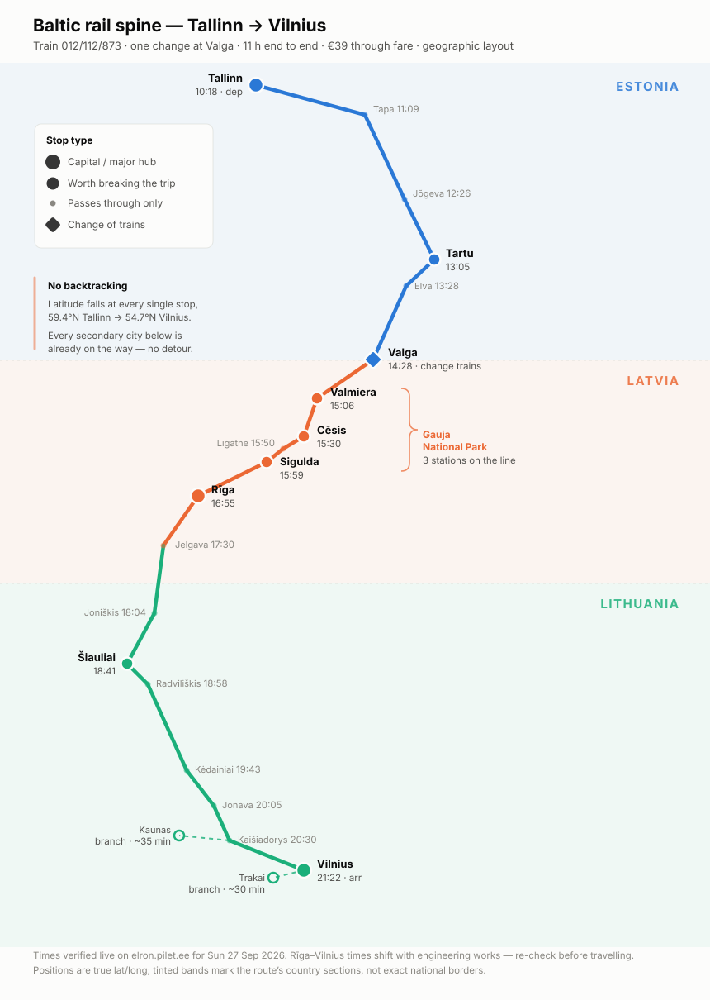

# Europe 2026: Scandinavia → Baltics → Central Europe → Slovenia/Croatia → Italy → Sicily

**24 Aug – 20 Nov 2026 · 89 days (one Schengen stint, just under the 90-day limit) · solo · budget · train-first**

The route ran north-west to south-east through countries I hadn't visited before. It went from Copenhagen up the Norwegian coast and fjords, across to the Baltics, overland through Poland, Czechia and Austria, then Croatia and Slovenia, and down Italy to Sicily. It ended with the flight home from Palermo the day before the Schengen limit ran out. Each place has a guide in [`guides/`](guides/) covering food, beer, sights, hikes, transport and where to sleep.

## Route as travelled

Dates marked *≈* are reconstructed from the planning notes rather than from a booking.

| Dates | Where | Bed | Getting there / highlights | Guide |
|---|---|---|---|---|
| 24 Aug → ≈ 28 Aug | **Copenhagen** | Hostel | Flew Seattle → Copenhagen (SAS) | [copenhagen](guides/copenhagen.md) |
| ≈ late Aug | **Gothenburg** | Hostel | Train | [gothenburg](guides/gothenburg.md) |
| ≈ late Aug – 2 Sep | **Oslo** | Hostel | Train · stopover options to Stavanger | [oslo](guides/oslo.md) · [Oslo → Stavanger stopovers](guides/oslo-stavanger-stopovers.md) |
| 2 → 6 Sep | **Stavanger** | Private room | Preikestolen hike, Stavanger parkrun | [stavanger](guides/stavanger.md) |
| 6 → 8 Sep | **Bergen** | Montana hostel | FlixBus Stavanger → Bergen (direct). Skipped Haugesund | [bergen](guides/bergen.md) |
| 8 → 13 Sep | **Stockholm** | City Hostel, then STF | BA Avios flights Bergen ⇄ Stockholm | [stockholm](guides/stockholm.md) |
| 13 → 19 Sep | **Norwegian fjords road trip** (with a friend) | Guesthouses, Airbnb | Hardanger (Odda, Eidfjord, Vøringsfossen) → Voss → Lærdal → Geiranger → Gaularfjellet and Vikafjellet → Bergen | [bergen](guides/bergen.md) · [scandinavia-transit](guides/scandinavia-transit.md) |
| 19 → ≈ 22 Sep | **Riga** | 3 Monks (booked direct) | Norwegian Bergen → Riga | [riga](guides/riga.md) · [baltics train spine](guides/baltics-train-spine.md) |
| ≈ late Sep | **Tallinn** (± Helsinki by ferry) | Hostel | Baltics done as a north–south train run | [tallinn](guides/tallinn.md) · [helsinki](guides/helsinki.md) |
| 3 → 6 Oct | **Vilnius** | Hostel | FlixBus Riga → Vilnius | [vilnius](guides/vilnius.md) |
| 6 → ≈ 7 Oct | **Białystok** | Hotel (Chase Travel credit) | Train from Vilnius via the Polish border | [bialystok](guides/bialystok.md) |
| ≈ 7 → 10 Oct | **Wrocław** | Private room | Polish trains | [wroclaw](guides/wroclaw.md) |
| 10 → 12 Oct | **Prague** | Dorm | IC 261 Baltic Express Wrocław → Prague (direct) | [prague](guides/prague.md) |
| 12 → 13 Oct | **Brno** | 10-Z Bunker (a Cold War bunker hostel) | Train | [brno](guides/brno.md) |
| 13 → 14 Oct | **Graz** | Hostel | Railjet | [graz](guides/graz.md) |
| 14 → 16 Oct | **Zagreb** (+ Plitvice) | Main Square Hostel | FlixBus Graz → Zagreb | [croatia](guides/croatia.md) |
| 16 → 20 Oct | **Bled**, staying in **Lesce** | 1A Adventure Hostel | Train Zagreb → Ljubljana → Lesce-Bled. Bled itself was sold out for the Ljubljana marathon weekend | [slovenia](guides/slovenia.md) |
| 20 → 22 Oct | **Ljubljana** | AdHoc Hostel | Train Lesce-Bled → Ljubljana | [slovenia](guides/slovenia.md) |
| 22 → 26 Oct | **Padua** (base for Venice and Verona) | Hotello Padova (Chase Travel credit) | Via Trieste | [italy](guides/italy.md) · [trieste](guides/trieste.md) |
| 26 → 27 Oct | **Bologna** | Hostel | Train | [italy](guides/italy.md) |
| 27 → 30 Oct | **Florence** (+ Siena day trip) | Hostel | Train | [italy](guides/italy.md) |
| 30 Oct → ≈ 2 Nov | **Cinque Terre / La Spezia** | Hostel | Train | [italy](guides/italy.md) |
| ≈ 2 → 9 Nov | **Naples** (Pompeii, Vesuvius, Amalfi coast) | Hostel | Train | [italy](guides/italy.md) |
| ≈ 9 → 11 Nov | **Calabria** (Reggio Calabria) | — | Regional trains down the Tyrrhenian coast | [italy](guides/italy.md) |
| 11 → 14 Nov | **Catania** (+ Syracuse/Ortigia day trip on 13 Nov) | The Yard Hostel (booked direct) | Train → Blu Jet ferry across the strait → train | [sicily](guides/sicily.md) |
| 14 → 16 Nov | **Taormina**, staying in Giardini Naxos | B&B Villa Maria | Castelmola, Monte Veneretta, the Mazzarò steps | [sicily](guides/sicily.md) |
| 16 Nov | **Cefalù** (day stop with luggage storage) | — | The Rocca, the rocks walk to Capo Cefalù | [sicily](guides/sicily.md) |
| 16 → 20 Nov | **Palermo** | Ostello Bello | Coastal bike ride to Capo Gallo, markets, Monte Pellegrino | [sicily](guides/sicily.md) |
| 20 Nov | ✈ **Home** | — | Palermo → Istanbul → Seattle (Turkish Airlines, cash fare) | — |

## How it was planned

- **Trains first.** Buses only where the train was 2–3× slower (Croatia, some Baltic legs). Every leg was compared on journey time and price, and tickets were bought from each operator's own shop.
- **One Schengen stint.** The whole trip was sized to fit 90 days, and the home flight was booked late, timed to day 89–90.
- **Weather decided the order.** The best-weather region got the late, long slot. Stops were never shortened: dates moved, and when time ran out the stops at the end were cut.
- **Big events were checked before fixing dates.** Marathons and trade fairs sell out hostels (Ljubljana marathon weekend, Venice marathon, Bologna and Parma fairs).
- **Beds:**
  - Sorting rules: no party hostels; a kitchen where eating out is expensive; privacy curtains.
  - Every bed was priced on Google Maps, Booking, Agoda, Hostelworld **and the property's own booking engine**, comparing **checkout totals including city tax and coupons**.
  - Discount codes were searched for and tested live, e.g. Ostello Bello's `Weloveyou`.
- **Places were saved to Google Maps lists with notes.** Sights, food, craft beer, and separate icon lists for walks, hikes and bike routes.
- **Browser automation, API first.** Fare calendars, award searches, hostel prices and review distributions were pulled by replaying each site's own requests. The recipes are in [`AGENTS.md`](../../AGENTS.md).

## Lessons worth reusing

- **Book a budget one-way the moment you decide.** Fares jumped 20%+ within a day several times (Norwegian, Ryanair, Wizz).
- **The property's own booking site is usually cheapest, but not always.** Agoda's signed-in checkout coupons beat it once, so compare checkout totals including city tax.
- **A search card shows only the cheapest unit.** To find private rooms, read each hostel's room list.
- **A private room costs about 2× a dorm bed** in most places. A whole flat often beats a hostel's own private room.
- **Read the full review spread.** An 8.x average can hide many scores under 7, and small new places have few reviews.
- **Award flights:** points beat cash only for long-haul premium cabins, or when no same-day connection exists. Transfer points only at the moment of booking.
- **Google Maps lists:** the label you save with a place is hidden in the app. Write descriptions into the visible **note**.
- **November in Italy and Sicily:** Etna's summit area and many seasonal services close (cable cars, island reserves, beach clubs). Check official pages, not AI summaries.

## Notes

- Spending was tracked privately in a spreadsheet, synced from card statements (see [`skills/card-expense-sync`](../../skills/card-expense-sync/)). It isn't published here.
- Reusable research that isn't tied to one city is in [`research/`](../../research/).
