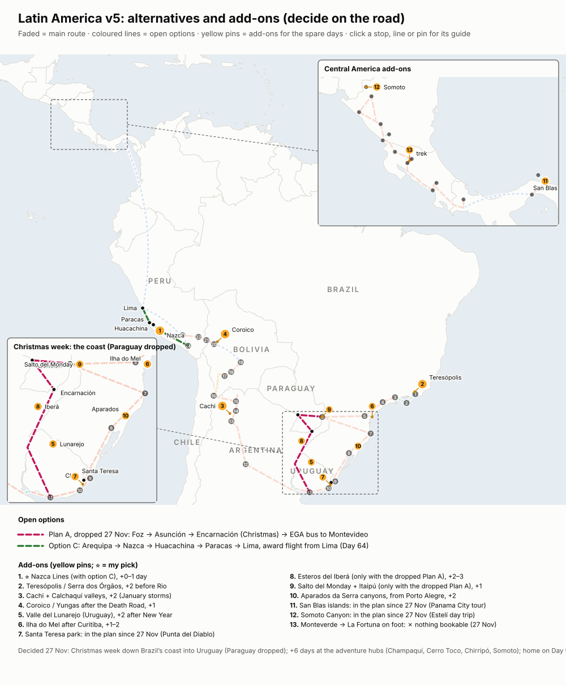

# Latin America v5: alternatives to decide on the road

Part of the [LatAm itinerary](itinerary.md). The **route order is fixed** (decided 26 Nov). This page holds the choices that can wait. Each one says when to decide, what to book for each option, and the signs that should tip it.

🖱️ Click the map to open the interactive version: every stop, line and pin there opens its guide.

The main route on its own: [interactive route map](https://raw.githubusercontent.com/YellowViking/sabbatical-2026/latam-route-v5/trips/latam/latam-route-draft.svg).

## Decided (26 Nov 2026)
- **Route order:** keep the current one (Brazil → Paraguay/Uruguay → Argentina → Atacama → Bolivia → southern Peru → Panama → Costa Rica → Nicaragua). The Andes-first and reversed orders were re-scored in [route-v5-brainstorm §1](route-v5-brainstorm.md) and not taken.
- **Potosí gets a 2nd night** (LP's top Bolivia pick: the mine and the mint), taken from the Copacabana-town night: Potosí 20 → 22, Sucre 22 → 25, La Paz 25 → 28 (BoA Day 49, $49), Isla del Sol 28 → 29, then the 18:00 bus to Puno. Nothing after Day 53 moves.
- **Northern Brazil entry** (an award into Belém, Fortaleza or Manaus; the best was economy into Belém on Day 0, ≈ 26,700 points + $60): **dropped**. The trip starts with the Alaska business award into Rio on Day 1.

## Decided (27 Nov 2026)
- **More days at the adventure hubs** (user's choice, over the 7 Mar spring-break cap). Every stop from 10 Jan moved 2–6 days later. `schedule.json` + `reschedule.py` re-dated the guides, links and maps, and every bed was re-priced for the new dates.
  - **Córdoba +2: [Cerro Champaquí](guides/cordoba.md)**, Day 31 → 33. Villa Alpina → refuge → summit → back. A free declaration is compulsory; a guide is optional.
  - **San Pedro +1:** a buffer and acclimatisation day before **Cerro Toco** (Day 44, Vulcano CLP 85,000).
  - **San Gerardo +1** (Day 67 → 71). ⚠️ SINAC showed **0 Chirripó permits** for every night from now to mid-May (27 Nov): watch for cancellations, which return to sale when someone cancels at least 15 days ahead.
  - **Estelí +2:** the [Somoto Canyon](guides/somoto.md) day trip (Day 92, $30 tour), plus one more night for a better Alaska award day. On Day 93 the only routing at that price had a 34-minute change at JFK.
  - **San Blas (Guna Yala)**, a 2-day / 1-night island tour from Panama City on Day 62 → 63, with a 2nd Panama City night after it (added later on 27 Nov at the user's request). It replaced a 2-night Bocas del Toro detour the same day: San Blas is the more distinctive island stay and avoids Bocas's long trip back to San Gerardo. See the [San Blas guide](guides/san-blas.md).
  - **Home: Day 94, Thu 11 March** (93 nights): Alaska award MGA 07:00 → Miami → AS38 → Portland → Seattle 22:39, 25k + $94.42.
- **Quebrada de las Conchas, Day 35:** the 10.9 km loop hike (AllTrails 4.7, 94 reviews) instead of the bike ride. The 08:30 Flecha Bus drops you at the trailhead.

## 1. Christmas week: decided 27 Nov, Brazil's coast into Uruguay
The user chose the coastal route over Paraguay, after the Broke Backpacker's Uruguay guide, which describes the same way in (Florianópolis → Chuy → Punta del Diablo). The split version won over 4 nights in Florianópolis and over Porto Alegre + the Aparados canyons.

| Dates | Now (main route) | Plan A, dropped (Paraguay) |
|---|---|---|
| Day 14 | 🚌 Nordeste Foz 16:30 → Florianópolis 08:10 (R$276.99) | Nordeste Foz 08:00 → Asunción |
| Day 15 → 17 | **[Florianópolis](guides/florianopolis.md)**, Pequi Hostel $31 | Asunción, then Encarnación |
| Day 17 → 19 | 🎄 **[Porto Alegre](guides/porto-alegre.md)** | 🎄 Encarnación (whole flat $76; hostels full) |
| Day 19 → 20 | 🚌 Planalto Porto Alegre 23:30 → Chuí 09:00 (R$267.95) | EGA Encarnación 13:30 → Montevideo 07:15 ($124) |
| Day 20 → 21 | **[Punta del Diablo](guides/punta-del-diablo.md)**, Mar de Fondo $26, Santa Teresa park | Montevideo |
| From 28 Dec | Cabo Polonio, then New Year in Montevideo (unchanged) | same |

- **What it costs:** Paraguay as a new country. **What it gains:** the classic coast route, a city the user wanted to see, Punta del Diablo and Santa Teresa park at no extra day, and no twice-weekly bus to depend on.
- **Plan A's guides** ([Asunción](guides/asuncion.md), [Encarnación](guides/encarnacion.md)) stay in the repo, marked dropped; their prices date from 24–26 Nov.
- **Other variants checked on 27 Nov, for reference:**
  - 4 nights in Florianópolis + EGA/TTL straight to Montevideo (Saturdays only, ≈ $146). See the [Florianópolis guide](guides/florianopolis.md).
  - Porto Alegre + **Cambará do Sul** for the Itaimbezinho and Fortaleza canyons. It works only via Caxias (Citral runs Porto Alegre ↔ Cambará on Mondays and Fridays only): Hostel Cape Town $36, park R$112. See add-on 10 below.

## 2. Arequipa → Panama City, leaving Days 60–61 · decide by ≈ mid-January
Three options, already in the [itinerary](itinerary.md) and the [Panama City guide](guides/panama-city.md):
- **A:** Sky 06:50 Arequipa → Lima + Copa CM760 13:20 → Panama, **$326 cash** (two tickets, 4 h 45 connection).
- **B:** a Lima night, then Copa 10:30 on **17,500 United miles**.
- **C:** overland via [Huacachina + Paracas](guides/huacachina-paracas.md) (+3 days), award from Lima on Day 61.
  - **New from LP (26 Nov): add the Nazca Lines to C** (+0–1 day). Either the bus Arequipa → Nazca (10–12 h), an early overflight, then ≈ 2½ h on to Huacachina; or an overflight from Pisco or Ica (≈ US$90 + S/30 airport tax, LP). The coast is in season in February.

## Islands: which ones (evaluated 27 Nov)
The route already has four island stops: Ilha Grande, Isla del Sol, Ometepe and Granada's Isletas. So this is about **one Caribbean island stay**. **San Blas is in the plan; the others stay open.** Prices come from operators' sites and Google results on 27 Nov; weather is Open-Meteo 10-year normals for Days 60–70.

| Rank | Islands | Why | Cost | Fit with the route | Verdict |
|---|---|---|---|---|---|
| 1 | **San Blas (Guna Yala), Panama**: Chichime or Perro Chico on a 2-day / 1-night tour; Cayos Holandeses on a longer trip | Roadless white-sand islets run by the Guna; the traveller consensus pick (r/Panama, r/centralamerica: "pristine… culturally sound"; "Holandes Keys is the prettiest part, by far"). Snorkelling, including the Isla Perro wreck, is free | **$192.85** (Perro Chico private room, meals and boat, ✅ 27 Nov) + ≈ $25 fees in cash; day trip $148 | **In the plan**: Day 62 → 63 from Panama City, no backtracking | ⭐ Keep. Pick a tour that sleeps on **Chichime or Perro Chico**, not the busy hub islands. Upgrade to 3 days / 2 nights for the Holandeses only if a spare day is wanted: Sea San Blas, both nights on Pelícano, **$319.93** for Day 62 → 64 (+ ≈ $127 and +1 day; Boquete moves a day later). Sleeping in the Cayos themselves needs 2 people |
| 2 | **Little Corn Island, Nicaragua** | Car-free, with coral snorkelling, jungle paths, Creole culture and cheap cabins; "100% worth it" in most write-ups | La Costeña Managua ↔ Big Corn ≈ $170–240 return + panga ≈ $10 each way (leads) | +3 days at the end (Managua → Corn → Managua before the flight home); March is drier there | Open option if a 2nd island is wanted: a different sea and feel from San Blas |
| 3 | **Bocas del Toro, Panama** | Starfish Beach (calm water, bus from town), the **Zapatilla Cays** (the clearest water; tour), Bastimentos's walk to Wizard / Red Frog (fee) | ≈ $30 shuttle from Boquete + hostels ≈ $15–20 | +2 after Boquete; the way back to San Gerardo may need a night on the road | Fallback if San Blas is full at Carnaval. Busier and party-ish; ≈ 71% wet days |
| 4 | Isla Taboga (Panama City) | A quick beach-and-hill day out | Ferry ≈ $24 return, 30 min | Only with a spare Panama City day | Skip unless stuck in the city; mixed reviews |
| 5 | Contadora / Pearl Islands | Pacific islands, resort-style | Ferry $118–133 return; day pass ≈ $150 | +1 from Panama City | Skip: dear for what it is |

## 3. Optional add-ons (4 spare days before 15 Mar)
**Spring breaks:** the busiest 2027 US college weeks are 8–12 and 15–19 Mar, Ontario's March break is 15–19 Mar, and Semana Santa is 21–28 Mar (checked 27 Nov). The plan now ends **Wed 10 Mar** by choice (more hub days), with the last nights in Estelí, which spring-breakers rarely visit. Each add-on day below pushes everything after it later. Costa Rica's and Panama's 2027 school years start on 1 Mar, so local families travel through February.

**Transport and beds were verified on 27 Nov** (✅ works car-free · ⚠️ works with a catch · ❌ doesn't). Dates before Day 34 didn't move. Rows marked "old dates" were checked for the pre-shift dates, so re-check them if you pick one.

⭐ = my pick. Costs marked "not priced" haven't been checked yet. "New" = first raised by the Lonely Planet *South America on a Shoestring* review on 26 Nov; the rest came from the earlier article sweep or already have guides.

| Option | Where it fits | Days | ≈ Cost | Verified 27 Nov: transport + bed | Note |
|---|---|---:|---:|---|---|
| ⭐ **Nazca Lines** | with option C above | +0–1 | ≈ $100–120 flight | — | Only if C is chosen. The coast is dry in February |
| [Teresópolis / Serra dos Órgãos](guides/teresopolis.md) | before Rio | +2 | see guide | ✅ guide: Viação Teresópolis from Rio, Estúdio 325 $79 | Wet in Dec (LP: best Apr–Oct) |
| **Cachi + Calchaquí valleys** | from Salta (now Day 36 → 38) | +2 | bus ARS 27,907 + bed | ⚠️ The official fare is set, but no timetable is online. Paving works on the Cuesta del Obispo road run through 2027. Viracocha Art Hostel $25 for 2 nights (old dates) | Salta's fare table also lists a Cachi → Molinos → Angastaco line, so LP's "42 km with no bus" may be out of date; days unknown. January storms |
| **Coroico / Yungas, +1 night** | La Paz, after the Death Road (now Day 52 → 55) | +1 | minivan ≈ Bs 45–50 + bed | ⚠️ No Death Road operator advertises leaving you in Coroico (Gravity's ride ends at Senda Verde). Minivan back to La Paz ≈ Bs 45–50 (Facebook posts only). El Cafetal $13 (old dates) | Senda Verde refuge Bs 220, reserve by WhatsApp. Wet in January |
| **Valle del Lunarejo, Uruguay** | after New Year, 1 → 3 Jan | +2 | bus UYU 2,039 + ≈ $43 bed | ⚠️ The noon CUT bus is listed daily (to Artigas). **1 Jan is Uruguay's transport workers' day**, so service is unconfirmed. Walks are guided only (private land). El Gavilán hostel UYU 890 a night, own site; availability not checked | Would push Colonia and Córdoba back two days |
| **Ilha do Mel** | after Morretes, Day 11 → 12 | +1 | ≈ $45 bed + R$80 boat | ⚠️ Graciosa Morretes 13:30 → Paranaguá, then the Abaline boat 15:30 (**Mon/Wed/Fri only**, sold at the window). The island's only hostel (Encantadas Ecologic) is **full**; Recanto da Kaká private $45, location 9.6. Out Day 12 via Pontal → Paranaguá → Curitiba, then the 21:00 to Foz | A second island beach right after Ilha Grande (look-alike) |
| **Esteros del Iberá** | only with Plan A (dropped), from Encarnación 26 Dec | +2–3 | ≈ $84 bed + 4×4 | ⚠️ The Mercedes → Colonia Pellegrini shared minibus runs **Mon/Wed/Fri only**, so a Saturday arrival needs a private 4×4 (≈ ARS 350k return per vehicle). Hospedaje Iberá $84 for 2 nights; 11 places left for Christmas week | Fits only by dropping Cabo Polonio (New Year in Montevideo is fixed) |
| **Salto del Monday + Itaipú** | only with Plan A (dropped), a night in Ciudad del Este Day 14 → 15 | +1 | ≈ $13 bed + $21–26 bus | ⚠️ Itaipú visits are free, daily 08:00–16:00, passport needed. NSA buses Ciudad del Este → Asunción Day 15 at 07:30, 09:40 and 14:00 (Gs 135–165k). Hummingbird Hostel $13; the area's safety at night isn't checked | LP calls Ciudad del Este the one unsafe city at night |
| **Aparados da Serra canyons** | from Porto Alegre (now on the route) | +2 | park R$112 + guide | ⚠️ Porto Alegre → Caxias → São Marcos 17:00 → Cambará (Citral direct runs Mon/Fri only); Hostel Cape Town $36 for 3 nights, location 9.9. Christmas falls in the middle, so it would replace the Porto Alegre nights rather than add to them | Fog risk |
| **Bocas del Toro (Isla Colón)** | after Boquete | +2 | ≈ $30 shuttle + ≈ $15–20 a night | ⚠️ leads only (27 Nov): shared van + water taxi from Boquete ≈ $30; quiet hostels exist (Spanish by the Sea, HW 9.4). The way back to San Gerardo (Almirante → David → Paso Canoas → Tracopa) may need a night on the way | Swapped out for San Blas on 27 Nov; ≈ 71% wet days in early February, mostly light |
| **El Valle de Antón** (new, from G Adventures' routes) | between Panama City and Boquete | +1 | ≈ $16–23 bed | ⚠️ Bodhi dorm $16 on 4 Feb but $23 on Carnaval Friday, with several places sold out; buses west on that day are unreliable (old dates) | Crater town with free hikes (La India Dormida). With the shift it falls on Carnaval weekend: skip unless the dates move |
| **Manuel Antonio** (new, from G Adventures' routes) | between Uvita and Monteverde (now Day 73) | +1 | park ≈ $18 + ≈ $14 bed | ✅ Tracopa Uvita → Quepos 07:21 and 14:05; the park calendar showed 2,500 places free; Senda Adults Only Hostel $14 (old dates: Day 69) | The classic wildlife park (sloths, monkeys); SINAC online tickets, so check its closed day when booking |
| **Caño Negro wetlands** (new) | from La Fortuna (now Day 75 → 78) | +1, or +0 as a tour | $96 tour, or bus + $126 boat | ⚠️ By bus ≈ 5–6 h each way via Ciudad Quesada and Los Chiles, then a $126 solo boat; Poponjoche Lodge $41. The $96 Río Frío tour from La Fortuna is the +0 version | Birds, caimans |
| Granada extras (new) | Granada, Day 85 → 86 | +0 | ≈ C$1,400 per boat | ⚠️ Las Isletas boats from Puerto Asese ≈ C$1,400 per boat (up to 8), so share one. Mombacho publishes no entry or truck fares | |
| ~~Monteverde → La Fortuna on foot~~ | instead of the jeep-boat-jeep | — | — | ❌ Nothing bookable: the only 2-day trek (Red Lava, $160) runs La Fortuna → Monteverde and shows "unavailable" | Closest: a night at the San Gerardo Station in the Children's Eternal Rainforest ($94.80 with meals, prepaid 15 days ahead) |

Now in the plan (27 Nov): **[San Blas](guides/san-blas.md)**, **[Cerro Champaquí](guides/cordoba.md)**, **[Somoto Canyon](guides/somoto.md)**, the Quebrada de las Conchas hike, and **Santa Teresa park** (Punta del Diablo, Day 20).

**Not this season** (LP picks that are wet or out of season in our dates): the Pantanal and Bonito, the Amazon, Lençóis Maranhenses (lagoons mostly dry until ≈ May), Kuélap/Chachapoyas, the Cotahuasi canyon, Samaipata, and trekking in the Cordillera Real (best May–September).

## 4. Things to recheck before each stop
- **Iguazú, by Day 8:** the Argentine **Garganta del Diablo walkway has been closed since 3 Aug 2026** (park's own news page, no reopening as of 25 Nov). The rest of both sides is open; the fallback order is in the [Foz guide](guides/foz-do-iguacu.md).
- **Iruya road, Day 36:** January rain can close the gravel road; ask at the Humahuaca terminal the day before ([Quebrada guide](guides/quebrada-de-humahuaca.md)).
- **Bolivian road blockades, the week before Day 42:** the Oruro–Potosí–Sucre road was blocked on 24 Nov.
- **Isla del Sol north, late January:** LP says closed; 2026 sources say probably open ([Copacabana guide](guides/copacabana-isla-del-sol.md)).
- **Volcán Barú road (Boquete) and Telica (León):** both closed in Nov 2026.
