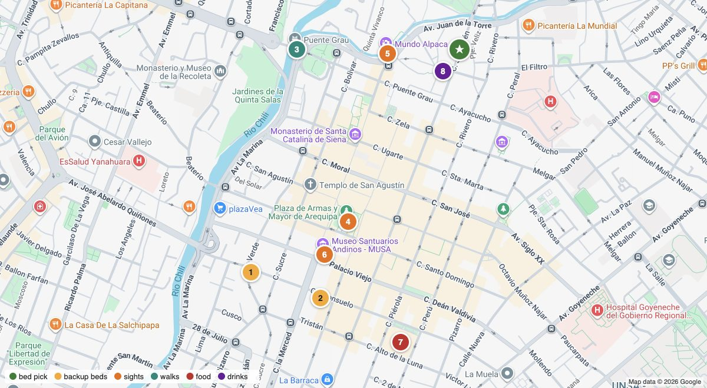
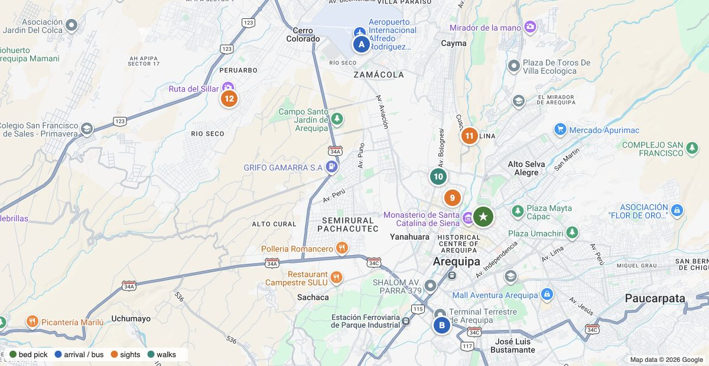

# 🇵🇪 Arequipa

Part of the [LatAm itinerary](../itinerary.md) · region notes: [Southern Peru + Panama](peru-panama.md) · ← [Colca Canyon](colca-canyon.md) · [Panama City](panama-city.md) →

> **Stop 24 · Day 59 → 61 · 2 nights (1 under options B and C)** 
> 🏞️ The white-stone city under Misti, Chachani and Pichu Pichu, and the driest stop of the week 
> 🛏️ **Econunay**, a bed in an 8-bed mixed ensuite dorm, $18.94 for 2 nights 
> 🚌 **In:** bus from Cabanaconde, Day 59 09:30 · **Out:** three open options (A: fly Day 61 06:50 · B: fly to Lima on the Day 60 afternoon · C: night bus on Day 60 to Huacachina + Paracas)

El Misti above Arequipa's green valley. Photo: Google Maps (<a href="https://www.google.com/maps?ftid=0x91424fcc9f1394f9:0x319d57bcb502bf3c">Misti</a>).

## 🗺️ Map

**In town:** ★ **[Econunay](https://www.google.com/maps?ftid=0x91424a504bc605c3:0x4ddee7bc10971d8c)** (the pick, [book](https://www.hostelworld.com/hostels/p/101496/econunay/?from=2027-02-04&to=2027-02-06&guests=1)) · **1** [Friendly AQP](https://www.google.com/maps?ftid=0x91424a58e0d7a8f3:0x959fee4f9a896087) (backup, [book](https://www.hostelworld.com/hostels/p/81894/friendly-aqp/?from=2027-02-04&to=2027-02-06&guests=1)) · **2** [Hotel Tierrasur](https://www.google.com/maps?ftid=0x91424a59cb4a9c3d:0xf78814ab63d38e1d) (private alt, [book](https://www.booking.com/hotel/pe/tierrasur-arequipa.html?checkin=2027-02-04&checkout=2027-02-06&group_adults=1&no_rooms=1&group_children=0&selected_currency=USD)) · **3** [Puente Grau](https://www.google.com/maps?ftid=0x91424a4534523b1f:0x25dbcc5ab752753a) [🚶 10 min](https://www.google.com/maps/dir/?api=1&origin=-16.3927766,-71.5328378&destination=-16.3927786,-71.5387761&travelmode=walking) (start of the riverside walk and the way to Yanahuara) · **4** [Plaza de Armas](https://www.google.com/maps?ftid=0x91424a59ffae2999:0xc419f49d1f9cd270) [🚶 12 min](https://www.google.com/maps/dir/?api=1&origin=-16.3927766,-71.5328378&destination=-16.3988146,-71.5368919&travelmode=walking) · **5** [Mundo Alpaca](https://www.google.com/maps?ftid=0x91424a4fe1ae2d85:0x84aa1c7593f13cce) [🚶 5 min](https://www.google.com/maps/dir/?api=1&origin=-16.3927766,-71.5328378&destination=-16.3929231,-71.5354539&travelmode=walking), in the [San Lázaro](https://www.google.com/maps?ftid=0x91424a502cc27acb:0xb98105c5ac052250) lanes · **6** [Museo Santuarios Andinos](https://www.google.com/maps?ftid=0x91424a59e57eb765:0x1727dfb603fb649f) [🚶 14 min](https://www.google.com/maps/dir/?api=1&origin=-16.3927766,-71.5328378&destination=-16.3999611,-71.537755&travelmode=walking) (Juanita) · **7** [Mercado San Camilo](https://www.google.com/maps?ftid=0x91424b4db3ab1345:0xaa3d6655a1e51714) [🚶 17 min](https://www.google.com/maps/dir/?api=1&origin=-16.3927766,-71.5328378&destination=-16.403028,-71.5349841&travelmode=walking) · **8** [Chelawasi Public House](https://www.google.com/maps?ftid=0x91424a51ce085917:0x6c82a877b74d0fc2) [🚶 2 min](https://www.google.com/maps/dir/?api=1&origin=-16.3927766,-71.5328378&destination=-16.3935367,-71.5334405&travelmode=walking) (Lonko is ≈ 60 m from it)

**Around:** ★ Econunay · **B** [Terminal Terrestre](https://www.google.com/maps?ftid=0x91424aeb95cb3be1:0x362ceaa0b20a26e5) · **A** [airport (AQP)](https://www.google.com/maps?ftid=0x914249e032f4992d:0xabb659ad8a6db57c) · **9** [Mirador de Yanahuara](https://www.google.com/maps?ftid=0x91424a44bd6cfa61:0xd753b23611dea7e0) [🚶 25 min](https://www.google.com/maps/dir/?api=1&origin=-16.3927766,-71.5328378&destination=-16.3874472,-71.5417323&travelmode=walking) ([La Nueva Palomino](https://www.google.com/maps?ftid=0x91424a467ba03683:0xc3959e972da3e0d4) is nearby) · **10** [Chilina valley](https://www.google.com/maps?ftid=0x91424b0012d07a2b:0x81e70a720f6a70f6) [🚕 ≈ 13 min](https://www.google.com/maps/dir/?api=1&origin=-16.3927766,-71.5328378&destination=-16.3814272,-71.5458294&travelmode=driving) · **11** [Mirador de Carmen Alto](https://www.google.com/maps?ftid=0x91424a20bc1b67b5:0x14f6794741e938c6) [🚕 ≈ 13 min](https://www.google.com/maps/dir/?api=1&origin=-16.3927766,-71.5328378&destination=-16.370079,-71.5366562&travelmode=driving) · **12** [Ruta del Sillar](https://www.google.com/maps?ftid=0x91423775db85c4d7:0x1c3b5509192fd864) [🚕 ≈ 35 min](https://www.google.com/maps/dir/?api=1&origin=-16.3927766,-71.5328378&destination=-16.3597362,-71.6065002&travelmode=driving) (Añashuayco quarry)

🧭 The time after each place is from the ★ bed (Google Maps, 26 Nov): 🚶 walk · 🚌 bus · 🚕 taxi · 🚗 by road (tour or bus). Click it for the route.

**Open the live map:** [town](https://www.google.com/maps/@-16.3975,-71.5365,16z) · [area](https://www.google.com/maps/@-16.385,-71.560,13z)

## 📅 Day by day

| Day | Plan |
|---|---|
| **Day 59** | 🚌 **09:30 Transandino** from Cabanaconde to the Terminal Terrestre (≈ 5.5–6 h), then a taxi to the hostel (S/10–15). 🌅 Late afternoon: walk over Puente Grau to the **Mirador de Yanahuara**. |
| **Day 60** · 🎭 Carnaval exodus day (Panama) | 🚶 **Río Chili and Chilina** riverside walk, the Plaza de Armas arcades, the San Lázaro lanes and **Mundo Alpaca** (all free). 🍲 Picantería lunch (they close mid-afternoon). One paid sight: the **Ruta del Sillar**, or the ice-mummy museum (in February it shows Sarita, not Juanita). Options B and C leave Arequipa today. |
| **Day 61** · 🎭 Carnaval | ✈ Option A: leave by 05:10 for the **06:50** flight. |

## 🔖 Book (one click)

Dates and 1 adult are pre-filled. The first channel listed was the cheapest when checked on 24 Nov. ⚠️ = time-sensitive.

**Beds** (Day 59 → 61, 2 nights)

| | Where | Total | Location | From the bus terminal | Book |
|---|---|---:|:---:|---|---|
| ⭐ **Pick** | **Econunay** · bed in an 8-bed mixed ensuite dorm | **$18.94** | 9.1 | 🚕 taxi/rideshare ≈ 17 min from the bus terminal (walk 1 hr 3 min, 4.2 km); centre 12 min on foot · [route](https://www.google.com/maps/dir/?api=1&origin=-16.423054699999998,-71.5448284&destination=-16.392776599999998,-71.5328378&travelmode=driving) | [Hostelworld](https://www.hostelworld.com/hostels/p/101496/econunay/?from=2027-02-04&to=2027-02-06&guests=1) · [Agoda](https://www.agoda.com/partners/partnersearch.aspx?hid=81309105&checkin=2027-02-04&checkout=2027-02-06&NumberofAdults=1&Rooms=1) |
| Backup | **Friendly AQP** · bed in a 4-bed mixed ensuite dorm | $20.40 | 9.0 | 🚕 taxi/rideshare ≈ 13 min from the bus terminal (walk 48 min, 3.3 km); centre 9 min on foot · [route](https://www.google.com/maps/dir/?api=1&origin=-16.423054699999998,-71.5448284&destination=-16.400574499999998,-71.5404465&travelmode=driving) | [Hostelworld](https://www.hostelworld.com/hostels/p/81894/friendly-aqp/?from=2027-02-04&to=2027-02-06&guests=1) · [Agoda](https://www.agoda.com/partners/partnersearch.aspx?hid=37917604&checkin=2027-02-04&checkout=2027-02-06&NumberofAdults=1&Rooms=1) |
| Private alt | **Hotel Tierrasur** · single room, breakfast | $79 | 9.7 | 0.29 km from the Plaza | [Booking](https://www.booking.com/hotel/pe/tierrasur-arequipa.html?checkin=2027-02-04&checkout=2027-02-06&group_adults=1&no_rooms=1&group_children=0&selected_currency=USD) |
| Private value | **Olespier Hostel** · private double | $54 | 9.5 | 0.53 km from the Plaza | Booking |

**Transport**

| | Leg | When | Price | Book |
|---|---|---|---:|---|
| In | 🚌 **Turismo Transandino** (or the next Andalucía) · Cabanaconde → Arequipa Terminal Terrestre | **Day 59 09:30**, ≈ 5.5–6 h | **S/35** (≈ $9.50) | counters on Cabanaconde's plaza ([Colca guide](colca-canyon.md)) |
| Out | Three open options: **A** fly Day 61 06:50 · **B** fly to Lima Day 60, then the Copa award · **C** night bus Day 60 to Ica | see Leaving, below | — | [Panama City guide](panama-city.md#getting-here-three-options-arequipa--panama-city) · [Huacachina + Paracas guide](huacachina-paracas.md) |

How to read these tables

- **Location** is the guests' location score on Booking.com. The target is 9.0 or higher, and ⚠️ would mark one below 9.0. *(HW)* means Hostelworld's location rating, used where a property isn't on Booking.
- **From the bus terminal** comes from Google Maps on 24 Nov: the property found on Maps and routed from where you arrive at midday on the check-in date. The **route** link opens the same route. For the private rooms, the distance to the Plaza from the Booking listing is shown instead.
- Symbols: 🚶 walk · 🚌 public transport · 🚕 taxi/rideshare · 🥾 hike only · ⚠️ far from the centre with no bus · ℹ️ outside the centre but on a bus line.
- Prices move, so compare the channels shown.

## 🚌 Getting here: Cabanaconde → Arequipa, Day 59

- **Bus Cabanaconde → Arequipa Terminal Terrestre:** 09:30 Transandino or the next Andalucía, ≈ 5.5–6 h, S/35 (≈ $9.50). ≈ redBus route data (see the [Colca guide](colca-canyon.md)).
- **Taxi to the centre** ≈ S/10–15 (LP: ≈ S/7). Take one from inside the terminal.
- **Two terminals side by side** on Av. Andrés Avelino Cáceres, under 3 km south: the Terminal Terrestre and the smaller Terrapuerto. Both have left luggage, and the Terminal Terrestre has an ATM. For departures, pay the S/1.50 terminal tax at its own booth (LP).
- **Cheaper:** combis link the centre and the terminals along Bolívar / Cruz Verde, S/1. Ask for a *directo* (≈ 20 min); others go via the market (≈ 35 min) (LP).

## 🛏️ Where to sleep

Live-checked on 24 Nov.

### ⭐ Pick: Econunay
- **Unit and price:** 8-bed mixed ensuite dorm · **US$18.94** for 2 nights · Hostelworld = Agoda ($18.94), Booking $19.
- **Rating:** Hostelworld 9.3 (1,125 reviews); 4% of the last 150 reviews are below 7. Booking 279 reviews, 8% below 7. Agoda 10 (283).
- **Where:** Jerusalén 605, 0.74 km from the Plaza de Armas.
- **Curtains:** most 2025–26 reviews say "beds have curtains" (one in May 2026 said not).
- **Kitchen** with cooker. A 2025 review says it's locked 21:00–06:00.
- **Vibe:** rooftop sunset yoga. One 2025 complaint about daytime music; reviews call it "friendly vibe without being loud".

### Backup: Friendly AQP
- **Unit and price:** 4-bed mixed ensuite dorm · **US$20.40** · Hostelworld (Booking $22, Agoda $25.96).
- **Rating:** 9.2 (1,328 reviews); 5% of the last 111 below 7.
- **Where:** Calle Consuelo 418, 0.41 km.
- **Checks:** family-run; beds with curtains (2025–26 reviews); "reasonably well equipped" kitchen with cooker; rooftop terrace with volcano views; not a party place.

**Also fine: Lonko** (6-bed dorm, **$21 on Booking**, Hostelworld $24, Agoda $23.40; 9.3 on 1,237 reviews). It has a rooftop bar, and reviews mention 3 am tour departures waking the dorms.

### Private alt (location first): Hotel Tierrasur
- Single room · **US$79** for 2 nights incl. breakfast · Booking.
- Location 9.7, score 9.1, 536 reviews, **2% below 7**, 0.29 km from the Plaza.
- **Value:** Olespier Hostel · private double · **US$54** · Booking (card price × 2; room table not opened). Location 9.5, 129 reviews, 2% below 7, 0.53 km.
- **Or** La Compañía de Jerusalén · single with private bath · **US$50** · Booking. Location 9.5, 109 reviews, 7% below 7, 0.71 km.
- **Agoda value lead (unchecked):** Los Andes Bed & Breakfast, Agoda 9.5 (2,615 reviews), $28 for 2 nights signed in. A Booking name search matched a different property, so the room type and location score aren't confirmed.

## 🌳 Things to do (free and outdoors first)

You have Thu evening, all of Fri, and an early Sat exit.

<table>
<tr>
<td width="50%" valign="top"> <b><a href="https://www.google.com/maps?ftid=0x91424a44bd6cfa61:0xd753b23611dea7e0">Mirador de Yanahuara</a></b> · free · late afternoon · <a href="https://www.google.com/maps/dir/?api=1&origin=-16.3927766,-71.5328378&destination=-16.3874472,-71.5417323&travelmode=walking">🚶 25 min</a> Sillar arches framing Misti, Chachani and Pichu Pichu. 1.5 km from the Plaza over Puente Grau.</td>
<td width="50%" valign="top"> <b><a href="https://www.google.com/maps?ftid=0x91424b0012d07a2b:0x81e70a720f6a70f6">Río Chili and Chilina</a></b> · free · <a href="https://www.google.com/maps/dir/?api=1&origin=-16.3927766,-71.5328378&destination=-16.3814272,-71.5458294&travelmode=driving">🚕 ≈ 13 min</a> The river and the Chilina valley terraces, between Puente Grau and the Yanahuara side.</td>
</tr>
<tr>
<td width="50%" valign="top"> <b><a href="https://www.google.com/maps?ftid=0x91424a20bc1b67b5:0x14f6794741e938c6">Mirador de Carmen Alto</a></b> · ≈ S/5 + ≈ S/15 taxi · <a href="https://www.google.com/maps/dir/?api=1&origin=-16.3927766,-71.5328378&destination=-16.370079,-71.5366562&travelmode=driving">🚕 ≈ 13 min</a> Terraced fields under Misti (≈ unverified).</td>
<td width="50%" valign="top"><b><a href="https://www.google.com/maps?ftid=0x91424a4fe1ae2d85:0x84aa1c7593f13cce">Mundo Alpaca</a></b> · free · <a href="https://www.google.com/maps/dir/?api=1&origin=-16.3927766,-71.5328378&destination=-16.3929231,-71.5354539&travelmode=walking">🚶 5 min</a> Alpacas and live weaving, Alameda San Lázaro.  <b><a href="https://www.google.com/maps?ftid=0x91424a59ffae2999:0xc419f49d1f9cd270">Plaza de Armas</a> arcades and the <a href="https://www.google.com/maps?ftid=0x91424a502cc27acb:0xb98105c5ac052250">San Lázaro</a> lanes</b> · free</td>
</tr>
<tr>
<td width="50%" valign="top"> <b><a href="https://www.google.com/maps?ftid=0x91424a59e57eb765:0x1727dfb603fb649f">Museo Santuarios Andinos</a></b> · S/20 (LP) · <a href="https://www.google.com/maps/dir/?api=1&origin=-16.3927766,-71.5328378&destination=-16.3999611,-71.537755&travelmode=walking">🚶 14 min</a> The Inca ice-mummy museum. ⚠️ Juanita is off display Jan–Apr, and Sarita is shown instead. One of the two paid options.</td>
<td width="50%" valign="top"> <b><a href="https://www.google.com/maps?ftid=0x91423775db85c4d7:0x1c3b5509192fd864">Ruta del Sillar</a></b> · ≈ S/40–60 by tour · <a href="https://www.google.com/maps/dir/?api=1&origin=-16.3927766,-71.5328378&destination=-16.3597362,-71.6065002&travelmode=driving">🚕 ≈ 35 min</a> The Añashuayco quarry canyon, where Arequipa's white stone is cut. The other paid option.</td>
</tr>
</table>

- **Mirador de Yanahuara** (free): sillar arches framing Misti, Chachani and Pichu Pichu. 1.5 km from the Plaza over Puente Grau. Best late afternoon; this is the Thu-evening walk.
  - LP's route: cross Puente Grau, take the first right (Bolognesi) along the park, then the first left up Cuesta del Ángel, and go four blocks to Plaza Yanahuara.
- **Riverside walk:** Río Chili and the Chilina valley terraces between Puente Grau and the Yanahuara side (free).
  - ⚠️ Go by day, and keep out of **Parque Selva Alegre**, north of the centre: LP reports muggings there.
- **Plaza de Armas arcades and the San Lázaro lanes** (free).
- **Mundo Alpaca** (free): alpacas and live weaving, Alameda San Lázaro.
- **Mirador de Carmen Alto:** terraced fields under Misti, ≈ S/5 plus a ≈ S/15 taxi (≈ unverified).
- **One paid, unique:** either **Museo Santuarios Andinos** or the **Ruta del Sillar** (Añashuayco quarry canyon, where Arequipa's white stone is cut; ≈ S/40–60 by tour, or a taxi plus a small entry fee). Nothing later on the route covers either.
  - ⚠️ **Juanita** (the Inca girl from Ampato) is **off display January–April** for conservation. **Sarita**, another Inca child offering from Sara Sara volcano, is shown instead (peru.travel and Peru's state news agency Andina; checked 26 Nov). On Day 60 you'd see Sarita, which tilts the choice towards the **Ruta del Sillar**.
  - Museum (LP): adult **S/20** (also the foreign-adult rate on the museum's 2021 reopening notice). The guided tour is compulsory, takes ≈ 1 h, is free and expects a tip, and runs in Spanish, English or French. Mon–Sat 09:00–18:00, Sun to 15:00.
- **Paid and outdoors, if the weather's good:** a half-day bike ride around Misti, US$50 with Peru Adventures Tours, transport and gear included (LP).
- **Not in this season:** rafting on the Río Chili runs April–November only; LP says rivers are too high in Dec–Mar.
- **Skip:** the Santa Catalina monastery (a religious site) and the cathedral.
- **Misti (5,822 m) and Chachani (6,057 m):** guided ascents are **paused January–March** (rainy season), so don't plan a climb.

## 🍽️ Eat and drink

<table>
<tr>
<td width="50%" valign="top"> <b><a href="https://www.google.com/maps?ftid=0x91424b4db3ab1345:0xaa3d6655a1e51714">Mercado San Camilo</a></b> · menú upstairs S/8–10 · <a href="https://www.google.com/maps/dir/?api=1&origin=-16.3927766,-71.5328378&destination=-16.403028,-71.5349841&travelmode=walking">🚶 17 min</a> Fresh juice S/5–7.</td>
<td width="50%" valign="top"> <b>Queso helado</b> · S/3–5 (≈ $1) At Mercado San Camilo. Photo: a generic queso helado (Commons).</td>
</tr>
<tr>
<td width="50%" valign="top"> <b>Picantería lunch</b> · ≈ S/25–40 (≈ $7–11) <i>Rocoto relleno</i>, or <i>adobo</i> on Sundays. For example, <a href="https://www.google.com/maps?ftid=0x91424a467ba03683:0xc3959e972da3e0d4">La Nueva Palomino</a> in Yanahuara. They close mid-afternoon. Photo: Sol de Mayo (Commons).</td>
<td width="50%" valign="top"> <b><a href="https://www.google.com/maps?ftid=0x91424a51ce085917:0x6c82a877b74d0fc2">Chelawasi Public House</a></b> · ≈ pint S/15–20 · <a href="https://www.google.com/maps/dir/?api=1&origin=-16.3927766,-71.5328378&destination=-16.3935367,-71.5334405&travelmode=walking">🚶 2 min</a> Peruvian craft taps, San Lázaro.</td>
</tr>
</table>

All ≈, not checked, except where LP is cited:
- **La Nueva Palomino** (LP): mains S/22–69, but one *rocoto relleno* is a meal for a solo diner. Lunch only, Mon–Sat 12:00–17:00 (Sun breakfast 07:30–12:00), so go by ≈ 14:00 on Friday.
- **Chelawasi:** opens 16:00 on weekdays (noon on Saturdays), and craft beers are S/15–18 (LP).
- **Set lunch** (*menú del día*): soup, main and sometimes dessert for ≈ S/8–22 nationally (LP). Mercado San Camilo is LP's tip for cheap local eating too.
- Mid-range and better restaurants add tax and a 10% service charge to the bill (LP), so the menu price isn't the total.

## ℹ️ Good to know
- **Dry:** Arequipa is desert. Jan–Feb station rain is 28–36 mm a month (brainstorm §6), so it's the driest stop of the week.
- **Airport (AQP):** about 8 km out; taxi ≈ S/25–35, 25–35 min. For a 06:50 flight, leave by 05:10. Have the hostel book the taxi the night before.
- ⚠️ **Taxis (LP):** don't hail taxis in the street here. LP links unlicensed "pirate" taxis to crimes against passengers, naming Arequipa in particular. Have the hostel call an official one, or use the ranks inside the bus terminals.
- **Tours (LP):** book only at a recognised agency, never through street touts. Pay in cash, because card fraud has been reported.
- **Petty theft** is common in cafés and bars, so keep your phone off the table (LP).
- **Tourist info:** iPerú on the Plaza de Armas (Portal de la Municipalidad 110), Mon–Sat 09:00–18:00, Sun to 13:00 (LP).
- **Carnival:** Peru's water-balloon and foam fights peak on the Carnaval weekend, **Sat 6 – Sun 7 Feb 2027**. Option A flies out early on the 6th and B/C leave on the 5th, so expect at most some water play in the streets on Fri 5 (≈).

## 🚌 Leaving: three open options

**Leaving Arequipa: three open options** (details in the [Panama City guide](panama-city.md#getting-here-three-options-arequipa--panama-city)):
- **A:** fly Day 61 06:50 (2 nights here): Sky + Copa ≈ $312 (✅ Google Flights, 27 Nov).
- **B:** fly to Lima on the Day 60 afternoon and use the Copa award on Day 61 (1 night here).
- **C:** night bus on Day 60 to Huacachina + Paracas, then the award from Lima on Day 64 (1 night here; +3 days; [guide](huacachina-paracas.md)).

---
Photos: Google Maps contributors (Misti, Mirador de Yanahuara, Puente Grau, Carmen Alto, Museo Santuarios Andinos, Ruta del Sillar, Mercado San Camilo, Chelawasi). Wikimedia Commons: <a href="https://commons.wikimedia.org/wiki/File:Queso_helado.jpg">Queso helado</a> (TomasVial, CC BY-SA 4.0), <a href="https://commons.wikimedia.org/wiki/File:Rocoto_relleno._Sol_de_mayo,_Arequipa.jpg">Rocoto relleno, Sol de Mayo</a> (HugoMon, CC BY-SA 3.0).
