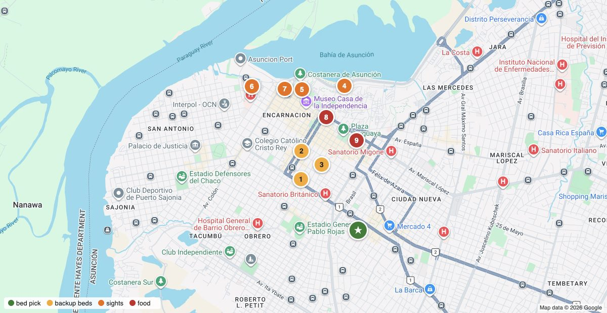
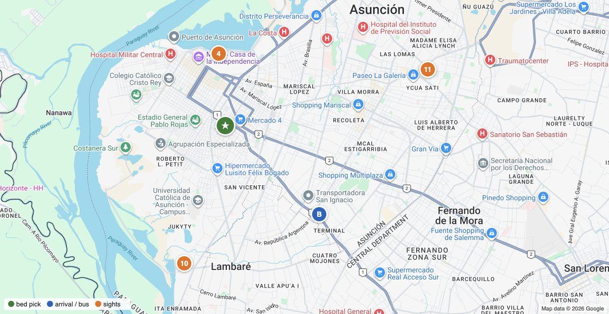

# 🇵🇾 Asunción

Part of the [LatAm itinerary](../itinerary.md) · region notes: [Paraguay + Uruguay](paraguay-uruguay.md) · ← [Foz do Iguaçu](foz-do-iguacu.md) · [Encarnación](encarnacion.md) →

> 🔁 **Backup plan:** if Paraguay looks shaky, [Plan B: Florianópolis](florianopolis.md) replaces 21–27 Dec (Asunción + Encarnación) with 4 nights on the island and the EGA bus to Montevideo on Sat 26 Dec. Nothing after 27 Dec changes.

> **Stop 7 · Mon 21 → Wed 23 Dec 2026 · 2 nights** 
> 🏞️ Paraguay's capital on its river bay: a waterfront promenade, a compact old centre and a mural-covered hillside barrio 
> 🛏️ **Hostel Chaton**, a bunk in a mixed dorm, $18 for 2 nights 
> 🚌 **In:** Expresso Nordeste from Foz do Iguaçu, Mon 08:00 · **Out:** La Encarnacena to Encarnación, Wed 08:30

Palacio de López, the presidential palace in the historic centre (seen from outside). Photo: Google Maps.

## 🗺️ Map

**In town:** ★ **[Hostel Chaton](https://www.google.com/maps?ftid=0x945da9f57f875d0f:0x4ebd73cb4218c9a)** (the pick, [book](https://www.booking.com/hotel/py/hostel-chaton-asuncion.html?checkin=2026-12-21&checkout=2026-12-23&group_adults=1&no_rooms=1&group_children=0&selected_currency=USD)) · **1** [El Nómada Hostel](https://www.google.com/maps?ftid=0x945da7fa3281a929:0x4909c50327b99f9) (backup, [book](https://www.booking.com/hotel/py/el-na3mada-hostel.html?checkin=2026-12-21&checkout=2026-12-23&group_adults=1&no_rooms=1&group_children=0&selected_currency=USD)) · **2** [Mediterraneo Hostal](https://www.google.com/maps?ftid=0x945da7c9c3df0df1:0xa4a1dee4eace026f) (backup 2, [book](https://www.booking.com/searchresults.html?ss=Mediterraneo+Hostal+&checkin=2026-12-21&checkout=2026-12-23&group_adults=1&no_rooms=1&selected_currency=USD)) · **3** [Casa Fulgencio](https://www.google.com/maps?ftid=0x945da7001f5317b5:0x1bc7b208e5a76b8c) (private alt, [book](https://www.booking.com/hotel/py/casa-fulgencio.html?checkin=2026-12-21&checkout=2026-12-23&group_adults=1&no_rooms=1&group_children=0&selected_currency=USD)) · **4** [Costanera](https://www.google.com/maps?ftid=0x945da79488bc57e9:0xb222df479a892db) [🚌 29 min (bus 38)](https://www.google.com/maps/dir/?api=1&origin=-25.298965,-57.62778&destination=-25.2768257,-57.6300848&travelmode=transit) · **5** [Palacio de López](https://www.google.com/maps?ftid=0x945da78c93a9ad45:0x98f8ed14fc209ad4) [🚌 20 min (bus 38)](https://www.google.com/maps/dir/?api=1&origin=-25.298965,-57.62778&destination=-25.2773288,-57.6372362&travelmode=transit) · **6** [Loma San Jerónimo](https://www.google.com/maps?ftid=0x945d0820de3262b7:0xc8655038de2d5277) [🚌 20 min (bus 15-2)](https://www.google.com/maps/dir/?api=1&origin=-25.298965,-57.62778&destination=-25.2768913,-57.6457421&travelmode=transit) · **7** [La Recova](https://www.google.com/maps?ftid=0x945da78b08aea531:0xba9eb8b50bb99e0a) [🚌 19 min (bus 15-2)](https://www.google.com/maps/dir/?api=1&origin=-25.298965,-57.62778&destination=-25.2772251,-57.6402304&travelmode=transit) · **8** [Lido Bar](https://www.google.com/maps?ftid=0x945da7f24904311d:0xc2a897ad5f9fec16) [🚌 15 min (bus 15-2)](https://www.google.com/maps/dir/?api=1&origin=-25.298965,-57.62778&destination=-25.281595,-57.633188&travelmode=transit) · **9** [Bar San Roque](https://www.google.com/maps?ftid=0x945da7ef1f23f431:0x454b6a24a0e1608a) [🚌 13 min (bus 15-2)](https://www.google.com/maps/dir/?api=1&origin=-25.298965,-57.62778&destination=-25.2851792,-57.6280459&travelmode=transit)

**Around:** ★ Hostel Chaton · **B** [bus terminal](https://www.google.com/maps?ftid=0x945da8f8d75485bb:0xefde8270335f73f3) · **4** [Costanera](https://www.google.com/maps?ftid=0x0:0xfacc5b63f6036cdd) [🚌 29 min (bus 38)](https://www.google.com/maps/dir/?api=1&origin=-25.298965,-57.62778&destination=-25.2768257,-57.6300848&travelmode=transit) · **10** [Cerro Lambaré](https://www.google.com/maps?ftid=0x945da82afa638381:0x58a16906ab135ac1) [🚌 45 min (bus 23)](https://www.google.com/maps/dir/?api=1&origin=-25.298965,-57.62778&destination=-25.3411203,-57.6417798&travelmode=transit) (≈ 7 km south) · **11** [Museo del Barro](https://www.google.com/maps?ftid=0x945da8076e69de45:0x92fed8adc6649d6f) [🚌 36 min (bus 101 + bus 30-4)](https://www.google.com/maps/dir/?api=1&origin=-25.298965,-57.62778&destination=-25.281595,-57.559273&travelmode=transit) (≈ 7 km east)

🧭 The time after each place is from the ★ bed (Google Maps, 26 Nov): 🚶 walk · 🚌 bus · 🚕 taxi · 🚗 by road (tour or bus). Click it for the route.

**Open the live map:** [town](https://www.google.com/maps/@-25.2860,-57.6360,15z) · [area](https://www.google.com/maps/@-25.3050,-57.6050,13z)

## 📅 Day by day

| Day | Plan |
|---|---|
| **Mon 21 Dec** | 🚌 08:00 Expresso Nordeste from Foz, arriving ≈ 15:00. Bus 88 to the hostel (18 min). Sunset on the **Costanera**. |
| **Tue 22 Dec** | A normal working day, ≈ 34 °C, so walk early and late. 🏛️ **Historic-centre walk** and **Loma San Jerónimo** in the morning. Midday: lunch at **Lido Bar**. From 14:00: the **Museo del Barro** (✅ opens Tue 14:00–20:00, PYG 50,000). Late afternoon: **Cerro Lambaré** viewpoint, back before dark. |
| **Wed 23 Dec** | 🚌 **08:30 La Encarnacena** to Encarnación (see the [Encarnación guide](encarnacion.md)). |

## 🔖 Book (one click)

Dates and 1 adult are pre-filled. The first channel listed was the cheapest when checked on 24 Nov. ⚠️ = time-sensitive.

**Beds** (21 → 23 Dec, 2 nights)

| | Where | Total | Location | From the bus terminal | Book |
|---|---|---:|:---:|---|---|
| ⭐ **Pick** | **Hostel Chaton** · bunk in a mixed dorm | **$18** | 9.5 | 🚌 25 min: walk 6 min → bus 15-4 → walk 3 min (taxi ≈ 18 min; walk 1 h 9 min); centre (Plaza Uruguaya) 28 min on foot · [route](https://www.google.com/maps/dir/?api=1&origin=-25.3259752,-57.5959871&destination=-25.298998,-57.62781&travelmode=transit) | [Booking](https://www.booking.com/hotel/py/hostel-chaton-asuncion.html?checkin=2026-12-21&checkout=2026-12-23&group_adults=1&no_rooms=1&group_children=0&selected_currency=USD) |
| Backup | **El Nómada Hostel** · bed in a 9-bed mixed dorm | $22 | ⚠️ 8.9 | 🚌 30 min: walk 6 min → bus 38 → walk 3 min (taxi ≈ 21 min; walk 1 h 26 min); centre (Plaza Uruguaya) 16 min on foot · [route](https://www.google.com/maps/dir/?api=1&origin=-25.3259752,-57.5959871&destination=-25.2911507,-57.637488299999994&travelmode=transit) | [Booking](https://www.booking.com/hotel/py/el-na3mada-hostel.html?checkin=2026-12-21&checkout=2026-12-23&group_adults=1&no_rooms=1&group_children=0&selected_currency=USD) · [Agoda](https://www.agoda.com/partners/partnersearch.aspx?hid=557010&checkin=2026-12-21&checkout=2026-12-23&NumberofAdults=1&Rooms=1) |
| Backup 2 | **Mediterraneo Hostal** · bed in the male dorm | $18 | 9.0 | 🚌 31 min: walk 6 min → bus 38 (taxi ≈ 23 min; walk 1 h 35 min); centre (Plaza Uruguaya) 15 min on foot · [route](https://www.google.com/maps/dir/?api=1&origin=-25.3259752,-57.5959871&destination=-25.2867708,-57.6373404&travelmode=transit) | [Booking (search)](https://www.booking.com/searchresults.html?ss=Mediterraneo+Hostal+&checkin=2026-12-21&checkout=2026-12-23&group_adults=1&no_rooms=1&selected_currency=USD) · [Hostelworld](https://www.hostelworld.com/hostels/p/326334/mediterraneo-hostal/?from=2026-12-21&to=2026-12-23&guests=1) |
| Private alt | **Casa Fulgencio** · studio with its own kitchen | $61 | 9.2 | 🚌 29 min: walk 6 min → bus 38 → walk 3 min (taxi ≈ 22 min; walk 1 h 28 min); centre (Plaza Uruguaya) 8 min on foot · [route](https://www.google.com/maps/dir/?api=1&origin=-25.3259752,-57.5959871&destination=-25.288899299999997,-57.633950999999996&travelmode=transit) | [Booking](https://www.booking.com/hotel/py/casa-fulgencio.html?checkin=2026-12-21&checkout=2026-12-23&group_adults=1&no_rooms=1&group_children=0&selected_currency=USD) |

**Transport**

| | Leg | When | Price | Book |
|---|---|---|---:|---|
| In | **Expresso Nordeste** · Foz Rodoviária Internacional → Asunción terminal, semi-leito | **Mon 21 Dec 08:00 → 15:00** (28 seats left) | **R$ 114.99 ($19.30)** | [ClickBus](https://www.clickbus.com.br/onibus/foz-do-iguacu-pr/assuncao-py?departureDate=2026-12-21) |
| In, alt | **NSA** · Foz → Asunción | Mon 21 Dec 10:00 → 17:00 | Gs 200,000 ($31.50) | nsa.com.py |
| Out | **La Encarnacena** · Asunción → Encarnación | **Wed 23 Dec 08:30** (or 12:00) → ≈ 14:00 | ≈ $19 | [La Encarnacena](https://compraonline.sittnet.net/py/5596/) |

How to read these tables

- **Location** is the guests' location score on Booking.com. The target is 9.0 or higher, and ⚠️ marks one below 9.0. *(HW)* means Hostelworld's location rating, used where a property isn't on Booking.
- **From the bus terminal** comes from Google Maps on 24 Nov: the property found on Maps and routed from where you arrive at midday on the check-in date. The **route** link opens the same route.
- Symbols: 🚶 walk · 🚌 public transport · 🚕 taxi/rideshare · 🥾 hike only · ⚠️ far from the centre with no bus · ℹ️ outside the centre but on a bus line.

## 🚌 Getting here: Foz do Iguaçu → (Ciudad del Este) → Asunción, Mon 21 Dec

**(a) Direct bus, the simplest:**
- **Pick: Expresso Nordeste 08:00 Foz Rodoviária Internacional → Asunción terminal 15:00**, semi-leito, **R$ 114.99 ($19.30)**, 28 seats left. ✅ ClickBus (Nordeste's own web shop runs on ClickBus).
- Take an Uber to the rodoviária at ≈ 07:15 (≈ 6 km).
- **Alternative: NSA 10:00 → 17:00**, **Gs 200,000 ($31.50)**. ✅ nsa.com.py's own booking API.

**(b) Do it yourself via Ciudad del Este:**
1. Take a city bus or Uber to the **Ponte da Amizade** and get the **Brazil exit stamp** (Polícia Federal) at the Brazilian end.
2. Walk across (≈ 550 m) and get the **Paraguay entry stamp** at Migraciones in Ciudad del Este.
3. Take a taxi to the CDE bus terminal. **NSA to Asunción** ✅ nsa.com.py: 07:30, 09:40, 14:00 and 16:00 (plus through-buses at 11:40 and 18:30), **Gs 135,000–170,000 ($21–27)**, 5–5 h 30.

**Stamps and entry:**
- Get **both** stamps whichever way you go. Direct buses normally stop for them, but tell the driver you need them ≈. LP agrees: locals don't need to stop, so buses may roll through, and with no entry stamp you can be fined when you leave (LP). Paraguay charges nothing at its land borders (LP).
- **On a US passport, no visa is needed for up to 90 days** (Ley 7314/2024, valid to 13 Aug 2027). ✅ migraciones.gov.py. (LP still says Americans need a visa; that's out of date.)
- Monday 21 Dec is the last shopping Monday before Christmas, so expect heavy traffic on the bridge; walking across is faster ≈.

**Arriving:**
- You arrive at the **Terminal de Ómnibus de Asunción** (Av. Fernando de la Mora × Av. República Argentina), about 5 km south-east of the centre.
- **Bolt or Uber** to the centre ≈ PYG 35–50k ($6–8). The terminal taxis charge a flat ≈ PYG 100k ($16, Wikivoyage 2023).
- City buses 8 and 36 also go there; bus 88 runs to the pick (see the table).

## 🛏️ Where to sleep

**Live-checked 25 Nov, chosen for location.**

### ⭐ Pick: Hostel Chaton
- **Unit:** a bunk in a mixed dorm.
- **Price:** **$18 for 2 nights on Booking** (free cancellation to 21 Dec, pay at the property). Not on Hostelworld.
- **Reviews:** Booking **9.2 (53 reviews; 2% below 7)**, **location 9.5**.
- **Where:** ≈ 2 km south-east of Plaza Uruguaya (28 min on foot, or a short bus or ride).
- ✅ "Great kitchen", big dorm, garden and terrace, AC.
- Small and calm, with long-stay guests; no party mentions.
- ⚠️ About six people share one bathroom; Wi-Fi scores only 7.5.
- Guests rate its location higher than El Nómada's, even though El Nómada is nearer the old town.

### Backup: El Nómada Hostel
- ⚠️ **Location 8.9.** It was the pick until 25 Nov.
- Bed in a 9-bed mixed dorm. **$22 for 2 nights on Booking** (HW $23.10, Agoda $24.20; the 4-bed dorm is $28 on Booking).
- Booking 9.0 (740; 1% below 7), HW 87 (863).
- Iturbe 1156, 1.0 km from Plaza de los Héroes, 5 km from the bus terminal.
- Dorm beds have curtains (property text). Stove kitchen.
- A review calls it "very chilled, lots of long-termers, don't expect a party".
- ⚠ It has a small garden plunge pool, but no pool parties. One review mentions 3-tier bunks in the 9-bed dorm, so ask for a low bunk.

### Backup 2: Mediterraneo Hostal
- **Location 9.0.** Bed in the **male** dorm (double-width beds with wooden partitions and curtains).
- **$18 for 2 nights on Booking** (Agoda $23.10, HW $32).
- Booking 8.3 (534; 4% below 7), HW 88 (73).
- 0.6 km from Plaza de los Héroes, in the historic centre.
- Stove kitchen, rooftop terrace; reviews say "quiet, no party hostel".
- ⚠ One 2026 review reports bed bugs in the male dorm, so read the newest reviews before booking.

### Private alt (location first): Casa Fulgencio
- Studio with its own kitchen. **$61 for 2 nights** on Booking (room table).
- Booking **location 9.2** (9.3; 32 reviews; 3% below 7).
- 0.75 km from the plaza.
- **Cheaper:** Panambi, a triple room for 1, location 9.2 (8.7 from 131 reviews), **$40** on Booking ($48.40 on Agoda).

## 🌳 Things to do (free and outdoors first)

<table>
<tr>
<td width="50%" valign="top"> <b><a href="https://www.google.com/maps?ftid=0x945da79488bc57e9:0xb222df479a892db">Costanera de Asunción</a></b> · free · <a href="https://www.google.com/maps/dir/?api=1&origin=-25.298965,-57.62778&destination=-25.2768257,-57.6300848&travelmode=transit">🚌 29 min (bus 38)</a> A 3 km riverside promenade along the bay. Go at sunset.</td>
<td width="50%" valign="top"> <b><a href="https://www.google.com/maps?ftid=0x945d0820de3262b7:0xc8655038de2d5277">Loma San Jerónimo</a></b> · free · <a href="https://www.google.com/maps/dir/?api=1&origin=-25.298965,-57.62778&destination=-25.2768913,-57.6457421&travelmode=transit">🚌 20 min (bus 15-2)</a> A colourful hillside barrio with stairways and murals. Go in daylight.</td>
</tr>
<tr>
<td width="50%" valign="top"> <b>Historic-centre walk</b> · all free Palacio de López (outside), La Recova, Plaza de los Héroes, the <a href="https://www.google.com/maps?ftid=0x945da78ca5d8d10f:0x2ba5850d31bdc598">Manzana de la Rivera</a> (pictured; free entry (LP)) and Casa de la Independencia.</td>
<td width="50%" valign="top"> <b><a href="https://www.google.com/maps?ftid=0x945da78b08aea531:0xba9eb8b50bb99e0a">La Recova</a></b> · free to browse · <a href="https://www.google.com/maps/dir/?api=1&origin=-25.298965,-57.62778&destination=-25.2772251,-57.6402304&travelmode=transit">🚌 19 min (bus 15-2)</a> The craft arcade on the historic-centre walk.</td>
</tr>
<tr>
<td width="50%" valign="top"> <b><a href="https://www.google.com/maps?ftid=0x945da82afa638381:0x58a16906ab135ac1">Cerro Lambaré</a></b> · free · Bolt ≈ $4 · <a href="https://www.google.com/maps/dir/?api=1&origin=-25.298965,-57.62778&destination=-25.3411203,-57.6417798&travelmode=transit">🚌 45 min (bus 23)</a> A viewpoint over the river, 7 km south.</td>
<td width="50%" valign="top"> <b><a href="https://www.google.com/maps?ftid=0x945da8076e69de45:0x92fed8adc6649d6f">Museo del Barro</a></b> · PYG 50,000 ≈ $7.90 ✅ · paid, only if unique · <a href="https://www.google.com/maps/dir/?api=1&origin=-25.298965,-57.62778&destination=-25.281595,-57.559273&travelmode=transit">🚌 36 min (bus 101 + bus 30-4)</a> Paraguay's best indigenous and folk-art collection. ✅ museodelbarro.org: Tue–Thu 14:00–20:00 (paid); Fri–Sat 14:00–20:00 free; closed Sun–Mon.</td>
</tr>
</table>

**Historic-centre walk (all free):**
- [Palacio de López](https://www.google.com/maps?ftid=0x945da78c93a9ad45:0x98f8ed14fc209ad4), from outside (closed to visitors). The best photo is from the river side (LP).
- [La Recova](https://www.google.com/maps?ftid=0x945da78b08aea531:0xba9eb8b50bb99e0a) craft arcade.
- [Plaza de los Héroes](https://www.google.com/maps?ftid=0x945da7f236ab19a9:0x8fe4792a6ff9f0c0), with the **Panteón de los Héroes**, the national heroes' mausoleum: free, ≈ 06:00–18:30 Mon–Sat, with a changing of the guard (LP). A craft market on the plaza sells *ao po'i* cotton and indigenous crafts (LP).
- The [Manzana de la Rivera](https://www.google.com/maps?ftid=0x945da78ca5d8d10f:0x2ba5850d31bdc598): nine restored houses opposite the palace; the oldest, Casa Viola (1750), holds a free museum of the city's history. ≈ 07:00–21:00 (LP).
- [Casa de la Independencia](https://www.google.com/maps?ftid=0x945da7f30fc572ab:0x7fd4b0b8abaed399): the 1772 house where the 1811 independence was plotted, with period rooms. Free, ≈ Mon–Fri 08:00–18:00 (LP).
- **Cabildo** on Plaza de Armas: the pink colonial council house, now a cultural centre with free exhibitions. ≈ Tue–Fri 09:00–19:00 (LP).
- **Estación Ferrocarril** on Plaza Uruguaya: the old station of South America's first railway line (to Encarnación), with an early locomotive on show. Free, ≈ Mon–Fri 07:00–17:00 (LP).

**More, from Lonely Planet (not live-checked):**
- 🌳 **Jardín Botánico**: the López family's old estate ≈ 6 km out along Av Artigas, with woods, a small nature reserve and the two López houses. Free on foot, ≈ 07:00–19:00; buses 24 or 35 from Cerro Corá (LP).
- 🛒 **Mercado Cuatro**: a sprawling, lively market where Av Francia meets Av Pettirossi, selling everything from produce to cheap imports. Free to browse (LP); mind your bag.
- **Cementerio de la Recoleta**, 3 km east on Av Mariscal López: a maze of grand family mausoleums. Free (LP).
- The **Senatur tourist office** (Palma 468, ≈ 07:00–19:00) has free information and a ground-floor display of crafts from around the country (LP).
- **Conmebol's football museum** is in Luque on the airport road, Mon–Fri ≈ 09:00–12:00 and 15:00–18:00 (LP). Out of the way for this trip.
- With a spare day: of the "Circuito de Oro" villages LP lists, the one that isn't about a church is **Areguá**: colonial lanes and ceramics stalls above Lago Ypacaraí, 27 km away, with La Aregueña buses every ≈ 30 min from outside the bus terminal (LP).

## 🍽️ Eat and drink

<table>
<tr>
<td width="50%" valign="top"> <b><a href="https://www.google.com/maps?ftid=0x945da7f24904311d:0xc2a897ad5f9fec16">Lido Bar</a></b> · ≈ PYG 25–45k ($4–7) ≈ · <a href="https://www.google.com/maps/dir/?api=1&origin=-25.298965,-57.62778&destination=-25.281595,-57.633188&travelmode=transit">🚌 15 min (bus 15-2)</a> An institution facing the Panteón: sopa paraguaya, chipa guasu, pira caldo.</td>
<td width="50%" valign="top"> <b><a href="https://www.google.com/maps?ftid=0x945da7ef1f23f431:0x454b6a24a0e1608a">Bar San Roque</a></b> · mains ≈ PYG 50–80k ($8–13) ≈ · <a href="https://www.google.com/maps/dir/?api=1&origin=-25.298965,-57.62778&destination=-25.2851792,-57.6280459&travelmode=transit">🚌 13 min (bus 15-2)</a> Paraguayan home cooking since 1900.</td>
</tr>
<tr>
<td width="50%" valign="top"> <b>Chipa guasu</b> · at Lido Bar One of Lido Bar's Paraguayan classics, with sopa paraguaya and pira caldo. Generic photo.</td>
<td width="50%" valign="top"> <b>Chipa</b> · ≈ PYG 3–5k ($0.50–0.80) ≈ From any street stall.</td>
</tr>
</table>

- **Cheapest eats (LP):** *asadito* street stalls (small beef skewers with mandioca, a few thousand PYG), and the many simple Paraguayan places along **Av Figueroa ("La Quinta Avenida")**, south of the centre.
- **Lido Bar:** LP says to come for the setting opposite the Panteón more than for the food (LP).
- **Bellini** (Palma near 15 de Agosto): pick your ingredients and watch your fresh pasta cooked; ≈ PYG 35–45k in LP (LP).
- **Confitería Bolsi** (Estrella 399): open 24 h, running since 1960; LP suggests the surubí river fish (LP).
- **Bar San Roque:** ≈ Mon–Sat 08:00–15:00 and 18:00–24:00, Sun lunch only (LP).
- ⚠️ Many restaurants close on **Mondays** (LP), so check before walking out on Mon 21.

**Craft beer:** the **Sajonia Brewing Company** taproom ≈ (lead, not checked). LP's picks are **Palo Santo Brewing Co.** (Del Maestro, Tue–Sun ≈ 17:00–01:00) and **Sacramento Brewing Co.** (Av Santísimo Sacramento 655, draught only, Tue–Sun ≈ 18:00–01:00), both in the eastern suburbs, so Tue 22 evening, not Mon 21 (LP; check they're still open). Bars and clubs often charge men at the door after 22:00 (LP).

## ℹ️ Good to know
- **21–22 Dec are normal working days.**
- **It's hot:** expect about 34 °C, so walk early and late.
- **Safety:** the centre empties after dark, and the riverside **Chacarita** slum is off limits.
  - LP rates Paraguay among the continent's safest countries, but names the **Costanera** as the exception in Asunción (occasional robberies): enjoy the sunset, then leave as it gets dark (LP).
  - Plaza Uruguaya and the streets around Palma have sex workers after dark, and the bus terminal is the place to watch your bag (LP).
- **Getting around:** Bolt and Uber work.
  - Taxis are metered, with a 30% surcharge 22:00–05:00 and on Sundays and holidays; few city buses run after 22:00 (LP).
- **Money:** ATMs are everywhere (≈ $4–5 fee per withdrawal); cards are widely taken.
  - LP puts the ATM fee at ≈ PYG 25,000 and the usual daily limit at ≈ PYG 1.5 million. The casas de cambio on Palma pay better than the street changers shouting "cambio"; the terminal also has ATMs and changers (LP).
  - Keep small notes, and spend or change your guaraníes before leaving Paraguay (LP).
- **Long-distance bus tickets** are sold at the company offices upstairs (2nd floor) in the terminal; ignore the touts shouting destinations (LP). Drivers run the air-con hard, so carry a warm layer on board (LP).
- **Health:** tap water is fine in the cities; dengue has occasional outbreaks, but there's no malaria (LP).
- No parkrun in Paraguay or Uruguay.

## 🚌 Leaving: Asunción → Encarnación, Wed 23 Dec

- **La Encarnacena direct bus at 08:30** (or 12:00) from the Asunción terminal, arriving ≈ 14:00, ≈ $19.
- Full details (windows, online shop, NSA's night bus) are in the [Encarnación guide](encarnacion.md).

---
Photos: Google Maps contributors (Palacio de López, Costanera, Loma San Jerónimo, Manzana de la Rivera, La Recova, Cerro Lambaré, Museo del Barro, Lido Bar, Bar San Roque). Wikimedia Commons: <a href="https://commons.wikimedia.org/wiki/File:Paraguayan_chipa_guaz%C3%BA.jpg">Chipa guasu</a> (Amambay T, CC BY-SA 4.0), <a href="https://commons.wikimedia.org/wiki/File:Chipa_Paraguay.jpg">Chipa</a> (Ekem, CC BY-SA 3.0).
