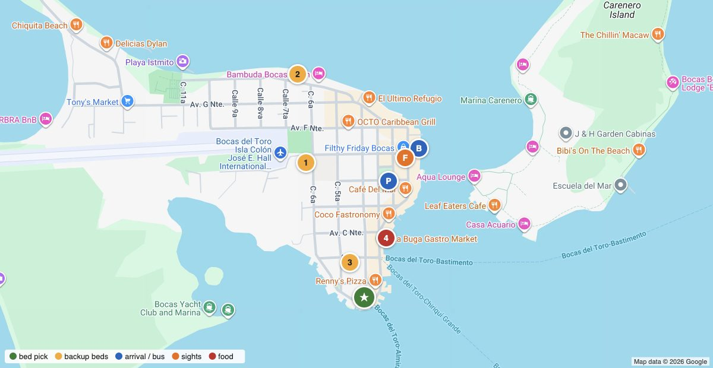
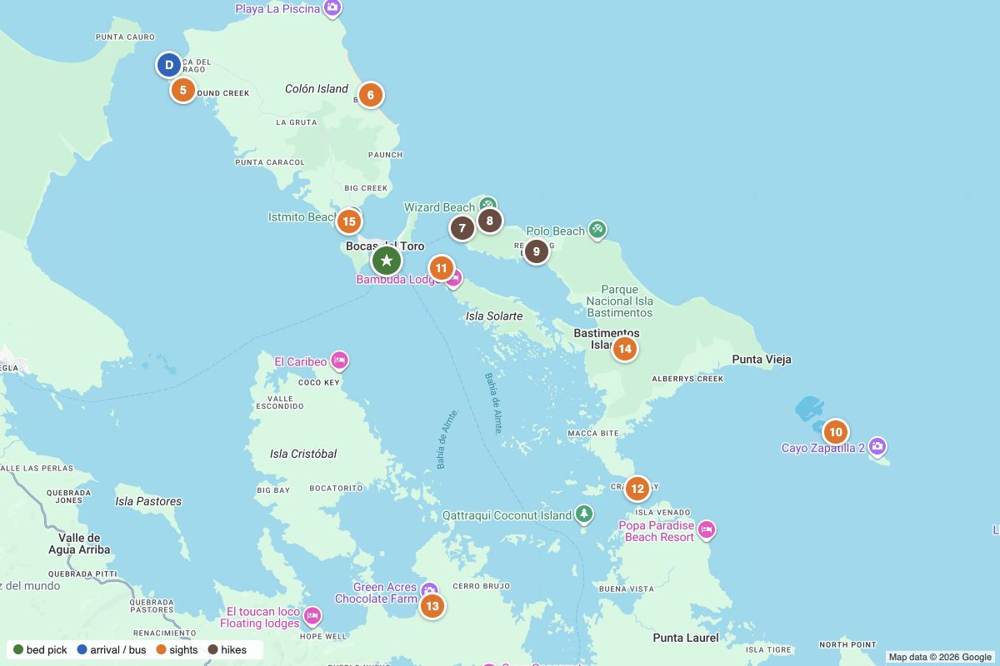

# 🇵🇦 Bocas del Toro (Chirripó fallback)

Part of the [LatAm itinerary](../itinerary.md) · region notes: [Peru + Panama](peru-panama.md) · ← [Boquete](boquete.md) · [Uvita](uvita.md) →

> **Optional · Chirripó fallback · Day 67 → 70 · 3 nights**, then one long day to Uvita (Uvita gains a night: Day 70 → 73) 
> 🏝️ Caribbean archipelago of stilt-house towns, jungle islands and reefs: Starfish Beach, the Bastimentos jungle walk, poison frogs in a different colour on each island, and the Zapatilla Cays, with **Filthy Friday** on arrival day 
> 🛏️ **Spanish by the Sea**, bed in a 3–4-bed mixed dorm (fan), **$53.46 for 3 nights** on Booking (✅ 27 Nov, incl. 10% tax; free cancellation, pay at the hostel) 
> 🚐 **In:** Hello Travel shuttle Boquete 08:00 → Bocas Town ≈ 12:30, Day 67 · **Out:** 06:00 water taxi → Almirante → David → Paso Canoas → ✅ Tracopa 13:20 → Uvita 16:30, Day 70

Playa Estrella (Starfish Beach) on Isla Colón, the free day out by bus. Photo: Google Maps.

> **Plan A vs Plan B**
> - **Plan A, San Gerardo + Chirripó (Day 67 → 71):** the 3,820 m summit and a night at Base Crestones. ⚠️ SINAC showed **0 overnight permits for every February night** on 27 Nov.
> - **Plan B, Bocas (this guide):** you **lose** Costa Rica's highest peak and the páramo, and a cool mountain stay. You **gain** the trip's only Caribbean stop: Filthy Friday, reef snorkelling at the Zapatilla Cays, the jungle walk to Wizard and Red Frog beaches, poison-dart frogs, and an extra night in dry-season Uvita (whale's tail at low tide, Nauyaca). It's cheaper: ≈ $250 (beds, shuttle, Filthy Friday, the Zapatilla tour and park fee, boats, the long day to Uvita and Uvita's extra night) against ≈ $310 for Plan A (Casa Colibri with tax, Crestones bed and meals, the permit and buses). Bocas is wetter: rain on most early-February days, mostly light.
> - **Decide by Day 54** (see [the decision rule](#-decision-rule-and-hedge)).

## 🗺️ Map

**In town:** ★ **[Spanish by the Sea](https://www.google.com/maps?ftid=0x8fa61daf28f9d5af:0x6e10df1154c64fe9)** (the pick, [book](https://www.booking.com/hotel/pa/spanish-by-the-sea-bocas.html?checkin=2027-02-12&checkout=2027-02-15&group_adults=1&no_rooms=1&group_children=0&selected_currency=USD)) · **B** [Taxi 25 dock (Transporte Marítimo Valencia)](https://www.google.com/maps?ftid=0x8fa61dbcd99ae6e9:0x53c97ab36ec1d60b), where the Almirante boats and the Boquete shuttle land, [🚶 9 min](https://www.google.com/maps/dir/?api=1&origin=9.3357221,-82.2413338&destination=9.3410457,-82.2393585&travelmode=walking) · **F** [Filthy Friday HQ](https://www.google.com/maps?ftid=0x8fa61df84862ffbf:0x4a32a6933520bc46) (check-in), next to the dock · **P** [Parque Simón Bolívar](https://www.google.com/maps?ftid=0x8fa61dbcec67e571:0x82784289b6053880), the Boca del Drago and Bluff buses, [🚶 8 min](https://www.google.com/maps/dir/?api=1&origin=9.3357221,-82.2413338&destination=9.3398755,-82.2404635&travelmode=walking) · **1** [Cataleya Hostel](https://www.google.com/maps/search/?api=1&query=9.3405266,-82.2434441) (budget backup, [book](https://www.hostelworld.com/hostels/p/305822/cataleya-hostel/?from=2027-02-12&to=2027-02-15&guests=1)) · **2** [Hostal On The Sea](https://www.google.com/maps/search/?api=1&query=9.343685,-82.2437422) (homestay backup, [book](https://www.booking.com/hotel/pa/pencas-beach-resort-bocas-town.html?checkin=2027-02-12&checkout=2027-02-15&group_adults=1&no_rooms=1&group_children=0&selected_currency=USD)) · **3** [Surfari Bocas](https://www.google.com/maps/search/?api=1&query=9.3369727,-82.2418446) (en-suite private, [book](https://www.booking.com/hotel/pa/surfari-bocas-b-amp-b.html?checkin=2027-02-12&checkout=2027-02-15&group_adults=1&no_rooms=1&group_children=0&selected_currency=USD)) · **4** [Supermercado Bocas](https://www.google.com/maps/search/?api=1&query=9.3378362,-82.2405395) for cooking, 🚶 ≈ 3 min

**Around:** ★ Bocas Town · **D** [Boca del Drago](https://www.google.com/maps?ftid=0x8fa6191da2d4a98f:0x8c95896767529f7) 🚌 ≈ 40 min (13 km) · **5** [Starfish Beach](https://www.google.com/maps?ftid=0x8fa61917926da04d:0x8556d422e352436f) 🚶 15–20 min beyond D · **6** [Bluff Beach](https://www.google.com/maps?ftid=0x8fa61e50095c65d3:0x978c5d6f56600254) 🚌 ≈ 45 min (7.5 km) · **7** [Old Bank, Bastimentos](https://www.google.com/maps?ftid=0x8fa8a760a8fe1571:0x8edf6a610722c88d) ⛵ ≈ 10 min (3.7 km) · **8** [Wizard Beach](https://www.google.com/maps?ftid=0x8fa8a7416853f8ab:0x5a5e12d2123f56da) 🥾 30–60 min from 7 · **9** [Red Frog Beach](https://www.google.com/maps?ftid=0x8fa8a7026175854b:0xa2ceb9cb11c06314) 🥾 ≈ 20 min from 8 · **10** [Cayos Zapatilla](https://www.google.com/maps?ftid=0x8fa8afee5ea5228f:0x272f0e45ce2fe52c) ⛵ (22 km) · **11** [Hospital Point](https://www.google.com/maps?ftid=0x8fa61d8169dbaf49:0x5a949b43675963fd), Solarte ⛵ (2.5 km) · **12** [Coral Cay](https://www.google.com/maps/search/?api=1&query=9.2429928,-82.1380431) ⛵ (15 km) · **13** [Green Acres chocolate farm](https://www.google.com/maps?ftid=0x8fa602027b2179b9:0xf3ac87b3c98bd4d5) ⛵ (16 km) · **14** [Nivida bat cave](https://www.google.com/maps?ftid=0x8fa8a74853f474e9:0x98539c7af7f95e66) ⛵ + 🥾 (11.5 km) · **15** [Smithsonian research station](https://www.google.com/maps?ftid=0x8fa61dcae12e0e39:0xfaf6a437ad5ef48) [🚶 41 min](https://www.google.com/maps/dir/?api=1&origin=9.3357221,-82.2413338&destination=9.3518726,-82.256763&travelmode=walking) · off the map, ⛵ ≈ 30 min west: [Almirante's Taxi 25 dock](https://www.google.com/maps?ftid=0x8fa6101b6f6800a7:0x80b1354eeba6e6cd) (18 km)

🧭 Walks are Google Maps routes from the ★ bed (27 Nov); bus and boat times are leads (≈), and the figures in brackets are straight-line distances: 🚶 walk · 🚌 bus · ⛵ boat · 🥾 hike.

**Open the live map:** [town](https://www.google.com/maps/@9.339,-82.241,16z) · [archipelago](https://www.google.com/maps/@9.31,-82.19,11z)

## 📅 Day by day

| Day | Plan |
|---|---|
| **Day 67** · Fri | 🚐 **08:00** Hello Travel shuttle from your Boquete hostel (via the Caldera–Gualaca shortcut, then the water taxi), Bocas Town ≈ **12:30**. Check in at Spanish by the Sea (9 min walk from the dock). 🎉 **Filthy Friday** if you want it (see below). |
| **Day 68** · Sat | 🥾 **Bastimentos**: water taxi to Old Bank, then the jungle path to **Wizard Beach** and along the coast to **Red Frog Beach** (look for the orange-red poison frogs), boat back from the Red Frog dock. Recover from Friday. |
| **Day 69** · Sun | 🐠 **Zapatilla Cays** boat tour (Dolphin Bay, Coral Cay, Zapatilla), or the free day: the **Boca del Drago bus** to **Starfish Beach**. Swap with Day 68 on the sunnier day. Pack for the 06:00 start. |
| **Day 70** · Mon | 🚌 **06:00** water taxi → Almirante → bus to David → Frontera bus → **Paso Canoas border** → ✅ **Tracopa 13:20 → Uvita 16:30** (CR time). Night 1 of 3 in [Uvita](uvita.md). |

## 🔖 Book (one click)

Dates and 1 adult are pre-filled. Prices for **Day 67 → 70 (3 nights)** were read on 27 Nov; Booking shows them before Panama's **10% lodging tax**, which is added below. ⚠️ = time-sensitive.

**Beds** (Day 67 → 70, 3 nights)

| | Where | Total, 3 nights | 4 nights (Day 67 → 71) | Location | From the Taxi 25 dock | Book |
|---|---|---:|---:|:---:|---|---|
| ⭐ **Pick** | **Spanish by the Sea** · bed in a 3- or 4-bed mixed dorm (fan) | **$53.46** ✅ 27 Nov ($48.60 Genius + 10% tax; free cancellation, pay at the hostel) · A/C dorm $65.34 · HW $54 | $71.28 | 9.0 | 🚶 9 min (560 m) · [route](https://www.google.com/maps/dir/?api=1&origin=9.3410457,-82.2393585&destination=9.3357221,-82.2413338&travelmode=walking) | [Booking](https://www.booking.com/hotel/pa/spanish-by-the-sea-bocas.html?checkin=2027-02-12&checkout=2027-02-15&group_adults=1&no_rooms=1&group_children=0&selected_currency=USD) · [Hostelworld](https://www.hostelworld.com/hostels/p/43269/spanish-by-the-sea-bocas/?from=2027-02-12&to=2027-02-15&guests=1) |
| Backup (budget) | **Cataleya Hostel** · mixed dorm with A/C | **$30** ✅ 27 Nov (HW $10/night) | $40 | 9.0 *(HW)* | 🚶 6 min (360 m) · [route](https://www.google.com/maps/dir/?api=1&origin=9.3410457,-82.2393585&destination=9.3405266,-82.2434441&travelmode=walking) | [Hostelworld](https://www.hostelworld.com/hostels/p/305822/cataleya-hostel/?from=2027-02-12&to=2027-02-15&guests=1) (not on Booking or Agoda) |
| Backup (homestay) | **Hostal On The Sea** · bed in a 4-bed mixed dorm over the water | $65 ($50 + 10% tax + $10 city tax; free cancellation until Day 64) | $87 | **9.5** | 🚶 8 min (470 m) · [route](https://www.google.com/maps/dir/?api=1&origin=9.3410457,-82.2393585&destination=9.343685,-82.2437422&travelmode=walking) | [Booking](https://www.booking.com/hotel/pa/pencas-beach-resort-bocas-town.html?checkin=2027-02-12&checkout=2027-02-15&group_adults=1&no_rooms=1&group_children=0&selected_currency=USD) |
| Private alt | **Spanish by the Sea** · double room (fan; shared bathroom ≈) | $118.80 ($108 + 10%; free cancellation) | $158.40 | 9.0 | 🚶 9 min | [Booking](https://www.booking.com/hotel/pa/spanish-by-the-sea-bocas.html?checkin=2027-02-12&checkout=2027-02-15&group_adults=1&no_rooms=1&group_children=0&selected_currency=USD) |
| Private, en-suite | **Surfari Bocas** (B&B) · double room, private bathroom, A/C | $178.54 ($162.31 Genius + 10%) | $229 | 9.3 | 🚶 8 min (500 m) · [route](https://www.google.com/maps/dir/?api=1&origin=9.3410457,-82.2393585&destination=9.3369727,-82.2418446&travelmode=walking) | [Booking](https://www.booking.com/hotel/pa/surfari-bocas-b-amp-b.html?checkin=2027-02-12&checkout=2027-02-15&group_adults=1&no_rooms=1&group_children=0&selected_currency=USD) |

**Transport**

| | Leg | When | Price | Book |
|---|---|---|---:|---|
| In | **Hello Travel shuttle** · Boquete hostel → Bocas Town (water taxi included) | **Day 67 08:00–08:30** pickup → ≈ 12:30–13:00 | **$30** ✅ (hellotravelpanama.com, 27 Nov) | [Hello Travel](https://hellotravelpanama.com/daily-shuttles/boquete-to-bocas-del-toro/) · [booking calendar](https://hellotravelpanama.rezdy.com/calendarWidget/39704) (pick the date and 1 adult) |
| Out | Water taxi Bocas → Almirante, bus → David, Frontera bus → Paso Canoas | **Day 70 ≈ 06:00** | ≈ $6 + $8.45 + $3 | cash on the day |
| Out | ✅ **Tracopa** Paso Canoas → Uvita (Costanera) | **13:20 → 16:30** (backups 15:00 → 17:50, 16:40 → 19:57) | ≈ ₡4,000–5,000 | [Tracopa timetable](https://www.tracopacr.com/Rutas_Horarios) · Passer app or the terminal |
| ⚠️ Entry | Bus ticket out of Costa Rica (onward-travel proof), e.g. Tica Bus San José → Managua | before Day 70 | $33 | as in the [San Gerardo guide](san-gerardo-de-rivas.md) |
| Uvita +1 | **Hostel Cascada Verde**, the extra night **Day 70 → 71** (8-bed dorm) | Day 70 | $14.69 ($13 + 13% VAT; free cancellation until Day 68) | [Booking](https://www.booking.com/hotel/cr/cascada-verde-hostel-at-the-waterfall.html?checkin=2027-02-15&checkout=2027-02-16&group_adults=1&no_rooms=1&group_children=0&selected_currency=USD) |

How to read these tables

- **Location** is the guests' location score on Booking.com. The target is 9.0 or higher, and ⚠️ would mark one below 9.0. *(HW)* means Hostelworld's location rating, used where a property isn't on Booking.
- **From the Taxi 25 dock** is the walk from Transporte Marítimo Valencia (Taxi 25), where the Almirante boats and the Hello Travel shuttle land: Google Maps, 27 Nov.
- Symbols: 🚶 walk · 🚌 public transport · 🚕 taxi/rideshare · ⛵ boat · 🥾 hike only.

## 🧭 Which split, and why

| Split | Bocas nights | Day 70 → 71 night | Uvita | Verdict |
|---|:---:|---|---|---|
| **A. Bocas 3, one long day to Uvita on Day 70** | 3 | Uvita (+1 night, $14.69) | Day 70 → 73: arrive 16:30, two full days | ⭐ **Recommended** |
| B. Bocas 3 + David on Day 70 → 71 | 3 | David (Penny House ≈ $14) | Day 71 → 73 as now, from ≈ 11:10 | Fallback only: a night in a dull town |
| C. Bocas 4, long day on Day 71 | 4 | Bocas | Day 71 → 73: arrive 16:30, one full day | No: you lose Uvita's best tide |

**Why A:**
- The one-day chain works: ✅ Tracopa's 13:20 reaches Uvita at 16:30 with two later buses as backups.
- **Uvita's whale's tail needs low tide inside park hours (07:00–16:00).** The best afternoon is **Day 71** (low ≈ 16:25, see the [Uvita guide](uvita.md)); on Day 72 low tide is ≈ 17:15, after the park closes. Split A puts you in Uvita for the whole of Day 71; split C arrives at 16:30 that day and misses it.
- February is **dry season on the Pacific** but rainy on the Caribbean: a third Uvita night is a surer bet than a fourth Bocas night.
- Three Bocas nights still give two full island days (Day 68–69) after Filthy Friday.
- If the forecast for Day 68–69 is bad and you'd rather keep a spare day for the Zapatilla boat, switch to **C** by **Day 68**: add a 4th night at Spanish by the Sea and cancel Cascada Verde's Day 70 → 71 night (free until Day 68 ✅ 27 Nov; after that you lose $14.69). C also lets you catch the Smithsonian's Monday tour.

## 🚐 Getting here: Boquete → Bocas Town, Day 67 (Friday)

- **Recommended: Hello Travel's shared shuttle, $30** ✅ hellotravelpanama.com (27 Nov):
  - pickup at your Boquete hostel **08:00–08:30** (Bajo Boquete, Alto Boquete, Palo Alto, Alto Lino);
  - ≈ 4 h by road over the **Caldera–Gualaca shortcut** (it doesn't go through David), then the included **water taxi** from Almirante, ≈ 30 min;
  - you land at **Transporte Marítimo Valencia (Taxi 25)** in the middle of Bocas Town ≈ **12:30–13:00**;
  - 1 bag up to 23 kg + 1 carry-on; extra bags $7–14.
  - Book on the [Rezdy calendar](https://hellotravelpanama.rezdy.com/calendarWidget/39704): pick the date and 1 adult (the link can't carry a date). Seats for Day 67 couldn't be read from here (the calendar blocks scripts), so check it when you book.
  - Caribe Shuttle doesn't run Boquete → Bocas ✅ (its Bocas routes go to Costa Rica only). Blasina Hostel advertised a $25 shuttle at 08:30, and Pana Bocas Express runs via Chiriquí Grande with a ≈ 1 h boat (≈ Wikivoyage, Nov 2024).
- **Public alternative (≈ $17–20, ≈ 6 h):**

| Step | How | Time (PA) | Cost |
|---|---|---|---|
| Boquete → David terminal | Boquete bus from the park, every 20–30 min from ≈ 05:00 | 05:30 → 06:30 | $1.75–2 |
| David → Almirante | a **Changuinola** bus; ask to get off at Almirante, before the terminal (≈ hourly from ≈ 05:00) | ≈ 07:00 → 11:00 | ≈ $8.45 |
| Almirante bus stop → dock | taxi, or walk 1–1.5 km | | ≈ $1–2 |
| Almirante → Bocas Town | water taxi (Taxi 25 / Valencia, Bocas Marine Tours), every 30–60 min, 06:00–18:00 | ≈ 11:30 → 12:00 | ≈ $6–8 |

  All ≈ (Wikivoyage, panamaspot.com, AI Mode leads; no operator timetable online). It saves ≈ $10 but starts at 05:30 and lands at about the same time as the shuttle, so **take the shuttle**.
- **Filthy Friday on the same day: yes.** Its check-in runs until 15:00 (they ask for 13:00) at the HQ a minute from the Taxi 25 dock where the shuttle lands ≈ 12:30–13:00; the party goes on until 21:00. See [Filthy Friday](#-filthy-friday).

## 🎉 Filthy Friday

Bocas's weekly island-hopping day party: three venues on different islands, with boats between them. **A paid party** (the free alternative is sunset on the town waterfront).

- ✅ **Runs every Friday** ("every Friday since 2017") and **Fri 12 Feb 2027 (Day 67) was open for booking** on filthyfriday.rocks, 27 Nov. Dates do move: 1 Jan 2027 is replaced by Sat 2 Jan, and Carnaval Sunday (7 Feb) has an extra party.
- ✅ **Price:** general admission **from $36.36**, plus fees and tax shown at checkout; "pay later" is offered. **All sales are final and non-refundable**, so buy it only once you've switched to this plan. The FAQ says tickets are limited and sell out; you can also buy at the HQ (Fri 11:00–20:00) while they last. VIP tables from $100.
- ✅ **Included:** entry to the 3 venues, the boats between islands, shots, a tank top, a drawstring bag, temporary tattoos and your first reusable cup. Drinks at the venues: national beer **$3**, mixed drinks **$5**; bag check $1. No outside alcohol (bags are searched).
- ✅ **When and where:** check in at **[Filthy Friday HQ](https://www.google.com/maps?ftid=0x8fa61df84862ffbf:0x4a32a6933520bc46)**, Avenida E, 60 m from the Taxi 25 dock, **11:00–15:00; they ask you to arrive by 13:00**. Doors 12:00, the party ends **21:00**.
- ✅ **18+**, with ID (a photo of your passport on your phone is accepted). Leave the passport at the hostel.
- ≈ **Venues** aren't published. Older reports name Aqua Lounge (Isla Carenero) and Barco Hundido; a Sep 2026 forum post named Klika and Tropical Arts.
- **Day 67 timing:** the shuttle lands at the Taxi 25 dock ≈ 12:30–13:00, a minute from the HQ. Drop your bag at Spanish by the Sea (9 min; check-in from 14:00, ask to leave the bag) and be back at the HQ by ≈ 13:30. Message them that you arrive on the Boquete shuttle.
- [Book GA tickets for Day 67](https://www.filthyfriday.rocks/choose-your-package?product=b5bcec77-eccf-4cc4-9db3-850e1b9610c2&guests=1&startDate=2027-02-12)

## 🌳 Things to do (free and outdoors first)

<table>
<tr>
<td width="50%" valign="top"> <b><a href="https://www.google.com/maps?ftid=0x8fa61917926da04d:0x8556d422e352436f">Starfish Beach (Playa Estrella)</a></b> · free (≈ $5 reported) + bus ≈ $3 · 🚌 ≈ 40 min Calm, clear shallows with orange cushion stars. Bus to Boca del Drago, then a 15–20 min walk along the shore.</td>
<td width="50%" valign="top"> <b><a href="https://www.google.com/maps?ftid=0x8fa8a7416853f8ab:0x5a5e12d2123f56da">Wizard Beach</a> → <a href="https://www.google.com/maps?ftid=0x8fa8a7026175854b:0xa2ceb9cb11c06314">Red Frog Beach</a></b> · free walk (Red Frog ≈ $5) · ⛵ 10 min + 🥾 From Old Bank over the island's jungle spine to a wild surf beach, then along the coast to Red Frog.</td>
</tr>
<tr>
<td width="50%" valign="top"> <b>Poison frogs, Bastimentos morph</b> · free Orange-red with small dark spots, on the Old Bank → Wizard → Red Frog trail. Photo: Isla Bastimentos.</td>
<td width="50%" valign="top"> <b>Poison frogs, Isla Colón morph</b> · free The same species, but green with black spots, in the forest off the Boca del Drago road. Photo: Isla Colón.</td>
</tr>
<tr>
<td width="50%" valign="top"> <b><a href="https://www.google.com/maps?ftid=0x8fa8afee5ea5228f:0x272f0e45ce2fe52c">Cayos Zapatilla</a></b> · tour ≈ $35–50 + $10 park fee · ⛵ ≈ 45 min Two uninhabited cays in the Bastimentos marine park: the archipelago's clearest water and its best snorkelling.</td>
<td width="50%" valign="top"> <b><a href="https://www.google.com/maps?ftid=0x8fa61df84862ffbf:0x4a32a6933520bc46">Filthy Friday</a></b> · from $36.36 · Day 67 The weekly three-island day party (above). Paid; go for the experience, sleep elsewhere.</td>
</tr>
<tr>
<td width="50%" valign="top"> <b><a href="https://www.google.com/maps?ftid=0x8fa61e50095c65d3:0x978c5d6f56600254">Bluff Beach</a></b> · free · 🚌 ≈ 45 min or 🚲 A long, empty surf beach on Isla Colón's east coast. January–March is surf season: watch, don't swim far out.</td>
<td width="50%" valign="top"> <b><a href="https://www.google.com/maps?ftid=0x8fa61dcae12e0e39:0xfaf6a437ad5ef48">Smithsonian research station</a></b> · free tour · 🚶 41 min Mon and Wed 14:30 only, so it misses Day 67 → 70 (it fits on Day 70 if you stay 4 nights).</td>
</tr>
</table>

### Free
- **Starfish Beach (Playa Estrella):** shared buses (colectivos) to **Boca del Drago** leave from **[Parque Simón Bolívar](https://www.google.com/maps?ftid=0x8fa61dbcec67e571:0x82784289b6053880)** (8 min walk from the pick) in daylight, with no fixed timetable (one guide lists ≈ 05:00, 10:00, 12:00, 14:00, 16:00, 18:00), **≈ $2.50–3.50 each way, 30–45 min**. From the Drago dock walk **15–20 min** east along the shore. Several 2026 write-ups mention a **≈ $5 cash** entry fee; the collector isn't confirmed. All ≈. Look at the starfish; don't lift them out of the water. Go early: tour boats arrive late morning.
- **Bastimentos: Old Bank → Wizard Beach → Red Frog Beach:**
  - water taxi from the Bocas Town docks to **[Old Bank](https://www.google.com/maps?ftid=0x8fa8a760a8fe1571:0x8edf6a610722c88d)** ≈ $5 per person shared (≈ $29 private for 1–4);
  - Old Bank → **Wizard Beach**: ≈ 2.6 km, +80 m, 30–60 min over the hill (AllTrails ≈). The path is **deep mud after rain**: wear sandals you can wash, not trainers;
  - Wizard → **Red Frog Beach**: ≈ 20 min along the coast; Red Frog charges **≈ $5** "dock maintenance"/beach access (Bocas Breeze, Oct 2026 ≈);
  - back from the Red Frog marina by water taxi, ≈ $5–10 (≈).
  - Wizard and Red Frog face the open sea, with surf and currents in February; swim only where others do.
- **Poison-dart frogs** (strawberry poison frog, *Oophaga pumilio*): the same species comes in a different colour on almost every island. ✅ Brown, Maan, Cummings & Summers 2010, *Journal of Biogeography* (Table 1):

| Where | Colour | Where to look (free) |
|---|---|---|
| **Bastimentos** | **orange-red, small spots** (≈ a rare yellow form on the NW coast) | the Old Bank → Wizard → Red Frog trail; local kids show them for a tip |
| **Isla Colón** | **green with black spots** | forest edges off the Boca del Drago road |
| Solarte | orange | the island tours stop at Hospital Point, on Solarte, for snorkelling |
| San Cristóbal | red with spots | (≈ "blueberry" blue-legged frogs reported by a photographer) |
| Popa | green | |
| Aguacate peninsula | blue | |
| Almirante | red | |

  Look, don't touch. Paid frog stops (chocolate farms, lodges) aren't needed: the Bastimentos trail is the reliable free one.
- **Bluff Beach and Paunch** (Isla Colón's east coast): free; bus ≈ $3.50 to the end of the road (≈), or rent a bike. Surf season, so rough for swimming.
- **Snorkel from shore (≈):** the shallow reef and mangroves by Old Bank, and the Starfish/Drago shallows. Bring your own mask (La Buga rents gear for $10 ✅).

### Paid, worth it
- **Zapatilla Cays tour (best snorkelling):** ≈ **$35–50** for a ≈ 6-hour boat day: Dolphin Bay (dolphins), Coral Cay (snorkel; lunch $12–18 not included), Zapatilla (beach and reef). ✅ **Park fee $10** for foreign adults (Parque Nacional Marino Isla Bastimentos, MiAmbiente Resolution DM-0173-2026), not included in tours; pay online at [reservasap.miambiente.gob.pa](https://reservasap.miambiente.gob.pa) or as the boat crew says. Operators: [bocastours.com](https://bocastours.com) (from $40, Sun–Fri ≈); GetYourGuide/Viator resell at $50–51. Spanish by the Sea and Cataleya book tours at a hostel discount (reviews). Go on the calmer, sunnier of Day 68–69; the open-sea leg to Zapatilla is cancelled in big swell.
- **The standard island tour** (Dolphin Bay, Coral Cay, Hospital Point, Red Frog) is ≈ $25–45; skip it if you do Zapatilla and the Bastimentos walk.
- **Scuba:** ✅ two-tank fun dive **$95** at [La Buga](https://labugapanama.com/price-list) and Panama Dive School; Bocas Dive Center from $80.25 a dive (its 6-dive pack ≈ $50 a dive). **February visibility:** Bocas Dive Center calls Feb–May the first dry window, with calmer seas and improving visibility (best Sep–Oct) ✅; DiveGrade says 5–10 m and rough seas ≈. **San Blas doesn't allow scuba** ✅ (the Guna Yala statute bans diving with tanks; Mi Diario, 1 Mar 2016, reports a foreigner fined for selling dive courses), so this is the route's only Caribbean dive. Snorkelling at Zapatilla gives most of the reef for less.
- **Sport fishing (lead):** ✅ [sportfishingbocasdeltoro.com](https://sportfishingbocasdeltoro.com) half day (5 h) **$590** per boat, full day $815; a local panga ≈ from $250 a day. No shared trips found.

### Rainy-day options
- **Spanish lessons** at the pick itself (Spanish by the Sea is a school; ask for a drop-in lesson).
- ✅ **Smithsonian (STRI) research station:** free public tours **Mon and Wed 14:30** (≈ 1 h), walk-ins welcome, closed on holidays ([stri.si.edu](https://stri.si.edu)). Not on Day 67–69; on Day 70 only if you stay 4 nights.
- ✅ **[Green Acres chocolate farm](https://www.google.com/maps?ftid=0x8fa602027b2179b9:0xf3ac87b3c98bd4d5)** (by Dolphin Bay): tours 10:00 and 14:00 daily, **$25**, reservation required, plus a boat there.
- ≈ **[Nivida bat cave](https://www.google.com/maps?ftid=0x8fa8a74853f474e9:0x98539c7af7f95e66)** (Bahía Honda, Bastimentos): guided, ≈ $40–45 plus ≈ $8–15 for the cave and gear; you wade through the cave river.
- ≈ Yoga from $5 a class (Roam Yoga).

## 🛏️ Where to sleep

All live-checked on 27 Nov for Day 67 → 70 (and Day 67 → 71). Hostelworld listed **15 Bocas properties** with beds; Booking had 13 hostels at 8.0+.

### ⭐ Pick: Spanish by the Sea
- **Room:** bed in a 3- or 4-bed mixed dorm with fans; or the "Single Bed in 4-Bed Dormitory" with **A/C** for $11.88 more.
- **Price:** **$53.46 for 3 nights on Booking** ($48.60 with Genius + 10% tax; **free cancellation any time, pay at the hostel**) vs **$54 on Hostelworld**. 4 nights $71.28. Pancake-and-fruit breakfast included.
- **Reviews:** Booking **8.2 (695; 16% below 7)**, location **9.0**; Hostelworld **9.4 (193)**.
- **Where:** Calle 4, a block back from the main street; 9 min walk from the Taxi 25 dock, by the supermarkets.
- **Checks (reviews):**
  - **Not a party hostel:** "not a party hostel, but definitely social" (HW, Oct 2025); "quiet during the night", "away from the noisy bars" (Booking, 2024–26). It's a Spanish school, so the crowd skews to students and remote workers.
  - **Kitchen:** stove, fridge, pots and pans (Hostelworld's facility list); "good kitchen" in Nov 2026.
  - ⚠️ **No bed curtains** ("the beds should have curtains", Dec 2024; window curtains "don't stop any light"). Bring an eye mask.
  - ⚠️ **Hot at night** in the fan dorms: pay the $11.88 for the A/C dorm if you sleep badly in heat.

### Backup (budget): Cataleya Hostel
- **Room:** mixed dorm with **A/C** and its own bathroom · **$30 for 3 nights** on Hostelworld (the only channel).
- **Reviews:** Hostelworld **9.4 (350)**, location 9.0. But **16 of the last 68 reviews (24%) score below 7**, mostly in 2024–25 (smell, mould, dirty showers, water cuts); the 2026 reviews are good.
- **Checks:** "officially a non-party hostel"; **kitchen with a stove**; terrace with hammocks. **No bed curtains** (Feb 2024 review). Near the airstrip: daytime plane noise (Mar 2025).
- 6 min walk from the dock, on the road to the airport.

### Backup (homestay): Hostal On The Sea
- Two small 4-bed dorms in **Martha's house over the water** at the north end of town · **$65 for 3 nights** ($50 + 10% tax + $10 city tax; free cancellation until Day 64).
- **Location 9.5**, Booking 8.5 (121; 18 below 7, 15%). Calm and family-like; you hear the waves (bring earplugs). Fans, no A/C; a small shared kitchen. Some guests found the owner's constant presence too much ("more homestay than hostel").

### Private alternatives
- **Spanish by the Sea double** · $118.80 for 3 nights (free cancellation) · same quiet hostel and kitchen; fan; the room list shows no private bathroom.
- **Surfari Bocas** (B&B) · double with private bathroom and A/C · **$178.54** · Booking 8.8 (560; 3% below 7), location 9.3.
- **Cataleya private** (shared bath) · $28/night on Hostelworld.

### Skipped (party or noise)
- **Boca Estrella** ($32 + tax on Booking, location 9.3): music "always really loud", once until 06:00 (Booking and HW reviews, Jul–Nov 2026).
- **Klika** ($16/night): its restaurant "blasts music until past midnight most nights"; no kitchen.
- **Cliff's Hostel** ($49 + tax): "a good stopping spot for a Filthy Friday party", party people coming back at dawn; HW 8.0.
- **Bambuda Bocas Town** ($135 + tax for 3 nights): pool-and-bar hostel. Aqua Lounge and Selina are Bocas's best-known party hostels.
- None of Bocas Town's non-party hostels lists **privacy curtains**; the curtained pods are at Bambuda.

## ℹ️ Good to know

- **Weather (Open-Meteo, 10 years, Days 65–72):** rain (≥ 1 mm) on **79% of days**, but **≥ 10 mm on only 11%**: mean 4.8 mm a day (median 2.3), so mostly short showers. The wettest week (2016) had 102 mm, the driest (2019) 9 mm. Highs 27 °C, lows 23.5 °C. Do the boat day on the first good morning; the north-facing beaches have surf in February, the sheltered bays are calmer.
- **Water taxis** charge per person; agree the fare before you step in (Wikivoyage). Boats to Old Bank and Carenero leave from the docks along Calle 1–3.
- **Cash:** Old Bank, Red Frog, Starfish and the colectivos are cash-only. Get US dollars in Bocas Town before the boat days. The Day 70 chain is cash too (≈ $27–33 in dollars), plus colones or the Passer app for the Tracopa bus.
- **Cooking:** [Supermercado Bocas](https://www.google.com/maps/search/?api=1&query=Supermercado%20Bocas%2C%20Bocas%20del%20Toro) and Super Market Isla Colón are 6–8 min from the pick.
- **Panama's Carnaval** (6–9 Feb 2027) ends three days before you arrive; Day 67 → 70 is an ordinary weekend.
- **Costa Rica is 1 h behind Panama.**

## 🚌 Leaving: Bocas Town → Uvita, Day 70 (Monday), one long day

No shuttle runs Bocas → Uvita or Dominical (Hello Travel and Caribe Shuttle ✅; Interbus doesn't serve Bocas). The public chain works in a day:

| Step | How | Time | Cost |
|---|---|---|---|
| Bocas Town → Almirante | first water taxi (Taxi 25 / Valencia dock), 25–35 min | **06:00** → 06:30 (PA) | ≈ $6–8 |
| Almirante dock → bus | taxi to the bus stop on the main road | | ≈ $1–2 |
| Almirante → David | bus from Changuinola (≈ hourly from ≈ 05:00) | ≈ 07:00 → 11:00 (PA) | ≈ $8.45 |
| David → Paso Canoas | "Frontera" bus, every 10–20 min | ≈ 11:15 → 12:30 (PA) = **11:30 CR** | ≈ $2–3 |
| Border | Panama exit stamp, walk across, Costa Rica entry | ≈ 45–60 min | free (≈ no Panama exit fee) |
| **Paso Canoas → Uvita** | ✅ **Tracopa, Costanera route** | **13:20 → 16:30 (CR)** · backups 15:00 → 17:50, **16:40 → 19:57 (last)** | ≈ ₡4,000–5,000 (≈ $8–10) |

- **Total ≈ $27–33, ≈ 11½ h** (06:00 PA → 16:30 CR; Costa Rica is **1 h behind** Panama).
- ✅ **Tracopa times** come from its own timetable for **Day 70** (and Day 71), read on 27 Nov: Paso Canoas → Uvita departs 04:00, 06:30 (Mondays), 08:30 → 11:10, 09:30, 11:15 → 14:00, **13:20 → 16:30**, 15:00 → 17:50, 16:40 → 19:57. Fare not listed for this pair (≈). Buy in the Passer app or at the Paso Canoas window.
- **Slack:** the 13:20 leaves ≈ 50 min after the earliest realistic border exit; missing it costs 1.5 h (15:00), and the 16:40 still reaches Uvita before 20:00.
- ⚠️ **Costa Rica entry** ✅ visitcostarica.com (Entry requirements): a **pre-purchased ticket out of Costa Rica** (a bus ticket counts, e.g. Tica Bus San José → Managua $33 or Tracopa San José → David $21) and proof of **US$100 per month** of stay. Carry the yellow-fever card (you were in Peru until Day 58).
- **Paso Canoas border hours** ≈ 06:00–22:00 (DGME Facebook, unconfirmed on an official page).

### Fallback: a night in David (Day 70 → 71)
If Day 70 goes wrong (a late boat, a long border queue), sleep at **Penny House** in David (9.4 location, 17 min walk from the terminal; see the [Boquete guide](boquete.md)) and on Day 71 take the ≈ 05:00 Frontera bus → border → ✅ **Tracopa 08:30 → Uvita 11:10**: the same arrival time as the current plan. You can also plan it this way from the start, but you'd trade an Uvita night for a David one.

## ⏳ Decision rule and hedge

- **How permits come back:** SINAC resells a Chirripó overnight place only when its holder cancels **≥ 15 days ahead** (permits can't be moved). So places for the climb night **Day 69 → 70** can reappear until about **Day 54**, and for the Day 68 → 69 fallback until about Day 53. After that, few people cancel.
- **Rule: check SINAC's calendar every few days until Day 54. No overnight permit by the end of Day 54 → switch to Bocas.** A one-day "Diario" permit alone isn't worth keeping San Gerardo for.
- **Book now, all refundable:**
  - Spanish by the Sea, Day 67 → 70, on Booking: **free cancellation any time, pay at the hostel** ✅ 27 Nov.
  - Keep **Casa Colibri** (San Gerardo) too: Booking's current rate shows **free cancellation before Day 64** for Day 67 → 69 and **before Day 67** for Day 70 → 71, pay at the property ✅ 27 Nov. Check the terms on your own booking confirmation.
  - Don't buy the Hello Travel shuttle until you switch; it runs daily.
  - The onward bus ticket out of Costa Rica is needed in either plan.
- **When you switch (by Day 54):**
  1. Cancel both Casa Colibri bookings (free until Day 64 / Day 67).
  2. Book the Hello Travel shuttle for Day 67 and the Filthy Friday ticket.
  3. Add the **Uvita night Day 70 → 71** at Cascada Verde ($14.69; the Day 71 → 73 booking stays as it is).
  4. Boquete's **Out** line changes from the 05:30 David bus to the 08:00 shuttle pickup.
- **If a permit turns up after you switched:** Spanish by the Sea cancels free, and Casa Colibri can be rebooked if it still has beds (3–5 dorm beds were free on 27 Nov).

---
Photos: Google Maps contributors (Starfish Beach ×2, Wizard Beach, Cayos Zapatilla, Filthy Friday, Bluff Beach, the Smithsonian research station). Wikimedia Commons: <a href="https://commons.wikimedia.org/wiki/File:Strawberry_poison-dart_frog_(Oophaga_pumilio_or_Dendrobates_pumilio)_(9429685305).jpg">Strawberry poison-dart frog, Isla Bastimentos</a> (Pavel Kirillov, CC BY-SA 2.0), <a href="https://commons.wikimedia.org/wiki/File:Flickr_-_ggallice_-_Dart_frog.jpg">Dart frog, Isla Colón morph</a> (Geoff Gallice, CC BY 2.0).
