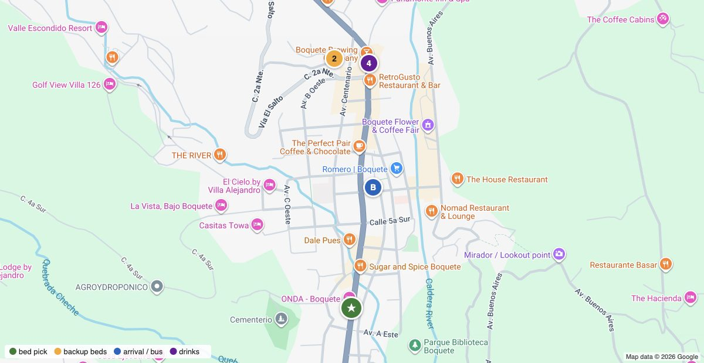
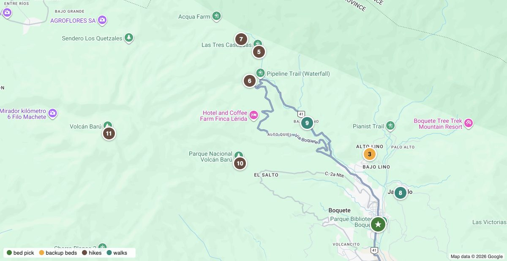

# 🇵🇦 Boquete

Part of the [LatAm itinerary](../itinerary.md) · region notes: [Southern Peru + Panama](peru-panama.md) · ← [San Blas](san-blas.md) · [San Gerardo de Rivas (Chirripó)](san-gerardo-de-rivas.md) →

> **Stop 27 · Day 64 → 67 · 3 nights · 🎭 Carnaval** 
> 🏞️ Cool coffee-country town in the highlands, below Volcán Barú (3,474 m) 
> 🛏️ **ONDA Boquete** ("Socialtel Boquete" on Booking), mixed dorm, $99.76 for 3 nights on Agoda (✅ 27 Nov; Booking $116) 
> ✈️ **In:** Air Panama Albrook → David, Day 64 07:15, then the bus up · **Out:** 🚌 05:30 bus to David and the Costa Rican border, Day 67

Dawn above the clouds from the summit of Volcán Barú, the goal of the Tue–Wed night climb. Photo: Google Maps.

## 🗺️ Map

**In town:** ★ **[ONDA Boquete](https://www.google.com/maps?ftid=0x8fa5edeb0f96a23f:0xae690fb789f58a8)** (the pick, [book](https://www.booking.com/hotel/pa/socialtel-boquete.html?checkin=2027-02-09&checkout=2027-02-12&group_adults=1&no_rooms=1&group_children=0&selected_currency=USD)) · **B** [Parque Domingo Médica](https://www.google.com/maps?ftid=0x8fa5ecd8a998762b:0xad46ee985cc5ba40), the main park and the David-bus stop; **La Casa de Doña Cata** (budget backup) is right on it · **2** [Buena Vista Boquete](https://www.google.com/maps?ftid=0x8fa5ed1470d4ab81:0xe9edd7ce7f0af0c0) (private alt, [book](https://www.booking.com/searchresults.html?ss=Buena+Vista+Boquete+Boquete&checkin=2027-02-09&checkout=2027-02-12&group_adults=1&no_rooms=1&selected_currency=USD)) · **4** [Boquete Brewing Company](https://www.google.com/maps?ftid=0x8fa5ecdf89da0f2f:0x44fb66a6c7e3499c) [🚶 16 min](https://www.google.com/maps/dir/?api=1&origin=8.7720958,-82.4330009&destination=8.7809639,-82.4323627&travelmode=walking)

**Around:** ★ Boquete · **3** [Hostal Casa Pedro](https://www.google.com/maps?ftid=0x8fa5ecff756bfc31:0xdddd8daf3b853772) (value private, 2.8 km out, [book](https://www.booking.com/searchresults.html?ss=Hostal+Casa+Pedro+Boquete&checkin=2027-02-09&checkout=2027-02-12&group_adults=1&no_rooms=1&selected_currency=USD)) · **5** [Lost Waterfalls (Las Tres Cascadas)](https://www.google.com/maps?ftid=0x8fa5ebfbdcff069f:0x97bd578d071faac2) [🚕 ≈ 24 min](https://www.google.com/maps/dir/?api=1&origin=8.7720958,-82.4330009&destination=8.8417664,-82.4813903&travelmode=driving) · **6** [Pipeline Trail](https://www.google.com/maps?ftid=0x8fa5ebf28d7da5fb:0xe313187bea8e01f8) [🚕 ≈ 22 min](https://www.google.com/maps/dir/?api=1&origin=8.7720958,-82.4330009&destination=8.8300076,-82.4851082&travelmode=driving) · **7** [Alto Chiquero ranger post](https://www.google.com/maps?ftid=0x8fa5ebfb1d5e7cb7:0x8897fae8410e15d4) [🚕 ≈ 27 min](https://www.google.com/maps/dir/?api=1&origin=8.7720958,-82.4330009&destination=8.8468593,-82.4886078&travelmode=driving) (Sendero Los Quetzales) · **8** [Jaramillo Arriba](https://www.google.com/maps?ftid=0x8fa5ed0169957e33:0x752dd8ad4b012401) [🚕 ≈ 8 min](https://www.google.com/maps/dir/?api=1&origin=8.7720958,-82.4330009&destination=8.7849465,-82.4238122&travelmode=driving) (road walk) · **9** [Bajo Mono](https://www.google.com/maps?ftid=0x8fa5ec6509d483db:0x3d1efd79df9f5424) [🚕 ≈ 14 min](https://www.google.com/maps/dir/?api=1&origin=8.7720958,-82.4330009&destination=8.8130577,-82.4617364&travelmode=driving) (road walk) · **10** [Barú trail entrance, end of the paved road](https://www.google.com/maps?ftid=0x8fa5eb71ac2cf897:0xe624b8de34815ca1) [🚕 ≈ 16 min](https://www.google.com/maps/dir/?api=1&origin=8.7720958,-82.4330009&destination=8.7966897,-82.4891207&travelmode=driving) · **11** [Volcán Barú summit](https://www.google.com/maps?ftid=0x8fa5ea6050b7e431:0xaa272f8ce9430b06) [🚕 ≈ 55 min](https://www.google.com/maps/dir/?api=1&origin=8.7720958,-82.4330009&destination=8.808811,-82.542339&travelmode=driving) · off the map, ≈ 1 h south: [Penny House](https://www.google.com/maps?ftid=0x8fa59d98cb1a49c5:0xb5e26017cc5f972c) in David (🎭 Carnaval backup) and [David airport](https://www.google.com/maps?ftid=0x8fa577cace9b2da9:0xc39bd718b7c1ddb2)

🧭 The time after each place is from the ★ bed (Google Maps, 26 Nov): 🚶 walk · 🚌 bus · 🚕 taxi · 🚗 by road (tour or bus). Click it for the route.

**Open the live map:** [town](https://www.google.com/maps/@8.7765,-82.4330,16z) · [area](https://www.google.com/maps/@8.81,-82.48,13z)

## 📅 Day by day

| Day | Plan |
|---|---|
| **Day 64** · 🎭 Carnaval | ✈️ **Air Panama 07:15** Albrook → David 08:00, taxi to the terminal, Boquete bus; in Boquete by ≈ 10:00. Afternoon: 🥾 **Lost Waterfalls** or the **Pipeline Trail**. |
| **Day 65** | Morning: 🥾 **Sendero Los Quetzales** from Alto Chiquero, or a free road walk (Jaramillo Arriba, Bajo Mono). Nap in the afternoon. Leave ≈ 23:00 for Barú. |
| **Day 66** | 🌋 **Volcán Barú summit for sunrise ≈ 06:30**, back by ≈ 12:00. Recover; coffee-farm cupping is optional (paid). Pack for the 05:30 start. |
| **Day 67** | 🚌 **05:30** bus to David, then the border and Costa Rica ([San Gerardo guide](san-gerardo-de-rivas.md)). |

## 🔖 Book (one click)

Dates and 1 adult are pre-filled. The first channel listed was the cheapest when checked on 24 Nov. ⚠️ = time-sensitive.

**Beds** (Day 64 → 67, 3 nights)

| | Where | Total | Location | From the park bus stop | Book |
|---|---|---:|:---:|---|---|
| ⭐ **Pick** | **ONDA Boquete** ("Socialtel Boquete" on Booking and Agoda) · mixed dorm bunk | **$99.76** ✅ 27 Nov | 9.7 | 🚶 6 min (500 m) from the central park (bus from David) · [route](https://www.google.com/maps/dir/?api=1&origin=8.7763958,-82.4322826&destination=8.772095799999999,-82.4330009&travelmode=walking) | [Agoda](https://www.agoda.com/partners/partnersearch.aspx?hid=35353686&checkin=2027-02-09&checkout=2027-02-12&NumberofAdults=1&Rooms=1) · [Booking](https://www.booking.com/hotel/pa/socialtel-boquete.html?checkin=2027-02-09&checkout=2027-02-12&group_adults=1&no_rooms=1&group_children=0&selected_currency=USD) |
| Backup (budget) | **La Casa de Doña Cata** · 8-bed mixed dorm | $42 | 9.4 | 🚶 1 min (8 m) from the central park (bus from David) · [route](https://www.google.com/maps/dir/?api=1&origin=8.7763958,-82.4322826&destination=8.7762121,-82.4322037&travelmode=walking) | [Booking (search)](https://www.booking.com/searchresults.html?ss=La+Casa+de+Do%C3%B1a+Cata+Boquete&checkin=2027-02-09&checkout=2027-02-12&group_adults=1&no_rooms=1&selected_currency=USD) · [Hostelworld](https://www.hostelworld.com/hostels/p/310314/la-casa-de-dona-cata/?from=2027-02-09&to=2027-02-12&guests=1) · [Agoda](https://www.agoda.com/partners/partnersearch.aspx?hid=23738460&checkin=2027-02-09&checkout=2027-02-12&NumberofAdults=1&Rooms=1) |
| Private alt | **Buena Vista Boquete** · classic room (sleeps 4), non-refundable | $173 ✅ 27 Nov | 9.5 | Not routed. 0.43 km from the park | [Booking (search)](https://www.booking.com/searchresults.html?ss=Buena+Vista+Boquete+Boquete&checkin=2027-02-09&checkout=2027-02-12&group_adults=1&no_rooms=1&selected_currency=USD) |
| Value private | **Hostal Casa Pedro Boquete** · twin, private bathroom | $94 | 9.2 | Not routed. 2.8 km out (taxi ≈ $3) | [Booking (search)](https://www.booking.com/searchresults.html?ss=Hostal+Casa+Pedro+Boquete&checkin=2027-02-09&checkout=2027-02-12&group_adults=1&no_rooms=1&selected_currency=USD) |
| 🎭 Carnaval backup | **Penny House**, **David** (alt town) · single bed in a mixed dorm | $41 for 3 nights | 9.4 | 🚶 17 min (1.2 km) from David's bus terminal (taxi 3 min); Boquete buses leave the same terminal (≈ 1 h) · [route](https://www.google.com/maps/dir/?api=1&origin=8.4347139,-82.421874&destination=8.442252,-82.419783&travelmode=walking) | [Booking](https://www.booking.com/hotel/pa/penny-house-hostal-david.html?checkin=2027-02-09&checkout=2027-02-12&group_adults=1&no_rooms=1&group_children=0&selected_currency=USD) |

**Transport**

| | Leg | When | Price | Book |
|---|---|---|---:|---|
| ⚠️ In | **Air Panama 7P670** · Albrook (PAC) → David (DAV) | **Day 64 07:15 → 08:00** (also 7P970 16:15 → 17:00; ✅ Air Panama timetable, 27 Nov) | **$67** (24 Nov) | [Air Panama](https://www.airpanama.com/) |
| In | **Boquete bus** (Coopsemautranchiri ≈) · David terminal → Boquete | every 20–30 min, ≈ 05:00–19:45, ≈ 45–60 min | $1.75–2.00 | on the day |
| 🎭 Shift | Air Panama Albrook → David **a day late** (Ash Wednesday), with a 3rd Panama City night and 2 Boquete nights. A day early no longer works: the San Blas boat gets back on Day 63 after the last David flight | **Day 65** 07:15 (7P670 Mon–Sat) or 16:15 | ≈ $67 (Day 61 fare, 24 Nov; Day 65 not priced) | [Google Flights](https://www.google.com/travel/flights/search?tfs=GhoSCjIwMjctMDItMTBqBRIDUEFDcgUSA0RBVkABSAGYAQI&curr=USD&hl=en) |
| 🎭 Other airline | Copa CM13 Tocumen → David | Day 64 06:39 → 07:46 (also CM17 07:42, CM28 17:50) | $80 ✅ 27 Nov | [Google Flights](https://www.google.com/travel/flights/search?tfs=GhoSCjIwMjctMDItMDlqBRIDUFRZcgUSA0RBVkABSAGYAQI&curr=USD&hl=en) |
| Out | Boquete → David terminal, then on to Costa Rica | **Day 67 05:30** | $1.75–2.00 | on the day; full leg in the [San Gerardo guide](san-gerardo-de-rivas.md) |

How to read these tables

- **Location** is the guests' location score on Booking.com. The target is 9.0 or higher, and ⚠️ would mark one below 9.0. *(HW)* means Hostelworld's location rating, used where a property isn't on Booking.
- **From the park bus stop** comes from Google Maps on 24 Nov: the property found on Maps and routed from where you arrive at midday on the check-in date (Google's "central park" point for Boquete).
- Symbols: 🚶 walk · 🚌 public transport · 🚕 taxi/rideshare · 🥾 hike only · ⚠️ far from the centre with no bus · ℹ️ outside the centre but on a bus line.

## ✈️ Getting here: Panama City → David → Boquete, Day 64 (Carnaval Tuesday)

- **Recommended: Air Panama 7P670, Albrook (PAC) 07:15 → David (DAV) 08:00, $67** (Google Flights, live 24 Nov). There's also 7P970, 16:15 → 17:00.
  - ✅ **Air Panama's own timetable (27 Nov):** 7P670 runs Mon–Sat, 7P972 13:30 → 14:15 Sat–Sun, 7P970 16:15 → 17:00 daily except Saturday. Google Flights showed **no Air Panama fares at all** for Days 60–65 on 27 Nov, so the $67 couldn't be re-priced; price it on airpanama.com.
  - **Fallback:** Copa CM13 from Tocumen 06:39 → 07:46, **$80** (✅ Google Flights, 27 Nov).
  - PAC is next to Albrook Mall: 1.3 km from Greg's Place, ≈ $6–10 by Uber from Bella Vista.
  - Then a taxi from DAV to the David bus terminal (≈ $5), and the **Boquete bus** (Coopsemautranchiri ≈), every 20–30 min from about 05:00 to 19:45, ≈ 45–60 min, **$1.75–2.00**. You're in Boquete by ≈ 10:00.
  - Air Panama's bag allowance isn't checked; read it before buying.
- **Bus alternative:** Albrook terminal → David, run by TDP (Terminales David-Panamá) and Panachif.
  - Regular ≈ $15–17 (7–8 h); express ≈ $18–22 (6–6.5 h). Departures roughly hourly; cash at the counter; a RapiPass is needed for the terminal turnstile.
  - On Carnaval Friday, AI-Mode leads and Panamanian news say expresses sell out and the Interamericana jams (**+2–4 h**). You travel on Carnaval Tuesday, after the outbound rush and before the return rush on Wednesday, so it should be calmer (≈), but buy the ticket at Albrook on Sun 7 Feb if you bus.
  - Then the Boquete bus as above. ≈ (no operator website; times from AI Mode and secondary sites).
- **Verdict: fly.** It's about $45–50 more, saves 6–10 h on a Carnaval road, and gives you Tuesday afternoon in Boquete.

## 🛏️ Where to sleep

All live-checked on 24 Nov. **Carnaval Sat 6 → Tue 9 Feb fills the town, so book the bed now.**

### ⭐ Pick: ONDA Boquete (listed as "Socialtel Boquete" on Booking and Agoda)
- **Room:** mixed dorm bunk.
- **Price:** **US$99.76 for 3 nights on Agoda** (✅ 27 Nov, signed-in cheapest offer; the room type wasn't returned, so confirm it's the dorm bunk) vs **US$116 on Booking** (dorm bunk, ✅ 27 Nov). On 24 Nov: Agoda $124.65, **Hostelworld $184.62**, so don't book it there.
- **Reviews:** Booking 9.2 (1,384 reviews; **5.7% below 7**); Hostelworld 9.7 (162); location 9.7.
- **Where:** Av. Fundadores, 0.7 km from the park and the David-bus stop.
- **Checks:**
  - Dorms "good privacy with the curtains" (Jan 2026).
  - Kitchen: "could be bigger and better equipped". It's small but has a cooker.
  - Free breakfast and coffee; daily activities; a free beer at night. One Jul 2026 review found the live-music night very loud, but reviews generally call it "social without being a party hostel" (Hostelworld, Oct–Nov 2026).
  - No pool. Card-only payment.

### Backup (budget): La Casa de Doña Cata
- **Room:** 8-bed mixed dorm · **US$42 for 3 nights on Booking** (Hostelworld $48.30, Agoda $46.20).
- **Reviews:** Hostelworld 8.6 (318); Booking 425 reviews, **16% below 7**.
- **Where:** right on the main park (bus stop).
- **Checks:** "well equipped" kitchen; no curtains.
- ⚠️ **The bar/club next door plays loud music and karaoke until about 2 am at weekends** (6 Booking reviews). Your nights are Carnaval Tuesday, Ash Wednesday and Thursday, and you need sleep before the Barú start, so use it only if ONDA sells out.
- **Skip Bambuda Castle:** $140 for 3 nights, 2 km out of town, kitchen closed in 2025 reviews, renovations.

### Private alt (location first): Buena Vista Boquete
- Classic room (sleeps 4) · **US$173 for 3 nights** (✅ 27 Nov; $160 non-refundable on 24 Nov) · Booking.
- Location 9.5, score 8.6, 327 reviews, **6% below 7**, 0.43 km from the park.
- **Value:** Hostal Casa Pedro Boquete · twin with private bathroom · **US$94** · Booking. Location 9.2, score 9.3, 72 reviews, 8% below 7; 2.8 km out (taxi ≈ $3).
- Doña Cata's private (double, shared bath) is $114 on Booking, but it has the same club-noise problem.

### 🎭 Carnaval backups
- **Another town:** **Penny House** in **David**, a single bed in a mixed dorm, **$41 for 3 nights** on Booking (26 Nov; 81 reviews, none below 7), location 9.4. It's a 17-min walk from David's bus terminal, where the Boquete buses leave (≈ 1 h).
- **Shifted dates:** fly Air Panama Albrook → David **a day late**, on **Day 65** (Ash Wednesday; 07:15 or 16:15, not priced yet), with a 3rd Panama City night and 2 Boquete nights. Going a day early no longer works since the San Blas swap: the boat gets back to Panama City on Day 63 after the last David flight.
- **Other airline:** Copa CM13 Tocumen → David, Day 64 06:39 → 07:46 ($80, ✅ 27 Nov).

## 🌳 Things to do (outdoors first)

The Barú timing is the key choice.

<table>
<tr>
<td width="50%" valign="top"> <b><a href="https://www.google.com/maps?ftid=0x8fa5ea6050b7e431:0xaa272f8ce9430b06">Volcán Barú</a></b> (3,474 m) · ≈ $7 park fee · overnight · <a href="https://www.google.com/maps/dir/?api=1&origin=8.7720958,-82.4330009&destination=8.808811,-82.542339&travelmode=driving">🚕 ≈ 55 min</a> A 12–13.5 km rocky 4×4 road each way to a sunrise summit; both oceans on a clear day. ⚠️ Check access first.</td>
<td width="50%" valign="top"> <b><a href="https://www.google.com/maps?ftid=0x8fa5ebfbdcff069f:0x97bd578d071faac2">Lost Waterfalls</a></b> (Tres Cascadas) · $10 · 2–3 h · <a href="https://www.google.com/maps/dir/?api=1&origin=8.7720958,-82.4330009&destination=8.8417664,-82.4813903&travelmode=driving">🚕 ≈ 24 min</a> A privately run trail to three waterfalls (LP).</td>
</tr>
<tr>
<td width="50%" valign="top"> <b><a href="https://www.google.com/maps?ftid=0x8fa5ebf28d7da5fb:0xe313187bea8e01f8">Pipeline Trail</a></b> · ≈ $5–10 · 2–3 h · <a href="https://www.google.com/maps/dir/?api=1&origin=8.7720958,-82.4330009&destination=8.8300076,-82.4851082&travelmode=driving">🚕 ≈ 22 min</a> Out-and-back through cloud forest to a tall cascade, with a good chance of quetzals in February.</td>
<td width="50%" valign="top"> <b><a href="https://www.google.com/maps?ftid=0x8fa5ebfb1d5e7cb7:0x8897fae8410e15d4">Sendero Los Quetzales</a></b> · ≈ $7 park fee · <a href="https://www.google.com/maps/dir/?api=1&origin=8.7720958,-82.4330009&destination=8.8468593,-82.4886078&travelmode=driving">🚕 ≈ 27 min</a> Out-and-back from the Alto Chiquero ranger post (photo) in Barú NP. Quetzal season is Feb–May (LP).</td>
</tr>
</table>

- **Barú on your own** costs ≈ $5 in park fees against $40–85 guided, but muggings have been reported on the trail: start with other hikers from the hostel, not alone (The Broke Backpacker, 26 Nov lead).
- **Day 64, afternoon: Lost Waterfalls trail** (Tres Cascadas): privately run, **$10 cash** (LP; the owners' Instagram and 2026 guides agree; a sign photo on Google Maps showing $8 is older), daily from 08:00, last entry ≈ 15:00, 2–3 h, three waterfalls. Or the **Pipeline Trail**: privately maintained, ≈ $5–10 (≈), 2–3 h out-and-back through cloud forest to a tall cascade, with a good chance of quetzals in Feb (dry season). Both are in Alto/Bajo Boquete, taxi ≈ $5–10.
- **Day 65, morning:**
  - **Option 1: Sendero Los Quetzales**, out-and-back from the Alto Chiquero ranger post (Barú NP; park fee ≈ $7, ≈ 45 min by taxi). Quetzal season is Feb–May (LP).
  - **Option 2:** free road walks: the Jaramillo Arriba loop with volcano views, or Bajo Mono.
  - Then nap in the afternoon.
- **Day 66:** recover; coffee-farm cupping is optional (paid).

### 🌋 Volcán Barú sunrise climb, Day 65 → 66
- **Route:** from the **Camiseta** control post above Boquete, a rocky 4×4 road, **12–13.5 km each way, ≈ 1,800 m gain**, 5–7 h up. Leave Boquete ≈ 23:00 (taxi ≈ $15–20, or a hostel shuttle ≈ $6–7; ≈) to summit for **sunrise ≈ 06:30**. Down in 4–5 h, back by ≈ 12:00.
- **Fee and registration:** MiAmbiente's 2022 fee table puts **foreigners at B/ 7.00** (≈ $7); AI-Mode leads say $5 paid online. **Registration at Camiseta is mandatory**, digital (MiAmbiente, Sep 2025); pre-register online, as the post may be unstaffed at night (≈).
- **Self-guided or guided:** the road is unmistakable and your climb is on the last night of Carnaval (Tue 9 → Wed 10), when there should still be plenty of hikers (≈), so self-guided is reasonable if the forecast is clear. MiAmbiente and LP still advise "preferably with a certified guide". A **guided hike costs ≈ $120–150**; a **4×4 sunrise tour ≈ $110–155** (leaves ≈ 03:30, 15 operator jeeps; ≈ AI-Mode/operator pages).
- **Conditions:** February is the dry season, with the best odds of seeing both oceans. The summit is **0–5 °C with strong wind before dawn**, so bring a down layer, gloves, a headlamp and 3 L of water. MiAmbiente treated two exhausted hikers at Camiseta in Apr 2026.
- ⚠️ **Access status:**
  - **20–24 Feb 2026:** the **"La Nevera" section (km 9.6–10) was under repair**. 4×4s could only enter 04:00–04:30, while visits on foot continued; sunset trips resumed on Day 82.
  - **7 Jul 2026: a landslide there closed summit access for walkers and 4×4s.** MiAmbiente's site shows no reopening notice, but its 5 Nov 2026 note says the park is open to visitors.
  - **Check MiAmbiente's Facebook or the Camiseta post the week before.**

## 🍽️ Eat and drink

Prices are ≈ and not checked. Cook at the hostel to save.

<table>
<tr>
<td width="50%" valign="top"> <b><a href="https://www.google.com/maps?ftid=0x8fa5ecdf89da0f2f:0x44fb66a6c7e3499c">Boquete Brewing Company</a></b> · pints ≈ $5–6 · <a href="https://www.google.com/maps/dir/?api=1&origin=8.7720958,-82.4330009&destination=8.7809639,-82.4323627&travelmode=walking">🚶 16 min</a> The town's craft-beer taproom.</td>
<td width="50%" valign="top"><b><a href="https://www.google.com/maps?ftid=0x8fa5ecd8a998762b:0xad46ee985cc5ba40">Fondas by the park</a></b> · $5–7 <i>Comida corrida</i>: chicken, rice, beans and salad. No photo found that shows it.</td>
</tr>
</table>

- **Fondas by the park:** *comida corrida* (chicken, rice, beans, salad) $5–7.
- **Mercado Municipal:** produce, for cooking.
- **Craft beer:** Boquete Brewing Company's taproom, pints ≈ $5–6.

## ℹ️ Good to know
- **Carnaval Sat 6 → Tue 9 Feb:** Boquete and Barú fill with Panamanians (597 Barú visitors in the 2026 Carnaval operation, per MiAmbiente). You arrive on Carnaval Tuesday (Day 64) and stay through Ash Wednesday to Day 67. Book the bed now: on 27 Nov Booking had ≈ 20% fewer 8+ properties free for 8 → 11 Feb than for the week after.
- **ATMs:** Banco Nacional and others on the main street (≈).
- **Nights are cool**, ≈ 13–15 °C.

## 🚌 Leaving: Boquete → David → Costa Rica, Day 67

- **05:30** Boquete → David terminal (Coopsemautranchiri bus from the park, $1.75–2.00), then the Frontera bus to Paso Canoas, the border and Tracopa to San Isidro.
- The full step-by-step leg, the Costa Rica entry rules and the fallbacks are in the [San Gerardo de Rivas guide](san-gerardo-de-rivas.md).

---
Photos: Google Maps contributors (Volcán Barú ×2, Lost Waterfalls, Pipeline Trail, Alto Chiquero ranger post, Boquete Brewing Company).
