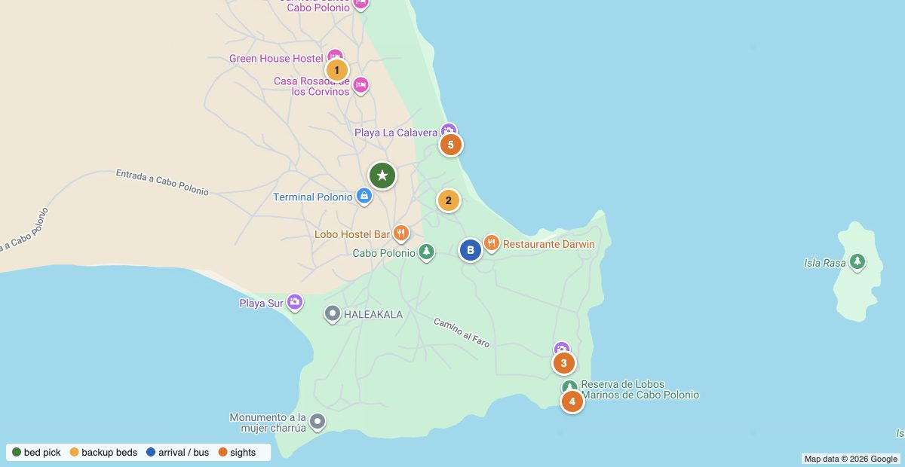
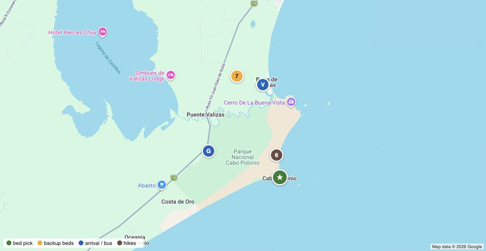

# 🇺🇾 Cabo Polonio

Part of the [LatAm itinerary](../itinerary.md) · region notes: [Paraguay + Uruguay](paraguay-uruguay.md) · ← [Montevideo](montevideo.md) · [Colonia stopover → Buenos Aires → Córdoba](colonia.md) →

> **Stop 10 · Day 21 → 23 · 2 nights · New Year week (peak)** 
> 🏞️ An off-grid village on a cape inside a national park: sea lions, a lighthouse and big moving dunes 
> 🛏️ **Hostel Albatros**, a bed in a 6-bed dorm, $70 for 2 nights 
> 🚌 **In:** Rutas del Sol from Montevideo, Day 21 10:10, then the 4x4 truck · **Out:** truck 14:00 + Rutas del Sol 15:10, Day 23

The lighthouse above the rocks of the cape; the sea-lion colony is on the rocks below it. Photo: Google Maps.

## 🗺️ Map

**In the village:** ★ **[Hostel Albatros](https://www.google.com/maps?ftid=0x95736a6249ff1fa7:0x9e75c34b196c5680)** (the pick, [book](https://www.booking.com/hotel/uy/el-albatros.html?checkin=2026-12-28&checkout=2026-12-30&group_adults=1&no_rooms=1&group_children=0&selected_currency=USD)) · **1** [Green House Hostel](https://www.google.com/maps?ftid=0x95736a7cca82105d:0x1c1327cc912ba3f0) (backup, [book](https://www.booking.com/hotel/uy/green-house-hostel.html?checkin=2026-12-28&checkout=2026-12-30&group_adults=1&no_rooms=1&group_children=0&selected_currency=USD)) · **2** [Hostal del Cabo](https://www.google.com/maps?ftid=0x95736b27322ceba9:0xb8324cb00bc2357b) (private alt, [book](https://www.booking.com/hotel/uy/hostal-del-cabo.html?checkin=2026-12-28&checkout=2026-12-30&group_adults=1&no_rooms=1&group_children=0&selected_currency=USD)) · **B** [truck stop](https://www.google.com/maps?ftid=0x95736a61f1690c5b:0x189f718fcaabe1c3) · **3** [Lighthouse](https://www.google.com/maps?ftid=0x95736a8ad9e7131d:0x617f48857b4acff7) [🚶 11 min](https://www.google.com/maps/dir/?api=1&origin=-34.4008775,-53.7830908&destination=-34.4052809,-53.7779233&travelmode=walking) · **4** [Sea-lion colony](https://www.google.com/maps?ftid=0x95736af52c9a310b:0xdff58b61c222f20) [🚶 12 min](https://www.google.com/maps/dir/?api=1&origin=-34.4008775,-53.7830908&destination=-34.4061805,-53.7776997&travelmode=walking) · **5** [Playa La Calavera](https://www.google.com/maps?ftid=0x95736a62637eb3b9:0x367a7dd2c3642a0e) [🚶 3 min](https://www.google.com/maps/dir/?api=1&origin=-34.4008775,-53.7830908&destination=-34.4001505,-53.7811449&travelmode=walking) · Playa Sur is labelled on the base map

**Around:** ★ Cabo Polonio · **G** [Puerta del Polonio](https://www.google.com/maps?ftid=0x957342384f461179:0xdfa493de97a0d471) (park gate, bus stop and truck terminal) · **6** [The dunes](https://www.google.com/maps?ftid=0x957341d823e8af43:0x363f24e0c545e80f) [🚶 14 min](https://www.google.com/maps/dir/?api=1&origin=-34.4008775,-53.7830908&destination=-34.3853,-53.7856725&travelmode=walking) · **V** Rutas del Sol stop in [Barra de Valizas](https://www.google.com/maps?ftid=0x95734119ea6b2563:0x1f77682c8595aa97) · **7** [Valizas 1900](https://www.google.com/maps?ftid=0x957341569a5730e1:0xdc6d9045df877a4) (🎆 holiday backup)

🧭 The time after each place is from the ★ bed (Google Maps, 26 Nov): 🚶 walk · 🚌 bus · 🚕 taxi · 🚗 by road (tour or bus). Click it for the route.

**Open the live map:** [village](https://www.google.com/maps/@-34.4025,-53.7810,16z) · [area](https://www.google.com/maps/@-34.3650,-53.8100,12z)

## 📅 Day by day

| Day | Plan |
|---|---|
| **Day 21** | 🚌 10:10 Rutas del Sol from Tres Cruces, gate 14:30, then the 4x4 truck (≈ 20 min). Walk 3 min to the hostel. 🦭 **Sea-lion colony** below the lighthouse. 🌅 Sunset at Playa Sur / La Calavera, then ✨ stargazing. |
| **Day 22** | 🥾 Early: **dune walk to Barra de Valizas** and back (≈ 2–3 h each way). Afternoon: 🏖️ swim at Playa Sur; climb the lighthouse. |
| **Day 23** | 🚚 Truck 14:00 → 🚌 **Rutas del Sol 15:10 → Tres Cruces 20:10**, for New Year in [Montevideo](montevideo.md). |

## 🔖 Book (one click)

Dates and 1 adult are pre-filled. The first channel listed was the cheapest when checked on 24 Nov. ⚠️ = time-sensitive: it is peak week, so book the bed now.

**Beds** (Day 21 → 23, 2 nights)

| | Where | Total | Location | From the truck stop | Book |
|---|---|---:|:---:|---|---|
| ⭐ **Pick** | **Hostel Albatros** · bed in a 6-bed mixed dorm | **$70** | 9.4 | 🚶 5 min (350 m); centre 11 min on foot · [route](https://www.google.com/maps/dir/?api=1&origin=-34.4026298,-53.7805879&destination=-34.4008775,-53.7830908&travelmode=walking) | [Booking](https://www.booking.com/hotel/uy/el-albatros.html?checkin=2026-12-28&checkout=2026-12-30&group_adults=1&no_rooms=1&group_children=0&selected_currency=USD) · [Agoda](https://www.agoda.com/partners/partnersearch.aspx?hid=1224576&checkin=2026-12-28&checkout=2026-12-30&NumberofAdults=1&Rooms=1) |
| Backup | **Green House Hostel** · bed in an 8- or 6-bed dorm, breakfast | $50 | ⚠️ 8.7 | 🚶 10 min (700 m); centre 16 min on foot · [route](https://www.google.com/maps/dir/?api=1&origin=-34.4026298,-53.7805879&destination=-34.3984017,-53.7843777&travelmode=walking) | [Booking](https://www.booking.com/hotel/uy/green-house-hostel.html?checkin=2026-12-28&checkout=2026-12-30&group_adults=1&no_rooms=1&group_children=0&selected_currency=USD) · [Agoda](https://www.agoda.com/partners/partnersearch.aspx?hid=2165637&checkin=2026-12-28&checkout=2026-12-30&NumberofAdults=1&Rooms=1) |
| Private alt | **Hostal del Cabo** · "Double Queen Bed" room | $117 | 9.5 | 🚶 2 min (140 m); centre 9 min on foot · [route](https://www.google.com/maps/dir/?api=1&origin=-34.4026298,-53.7805879&destination=-34.40146,-53.781210599999994&travelmode=walking) | [Booking](https://www.booking.com/hotel/uy/hostal-del-cabo.html?checkin=2026-12-28&checkout=2026-12-30&group_adults=1&no_rooms=1&group_children=0&selected_currency=USD) |
| 🎆 Holiday backup (alt village) | **Valizas 1900**, **Barra de Valizas** · bed in an 8-bed mixed dorm | $38 | 9.5 | 🚶 31 min (2.3 km) from the Rutas del Sol stop in Valizas (taxi 4 min); Cabo Polonio is a ≈ 2–3 h dune walk away · [route](https://www.google.com/maps/dir/?api=1&origin=-34.33597,-53.79752&destination=-34.330033,-53.819607&travelmode=walking) | [Booking](https://www.booking.com/hotel/uy/valizas-1900-barra-de-valizas1.html?checkin=2026-12-28&checkout=2026-12-30&group_adults=1&no_rooms=1&group_children=0&selected_currency=USD) |

**Transport**

| | Leg | When | Price | Book |
|---|---|---|---:|---|
| In | **Rutas del Sol** · Tres Cruces → Cabo Polonio gate (via San Carlos, Rocha, La Paloma) | **Day 21 10:10 → 14:30** | UYU 1,003 ≈ **$25** | [Rutas del Sol](https://www.rutasdelsol.com.uy/) or the Tres Cruces counter |
| In | **4x4 truck** · Puerta del Polonio gate → village | ≈ 20 min | UYU 470 return ≈ **$12** | Pay at the gate (cash or debit) |
| Out | Truck 14:00 → **Rutas del Sol** · Cabo Polonio → Tres Cruces | **Day 23 15:10 → 20:10** | UYU 1,003 ≈ $25 | [Rutas del Sol](https://www.rutasdelsol.com.uy/) |

How to read these tables

- **Location** is the guests' location score on Booking.com. The target is 9.0 or higher, and ⚠️ marks one below 9.0. *(HW)* means Hostelworld's location rating, used where a property isn't on Booking.
- **From the truck stop** comes from Google Maps on 24 Nov: the property found on Maps and routed from where you arrive at midday on the check-in date. The **route** link opens the same route.
- Symbols: 🚶 walk · 🚌 public transport · 🚕 taxi/rideshare · 🥾 hike only · ⚠️ far from the centre with no bus · ℹ️ outside the centre but on a bus line.
- The holiday-backup total ($38) is from the itinerary's holiday table.

## 🚌 Getting here: Montevideo → Cabo Polonio, Day 21

A 4x4 truck at the Puerta del Polonio gate. Photo: Google Maps.

- **Rutas del Sol 10:10 Tres Cruces → 14:30 Cabo Polonio gate** (via San Carlos, Rocha, La Paloma).
- **UYU 1,003 ≈ $25.** Tres Cruces counter or rutasdelsol.com.uy.
- ✅ Operator timetable and fare table, but only the **winter 2026** timetable is online; summer adds buses, so recheck in mid-December.
- COT's La Pedrera line doesn't stop at Cabo Polonio.
- **Peak-week tip:** on busy dates a company may run several buses at the same hour and print a bus number on your ticket, so check it before boarding (LP).
- Then the **4x4 truck** from the Puerta del Polonio gate into the village: ≈ 20 min, **UYU 470 return ≈ $12**, park entry free, pay at the gate (cash or debit). ✅ Portal del Cabo.
- No tents or pets are allowed in the national park.

## 🛏️ Where to sleep

**Live-checked 24 Nov; the pick moved up on 25 Nov for location.** It is peak week, so book the bed now.

### ⭐ Pick: Hostel Albatros
- **Unit:** a bed in a 6-bed mixed dorm.
- **Price:** **$70 for 2 nights** on Booking (Agoda also $70).
- **Reviews:** Booking **9.1 (86; 1% below 7)**, **location 9.4**.
- **Where:** 0.3 km from the lighthouse, 200 m from the truck stop.
- Shared kitchen. No noise complaints.
- **Others looked at:**
  - Viejo Lobo (HW 100 from 382 reviews, two kitchens) has beds on **Day 21 only**, $25–29, and is sold out on the 29th.
  - Lobo Hostel Bar (location 9.7, $61) is skipped: 11 reviews mention the bar's music.

### Backup: Green House Hostel
- ⚠️ **Location 8.7.** A bed in an 8- or 6-bed dorm, breakfast included.
- **$50 for 2 nights** (room table) on Booking (Agoda also $50).
- Booking 8.8 (354; 4% below 7).
- In the village, 0.7 km from the lighthouse and close to the truck stop.
- **Shared kitchen with stovetop**, terrace and small bar.
- **Party check:** no "party" or "music" complaints in the newest reviews, and one mention of "loud".
- **The ≥ 9.0 dorm alternative:** Hostal del Cabo's 10-bed dorm, location 9.5, $86.

### Private alt (location first): Hostal del Cabo
- "Double Queen Bed" room. **$117 for 2 nights** (room table) on Booking.
- Booking **location 9.5** (8.7; 78 reviews; 6% below 7). Shared kitchen.
- The next best is Albatros' double at $180 (location 9.4).
- The posadas with location 9.3–9.6 (Carmela, Narakan, Puertas al Cabo) cost $390–586.

### 🎆 Holiday backups
- **The squeeze** (itinerary check): 5 hostels were left (Albatros $70, Lobo $61, Hostal del Cabo $86), and Punta del Diablo was 83% unavailable.
- **Another village:** **Barra de Valizas**, the next village, with a bus stop on the same Rutas del Sol line. **Valizas 1900**, a bed in an 8-bed mixed dorm, location 9.5, **$38**. It's 31 min on foot (2.3 km) from the bus stop; Cabo Polonio is a ≈ 2–3 h dune walk away.
- A central alternative in Valizas: Hostel Lo de Milton, 9.4, $66.

## 🌳 Things to do (free and outdoors first)

<table>
<tr>
<td width="50%" valign="top"> <b><a href="https://www.google.com/maps?ftid=0x95736af52c9a310b:0xdff58b61c222f20">Sea-lion and fur-seal colony</a></b> · free · <a href="https://www.google.com/maps/dir/?api=1&origin=-34.4008775,-53.7830908&destination=-34.4061805,-53.7776997&travelmode=walking">🚶 12 min</a> On the rocks below the lighthouse, and always there.</td>
<td width="50%" valign="top"> <b><a href="https://www.google.com/maps?ftid=0x957341d823e8af43:0x363f24e0c545e80f">Dune walk to Barra de Valizas</a></b> · free · ≈ 2–3 h each way · <a href="https://www.google.com/maps/dir/?api=1&origin=-34.4008775,-53.7830908&destination=-34.3853,-53.7856725&travelmode=walking">🚶 14 min</a> ≈ 7 km over the big moving dunes, or 12 km along the beach. The area's best outdoor half-day.</td>
</tr>
<tr>
<td width="50%" valign="top"> <b><a href="https://www.google.com/maps?ftid=0x95736a62637eb3b9:0x367a7dd2c3642a0e">Playa La Calavera</a></b> / Playa Sur · free · <a href="https://www.google.com/maps/dir/?api=1&origin=-34.4008775,-53.7830908&destination=-34.4001505,-53.7811449&travelmode=walking">🚶 3 min</a> Sunset, then stargazing: the village is off-grid (solar power only).</td>
<td width="50%" valign="top"> <b><a href="https://www.google.com/maps?ftid=0x95736a8ad9e7131d:0x617f48857b4acff7">Lighthouse climb</a></b> · small fee · <a href="https://www.google.com/maps/dir/?api=1&origin=-34.4008775,-53.7830908&destination=-34.4052809,-53.7779233&travelmode=walking">🚶 11 min</a> The view over the village and the colony. Closed at midday: ≈ 10:00–13:00 and 15:00–sunset (LP).</td>
</tr>
<tr>
<td width="50%" valign="top"> <b><a href="https://www.google.com/maps?ftid=0x95734119ea6b2563:0x1f77682c8595aa97">Barra de Valizas</a></b> · free The end of the dune walk, and the 🎆 holiday-backup village.</td>
<td width="50%" valign="top"><b>Swim at Playa Sur</b> · free The sheltered beach (labelled on the village map). Playa Norte is wilder.</td>
</tr>
</table>

- **Sea-lion and fur-seal colony** on the rocks below the lighthouse. Free and always there.
- **Dune walk to Barra de Valizas:** ≈ 7 km over the big moving dunes, or 12 km along the beach, ≈ 2–3 h each way. Free.
  - Go early, and take water, sun protection and a windproof layer.
  - It is the area's best outdoor half-day.
- **Sunset** at Playa Sur / La Calavera, then **stargazing**: the village is off-grid (solar power only).
- **Lighthouse climb** for the view over the village and colony: small fee (U$25 in 2018 per Wikivoyage; ≈ UYU 50–100 now, unverified). LP gives the hours as ≈ 10:00–13:00 and 15:00–sunset, so not at midday (LP).
- **Swim** at the sheltered **Playa Sur**; Playa Norte is wilder.
- The cape has been a **national park** (SNAP) since 2009 (LP).

**Paid extras, from Lonely Planet (not live-checked):**
- 🐎 **Horse rides** through the park's dunes and along the beaches north of the cape with **Cabalgatas Valiceras**, based in Barra de Valizas: full-day rides (US$80–95 in LP) and monthly full-moon rides (LP).
- 🏄 **Cabo Polonio Surf School**, just inland from Playa Sur: 2-hour lessons with kit, ≈ 11:00 and 17:00 daily from late December to Easter; book by phone or ask in the village (LP).

## 🍽️ Eat and drink

<table>
<tr>
<td width="50%" valign="top"> <b>Buñuelos de algas</b> · ≈ UYU 250–350 ($6–9) ≈ (lead) The local seaweed fritters, from a beach stand; LP's pick is Lo de Dany by the truck stop (LP). Generic photo.</td>
<td width="50%" valign="top"><b>Cook: bring 2 days of groceries from Montevideo</b> Tienda Inglesa or Disco. The village almacenes are small and dear, and restaurants charge resort prices (≈ UYU 800–1,200 ≈ $20–30 a main).</td>
</tr>
</table>

**From Lonely Planet (not live-checked):**
- **Lo de Dany**, the orange snack shack by the 4x4 truck stop, run by one of the few families who live here all year: buñuelos de algas, *rabas* (fried squid) and chivitos at fair prices, ≈ 09:00–22:00 (LP).
- 🐟 **Fresh fish to cook:** Marta and Héctor, a local fishing couple in the salmon-coloured house with a green flag just north of the truck stop, put up a **"Hay pescado"** sign when they have fish to sell (LP).
- **El Club**, ≈ 50 m west of the truck stop (mid-Dec to Easter): grilled fish, wood-fired pizza and craft beer, a daily set plate with vegetarian options, and live music (LP).

## ℹ️ Good to know
- ⚠️ **No ATM** and patchy card acceptance, so carry UYU cash for 2 days plus the truck.
- ⚠️ **It is peak week,** so book the bed now.
- **Electricity and Wi-Fi are limited.**
- **It is very windy,** and the sun is strong.

## 🚌 Leaving: Cabo Polonio → Montevideo, Day 23

- **Truck 14:00 → Rutas del Sol 15:10 → Tres Cruces 20:10.**
- **UYU 1,003 ≈ $25.** ✅ Winter timetable (summer adds services), so recheck in mid-December.
- Then 2 nights in [Montevideo](montevideo.md) for New Year's Eve.

---
Photos: Google Maps contributors (lighthouse and rocks, sea-lion colony, dunes, La Calavera, lighthouse, Barra de Valizas, the 4x4 truck). Wikimedia Commons: <a href="https://commons.wikimedia.org/wiki/File:Bu%C3%B1uelos_de_algas.jpg">Buñuelos de algas</a> (TitiNicola, CC BY-SA 4.0).
