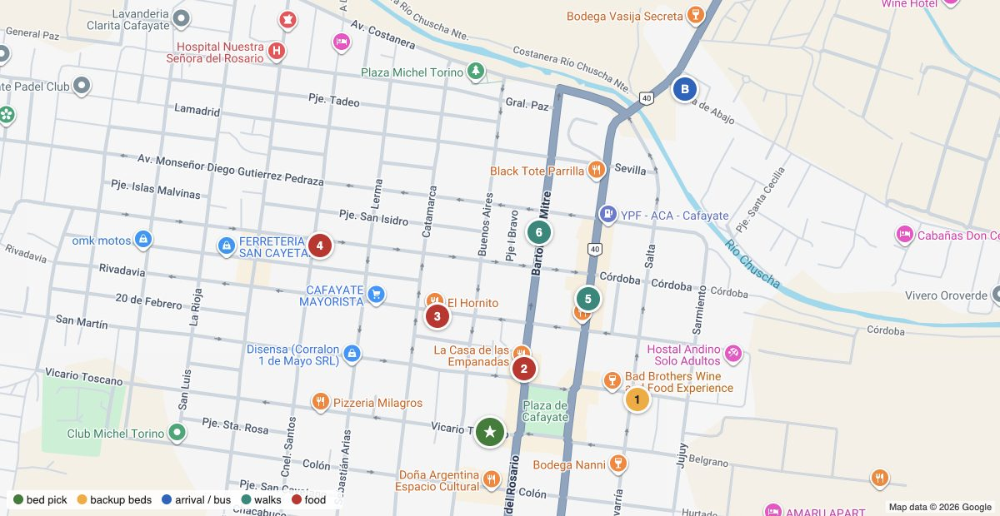

# 🇦🇷 Cafayate

Part of the [LatAm itinerary](../itinerary.md) · region notes: [Argentina](argentina.md) · ← [Córdoba + Los Gigantes](cordoba.md) · [Salta](salta.md) →

> **Stop 13 · Day 34 → 36 · 2 nights · January peak season** 
> 🏞️ A small valley town: the Río Colorado falls on foot, then a hike in the red Quebrada de las Conchas 
> 🛏️ **Cielito Lindo Hostel**, a bed in a 10-bed dorm, $28.80 for 2 nights 
> 🚌 **In:** night bus Córdoba → Tucumán, then Aconquija 06:00 → 12:31, Sun · **Out:** bus to Salta through the Quebrada, Tue

The Quebrada de las Conchas from the Tres Cruces viewpoint on RN68. Photo: Google Maps.

## 🗺️ Map

**In town:** ★ **[Cielito Lindo Hostel](https://www.google.com/maps?ftid=0x941f3111a940cac9:0xda2abf085e5c5a2c)** ([book](https://www.hostelworld.com/hostels/p/314663/cielito-lindo-hostel/?from=2027-01-10&to=2027-01-12&guests=1)) (the pick; [Martínez Cerveza Artesanal](https://www.google.com/maps?ftid=0x941f310022e80071:0xc540fce9e3ed326) is around the corner) · **1** [La Montaña B&B](https://www.google.com/maps?ftid=0x941f316b23341d59:0x2b8ce8cd7b1f79ae) (backup, private, [book](https://www.booking.com/hotel/ar/hostal-la-montaa-a.html?checkin=2027-01-10&checkout=2027-01-12&group_adults=1&no_rooms=1&group_children=0&selected_currency=USD)) · **B** [Aconquija stop](https://www.google.com/maps?ftid=0x941f316cb47dda7b:0x5304d55cf95ad67d) ([Flecha Bus](https://www.google.com/maps?ftid=0x941f311367fe2467:0x3e6d5c6b0ba0160c) is beside it) · **2** [La Casa de las Empanadas](https://www.google.com/maps?ftid=0x941f31134d4c2613:0x46b2cf6f80ae90c5) [🚶 4 min](https://www.google.com/maps/dir/?api=1&origin=-26.0733782,-65.9775045&destination=-26.0719237,-65.9766273&travelmode=walking) · **3** [El Hornito](https://www.google.com/maps?ftid=0x941f311390684abb:0x9423fe955a24437a) [🚶 6 min](https://www.google.com/maps/dir/?api=1&origin=-26.0733782,-65.9775045&destination=-26.070701,-65.9788683&travelmode=walking) · **4** [La Esquina de la Abuela](https://www.google.com/maps?ftid=0x941f31119c45732d:0x76166f1431332911) [🚶 13 min](https://www.google.com/maps/dir/?api=1&origin=-26.0733782,-65.9775045&destination=-26.069065,-65.9818867&travelmode=walking) · **5** [Cafayate Bike & Travel](https://www.google.com/maps?ftid=0x941f3100409a837d:0x4274436ca5911169) [🚶 8 min](https://www.google.com/maps/dir/?api=1&origin=-26.0733782,-65.9775045&destination=-26.0703029,-65.9749757&travelmode=walking) · **6** [RuralBikeCafayate](https://www.google.com/maps?ftid=0x941f317eb842e72f:0xab4132d409bd1e0) [🚶 8 min](https://www.google.com/maps/dir/?api=1&origin=-26.0733782,-65.9775045&destination=-26.0687531,-65.9762336&travelmode=walking)

**Around:** ★ Cafayate · **7** [Río Colorado falls](https://www.google.com/maps?ftid=0x941f30bf534208c9:0xfc7801a1400df902) [🚕 ≈ 13 min](https://www.google.com/maps/dir/?api=1&origin=-26.0733782,-65.9775045&destination=-26.0934507,-66.0122511&travelmode=driving) · along RN68, from the Cafayate end: **8** [Los Médanos](https://www.google.com/maps?ftid=0x941f33a1f657992b:0x596d9cb67cffc040) [🚕 ≈ 14 min](https://www.google.com/maps/dir/?api=1&origin=-26.0733782,-65.9775045&destination=-26.063921,-65.9093997&travelmode=driving) · **9** [Los Castillos](https://www.google.com/maps?ftid=0x9418cd755e28f4ef:0xa7823aab4016a08a) [🚕 ≈ 22 min](https://www.google.com/maps/dir/?api=1&origin=-26.0733782,-65.9775045&destination=-26.0012952,-65.8087308&travelmode=driving) · **10** [El Obelisco](https://www.google.com/maps?ftid=0x9418cdb8e0c50d0f:0xc927830e4e2c355c) [🚕 ≈ 25 min](https://www.google.com/maps/dir/?api=1&origin=-26.0733782,-65.9775045&destination=-26.0066546,-65.7872098&travelmode=driving) · **11** [Los Estratos / La Yesera](https://www.google.com/maps?ftid=0x9418ce0da7e30641:0x2baf2c01d8d8b520) [🚕 ≈ 31 min](https://www.google.com/maps/dir/?api=1&origin=-26.0733782,-65.9775045&destination=-25.9886308,-65.7519317&travelmode=driving) · **12** [El Fraile](https://www.google.com/maps?ftid=0x94193f6e211fe315:0xa684ef5eb13ca76f) [🚗 ≈ 36 min by road](https://www.google.com/maps/dir/?api=1&origin=-26.0733782,-65.9775045&destination=-25.9491709,-65.7439195&travelmode=driving) ([El Sapo](https://www.google.com/maps?ftid=0x9418d1c7823c462d:0xa6f1cd40a8318d35) just beyond) · **13** [Tres Cruces viewpoint](https://www.google.com/maps?ftid=0x9418d0d8d6ec61cf:0xfd4a63bf8ba7d678) [🚗 ≈ 45 min by road](https://www.google.com/maps/dir/?api=1&origin=-26.0733782,-65.9775045&destination=-25.8907137,-65.7108547&travelmode=driving). The Garganta del Diablo and the Anfiteatro (≈ 50 km from town, where the bike alternative starts) are beyond the top edge.

🧭 The time after each place is from the ★ bed (Google Maps, 26 Nov): 🚶 walk · 🚌 bus · 🚕 taxi · 🚗 by road (tour or bus). Click it for the route.

**Open the live map:** [town](https://www.google.com/maps/@-26.0710,-65.9770,16z) · [Quebrada de las Conchas](https://www.google.com/maps/@-25.9500,-65.8000,11z)

## 📅 Day by day

| Day | Plan |
|---|---|
| **Day 33** (night) | 🚌 Night bus Córdoba → Tucumán: **Flecha Bus cama 20:30 → 04:30** (or Andesmar 20:15). Wait 1½ h in Tucumán's 24-h terminal. |
| **Day 34** | 🚌 **Aconquija 06:00 → Cafayate 12:31**, over the Infiernillo pass through Tafí del Valle (08:35). Walk 17 min to the hostel. Afternoon: 💧 **Río Colorado falls** (3–4 h, local guide mandatory). |
| **Day 35** | 🥾 **Quebrada de las Conchas hike + bus:** the **08:30 Flecha Bus** towards Salta drops you at the trailhead (≈ 30 km up RN68), then the **Quebrada de las Conchas Loop** (10.9 km, +214 m) past **Los Estratos / La Yesera**. Flag the Cafayate-bound bus back at ≈ 14:20 (or ≈ 18:20). |
| **Day 36** | 🚌 Bus to [Salta](salta.md) through the whole canyon (sit on the left). |

## 🔖 Book (one click)

Dates and 1 adult are pre-filled. The first channel listed was the cheapest when checked on 24 Nov. ⚠️ = time-sensitive.

**Beds** (Day 34 → 36, 2 nights)

| | Where | Total | Location | From the bus stop | Book |
|---|---|---:|:---:|---|---|
| ⭐ **Pick** | **Cielito Lindo Hostel** · bed in a 10-bed mixed dorm | **$28.80** | 9.8 | 🚶 17 min (1.2 km) from the Aconquija bus stop; centre 2 min on foot · [route](https://www.google.com/maps/dir/?api=1&origin=-26.0654453,-65.9724853&destination=-26.0733782,-65.9775045&travelmode=walking) | [Hostelworld](https://www.hostelworld.com/hostels/p/314663/cielito-lindo-hostel/?from=2027-01-10&to=2027-01-12&guests=1) · [Booking](https://www.booking.com/hotel/ar/cielito-lindo-cafayate.html?checkin=2027-01-10&checkout=2027-01-12&group_adults=1&no_rooms=1&group_children=0&selected_currency=USD) · [Agoda](https://www.agoda.com/partners/partnersearch.aspx?hid=12531179&checkin=2027-01-10&checkout=2027-01-12&NumberofAdults=1&Rooms=1) |
| Backup (private) | **La Montaña B&B** (Hostal La Montaña) · small double | $86 | 9.9 | 🚶 12 min (900 m) from the Aconquija bus stop; centre 5 min on foot · [route](https://www.google.com/maps/dir/?api=1&origin=-26.0654453,-65.9724853&destination=-26.072635,-65.97370149999999&travelmode=walking) | [Booking](https://www.booking.com/hotel/ar/hostal-la-montaa-a.html?checkin=2027-01-10&checkout=2027-01-12&group_adults=1&no_rooms=1&group_children=0&selected_currency=USD) · [Agoda](https://www.agoda.com/partners/partnersearch.aspx?hid=416350&checkin=2027-01-10&checkout=2027-01-12&NumberofAdults=1&Rooms=1) |

**Transport**

| | Leg | When | Price | Book |
|---|---|---|---:|---|
| In | **Flecha Bus cama** · Córdoba → Tucumán | **Day 33 20:30 → 04:30** | ARS 90,000 ≈ $55 | [Plataforma10](https://www.plataforma10.com.ar/) or Flecha Bus ✅ |
| In, alt | **Andesmar semicama** · Córdoba → Tucumán | Day 33 20:15 → 04:30 | ARS 50,000 ≈ $30 | [Plataforma10](https://www.plataforma10.com.ar/) or Andesmar ✅ |
| ⚠️ In | **Aconquija** · Tucumán → Cafayate (Tafí 08:35) | **Day 34 06:00 → 12:31** | ARS 44,000 ≈ $27 | Aconquija (January not on sale yet) |
| In, more sleep | **El Práctico** 23:45 → 07:10, then **Aconquija** 10:00 → 16:20 | Day 33 → 34 | ARS 40,000 ≈ $25 + ARS 44,000 | [Plataforma10](https://www.plataforma10.com.ar/) |
| Hike day | **Flecha Bus** towards Salta, off at the Quebrada de las Conchas Loop trailhead (≈ 30 km); back on a Cafayate-bound bus | ✅ **Day 35 08:30**; back ≈ 14:20 or ≈ 18:20 (the 11:00 and 15:00 from Salta) | ask for a ticket to the trailhead (Salta is ARS 33,500) | Cafayate terminal; flag the bus back on RN68 |
| ⚠️ Out | **Bus to Salta** (Flecha Bus 08:30 or 11:30) | **Day 36** | ARS 33,500 ≈ $21 | Flecha Bus; book ahead |

How to read these tables

- **Location** is the guests' location score on Booking.com. The target is 9.0 or higher, and ⚠️ marks one below 9.0. *(HW)* means Hostelworld's location rating, used where a property isn't on Booking.
- **From the bus stop** comes from Google Maps on 24 Nov: the property found on Maps and routed from where you arrive at midday on the check-in date. The **route** link opens the same route.
- Symbols: 🚶 walk · 🚌 public transport · 🚕 taxi/rideshare · 🥾 hike only · ⚠️ far from the centre with no bus · ℹ️ outside the centre but on a bus line.

## 🚌 Getting here: Córdoba → Tucumán → Cafayate, Day 33 → 34

The night bus to Tucumán, then Aconquija over the Infiernillo pass. **Tafí del Valle is ridden through, not stayed in** (rain/fog season).

- **Recommended:** Flecha Bus **cama** 20:30 → Tucumán 04:30 (ARS 90,000 ≈ $55), or Andesmar semicama 20:15 → 04:30 (ARS 50,000 ≈ $30).
  - Wait 1½ h in Tucumán's 24-h terminal, then **Aconquija 06:00 → Cafayate 12:31** (Tafí 08:35; ARS 44,000 ≈ $27). The terminal is air-conditioned, with a supermarket, cafés and a tourist desk (LP).
  - That gives a free afternoon in Cafayate for the Río Colorado falls.
  - **From the window:** the road climbs the Río Los Sosa gorge, then passes the La Angostura reservoir and **El Mollar**, whose plaza holds the Parque de los Menhires, carved standing stones about 2,000 years old (LP).
- **More sleep:** El Práctico 23:45 → 07:10 (ARS 40,000 ≈ $25), then Aconquija 10:00 → 16:20. You lose the afternoon hike.
- **Where to buy:** Plataforma10 or each operator's own site.
  - ✅ The Córdoba → Tucumán times are on sale for Day 33 (Plataforma10, rechecked 27 Nov: Flecha cama 20:30 ARS 90,000, Andesmar 20:15 ARS 50,000, El Práctico 23:45 ARS 40,000).
  - ✅ Aconquija's times are the December timetable (daily 06:00 / 10:00 / 14:00); its January dates aren't on sale yet, so re-check in mid-December.

## 🛏️ Where to sleep

**Live-checked 24 Nov.**

### ⭐ Pick: Cielito Lindo Hostel
- **Unit:** a bed in a 10-bed mixed dorm.
- **Where:** Vicario Toscano 149, 130 m from the plaza.
- **Total for 2 nights: $28.80 on Hostelworld or Agoda** (signed in); Booking $29.
- **Ratings:** Booking 8.9 (646 reviews; **4% below 7**); Hostelworld 97 (37); Agoda 9.0 (650). Location 9.8.
- ✅ A "large and clean" kitchen with a cooker; garden and bar.
- ⚠️ Several reviews mention **bar music past quiet hours**, especially on Saturday (your nights are Sun and Mon), and the domes are the most exposed, so bring earplugs.
- It's a social bar hostel, not a party hostel, and has no pool. Curtains: not confirmed.

### Backup
- Cafayate has **no second hostel worth taking** (the other one on Booking scores 2.0), so the backup is the private below.
- Cheapest decent alternative: **ALPACA Departamentos** (Booking 8.9, 48 reviews, location 8.9), a twin room at **$74** for 2 nights on Booking.

### Private alt (location first): La Montaña B&B
- Hostal La Montaña. Small double.
- Booking **location 9.9** (285 reviews, 0% below 7).
- **Total $86 on Booking** (room table; Agoda $101.48).
- 260 m from the plaza.
- **Runner-up:** Hostal Virgen del Rosario (location 9.9, 142 reviews, 1% below 7), $94 on both Booking and Agoda.

## 🌳 Things to do (free and outdoors first)

<table>
<tr>
<td width="50%" valign="top"> <b><a href="https://www.google.com/maps?ftid=0x941f30bf534208c9:0xfc7801a1400df902">Río Colorado falls</a></b> (7 Cascadas) · guide ≈ ARS 20,000–30,000 · Day 34 · <a href="https://www.google.com/maps/dir/?api=1&origin=-26.0733782,-65.9775045&destination=-26.0934507,-66.0122511&travelmode=driving">🚕 ≈ 13 min</a> 5.5–6 km return, +240 m, 3–4 h, with boulder scrambling. A local Diaguita guide is mandatory.</td>
<td width="50%" valign="top"> <b>Garganta del Diablo</b> · free · from the bus The narrow side gorge ≈ 50 km from town, beyond the hike: Tuesday's bus to Salta passes it, and the bike alternative starts here.</td>
</tr>
<tr>
<td width="50%" valign="top"> <b><a href="https://www.google.com/maps?ftid=0x9418ce0da7e30641:0x2baf2c01d8d8b520">Los Estratos / La Yesera</a></b> · free · <a href="https://www.google.com/maps/dir/?api=1&origin=-26.0733782,-65.9775045&destination=-25.9886308,-65.7519317&travelmode=driving">🚕 ≈ 31 min</a> On the Quebrada de las Conchas Loop hike (Day 35).</td>
<td width="50%" valign="top"> <b><a href="https://www.google.com/maps?ftid=0x9418cd755e28f4ef:0xa7823aab4016a08a">Los Castillos</a></b> · free · <a href="https://www.google.com/maps/dir/?api=1&origin=-26.0733782,-65.9775045&destination=-26.0012952,-65.8087308&travelmode=driving">🚕 ≈ 22 min</a> One of the RN68 viewpoints; there are no gates on the road.</td>
</tr>
<tr>
<td width="50%" valign="top"> <b><a href="https://www.google.com/maps?ftid=0x9418cdb8e0c50d0f:0xc927830e4e2c355c">El Obelisco</a></b> · free · <a href="https://www.google.com/maps/dir/?api=1&origin=-26.0733782,-65.9775045&destination=-26.0066546,-65.7872098&travelmode=driving">🚕 ≈ 25 min</a> Another RN68 formation, seen from the bus.</td>
<td width="50%" valign="top"> <b><a href="https://www.google.com/maps?ftid=0x941f33a1f657992b:0x596d9cb67cffc040">Los Médanos dunes</a></b> · free · <a href="https://www.google.com/maps/dir/?api=1&origin=-26.0733782,-65.9775045&destination=-26.063921,-65.9093997&travelmode=driving">🚕 ≈ 14 min</a> The last stop before town.</td>
</tr>
</table>

### 💧 Río Colorado falls, Day 34 afternoon
- **Where:** 7 Cascadas, 5–6 km south-west of town.
- **Getting there:** walk 1 h 15, or take a 10-min remís.
- **Guide and fee:** a **local Diaguita community guide is mandatory**, ≈ ARS 20,000 (≈ $12) for the first 3 falls or ≈ ARS 30,000 (≈ $18) for all 7, cash *(mid-2026 leads)*.
- **Effort:** 5.5–6 km return, +240 m, 3–4 h, with boulder scrambling and wet rock.
- **Swim and rock art:** a ≈ 10 m fall about 2 h upstream has a pool you can swim in, and there are rock paintings along the way (LP).
- **Weather:** skip it if a storm is building (the gorge flash-floods).

### 🥾 Quebrada de las Conchas hike + bus, Day 35 (free)
- **Trail:** the **Quebrada de las Conchas Loop** (AllTrails: 10.9 km, +214 m, 4.7★ from 94 reviews), past **Los Estratos / La Yesera**. The trailhead is on RN68, ≈ 29.7 km from Cafayate.
  - **Shorter or as well:** **El Paso**, ≈ 4 km before it on RN68 (AllTrails: 6.8 km, 4.8★ from 163 reviews).
- **Bus out:** the **08:30 Flecha Bus towards Salta** (✅ Flecha's own site, rechecked 27 Nov for Day 35: 04:10, 08:30, 11:30, 14:45, 16:00, 19:45).
  - Ask the driver to let you off at the trailhead, and pay only as far as there (Cafayate → Salta is ARS 33,500).
- **Back:** flag down a Cafayate-bound bus on RN68. It passes the trailhead ≈ **14:20** (the 11:00 from Salta) or ≈ **18:20** (the 15:00 from Salta); ✅ both run on Day 35 (Flecha's site), the passing times are ≈. Wave early so the driver sees you.
- **Cost:** the trails and viewpoints are free; there are no gates on RN68.
- **Conditions:** there's **no shade**: carry 3 L of water, a hat and sunscreen, and start walking as soon as you're off the bus, before the afternoon wind and heat.
- **Bike alternative:** rent an MTB (Cafayate Bike & Travel, Güemes Norte 158, ARS 44,000/day ≈ $27, delivered to your bed; or RuralBikeCafayate, Mitre 258), put it in the hold of the same 08:30 bus to the **Garganta del Diablo** (≈ 50 km) and ride back down RN68, mostly downhill, ≈ 4 h (LP).
- **No time?** Tuesday's bus to Salta drives the whole canyon (sit on the left).

### More around town
- **Cerro San Isidro / Cerro de la Cruz (free):** the white cross on the ridge above town. It's a steep pilgrimage path with ≈ 1,000 m of climbing, so a long morning (LP). Only worth it if storms cancel the Quebrada hike; ask the tourist office for the path.
- **Tourist office** (Av. Güemes, beside the Museo de la Vid y el Vino): it hands out a list of winery opening hours (LP). The wine museum itself is paid, with a higher price for foreigners (LP).
- **Skip:** the **Quilmes** ruins, 50 km south. LP rates them as Argentina's largest pre-Hispanic town (paid; buses to Santa María pass the turn-off, then 5 km on foot), but Peru and Bolivia ahead have bigger ruins.

Paid wine tastings are optional; skip them unless you want one.

## 🍽️ Eat and drink

<table>
<tr>
<td width="50%" valign="top"> <b><a href="https://www.google.com/maps?ftid=0x941f31134d4c2613:0x46b2cf6f80ae90c5">La Casa de las Empanadas</a></b> (Mitre 24) · ARS 1,300–1,600 each (≈ $1) · <a href="https://www.google.com/maps/dir/?api=1&origin=-26.0733782,-65.9775045&destination=-26.0719237,-65.9766273&travelmode=walking">🚶 4 min</a> Empanadas by the piece, near the hostel (see the map).</td>
<td width="50%" valign="top"> <b><a href="https://www.google.com/maps?ftid=0x941f311390684abb:0x9423fe955a24437a">El Hornito</a></b> (Rivadavia 266) · a dozen ARS 10,000–12,000 (≈ $7) · <a href="https://www.google.com/maps/dir/?api=1&origin=-26.0733782,-65.9775045&destination=-26.070701,-65.9788683&travelmode=walking">🚶 6 min</a> Empanadas salteñas; cazuela de cabrito ARS 15,000–18,000 (≈ $10).</td>
</tr>
<tr>
<td width="50%" valign="top"> <b><a href="https://www.google.com/maps?ftid=0x941f31119c45732d:0x76166f1431332911">La Esquina de la Abuela</a></b> (San Lorenzo 151) · under ARS 10,000 a meal · <a href="https://www.google.com/maps/dir/?api=1&origin=-26.0733782,-65.9775045&destination=-26.069065,-65.9818867&travelmode=walking">🚶 13 min</a> Tamales and humitas. Generic photo of a Salta tamal.</td>
<td width="50%" valign="top"> <b><a href="https://www.google.com/maps?ftid=0x941f310022e80071:0xc540fce9e3ed326">Martínez Cerveza Artesanal</a></b> (Calchaquí 70) · ARS 3,500–5,500 (≈ $2–3) a pint Craft beer, around the corner from the hostel.</td>
</tr>
</table>

AI Mode leads; prices ≈.

- **La Casa de las Empanadas** opens Tue–Sun, 11–15 h and 20–24 h, so it's **shut on Day 35**: eat there on Day 34 or Day 36 before the bus, or use its second branch at Nuestra Señora del Rosario 156 (LP).
- **Cheaper sit-down dinners:** the no-frills grills on Rivadavia between San Lorenzo and 12 de Octubre (LP).

## ℹ️ Good to know
- **Sun:** January sun in the valley is fierce: carry a hat and sunscreen, and start early.
- **Cash:** Cafayate's ATMs are around the plaza; bring cash for the falls guide.
- ⚠️ **Book the Day 36 bus to Salta in advance:** January is peak season.

## 🚌 Leaving: Cafayate → Salta, Day 36

- **Flecha Bus at 08:30 or 11:30** from the Cafayate terminal (✅ Flecha's own site, rechecked 27 Nov for Day 36: also 04:10, 16:00 and 19:45). The fare to Salta is now **ARS 33,500** (ARS 29,000 on 24 Nov).
- The road runs through the whole Quebrada de las Conchas: **sit on the left**.
- ⚠️ Book it in advance: January is peak season.

---
Photos: Google Maps contributors (Tres Cruces viewpoint, Río Colorado falls, Los Estratos, Los Castillos, El Obelisco, Los Médanos, La Casa de las Empanadas, El Hornito, Martínez Cerveza Artesanal). Wikimedia Commons: <a href="https://commons.wikimedia.org/wiki/File:Garganta_del_Diablo_-_Quebrada_de_las_Conchas.JPG">Garganta del Diablo</a> (Littletroll, CC BY-SA 4.0), <a href="https://commons.wikimedia.org/wiki/File:TAMAL_SALTA_-_120715-7055-jikatu.jpg">Tamal</a> (Jimmy Baikovicius, CC BY-SA 2.0).
