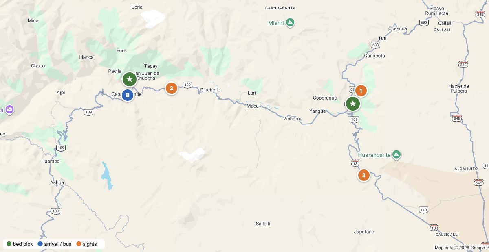
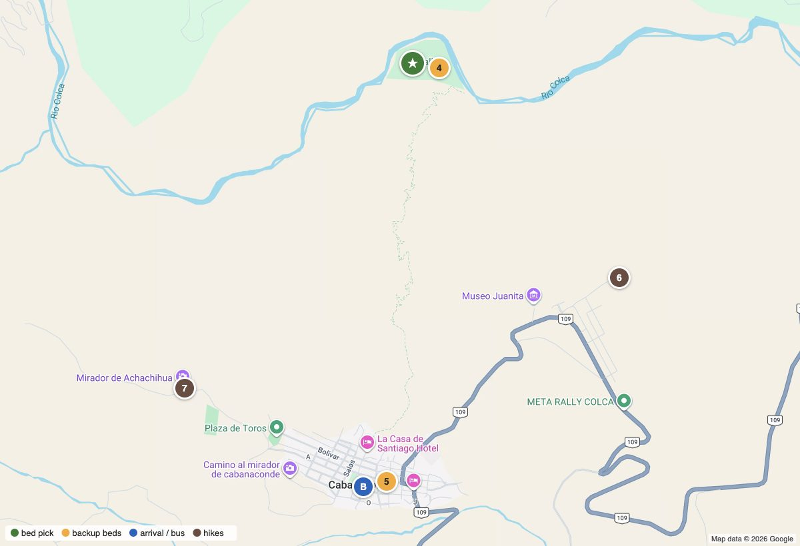

# 🇵🇪 Colca Canyon

Part of the [LatAm itinerary](../itinerary.md) · region notes: [Southern Peru + Panama](peru-panama.md) · ← [Puno](puno.md) · [Arequipa](arequipa.md) →

> **Stop 23 · Sat 30 Jan → Mon 1 Feb 2027 (days 54–56) · 2 nights (Chivay, then the Sangalle oasis) · canyon trek** 
> 🏞️ Chivay → Cruz del Cóndor → Cabanaconde → Sangalle: condors at dawn, a rim walk, ≈ 1,100 m down to an oasis and a 05:00 climb out 
> 🛏️ **Samay Lodge**, Chivay, $12 · then **Paraíso Las Palmeras**, Sangalle oasis, $32 
> 🚌 **In:** 4M Express from Puno, Sat 06:15 · **Out:** bus Cabanaconde → Arequipa, Mon 09:30

The Colca Canyon on the trail to the <a href="https://www.google.com/maps?ftid=0x916a02c7f1768b3f:0x4fe13d24d02b9222">Sangalle oasis</a>. Photo: Google Maps.

## 🗺️ Map

**The canyon:** ★ **[Samay Lodge](https://www.google.com/maps?ftid=0x9169e7de2e97968f:0x1eadf4920eec25e8)** ([book](https://www.booking.com/hotel/pe/samay-lodge.html?checkin=2027-01-30&checkout=2027-01-31&group_adults=1&no_rooms=1&group_children=0&selected_currency=USD)), Chivay (night-1 pick, 170 m from the [Plaza de Chivay](https://www.google.com/maps?ftid=0x9169e721e3922397:0x102d3bcf102d2aef), the 4M stop; the backup, [Pascana Hotel](https://www.google.com/maps?ftid=0x9169e73160b934c9:0xcfc6862a4cf2cfa6), is on the plaza too) · ★ **Paraíso Las Palmeras**, Sangalle (night-2 pick) · **1** [La Calera hot springs](https://www.google.com/maps?ftid=0x9169e768e719805d:0xb0075812e178191b) [🚕 ≈ 6 min](https://www.google.com/maps/dir/?api=1&origin=-15.6360018,-71.6007136&destination=-15.614706,-71.5868605&travelmode=driving) · **2** [Cruz del Cóndor](https://www.google.com/maps?ftid=0x9169f84d6722127b:0x8ed55932080011de) [🚕 ≈ 1 h 30 min](https://www.google.com/maps/dir/?api=1&origin=-15.5962805,-71.9769824&destination=-15.6112885,-71.9060969&travelmode=driving) · **B** [Cabanaconde](https://www.google.com/maps?ftid=0x916a02f70e87e669:0x5433a5a2ddcfeb60) plaza (buses, trailhead) · **3** [Mirador de Patapampa](https://www.google.com/maps?ftid=0x91420ab7c5308419:0x44188b8037abd60d) [🚕 ≈ 36 min](https://www.google.com/maps/dir/?api=1&origin=-15.6360018,-71.6007136&destination=-15.7526468,-71.5821779&travelmode=driving), 4,910 m (on the way in)

**The descent:** **B** [Cabanaconde plaza](https://www.google.com/maps?ftid=0x916a02f3c4666f59:0x84ee0d10c1cb234d) (Cabanaconde Backpackers is on it) · **5** [Homestay Pachamama](https://www.google.com/maps?ftid=0x916a02f30ac28d49:0x78171eb127362304) (Plan B night) · the dotted line is the trail down · ★ **[Paraíso Las Palmeras](https://www.google.com/maps?ftid=0x916a02c793c249db:0x86a23f52f08954c5)** · **4** [Oasis Paraíso Ecolodge](https://www.google.com/maps?ftid=0x916a02c7e672b023:0xbf76a14832db3119) (backup) · **6** [Mirador San Miguel](https://www.google.com/maps?ftid=0x916a0296b00c91bd:0xbda725f241355652) [🚕 ≈ 1 h 23 min](https://www.google.com/maps/dir/?api=1&origin=-15.5962805,-71.9769824&destination=-15.6095826,-71.963693&travelmode=driving) · **7** [Mirador Achachiwa](https://www.google.com/maps?ftid=0x916a02ef946f852d:0x25c8d5cc56916e6f) [🚕 ≈ 1 h 27 min](https://www.google.com/maps/dir/?api=1&origin=-15.5962805,-71.9769824&destination=-15.6164359,-71.9916591&travelmode=driving)

🧭 The time after each place is from the ★ bed (Google Maps, 26 Nov): 🚶 walk · 🚌 bus · 🚕 taxi · 🚗 by road (tour or bus). Click it for the route.

**Open the live map:** [canyon](https://www.google.com/maps/@-15.66,-71.78,11z) · [Cabanaconde → Sangalle](https://www.google.com/maps/@-15.6090,-71.9770,15z) · [Chivay](https://www.google.com/maps/@-15.6365,-71.6020,17z)

## 📅 Day by day

The recommended plan: one night in Chivay, then one in Sangalle (Plan B is under Things to do).

| Day | Plan |
|---|---|
| **Sat 30 Jan** | 🚌 **4M Express** pickup in Puno 05:50–06:10, via Lagunillas and **Patapampa (4,910 m)**, to the Plaza de Chivay ≈ 12:30. Buy the boleto if it wasn't checked on the bus. 🥾 Over the Inca bridge to **Corporaque** (7 km, free, LP) and/or ♨️ **La Calera hot springs** (3 km, S/15; LP says it closes at 18:00). Sleep in Chivay. |
| **Sun 31 Jan** | 🚌 ≈ 06:00 bus to **Cruz del Cóndor** (≈ 07:30; LP: a 07:30 Milagros bus from Chivay's bus station, S/8); condors fly ≈ 08:00–10:00, but LP says they rarely appear in Jan–Feb. 🥾 **Rim walk to Cabanaconde** (≈ 12 km, 2.5–3 h) or flag the next bus. Early lunch; buy Monday's bus ticket on the plaza. 🥾 **Descend to Sangalle** by noon (≈ 1,100 m down, 2–3 h). Sleep at the oasis. |
| **Mon 1 Feb** | 🥾 **05:00 climb out** (≈ 3–3.5 h), in Cabanaconde by ≈ 08:30. Breakfast, then the 🚌 **09:30 Transandino** (or the next Andalucía) to Arequipa, arriving ≈ 15:15 (5 h 45 min). |

## 🔖 Book (one click)

Dates and 1 adult are pre-filled. The first channel listed was the cheapest when checked on 24 Nov. ⚠️ = time-sensitive.

**Beds** (night 1: 30 → 31 Jan in Chivay · night 2: 31 Jan → 1 Feb at the Sangalle oasis)

| | Where | Total | Location | From the plaza / trailhead | Book |
|---|---|---:|:---:|---|---|
| ⭐ **Pick, night 1** | **Hospedaje Samay Lodge**, Chivay · double, private bath | **$12** | 9.8 | 🚶 walk 2 min (170 m) from the Chivay plaza (4M Express stop) · [route](https://www.google.com/maps/dir/?api=1&origin=-15.636617099999999,-71.6021988&destination=-15.6360017805529,-71.6007135777927&travelmode=walking) | [Booking](https://www.booking.com/hotel/pe/samay-lodge.html?checkin=2027-01-30&checkout=2027-01-31&group_adults=1&no_rooms=1&group_children=0&selected_currency=USD) |
| Backup + private alt, night 1 | **Pascana Hotel**, Chivay · single | $56 | 9.8 | 🚶 walk 1 min (61 m) from the Chivay plaza (4M Express stop) · [route](https://www.google.com/maps/dir/?api=1&origin=-15.636617099999999,-71.6021988&destination=-15.6364202,-71.60289829999999&travelmode=walking) | [Booking](https://www.booking.com/hotel/pe/pascana-chivay1.html?checkin=2027-01-30&checkout=2027-01-31&group_adults=1&no_rooms=1&group_children=0&selected_currency=USD) |
| ⭐ **Pick, night 2** | **Paraíso Las Palmeras – Sangalle** · double, private bathroom | **$32** | 9.2 | 🥾 **hike only**: trail down from Cabanaconde (guide: ≈ 2–3 h down, 3–4 h back up at dawn); Google Maps walk 1 hr 34 min (5.1 km) · [route](https://www.google.com/maps/dir/?api=1&origin=-15.6225478,-71.98014429999999&destination=-15.596280499999999,-71.9769824&travelmode=walking) | [Booking](https://www.booking.com/hotel/pe/paraiso-las-palmeras-lodge.html?checkin=2027-01-31&checkout=2027-02-01&group_adults=1&no_rooms=1&group_children=0&selected_currency=USD) |
| Backup, night 2 | **Oasis Paraíso Ecolodge**, Sangalle · twin, shared bathroom | $27 | 9.5 | 🥾 **hike only**: trail down from Cabanaconde; Google Maps walk 1 hr 38 min (5.4 km) · [route](https://www.google.com/maps/dir/?api=1&origin=-15.6225478,-71.98014429999999&destination=-15.596563699999999,-71.9752786&travelmode=walking) | [Booking](https://www.booking.com/hotel/pe/oasis-paraiso-ecolodge.html?checkin=2027-01-31&checkout=2027-02-01&group_adults=1&no_rooms=1&group_children=0&selected_currency=USD) |

**Transport**

| | Leg | When | Price | Book |
|---|---|---|---:|---|
| ⚠️ In | 🚌 **4M Express** · Puno → Chivay | **Sat 30 Jan**, pickup 05:50–06:10, dep ≈ 06:15 → Plaza de Chivay 12:15–12:45 | **$54** | [4M Express](https://www.4m-express.com/) (confirm by WhatsApp; closes 3 days before) |
| Local | 🚌 Arequipa → Cabanaconde bus · Chivay → Cruz del Cóndor | **Sun 31 Jan**, passes Chivay ≈ 06:00–06:30, Cruz del Cóndor ≈ 07:30–08:00 | ≈ S/5–10 | on board |
| Out | 🚌 **Turismo Transandino** (or Andalucía) · Cabanaconde → Arequipa | **Mon 1 Feb 09:30** (5 h 45 min) | **S/35** (≈ $9.50) | counters on Cabanaconde's plaza, the day before · [Reyna](https://polarisweb.reyna.com.pe/) (lists Cabanaconde but returns no trips) |
| Fee | Boleto turístico (AUTOCOLCA) | checked on the road into Chivay, at Cruz del Cóndor and at the Cabanaconde trailhead | **S/70** (≈ $19), cash | colcaperu.gob.pe |

How to read these tables

- **Location** is the guests' location score on Booking.com. The target is 9.0 or higher, and ⚠️ would mark one below 9.0. *(HW)* means Hostelworld's location rating, used where a property isn't on Booking.
- **From the plaza / trailhead** comes from Google Maps on 24 Nov: the property found on Maps and routed from where you arrive on the check-in date (the Chivay plaza for night 1, Cabanaconde's plaza for night 2). The **route** link opens the same route.
- Symbols: 🚶 walk · 🚌 public transport · 🚕 taxi/rideshare · 🥾 hike only · ⚠️ far from the centre with no bus · ℹ️ outside the centre but on a bus line.
- Prices move, so compare the channels shown.

## 🚌 Getting here: 4M Express, Puno → Chivay, Sat 30 Jan

✅ All of this is on 4m-express.com (ES and EN route pages, plus the booking policy):
- **Schedule:** daily. Pickup from central Puno hotels 05:50–06:10, departure about 06:15, arrival at the **Plaza de Chivay 12:15–12:45**. About 6 h.
- **Price: US$54.** Includes the bus, a bilingual guide on board, snacks, water and the photo stops.
- **Stops en route:** Lagunillas (lakes, Andean flamingos) → Patahuasi / Pampa Cañahuas (toilets, crafts) → **Mirador de Patapampa, 4,910 m** (views of Misti, Chachani, Sabancaya and Ampato; apachetas).
- **Not included:** the Colca boleto turístico.
- **Booking:** "shared service: contact us first by WhatsApp to confirm availability" (+51 953 713 226). Online bookings are processed only **≥3 days before** travel, and payment is taken once they confirm.
- **Cancellation:** ≥60 days out costs $50 + $15; 59–5 days out costs 50% + $15; ≤4 days out is non-refundable (date change only).
- **Can you stop over and continue later?** No. The Puno → Chivay ticket **ends in Chivay**. 4M has no stand-alone Chivay → Arequipa or Cabanaconde → Arequipa leg. Their only through product is the 2-day "Tour Puno / Colca / Arequipa" (US$120 + $20 single supplement, a fixed night in Chivay, Cruz del Cóndor, arriving Arequipa about 16:00 on day 2), and that package doesn't allow a Cabanaconde/Sangalle night. So: 4M to Chivay, then local buses.
- **Alternatives:** Rutas del Sur / other tourist buses at ≈ $35–40 (from the brainstorm doc; not verified). The cheap public route is Puno → Juliaca → Arequipa → Chivay, which doubles back through Arequipa.

### Getting around Colca (local buses ≈; no operator publishes a timetable online)
- **Why ≈:** Reyna's web shop (polarisweb.reyna.com.pe) lists Cabanaconde as a stop but returns no trips. redBus lists the routes, but its dated searches for Jan/Feb 2027 come back empty, so all times below are ≈.
- **Chivay → Cruz del Cóndor → Cabanaconde:** the Arequipa → Cabanaconde buses pass through Chivay.
  - Departures from Arequipa per redBus's route page: Andalucía from 03:30 (last 23:45), Transandino from 00:00 (last 12:30), Nativa Express 03:00; 13 a day, about 5.5 h to Cabanaconde, S/35.
  - The early ones pass **Chivay ≈ 06:00–06:30 and Cruz del Cóndor ≈ 07:30–08:00**, about 1 h before Cabanaconde. ≈ S/5–10 from Chivay.
  - A Cabanaconde lodge (colcahotel.com) says the last Chivay → Cabanaconde combi leaves at 14:00–15:00.
  - **LP's version:** Milagros buses leave **Chivay's bus station** (not the plaza) at **07:30** for Cruz del Cóndor, S/8. After that, the only public ride on to Cabanaconde is the minivan that carries the craft sellers, at ≈ 11:00 (S/5). Otherwise walk the 12.5 km or wait for a later bus. Ask at the station on Saturday which of the two times (≈ 06:00 or 07:30) is right.
  - **LP's older fares from Arequipa:** Chivay S/13 (3½ h), Cabanaconde S/17 (5 h). Andalucía uses the Terrapuerto terminal, Reyna the Terminal Terrestre (they're side by side). The buses get cold as they climb, so keep a warm layer out.
- **Boleto turístico (AUTOCOLCA): S/70 (≈ $19) for a foreign adult**, cash.
  - Sources: 4M's route page, three 2026 tour sites, and AUTOCOLCA's own e-ticket page (colcaperu.gob.pe, "Entradas desde S/0.00 a S/70.00"; I didn't load the price table itself).
  - It is checked on the road into Chivay, at Cruz del Cóndor and at the Cabanaconde trailhead. Keep it.
  - LP gives the same S/70, and says it's also sold on most public buses into or out of Chivay and in Cabanaconde.

## 🛏️ Where to sleep

All live-checked on 24 Nov.

### Night 1, Chivay, Sat 30 Jan
Hostelworld has no Chivay listings, so it's a private.

#### ⭐ Pick (best value): Hospedaje Samay Lodge
- Self-managed · double with private bath · **US$12** · Booking.
- 8.6, location 9.8, **0 of 20 reviews below 7** (a thin record), 0.22 km from the plaza.

#### Backup and private alt (location first): Pascana Hotel
- Single · **US$56** · Booking.
- Location 9.8, score 9.1, 303 reviews, **4% below 7**, newest reviews 9–10. 0.21 km.

**Not recommended: Sierra Alta Colca** ($25 single). It looked good on the card, but **17% of its 159 reviews are below 7**, and the worst reviews complain of cold rooms with no heater at 3,630 m.

### Night 2, Sangalle oasis, Sun 31 Jan
Hostelworld shows nothing at the oasis for these dates.

#### ⭐ Pick: Paraíso Las Palmeras – Sangalle
- Double with private bathroom · **US$32** · Booking.
- Booking 8.8 (394 reviews); **22 of them (5.6%) below 7**; newest Nov 2026 reviews 7–10; location 9.2.
- On the oasis floor, 2.8 km in a straight line below Cabanaconde (the trail is longer).
- It has a spring-fed **pool** (flagged). Reviews read it as a place to unwind after the hike, with no party or music complaints. The one exception is a Dec 2024 review saying staff were drinking by the pool and there was no lunch.

#### Backup: Oasis Paraíso Ecolodge
- Twin with shared bathroom · **US$27** · Booking (private bath $34–38).
- Booking 8.4 (384 reviews); **12% below 7** (very basic rooms, the odd broken toilet); location 9.5. Pool, next door.
- Also listed on Hostelworld (no availability shown for 31 Jan).

**Walk-in:** AI-Mode leads say walk-in bungalows run ≈ S/40–60 (≈ $11–16) in January, when it's quiet. Not verified, and with only one night I'd book.

**Food at the oasis:** dinner and breakfast ≈ S/20–30 each; bottled water is pricey (mule-carried), so bring a filter.

### Cabanaconde (Plan B night, or a lunch stop)
- **Homestay Pachamama** · twin, shared toilet · **US$38** · Booking. 9.5 (1,289 reviews), **1% below 7**, location 9.8, 0.26 km from the plaza.
- **Cheapest: Cabanaconde Backpackers – Plaza de Armas** · small single · **US$14** · Booking. 8.3 (255 reviews), **12% below 7**. Also on Hostelworld, private $18.

## 🌳 Things to do (free and outdoors first)

<table>
<tr>
<td width="50%" valign="top"> <b>Rim walk, Cruz del Cóndor → Cabanaconde</b> · free ≈ 12 km, 2.5–3 h, mostly gentle, along the rim road and paths. Or flag the next bus.</td>
<td width="50%" valign="top"> <b><a href="https://www.google.com/maps?ftid=0x916a02c7f1768b3f:0x4fe13d24d02b9222">Descent to Sangalle</a> + the 05:00 climb out</b> · free with the boleto ≈ 1,100 m down in 2–3 h; 3–3.5 h back up at dawn.</td>
</tr>
<tr>
<td width="50%" valign="top"> <b><a href="https://www.google.com/maps?ftid=0x9169f84d6722127b:0x8ed55932080011de">Cruz del Cóndor</a></b> at dawn · free with the boleto · <a href="https://www.google.com/maps/dir/?api=1&origin=-15.5962805,-71.9769824&destination=-15.6112885,-71.9060969&travelmode=driving">🚕 ≈ 1 h 30 min</a> Condors fly ≈ 08:00–10:00. January is low season, so sightings aren't guaranteed.</td>
<td width="50%" valign="top"> <b><a href="https://www.google.com/maps?ftid=0x916a0296b00c91bd:0xbda725f241355652">Mirador San Miguel</a></b> and <a href="https://www.google.com/maps?ftid=0x916a02ef946f852d:0x25c8d5cc56916e6f">Achachiwa</a> · free · <a href="https://www.google.com/maps/dir/?api=1&origin=-15.5962805,-71.9769824&destination=-15.6095826,-71.963693&travelmode=driving">🚕 ≈ 1 h 23 min</a> Viewpoints above Cabanaconde. Optional, only if dry.</td>
</tr>
<tr>
<td width="50%" valign="top"> <b><a href="https://www.google.com/maps?ftid=0x91420ab7c5308419:0x44188b8037abd60d">Mirador de Patapampa</a></b>, 4,910 m · on the 4M ride · <a href="https://www.google.com/maps/dir/?api=1&origin=-15.6360018,-71.6007136&destination=-15.7526468,-71.5821779&travelmode=driving">🚕 ≈ 36 min</a> Apachetas, with views of Misti, Chachani, Sabancaya and Ampato.</td>
<td width="50%" valign="top"> <b><a href="https://www.google.com/maps?ftid=0x9142a141ea82bc97:0x1a5a4fe0d928f97a">Lagunillas</a></b> · on the 4M ride Lakes with Andean flamingos, the first photo stop out of Puno.</td>
</tr>
<tr>
<td width="50%" valign="top"> <b><a href="https://www.google.com/maps?ftid=0x9169e768e719805d:0xb0075812e178191b">La Calera hot springs</a></b> · S/15 · <a href="https://www.google.com/maps/dir/?api=1&origin=-15.6360018,-71.6007136&destination=-15.614706,-71.5868605&travelmode=driving">🚕 ≈ 6 min</a> 3 km from the Chivay plaza. Cheap and unique on the route.</td>
<td width="50%" valign="top"> <b><a href="https://www.google.com/maps?ftid=0x916a02c7f1768b3f:0x4fe13d24d02b9222">Sangalle oasis</a></b> · where you sleep on night 2 Palms and spring-fed pools on the canyon floor, ≈ 2,200 m.</td>
</tr>
</table>

**Sat 30 Jan, Chivay:**
- 4M arrives in Chivay at about 12:30. Buy the boleto if it wasn't checked on the bus.
- 🥾 **Chivay → Corporaque → Yanque loop** (free, LP). Leave from the north edge of town on the La Calera road, fork left, cross the Puente Inca, and follow the fields 7 km to Corporaque on the north side of the canyon. Then drop past small ruins to the orange bridge over the Río Colca to Yanque, and take a passing bus or colectivo the 7 km back (or walk the road). Bikes can be rented in Chivay for a quicker version (LP).
- **La Calera hot springs**, 3 km from the plaza, S/15 (price on 4M's tour page; LP: S/5–15, open 05:00–18:00). It's on the same road, so do it after the walk if there's time.
- **Zip line** over the river just past La Calera (paid, optional): Colca Zip-Lining, 2/4/6 rides for S/50/100/150 (LP).

**Sun 31 Jan, condors, rim and descent:**
- About 06:00, the bus from Chivay to **Cruz del Cóndor** (arrive ≈ 07:30). Condors fly about 08:00–10:00. January is low season for condors (dry-season months are best), so sightings aren't guaranteed. Free with the boleto.
  - LP is blunter: the condors are **unlikely to appear at all in January and February**, and less likely on rainy days. Treat them as a bonus; the 1,200 m drop and the rim walk are the reason to stop.
- Walk the rim road and paths **Cruz del Cóndor → Cabanaconde, ≈ 12 km, 2.5–3 h, mostly gentle**, or flag the next bus.
- Early lunch in Cabanaconde, then **descend to Sangalle**: about 1,100 m down, 2–3 h, **starting by noon**. January rain mostly falls 13:00–16:00 (the brainstorm's hourly analysis: 67% of January mornings are dry).
- ⚠️ The switchbacks get muddy and loose, so use poles and grippy shoes.
- Other trails down from Cabanaconde, about as long as the Sangalle one: to San Juan de Chuccho, Tapay or Llahuar (LP).

**Mon 1 Feb, climb out:**
- **05:00 climb out**, about 3–3.5 h up, in Cabanaconde by about 08:30.
- Breakfast, then the 09:30 Transandino (or the next Andalucía) to Arequipa, arriving ≈ 15:00–17:30.
- No ATMs below Cabanaconde, so carry soles for the lodge, dinner and water.

<b>Plan B: one night in Cabanaconde, then one in Sangalle</b>

- **Sat 30 Jan:** take the 14:00–15:00 combi Chivay → Cabanaconde (you pass Cruz del Cóndor in the afternoon, when there are few condors). Sleep at Homestay Pachamama.
- **Sun 31 Jan:** descend at 07:00. Easier, but you trade the morning condors for a lazy oasis afternoon. LP says the condors rarely show in Jan–Feb anyway, so the trade costs less than it looks (you also descend before the afternoon rain).

## 🍽️ Eat and drink

<table>
<tr>
<td width="50%" valign="top"> <b>Chivay market, upstairs</b> · menú S/8–10 (≈ $2–3) Alpaca or trout. Photo: an alpaca chicharrón in Santa Lucía, Puno (Commons), not this market.</td>
<td width="50%" valign="top"><b>Cabanaconde plaza</b> · menú ≈ S/10–15 Lunch before the descent.  <b>Colca sour</b> · ≈ S/15 A sour made with sancayo cactus fruit.  <b>At the oasis</b> · dinner and breakfast ≈ S/20–30 each Bottled water is pricey (mule-carried), so bring a filter.</td>
</tr>
</table>

All ≈ (not checked).

## ℹ️ Good to know
- **Rainy season:** afternoon storms, mud and the odd rockfall on the switchbacks.
  - LP warns that from January to April highland bus times can double, with landslide delays. Leave slack on Monday before anything fixed in Arequipa.
- **Altitude:** Patapampa 4,910 m on the way in; Chivay 3,630 m; Cabanaconde 3,290 m; Sangalle ≈ 2,200 m.
- **Cash:** no ATM in Cabanaconde (LP agrees; Chivay has a couple), so carry ≈ S/300 in small notes.
- **Passport on you,** not in the bag in the hold: buses pass police checkpoints (LP).
- ⚠️ **Book 4M at least 4 days ahead** (their 3-day rule), and only after WhatsApp confirms the seat.

## 🚌 Leaving: Cabanaconde → Arequipa, Mon 1 Feb

Per redBus, 11 departures a day between 06:30 and 22:00 from 3 companies:
- **Turismo Transandino at 09:30** and 12:30 (5 h 45 min).
- Express Turismo Andalucía from 06:30 to 22:00 (5 h 30 min).
- Cheapest fare **S/35 (≈ $9.50)**. LP's older figure for Arequipa ↔ Cabanaconde is S/17, 5 h.
- Local sites also name Reyna and Milagros.
- **Buy at the counters on Cabanaconde's plaza the day before** (you pass through on 31 Jan).
- You arrive at Arequipa's Terminal Terrestre (or the Terrapuerto next door), about 3 km south of the Plaza: taxi ≈ S/10–15 (LP: ≈ S/7). Take one from inside the terminal; LP warns against street-hailed taxis in Arequipa. Next: the [Arequipa guide](arequipa.md).

---
Photos: Google Maps contributors (Sangalle, Cruz del Cóndor, Mirador San Miguel, Mirador de Patapampa, Lagunillas, La Calera). Wikimedia Commons: <a href="https://commons.wikimedia.org/wiki/File:Colca-condor-c03.jpg">Colca condor</a> (Colegota, CC BY-SA 2.5 es), <a href="https://commons.wikimedia.org/wiki/File:Portrait_of_traditional_alpaca_chicharr%C3%B3n_in_Santa_Luc%C3%ADa,_Puno,_Peru.jpg">Alpaca chicharrón in Santa Lucía</a> (H.dav.are, CC BY-SA 4.0).
