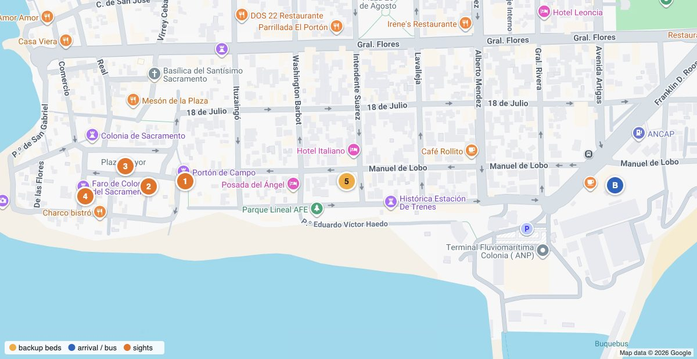
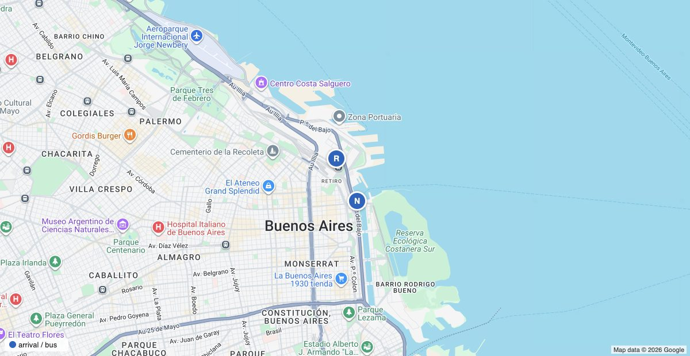

# 🇺🇾 Colonia stopover → Buenos Aires → Córdoba

Part of the [LatAm itinerary](../itinerary.md) · region notes: [Paraguay + Uruguay](paraguay-uruguay.md) · ← [Cabo Polonio](cabo-polonio.md) · [Córdoba + Los Gigantes](cordoba.md) →

> **Day 25 · Fri 1 Jan 2027 · no night in Colonia · New Year's Day** 
> 🏞️ A 4½-hour stopover in Colonia's UNESCO old town, then the ferry across the Río de la Plata and a night bus to Córdoba 
> 🛏️ No bed: you sleep on the night bus (cama, ≈ $44–48) 
> 🚌 **In:** COT from Montevideo, 09:30 → 12:20 · **Out:** Colonia Express 18:00 → Buenos Aires 19:15, then Retiro → Córdoba 21:00 or 22:20

The Río de la Plata and the port from Colonia's lighthouse. Photo: Google Maps.

## 🗺️ Map

**Colonia:** **B** [bus terminal](https://www.google.com/maps?ftid=0x95a31268d28d22d3:0xbe92547b4932d9f7) (the ferry terminal is next to it) · **1** [Portón de Campo](https://www.google.com/maps?ftid=0x95a313e7eb031f6d:0x962d5ee292ed96e4) · **2** [Calle de los Suspiros](https://www.google.com/maps?ftid=0x95a3125cd6d25039:0x212db478dc6ff074) · **3** [Plaza Mayor](https://www.google.com/maps?ftid=0x95a3125cdcbfffff:0xdb753d8f7a0375eb) · **4** [Lighthouse](https://www.google.com/maps?ftid=0x95a3125cb88d65e7:0x677c7ec2aa26e4c8) and the [San Francisco convent ruins](https://www.google.com/maps?ftid=0x95a3125cc716267d:0xfb207e586da1d8f8) · **5** [Casarão Sacramento Hostel](https://www.google.com/maps?ftid=0x95a313af76225f29:0xb265d8d82ca13cd9) (🎆 New Year option, see below, [book](https://www.booking.com/hotel/uy/casarao-sacramento-hostel-amp-suites.html?checkin=2026-12-30&checkout=2027-01-01&group_adults=1&no_rooms=1&group_children=0&selected_currency=USD))

**Buenos Aires:** **N** [Buquebus, Dársena Norte](https://www.google.com/maps?ftid=0x95a335345c78628d:0x8eaa9ddf5a38eaaa) (15-min walk to Retiro) · **R** [Retiro bus terminal. Colonia Express lands at **Dársena Sur](https://www.google.com/maps?ftid=0x95bccab3c1ba6d5b:0x7d3428efec4f1321)** (Av. Pedro de Mendoza, at the La Boca edge), towards the bottom of this map, ≈ 20 min by taxi to Retiro.

**Open the live map:** [Colonia old town](https://www.google.com/maps/@-34.4720,-57.8480,16z) · [Rambla to Real de San Carlos](https://www.google.com/maps/@-34.4560,-57.8560,14z) · [Buenos Aires port](https://www.google.com/maps/@-34.6050,-58.3700,13z)

## 📅 The day

| Time | Plan |
|---|---|
| **Before 09:30** | 🚶 Walk the 2.5 km (30 min) from MedioMundo to Tres Cruces: there are no city buses on 1 Jan. |
| **09:30 → 12:20** | 🚌 **COT** Tres Cruces → Colonia. |
| **12:20 → 17:00** | 🏛️ **Barrio Histórico** walk (all free), a picnic on the Rambla, the lighthouse if you like. ⚠ Sort out the bag first (see Good to know). |
| **≈ 17:00** | ⛴️ Check in and clear joint immigration ≈ 1 h before the ferry. |
| **18:00 → 19:15** | ⛴️ **Colonia Express** to Buenos Aires (Dársena Sur), then a taxi or Uber to Retiro (≈ 20 min). |
| **21:00 or 22:20** | 🚌 **Night bus** Retiro → Córdoba (Betel 21:00 → 06:00, or El Práctico 22:20 → 07:10). |

## 🔖 Book (one click)

Prices move, so compare the channels shown (first = cheapest when checked on 24 Nov). ⚠️ = time-sensitive.

**Transport** (all times verified; ✅ = seen on sale for 1 Jan)

| | Leg | When | Price | Book |
|---|---|---|---:|---|
| In | **COT** · Tres Cruces → Colonia | **Fri 1 Jan 09:30 → 12:20** (or 11:30 → 14:20) | UYU 579 ≈ **$14** | [COT](https://www.cot.com.uy/) |
| ⛴️ Ferry | **Colonia Express** · Colonia → Buenos Aires (Dársena Sur), "Super Económica" | **18:00 → 19:15** (or 20:15 if you take the later COT) | UYU 1,943 ≈ **$48** ✅ | [Colonia Express](https://book.coloniaexpress.com/) |
| ⛴️ Ferry, alt | **Buquebus** · Colonia → Buenos Aires (Dársena Norte) | 17:01 → 18:16 | UYU 2,198 ≈ $54 ✅ | [Buquebus](https://www.buquebus.com/uy) |
| ⚠️ Fallback | **Colonia Express through-ticket** (bus + ferry) · Montevideo → Buenos Aires, no Colonia stopover | 12:45 → 17:30 | UYU 2,143 ≈ $53 ✅ | [Colonia Express](https://book.coloniaexpress.com/) |
| 🚌 Night bus | **Betel** · Retiro → Córdoba, Cama Ejecutivo | 21:00 → 06:00 | ARS 75,000 ≈ **$48** ✅ | [Plataforma10](https://www.plataforma10.com.ar/) |
| 🚌 Night bus | **El Práctico** · Retiro → Córdoba, Cama Low Cost (the cheapest cama) | 22:20 → 07:10 | ARS 70,000 ≈ **$44** ✅ | [Plataforma10](https://www.plataforma10.com.ar/) |
| 🚌 Night bus | **General Urquiza** · Retiro → Córdoba, full Cama | 21:31 → 06:30 | ARS 116,400 ≈ $74 ✅ | [Plataforma10](https://www.plataforma10.com.ar/) |
| 🎆 Shift | Night bus Buenos Aires → Córdoba **Sat 2 Jan** (38 departures on Plataforma10 on 25 Nov; 30 on 1 Jan) | 21:00–23:05 | same fares | [Plataforma10](https://www.plataforma10.com.ar/servicios/buscar-pasajes/Retiro/Cordoba/10/19/02-01-2027/_/1/0/0) |

**Beds** (only if the day slips)

| | Where | Total | Location | From the bus terminal | Book |
|---|---|---:|:---:|---|---|
| 🎆 If 1 Jan doesn't work | **MedioMundo Hostel**, Montevideo · 1 → 2 Jan, then this plan on Sat 2 Jan | $25.24 (HW) ✅ | 9.4 | see the [Montevideo guide](montevideo.md) | Hostelworld |
| 🎆 New Year in Colonia instead | **Casarão Sacramento Hostel**, Colonia · bed in an 8-bed mixed dorm, 30 Dec → 1 Jan (replaces Montevideo's New Year and this morning's bus) | $40 | 9.8 | 🚶 7 min (450 m) from Colonia's bus terminal; old town 5 min on foot · [route](https://www.google.com/maps/dir/?api=1&origin=-34.4726414,-57.8425142&destination=-34.472580,-57.847469&travelmode=walking) | [Booking](https://www.booking.com/hotel/uy/casarao-sacramento-hostel-amp-suites.html?checkin=2026-12-30&checkout=2027-01-01&group_adults=1&no_rooms=1&group_children=0&selected_currency=USD) |

How to read these tables

- **Location** is the guests' location score on Booking.com. The target is 9.0 or higher, and ⚠️ marks one below 9.0.
- **From the bus terminal** comes from Google Maps on 24 Nov. The **route** link opens the same route.
- Symbols: 🚶 walk · 🚌 public transport · 🚕 taxi/rideshare · ⛴️ ferry.
- The Casarão total ($40) is from the itinerary's holiday table; the full row is in the [Montevideo guide](montevideo.md).

## 🚌 Getting here: Montevideo → Colonia, Fri 1 Jan

- **COT 09:30 Tres Cruces → Colonia 12:20** · UYU 579 ≈ **$14**.
- **Walk the 2.5 km to Tres Cruces,** because there are no city buses on 1 Jan.
- **If holiday service has cut the morning buses,** take the 11:30 → 14:20 and the 20:15 ferry.
- **If COT isn't running at all,** use the **Colonia Express through-ticket** (Montevideo 12:45 → Buenos Aires 17:30, UYU 2,143 ≈ $53, ✅ on sale for 1 Jan). That loses the stopover but keeps the night bus.

## 🛏️ Where to sleep

**No night in Colonia:** the night bus to Córdoba is the bed (Cama Ejecutivo or Cama Low Cost, see the table).

### 🎆 Holiday backups
- **Shift the whole day to Sat 2 Jan** if 1 Jan doesn't work (e.g. the holiday bus doesn't run).
  - It costs **one more Montevideo night**: MedioMundo has beds on 1 Jan at **$25.24 on HW** ✅.
  - You arrive in Córdoba on 3 Jan, eating a day of the 12 spare.
- **New Year in Colonia** instead of Montevideo: Casarão Sacramento, dorm, location 9.8, $40. It removes the 1 Jan bus (see the [Montevideo guide](montevideo.md)).

## 🌳 Things to do (free and outdoors first)

<table>
<tr>
<td width="50%" valign="top"> <b><a href="https://www.google.com/maps?ftid=0x95a313e7eb031f6d:0x962d5ee292ed96e4">Portón de Campo</a></b> and the old walls · free The way into the Barrio Histórico (UNESCO), 500 m from the terminals.</td>
<td width="50%" valign="top"> <b><a href="https://www.google.com/maps?ftid=0x95a3125cd6d25039:0x212db478dc6ff074">Calle de los Suspiros</a></b> · free The old town's famous cobbled lane.</td>
</tr>
<tr>
<td width="50%" valign="top"> <b><a href="https://www.google.com/maps?ftid=0x95a3125cdcbfffff:0xdb753d8f7a0375eb">Plaza Mayor</a></b> · free The main square of the Barrio Histórico.</td>
<td width="50%" valign="top"> <b><a href="https://www.google.com/maps?ftid=0x95a3125cb88d65e7:0x677c7ec2aa26e4c8">Lighthouse climb</a></b> · small fee Optional. The hero photo above is the view from the top.</td>
</tr>
<tr>
<td width="50%" valign="top"> <b><a href="https://www.google.com/maps?ftid=0x95a312f1d7b062fd:0xe096ed9cf6f8b48e">The Rambla</a></b> · free The waterfront Rambla; eating is dear here, so picnic on it.</td>
<td width="50%" valign="top"> <b><a href="https://www.google.com/maps?ftid=0x95a312d0b33bb5ff:0x70ccaa876da3e19b">Plaza de Toros, Real de San Carlos</a></b> · 4–5 km Rambla walk ≈ The restored bullring, if there's time.</td>
</tr>
</table>

**Barrio Histórico walk (UNESCO, all free):**
- Portón de Campo and the old walls.
- Calle de los Suspiros.
- Plaza Mayor.
- The ruins of the San Francisco convent.
- The waterfront Rambla.
- Optional: the lighthouse climb (small fee).
- If there's time, the Rambla walk (4–5 km) to the restored Plaza de Toros at Real de San Carlos ≈.

## 🍽️ Eat and drink

- **Eating is dear here,** so picnic on the Rambla.

## ℹ️ Good to know
- ⚠ **Luggage storage is not confirmed.**
  - A Tripadvisor report (Dec 2022) says the bus terminal's guardaequipaje has closed.
  - An independent port guide (3 Nov 2026) finds no official storage in the ferry terminal.
  - Pre-book a **Radical Storage / Qeepl** partner near the terminals (from ≈ $4/day, bookable online), or carry only a light pack.
- **The bus and ferry terminals are next to each other,** 500 m from the old town.
- **Ferry check-in:** check in and clear joint immigration ≈ 1 h before.
- **Which ferry:**
  - Buquebus lands at **Dársena Norte**, a 15-min walk to Retiro.
  - Colonia Express lands at **Dársena Sur** (Av. Pedro de Mendoza, La Boca edge), ≈ 20 min by taxi or Uber to Retiro (≈ ARS 9–12k, $6–8 ≈).
  - The two cost about the same once you add the taxi, so pick Colonia Express for the extra hour in Colonia, or Buquebus for less hassle.

## 🚌 Leaving: Buenos Aires → Córdoba, Fri 1 → Sat 2 Jan

- **Betel Ejecutivo 21:00 → 06:00**, Cama Ejecutivo ARS 75,000 ≈ **$48**.
- Or **El Práctico 22:20 → 07:10**, Cama Low Cost ARS 70,000 ≈ **$44** (the cheapest cama).
- Or General Urquiza 21:31 → 06:30, full Cama ARS 116,400 ≈ $74.
- All ✅ on Plataforma10 for 1 Jan, with seats free. Buy on Plataforma10 or the operator's site.

**Day total ≈ $14 + $48 + $7 + $44–48 ≈ $115.** That compares with Buquebus' direct Montevideo → Buenos Aires ferry ("Francisco", 11:00 → 13:45, UYU 3,371 ≈ $83) plus the same night bus, which skips Colonia.

<b>If 1 Jan doesn't work: the same plan on Sat 2 Jan</b> (+1 Montevideo night, Córdoba on 3 Jan)

- **When:** e.g. the holiday bus doesn't run.
- **Ferries on 2 Jan:** Colonia Express sails at 10:00, 12:55, 15:30, 18:00, 19:30, 22:00 and 23:30 (UYU 1,943–2,508); Buquebus at 11:20, 13:30, 17:01 and 22:40.
- **Night buses on 2 Jan:** Plataforma10 shows Retiro → Córdoba buses at 21:00–23:05 at the same fares ([Plataforma10, 2 Jan](https://www.plataforma10.com.ar/servicios/buscar-pasajes/Retiro/Cordoba/10/19/02-01-2027/_/1/0/0)).
- **Cost:** one more Montevideo night (MedioMundo has beds on 1 Jan at $25.24 on HW ✅), and you arrive in Córdoba on 3 Jan, eating a day of the 12 spare.

---
Photos: Google Maps contributors (view from the lighthouse, Portón de Campo, Plaza Mayor, lighthouse, Rambla, Plaza de Toros). Wikimedia Commons: <a href="https://commons.wikimedia.org/wiki/File:Calle_de_los_Suspiros_towards_the_sea.JPG">Calle de los Suspiros</a> (Ypsilon from Finland, CC0).
