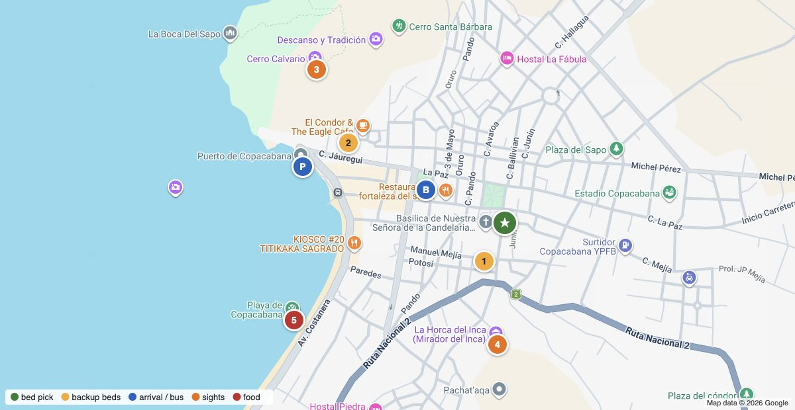
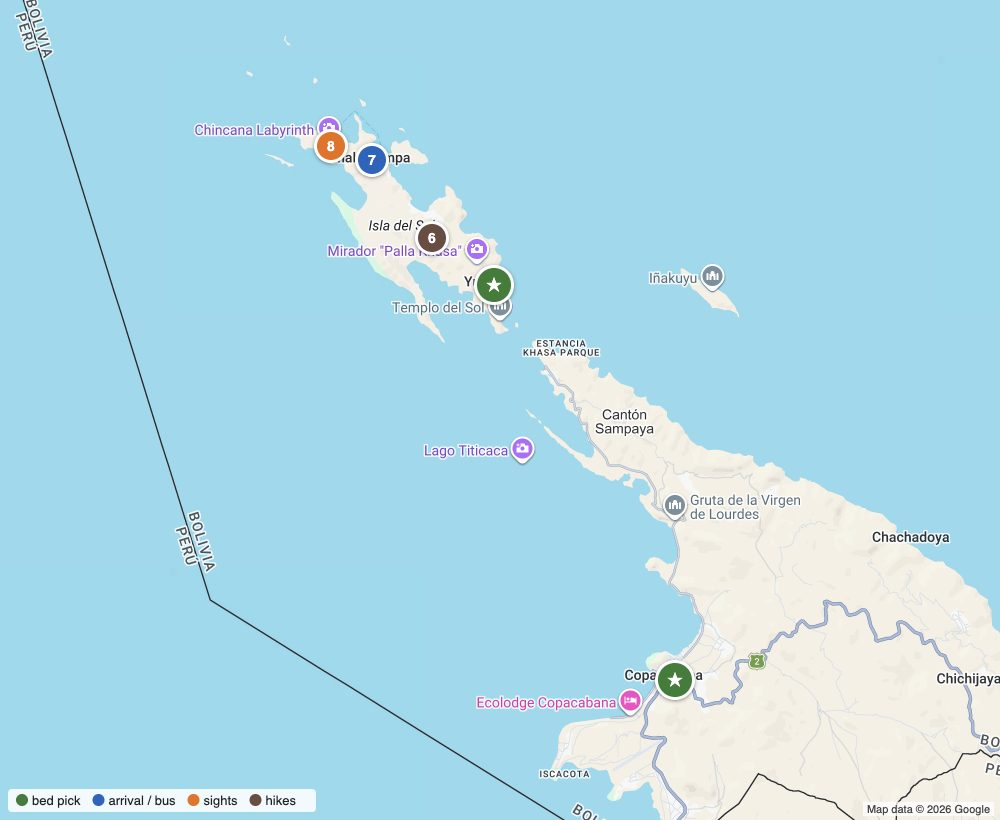

# 🇧🇴 Copacabana + Isla del Sol

Part of the [LatAm itinerary](../itinerary.md) · region notes: [Chile + Bolivia](chile-bolivia.md) · ← [La Paz](la-paz.md) · [Puno](puno.md) →

> **Stop 21 · Wed 27 → Fri 29 Jan 2027 (days 51–53) · 2 nights (1 on Isla del Sol, 1 in Copacabana)**
> 🏞️ Lake Titicaca: a night on Isla del Sol and the Inca ridge walk across it, up to 4,050 m 
> 🛏️ **Inti Wasi Lodge** on the island, $18 · then **Mia Posada** in Copacabana, $17 (≈ $35–37 for both nights) 
> 🚌 **In:** Vicuña Travel from La Paz, Wed 07:30 · **Out:** bus to Puno, Fri after midday (13:30)

Copacabana's bay from the hill above town. Photo: Google Maps (<a href="https://www.google.com/maps?ftid=0x915dd2809384392d:0x5fcaae1cbab8692e">Playa de Copacabana</a>).

## 🗺️ Map

**In town:** ★ **Mia Posada** (night-2 pick) · **1** Hostal Florencia (backup) · **2** Hostal Las Olas (private alt; Hotel La Cúpula is ≈ 50 m away) · **B** bus stop (Plaza Sucre) · **P** [pier](https://www.google.com/maps?ftid=0x915dd27ea339c451:0x7b00bc4ee77465c5) (boats to Isla del Sol) · **3** [Cerro Calvario](https://www.google.com/maps?ftid=0x915dd279618bde5f:0x254f01f54680b526) viewpoint · **4** [Horca del Inca](https://www.google.com/maps?ftid=0x915dd287d8e2a74d:0x6c966ab422da27e) (Kesanani) · **5** [waterfront and trout tents](https://www.google.com/maps?ftid=0x915dd2809384392d:0x5fcaae1cbab8692e)

**Isla del Sol:** ★ **Inti Wasi Lodge**, Yumani (night-1 pick; Inti Wayra backup, the [Yumani pier](https://www.google.com/maps?ftid=0x915dc5817c0d2a77:0x2555dafa4dc5480f) and the [Inca stairway](https://www.google.com/maps?ftid=0x915dc50b4fa32d59:0x8afcbfd9994982d0) are all within ≈ 400 m) · **6** [Challa](https://www.google.com/maps?ftid=0x915dc5997250f315:0x8c227e8596da142a) (mid-island, on the ridge walk) · **7** [Challapampa](https://www.google.com/maps?ftid=0x915dc42b8e26143f:0x6ba7b57cc3898522) (boat back) · **8** [Chincana ruins](https://www.google.com/maps?ftid=0x915dc69ab5a64f05:0xb3d4057308574337) and the [Sacred Rock](https://www.google.com/maps?ftid=0x915dc68529975141:0xc5a7fe1796ae3933) · ★ Copacabana (bottom right)

**Open the live map:** [Copacabana](https://www.google.com/maps/@-16.1660,-69.0880,16z) · [Isla del Sol](https://www.google.com/maps/@-16.08,-69.14,12z)

## 📅 Day by day

| Day | Plan |
|---|---|
| **Wed 27 Jan** | 🚌 **07:30 Vicuña Travel** from La Paz, arriving ≈ 11:30 (launch across the Tiquina strait on the way). Leave the big bag at the night-2 hostel. ⛴️ **13:30 boat to Yumani** (≈ 1.5 h). Climb the Inca stairway, sunset from the ridge, sleep on the island. |
| **Thu 28 Jan** | 🥾 **07:00 ridge walk Yumani → Challa → Challapampa** (≈ 8–12 km, 3–4 h, up to 4,050 m). Boat back from Challapampa ≈ 13:00–13:30. 🐟 Trout on the waterfront. Night in Copacabana. |
| **Fri 29 Jan** | 🌅 Sunrise on the **Horca del Inca** or the Calvario hill. 🚌 Bus to **Puno** after midday (13:30). |

## 🔖 Book (one click)

Dates and 1 adult are pre-filled. The first channel listed was the cheapest when checked on 24 Nov. ⚠️ = time-sensitive.

**Beds** (night 1: 27 → 28 Jan on the island · night 2: 28 → 29 Jan in Copacabana)

| | Where | Total | Location | From the pier / bus stop | Book |
|---|---|---:|:---:|---|---|
| ⭐ **Pick, night 1** | **Inti Wasi Lodge**, Yumani · double, private bathroom, breakfast | **$18** | 9.6 | 🥾 boat to Yumani pier, then a steep stairway walk; Google Maps walk 13 min (600 m) · [route](https://www.google.com/maps/dir/?api=1&origin=-16.038460999999998,-69.1444077&destination=-16.036048,-69.1472613&travelmode=walking) | [Booking](https://www.booking.com/hotel/bo/inti-wasi-lodge-la-paz.html?checkin=2027-01-27&checkout=2027-01-28&group_adults=1&no_rooms=1&group_children=0&selected_currency=USD) |
| Backup, night 1 | **Hostal Inti Wayra**, Yumani · twin, shared bathroom, breakfast | $26 | 9.1 | 🥾 boat to Yumani pier, then a steep stairway walk; Google Maps walk 15 min (600 m) · [route](https://www.google.com/maps/dir/?api=1&origin=-16.038460999999998,-69.1444077&destination=-16.0376583,-69.1473793&travelmode=walking) | [Booking](https://www.booking.com/hotel/bo/hostal-inti-wayra.html?checkin=2027-01-27&checkout=2027-01-28&group_adults=1&no_rooms=1&group_children=0&selected_currency=USD) |
| ⭐ **Pick, night 2** | **Mia Posada Hostel & Coworking** · single private room with bathroom | **$17** | 10.0 *(HW)* | 🚶 walk 7 min (450 m) from the bus stop (Plaza Sucre); centre 3 min on foot · [route](https://www.google.com/maps/dir/?api=1&origin=-16.1651831,-69.0876162&destination=-16.166212599999998,-69.085061&travelmode=walking) | [Hostelworld](https://www.hostelworld.com/hostels/p/322936/mia-posada-hostel-coworking/?from=2027-01-28&to=2027-01-29&guests=1) |
| Backup, night 2 | **Hostal Florencia** · single, shared bathroom | $6.08 | — | — | Hostelworld |
| Private alt, night 2 | **Hostal Las Olas** · Suite with lake view | $92 | 9.7 | 🚶 walk 7 min (400 m) from the bus stop (Plaza Sucre); centre 10 min on foot · [route](https://www.google.com/maps/dir/?api=1&origin=-16.1651831,-69.0876162&destination=-16.1637249,-69.0901256&travelmode=walking) | [Booking](https://www.booking.com/hotel/bo/hostal-las-olas.html?checkin=2027-01-28&checkout=2027-01-29&group_adults=1&no_rooms=1&group_children=0&selected_currency=USD) · [Agoda](https://www.agoda.com/partners/partnersearch.aspx?hid=3012976&checkin=2027-01-28&checkout=2027-01-29&NumberofAdults=1&Rooms=1) |

**Transport**

| | Leg | When | Price | Book |
|---|---|---|---:|---|
| In | 🚌 **Vicuña Travel** · La Paz → Copacabana (semi-cama) | **Wed 27 Jan 07:30 → ≈ 11:30** | ≈ $7 (Tickets Bolivia; the counter is cheaper) | La Paz main bus terminal |
| Boat | ⛴️ Copacabana → **Yumani** (south of the island) | **Wed 27 Jan 13:30**, ≈ 1.5 h | ≈ Bs 30–40 one way | pier office; insist on a ticket |
| Boat | ⛴️ **Challapampa** → Copacabana | Thu 28 Jan ≈ 13:00–13:30 (fallback: Yumani 15:00–16:00) | — | at the pier |
| Out | 🚌 **Titicaca Bolivia Bus** · Copacabana → Puno | **Fri 29 Jan 13:30 → 16:30** | $10 | [Titicaca Bolivia Bus](https://titicacaboliviabus.com/trip/copacabana-puno/) (see the [Puno guide](puno.md)) |

How to read these tables

- **Location** is the guests' location score on Booking.com. The target is 9.0 or higher, and ⚠️ would mark one below 9.0. *(HW)* means Hostelworld's location rating, used where a property isn't on Booking.
- **From the pier / bus stop** comes from Google Maps on 24 Nov: the property found on Maps and routed from where you arrive at midday on the check-in date (Yumani pier on the island, Plaza Sucre in Copacabana). The **route** link opens the same route.
- Symbols: 🚶 walk · 🚌 public transport · 🚕 taxi/rideshare · 🥾 hike only · ⚠️ far from the centre with no bus · ℹ️ outside the centre but on a bus line.
- Prices move, so compare the channels shown.

## 🚌 Getting here: La Paz → Copacabana, Wed 27 Jan

- **Bus, ≈ 4 h**, from La Paz's main bus terminal (90 m from Casa Bonita).
- **Schedule** from Tickets Bolivia (24 Nov; their price US$7, the counter is cheaper):
  - 07:00 Manco Kapac;
  - **07:30 Vicuña Travel** (semi-cama, arr ≈ 11:30), the pick;
  - 08:00 Trans Titicaca;
  - 08:00, 10:00 and 13:30 Manco Kapac.
- At the **[Tiquina strait](https://www.google.com/maps?ftid=0x915e81d103237d29:0xf3d16e5755f08d9)** you get off and cross by launch (≈ Bs 2) while the bus goes on a barge.
- The strait closes at 18:30, so there are **no evening buses**.

## 🛏️ Where to sleep

All live-checked on 24 Nov. Section total **≈ US$35–37** for both nights.

### ⭐ Pick, night 1 (27 Jan, on the island): Inti Wasi Lodge, Yumani
- **Unit:** double room with private bathroom, breakfast.
- **Price:** **US$18** (non-refundable) or US$20 (free cancellation to 26 Jan), Booking.
- **Reviews:** Booking 8.8, 230 reviews, **3.0% below 7**, location 9.6.
- **Where:** near the top of the Yumani village, with lake views.
- ⚠️ Basic bathroom, cold at night.
- Isla del Sol has 0 Hostelworld listings.

### ⭐ Pick, night 2 (28 Jan, Copacabana): Mia Posada Hostel & Coworking
- **Unit:** single private room with bathroom.
- **Price:** **US$17** on Hostelworld (not on Booking; listed on Agoda with no price for 28 Jan).
- **Reviews:** Hostelworld 9.7 (157; 1 of 10 reviews in the last 12 months below 70).
- **Where:** 0.2 km from the plaza, 0.6 km from the pier.
- **Checks:** ✅ kitchen with stove · quiet, "more hotel than hostel", not social.
- **Why a private:** Copacabana has no well-reviewed dorm (the best dorm on Hostelworld has 21 reviews), and a private is as cheap.

### Backup
- **Island: Hostal Inti Wayra**, Yumani · twin with shared bathroom, breakfast · Booking 202 reviews, 3.0% below 7, location 9.1 · **US$26** (free cancellation) · high up the hill; weak Wi-Fi.
- **Copacabana: Hostal Florencia** · single, shared bathroom · Hostelworld 9.4 (365; 3% below 70 in 12 months) · **US$6.08** · no kitchen, very quiet.

### Private alt (location first): Hostal Las Olas
- Suite with lake view. **US$92 for 1 night** (night 2; room table) on Booking (Agoda US$184 for both nights, the same rate).
- Booking location **9.7**, 896 reviews, **0.8% below 7**.
- The famous whimsical lake-view suites at the foot of Cerro Calvario.
- **Value version:** Hotel La Cúpula, Standard Double, breakfast, location 9.4, 760 reviews, US$43.

## 🌳 Things to do (free and outdoors first)

<table>
<tr>
<td width="50%" valign="top"> <b><a href="https://www.google.com/maps?ftid=0x915dc5997250f315:0x8c227e8596da142a">Isla del Sol ridge walk</a></b> · fees ≈ Bs 25–55 in total Yumani → Challa → Challapampa, ≈ 8–12 km, 3–4 h, up to 4,050 m. The main event.</td>
<td width="50%" valign="top"> <b><a href="https://www.google.com/maps?ftid=0x915dc50b4fa32d59:0x8afcbfd9994982d0">Inca stairway, Yumani</a></b> · Yumani fee Steep, straight from the pier: go slowly. Then sunset from the ridge.</td>
</tr>
<tr>
<td width="50%" valign="top"> <b><a href="https://www.google.com/maps?ftid=0x915dc69ab5a64f05:0xb3d4057308574337">Chincana ruins</a></b> and the <a href="https://www.google.com/maps?ftid=0x915dc68529975141:0xc5a7fe1796ae3933">Sacred Rock</a> · Challapampa fee ≈ Bs 10–15 The north end of the walk, if the north is open.</td>
<td width="50%" valign="top"> <b><a href="https://www.google.com/maps?ftid=0x915dd287d8e2a74d:0x6c966ab422da27e">Horca del Inca</a></b> (Kesanani) · sunrise, Fri 29 An Inca astronomical stone on the hill above town.</td>
</tr>
<tr>
<td width="50%" valign="top"> <b>Waterfront + <a href="https://www.google.com/maps?ftid=0x915dd279618bde5f:0x254f01f54680b526">Calvario hill</a></b> · free The Copacabana waterfront, and sunset or sunrise from the hill above the bay.</td>
<td width="50%" valign="top"> <b><a href="https://www.google.com/maps?ftid=0x915e81d103237d29:0xf3d16e5755f08d9">Tiquina strait</a></b> · launch ≈ Bs 2 On the way in from La Paz: you cross by launch while the bus goes over on a barge.</td>
</tr>
</table>

**Paid tours aren't needed:** the public boats do it all.

**Wed 27 Jan, to the island:**
- Arrive ≈ 11:30. Leave the big bag at the night-2 hostel.
- Take the **13:30 boat to Yumani** (south, ≈ 1.5 h, ≈ **Bs 30–40** one way at the pier). Buy at the pier office and insist on a ticket.
- Climb the Inca stairway (steep: go slowly). Sunset from the ridge, then sleep on the island.

**Thu 28 Jan, the ridge walk:**
- Start at 07:00 and walk the ridge **Yumani → Challa → Challapampa**, ≈ 8–12 km, 3–4 h, up to 4,050 m.
- **Community fees** in cash, small notes; keep every stub: Yumani ≈ Bs 10–20, Challa ≈ Bs 5–20, Challapampa (Chincana ruins and the Sacred Rock) ≈ Bs 10–15.
- **Boat back** from Challapampa ≈ 13:00–13:30.
- **If the north is closed:** walk to the Challa boundary and back, then take the 15:00–16:00 boat from Yumani.
- Night 2 in Copacabana.

**Fri 29 Jan:** sunrise on the **Horca del Inca** (Kesanani) hill, an Inca astronomical stone, or the Calvario hill viewpoint above the bay; then the bus to Puno.

**North–south walk status for 2026–27:**
- AllTrails hikers logged the full Challapampa ↔ Yumani walk in **Aug, Sep and Oct 2026**.
- Take Your Backpack (Oct 2026) describes separate north and south fees; Bus Hop and Bolivian Life say open.
- La Paz Life (Aug 2026) still calls the north "intermittently restricted" by the long-running community dispute (since ≈ 2017).
- **Verdict: likely open.** Ask your Copacabana hostel the day before, and treat the south as the fallback.

## 🍽️ Eat and drink

<table>
<tr>
<td width="50%" valign="top"> <b><a href="https://www.google.com/maps?ftid=0x915dd2809384392d:0x5fcaae1cbab8692e">Trucha on the waterfront</a></b> · Bs 25–35 (US$2–3) Titicaca trout, grilled or fried, with rice, chips and salad, at the white tents. Agree the price first.</td>
<td width="50%" valign="top"><b>On Isla del Sol</b> · set dinners in the lodges Simple set dinners where you sleep. Bring snacks and water: prices rise on the trail.</td>
</tr>
</table>

Prices are ≈ AI-summary leads, Nov 2026.

## ℹ️ Good to know
- **The wettest stop of the trip:** 185 mm, rain on 19 January days; mornings are usually dry.
- **Boats can be cancelled in storms**, so keep 29 Jan's bus to Puno for after midday.
- **Cash only on the island:** no ATMs there, and Copacabana's run dry at weekends (the 27th is a Wednesday, so you're fine).
- **Altitude:** 3,810–4,050 m.
- **Candelaria:** Copacabana's big festival is 2–5 Feb, after you leave.

## 🚌 Leaving: bus to Puno, Fri 29 Jan

- **Titicaca Bolivia Bus 13:30 → 16:30, US$10** (or 18:00), via the Kasani / Yunguyo border.
- Keep it for after midday in case a boat is cancelled.
- Border steps, other operators and the Puno bed are in the [Puno guide](puno.md).

---
Photos: Google Maps contributors (Playa de Copacabana, Challa, Escalera del Inca, Chincana, Horca del Inca, Cerro Calvario, Estrecho de Tiquina). Wikimedia Commons: <a href="https://commons.wikimedia.org/wiki/File:Trucha_frita_con_vista_al_puerto_de_Copacabana.jpg">Trucha frita con vista al puerto de Copacabana</a> (Mferjh, CC BY-SA 4.0).
