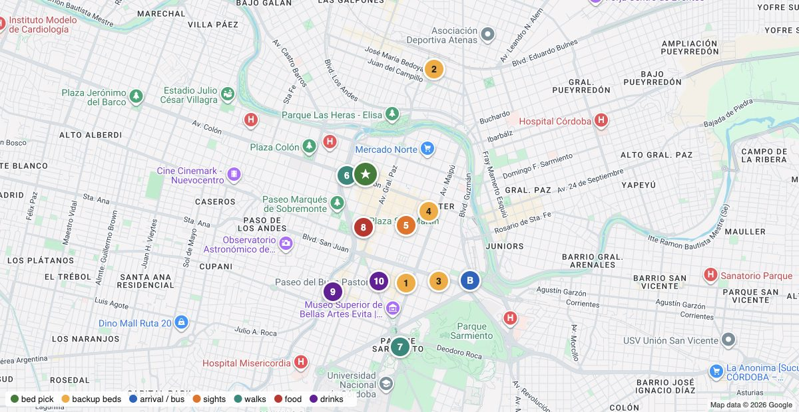
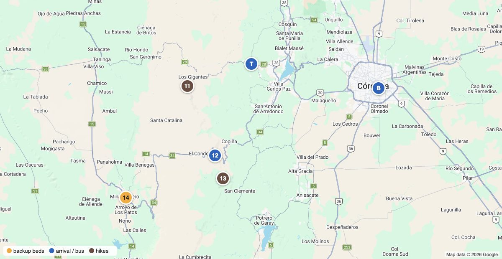
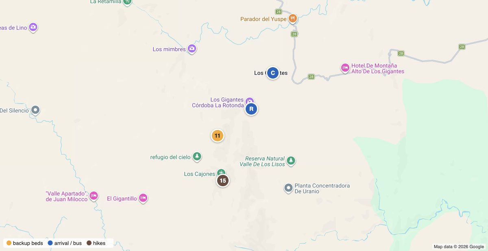

# 🇦🇷 Córdoba + Los Gigantes

Part of the [LatAm itinerary](../itinerary.md) · region notes: [Argentina](argentina.md) · ← [Colonia stopover → Buenos Aires → Córdoba](colonia.md) · [Cafayate](cafayate.md) →

> **Stop 12 · Sat 2 → Thu 7 Jan 2027 · 5 nights (3 in the city + 2 in the Los Gigantes refugio) · Argentine summer holidays (peak)** 
> 🏞️ A city hub for two free Sierras hikes: the condor gorge of Quebrada del Condorito and the granite massif of Los Gigantes 
> 🛏️ **Aldea Hostel Córdoba**, dorm, $41 for 3 nights · **Refugio Aurelio Castelli** (Club Andino), 2 nights, price on request 
> 🚌 **In:** night bus from Buenos Aires, early Sat 2 Jan · **Out:** night bus to Tucumán, Thu 7 Jan 20:15/20:30 (or 23:45)

The granite of Los Gigantes, from the La Rotonda side. Photo: Google Maps.

## 🗺️ Map

**In the city:** ★ **[Aldea Hostel Córdoba](https://www.google.com/maps?ftid=0x943298792a6b9d6d:0xdf253af57f90927c)** (the pick, [book](https://www.booking.com/hotel/ar/aldea-hostel.html?checkin=2027-01-02&checkout=2027-01-04&group_adults=1&no_rooms=1&group_children=0&selected_currency=USD)) · **1** [Lacandona Hostel](https://www.google.com/maps?ftid=0x95cc428c3eaf243f:0x421e6623baa3adec) (backup, [book](https://www.booking.com/hotel/ar/lacandona-hostel.html?checkin=2027-01-02&checkout=2027-01-04&group_adults=1&no_rooms=1&group_children=0&selected_currency=USD)) · **2** [Faz Hostel](https://www.google.com/maps?ftid=0x943299c08418896f:0xf77f1382db62f53a) (backup 2, [book](https://www.hostelworld.com/hostels/p/315620/faz-hostel/?from=2027-01-02&to=2027-01-04&guests=1)) · **3** [Alto Paraná Depto](https://www.google.com/maps?ftid=0x9432a2909121ec45:0x4c2c4de79ff02036) (private alt, [book](https://www.booking.com/hotel/ar/alto-parana-depto-en-nueva-cordoba.html?checkin=2027-01-02&checkout=2027-01-04&group_adults=1&no_rooms=1&group_children=0&selected_currency=USD)) · **4** [Hostel Alvear](https://www.google.com/maps?ftid=0x9432a29cf789bb7b:0xc1e0feec8ac197d1) (third option; private for 6 → 7) · **B** [bus terminal](https://www.google.com/maps?ftid=0x9432a2971222637b:0xe981317ad406c172) · **5** [Plaza San Martín](https://www.google.com/maps?ftid=0x94329902eb0b2faf:0x4382bb478dc6e982) and the [Cabildo](https://www.google.com/maps?ftid=0x9432a28340e9d9f5:0x10d5791e61043311) · **6** [La Cañada](https://www.google.com/maps?ftid=0x9432987ee26e2099:0x11723b3fbf2e71f8) · **7** [Parque Sarmiento](https://www.google.com/maps?ftid=0x9432a294dad873df:0xac61ff67fc85d50a) · **8** [La Vieja Esquina](https://www.google.com/maps?ftid=0x9432986f9eb90f67:0xf17c6d17d4133419) · **9** [Cervecearte](https://www.google.com/maps?ftid=0x9432a30078c434e1:0xf5d7e7bcf27d089c) (Güemes) · **10** [Craft Beer Community House](https://www.google.com/maps?ftid=0x9432a2859a91f1b9:0x70d49da7e15ba1)

**The Sierras:** **B** [Córdoba bus terminal](https://www.google.com/maps?ftid=0x9432a2971222637b:0xe981317ad406c172) · **T** [Tanti](https://www.google.com/maps?ftid=0x942d6e1f05e4b7ed:0xb64274d37f53ce0b) · **11** [Refugio Aurelio Castelli](https://www.google.com/maps?ftid=0x942d13d317aceb01:0xabfd6c3d81a6a0f3), Los Gigantes · **12** [Quebrada del Condorito NP](https://www.google.com/maps?ftid=0x942d47957399fb5d:0xd16bd8f0f2ffb4f4) (Google's park pin on RP34) · **13** [Balcón Norte](https://www.google.com/maps?ftid=0x942d47c38805da15:0xe05fed7ec822c748) (Mirador Norte) · **14** [Mina Clavero](https://www.google.com/maps?ftid=0x942d25d59048c4dd:0xa693b3400e45cb6c) (fallback base)

**Los Gigantes:** **11** [Refugio Aurelio Castelli](https://www.google.com/maps?ftid=0x942d13d317aceb01:0xabfd6c3d81a6a0f3) · **R** [La Rotonda](https://www.google.com/maps?ftid=0x9432a2deee71c04b:0x3b8160c4e9db048f) · **C** [Casas Nuevas](https://www.google.com/maps?ftid=0x942d12440ac0b01b:0xb934e666617a8774) (the two trailheads and bus stops on RP28) · **15** [Los Cajones](https://www.google.com/maps?ftid=0x942d1300366ea105:0x9eba5e54bc3d23a9). Cerro Mogote is ≈ 2 km from the refugio (not pinned).

**Open the live map:** [city](https://www.google.com/maps/@-31.4170,-64.1850,15z) · [Sierras](https://www.google.com/maps/@-31.5300,-64.5900,10z) · [Los Gigantes](https://www.google.com/maps/@-31.4130,-64.7920,14z)

## 📅 Day by day

| Day | Plan |
|---|---|
| **Sat 2 Jan** | 🚌 Arrive early on the night bus; rest. 🎟️ Buy the **Sarmiento** ticket for Mon 06:15 (terminal window or Plataforma10) and the **COATA** ticket for Sunday. 📝 Do the **Condorito online registration** and **WhatsApp the Club Andino**. |
| **Sun 3 Jan** | 🦅 **Quebrada del Condorito** day trip: COATA 09:30 → La Pampilla 11:30; back 19:40 → 21:45. |
| **Mon 4 Jan** | 🚌 **06:15 Sarmiento** to Los Gigantes (off at 08:40), 🥾 walk up to the refugio (2–3 h). Afternoon: Cerro de la Cruz and the Cueva de la Salamanca. |
| **Tue 5 Jan** | ⛰️ **Cerro Mogote** at dawn, then the **Los Cajones** granite canyons. |
| **Wed 6 Jan** | 🥾 Down by ≈ 11:30 for the **12:04 bus**, back in Córdoba 13:59. |
| **Thu 7 Jan** | Spare day: redo Condorito if Sunday was fogged in, or laundry and the city. 🚌 Night bus at 20:15/20:30, or 23:45 if you redo Condorito. |

## 🔖 Book (one click)

Dates and 1 adult are pre-filled. The first channel listed was the cheapest when checked on 24 Nov. ⚠️ = time-sensitive.

**Beds** (city 2 → 4 Jan and 6 → 7 Jan; refugio 4 → 6 Jan)

| | Where | Total | Location | From the bus terminal | Book |
|---|---|---:|:---:|---|---|
| ⭐ **Pick**, 2 → 4 Jan | **Aldea Hostel Córdoba** · bed in a 6-bed mixed dorm | **$28** | 9.1 | 🚌 14 min: bus 29 → walk 6 min; walk 32 min; centre 16 min on foot · [route](https://www.google.com/maps/dir/?api=1&origin=-31.422777999999997,-64.17527799999999&destination=-31.4111141,-64.1887784&travelmode=transit) | [Booking](https://www.booking.com/hotel/ar/aldea-hostel.html?checkin=2027-01-02&checkout=2027-01-04&group_adults=1&no_rooms=1&group_children=0&selected_currency=USD) · [Hostelworld](https://www.hostelworld.com/hostels/p/30515/aldea-hostel-cordoba/?from=2027-01-02&to=2027-01-04&guests=1) · [Agoda](https://www.agoda.com/partners/partnersearch.aspx?hid=349156&checkin=2027-01-02&checkout=2027-01-04&NumberofAdults=1&Rooms=1) |
| ⭐ **Sierras**, 4 → 6 Jan | **Refugio Aurelio Castelli** (Club Andino Córdoba), Los Gigantes · covered mattress | on request | — | 🥾 ≈ 6–6.5 km (+450 m, 2–3 h) from the Casas Nuevas or La Rotonda bus stop | WhatsApp/phone the club (+54 351 480-5126, *lead*) |
| ⭐ **Pick**, 6 → 7 Jan | **Aldea Hostel Córdoba** · the same dorm | **$13** | 9.1 | 🚌 18 min: bus Cordoba - Miramar → trolleybus B1; walk 32 min; centre 16 min on foot · [route](https://www.google.com/maps/dir/?api=1&origin=-31.422777999999997,-64.17527799999999&destination=-31.4111141,-64.1887784&travelmode=transit) | [Booking](https://www.booking.com/hotel/ar/aldea-hostel.html?checkin=2027-01-06&checkout=2027-01-07&group_adults=1&no_rooms=1&group_children=0&selected_currency=USD) · [Hostelworld](https://www.hostelworld.com/hostels/p/30515/aldea-hostel-cordoba/?from=2027-01-06&to=2027-01-07&guests=1) · [Agoda](https://www.agoda.com/partners/partnersearch.aspx?hid=349156&checkin=2027-01-06&checkout=2027-01-07&NumberofAdults=1&Rooms=1) |
| Backup | **Lacandona Hostel** · bed in a 6-bed mixed dorm, 2 → 4 Jan | $21 | 9.6 | 🚌 18 min: bus 29 → walk 8 min (or walk 18 min, 1.2 km); centre 11 min on foot · [route](https://www.google.com/maps/dir/?api=1&origin=-31.422778,-64.175278&destination=-31.423062,-64.183508&travelmode=walking) | [Booking](https://www.booking.com/hotel/ar/lacandona-hostel.html?checkin=2027-01-02&checkout=2027-01-04&group_adults=1&no_rooms=1&group_children=0&selected_currency=USD) |
| Backup 2 | **Faz Hostel** · bed in an 8-bed mixed dorm, 3 nights | $50.40 | ⚠️ 8.8 | 🚌 16 min: bus Cordoba - Villa Maria Rio Seco → walk 7 min; walk 43 min; ℹ️ outside the centre (31 min on foot, buses run) · [route](https://www.google.com/maps/dir/?api=1&origin=-31.422777999999997,-64.17527799999999&destination=-31.399509899999998,-64.1799199&travelmode=transit) | [Hostelworld](https://www.hostelworld.com/hostels/p/315620/faz-hostel/?from=2027-01-02&to=2027-01-04&guests=1) · [Booking](https://www.booking.com/hotel/ar/faz-cordoba.html?checkin=2027-01-02&checkout=2027-01-04&group_adults=1&no_rooms=1&group_children=0&selected_currency=USD) |
| Private alt | **Alto Paraná Depto en Nueva Córdoba** · whole 1-bed apartment with kitchen, 2 → 4 Jan | $82 | 9.9 | 🚶 11 min (700 m); centre 15 min on foot · [route](https://www.google.com/maps/dir/?api=1&origin=-31.422777999999997,-64.17527799999999&destination=-31.4228659,-64.1793357&travelmode=walking) | [Booking](https://www.booking.com/hotel/ar/alto-parana-depto-en-nueva-cordoba.html?checkin=2027-01-02&checkout=2027-01-04&group_adults=1&no_rooms=1&group_children=0&selected_currency=USD) |

**Transport**

| | Leg | When | Price | Book |
|---|---|---|---:|---|
| In | **Night bus** Retiro → Córdoba (see the [Colonia guide](colonia.md)) | Fri 1 → **Sat 2 Jan** (El Práctico 22:20 → 07:10 or Betel 21:00 → 06:00) | ≈ $44–48 | [Plataforma10](https://www.plataforma10.com.ar/) |
| ⚠️ Condorito | **COATA** · Córdoba terminal → La Pampilla | **Sun 3 Jan 09:30 → 11:30**; back **19:40 → 21:45** (10–15 seats left) | ARS 16,900 ≈ $10 each way | flechabus.com.ar ✅ |
| ⚠️ Los Gigantes | **Sarmiento** · Córdoba → Casas Nuevas / La Rotonda (Mon and Wed only) | **Mon 4 Jan 06:15** → off at 08:40 | — | terminal window or Plataforma10 |
| Los Gigantes | **Sarmiento** · Los Gigantes → Córdoba | **Wed 6 Jan 12:04 → 13:59** | — | terminal window or Plataforma10 |
| Out | **Night bus** Córdoba → Tucumán (see the [Cafayate guide](cafayate.md)) | **Thu 7 Jan** 20:15 / 20:30 (or 23:45 after a Condorito redo) | ARS 45,000–90,000 ≈ $27–55 | [Plataforma10](https://www.plataforma10.com.ar/) |

How to read these tables

- **Location** is the guests' location score on Booking.com. The target is 9.0 or higher, and ⚠️ marks one below 9.0. *(HW)* means Hostelworld's location rating, used where a property isn't on Booking.
- **From the bus terminal** comes from Google Maps on 24 Nov: the property found on Maps and routed from where you arrive at midday on the check-in date. The **route** link opens the same route.
- Symbols: 🚶 walk · 🚌 public transport · 🚕 taxi/rideshare · 🥾 hike only · ⚠️ far from the centre with no bus · ℹ️ outside the centre but on a bus line.

## 🚌 Getting here: Buenos Aires → Córdoba, Fri 1 → Sat 2 Jan

- The night bus from Buenos Aires (see the [Colonia guide](colonia.md)) arrives at Córdoba's **Terminal de Ómnibus (Bv. Perón 380)** early on Sat 2 Jan.
- Aldea is 2.0 km from the terminal: bus 29 (14 min) or a 32-min walk.

## 🛏️ Where to sleep

**The split (recommended):**
- **Córdoba city**, Sat 2 → Mon 4 (2 nights).
- **Los Gigantes**, Club Andino Córdoba's Refugio Aurelio Castelli, Mon 4 → Wed 6 (2 nights): this is the Sierras base.
- **Córdoba city**, Wed 6 → Thu 7 (1 night), then the night bus to Tucumán on Thu 7.
- **Condorito** is a day trip from the city on Sun 3, with Thu 7 as the weather backup.

<b>Why this base: the "hostels signal transit" check</b> (Booking hostel filter + Hostelworld, 3 → 7 Jan, checked 24 Nov)

| Candidate | Hostels with beds 3 → 7 Jan | Car-free hiking from there | Verdict |
|---|---|---|---|
| **Tanti** (for Los Gigantes) | **None.** Booking's hostel filter and Hostelworld both show 0; only cabins and a family-room hostal at $41–46 a night | Los Gigantes is 55 min away on the same Sarmiento bus that starts in Córdoba (Mon and Wed only) | Fails the hostel test. Ride to Los Gigantes straight from Córdoba and sleep in the refugio |
| Capilla del Monte | 4–6 (Falucho 9.6, Puerta Azul 8.6, Los 3 Gómez 8.6, Waysanú; Hostelworld's El Patio Valiente has a male dorm and a pool) | Uritorco costs ARS 42–50k (≈ $25–30) to enter, Los Terrones and Ongamira are also paid; little that is free | Passes the hostel test but fails "free outdoors" |
| Mina Clavero | 2 (Andamundos 9.1, El Viaje 9.1 with "1 left") | Condorito 1 h away by COATA; river pools; Champaquí only with a guide | **The best town if the refugio falls through** (see the alternative below) |
| Villa General Belgrano / La Cumbrecita | 1 in La Cumbrecita (Cumbrecita Planeta 8.5), plus dorms 8–10 km out of town | Waterfall walks; Champaquí needs a remís to Villa Alpina plus a guide | Too thin for peak January |
| Villa Carlos Paz | 2 (Central Paz 8.5, Antu Kuyen 8.5) | Condorito 1 h away; a crowded lakeside resort in January | No |
| **Córdoba city** | 12 hostels, Aldea and Faz included | Both the COATA bus to La Pampilla and the Sarmiento bus to Los Gigantes **start at the Córdoba terminal** | **The hub** |

### ⭐ Pick (city): Aldea Hostel Córdoba
- **Unit:** a bed in a 6-bed mixed dorm, shared bathroom. Santa Rosa 447.
- **Live-checked 24 Nov.**
- **Ratings:** Booking 9.0 (864 reviews; **4% below 7**); Hostelworld 95 (1,137; 5% below 70 in the newest 60). Location 9.1.
- **Total for 3 nights: $41 on Booking** (Genius room table: $28 for 2 → 4 Jan + $13 for 6 → 7 Jan; the flexible rate is $35 + $17).
- **Others:** Hostelworld $46.20 ($15.75 and $14.70 a night); Agoda signed-in $34.50 for 2 → 4 alone (Booking $28).
- **Distance:** 0.8 km from Plaza San Martín, 2.0 km from the bus terminal. Take an Uber/taxi for the 06:15 bus.
- ✅ Privacy curtains and AC in the dorms (several reviews). ✅ "Spacious" equipped kitchen.
- Not a party hostel: reviews say "social but not too much of a party hostel" and there's a midnight noise curfew; there is a café-bar. No pool.

### ⭐ Sierras nights, Mon 4 → Wed 6: Refugio Aurelio Castelli

The [refugio](https://www.google.com/maps?ftid=0x942d13d317aceb01:0xabfd6c3d81a6a0f3) at 2,250 m. Photo: Google Maps.

- **Club Andino Córdoba's hut** at Los Gigantes, 2,250 m.
- ✅ Per the club's own page: 44 covered mattresses, running water, electric light and gas.
- **Price:** not published. Ask on the club's WhatsApp/phone; leads give +54 351 480-5126, with the secretariat open on weekday evenings.
- **Bring:** a sleeping bag (nights can approach 0 °C; rentals in Córdoba: KitCamp or Outdoor Córdoba, Entre Ríos 85, *leads*), all food, and a headlamp.
- **If the refugio can't be arranged:** bunks at the trailhead parador at **La Rotonda** (Pedernera family) or the dorms/domes at **Casas Nuevas** (Bazán family). Leads give ARS 9,500 a night for La Rotonda (older figure, cash); ask both.

### Backup: Lacandona Hostel
- **Location 9.6** (added 25 Nov). Nueva Córdoba, 850 m from Plaza San Martín.
- Bed in a 6-bed mixed dorm. **$21 for 2 → 4 Jan on Booking** (free cancellation; the 4-bed mixed dorm is $24).
- Booking 8.5 (216; 4% below 7).
- ✅ Kitchen (worn but usable).
- No bed curtains; the street can be noisy at night; AC only at night; bring cash and a plug adapter.

### Backup 2: Faz Hostel
- ⚠️ **Location 8.8.** Av. General Paz 1539. Bed in an 8-bed mixed dorm.
- **Total: $50.40 on Hostelworld** ($16.80 a night). Booking only has its family apartment left for 2 → 4 Jan ($162).
- Hostelworld 96 (168; 2% below 70); Booking 9.4 (716; 2% below 7).
- 1.9 km from the plaza, 2.8 km from the terminal.
- ✅ Curtains with a light and socket at each bed, and a well-equipped kitchen (staff sometimes use it).
- ⚠️ It has a small **pool**, but reviews describe a calm place, not pool parties; the outdoor dining area has music until midnight.
- **Third option, nearest the terminal:** Hostel Alvear (0.3 km from the plaza, 1.1 km from the terminal). Agoda 9.4 (1,097 reviews), **$25.80 on Agoda for 2 → 4**; Hostelworld 87 with a few reception-music complaints.

### Private alt (location first): Alto Paraná Depto en Nueva Córdoba
- Whole 1-bedroom apartment with kitchen. Booking **location 9.9** (51 reviews, 0% below 7).
- **$82 for 2 → 4 Jan on Booking** (room table).
- It is **0.4 km from the bus terminal**, ideal for the 06:15 bus.
- It has **no availability for 6 → 7 Jan**. For that night, take **Hostel Alvear**'s single private room with shared bathroom, **$25.12 on Hostelworld** (0.3 km from the plaza, 1.1 km from the terminal).
- Private total ≈ **$107**.

## 🌳 Things to do (free and outdoors first)

<table>
<tr>
<td width="50%" valign="top"> <b><a href="https://www.google.com/maps?ftid=0x942d47957399fb5d:0xd16bd8f0f2ffb4f4">Quebrada del Condorito NP</a></b> · free · Sun 3 10 km / ≈ 5 h return to the <a href="https://www.google.com/maps?ftid=0x942d47c38805da15:0xe05fed7ec822c748">Balcón Norte</a> condor viewpoint over an 800 m-deep gorge. Online registration is mandatory.</td>
<td width="50%" valign="top"> <b>Los Gigantes</b> · ranch fees ≈ ARS 2,500–5,500 (lead) · Mon 4 → Wed 6 A granite massif up to 2,374 m (Cerro Mogote), with trails marked by cairns. Two nights in the refugio.</td>
</tr>
<tr>
<td width="50%" valign="top"> <b><a href="https://www.google.com/maps?ftid=0x942d1300366ea105:0x9eba5e54bc3d23a9">Los Cajones</a></b> · Tue 5 The granite canyons of Los Gigantes, 6–8 km return from the refugio, after Mogote at dawn.</td>
<td width="50%" valign="top"> <b><a href="https://www.google.com/maps?ftid=0x9432a28340e9d9f5:0x10d5791e61043311">Cabildo</a></b> and <b><a href="https://www.google.com/maps?ftid=0x94329902eb0b2faf:0x4382bb478dc6e982">Plaza San Martín</a></b> · free The old centre, 0.8 km from the hostel.</td>
</tr>
<tr>
<td width="50%" valign="top"> <b><a href="https://www.google.com/maps?ftid=0x9432987ee26e2099:0x11723b3fbf2e71f8">La Cañada</a></b> · free The stream walk through the centre, by the hostel.</td>
<td width="50%" valign="top"><b>Güemes</b> and <b><a href="https://www.google.com/maps?ftid=0x9432a294dad873df:0xac61ff67fc85d50a">Parque Sarmiento</a></b> · free The <b>Paseo de las Artes</b> craft fair in Güemes (weekend afternoons), then <b>Parque Sarmiento</b> and <b><a href="https://www.google.com/maps?ftid=0x9432a28fb8f9010b:0xf38e0d8c5a49ab83">Nueva Córdoba</a></b>.</td>
</tr>
</table>

### 🦅 Quebrada del Condorito NP, Sun 3 (free)
- ✅ **Rules** (APN's official pages):
  - Entry is free. The summer gate is open 08:00–20:00, and you should **start the Balcón Norte trail before 15:00**.
  - Without a guide, **online registration is mandatory**; on a bus, one person registers for up to 6. Show the confirmation email at the park.
- **Route:** the main trail is **10 km / ≈ 5 h** return, to the Balcón Norte condor viewpoint (an 800 m-deep gorge), plus the optional steep drop to the Río de los Condoritos. Balcón Sur needs a guide.
- **Getting there:** only COATA and ERSA stop at **Paraje La Pampilla, km 59.5 of RP34**; buy the ticket "to La Pampilla". ✅ ERSA doesn't run at weekends, so Sunday means COATA. From the stop it's 2.5 km of gravel to the visitor centre.
- **Bring:** 2 L of water and closed shoes (both required). There's no food or drinkable water in the park.
- **Weather:** ✅ APN warns that RP34 closes in summer fog. Check "PROVINCIAL.ALTAS CUMBRES E-34" on the road-status page that morning.
- **Bus times:** ✅ **COATA tickets are sold on flechabus.com.ar** (checked 24 Nov for Sun 3 and Thu 7 Jan, both on sale).
  - **Out:** Córdoba terminal **09:30 → La Pampilla 11:30** (the 12:30 → 14:30 is too late for the trail).
  - **Back:** La Pampilla **19:40 → Córdoba 21:45**, the only afternoon service (the other is 10:40).
  - ARS 16,900 ≈ $10 each way; 10–15 seats left.
  - That gives 8 h at the park: plenty for Balcón Norte plus the river, with time to wait out a storm.
- **Thu 7 backup:** the same 09:30 / 19:40 buses run. Coming back at 21:45 means **taking the 23:45 El Práctico night bus** to Tucumán (then Aconquija 10:00 → 16:20), not the 20:15/20:30 ones.

### ⛰️ Los Gigantes, Mon 4 → Wed 6
- **The massif:** granite, up to 2,374 m. Trails are marked by cairns, so carry the Wikiloc track offline; there is no phone signal on the massif.
- **Mon:** get off the 08:40 bus at **Casas Nuevas** or **La Rotonda** on RP28 and walk ≈ 6–6.5 km (+450 m, 2–3 h) up to the refugio. In the afternoon, do Cerro de la Cruz and the Cueva de la Salamanca (≈ 4–5 km).
- **Tue:** go up **Cerro Mogote (2,374 m)** at dawn (≈ 2 km from the refugio, light scrambling at the top), then the **Los Cajones** granite canyons (6–8 km return).
- **Wed:** walk down by ≈ 11:30 for the 12:04 bus.
- **Fees and registration:**
  - Both trailheads are on private ranches. La Rotonda charges an entry fee in cash; Casas Nuevas mainly charges for parking and camping.
  - Leads give ARS 2,500–5,500 (older figures), so bring ARS 15,000 in cash.
  - Córdoba's risk-zone **sworn declaration** (Declaración Jurada, free; online or by QR at the trailhead) is required going up and coming down *(≈ lead, check the form on cba.gov.ar)*.
- **Weather:** afternoon storms and fog are common in January, so be off the summits by noon.

### 🏙️ Córdoba city (free, Sat 2 / Thu 7)
- The **Güemes** neighbourhood and its **Paseo de las Artes** craft fair (weekend afternoons).
- **Parque Sarmiento** and **Nueva Córdoba**.
- The **La Cañada** stream walk.
- The old centre around **Plaza San Martín and the Cabildo**.

## 🍽️ Eat and drink

<table>
<tr>
<td width="50%" valign="top"> <b><a href="https://www.google.com/maps?ftid=0x9432986f9eb90f67:0xf17c6d17d4133419">La Vieja Esquina</a></b> (Belgrano 193) · ARS 10,000–15,000 (≈ $6–9) Locro, humita and empanadas: a full meal. The photo shows its locro.</td>
<td width="50%" valign="top"> <b>Lomito</b> · ≈ ARS 14,000–16,000 (≈ $9) with fries Córdoba's steak sandwich, at any lomitería in Nueva Córdoba. Generic photo.</td>
</tr>
<tr>
<td width="50%" valign="top"> <b><a href="https://www.google.com/maps?ftid=0x9432a2859a91f1b9:0x70d49da7e15ba1">Craft Beer Community House</a></b> (Independencia 572) · pint ≈ ARS 3,500–6,000 (≈ $2–4) Happy hour 18–20 h.</td>
<td width="50%" valign="top"> <b>Empanadas</b> · at La Vieja Esquina Part of the full meal above. Photo from La Vieja Esquina.</td>
</tr>
</table>

**Leads from Google AI Mode; prices ≈:**
- **La Vieja Esquina** (Belgrano 193): locro, humita and empanadas, a full meal for ARS 10,000–15,000 (≈ $6–9).
- **tá Locro!** (Barrio General Paz, near Roma/Buchardo): a bowl of locro plus empanadas for ARS 10,000–16,000 (≈ $6–10).
- **Lomito** (Córdoba's steak sandwich) at any lomitería in Nueva Córdoba: ≈ ARS 14,000–16,000 (≈ $9) with fries.
- **Craft beer:** [Cervecearte](https://www.google.com/maps?ftid=0x9432a30078c434e1:0xf5d7e7bcf27d089c) (Achával Rodríguez 371, Güemes) or Craft Beer Community House (Independencia 572). A pint is ≈ ARS 3,500–6,000 (≈ $2–4), with happy hour 18–20 h.

## ℹ️ Good to know
- ⚠️ **Peak season:** early January is peak domestic holiday season in the Sierras. APN advises booking the La Pampilla buses ahead in January–March.
- **Sat 2 Jan** is the first working day after New Year, so shops in the city are still half shut.
- **Safety:** use an app taxi to and from the terminal at night and at 05:45.
- **Cash:** bring pesos for the Los Gigantes fees and any roadside ticket.

<b>If you don't carry a sleeping bag, or prefer a town base</b>

**Stay all 5 nights in Córdoba and do Los Gigantes as a long day:**
- Ride the 06:15 bus up.
- Pre-book a remís from the trailhead back to Tanti (≈ ARS 42,000–55,000, *lead*), then take the hourly Sarmiento Tanti → Córdoba (ARS 9,500, 1 h 34).

**Or switch the Sierras base to Mina Clavero.** It is 1 h past La Pampilla on COATA, but drops Los Gigantes.
- **Andamundos Hostel:** Booking 9.1, 143 reviews, 7% below 7, 8-bed dorm $60 for 3 nights.
- **El Viaje Hostel:** 9.1, 35 reviews, 3% below 7, 6-bed dorm $57 for 3 nights.
- Both live 3 → 6 Jan.
- ✅ COATA Córdoba 09:30 → Mina Clavero 12:35 (or 12:30 → 15:35), ARS 22,700 ≈ $14.
- ✅ Back: 09:40, 13:30 or 18:40 → Córdoba in 3 h 05 (flechabus.com.ar, Sun 3 Jan).

## 🚌 Leaving: Córdoba → Tucumán → Cafayate, Thu 7 → Fri 8 Jan

- **Night bus Thu 7 Jan** at 20:15/20:30 to Tucumán, or the **23:45 El Práctico** if you redo Condorito that day.
- Then the Aconquija bus over the Infiernillo pass to Cafayate. Times, fares and where to buy are in the [Cafayate guide](cafayate.md).

---
Photos: Google Maps contributors (Los Gigantes from La Rotonda, Quebrada del Condorito, Los Gigantes granite, Los Cajones, the refugio, the Cabildo, La Cañada, La Vieja Esquina's locro and empanadas, Craft Beer Community House). Wikimedia Commons: <a href="https://commons.wikimedia.org/wiki/File:S%C3%A1ndwich_de_lomito_argentino_con_lechuga,_tomate_y_huevo.png">Lomito</a> (Horacio Cambeiro, CC BY-SA 3.0).
