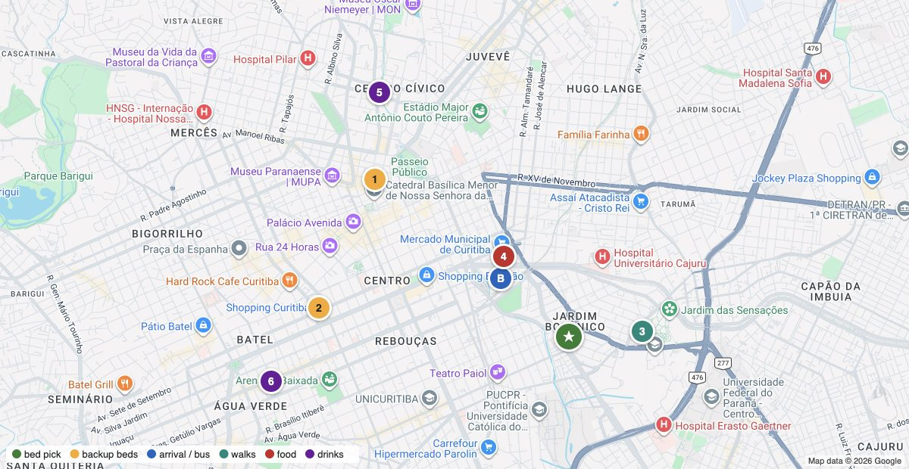
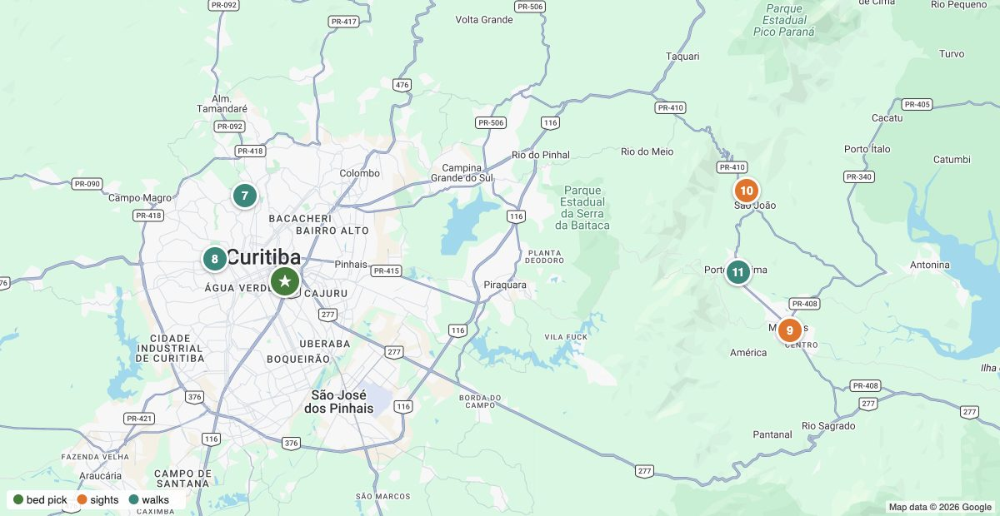

# 🇧🇷 Curitiba + Serra Verde

Part of the [LatAm itinerary](../itinerary.md) · region notes: [Brazil](brazil.md) · ← [São Paulo](sao-paulo.md) · [Foz do Iguaçu](foz-do-iguacu.md) →

> **Stop 5 · Thu 17 → Fri 18 Dec 2026 · 1 night · then the Serra Verde train and a night bus** 
> 🏞️ Brazil's craft-beer capital, then the train down the Serra do Mar's Atlantic forest to colonial Morretes 
> 🛏️ **Hostel Residencial Botânico**, a bunk in a mixed dorm, $13 for 1 night 
> 🚌 **In:** Penha 07:30 Tietê → Curitiba 14:00, Thu 17 · 🚆 **Fri 18:** Serra Verde Express 08:30 to Morretes, Graciosa bus back 16:10 · 🌙 **Out:** Catarinense night bus 21:00 to Foz, Fri 18

The Serra Verde Express on its ledge above the Serra do Mar. Photo: Google Maps (from the Casario listing, Morretes).

## 🗺️ Map

**Curitiba:** ★ **[Hostel Residencial Botânico](https://www.google.com/maps?ftid=0x94dce5cb2b0d2e1b:0xc5f8eeba78f09f76)** (the pick, [book](https://www.booking.com/hotel/br/residencial-botanico.html?checkin=2026-12-17&checkout=2026-12-18&group_adults=1&no_rooms=1&group_children=0&selected_currency=USD)) · **1** [Hostel Matilda](https://www.google.com/maps?ftid=0x94dce412337cc993:0x863e5e89897e6bdd) (backup), by the [Largo da Ordem](https://www.google.com/maps?ftid=0x94dce412451404e7:0x1fb057edfa6cad72) ([book](https://www.booking.com/hotel/br/hostel-matilda.html?checkin=2026-12-17&checkout=2026-12-18&group_adults=1&no_rooms=1&group_children=0&selected_currency=USD)) · **2** [Studio Lifespace Batel](https://www.google.com/maps?ftid=0x94dce471225020b5:0x3f3ee47de6549030) (private alt, [book](https://www.booking.com/hotel/br/estudio-moderno-e-completo-no-batel.html?checkin=2026-12-17&checkout=2026-12-18&group_adults=1&no_rooms=1&group_children=0&selected_currency=USD)) · **B** [Rodoferroviária](https://www.google.com/maps?ftid=0x94dce45abc8fcacd:0xe97d288f3a0b65bc) (buses and the [Serra Verde Express](https://www.google.com/maps?ftid=0x94dce45addce8813:0x4dbd62c7e5c46e97)) · **3** [Jardim Botânico](https://www.google.com/maps?ftid=0x94dce500d5e96635:0x1a2d5ec5fddc5654) · **4** [Mercado Municipal](https://www.google.com/maps?ftid=0x94dce444ecd9879d:0x3555477b39ebc02a) · **5** [Hop'n Roll](https://www.google.com/maps?ftid=0x94dce41a5afbffff:0x763f21de7430bab7) · **6** [We Are Bastards](https://www.google.com/maps?ftid=0x94dce4788e7fa543:0xeba6319a9f5ef2ec)

**Around:** ★ Curitiba · **7** [Parque Tanguá](https://www.google.com/maps?ftid=0x94dce6d445082041:0x69949666c14b40dc) (and the [Ópera de Arame](https://www.google.com/maps?ftid=0x94dce7682b135bf5:0x2e7bb1984e204490)) · **8** [Parque Barigui](https://www.google.com/maps?ftid=0x94dce3d8762c9e71:0x5628b5d28d45bd5b) · **9** Morretes: [train station](https://www.google.com/maps?ftid=0x94dc87458ddd8685:0x97a6520ce50c3909), [Rio Nhundiaquara](https://www.google.com/maps?ftid=0x94dc7f92adde203b:0x461c3381f1a20f5f) · **10** [Estrada da Graciosa](https://www.google.com/maps?ftid=0x94dc9044738c4017:0x953e93e418b029bc) · **11** [Porto de Cima](https://www.google.com/maps?ftid=0x94dc8f5169a95bf7:0x2115264d280e0cd2)

**Open the live map:** [Curitiba](https://www.google.com/maps/@-25.4330,-49.2620,14z) · [Serra do Mar](https://www.google.com/maps/@-25.430,-49.060,10z)

## 📅 Day by day

| Day | Plan |
|---|---|
| **Thu 17 Dec** | 🚌 **Penha 07:30** Tietê → **14:00** Curitiba Rodoferroviária. Afternoon (free): the **Jardim Botânico**, then the **Largo da Ordem** at dusk; Parque Tanguá or Barigui if there's time. 🍺 Hop'n Roll or We Are Bastards. |
| **Fri 18 Dec** | 🚆 **08:30 Serra Verde Express** to Morretes (about 4 h 30; arrive ≈ 12:30–13:00). 🍲 Barreado lunch, then the **Rio Nhundiaquara** riverbank and the Ponte Velha. 🚌 **16:10 Graciosa bus** via the Estrada da Graciosa → 17:47. Collect your pack, then the 🌙 **21:00 Catarinense** night bus to Foz (→ Sat 07:00). |

## 🔖 Book (one click)

Dates and 1 adult are pre-filled. The first channel listed was the cheapest when checked on 24 Nov. ⚠️ = time-sensitive.

**Beds** (17 → 18 Dec, 1 night)

| | Where | Total | Location | From the Rodoferroviária | Book |
|---|---|---:|:---:|---|---|
| ⭐ **Pick** | **Hostel Residencial Botânico** · bunk in a mixed dorm | **$13** | 9.3 | 🚌 24 min from the Rodoferroviária: walk 12 min → bus 463 (taxi ≈ 8 min; walk 26 min); ℹ️ outside the centre (38 min on foot, buses run) · [route](https://www.google.com/maps/dir/?api=1&origin=-25.4368387,-49.2574368&destination=-25.44275,-49.249636&travelmode=transit) | [Booking](https://www.booking.com/hotel/br/residencial-botanico.html?checkin=2026-12-17&checkout=2026-12-18&group_adults=1&no_rooms=1&group_children=0&selected_currency=USD) · [Agoda](https://www.agoda.com/partners/partnersearch.aspx?hid=46749238&checkin=2026-12-17&checkout=2026-12-18&NumberofAdults=1&Rooms=1) |
| Backup | **Hostel Matilda** · bed in a 4-bed mixed dorm | $11 | 9.5 | 🚌 21 min from the Rodoferroviária: walk 10 min → bus 304 → walk 4 min (taxi ≈ 17 min; walk 34 min); centre 9 min on foot · [route](https://www.google.com/maps/dir/?api=1&origin=-25.4368387,-49.2574368&destination=-25.4265717,-49.2715592&travelmode=transit) | [Booking](https://www.booking.com/hotel/br/hostel-matilda.html?checkin=2026-12-17&checkout=2026-12-18&group_adults=1&no_rooms=1&group_children=0&selected_currency=USD) · [Hostelworld](https://www.hostelworld.com/hostels/p/95733/hostel-matilda/?from=2026-12-17&to=2026-12-18&guests=1) · [Agoda](https://www.agoda.com/partners/partnersearch.aspx?hid=981227&checkin=2026-12-17&checkout=2026-12-18&NumberofAdults=1&Rooms=1) |
| Private alt | **Studio Lifespace Batel** (Torre A) · whole studio flat | $50 | 9.9 | 🚌 27 min from the Rodoferroviária: walk 9 min → bus 472 → bus H01 (taxi ≈ 13 min; walk 36 min); centre 25 min on foot · [route](https://www.google.com/maps/dir/?api=1&origin=-25.4368387,-49.2574368&destination=-25.439798399999997,-49.2779236&travelmode=transit) | [Booking](https://www.booking.com/hotel/br/estudio-moderno-e-completo-no-batel.html?checkin=2026-12-17&checkout=2026-12-18&group_adults=1&no_rooms=1&group_children=0&selected_currency=USD) |

**Transport**

| | Leg | When | Price | Book |
|---|---|---|---:|---|
| In | **Expresso NS Penha** · São Paulo Tietê → Curitiba Rodoferroviária | **Thu 17 Dec 07:30 → 14:00** | R$ 116.99 ($19.60) | [ClickBus](https://www.clickbus.com.br/onibus/sao-paulo-tiete-sp/curitiba-pr?departureDate=2026-12-17) |
| ⚠️ Train | **Serra Verde Express** · Curitiba → Morretes, Econômico | **Fri 18 Dec 08:30** → ≈ 12:30–13:00 | **R$ 70** ($11.75) | [Serra Verde Express](https://www.serraverdeexpress.com.br/) |
| ⚠️ Bus | **Viação Graciosa** · Morretes → Curitiba "via Estrada da Graciosa" | **Fri 18 Dec 16:10 → 17:47** | R$ 34.70 ($5.80) | [ClickBus](https://www.clickbus.com.br/onibus/morretes-pr/curitiba-pr?departureDate=2026-12-18) |
| Out | **Catarinense** · Curitiba → Foz do Iguaçu, convencional (double-decker) | **Fri 18 Dec 21:00 → Sat 07:00** | **R$ 289.99** ($48.70) | [ClickBus](https://www.clickbus.com.br/onibus/curitiba-pr/foz-do-iguacu-pr?departureDate=2026-12-18) |

How to read these tables

- **Location** is the guests' location score on Booking.com. The target is 9.0 or higher, and ⚠️ would mark one below 9.0. *(HW)* means Hostelworld's location rating, used where a property isn't on Booking.
- **From the Rodoferroviária** comes from Google Maps on 24 Nov: the property found on Maps and routed from where you arrive at midday on the check-in date. The **route** link opens the same route.
- Symbols: 🚶 walk · 🚌 public transport · 🚕 taxi/rideshare · 🥾 hike only · ⚠️ far from the centre with no bus · ℹ️ outside the centre but on a bus line.

## 🚌 Getting here: São Paulo → Curitiba, Thu 17 Dec

✅ Live fares on ClickBus; 102 departures that day, so no sell-out risk.

- **Pick: Expresso NS Penha 07:30 Tietê → 14:00 Curitiba Rodoferroviária**, semi-leito, 6 h 30, **R$ 116.99 ($19.60)**.
- **Cheapest:**
  - Penha 09:30 Tietê → 16:25, executivo, R$ 92.98 ($15.60).
  - Penha 10:00 **Barra Funda** → 16:25, R$ 87.98 ($14.80). Barra Funda is on L3; from Sumaré change at Consolação/República, or take a short Uber.
- **Earliest:** Cometa 06:00 → 12:30, convencional, R$ 107.99 ($18.10).
- **Buy:** ClickBus, or the Penha/Cometa counters at Tietê with your passport. ClickBus's checkout fee and whether it accepts a passport instead of a CPF are ≈. The operators' own sites didn't load.

## 🛏️ Where to sleep

All live-checked on 24 Nov.

### ⭐ Pick: Hostel Residencial Botânico
- **Unit:** a bed in a mixed dorm (bunk), Jardim Botânico district.
- **Price:** **$13 for 1 night on Booking** (non-refundable, dates changeable; other mixed dorms $14–17). Agoda $15.37.
- **Reviews:** Booking 9.2 (334; **4% below 7**), location 9.3. Agoda 9.1 (333). Not on Hostelworld.
- **Where:** **~1 km from the Rodoferroviária**, which serves the train, the bus back and the night bus to Foz. ~1.1 km from the Jardim Botânico.
- **Checks:**
  - Big kitchen (Nov 2026 review).
  - Residential and quiet; no bar.
  - Curtains not mentioned.

### Backup: Hostel Matilda
- **Unit:** a bed in a 4-bed mixed dorm. R. Mateus Leme 120, by the Largo da Ordem (historic centre).
- **Price:** **$11 on Booking** (free cancellation to 3 Dec, pay at the property). Agoda $11.24; Hostelworld $11.59.
- **Reviews:** Booking 8.9 (690; **8% below 7**), location 9.5. Hostelworld 83% (332), the most-reviewed in Curitiba on Hostelworld.
- **Where:** 1.9 km from the Rodoferroviária.
- **Checks:**
  - Kitchen.
  - **Street-facing rooms hear traffic until ~2 am**, and an Apr 2026 review mentions late noise.
  - The lockers don't lock (Nov 2026).
  - Better for an evening in the old town.

### Also: Social Hostel Café e Bar
- Booking 9.0 (1,016; 7% below 7).
- $11; has a bar. Batel, 2.4 km from the Rodoferroviária. No curtains.

### Private alt (location first): Studio Lifespace Batel (Torre A)
- A whole studio flat in Batel. Booking 9.8 (60; **2% below 7**), location 9.9.
- **$50** from the room table (non-refundable; $54 with free cancellation to 3 Dec), Booking.
- 2 km from the Rodoferroviária. The avenue in front is noisy at night with the window open.
- Matilda's single room with a shared bathroom is $17.19 on Hostelworld if you only want a door that locks.

**Not chosen:** Gup Hostel (30 reviews; 30% below 7; mould in Apr 2026), Bela Curitiba (9% below 7, no AC), Joshua Tree (8.5).

## 🌳 Things to do (free and outdoors first)

<table>
<tr>
<td width="50%" valign="top"> <b><a href="https://www.google.com/maps?ftid=0x94dce500d5e96635:0x1a2d5ec5fddc5654">Jardim Botânico</a></b> · free · Thu 17 The glass greenhouse and French gardens; daily 06:00–19:30. ~1 km from the hostel.</td>
<td width="50%" valign="top"> <b><a href="https://www.google.com/maps?ftid=0x94dc7f92adde203b:0x461c3381f1a20f5f">Rio Nhundiaquara</a>, Morretes</b> · free · Fri 18 The riverbank, the Ponte Velha and the colonial centre, ≈ 13:00–16:10.</td>
</tr>
<tr>
<td width="50%" valign="top"> <b><a href="https://www.google.com/maps?ftid=0x94dce6d445082041:0x69949666c14b40dc">Parque Tanguá</a></b> · free If there's time on Thursday afternoon.</td>
<td width="50%" valign="top"> <b><a href="https://www.google.com/maps?ftid=0x94dce3d8762c9e71:0x5628b5d28d45bd5b">Parque Barigui</a></b> · free The other big park, west of the centre.</td>
</tr>
<tr>
<td width="50%" valign="top"> <b><a href="https://www.google.com/maps?ftid=0x94dce45addce8813:0x4dbd62c7e5c46e97">Serra Verde Express</a></b> · Econômico R$ 70 · Fri 18, 08:30 Curitiba → Morretes, about 4 h 30. ⚠️ Only 67 Econômico seats left.</td>
<td width="50%" valign="top"> <b><a href="https://www.google.com/maps?ftid=0x94dc9044738c4017:0x953e93e418b029bc">Estrada da Graciosa</a></b> · bus R$ 34.70 · Fri 18, 16:10 The old cobbled road through the Atlantic forest, a different line from the train. ⚠️ Only 10 seats were listed.</td>
</tr>
</table>

**Thu 17 afternoon in Curitiba (free first):**
- **Jardim Botânico** (the glass greenhouse and French gardens): free, daily 06:00–19:30. "Free" ✅ curitiba.pr.gov.br; hours ≈ from a city-page snippet. It's ~1 km from the hostel.
- **Largo da Ordem** and the historic centre at dusk: free.
- **Parque Tanguá / Barigui:** free. Ópera de Arame is ≈ R$ 30, Tue–Sun 10:00–18:00 (local guide only), so skip it unless you have spare time.

**Fri 18: Serra Verde Express Curitiba → Morretes, 08:30**
- ✅ **It runs on Fri 18 Dec**, per serraverdeexpress.com.br's own booking API. It leaves from the Rodoferroviária. The operator gives "about 4 h 30" for the trip, so you arrive ≈ 12:30–13:00.
- **One-way fares** ✅ (495 of 1,118 seats already sold):

| Class | Fare | Notes |
|---|---|---|
| **Econômico** | **R$ 70 ($11.75)** | **only 67 seats left. Book it soon** |
| Turística | R$ 206 ($34.60) | snack kit, 1 drink, guide in Portuguese |
| Boutique | R$ 475 ($79.70) | snacks + open bar |
| Litorina Luxo | R$ 525 ($88.10) | |

- **Seats:** Econômico and Turística seats are assigned automatically. The left side has the best views going down (LP ≈).
- **Rules:** be there 1 h early. Online tickets can be cancelled free within 7 days of buying; after that the fee is 20% ✅.
- **Backpack:** leave it at the hostel (ask at check-out), or use the Malex automatic lockers in the Rodoferroviária. The lockers are ✅ listed on the URBS station page; the price, ≈ R$ 35 a day, comes from an old snippet.

**Fri 18, Morretes (≈ 13:00–16:10):**
- Walk the **Rio Nhundiaquara** riverbank, the Ponte Velha and the colonial centre: free.
- Porto de Cima (≈ 6 km) doesn't fit before the 16:10 bus.

**Bus back with Viação Graciosa, Morretes rodoviária → Curitiba Rodoferroviária, Fri 18** ✅ ClickBus departures for 18 Dec:
- 14:00 → 15:10.
- 15:40 → 16:55.
- **16:10 → 17:47 "via Estrada da Graciosa", R$ 34.70 ($5.80).** This is the pick: the old cobbled road through the Atlantic forest, a different line from the train. **Only 10 seats were listed.**
- 17:10 → 18:25.
- 20:45 → 21:55.
- The regular fare is R$ 31.99 ($5.40); Graciosa's own Embarca shop shows R$ 36.64.
- **Alternative:** the 15:00 return train also runs that day (Econômico R$ 70), back ≈ 18:30.

## 🍽️ Eat and drink

<table>
<tr>
<td width="50%" valign="top"> <b>Barreado</b>, Morretes · ≈ R$ 55–60 ($9–10) Beef slow-cooked for hours in a sealed clay pot, with banana and farofa. Usually all-you-can-eat. Generic photo.</td>
<td width="50%" valign="top"> <b><a href="https://www.google.com/maps?ftid=0x94dce444ecd9879d:0x3555477b39ebc02a">Mercado Municipal</a></b>, Curitiba · prices ≈ Next to the Rodoferroviária, for a quick lunch or dinner.</td>
</tr>
<tr>
<td width="50%" valign="top"> <b><a href="https://www.google.com/maps?ftid=0x94dce41a5afbffff:0x763f21de7430bab7">Hop'n Roll</a></b> · craft beer, 32 taps R. Mateus Leme 950 (LP lead).</td>
<td width="50%" valign="top"> <b><a href="https://www.google.com/maps?ftid=0x94dce4788e7fa543:0xeba6319a9f5ef2ec">We Are Bastards</a></b> · craft beer, 31 taps Av. Iguaçu 2300 (LP lead).</td>
</tr>
</table>

- **Curitiba:** the Mercado Municipal, next to the Rodoferroviária, for a quick lunch or dinner (prices ≈).
- **Craft beer** (Curitiba is Brazil's craft-beer capital), LP leads; check they're still open ≈:
  - **Hop'n Roll**, R. Mateus Leme 950: 32 taps.
  - **We Are Bastards**, Av. Iguaçu 2300: 31 taps.
- **Morretes: barreado**, beef slow-cooked for hours in a sealed clay pot and served with banana and farofa. It's usually an all-you-can-eat (rodízio) at ≈ R$ 55–60 ($9–10). [Madalozo](https://www.google.com/maps?ftid=0x94dc870c547ae39d:0x72dbb45107212737) is R$ 59.90 (festival price) and [Casario](https://www.google.com/maps?ftid=0x94dc876d68fe0fb9:0x90ae7858011d726d)'s buffet R$ 55.90, both from their Instagram ≈.

## ℹ️ Good to know
- **Book now:** the Econômico train seats (67 left) and the 16:10 Graciosa bus (10 seats).
- **Weather:** Curitiba is cooler than the coast: ≈ 15–25 °C in December, with afternoon rain.
- **Your pack on Friday:** leave it at the hostel or in the Rodoferroviária lockers (see the train notes above).

## 🌙 Leaving: night bus Curitiba → Foz do Iguaçu, Fri 18 → Sat 19 Dec

Catarinense is the only direct operator ✅ ClickBus (Embarca agrees):

| Dep → arr | Time | Convencional (double-decker) | Cama |
|---|---|---|---|
| **21:00 → 07:00 (pick)** | 10 h | **R$ 289.99 ($48.70)** | R$ 584.65 ($98.10, 2 seats left) |
| 21:30 → 08:00 | 10 h 30 | R$ 289.99 | R$ 584.65 |
| 22:15 → 09:00 | 10 h 45 | R$ 289.99 | R$ 584.65 |
| 18:00 → 05:45 | 11 h 45 | R$ 289.99 | R$ 405.96 ($68.10) |

- The 18:00 has the cheapest cama, but you'd have to leave Morretes by 15:40 and you'd reach Foz before dawn.
- Princesa dos Campos 19:20 → 08:30 involves a change and costs R$ 325 ✅ princesadoscampos.embarca.ai, so it's worse.
- **Buy:** ClickBus, or the Catarinense counter at the Rodoferroviária with your passport. Catarinense's own site didn't load.

---
Photos: Google Maps contributors (Casario listing for the train hero, Jardim Botânico, Rio Nhundiaquara, Parque Tanguá, Parque Barigui, Serra Verde Express, Estrada da Graciosa, Mercado Municipal, Hop'n Roll, We Are Bastards). Wikimedia Commons: <a href="https://commons.wikimedia.org/wiki/File:Barreado.jpg">Barreado</a> (Kevin Klop, CC BY-SA 3.0).
