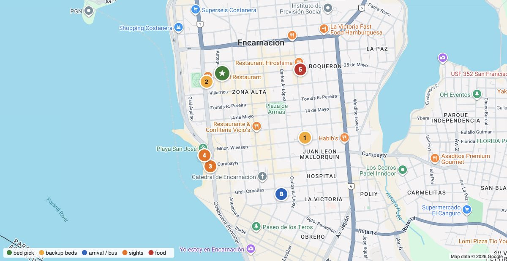
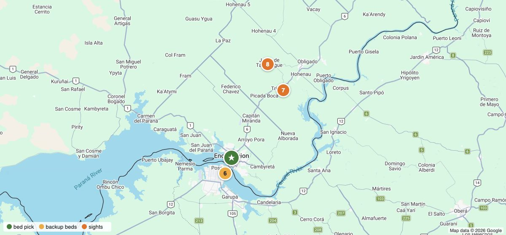

# 🇵🇾 Encarnación (Plan A, dropped)

Part of the [LatAm itinerary](../itinerary.md) · region notes: [Paraguay + Uruguay](paraguay-uruguay.md) · ← [Asunción](asuncion.md) · [Montevideo](montevideo.md) →

> ⏸️ **Plan A, dropped 27 Nov.** Christmas week now goes down Brazil's coast instead: [Florianópolis](florianopolis.md) → [Porto Alegre](porto-alegre.md) → [Punta del Diablo](punta-del-diablo.md). This guide is kept in case Paraguay comes back; its dates, prices and bookings were checked 24–26 Nov and haven't been rechecked.

> **Plan A (dropped) · Wed 23 → Sat 26 Dec 2026 · 3 nights · Christmas** 
> 🏞️ River town and beach on the Paraná, with Jesuit ruins nearby 
> 🛏️ **Departamentos De La Costa**, a whole flat with a kitchen, $76 for 3 nights 
> 🚌 **In:** La Encarnacena from Asunción, Wed 08:30 · **Out:** EGA overnight to Montevideo, Sat 13:30

Sunset from the Costanera, looking across the Paraná to Posadas (Argentina). Photo: Google Maps.

## 🗺️ Map

**In town:** ★ **[Departamentos De La Costa](https://www.google.com/maps?ftid=0x945795699ab5dc7b:0x3e6f9f4223b75d26)** (the pick, [book](https://www.booking.com/hotel/py/departamentos-de-la-costa.html?checkin=2026-12-23&checkout=2026-12-26&group_adults=1&no_rooms=1&group_children=0&selected_currency=USD)) · **1** [Terwindt Hotel](https://www.google.com/maps?ftid=0x9457955b8d9464a1:0x530ab901886fd02) (backup, [book](https://www.booking.com/hotel/py/terwindt.html?checkin=2026-12-23&checkout=2026-12-26&group_adults=1&no_rooms=1&group_children=0&selected_currency=USD)) · **2** [Milord Suites](https://www.google.com/maps?ftid=0x945795696c1dd94f:0xb14bd2054eca368c) (private alt, [book](https://www.booking.com/hotel/py/milord-boutique.html?checkin=2026-12-23&checkout=2026-12-26&group_adults=1&no_rooms=1&group_children=0&selected_currency=USD)) · **B** [bus terminal](https://www.google.com/maps?ftid=0x945795b5efd743a5:0xef77e80feab951c8) · **3** [Costanera](https://www.google.com/maps?ftid=0x9457956eb8eda16f:0xb2a18ead954b59aa) [🚶 19 min](https://www.google.com/maps/dir/?api=1&origin=-27.3290699,-55.8712289&destination=-27.3374898,-55.872457&travelmode=walking) · **4** [Playa San José](https://www.google.com/maps?ftid=0x9457956f1e6afc0b:0x368e81fee5b5ec22) [🚶 21 min](https://www.google.com/maps/dir/?api=1&origin=-27.3290699,-55.8712289&destination=-27.3364953,-55.8730598&travelmode=walking) · **5** [Hiroshima](https://www.google.com/maps?ftid=0x945795447e35d7e9:0x859b2808eb9e5148) [🚶 12 min](https://www.google.com/maps/dir/?api=1&origin=-27.3290699,-55.8712289&destination=-27.3287225,-55.8633006&travelmode=walking)

**Around:** ★ Encarnación · **6** [La Casa de Sol](https://www.google.com/maps?ftid=0x9457bfb4b6e05c73:0x7d86ff4c0ff3d81e) in Posadas (🎄 holiday backup, across the bridge, [book](https://www.booking.com/hotel/ar/la-casa-de-sol.html?checkin=2026-12-23&checkout=2026-12-26&group_adults=1&no_rooms=1&group_children=0&selected_currency=USD)) · **7** [Trinidad mission](https://www.google.com/maps?ftid=0x9457f0281002dcef:0x254e952c8c133fb) [🚗 ≈ 43 min by road](https://www.google.com/maps/dir/?api=1&origin=-27.3290699,-55.8712289&destination=-27.1323306,-55.7021508&travelmode=driving) (≈ 27 km) · **8** [Jesús mission](https://www.google.com/maps?ftid=0x9457f6a927979049:0x71a255ba02d5cc94) [🚗 ≈ 53 min by road](https://www.google.com/maps/dir/?api=1&origin=-27.3290699,-55.8712289&destination=-27.055985,-55.7526346&travelmode=driving) (≈ 32 km)

🧭 The time after each place is from the ★ bed (Google Maps, 26 Nov): 🚶 walk · 🚌 bus · 🚕 taxi · 🚗 by road (tour or bus). Click it for the route.

**Open the live map:** [town](https://www.google.com/maps/@-27.3305,-55.8680,15z) · [area](https://www.google.com/maps/@-27.20,-55.80,10z). When you're signed in, every place here also shows as a saved pin: the pick is ⭐ Starred, backups are in 🛏️ Beds – LatAm backups, sights are in Want to go and food is in Restaurants.

## 📅 Day by day

| Day | Plan |
|---|---|
| **Day 1** · Wed 23 Dec | 🚌 08:30 La Encarnacena from Asunción, arriving ≈ 14:00. Walk 24 min to the flat, or take a taxi (≈ 8 min). Sunset on the **Costanera**. |
| **Day 2** · Thu 24 Dec · 🎄 Christmas Eve | 🏛️ **Jesuit missions of Trinidad and Jesús** (5–6 h, bus + moto-taxi). 🛒 Shop for the 25th before the shops close in the afternoon. 🎆 Nochebuena fireworks over the river at midnight. |
| **Day 3** · Fri 25 Dec · 🎄 Christmas Day | Most restaurants are shut, so cook at the flat. 🏖️ **Playa San José** and the Costanera. |
| **Day 4** · Sat 26 Dec | A last Costanera walk, then the 🚌 **13:30 EGA** overnight to Montevideo. |

## 🔖 Book (one click)

Dates and 1 adult are pre-filled. The first channel listed was the cheapest when checked on 24 Nov. ⚠️ = time-sensitive.

**Beds** (23 → 26 Dec, 3 nights)

| | Where | Total | Location | From the bus terminal | Book |
|---|---|---:|:---:|---|---|
| ⭐ **Pick** | **Departamentos De La Costa** · whole 2-bed flat with kitchen | **$76** | 9.2 | 🚶 24 min (1.8 km) (taxi ≈ 8 min); centre 13 min on foot · [route](https://www.google.com/maps/dir/?api=1&origin=-27.3399784,-55.8652348&destination=-27.3290699,-55.8712289&travelmode=walking) | [Booking](https://www.booking.com/hotel/py/departamentos-de-la-costa.html?checkin=2026-12-23&checkout=2026-12-26&group_adults=1&no_rooms=1&group_children=0&selected_currency=USD) · [Agoda](https://www.agoda.com/partners/partnersearch.aspx?hid=77602665&checkin=2026-12-23&checkout=2026-12-26&NumberofAdults=1&Rooms=1) |
| Backup | **Terwindt Hotel** · single, breakfast | $127 | 9.1 | 🚶 11 min (800 m); centre 8 min on foot · [route](https://www.google.com/maps/dir/?api=1&origin=-27.3399784,-55.8652348&destination=-27.3348944,-55.862811199999996&travelmode=walking) | [Booking](https://www.booking.com/hotel/py/terwindt.html?checkin=2026-12-23&checkout=2026-12-26&group_adults=1&no_rooms=1&group_children=0&selected_currency=USD) · [Agoda](https://www.agoda.com/partners/partnersearch.aspx?hid=557029&checkin=2026-12-23&checkout=2026-12-26&NumberofAdults=1&Rooms=1) |
| Private alt | **Milord Suites & Apartments** · double, breakfast | $174 | 9.6 | 🚕 ≈ 6 min (walk 25 min, 1.9 km); centre 15 min on foot · [route](https://www.google.com/maps/dir/?api=1&origin=-27.3399784,-55.8652348&destination=-27.32981860770942,-55.872817039489746&travelmode=driving) | [Booking](https://www.booking.com/hotel/py/milord-boutique.html?checkin=2026-12-23&checkout=2026-12-26&group_adults=1&no_rooms=1&group_children=0&selected_currency=USD) · [Agoda](https://www.agoda.com/partners/partnersearch.aspx?hid=1461153&checkin=2026-12-23&checkout=2026-12-26&NumberofAdults=1&Rooms=1) |
| 🎄 Holiday backup | **La Casa de Sol**, **Posadas** (Argentina) · whole 1-bed flat | $67 | 9.5 | 🚕 23 min from Encarnación's centre over the bridge (international bus or train ≈ 26 min) · [route](https://www.google.com/maps/dir/?api=1&origin=-27.3323,-55.8656&destination=-27.374074,-55.890806&travelmode=driving) | [Booking](https://www.booking.com/hotel/ar/la-casa-de-sol.html?checkin=2026-12-23&checkout=2026-12-26&group_adults=1&no_rooms=1&group_children=0&selected_currency=USD) |

**Transport**

| | Leg | When | Price | Book |
|---|---|---|---:|---|
| In | La Encarnacena · Asunción → Encarnación | **Wed 23 Dec 08:30** (or 12:00) → ≈ 14:00 | ≈ $19 | [La Encarnacena](https://compraonline.sittnet.net/py/5596/) |
| ⚠️ Out | **EGA** · Encarnación → Montevideo Tres Cruces | **Sat 26 Dec 13:30 → Sun 07:15** | **$124** semi-cama | [EGA Paraguay shop](https://reservadirecta.sittnet.net/Commerce/egapy) · [timetable](https://ega.com.uy/destino/asuncion/) |
| 🎄 Shift | EGA a few days earlier, Christmas in Montevideo | Wed 23 Dec 13:30 → Thu 24 Dec 07:15 (32 semi-cama + 11 cama free on 25 Nov) | $124 | [EGA Paraguay shop](https://reservadirecta.sittnet.net/Commerce/egapy) |
| 🎄 Other route | Crucero del Norte · Posadas → Concordia, then Concordia → Salto → Montevideo | Sat 26 Dec 17:00 → 01:30 (34 seats free) | $53 + $7 + $40 | [Plataforma10](https://www.plataforma10.com.ar/servicios/buscar-pasajes/Posadas/Concordia/1471/3030/26-12-2026/_/1/0/0) |

How to read these tables

- **Location** is the guests' location score on Booking.com. The target is 9.0 or higher, and ⚠️ would mark one below 9.0. *(HW)* means Hostelworld's location rating, used where a property isn't on Booking.
- **From the bus terminal** comes from Google Maps on 24 Nov: the property found on Maps and routed from where you arrive at midday on the check-in date.
- Symbols: 🚶 walk · 🚌 public transport · 🚕 taxi/rideshare · 🥾 hike only · ⚠️ far from the centre with no bus · ℹ️ outside the centre but on a bus line.

## 🚌 Getting here: Asunción → Encarnación, Wed 23 Dec

- **La Encarnacena direct bus at 08:30** (or 12:00) from the Asunción terminal, arriving ≈ 14:00 (≈ 5½ h).
- **PYG 120,000 ≈ $19.** Buy at terminal windows 95–100 or online at `compraonline.sittnet.net/py/5596/`. ✅ The timetable and fare are on the operator's site; the seat map wasn't checked.
- NSA sells only its 00:00 Ejecutivo Black online (PYG 165k ≈ $26, arriving 05:00). LP rates La Encarnacena and NSA (Nuestra Señora de la Asunción) as the best companies on this route (LP).
- 🥯 **Chipa on the way:** the bus passes **Coronel Bogado**, Paraguay's self-styled chipa capital. Vendors climb aboard with it, so there's no need to get off (LP).
- Encarnación's bus terminal is in town, ≈ 0.8 km from the plaza.

## 🛏️ Where to sleep

**Why a flat:** no hostel bed is left for Christmas (checked 24 Nov).
- Hostelworld lists **nothing** for Encarnación on these dates.
- On Agoda, the two good hostels, **Frida Hostel (9.1, 120 reviews) and La Casa de Pedro (9.1, 200), are sold out**.
- Booking's three "hostels" are 3 km out, with 15 reviews or fewer or a 5–6 rating.

### ⭐ Pick: Departamentos De La Costa
- **Unit:** a whole 2-bedroom apartment with a kitchen.
- **Price:** **$76 for 3 nights** on Booking (room table); Agoda $95.37.
- **Reviews:** Booking 8.9 (29 reviews; 3% below 7), **location 9.2**.
- **Where:** Antequera 1615, 0.5 km from the plaza, a few blocks from the Costanera.
- **Why it fits:** the kitchen matters on 25 Dec, when most restaurants close.

### Backup: Terwindt Hotel
- Basic single room, breakfast included. **$127 for 3 nights** on Booking (Agoda $155.10).
- 9.1 (472 reviews; 1% below 7), location 9.1.
- 0.6 km from the plaza, 0.8 km from the terminal. A quiet hotel with a small outdoor pool.

### Private alt (location first): Milord Suites & Apartments
- Standard double, breakfast included. **$174 for 3 nights** on Booking (Agoda $191.85).
- Booking **location 9.6** (9.2 overall; 310 reviews; 2% below 7).
- At the Costanera end of the centre.

### 🎄 Holiday backups
- **Another town:** La Casa de Sol in **Posadas**, across the bridge in Argentina. A whole flat, location 9.5, $67 (241 reviews, none below 7). On 25 Nov Posadas had 141 places free, against 65 in Encarnación.
- **Shifted dates:** spend Christmas in Asunción instead. It had 379 places free and dorms from $27 for 3 nights, and the EGA bus starts there at 08:00 on the 26th.

## 🌳 Things to do (free and outdoors first)

<table>
<tr>
<td width="50%" valign="top"> <b><a href="https://www.google.com/maps?ftid=0x9457956eb8eda16f:0xb2a18ead954b59aa">Costanera de Encarnación</a></b> · free · <a href="https://www.google.com/maps/dir/?api=1&origin=-27.3290699,-55.8712289&destination=-27.3374898,-55.872457&travelmode=walking">🚶 19 min</a> A riverside promenade of 6 km and more, facing Posadas, with sunsets over Argentina. The place to be on Christmas Eve and Christmas Day.</td>
<td width="50%" valign="top"> <b><a href="https://www.google.com/maps?ftid=0x9457956f1e6afc0b:0x368e81fee5b5ec22">Playa San José</a></b> · free · <a href="https://www.google.com/maps/dir/?api=1&origin=-27.3290699,-55.8712289&destination=-27.3364953,-55.8730598&travelmode=walking">🚶 21 min</a> The town's Paraná river beach, free year-round. Lifeguards 08:00–20:00 in the high season, late October to Easter (Municipalidad de Encarnación). Expect crowds from 25 Dec.</td>
</tr>
<tr>
<td width="50%" valign="top"> <b>Jesuit mission of Trinidad</b> (UNESCO) · PYG 40,000 ≈ $6.30 Often called the best-preserved of the Jesuit missions. One 72-hour ticket covers Trinidad and Jesús.</td>
<td width="50%" valign="top"> <b><a href="https://www.google.com/maps?ftid=0x9457f6a927979049:0x71a255ba02d5cc94">Jesús de Tavarangüe</a></b> (UNESCO) · same ticket · <a href="https://www.google.com/maps/dir/?api=1&origin=-27.3290699,-55.8712289&destination=-27.055985,-55.7526346&travelmode=driving">🚗 ≈ 53 min by road</a> An unfinished mission 10–12 km beyond Trinidad, with Moorish-style arches.</td>
</tr>
</table>

**Missions day (Thu 24 Dec):**
- **Getting there:** any bus heading north-east from the terminal (towards Hohenau, Bella Vista or Ciudad del Este) drops you at the Trinidad crossroads in ≈ 45 min (≈ PYG 15k, $2.40). The ruins are 500 m up the side road. LP's landmark for the stop: get off when the power station appears on your right (LP).
- **Jesús** is 10–12 km further north. Take a moto-taxi (≈ PYG 30k, $5) or walk 2 h. LP adds two options: shared taxis that sometimes wait at the junction, or the Jesús–Obligado bus from the crossroads 100 m along the highway, nominally hourly (LP).
- **Guides:** Spanish-speaking guides wait at both gates; tip them well (LP).
- **Light show:** both sites have run an evening sound-and-light show projected onto the ruins (LP). It's unlikely on Christmas Eve, so ask at the gate ≈.
- **Ticket:** foreigners pay **PYG 40,000 ≈ $6.30** (Paraguayans 25,000) for one ticket valid 72 h at both sites. SENATUR updated the fees in July 2024. The PYG 40,000 figure comes from several 2026 guides, because SENATUR's own page timed out.
- **Hours:** 07:00–19:00 every day of the year. SENATUR has run special hours on 25 Dec before (2021: opening at 09:00, plus a 21:00 night show), so check SENATUR's or Ruta Jesuítica's Facebook the week before.
- **Time:** allow 5–6 h for both sites.

**More, from Lonely Planet (not live-checked; good for Fri 25 or Sat 26 morning):**
- 🌳 **Escalinata San Pedro**: a Gaudí-style decorated stairway in a residential street at the far end of the Costanera. Free (LP).
- 🏖️ **A quieter beach:** if Playa San José is packed from the 25th, LP suggests the beach at **Quiteria**, a short taxi ride away (LP).
- 🌳 **Hotel Tirol** (Capitán Miranda, Ruta 6 km 20): 20 ha of humid forest with trails and 300+ bird species recorded; non-guests can use its pools for a small fee. Local bus 1y2 ("Capitán Miranda") from Av Artigas ends at the gate, and Trinidad-bound buses pass it, so it can be a stop on the missions day (LP).
- 🌳 **Parque Manantial** near Hohenau (35 km, on the Ruta 6 bus line): 200 ha with walking trails and pools; small entry and pool fees; Tue–Sun ≈ 09:00–20:00 (LP).
- **Ita Cajón**, near Trinidad: the quarry that supplied the missions' red stone, now a small eco-park with a small fee (LP).
- **Sambódromo**, the Carnival parade ground on the Costanera, used for other events out of season (LP).
- **Karumbés**: the yellow horse-drawn carriages that were once the town's taxis. LP says rides were cheap and free at weekends, from the bus terminal (LP); check they still run.
- **Yerba-mate factory tours** in Bella Vista (45 km): Pajarito's is free and Selecta's is paid, booked at the Mate Roga tourist office on the main road (LP). Probably not running over Christmas ≈.

## 🍽️ Eat and drink

<table>
<tr>
<td width="50%" valign="top"> <b><a href="https://www.google.com/maps?ftid=0x945795447e35d7e9:0x859b2808eb9e5148">Hiroshima</a></b> · ≈ PYG 40–60k ($6–9) · <a href="https://www.google.com/maps/dir/?api=1&origin=-27.3290699,-55.8712289&destination=-27.3287225,-55.8633006&travelmode=walking">🚶 12 min</a> A Japanese-Paraguayan local favourite. Known for its soba; the photo shows its sushi.</td>
<td width="50%" valign="top"> <b>Lomito árabe</b> · ≈ PYG 20–30k ($3–5) Encarnación's shawarma, a legacy of its Arab community. Photo from <a href="https://www.google.com/maps?ftid=0x9457bff39007e95b:0xfa3d0c682c1ba35e">Lomitería Árabe</a>.</td>
</tr>
<tr>
<td width="50%" valign="top"> <b>Chipa</b> · from any bakery Cheesy cassava-starch bread rings, eaten all day.</td>
<td width="50%" valign="top"> <b>Sopa paraguaya</b> · from any bakery Not a soup: a dense cornbread with cheese and onion.</td>
</tr>
</table>

- **Lomito árabe:** LP's pick is **Habib's** on Av Irrazábal (LP).
- **Hiroshima:** LP singles out its udon (LP).
- **Cheap and filling:** **La Piccola Italia** (Ruta 1 × Av Caballero, Tue–Sun), big portions of pizza and pasta (LP).
- **Paseo Gastronómico:** a cluster of restaurants by the roundabout on the Costanera (LP).
- **Heladería Mako** (Av Caballero 590): artisan ice cream, pastries and coffee (LP).
- **Craft beer:** **Peltzer Artesanal**, a beer garden on Av Francia with local craft beer on tap (LP; not checked).

Prices are ≈.

## ℹ️ Good to know
- **24 Dec is a half day.** Shops and supermarkets close in the afternoon. Nochebuena is celebrated at midnight with fireworks over the river.
- **25 Dec is a public holiday** and most restaurants close, so shop on the 24th (hence the flat). Around 20 Dec, the Municipalidad de Encarnación's tourism office posts on Facebook a list of the restaurants open on 24 and 25 Dec.
- **It's hot:** ≈ 33–35 °C. LP's advice: pay for air-con, and carry a warm layer on the buses, where drivers run it cold (LP). That includes the 18-h EGA ride.
- **Carnaval Encarnaceno** runs on January and February weekends, so it isn't on these dates.
- **Money:** the banks around Plaza de Armas all have ATMs. Money changers work at the bus terminal and the border; check their rate first (LP).
- **Tourist office:** Senatur, at the western end of the Costanera (Ruta 1 × Padre Bolik), ≈ Mon–Fri 08:00–18:00, weekend mornings (LP).
- **Crossing to Posadas** (the 🎄 holiday backup, or the Crucero del Norte route), per LP:
  - The **international bus** leaves from outside the terminal. Get off at **both** immigration posts on the bridge and keep your ticket: buses don't always wait, so take your bag with you and board the next one (LP).
  - The quicker **air-conditioned train** leaves from Av Von Winkel near the bridge; both countries' formalities happen in one office on the Argentine side (LP; check it's running).
  - **Ferries** also cross from the eastern end of the Costanera to Posadas' riverfront (LP).
  - A taxi over the bridge can get stuck in long queues; the bus skips them (LP).
- ⚠️ **Buy the EGA ticket online early.** Cama is already sold out for 26 Dec, and 17 semi-cama seats were left on 24 Nov.

## 🚌 Leaving: EGA overnight to Montevideo, Sat 26 → Sun 27 Dec

- **EGA Encarnación 13:30 → Montevideo Tres Cruces 07:15** (17 h 45, via Posadas, Salto and Paysandú).
- **Semi-cama PYG 790,000 ≈ $124**, cheapest on the Paraguayan shop (`reservadirecta.sittnet.net/Commerce/egapy`). EGA Uruguay charges UYU 6,165 ≈ $152. ✅ Seen on sale on EGA's own shop for 26 Dec.
- EGA runs **only on Wed and Sat** (ega.com.uy timetable: Asunción 08:00, Encarnación 13:30).
- There are border controls at Encarnación/Posadas and at Concordia/Salto, so keep your passport handy overnight.
- If this bus fails, see the 🎄 rows in the transport table above.

<b>Option B, to decide closer to the date: break the ride in Salto</b> (≈ +$103, Montevideo at 20:00 instead of 07:15)

Ride the same EGA bus only as far as **Salto (00:45, 11 h 15)**:
- **Ticket:** Encarnación → Salto is semi-cama PYG 740,000 ≈ $116 on the same shop. If you already hold the Montevideo ticket, ask EGA whether you can simply get off at Salto. Mark your bag for Salto.
- **Bed:** Hotel Los Cedros, Booking location 9.5 (345 reviews, 1% below 7), 24-hour desk, **$65** ([Booking](https://www.booking.com/hotel/uy/los-cedros.html?checkin=2026-12-26&checkout=2026-12-27&group_adults=1&no_rooms=1&group_children=0&selected_currency=USD)). It's ≈ 1.5 km from the terminal, so take a taxi. Cheaper but out at the hot springs: Hotel Village Termas de Daymán, $38, location 8.9.
- **Day 5 (Sun 27 Dec), morning:** the Daymán municipal hot springs, 08:00–22:00, ≈ UYU 200. City bus from Julio Delgado y Brasil at 09:10 (≈ 30 min, UYU 54). *(AI-summary leads; check them on the day.)*
- **Day 5 (Sun 27 Dec), afternoon:** ✅ Agencia Central **13:00 → Tres Cruces 20:00**, or Núñez 12:30 → 19:50, both daily (Tres Cruces timetable). Fares from ≈ UYU 1,672 ≈ $40.
- **What stays the same:** the MedioMundo night and the 28 Dec Cabo Polonio bus.

---
Photos: Google Maps contributors (Costanera, Playa San José, Jesús, Hiroshima, Lomitería Árabe). Wikimedia Commons: <a href="https://commons.wikimedia.org/wiki/File:La_Sant%C3%ADsima_Trinidad_de_Paran%C3%A1_-_Church_ruins.jpg">Trinidad</a> (Indies1, CC BY 4.0), <a href="https://commons.wikimedia.org/wiki/File:Chipa_Paraguay.jpg">Chipa</a> (Ekem, CC BY-SA 3.0), <a href="https://commons.wikimedia.org/wiki/File:Sopa_paraguaya_(porci%C3%B3n_de_bandeja).jpg">Sopa paraguaya</a> (Tubby3, CC BY-SA 4.0).
