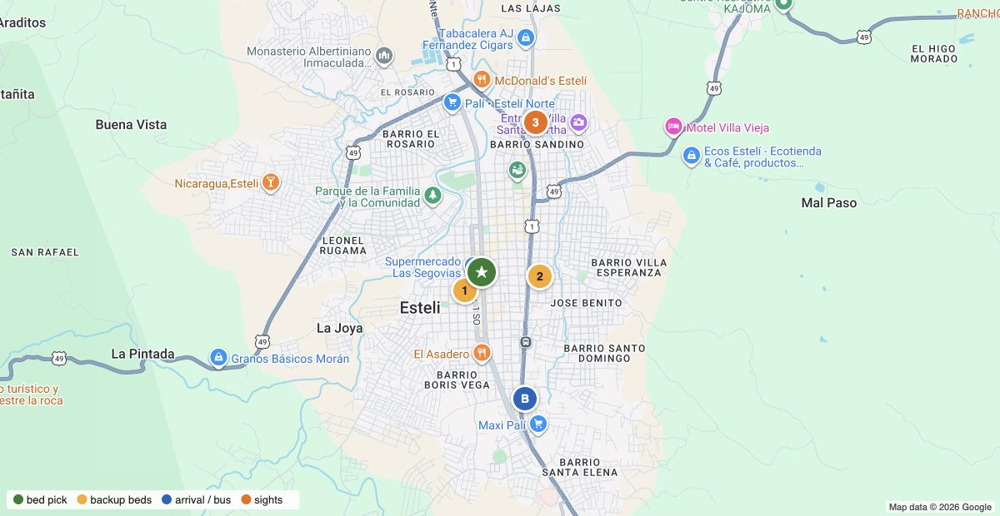
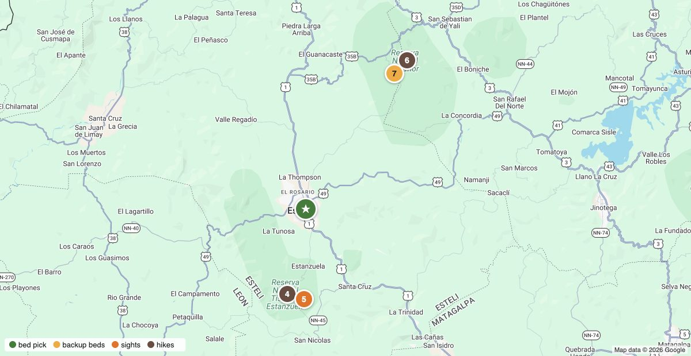

# 🇳🇮 Estelí (Miraflor / Tisey)

Part of the [LatAm itinerary](../itinerary.md) · region notes: [Costa Rica + Nicaragua](costa-rica-nicaragua.md) · ← [León](leon.md) · [Flight home (Managua → Seattle)](flight-home.md) →

> **Stop 36 · Tue 2 → Wed 3 Mar 2027 · 1 night · new 26 Nov** 
> 🏞️ Nicaragua's only cool highland stop (≈ 850 m), with two cloud-forest and waterfall reserves on its doorstep 
> 🛏️ **Melody 78 Hostel & Suites**, a central dorm bed, $14 (double $27) 
> 🚌 **In:** 05:20 bus from León, Tue · **Out:** express bus to Managua ≈ 12:00–13:15, Wed 3 Mar

The northern highlands from the Tisey–La Estanzuela reserve. Photo: Google Maps.

## 🗺️ Map

**In town:** ★ **[Melody 78 Hostel & Suites](https://www.google.com/maps?ftid=0x8f718d06008e4df3:0x37d078c1332a31b2)** (the pick, [book](https://www.hostelworld.com/hostels/p/311020/melody-78-hostel-suites/?from=2027-03-02&to=2027-03-03&guests=1)) · **1** [Hotel Casa Vínculos](https://www.google.com/maps?ftid=0x8f718c426f762687:0x3c3c11f436d3018) (backup, [book](https://www.booking.com/hotel/ni/casa-vinculos.html?checkin=2027-03-02&checkout=2027-03-03&group_adults=1&no_rooms=1&group_children=0&selected_currency=USD)) · **2** [Hotel NO STRESS TRAVELLERS](https://www.google.com/maps?ftid=0x8f718de690753a4b:0xc0e570801aa636a4) (private alt, [book](https://www.booking.com/hotel/ni/no-stress-travelleres.html?checkin=2027-03-02&checkout=2027-03-03&group_adults=1&no_rooms=1&group_children=0&selected_currency=USD)) · **B** [COTRAN Sur](https://www.google.com/maps?ftid=0x8f718c13825dde4b:0x69c6340e0429bb84) (buses from León, to Managua and Tisey) · **3** [UCA Miraflor](https://www.google.com/maps?ftid=0x8f718d5b57ad02a9:0x7a3c15b27002e9bf) [🚕 ≈ 8 min](https://www.google.com/maps/dir/?api=1&origin=13.0889274,-86.3568541&destination=13.1040123,-86.351278&travelmode=driving) (the Miraflor cooperative)

**Around:** ★ Estelí · **4** [Tisey–La Estanzuela reserve](https://www.google.com/maps?ftid=0x8f718e6a7df386a3:0xff3e3ead404fd2f) [🚕 ≈ 28 min](https://www.google.com/maps/dir/?api=1&origin=13.0889274,-86.3568541&destination=12.9894387,-86.3787953&travelmode=driving) · **5** [Don Alberto's stone carvings](https://www.google.com/maps?ftid=0x8f718f7b944e3007:0x5dfc0dc6924a0bb9) [🚕 ≈ 31 min](https://www.google.com/maps/dir/?api=1&origin=13.0889274,-86.3568541&destination=12.9836479,-86.3587145&travelmode=driving) · **6** [Miraflor reserve](https://www.google.com/maps?ftid=0x8f721dc000000001:0xfab3ffe70888f73d) [🚕 ≈ 1 h 4 min](https://www.google.com/maps/dir/?api=1&origin=13.0889274,-86.3568541&destination=13.2617868,-86.2361744&travelmode=driving) · **7** [Finca Neblina del Bosque](https://www.google.com/maps?ftid=0x8f721bf4f00ebc21:0x8897db68445e2276) (farm stay). Salto La Estanzuela (≈ 5–7 km south of the centre) isn't pinned: no Google Maps entry for the falls themselves turned up.

🧭 The time after each place is from the ★ bed (Google Maps, 26 Nov): 🚶 walk · 🚌 bus · 🚕 taxi · 🚗 by road (tour or bus). Click it for the route.

**Open the live map:** [town](https://www.google.com/maps/@13.0890,-86.3540,15z) · [area](https://www.google.com/maps/@13.12,-86.31,11z)

## 📅 Day by day

| Day | Plan |
|---|---|
| **Day 1** · Tue 2 Mar | 🚌 **05:20** León → Estelí (≈ 3 h), to get the whole day. 🌳 **Guided day in Tisey–La Estanzuela or Miraflor**, set up by the hostel when you book. Tisey is the easier same-day choice; Miraflor on the arrival day needs a private 4×4. |
| **Day 2** · Wed 3 Mar | 💦 Morning: **Salto La Estanzuela** (taxi or the Tisey bus), or the free **murals in the centre** and a **cigar-factory tour**. 🚌 Express bus to Managua **≈ 12:00–13:15** → Mercado Mayoreo → the airport homestay ([Flight home](flight-home.md)). |

## 🔖 Book (one click)

Dates and 1 adult are pre-filled. The first channel listed was the cheapest when checked on 26 Nov (Booking + Hostelworld APIs). ⚠️ = time-sensitive.

**Beds** (2 → 3 Mar, 1 night)

| | Where | Total | Location | From COTRAN Sur | Book |
|---|---|---:|:---:|---|---|
| ⭐ **Pick** | **Melody 78 Hostel & Suites** · dorm bed, or a double | **$14** dorm · $27 double | 9.5 | 🚶 24 min (1.7 km) from the COTRAN Sur bus terminal (taxi ≈ 8 min); centre 7 min on foot · [route](https://www.google.com/maps/dir/?api=1&origin=13.0762386,-86.3524291&destination=13.0889274,-86.3568541&travelmode=walking) | [Hostelworld](https://www.hostelworld.com/hostels/p/311020/melody-78-hostel-suites/?from=2027-03-02&to=2027-03-03&guests=1) · [Booking (double)](https://www.booking.com/hotel/ni/melody-78-hostel-amp-suites-esteli1.html?checkin=2027-03-02&checkout=2027-03-03&group_adults=1&no_rooms=1&group_children=0&selected_currency=USD) |
| Backup | **Hotel Casa Vínculos** · double or twin | $36 | 9.2 | 🚶 24 min (1.7 km) from the COTRAN Sur bus terminal (taxi ≈ 8 min); centre 13 min on foot · [route](https://www.google.com/maps/dir/?api=1&origin=13.0762386,-86.3524291&destination=13.0871299,-86.358624&travelmode=walking) | [Booking](https://www.booking.com/hotel/ni/casa-vinculos.html?checkin=2027-03-02&checkout=2027-03-03&group_adults=1&no_rooms=1&group_children=0&selected_currency=USD) |
| Private alt | **Hotel NO STRESS TRAVELLERS** · double with bathroom | $34 | 9.0 | 🚶 19 min (1.5 km) (taxi ≈ 5 min); centre 16 min on foot · [route](https://www.google.com/maps/dir/?api=1&origin=13.0762386,-86.3524291&destination=13.0885276,-86.3508616&travelmode=walking) | [Booking](https://www.booking.com/hotel/ni/no-stress-travelleres.html?checkin=2027-03-02&checkout=2027-03-03&group_adults=1&no_rooms=1&group_children=0&selected_currency=USD) |

**Transport and day trips**

| | Leg | When | Price | Book |
|---|---|---|---:|---|
| In | **León → Estelí** direct bus, La Terminal → COTRAN Sur | **Tue 2 Mar 05:20** (or 12:40, 15:00), ≈ 3 h | C$110 | [NicaBuses](https://www.nicabuses.com/rutas/leon-esteli-ruteado) |
| Day | Rural bus to **Tisey–La Estanzuela**, from COTRAN Sur | 06:30 and 13:30; ask the driver for the return | C$25–30 | [NicaBuses](https://www.nicabuses.com/bus/esteli/a/tisey-la-estanzuela) |
| Day | Bus to **Miraflor**, from COTRAN Norte | 06:00 (3 a day until 15:45); back from the reserve 07:15–16:15 | C$20–25 | [NicaBuses](https://www.nicabuses.com/bus/esteli/a/miraflor) |
| ⚠️ Out | **Estelí → Managua** express, COTRAN Sur → Mercado Mayoreo | **Wed 3 Mar**, take one ≈ 12:00–13:15 (express 04:45–15:15), ≈ 2 h 30 | C$110 | [NicaBuses](https://www.nicabuses.com/bus/esteli/a/managua) |

How to read these tables

- **Location** is the guests' location score on Booking.com. The target is 9.0 or higher, and ⚠️ marks one below 9.0.
- **From COTRAN Sur** comes from Google Maps (26 Nov): a walking route from the terminal, with Google's driving time for the taxi. The **route** link opens the same route.
- Symbols: 🚶 walk · 🚌 public transport · 🚕 taxi/rideshare · 🥾 hike only · ⚠️ far from the centre with no bus · ℹ️ outside the centre but on a bus line.

## 🚌 Getting here: León → Estelí, Tue 2 Mar

- **Direct bus 05:20**, 12:40 or 15:00 from León's La Terminal, **C$110, ≈ 3 h**, arriving at COTRAN Sur ✅ [NicaBuses](https://www.nicabuses.com/rutas/leon-esteli-ruteado) (updated 30 Oct 2026).
- **Take the 05:20** to get the whole day.

## 🛏️ Where to sleep

Live-checked 26 Nov (Booking + Hostelworld APIs).

### ⭐ Pick: Melody 78 Hostel & Suites
- **Price:** **dorm bed $14 on Hostelworld** (9.6, but only 9 reviews); **double $27 on Booking** (8.8/13 reviews, 0 % bad).
- **Location 9.5.** Central, 0.2 mi from downtown.
- Few reviews, so **check the newest before booking**.

### Backup: Hotel Casa Vínculos
- Double or twin, **$36 on Booking**.
- 9.1 (109 reviews, **0 % below 7**), **location 9.2**. In the centre.

### Private alt: Hotel NO STRESS TRAVELLERS
- Double with bathroom, **$34**.
- 9.0 (59; 3 % bad), location 9.0.

### Farm stay instead (if you want a night in Miraflor): Finca Neblina del Bosque
- Chalet **$30** on Booking (8.2/71; 11 % bad), ⚠️ **location 8.9**.
- Inside the reserve, 12.8 mi from town. It arranges cloud-forest walks on site.
- Only worth it with 2 nights.

## 🌳 Things to do (free and outdoors first)

<table>
<tr>
<td width="50%" valign="top"> <b>Salto La Estanzuela</b> · by taxi or the Tisey bus A tall waterfall in the forest, ≈ 5–7 km south of the centre. <b>Wed 3 Mar</b> morning.</td>
<td width="50%" valign="top"> <b><a href="https://www.google.com/maps?ftid=0x8f718e6a7df386a3:0xff3e3ead404fd2f">Tisey–La Estanzuela</a></b> · guided day ≈ $18–25 · <a href="https://www.google.com/maps/dir/?api=1&origin=13.0889274,-86.3568541&destination=12.9894387,-86.3787953&travelmode=driving">🚕 ≈ 28 min</a> 40 min south: miradores over the northern highlands, Don Alberto Gutiérrez's <a href="https://www.google.com/maps?ftid=0x8f718f7b944e3007:0x5dfc0dc6924a0bb9">stone carvings</a> (in the photo), the Estanzuela waterfall.</td>
</tr>
<tr>
<td width="50%" valign="top"> <b><a href="https://www.google.com/maps?ftid=0x8f721dc000000001:0xfab3ffe70888f73d">Miraflor</a></b> · guided day ≈ $18–25 · <a href="https://www.google.com/maps/dir/?api=1&origin=13.0889274,-86.3568541&destination=13.2617868,-86.2361744&travelmode=driving">🚕 ≈ 1 h 4 min</a> 1 h 15 north-east: cloud forest, orchids, coffee farms. Nomadic Matt calls it the highlight of his Nicaragua trip.</td>
<td width="50%" valign="top"><b>Murals and a cigar factory</b> · murals free The murals around the centre and the central park cost nothing. Estelí is Nicaragua's tobacco capital, so add a cigar-factory tour.</td>
</tr>
</table>

**Day 1 (Tue 2 Mar), guided day in Tisey–La Estanzuela or Miraflor:**
- Both reserves are run with local cooperatives. Guides are booked through Estelí hostels and agencies or the community cooperatives (e.g. UCA Miraflor), not on big booking sites.
- **≈ $18–25 per person with rural buses and a cooperative guide, ≈ $35–50+ for a private trip with a 4×4 from Estelí**, usually with a farm lunch *(lead from an AI summary citing Global Dreaming and Tripadvisor; ask the hostel to set it up when you book)*.
- Reserve fees are small (≈ C$25–60).
- **Tisey–La Estanzuela** (40 min south; miradores over the northern highlands, Don Alberto Gutiérrez's stone carvings, the Estanzuela waterfall). Rural buses leave COTRAN Sur at **06:30 and 13:30**, C$25–30; the return time isn't published, so ask the driver ✅ [NicaBuses](https://www.nicabuses.com/bus/esteli/a/tisey-la-estanzuela).
- **Miraflor** (1 h 15 north-east; cloud forest, orchids, coffee farms). Buses leave **COTRAN Norte at 06:00** (3 a day until 15:45, C$20–25) and come back from the reserve 07:15–16:15 ✅ [NicaBuses](https://www.nicabuses.com/bus/esteli/a/miraflor).
- The 06:00 bus is too early from León, so **Miraflor on the arrival day needs a private 4×4**; Tisey is the easier same-day choice.

**Wed 3 Mar morning:** **Salto La Estanzuela** (a tall waterfall in the forest, ≈ 5–7 km south of the centre, by taxi or the Tisey bus), or the free **murals in the centre** and a **cigar-factory tour** (Estelí is Nicaragua's tobacco capital).

**Free:** the murals around the centre, and the central park.

## 🍽️ Eat and drink

- **Northern-highlands home cooking** in *comedores* and the market (≈ C$100–180). Check nearer the time.
- No place was picked yet, so there are no photos here.

## ℹ️ Good to know
- **Why Estelí:** Nicaragua's only cool highland stop (≈ 850 m, after León's mid-30s °C), with two cloud-forest and waterfall reserves on its doorstep. Nomadic Matt calls Miraflor the highlight of his Nicaragua trip.
- **It adds one day:** the flight home moves from Wed 3 to **Thu 4 Mar** (same award, same price).
- **Carry córdobas in small notes** for buses and reserve fees.
- **Somoto Canyon** is now a +1-day extension from here (see [Somoto](somoto.md)).

## 🚌 Leaving: Estelí → Managua airport, Wed 3 Mar

- **Express buses to Managua** leave COTRAN Sur 04:45–15:15 (**C$110, ≈ 2 h 30**; verified at the terminal on 17 Nov 2026).
- Slower *ruteado* buses run until 18:00 (C$90, ≈ 3 h 30) ✅ [NicaBuses](https://www.nicabuses.com/bus/esteli/a/managua).
- They arrive at **Mercado Mayoreo** in eastern Managua, ≈ 2 km from the airport homestay.
- **Take an express around 12:00–13:15** to reach the airport homestay before dark. Then see [Flight home](flight-home.md).

---
Photos: Google Maps contributors (Tisey–La Estanzuela reserve, Esculturas en piedra). Wikimedia Commons: <a href="https://commons.wikimedia.org/wiki/File:SALTO_ESTANZUELA_NICARAGUA.jpg">Salto Estanzuela</a> (uploaded by Granada~enwiki, CC BY-SA 3.0), <a href="https://commons.wikimedia.org/wiki/File:Matapalo_Tree_Miraflor,_Esteli.jpg">Matapalo Tree Miraflor</a> (Tisey, CC BY-SA 4.0).
