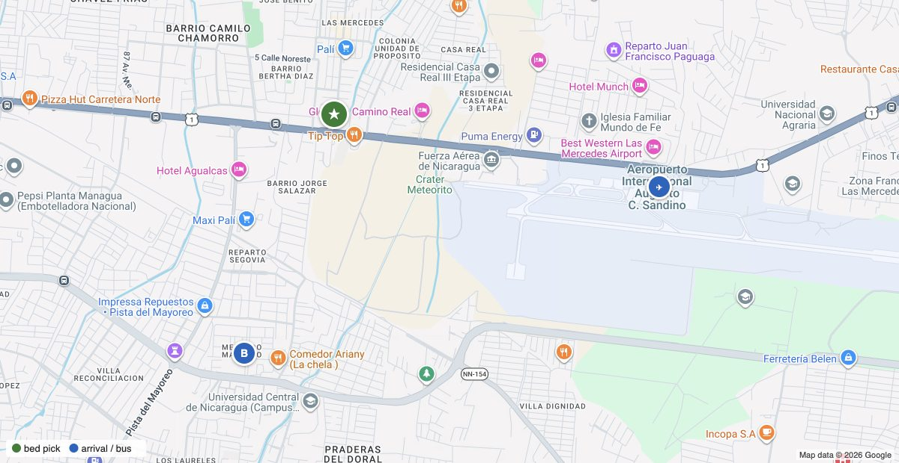

# 🇳🇮 Flight home (Managua → Seattle)

Part of the [LatAm itinerary](../itinerary.md) · region notes: [Costa Rica + Nicaragua](costa-rica-nicaragua.md) · ← [Estelí](esteli.md)

> **Last leg · Day 94 → 95 · 1 night by the airport · ✈ home** 
> 🛏️ **Casa Robles MGA Airport Homestay**, an apartment ≈ 2 km west of the terminal, $17 
> 🚌 **In:** express bus from Estelí to Mercado Mayoreo ≈ 12:00–13:15, Day 94 · **Out:** ✈ Alaska award MGA 07:00 → MIA → SEA 00:59 (+1), Day 95 (25k + $94.42)

## 🗺️ Map

★ **[Casa Robles MGA Airport Homestay](https://www.google.com/maps?ftid=0x8f73fc1a0819b303:0x71dfb65313a6a384)** (the pick, [book](https://www.booking.com/hotel/ni/apartment-3-minutes-from-airport.html?checkin=2027-03-11&checkout=2027-03-12&group_adults=1&no_rooms=1&group_children=0&selected_currency=USD)) · **B** [Mercado Mayoreo](https://www.google.com/maps?ftid=0x8f73fea02666def3:0xfe3b0806411e4559) (Estelí buses arrive here) · **✈** [Augusto C. Sandino International Airport (MGA)](https://www.google.com/maps?ftid=0x8f73fbfc3f69cac7:0x23fd903b3fad5c5a). The backup, Casa MONTOCO 114, isn't on Google Maps; it's further from the airport.

**Open the live map:** [airport area](https://www.google.com/maps/@12.1420,-86.1830,15z)

## 📅 Day by day

| Day | Plan |
|---|---|
| **Day 94** | Estelí morning walk → 🚌 **express bus ≈ 12:00–13:15** from COTRAN Sur (C$110, ≈ 2 h 30) → **Mercado Mayoreo** → 🚕 taxi ≈ 2 km to the homestay (agree the fare first). Ask the host to book the morning taxi. |
| **Day 95** | 🚕 Taxi to MGA **≈ 05:00** → ✈ **AA1318 MGA 07:00 → MIA 10:49** → **AA2363 MIA 20:56 → SEA 00:59** (+1 day; one change, ≈ 10 h in Miami). |

## 🔖 Book (one click)

Dates and 1 adult are pre-filled. The first channel listed was the cheapest when checked on 24 Nov. ⚠️ = time-sensitive.

**Beds** (Day 94 → 95, 1 night)

| | Where | Total | Location | From Mercado Mayoreo | Book |
|---|---|---:|:---:|---|---|
| ⭐ **Pick** | **Casa Robles MGA Airport Homestay** · apartment | **$17** | 9.5 | 🚕 ≈ 2 km from Mercado Mayoreo (Estelí buses) · [route](https://www.google.com/maps/dir/?api=1&origin=12.1351145,-86.1948813&destination=12.1485596,-86.1897278&travelmode=driving) · to the terminal: [route](https://www.google.com/maps/dir/?api=1&origin=12.1485596,-86.1897278&destination=12.1444609,-86.1710823&travelmode=driving) | [Booking](https://www.booking.com/hotel/ni/apartment-3-minutes-from-airport.html?checkin=2027-03-11&checkout=2027-03-12&group_adults=1&no_rooms=1&group_children=0&selected_currency=USD) |
| Backup | **Casa MONTOCO 114** · twin | $18 | 9.1 | 🚕 further from the airport (taxi) | [Booking](https://www.booking.com/hotel/ni/casa-114.html?checkin=2027-03-11&checkout=2027-03-12&group_adults=1&no_rooms=1&group_children=0&selected_currency=USD) |

**Transport**

| | Leg | When | Price | Book |
|---|---|---|---:|---|
| In | **Estelí → Managua** express, COTRAN Sur → Mercado Mayoreo, then a taxi ≈ 2 km | **Day 94 ≈ 12:00–13:15**, ≈ 2 h 30 | C$110 + taxi | [NicaBuses](https://www.nicabuses.com/bus/esteli/a/managua) |
| Taxi | Homestay → MGA | **Day 95 ≈ 05:00** | — | ask the host the evening before |
| ⚠️ ✈ | **Alaska award MGA → SEA** (AA1318 → AA2363), main cabin | **Day 95 07:00 → 00:59 (+1)** | **25,000 pts + $94.42** | [Alaska award search](https://www.alaskaair.com/search/results?A=1&O=MGA&D=SEA&OD=2027-03-12&OT=Anytime&RT=false&UPG=none&ShoppingMethod=onlineaward&awardType=MilesOnly) |

How to read these tables

- **Location** is the guests' location score on Booking.com. The target is 9.0 or higher, and ⚠️ marks one below 9.0.
- **From Mercado Mayoreo** comes from Google Maps on 24 Nov: the property found on Maps and routed from where the Estelí bus arrives. The **route** links open the same routes.
- Symbols: 🚶 walk · 🚌 public transport · 🚕 taxi/rideshare · 🥾 hike only · ⚠️ far from the centre with no bus · ℹ️ outside the centre but on a bus line.

## 🛏️ Why the airport night

- The award leaves at **07:00**, and Estelí is ≈ 2½ h from Managua with the first bus at 03:30, too late for a 05:00 airport arrival.
- **Night Day 93 → 94: Casa Robles MGA Airport Homestay** · apartment **$17 on Booking** · 9.1 (363 reviews; 1 % below 7), **location 9.5** · ≈ 2 km west of the terminal.
- **Backup:** Casa MONTOCO 114 (twin $18; 8.0, location 9.1, 9 % bad).

## ✈ The flight: Alaska award, Day 95

✅ alaskaair.com award search (27 Nov, 1 adult, for Fri 12 March 2027): **25,000 pts + $94.42**, main cabin. Every itinerary starts with **AA1318 MGA 07:00 → MIA 10:49**.
- **Pick: AA2363 MIA 20:56 → SEA 00:59** (+1 day): one change, ≈ 10 h in Miami, 7 seats.
- **Or AA2533 MIA 15:50 → ORD 18:29 → AA2392 ORD 21:40 → SEA 00:34** (+1 day; two changes, 9 seats).
- A later start, **AA344 MGA 13:13**, connects only overnight via Portland (25k + $100.02).
- Business on the MIA leg only: 50,000 + $94.42, not worth it.
- **History:** the plan flew on 10 March (AS305 via Miami, landing 22:24) until Bocas del Toro added 2 days on 27 Nov. On 9 March the only same-day 25k routing had a 34-minute change at JFK. The 13 March search returned nothing.

**Cash fare** ✅ Google Flights (24 Nov, for 1–5 March; not rechecked for 12 March): **$417 one-way** on every date checked (United 14:25 via IAH is the fastest, 10 h 34). The award saves $417 − $94 = $323 for 25k points (≈ 1.3 ¢/pt).

## ℹ️ Good to know
- **Tica Bus San José → Managua** (onward proof for Costa Rica entry): [ticabus.com](https://www.ticabus.com/en/).
- Somoto Canyon is Day 93, a day trip during the [Estelí](esteli.md) stay (see [Somoto](somoto.md)).
