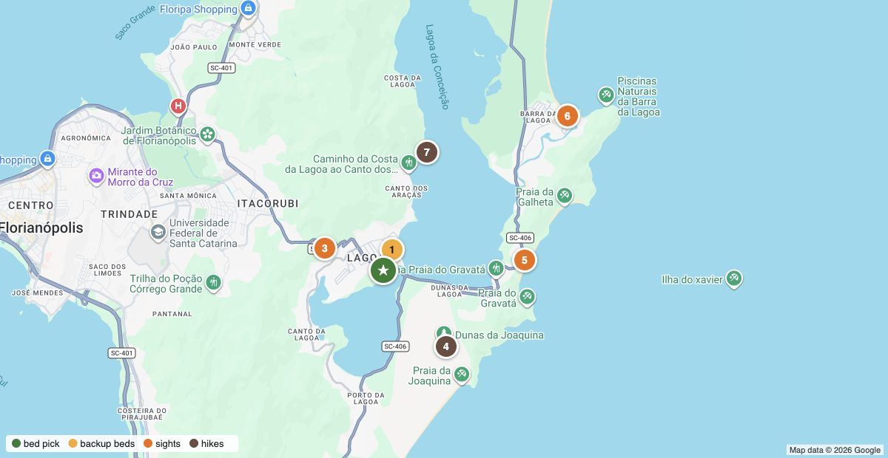
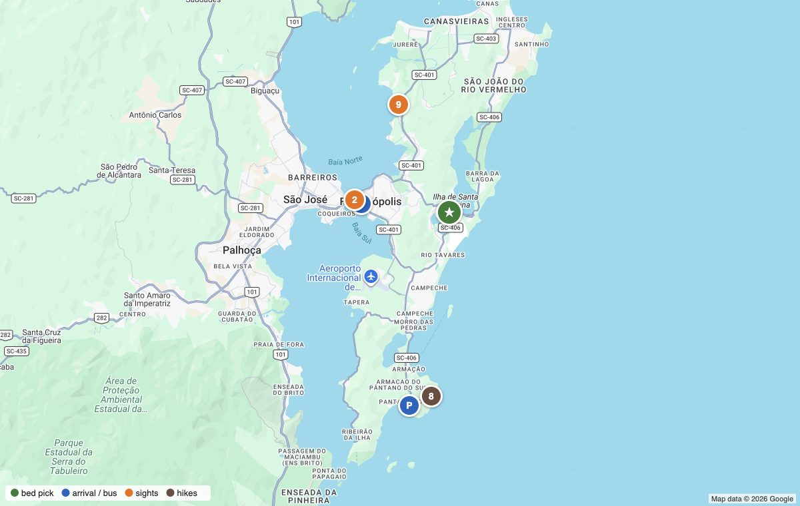

# 🇧🇷 Florianópolis (Plan B: instead of Paraguay)

Part of the [LatAm itinerary](../itinerary.md) · region notes: [Brazil](brazil.md) · ← [Foz do Iguaçu](foz-do-iguacu.md) · [Montevideo](montevideo.md) → · replaces [Asunción](asuncion.md) + [Encarnación](encarnacion.md) if you switch

> **Plan B · Tue 22 → Sat 26 Dec 2026 · 4 nights · Christmas · added 26 Nov** 
> 🏞️ Island of 42 beaches, dunes and forest trails, on the classic Brazil → Uruguay backpacker route 
> 🛏️ **Pequi Hostel**, Lagoa da Conceição, a dorm bed, $62 for 4 nights (location 9.8) 
> 🚌 **In:** night bus from Foz, Mon 21 Dec 16:30 · **Out:** EGA to Montevideo, Sat 26 Dec 14:30 → Sun 27 ≈ 09:45

Lagoa da Conceição from the Morro da Lagoa viewpoint (3 on the map). Photo: Google Maps.

## Why a Plan B

Paraguay is thin on tourist infrastructure: Lonely Planet *South America on a Shoestring* lists only about five hostels in the whole country, and the Christmas stop in Encarnación had **no hostels left** (a whole flat instead). The two countries share no border, so the only direct link on to Uruguay is the **EGA bus on Wed and Sat (≈ 18–20 h)**. Plan B swaps 21–27 Dec for **Florianópolis**, the standard stop on LP's "Atlantic Coast" route. **Everything from Sun 27 Dec on stays the same** (Montevideo, Cabo Polonio, New Year's Eve).

| | Plan A: Paraguay (current) | **Plan B: Florianópolis** | Plan B2: + Punta del Diablo |
|---|---|---|---|
| 21 → 22 Dec | Asunción | 🚌 night bus Foz → Florianópolis | same as B |
| 22 → 26 Dec | Asunción, then Encarnación (Christmas, whole flat) | **Florianópolis**, 4 nights (Christmas) | same as B |
| 26 → 27 Dec | EGA Encarnación → Montevideo (17 h 45) | EGA/TTL Florianópolis → Montevideo (≈ 19 h) | 🚌 Florianópolis → Porto Alegre → night bus to Chuí |
| 27 → 28 Dec | Montevideo | Montevideo | **Punta del Diablo** (instead of Montevideo) |
| Beds + buses, 21–27 Dec | ≈ $256 | **≈ $255** | ≈ $220 (and no Montevideo bed on the 27th) |
| New country | ✅ Paraguay | ✗ (Brazil again) | ✗ |
| Hostels with a kitchen | none left in Encarnación | 33 on Hostelworld, 50 on Booking; no "% unavailable" banner (26 Nov) | + 4 in Punta del Diablo |

**Switch if:** Paraguay's buses or beds look shaky closer to the date, or the EGA from Encarnación sells out (17 semi-cama seats left on 25 Nov). Decide by **mid-December**; book the Florianópolis → Montevideo bus as soon as you switch (holiday week, Saturdays only).

## 🗺️ Map

**Lagoa:** ★ **[Pequi Hostel](https://www.google.com/maps?ftid=0x95273fd9379e1ed1:0x22a20988379db3c0)** (the pick, [book](https://www.booking.com/hotel/br/pequi-hostel-florianopolis1.html?checkin=2026-12-22&checkout=2026-12-26&group_adults=1&no_rooms=1&group_children=0&selected_currency=USD)) · **1** [Tucano House](https://www.google.com/maps?ftid=0x95273eb91d602a79:0xe6aa61ddbe54bc7b) (backup, [book](https://www.booking.com/hotel/br/tucano-house-backpackers.html?checkin=2026-12-22&checkout=2026-12-26&group_adults=1&no_rooms=1&group_children=0&selected_currency=USD)) · **3** [Morro da Lagoa viewpoint](https://www.google.com/maps?ftid=0x952739345fb5a2c9:0x31c25b312b37d38c) · **4** [Joaquina dunes](https://www.google.com/maps?ftid=0x95273c3abbc1d301:0x82ac6764819ffa48) · **5** [Praia Mole](https://www.google.com/maps?ftid=0x95273e7c21378ba7:0xa317ef29d5487b28) · **6** [Barra da Lagoa](https://www.google.com/maps?ftid=0x95273f97d95a7995:0xa2ad4910c9545a11) · **7** [Costa da Lagoa trail](https://www.google.com/maps?ftid=0x95273f0022df9c4b:0xd41c49e20debb2c3) (start at Canto dos Araçás)

**Island:** ★ Pequi Hostel · **B** [Rita Maria bus station](https://www.google.com/maps?ftid=0x9527382091a283f9:0xd68eeedd6769a348) (long-distance; the island-bus hub [TICEN](https://www.google.com/maps?ftid=0x952738269ec9445b:0x37f01343fa54d00a) is 400 m away) · **2** [Hercílio Luz bridge](https://www.google.com/maps?ftid=0x952737f3a902cdc7:0x1aa7dec706ee183a) · **8** [Lagoinha do Leste](https://www.google.com/maps?ftid=0x95272404e8c3831d:0xae98a7e840abda50) · **P** [Pântano do Sul](https://www.google.com/maps?ftid=0x9527242f7337134b:0x17543c3c2d3c7cba) (trailhead) · **9** [Santo Antônio de Lisboa](https://www.google.com/maps?ftid=0x952746dfa6c1a34f:0xe59a64d6a8c102d9) (sunset, oysters)

**Open the live map:** [Lagoa](https://www.google.com/maps/@-27.60,-48.46,13z) · [island](https://www.google.com/maps/@-27.62,-48.50,11z)

## 📅 Day by day

| Day | Plan |
|---|---|
| **Mon 21 Dec** | Last morning in Foz (check out, leave the bag at the hostel). 🚌 **16:30 Nordeste** from Foz's bus station, overnight. |
| **Tue 22 Dec** | Arrive ≈ 08:10 at Rita Maria. 🚌 Bus 2120 to Lagoa (44 min). Afternoon: 🌅 **Morro da Lagoa viewpoint** walk (39 min) and the lagoon shore. |
| **Wed 23 Dec** | 🥾 **Lagoinha do Leste**: bus to Pântano do Sul (1 h 20), then the forest trail over the headland (≈ 1 h each way) to a wild beach. |
| **Thu 24 Dec** · Christmas Eve | 🥾 **Costa da Lagoa trail** along the lagoon (no road; come back by the lagoon boat), or the **Joaquina dunes** and Praia Mole on foot. Shops close early: buy food for the 25th. |
| **Fri 25 Dec** · Christmas Day | Most places shut. 🏖️ **Barra da Lagoa** (24 min by bus) and its natural pools; cook at the hostel. |
| **Sat 26 Dec** | Morning on the beach, then 🚌 **EGA 14:30** (or TTL 15:00) to Montevideo, arriving Sun 27 ≈ 09:45. |

## 🔖 Book (one click)

Dates and 1 adult are pre-filled. Prices were checked on 26 Nov. ⚠️ = time-sensitive.

**Beds** (22 → 26 Dec, 4 nights)

| | Where | Total | Location | From the bus station | Book |
|---|---|---:|:---:|---|---|
| ⭐ **Pick** | **Pequi Hostel** · bed in an 8-bed mixed dorm | **$62** | 9.8 | 🚌 44 min: walk 15 min → bus 2120 → walk 5 min (taxi ≈ 25 min) · [route](https://www.google.com/maps/dir/?api=1&origin=-27.5975303,-48.5581724&destination=-27.605318999999998,-48.4678009&travelmode=transit) | [Booking](https://www.booking.com/hotel/br/pequi-hostel-florianopolis1.html?checkin=2026-12-22&checkout=2026-12-26&group_adults=1&no_rooms=1&group_children=0&selected_currency=USD) · [Hostelworld](https://www.hostelworld.com/hostels/p/303448/pequi-hostel/?from=2026-12-22&to=2026-12-26&guests=1) ($64.68) |
| Backup | **Tucano House** · bunk in a mixed dorm, kitchen | $55 | 9.0 | 🚌 54 min: walk 15 min → bus 2120 → walk 13 min · [route](https://www.google.com/maps/dir/?api=1&origin=-27.5975303,-48.5581724&destination=-27.600945,-48.465633499999996&travelmode=transit) | [Booking](https://www.booking.com/hotel/br/tucano-house-backpackers.html?checkin=2026-12-22&checkout=2026-12-26&group_adults=1&no_rooms=1&group_children=0&selected_currency=USD) · [Hostelworld](https://www.hostelworld.com/hostels/p/23936/tucano-house-summer-hostel/?from=2026-12-22&to=2026-12-26&guests=1) ($56.16) |

**Transport**

| | Leg | When | Price | Book |
|---|---|---|---:|---|
| In | 🚌 **Nordeste** · Foz do Iguaçu → Florianópolis, semi-leito | **Mon 21 Dec 16:30 → Tue 22 08:10** (15 h 40; also 17:30, 18:40) | **R$276.99** (≈ $46.50) | [ClickBus](https://www.clickbus.com.br/onibus/foz-do-iguacu-pr/florianopolis-sc?departureDate=2026-12-21) |
| In (alt) | ✈ Azul via Campinas | 21 Dec evening, ≈ 4 h | $183 | Google Flights |
| ⚠️ Out | 🚌 **EGA** (or TTL) · Florianópolis → Montevideo Tres Cruces | **Sat 26 Dec 14:30 → Sun 27 ≈ 09:45** (Saturdays only; TTL 15:00) | ≈ UYU 5,845 semi-cama (≈ $146) | [EGA](https://ega.com.uy/destino/florianopolis/) |

How to read these tables

- **Location** is the guests' location score on Booking.com (aim ≥ 9.0).
- **From the bus station** comes from Google Maps (26 Nov), routed from Rita Maria bus station at 09:00 on 22 Dec.
- The EGA fare is EGA's published Montevideo ↔ Florianópolis fare (cama UYU 7,195); EGA's Brazilian shop didn't load headless, so confirm the reverse fare when booking. Tres Cruces' timetable lists EGA 14:30 and TTL 15:00 from Florianópolis, arriving Sundays.

## 🚌 Getting here: Foz do Iguaçu → Florianópolis, Mon 21 Dec

- **Bus (recommended):** Nordeste semi-leito **16:30 → 08:10, R$276.99** (≈ $46.50); 16:00 → 07:05 is R$294.99; cama from R$431.99. Catarinense and Expresso São José run the same night. ✅ ClickBus (26 Nov, 39 seats left at 16:30).
- **Flight:** Azul via Campinas $183 (≈ 4 h) or $160 (11.5 h), LATAM via São Paulo $206 ✅ Google Flights (26 Nov). The bus is a third of the price and saves a night's bed.
- **This keeps both Foz nights (19 → 21 Dec)** and frees Mon 21 Dec until 16:00 (Parque das Aves or the Marco das Três Fronteiras).
- **From Rita Maria to Lagoa:** walk 15 min to TICEN, bus **2120** to Lagoa (44 min door to door ✅ Google Maps). LP: the island buses run from TICEN with one free transfer at the district terminals (TILAG for Lagoa, TIRIO for the south).

## 🛏️ Where to sleep

### ⭐ Pick: Pequi Hostel
- **Unit:** bed in an 8-bed mixed dorm. **$62 for 4 nights on Booking** (26 Nov; Hostelworld $64.68).
- **Reviews:** Booking **9.6** (250 reviews, **0 % below 7**), location **9.8**; Hostelworld listed.
- **House rules:** no parties or events, **quiet hours 22:00–07:00**; shared kitchen.
- **Where:** in Lagoa da Conceição, LP's "rowdy and social" hub, 39 min on foot from the viewpoint and 5 min from the 2120 bus.

### Backup: Tucano House
- Bunk in a mixed dorm, **$55 on Booking** (Hostelworld $56.16 = $14.04 a night).
- Hostelworld **9.6 from 1,275 reviews**, Booking 9.3 (244; 1 % below 7), location 9.0; kitchen ✅ (Hostelworld).
- Reviews mention shared dinners and "a party" side: fine as a backup, not for early hike starts.

**Not chosen:** Mama Africa ($53, location 9.5) and the Nômades / Sea Wolf chain hostels (social, priced $64–89). Everything was available on 26 Nov with no Christmas banner.

## 🌳 Things to do (free and outdoors first)

<table>
<tr>
<td width="50%" valign="top"> <b><a href="https://www.google.com/maps?ftid=0x95272404e8c3831d:0xae98a7e840abda50">Lagoinha do Leste</a></b> · free · ≈ 1 h trail each way A wild beach with a lagoon behind it, reached only on foot over the headland from Pântano do Sul.</td>
<td width="50%" valign="top"> <b><a href="https://www.google.com/maps?ftid=0x95273c3abbc1d301:0x82ac6764819ffa48">Joaquina dunes</a></b> · free · 58 min on foot from the hostel Big white dunes above Praia da Joaquina; sandboards for hire at the bottom (LP).</td>
</tr>
<tr>
<td width="50%" valign="top"> <b><a href="https://www.google.com/maps?ftid=0x95273f97d95a7995:0xa2ad4910c9545a11">Barra da Lagoa</a></b> · free · 24 min by bus 2120 Fishing village at the lagoon's mouth with a surf beach and natural rock pools.</td>
<td width="50%" valign="top"> <b><a href="https://www.google.com/maps?ftid=0x95273e7c21378ba7:0xa317ef29d5487b28">Praia Mole</a></b> · free · 55 min on foot Surf beach between Lagoa and Galheta; walk on over the rocks to wild Praia da Galheta.</td>
</tr>
<tr>
<td width="50%" valign="top"> <b><a href="https://www.google.com/maps?ftid=0x952737f3a902cdc7:0x1aa7dec706ee183a">Hercílio Luz bridge</a></b> · free · by the bus station The 1926 suspension bridge, open to walkers; good on the way in or out.</td>
<td width="50%" valign="top"><b><a href="https://www.google.com/maps?ftid=0x95273f0022df9c4b:0xd41c49e20debb2c3">Costa da Lagoa trail</a></b> · free · 50 min to the start, then ≈ 2–3 h A path along the roadless west shore of the lagoon to Costa da Lagoa village; the lagoon boat brings you back (≈: the boat fare and the 2–3 h estimate are unchecked).</td>
</tr>
</table>

- **Morro da Lagoa viewpoint (3):** 39 min uphill on foot from Pequi; the classic view over the lagoon and dunes. Free.
- **Lagoinha do Leste (8):** bus from Lagoa to **Pântano do Sul** (Google: bus 841 → 4125, 1 h 19), then **57 min (2.6 km)** on the trail ✅ Google Maps; LP: about 1 h through forest. Take water, start early (heat), and come back before dark.
- **Santo Antônio de Lisboa (9):** Azorean fishing village in the north-west with sunset over the bay and oyster bars (paid).
- **Skip:** the calm but crowded northern bays (Canasvieiras, Jurerê) (LP); the wild south and the east coast suit hiking better.

## 🍽️ Eat and drink

- **Cook at the hostel on 24–25 Dec:** supermarkets close early on Christmas Eve, and most restaurants shut on Christmas Day.
- Lagoa's main streets have por-quilo buffets (pay by weight) for lunch; seafood ("sequência de camarão") is the local splurge. Prices weren't researched.

## ℹ️ Good to know

- **Season:** Christmas week is the start of Brazil's summer peak; prices rise from Réveillon (New Year), after you leave. LP: prices drop 15–40 % outside high season.
- **Island buses:** one fare covers a ride plus one transfer at the district terminals (LP; the fare was R$4.20 in LP and is higher now). Uber is cheap: LP quotes ≈ R$26 from the airport to Lagoa.
- **Christmas Day:** reduced bus timetables on the 25th; plan beach days near the hostel.
- **Sea:** east-coast beaches (Mole, Joaquina, Galheta) have strong surf; swim where there are lifeguards.

## 🚌 Leaving: Florianópolis → Montevideo, Sat 26 Dec

- **EGA 14:30** (semi-cama ≈ UYU 5,845 / $146; cama UYU 7,195) or **TTL 15:00**, both **Saturdays only**, arriving Tres Cruces Sun 27 Dec ≈ 09:45–10:30 ✅ Tres Cruces terminal timetable (26 Nov). Bring US$/UYU for Uruguay; the border stop is at Chuí/Chuy at night.
- Then the plan continues unchanged: [Montevideo](montevideo.md) Sun 27 → Mon 28, Cabo Polonio 28 → 30, New Year's Eve in Montevideo.

Plan B2: via Porto Alegre and Punta del Diablo (cheaper, more legs)

- **Sat 26 Dec:** 🚌 Florianópolis **14:00 → Porto Alegre 21:00** (Expresso NS da Penha semi-leito, **R$164.59** ≈ $27.65 ✅ [ClickBus](https://www.clickbus.com.br/onibus/florianopolis-sc/porto-alegre-rs?departureDate=2026-12-26)), then **Planalto 23:30 → Chuí Sun 27 09:00** (convencional **R$267.95** ≈ $45, executivo R$347.95 ✅ [ClickBus](https://www.clickbus.com.br/onibus/porto-alegre-rs/chui-rs?departureDate=2026-12-26)).
- **Sun 27 Dec:** get the **Uruguay entry stamp** at the Chuy border post (insist on both stamps), then any Montevideo-bound Ruta 9 bus from Chuy (e.g. CYNSA 10:15, COT 11:30, Rutas del Sol 12:45 ✅ Tres Cruces timetable) stops at **Punta del Diablo** (≈ 1 h 20).
- **Bed, 27 → 28 Dec:** **Mar de Fondo Hostel**, bed in a 4-bed dorm, **$26** on [Booking](https://www.booking.com/hotel/uy/mar-de-fondo-hostel.html?checkin=2026-12-27&checkout=2026-12-28&group_adults=1&no_rooms=1&group_children=0&selected_currency=USD) · 9.2 (269; 1 % below 7), location 9.6, kitchen. Skip Compay ($18): its reviews describe a party hostel.
- **Do:** the fishermen's beach and rocks ([Playa de los Pescadores](https://www.google.com/maps?ftid=0x95732dbca4e40137:0xdf7cb972b9e4ec67)), and the coastal walk or a bus to **[Fortaleza de Santa Teresa](https://www.google.com/maps?ftid=0x950d1dcb7cbb5fad:0xa812dbb5abe809)** in its national park (LP: free fort grounds, beaches, flamingos at Laguna Negra).
- **Mon 28 Dec:** on to Cabo Polonio: a Ruta 9 bus to Castillos, then the Rutas del Sol Valizas line to the Cabo Polonio gate. ⚠️ Only the **winter 2026 timetable** is published (Castillos → Cabo Polonio 19:20 that season); summer adds runs. Check rutasdelsol.com.uy in December, or ask the hostel about a shared taxi.
- **Saves** the Montevideo bed on the 27th ($25) and ≈ $45 of bus fare against EGA; **costs** an extra night-bus change at 23:30 in Porto Alegre.

---
Photos: Google Maps contributors (Lagoa viewpoint, Lagoinha do Leste, Joaquina dunes, Barra da Lagoa, Praia Mole, Hercílio Luz bridge). LP facts are from Lonely Planet *South America on a Shoestring*, paraphrased.
