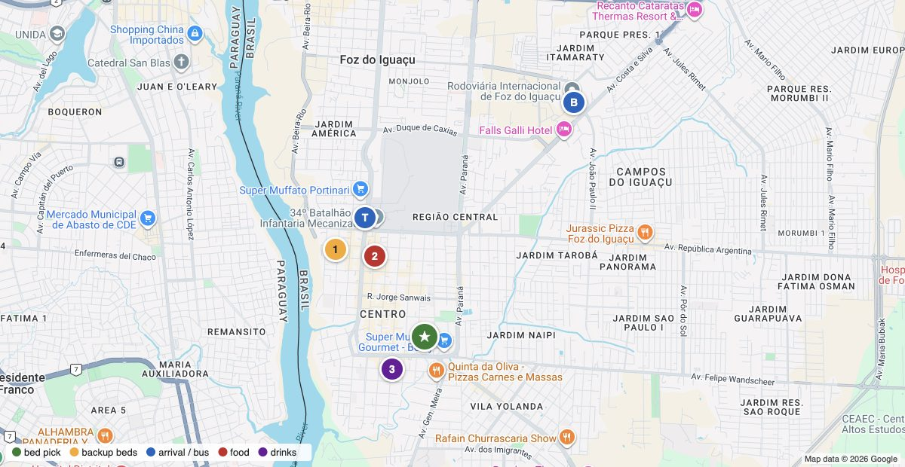
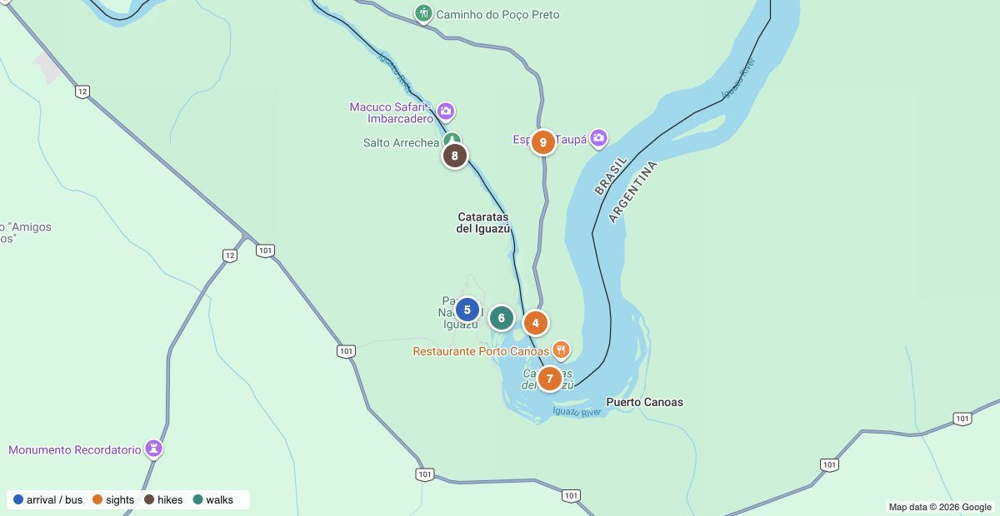

# 🇧🇷 Foz do Iguaçu

Part of the [LatAm itinerary](../itinerary.md) · region notes: [Brazil](brazil.md) · ← [Curitiba + Serra Verde](curitiba.md) · [Asunción](asuncion.md) →

> **Stop 6 · Sat 19 → Mon 21 Dec 2026 · 2 nights · pre-Christmas weekend** 
> 🏞️ The Iguaçu falls from both sides: the Brazilian panorama on Saturday, the Argentine walkways on Sunday 
> 🛏️ **Hostel Bambu**, a bed in a 10-bed mixed ensuite dorm with privacy curtains, $33.60 + fee for 2 nights 
> 🚌 **In:** Catarinense night bus from Curitiba, arriving ~07:00 Sat 19 · **Out:** Expresso Nordeste 08:00 to Asunción, Mon 21

The walkway out to the Garganta do Diabo, Brazilian side. Photo: Google Maps.

## 🗺️ Map

**In town:** ★ **Hostel Bambu** (the pick) · **1** El Shaddai Hostel e Pousada (backup) · **T** [TTU city-bus terminal](https://www.google.com/maps?ftid=0x94f69047772d25c9:0xcf28e5399f55e525) (bus 120 to the park; the Argentina bus Thu–Sun) · **B** [Rodoviária Internacional](https://www.google.com/maps?ftid=0x94f690f61d49ae65:0xa3c92911de5d27b0) · **2** [Buffet Shami](https://www.google.com/maps?ftid=0x94f6913d4e44c125:0x53f9e8b59a3f61a6) and [Restaurante Treviso](https://www.google.com/maps?ftid=0x94f690480b4d68d7:0x3ca27abf17078125) · **3** [277 Craft Beer](https://www.google.com/maps?ftid=0x94f691a95fca61c3:0x92d11ca1bb9c48e5)

**The falls** (the border runs down the gorge: 🇧🇷 east bank, 🇦🇷 west bank): **4** 🇧🇷 [Trilha das Cataratas](https://www.google.com/maps?ftid=0x94f6ea7400ba0ff5:0x2bd2515b9f69e025) → [Garganta do Diabo walkway](https://www.google.com/maps?ftid=0x94f6ea0b10a0b82f:0x222948c7f3092ad8) · **5** 🇦🇷 [visitor centre](https://www.google.com/maps?ftid=0x94f6eb006c6d109f:0x75a74243993ba61c) and train station · **6** 🇦🇷 [Circuito Superior](https://www.google.com/maps?ftid=0x94f6ea6fb4d69d5d:0x28b5ec1c5274d5b2) and [Inferior](https://www.google.com/maps?ftid=0x94f6eb680419968f:0xa94fc00704c48a42) · **7** 🇦🇷 [Garganta del Diablo](https://www.google.com/maps?ftid=0x94f6ea09a1f64ec1:0x348a6807de70ac63) · **8** 🇦🇷 [Sendero Macuco](https://www.google.com/maps?ftid=0x94f6ea8c5ac5d35f:0x1d1f9bf62651bd96) → [Salto Arrechea](https://www.google.com/maps?ftid=0x94f6eaeaadcc45b3:0xf53716145dd6a4ea) · **9** 🇧🇷 [Macuco Safari](https://www.google.com/maps?ftid=0x94f6ea9eee5378d3:0x5a4c438b42c5a278) (boat). Off the map to the north: 🇧🇷 the park's [visitor centre](https://www.google.com/maps?ftid=0x94f694e1f3ec9b11:0x95a68af890a7df6c), [Circuito São João](https://www.google.com/maps?ftid=0x94f6950007bc846b:0x4b0c1c64740a9259) and the [Poço Preto trail](https://www.google.com/maps?ftid=0x94f69533f021e97d:0xe4491e52d7efb453).

**Open the live map:** [town](https://www.google.com/maps/@-25.5380,-54.5800,14z) · [the falls](https://www.google.com/maps/@-25.6800,-54.4450,13z) · [Foz to the falls and Puerto Iguazú](https://www.google.com/maps/@-25.610,-54.520,11z)

## 📅 Day by day

| Day | Plan |
|---|---|
| **Sat 19 Dec** | 🌙 Night bus arrives ~07:00 at the Rodoviária Internacional; city bus or Uber (≈ R$ 20–25) to the hostel to drop your pack. 🇧🇷 **Brazilian side**: bus 120 from the TTU (≈ 40 min, R$ 6), the **08:30 slot**, the falls trail first, then Ytepopo. 🎟️ Buy tomorrow's Argentine park ticket online. 🍺 277 Craft Beer in the evening (closed Sunday). |
| **Sun 20 Dec** | 🇦🇷 **Argentine side**, all day: Río Uruguay bus from the TTU to Puerto Iguazú, then the park bus; **at the gate by 08:00**. Train to the **Garganta del Diablo**, then the Circuito Superior and Inferior, and the **Sendero Macuco** (closes 15:00). Last bus back to Brazil 20:30. |
| **Mon 21 Dec** | 🚌 Uber to the rodoviária ~07:15 for the **08:00 Expresso Nordeste** to Asunción. |

## 🔖 Book (one click)

Dates and 1 adult are pre-filled. The first channel listed was the cheapest when checked on 24 Nov. ⚠️ = time-sensitive.

**Beds** (19 → 21 Dec, 2 nights)

| | Where | Total | Location | From the bus terminal | Book |
|---|---|---:|:---:|---|---|
| ⭐ **Pick** | **Hostel Bambu** · bed in a 10-bed mixed ensuite dorm, privacy curtains | **$33.60** + fee | 9.1 *(HW)* | 🚕 taxi/rideshare ≈ 11 min from the international bus terminal (walk 55 min, 4.1 km); centre 10 min on foot · [route](https://www.google.com/maps/dir/?api=1&origin=-25.520148799999998,-54.564011699999995&destination=-25.5447915,-54.580391199999994&travelmode=driving) | [Hostelworld](https://www.hostelworld.com/hostels/p/15578/hostel-bambu/?from=2026-12-19&to=2026-12-21&guests=1) |
| Backup | **El Shaddai Hostel e Pousada** · bed in a 6-bed mixed ensuite dorm | $30.24 + fee | 9.6 *(HW)* | 🚕 taxi/rideshare ≈ 11 min from the international bus terminal (walk 55 min, 4.1 km); centre 19 min on foot · [route](https://www.google.com/maps/dir/?api=1&origin=-25.520148799999998,-54.564011699999995&destination=-25.5358505,-54.5905189&travelmode=driving) | [Hostelworld](https://www.hostelworld.com/hostels/p/20622/el-shaddai-hostel-e-pousada/?from=2026-12-19&to=2026-12-21&guests=1) · [Agoda](https://www.agoda.com/partners/partnersearch.aspx?hid=36757434&checkin=2026-12-19&checkout=2026-12-21&NumberofAdults=1&Rooms=1) |

**Park tickets**

| | Park | When | Price | Book |
|---|---|---|---:|---|
| ⚠️ 🇧🇷 | **Iguaçu falls, Brazilian side** (timed online ticket) | **Sat 19 Dec**, 08:30 slot | foreigners from **R$ 131** ($22) | [tickets.cataratasdoiguacu.com.br](https://tickets.cataratasdoiguacu.com.br/) |
| 🇦🇷 | **Iguazú falls, Argentine side** | **Sun 20 Dec**, 08:00–18:00 (last entry 16:00) | **AR$ 60,000** (≈ $38) | [iguazuargentina.com](https://iguazuargentina.com/) |

**Transport**

| | Leg | When | Price | Book |
|---|---|---|---:|---|
| In | **Catarinense** night bus · Curitiba → Foz Rodoviária Internacional | **Fri 18 Dec 21:00 → Sat 19 07:00** | R$ 289.99 ($48.70) | [ClickBus](https://www.clickbus.com.br/onibus/curitiba-pr/foz-do-iguacu-pr?departureDate=2026-12-18) |
| Day trip | **Río Uruguay** bus · Foz TTU → Puerto Iguazú | **Sun 20 Dec**, hourly 07:30–21:30 | ≈ AR$ 10–12k ($7–9) | [Río Uruguay](https://riouruguaybus.com.ar/) |
| Out | **Expresso Nordeste** · Foz Rodoviária Internacional → Asunción | **Mon 21 Dec 08:00 → 15:00** | R$ 114.99 ($19.30) | [ClickBus](https://www.clickbus.com.br/onibus/foz-do-iguacu-pr/assuncao-py?departureDate=2026-12-21) |

How to read these tables

- **Location** is the guests' location score on Booking.com. The target is 9.0 or higher, and ⚠️ would mark one below 9.0. *(HW)* means Hostelworld's location rating, used where a property isn't on Booking (neither hostel here is).
- **From the bus terminal** comes from Google Maps on 24 Nov: the property found on Maps and routed from where you arrive at midday on the check-in date (the international bus terminal). The **route** link opens the same route.
- Symbols: 🚶 walk · 🚌 public transport · 🚕 taxi/rideshare · 🥾 hike only · ⚠️ far from the centre with no bus · ℹ️ outside the centre but on a bus line.

## 🌙 Getting here: Curitiba → Foz do Iguaçu, Fri 18 → Sat 19 Dec

- The **Catarinense night bus** (21:00 from Curitiba; see the [Curitiba guide](curitiba.md)) reaches the **Rodoviária Internacional at ~07:00**.
- It is ≈ 6 km out; take a city bus or an Uber (≈ R$ 20–25) to the hostel, drop your pack and go straight to the falls.

## 🛏️ Where to sleep

Both live-checked on 24 Nov. Neither is on Booking, so the scores are Hostelworld's.

### ⭐ Pick: Hostel Bambu
- **Unit:** a bed in a 10-bed mixed ensuite dorm. R. Edmundo de Barros 621, centre.
- **Price:** **Hostelworld $33.60** + fee for 2 nights.
- **Reviews:** Hostelworld 89% (2,268); of the last 100 reviews the average is 94, with 3% below 60. Not found on Booking or Agoda.
- **Where:** ~0.65 km from the centre; the TTU (bus 120 to the park, and the Argentina bus Thu–Sun) is in the centre.
- **Checks:**
  - **Privacy curtains, shelf, light, sockets and a lockable cupboard per bed** (5+ reviews, 2025–26).
  - "Best hostel kitchen I've been in"; AC; free coffee.
  - **⚠ Pool and bar:** free caipirinha at 20:00 and a Friday BBQ. Reviews call it "social, not a party hostel", and staff turn the music down on request. A Dec 2025 reviewer found the private room next to the pool noisy, so ask for a dorm away from the pool.
  - Three 2026 reviews (Jun, Sep, Oct; all below 60) call the bathrooms dirty and the place run-down or damp.

### Backup: El Shaddai Hostel e Pousada
- **Unit:** a bed in a 6-bed mixed ensuite dorm, or a **4-bed male ensuite dorm** at $18.48 a night. R. Eng. Rebouças 306.
- **Price:** **Hostelworld $30.24** + fee for 2 nights. Not found on Booking or Agoda.
- **Reviews:** Hostelworld 96% (1,586); of the last 100 the average is 94, with 1% below 60 (one bed-bug report, Jan 2026).
- **Where:** ~1.5 km from Bambu and the centre.
- **Checks:**
  - **Quiet:** "more chill than wild", gated at night.
  - Big breakfast included.
  - **⚠ Small pool** (calm, not a party).
  - **No bed curtains.** The kitchen is large but poorly equipped.

### Also: The Lodge Iguassu
- A capsule hostel; each capsule is a private pod. [On Google Maps](https://www.google.com/maps?ftid=0x94f6912fae7489a5:0x991714f28a48ef62).
- Booking 8.8 (1,042; **9% below 7**), location 9.7.
- **Booking $35** (breakfast included, free cancellation to 14 Dec). Agoda $33.25.
- Central. Recent reviews: thin breakfast and weak capsule AC. No stove.

### Private alt (location first): "Conforto e estilo na melhor localização de Foz"
- A whole 1-bedroom flat in the centre, ~300 m from Bambu.
- Booking 9.8 (49; **0% below 7**), location 9.8.
- **$129 for 2 nights** from the room table (non-refundable; $141 with free cancellation to 5 Dec), Booking.
- **Cheaper:** Residencial Marco Zero apartment. Booking 9.2 (113; 4% below 7), location 9.7. **$108** (free cancellation to 18 Dec). ~1 km north of the centre.

**Not chosen:** Tetris (Hostelworld 94 overall, but 7 of its last 16 reviews are below 60: "abandoned", loud music), Concept Design ($51, 8% below 7, pool), Hostel Poesia (46%).

## 🌳 Things to do (free and outdoors first)

<table>
<tr>
<td width="50%" valign="top"> <b>🇧🇷 <a href="https://www.google.com/maps?ftid=0x94f6ea7400ba0ff5:0x2bd2515b9f69e025">Trilha das Cataratas</a></b> · park from R$ 131 · Sat 19, 08:30 The 1.5 km panorama trail and the Garganta do Diabo walkway. Walk it first, before the crowds.</td>
<td width="50%" valign="top"> <b>🇧🇷 <a href="https://www.google.com/maps?ftid=0x94f69533f021e97d:0xe4491e52d7efb453">Caminho do Poço Preto</a></b> · included in the ticket 9 km each way through forest; start between 09:00 and 12:00. Ytepopo (5 km along the river) is the shorter one.</td>
</tr>
<tr>
<td width="50%" valign="top"> <b>🇦🇷 <a href="https://www.google.com/maps?ftid=0x94f6ea09a1f64ec1:0x348a6807de70ac63">Garganta del Diablo walkway</a></b> · AR$ 60,000 park entry · Sun 20 2.2 km. Take the jungle train there at opening (from 08:20).</td>
<td width="50%" valign="top"> <b>🇦🇷 <a href="https://www.google.com/maps?ftid=0x94f6ea6fb4d69d5d:0x28b5ec1c5274d5b2">Circuito Superior</a> and <a href="https://www.google.com/maps?ftid=0x94f6eb680419968f:0xa94fc00704c48a42">Inferior</a></b> · included 1.85 km along the top, then 1.45 km with stairs below the falls.</td>
</tr>
<tr>
<td width="50%" valign="top"> <b>🇦🇷 <a href="https://www.google.com/maps?ftid=0x94f6ea8c5ac5d35f:0x1d1f9bf62651bd96">Sendero Macuco</a></b> · free inside the park A 7 km return jungle walk to the <a href="https://www.google.com/maps?ftid=0x94f6eaeaadcc45b3:0xf53716145dd6a4ea">Salto Arrechea</a>. It closes at 15:00.</td>
<td width="50%" valign="top"> <b>Boat under the falls</b>: 🇧🇷 <a href="https://www.google.com/maps?ftid=0x94f6ea9eee5378d3:0x5a4c438b42c5a278">Macuco Safari</a> or 🇦🇷 Gran Aventura · price unverified Paid extra, only if unique. Gran Aventura sells out by mid-morning <i>(lead)</i>.</td>
</tr>
</table>

**Argentine side:** buy the park ticket online the day before (≈ 15% cheaper, per Worldly Adventurer), and book the boat ride (Gran Aventura) first thing, because it sells out by mid-morning *(lead)*.

**Sat 19: Brazilian side** (Parque Nacional do Iguaçu). It's the panorama side; do it the morning you arrive.
- **Getting there:** bus **120 "Parque Nacional" from the TTU**, ≈ 40 min, every ≈ 20–30 min. The fare is **R$ 6 ($1)** from 4 Dec 2026 ✅ foz.pr.gov.br; the line number ✅ park site.
- **Hours** ✅ cataratasdoiguacu.com.br: Sat–Sun 08:30–16:00 (weekdays from 09:00); you may stay until 17:30.
- **Ticket:** **online only, with a timed entry slot.** **Foreigners from R$ 131 ($22)** (Mercosur R$ 118; locker R$ 45) ✅ tickets.cataratasdoiguacu.com.br. The exact 19 Dec price wasn't shown.
- **Included:** the park bus, the 1.5 km Trilha das Cataratas, the Garganta do Diabo walkway, and these free forest trails ✅ park site:
  - **Trilha Ytepopo:** 5 km along the river, 09:00–14:30.
  - **Caminho do Poço Preto:** 9 km each way through forest; start between 09:00 and 12:00.
  - **Circuito São João:** 2.8 km, with swimming spots.
  - The Bananeiras trail is temporarily closed.
- **Plan:** walk the falls trail at 08:30, before the crowds, then Ytepopo.

**Sun 20: Argentine side** (Parque Nacional Iguazú). This is the up-close side and needs the whole day.
- **Foz → Puerto Iguazú:** Río Uruguay bus, hourly 07:30–21:30. On Thu–Sun it starts at the **TTU** ✅ riouruguaybus.com.ar. The fare is ≈ AR$ 10–12k ($7–9) from resellers; the operator's site shows no fare.
- **Border:** Argentine immigration always stops the bus. For a same-day return you can usually stay on it at the Brazilian post (LP tip ≈), so confirm with the driver. Bring your passport.
- **Puerto Iguazú terminal → falls:** buses every 15 min, 06:00–17:30 ✅. ≈ AR$ 12,000 ($7.60) each way for foreigners (council tariff, July 2026, local news).
- **Entry: AR$ 60,000** (≈ $38 at the official rate, ≈ $35 by foreign card), jungle train included. Pay online or at the ticket office, in peso cash or by card ✅ iguazuargentina.com. A second day is half price.
- **Hours:** 08:00–18:00, last entry 16:00. The train starts at 08:20, and the last train to the Garganta leaves at 15:30 ✅.
- **Order of the day:**
  - At opening, take the train to the **Garganta del Diablo walkway** (2.2 km).
  - Then the **Circuito Superior** (1.85 km) and the **Inferior** (1.45 km, stairs).
  - The **Sendero Macuco** is a free 7 km return jungle walk to the Salto Arrechea waterfall. It closes at 15:00 ✅.
- **Last bus back to Brazil:** 20:30 from Puerto Iguazú ✅.

**Paid extra, only if unique:** the boat ride under the falls (Macuco Safari or Gran Aventura); price unverified. Skip Parque das Aves and Itaipu.

## 🍽️ Eat and drink

All ≈ leads from Google, 24 Nov.

<table>
<tr>
<td width="50%" valign="top"> <b><a href="https://www.google.com/maps?ftid=0x94f6913d4e44c125:0x53f9e8b59a3f61a6">Buffet Shami</a></b> · R$ 6.99/100 g, a plate ≈ R$ 35 ($6) Halal Lebanese food by weight, Av. Brasil 258. Mon–Sat 11:00–15:00.</td>
<td width="50%" valign="top"> <b><a href="https://www.google.com/maps?ftid=0x94f690480b4d68d7:0x3ca27abf17078125">Restaurante Treviso</a></b> · buffet R$ 20–40 ($3.50–7) R. Eng. Rebouças 727. Google 4.5 (969 reviews).</td>
</tr>
<tr>
<td width="50%" valign="top"> <b><a href="https://www.google.com/maps?ftid=0x94f691a95fca61c3:0x92d11ca1bb9c48e5">277 Craft Beer</a></b> · craft beer R. Mal. Floriano Peixoto 709: a World Beer Cup-medalled brewpub. Mon–Sat 17:00–00:30, so go on Saturday night (closed Sunday).</td>
<td width="50%" valign="top"></td>
</tr>
</table>

## ℹ️ Good to know
- **Crowds:** 19–20 Dec is a pre-Christmas weekend in the school holidays. **Buy the Brazilian ticket online for the 08:30 slot** and be at the Argentine gate at 08:00.
- **Money:** carry Argentine pesos (or a card) for the buses, and US dollars or reais as a fallback.
- **Weather:** Foz is hot and humid in December (≈ 33 °C), with afternoon storms.

## 🚌 Leaving: Foz do Iguaçu → Asunción, Mon 21 Dec

- **Pick: Expresso Nordeste 08:00 Foz Rodoviária Internacional → Asunción terminal 15:00**, semi-leito, **R$ 114.99 ($19.30)**, 28 seats left ✅ ClickBus. Take an Uber to the rodoviária at ~07:15 (≈ 6 km).
- **Alternative:** NSA 10:00 → 17:00, Gs 200,000 ($31.50).
- The do-it-yourself route via Ciudad del Este, and the exit and entry stamps you need either way, are in the [Asunción guide](asuncion.md).

---
Photos: Google Maps contributors (Mirante da Garganta do Diabo, Trilha das Cataratas, Trilha Poço Preto, Devil's Throat, Circuito Inferior, Salto Arrechea, Macuco Safari, Buffet Shami, Restaurante Treviso, 277 Craft Beer).
