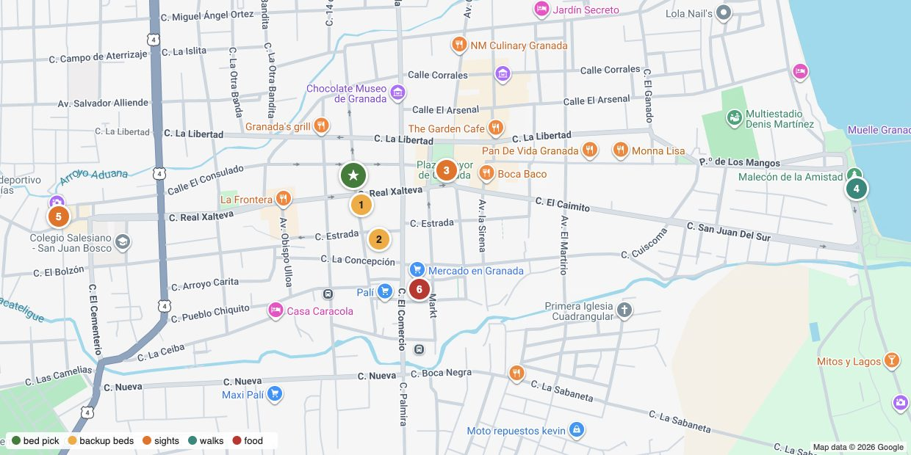
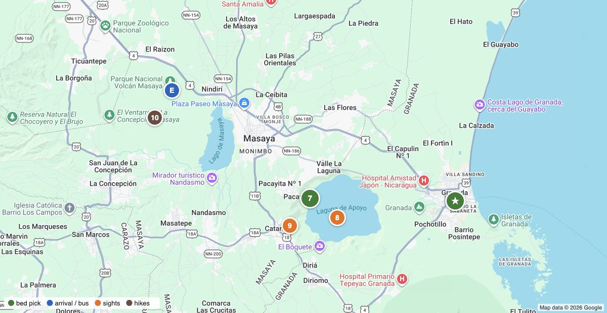

# 🇳🇮 Granada + Laguna de Apoyo

Part of the [LatAm itinerary](../itinerary.md) · region notes: [Costa Rica + Nicaragua](costa-rica-nicaragua.md) · ← [Ometepe](ometepe.md) · [León](leon.md) →

> **Stop 34 · Thu 25 → Sat 27 Feb 2027 · 2 nights: 1 in Granada, 1 at Laguna de Apoyo** 
> 🏞️ Colonial lake town, Masaya's crater at night, then a night on a warm crater lake 
> 🛏️ **De Boca en Boca** (Granada) $14 + **Coco Bay** (Laguna de Apoyo, on the shore) $14 
> 🚌 **In:** morning ferry from Ometepe + bus via Rivas, Thu · **Out:** microbus via Managua to León, Sat 27 Feb

Laguna de Apoyo, the crater lake between Granada and Masaya, from the rim. Photo: Google Maps.

## 🗺️ Map

**Granada:** ★ **De Boca en Boca** (the pick) · **1** Casa Gallo Pinto (backup) · **2** Oasis Hostel (private alt) · **3** [Parque Central](https://www.google.com/maps?ftid=0x8f740c94c3cc6847:0xfa98b9ea49042ca0) · **4** [Malecón](https://www.google.com/maps?ftid=0x8f740cb812fb2207:0x572905761ac01e81) on Lake Nicaragua · **5** [Fortaleza La Pólvora](https://www.google.com/maps?ftid=0x8f740ced47f22a79:0x9e2c1f8a4cfb9736) · **6** [Mercado](https://www.google.com/maps?ftid=0x8f740ceb6e9d0b4d:0x194770eae10ba0f)

**Around:** ★ Granada · **7** [Coco Bay](https://www.google.com/maps?ftid=0x8f740fda22242a65:0x2101824bf295ea8) (the Laguna de Apoyo bed) · **8** [Laguna de Apoyo](https://www.google.com/maps?ftid=0x8f740eedf46bb767:0x4bc7d2854d5b58f4) · **9** [Mirador de Catarina](https://www.google.com/maps?ftid=0x8f740f0c08f5c523:0xe2f0ef8ea8751edb) · **10** [Volcán Masaya](https://www.google.com/maps?ftid=0x8f7406c4641a9451:0xea7c8827d6d2c08) (Santiago crater) · **E** [park entrance](https://www.google.com/maps?ftid=0x8f7407201f44c605:0xd00b97c1d674be3) on the Managua road

**Open the live map:** [Granada](https://www.google.com/maps/@11.9290,-85.9540,16z) · [area](https://www.google.com/maps/@11.95,-86.06,12z)

## 📅 Day by day

| Day | Plan |
|---|---|
| **Thu 25 Feb** | ⛴️ Morning ferry Moyogalpa → San Jorge (≤ 09:00) → Rivas → 🚌 **Granada** (≈ 3½–4½ h). 🌋 Evening: **Volcán Masaya at night** (night entry ≈ 16:30–20:00); any Managua-bound bus to the *Entrada Volcán Masaya*. |
| **Fri 26 Feb** | 🚶 Early walk: the colonial grid, **La Pólvora** and the **Lake Nicaragua malecón** (best at sunset, but Thursday evening is Masaya). Then 🚕 shuttle or taxi to **Coco Bay, Laguna de Apoyo**: swim at sunset. |
| **Sat 27 Feb** | 🏊 Sunrise swim, then 🚌 via Managua to **León**. |

## 🔖 Book (one click)

Dates and 1 adult are pre-filled. The first channel listed was the cheapest when checked on 24 Nov (De Boca en Boca and Coco Bay rechecked on 26 Nov). ⚠️ = time-sensitive.

**Beds** (Granada 25 → 26 Feb, 1 night; Laguna de Apoyo 26 → 27 Feb, 1 night)

| | Where | Total | Location | From Parque Central | Book |
|---|---|---:|:---:|---|---|
| ⭐ **Pick** (Granada) | **De Boca en Boca** · 5- or 8-bed mixed dorm, breakfast | **$14** | 9.8 | 🚶 6 min (450 m) from Parque Central; centre 6 min on foot · [route](https://www.google.com/maps/dir/?api=1&origin=11.9299,-85.9539&destination=11.929784999999999,-85.95665699999999&travelmode=walking) | [Booking (search)](https://www.booking.com/searchresults.html?ss=De+Boca+en+Boca+&checkin=2027-02-25&checkout=2027-02-26&group_adults=1&no_rooms=1&selected_currency=USD) · [Hostelworld](https://www.hostelworld.com/hostels/p/268806/de-boca-en-boca/?from=2027-02-25&to=2027-02-26&guests=1) |
| Backup | **Casa Gallo Pinto** · 8-bed mixed dorm | $22.60 (for 2 nights) | 9.6 | 🚶 6 min (400 m) from Parque Central; centre 6 min on foot · [route](https://www.google.com/maps/dir/?api=1&origin=11.9299,-85.9539&destination=11.9289382,-85.9564156&travelmode=walking) | [Booking (search)](https://www.booking.com/searchresults.html?ss=Casa+Gallo+Pinto+&checkin=2027-02-25&checkout=2027-02-26&group_adults=1&no_rooms=1&selected_currency=USD) · [Hostelworld](https://www.hostelworld.com/hostels/p/332794/casa-gallo-pinto/?from=2027-02-25&to=2027-02-26&guests=1) |
| Private alt | **Oasis Hostel** · private triple, shared bath | $40 (for 2 nights) | 9.6 | 🚶 6 min (400 m) from Parque Central; centre 6 min on foot · [route](https://www.google.com/maps/dir/?api=1&origin=11.9299,-85.9539&destination=11.927960899999999,-85.9559094&travelmode=walking) | [Booking](https://www.booking.com/hotel/ni/oasis-hostel.html?checkin=2027-02-25&checkout=2027-02-26&group_adults=1&no_rooms=1&group_children=0&selected_currency=USD) |
| ⭐ **Pick** (Apoyo) | **Coco Bay - Laguna de Apoyo** · bed in a 10-bed mixed dorm | **$14** | 9.6 | 🚕 ≈ 30–40 min from Granada by hostel shuttle or taxi; by bus, a Masaya-bound bus to the Apoyo turn-off, then a taxi down to the shore · [route](https://www.google.com/maps/dir/?api=1&origin=11.9298,-85.9539&destination=11.932151,-86.055246&travelmode=driving) | [Booking](https://www.booking.com/hotel/ni/coco-bay.html?checkin=2027-02-26&checkout=2027-02-27&group_adults=1&no_rooms=1&group_children=0&selected_currency=USD) |

**Transport**

| | Leg | When | Price | Book |
|---|---|---|---:|---|
| In | Ferry Moyogalpa → San Jorge, taxi to Rivas, bus Rivas → Granada | **Thu 25 Feb**, a morning ferry (≤ 09:00); ≈ 3½–4½ h | ≈ $4–6 | [ferry timetable](https://www.ometepeislandinfo.com/) |
| Evening | Managua-bound bus → *Entrada Volcán Masaya*; park entry + compulsory ride up | **Thu 25 Feb**, night entry ≈ 16:30–20:00 | ≈ C$30 bus + **$10** + ≈ $5 | at the gate |
| Apoyo | Hostel shuttle or taxi Granada → Coco Bay (or a Masaya-bound bus + taxi) | Fri 26 Feb | shuttle + day pass ≈ $10–20 return (≈) | ask the hostel |
| Out | Microbus Granada → Managua (UCA), then a León microbus or bus | **Sat 27 Feb**, ≈ 3 h | ≈ $3–4 | see [León](leon.md) |

How to read these tables

- **Location** is the guests' location score on Booking.com. The target is 9.0 or higher, and ⚠️ marks one below 9.0. *(HW)* means Hostelworld's location rating, used where a property isn't on Booking.
- **From Parque Central** comes from Google Maps on 24 Nov: the property found on Maps and routed from Parque Central at midday on the check-in date. The **route** link opens the same route.
- The backup and private-alt totals are **for 2 nights**, as priced when Granada was a 2-night stop (before 26 Nov). The links are now for 1 night.
- Symbols: 🚶 walk · 🚌 public transport · 🚕 taxi/rideshare · 🥾 hike only · ⚠️ far from the centre with no bus · ℹ️ outside the centre but on a bus line.

## 🚌 Getting here: Moyogalpa → San Jorge → Rivas → Granada, Thu 25 Feb

- **Ferry Moyogalpa → San Jorge:** 05:30, 06:00, 06:30 (lancha), 06:45, 07:00 (lancha), 09:00, 10:00, 11:00, 11:30, 12:30, 13:00 (lancha), 14:00, 15:00 (lancha), 16:00, 17:30 (≈ ometepeislandinfo.com).
- **Taxi or colectivo** to the Rivas terminal (≈ C$20–40).
- **Rivas → Granada:** the direct bus (a few a day, ~2 h, ≈ C$50–100), or any Managua-bound bus to the Nandaime/Empalme junction and a connecting bus into Granada.
- **Total ≈ 3½–4½ h, ≈ $4–6.** Take a **morning ferry (≤ 09:00)** for the better bus connections.

## 🛏️ Where to sleep

### ⭐ Pick (Granada, Thu 25 → Fri 26 Feb): De Boca en Boca
- **Unit:** standard 5- or 8-bed mixed dorm.
- **Price:** **$14 for 1 night on Booking** (rechecked 26 Nov for 25 → 26 Feb; 9.1/748, breakfast included) vs $27.60 on Hostelworld ($24 + 15 % tax).
- **Reviews:** HW **9.6 (2,090; 2.0 % < 7)**, newest 91–100 (Nov 2026). Live-checked 24 Nov.
- **Where:** ~0.3 km from Parque Central.
- **Why it fits:** **dorm beds with curtains, reading lights and a fan each** (reviews), open kitchen with cooker, bar, small plunge pool.
- "Not a party hostel… still social": the Treehouse-party shuttle stops here, it isn't hosted here.

### Backup: Casa Gallo Pinto
- Standard 8-bed mixed dorm. **$22.60 for 2 nights** (tax incl.) on Hostelworld.
- HW **9.5 (59; 14 % < 7)**. ~0.3 km from the centre.
- Full kitchen, "really comfy beds with curtains" (mixed reports), quiet, no pool.
- **Alternative:** Hostal Azul (9.7/1,158, kitchen, curtains, but pool-side night noise reported; $28.75).

### Private alt (location first): Oasis Hostel
- Private triple, shared bath. **$40 for 2 nights** (room table) on Booking.com.
- Booking location **9.6** (score 9.0, 853 reviews, 2 % bad). 0.2 km from Parque Central (pool, kitchen).
- **Upgrade:** Hotel Casa del Consulado, queen room with breakfast, location 9.7 (281 reviews, 1 % bad), $102, on the square.

### ⭐ Laguna de Apoyo, Fri 26 → Sat 27 Feb (new 26 Nov): Coco Bay - Laguna de Apoyo
- **Unit:** bed in a 10-bed mixed dorm. **$14 on Booking** (26 Nov).
- **Reviews:** Booking 8.9 (298 reviews; 2% below 7), **location 9.6**.
- **Where:** right on the lake shore.
- **Why:** swapped in for the 2nd Granada night. The Broke Backpacker's editor calls Laguna de Apoyo his favourite place in Central America, and a night lets you swim at sunset and sunrise instead of on a day pass.
- Kitchen not confirmed; the lakeside hostels have restaurants.

## 🌳 Things to do (free and outdoors first)

<table>
<tr>
<td width="50%" valign="top"> <b><a href="https://www.google.com/maps?ftid=0x8f740cb812fb2207:0x572905761ac01e81">Lake Nicaragua malecón</a></b> · free Walk the colonial grid down to the lake, best at sunset.</td>
<td width="50%" valign="top"> <b><a href="https://www.google.com/maps?ftid=0x8f740ced47f22a79:0x9e2c1f8a4cfb9736">La Pólvora fortress</a></b> · free (the area) On the western edge of the old town.</td>
</tr>
<tr>
<td width="50%" valign="top"> <b><a href="https://www.google.com/maps?ftid=0x8f740f0c08f5c523:0xe2f0ef8ea8751edb">Catarina mirador</a></b> · free The view over Laguna de Apoyo from the crater rim (LP).</td>
<td width="50%" valign="top"> <b><a href="https://www.google.com/maps?ftid=0x8f740eedf46bb767:0x4bc7d2854d5b58f4">Laguna de Apoyo</a></b> · overnight at Coco Bay A crater lake, thermally warm (~28 °C) and very clear (LP). Swim at sunset and sunrise.</td>
</tr>
<tr>
<td width="50%" valign="top"> <b><a href="https://www.google.com/maps?ftid=0x8f7406c4641a9451:0xea7c8827d6d2c08">Volcán Masaya at night</a></b> · <b>$10</b> + ≈ $5 ride up A red glow deep in the Santiago crater. <b>Thu 25 Feb</b> evening.</td>
<td width="50%" valign="top"></td>
</tr>
</table>

**Free:** walk the colonial grid to the **Lake Nicaragua malecón** at sunset; the La Pólvora fortress area.

**Laguna de Apoyo (Fri 26 → Sat 27 Feb, now an overnight):**
- A crater lake, thermally warm (~28 °C) and very clear (LP).
- Hostel shuttles Granada ↔ Apoyo with a day pass at a lakeside hostel (e.g. Paradiso, Coco Bay) ≈ $10–20 return (≈).
- By bus: Granada → a Masaya-bound bus to the Apoyo turn-off + a taxi down.
- **Free alternative:** the **Catarina mirador** on the crater rim (LP).

**Volcán Masaya at night (Thu 25 Feb evening, new 26 Nov):**
- Open daily, **night entry ≈ 16:30–20:00**.
- **$10 for foreigners** plus ≈ $5 for the compulsory ride up from the gate (walking the road is banned).
- **Getting there:** any Managua-bound bus from Granada to the *Entrada Volcán Masaya* (≈ C$30, 30–40 min).
- After crater collapses in 2024–25 you now see a **red glow deep in the Santiago crater**, not the open lava lake. Rangers allow 5–15 min at the rim.
- *(Leads via an AI summary; rangers close the road when gas levels rise.)*

## 🍽️ Eat and drink

<table>
<tr>
<td width="50%" valign="top"> <b><a href="https://www.google.com/maps?ftid=0x8f740ceb6e9d0b4d:0x194770eae10ba0f">Mercado</a></b> and fritanga stalls · ≈ C$80–150 ($2–4) ≈ Cheap plates of vigorón or quesillo.</td>
<td width="50%" valign="top"> <b>Vigorón</b> · ≈ C$80–150 ≈ Boiled yuca with chicharrón and cabbage salad. Generic photo.</td>
</tr>
<tr>
<td width="50%" valign="top"> <b>Quesillo</b> · ≈ C$80–150 ≈ A tortilla wrapped round soft cheese, with cream and pickled onion. Generic photo.</td>
<td width="50%" valign="top"></td>
</tr>
</table>

Craft beer: check nearer the time.

## ℹ️ Good to know
- **Very hot in the afternoon:** walk early and late.
- **Masaya can close at short notice:** rangers close the road when gas levels rise.

## 🚌 Leaving: Laguna de Apoyo / Granada → Managua → León, Sat 27 Feb

- **Microbus Granada → Managua (UCA),** ~1 h, ≈ C$40–60.
- **León microbus or bus from Managua** (UCA or Mercado Israel Lewites), ~1½–2¼ h, ≈ C$55–80.
- ≈ 3 h, ≈ $3–4 in all. A door-to-door shuttle is ≈ $15–25 (≈). Details in the [León](leon.md) guide.

---
Photos: Google Maps contributors (Laguna de Apoyo, Granada malecón, Fortaleza La Pólvora, Mirador de Catarina, Volcán Masaya, Mercado en Granada). Wikimedia Commons: <a href="https://commons.wikimedia.org/wiki/File:VIGORON.JPG">Vigorón</a> (Nicaraguan food, public domain), <a href="https://commons.wikimedia.org/wiki/File:Quesillo.jpg">Quesillo</a> (Luiisyolmaan, CC BY-SA 3.0).
