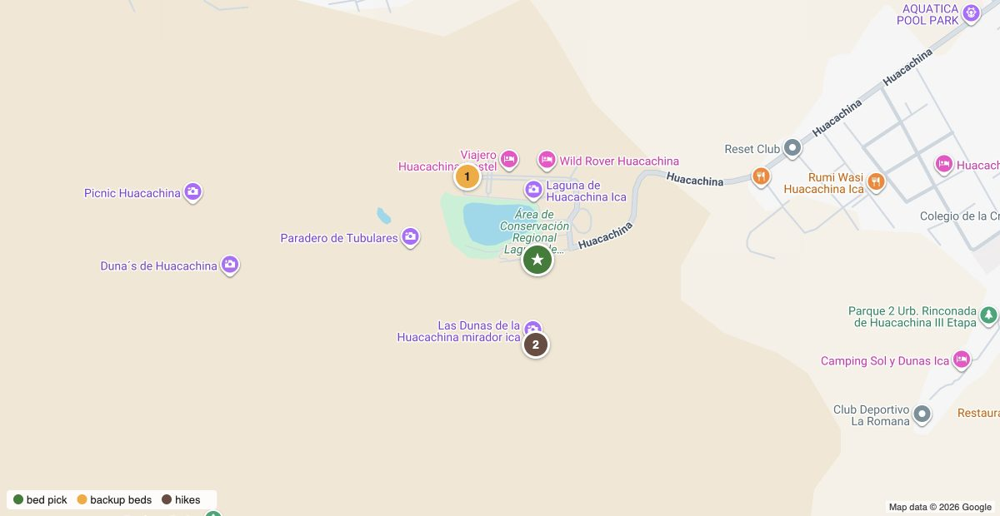
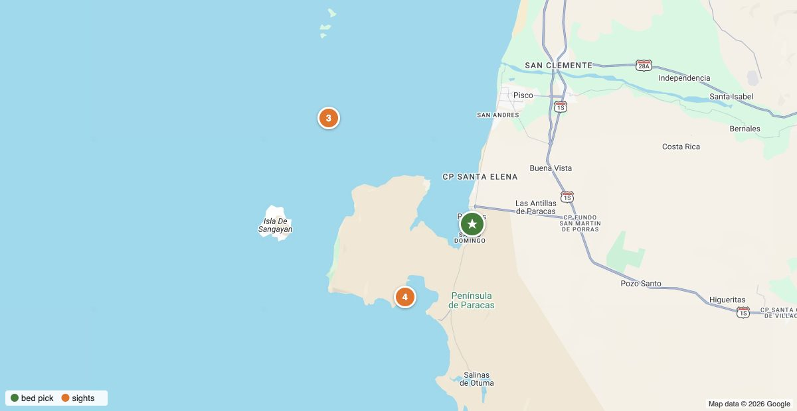

# 🇵🇪 Huacachina + Paracas (optional route C: Arequipa → Lima overland)

Part of the [LatAm itinerary](../itinerary.md) · region notes: [Southern Peru + Panama](peru-panama.md) · ← [Arequipa](arequipa.md) · [Panama City](panama-city.md) →

> **Optional route C · Tue 2 → Sat 6 Feb 2027 · night bus + 3 nights · an open option, not yet the plan** 
> 🏞️ Overland up the coast: the desert oasis at Huacachina, then the Ballestas islands and the Paracas reserve 
> 🛏️ **Hostal Huacachina Sunset** (dorm $15) · **Hostel Killamoon Centro**, Paracas (dorm $14) · **Tupac Hostel**, Lima airport (dorm $9.90) 
> 🚌 **In:** night bus Arequipa → Ica, Tue 2 Feb · ✈ **Out:** Copa Lima → Panama City on United miles, Sat 6 Feb 10:30

The Huacachina oasis from the <a href="https://www.google.com/maps?ftid=0x9110e30032671339:0xf1fa4e32393c9e6b">dunes viewpoint</a>. Photo: Google Maps.

**Status: an open option (user, 24 Nov), not yet the plan.** It's the third way from Arequipa to Panama; options A and B are in the [Panama City guide](panama-city.md#getting-here-three-options-arequipa--panama-city):
- Overland up the coast instead of flying Arequipa → Lima.
- The desert oasis at Huacachina and the Ballestas islands at Paracas.
- Then **Copa Lima → Panama City on United miles** (17,500 + $31.49 saver), avoiding the two-ticket connection risk entirely.
- **Cost:** +2 to +3 days (spare days 12 → 9–10) and one Arequipa night. It brings back the Peru coast that the route model had dropped.

## 🗺️ Map

**Huacachina:** ★ **Hostal Huacachina Sunset** (the pick) · **1** La Casa de Bamboo (quieter private) · **2** [dunes viewpoint](https://www.google.com/maps?ftid=0x9110e30032671339:0xf1fa4e32393c9e6b) · the night buses stop in Ica, ≈ 10 min by taxi: [Cruz del Sur](https://www.google.com/maps?ftid=0x9110e31c802fcce9:0x74ba6bdb3bb91306), [Civa](https://www.google.com/maps?ftid=0x9110e2be6257a82f:0x1052fe15bfad8a4c) · Viajero and Wild Rover (on the map's north side) are the party hostels to avoid

**Paracas:** ★ **Hostel Killamoon Centro** (SGH Paracas and the [El Chaco pier](https://www.google.com/maps?ftid=0x9110633d90963d1f:0xc2d83b1455b00774) are a few hundred metres away in town) · **3** [Islas Ballestas](https://www.google.com/maps?ftid=0x911079c545bac155:0xcb277dbb79b2baf3) · **4** [Paracas National Reserve](https://www.google.com/maps?ftid=0x9110c62aa911b86b:0xa54d42ae23a98439) · Lima: [Tupac Hostel](https://www.google.com/maps?ftid=0x9105cef22da3fc5f:0xcdbb12f9b9fb2972) by the [airport](https://www.google.com/maps?ftid=0x9105cc3d52f51e01:0x1f75ae97fb12652c)

**Open the live map:** [Huacachina](https://www.google.com/maps/@-14.0880,-75.7635,16z) · [Paracas](https://www.google.com/maps/@-13.83,-76.32,11z)

## 📅 Day by day

≈ times; confirm on the operators' sites when booking.

| Day | Plan |
|---|---|
| **Mon 1 Feb** | Colca → Arequipa (as in the main plan). **One night in Arequipa** instead of two. |
| **Tue 2 Feb** | Arequipa day, then the 🚌 **night bus to Ica** (≈ 12–13 h). Book a 160–180° lower-deck seat; keep valuables on you. |
| **Wed 3 Feb** | Arrive Ica ≈ 06:00–07:30. Take a **registered taxi from inside the terminal** to Huacachina (≈ 10 min); don't walk out with luggage before dawn. **Free:** climb the dunes on foot for sunset from the slopes behind the hotels, not through the buggy checkpoint. Paid: buggy + sandboarding 2 h, ≈ $15–25 + S/3.60 municipal fee. |
| **Thu 4 Feb** | 🚌 Morning bus to Paracas (≈ 1 h). Afternoon: 🚲 **Paracas National Reserve** by rented bike (S/11 entry, foreigners). |
| **Fri 5 Feb** | ⛴️ **Islas Ballestas boat 08:00** from El Chaco pier: S/50–80 ≈ $13–22, + S/11 protected-area fee + S/5 pier tax, cash; boats run mornings only. Then 🚌 Cruz del Sur ≈ 10:40 → Lima ≈ 14:40, and on to the airport (60–90 min; rush hour 16:30–20:30). Night at the airport hostel. |
| **Sat 6 Feb** | ✈ **Copa CM400 10:30 → Panama City 14:18** on miles. |

## 🔖 Book (one click)

Dates and 1 adult are pre-filled. ⚠️ = time-sensitive. Prices ≈ unless marked ✅.

**Beds** (1 night each)

| | Where | Total | Rating | Getting there | Book |
|---|---|---:|:---:|---|---|
| ⭐ **Huacachina, 3 → 4 Feb** | **Hostal Huacachina Sunset** · dorm / private | **$15** / $42 | Hostelworld 9.7 | 🚕 registered taxi from inside the Ica terminal, ≈ 10 min | [Hostelworld](https://www.hostelworld.com/hostels/p/101506/hostal-huacachina-sunset/?from=2027-02-03&to=2027-02-04&guests=1) · [Booking (search)](https://www.booking.com/searchresults.html?ss=Hostal+Huacachina+Sunset&checkin=2027-02-03&checkout=2027-02-04&group_adults=1&no_rooms=1&selected_currency=USD) |
| Huacachina, quieter private | **La Casa de Bamboo** · private | $45 | Hostelworld 9.4 (119) | as above | [Hostelworld](https://www.hostelworld.com/hostels/p/271225/la-casa-de-bamboo/?from=2027-02-03&to=2027-02-04&guests=1) |
| ⭐ **Paracas, 4 → 5 Feb** | **Hostel Killamoon Centro** · dorm | **$14** | Hostelworld 9.1 (210); Booking 6% below 7 | 🚌 bus from Ica, ≈ 1 h | [Hostelworld](https://www.hostelworld.com/hostels/p/321528/hostel-killamoon-centro/?from=2027-02-04&to=2027-02-05&guests=1) · [Booking (search)](https://www.booking.com/searchresults.html?ss=Killamoon+Paracas&checkin=2027-02-04&checkout=2027-02-05&group_adults=1&no_rooms=1&selected_currency=USD) |
| Paracas backup | **SGH Paracas** · dorm | $12 | 9.3 (70); some staff-party noise reports | as above | [Hostelworld](https://www.hostelworld.com/hostels/p/320545/sgh-paracas/?from=2027-02-04&to=2027-02-05&guests=1) |
| ⭐ **Lima airport, 5 → 6 Feb** | **Tupac Hostel – Lima Airport** · dorm, kitchen | **$9.90** | 9.2 (688) | 🚌 Cruz del Sur to Lima, then 60–90 min to the airport | [Hostelworld](https://www.hostelworld.com/hostels/p/89319/tupac-hostel-lima-airport/?from=2027-02-05&to=2027-02-06&guests=1) |

**Transport**

| | Leg | When | Price | Book |
|---|---|---|---:|---|
| In | 🚌 **Night bus** Arequipa → Ica | **Tue 2 Feb:** Civa 19:05 → ~07:00 · Cruz del Sur 17:00–22:15 · Oltursa ~20:30 | Civa $25–43 · Cruz del Sur $32–58 | [Civa](https://www.civa.com.pe/) · [Cruz del Sur](https://www.cruzdelsur.com.pe/) · [Oltursa](https://www.oltursa.pe/) |
| Bus | 🚌 Ica → Paracas | **Thu 4 Feb:** PerúBus 09:30 · Cruz del Sur ~10:00 | PerúBus $6–7 · Cruz del Sur $8–15 | [PerúBus](https://www.perubus.com.pe/) · [Cruz del Sur](https://www.cruzdelsur.com.pe/) |
| Boat | ⛴️ Islas Ballestas from El Chaco pier | **Fri 5 Feb 08:00** (mornings only) | S/50–80 ≈ $13–22 + S/11 + S/5, cash | at the pier |
| Bus | 🚌 Paracas → Lima | **Fri 5 Feb** Cruz del Sur ~10:40 → ~14:40 | $13–22 | [Cruz del Sur](https://www.cruzdelsur.com.pe/) |
| ⚠️ Out | ✈ **Copa** Lima → Panama City on United miles | **Sat 6 Feb CM400 10:30 → 14:18** | **17,500 + $31.49** saver ✅ 24 Nov | [United award search, 6 Feb](https://www.united.com/en/us/fsr/choose-flights?f=LIM&t=PTY&d=2027-02-06&tt=1&at=1&sc=7&px=1&taxng=1&newHP=True&clm=7&st=bestmatches&tqp=A) |
| Fewer miles | ✈ **LifeMiles on Avianca via Bogotá** | 01:50, 02:55 or 17:55 departures; seen for 2 Feb, re-check for 5 and 6 Feb | 12,730 + $36.49 | [LifeMiles search](https://www.lifemiles.com/fly/find?from=LIM&to=PTY&date=2027-02-06&cabin=1&adults=1&children=0&infants=0&oneWay=true) · full comparison in the [Panama City guide](panama-city.md) |
| Faster variant | ✈ **Copa CM132** | **Fri 5 Feb 16:40 → 20:27**. Needs an early bus from Pisco and skips Ballestas | 17,500 saver ✅ | [United award search, 5 Feb](https://www.united.com/en/us/fsr/choose-flights?f=LIM&t=PTY&d=2027-02-05&tt=1&at=1&sc=7&px=1&taxng=1&newHP=True&clm=7&st=bestmatches&tqp=A) |

How to read these tables

- **Rating** is the property's own guest rating (Hostelworld unless marked), with the review count in brackets. No Booking location scores were taken for this option.
- **Getting there** comes from the day plan, not from a Google Maps route.
- Symbols: 🚶 walk · 🚌 public transport · 🚕 taxi/rideshare · 🥾 hike only.
- Prices are ≈ unless marked ✅; confirm on the operators' sites when booking.

## 🚌 Getting here: night bus Arequipa → Ica, Tue 2 → Wed 3 Feb

- **Civa 19:05 → ~07:00, $25–43;** Cruz del Sur 17:00–22:15, $32–58; Oltursa ~20:30. ≈ 12–13 h.
- Book a **160–180° lower-deck seat**; keep valuables on you.
- Arrive Ica ≈ 06:00–07:30. Take a **registered taxi from inside the terminal** to Huacachina (≈ 10 min); don't walk out with luggage before dawn.

## 🛏️ Where to sleep

**Party check:** Huacachina is a party oasis.
- **Viajero Huacachina:** reviews read "This is a party hostel". Avoid.
- **Wild Rover:** a party chain. Avoid.

### ⭐ Pick, Huacachina (3 → 4 Feb): Hostal Huacachina Sunset
- Dorm **$15**, private $42. Hostelworld 9.7.
- The calmer pick: 763 Booking reviews, 2.5% below 7, **but it faces the main party venue**.

### Quieter private, Huacachina: La Casa de Bamboo
- Private **$45**, Hostelworld 9.4 (119).

### ⭐ Pick, Paracas (4 → 5 Feb): Hostel Killamoon Centro
- Dorm **$14**. Hostelworld 9.1 (210); Booking 6% below 7.
- Calm (10 "calm" mentions).

### Backup, Paracas: SGH Paracas
- Dorm **$12**, 9.3 (70). Some staff-party noise reports.

### Lima airport night (5 → 6 Feb): Tupac Hostel – Lima Airport
- Dorm **$9.90**, 9.2 (688), kitchen.

## 🌳 Things to do (free and outdoors first)

<table>
<tr>
<td width="50%" valign="top"> <b><a href="https://www.google.com/maps?ftid=0x9110e30032671339:0xf1fa4e32393c9e6b">Huacachina dunes on foot</a></b> · free · sunset Climb from the slopes behind the hotels, not through the buggy checkpoint.</td>
<td width="50%" valign="top"> <b><a href="https://www.google.com/maps?ftid=0x9110c62aa911b86b:0xa54d42ae23a98439">Paracas National Reserve</a></b> by rented bike · S/11 (foreigners) Thu 4 Feb, afternoon.</td>
</tr>
<tr>
<td width="50%" valign="top"> <b><a href="https://www.google.com/maps?ftid=0x911079c545bac155:0xcb277dbb79b2baf3">Islas Ballestas</a></b> boat · S/50–80 + S/11 + S/5 08:00 from <a href="https://www.google.com/maps?ftid=0x9110633d90963d1f:0xc2d83b1455b00774">El Chaco pier</a>, cash. Boats run mornings only.</td>
<td width="50%" valign="top"><b>Buggy + sandboarding</b> · ≈ $15–25 + S/3.60 municipal fee 2 h in the Huacachina dunes. The paid version of the dunes.</td>
</tr>
</table>

## 🍽️ Eat and drink

Not researched for this option. The cost estimate below includes 2 extra food days.

## ℹ️ Good to know

**What changes downstream:** you'd land in Panama on Sat 6 Feb instead of Wed 3 Feb.
- Panama City and Boquete shift to 6 → 11 Feb, so Boquete falls over Carnaval (6–9 Feb), and its beds and buses get dearer.
- Every later date moves +3 days, and the flight home moves to Sat 6 Mar. Sat 6 Mar has the award at 25k + $100, but only a 28.7 h routing (7 seats, checked 24 Nov); 5 Mar has a 14–17 h routing.
- The faster variant (CM132 on 5 Feb) shifts everything by +2 days instead.

**Rough cost vs option A (cash, same day):**
- Option A: ≈ $345 cash (two flights $326 + the second Arequipa night).
- Option C: ≈ $185 cash + 17,500 miles. That covers the night bus, two beds, the buses, Ballestas with fees, the Lima airport bed, the Copa award taxes and 2 extra food days.
- So C saves ≈ $160 cash and adds Huacachina + Paracas, but costs 3 days and the miles.

## ✈ Leaving: Copa Lima → Panama City on miles, Sat 6 Feb

- ⚠️ **Copa CM400 10:30 → 14:18**, 17,500 United miles + $31.49 saver (✅ 24 Nov).
- **Fewer miles:** LifeMiles on Avianca via Bogotá, 12,730 + $36.49 (01:50, 02:55 or 17:55 departures; seen for 2 Feb, re-check for 5 and 6 Feb).
- **Faster:** CM132 on Fri 5 Feb 16:40 → 20:27, also 17,500 saver ✅; it needs an early bus from Pisco and skips Ballestas.
- Full comparison in the [Panama City guide](panama-city.md).

---
Photos: Google Maps contributors (Huacachina dunes viewpoint, Paracas National Reserve). Wikimedia Commons: <a href="https://commons.wikimedia.org/wiki/File:Overlooking_Huacachina_(7136152747).jpg">Overlooking Huacachina</a> (Alex Proimos, CC BY 2.0), <a href="https://commons.wikimedia.org/wiki/File:15-Islas_Ballestas-nX-59.jpg">Islas Ballestas</a> (PsamatheM, CC BY-SA 4.0).
