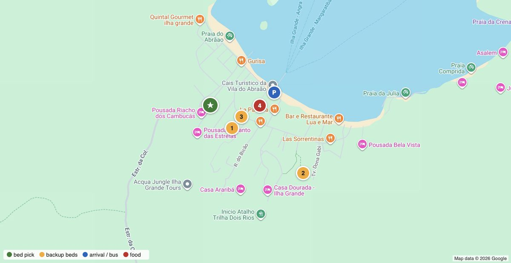
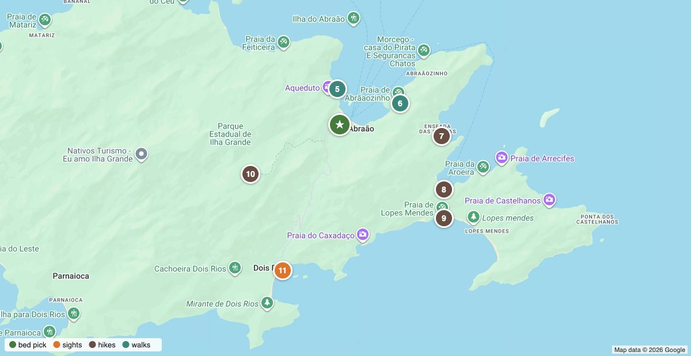

# 🇧🇷 Ilha Grande

Part of the [LatAm itinerary](../itinerary.md) · region notes: [Brazil](brazil.md) · ← [Rio de Janeiro](rio-de-janeiro.md) · [Paraty](paraty.md) →

> **Stop 2 · Day 5 → 7 · 2 nights · weekend ferry timetable** 
> 🏞️ A car-free island of beaches and forest; every trail starts in Vila do Abraão 
> 🛏️ **Lila Limão Hostel**, a bed in a 6-bed mixed ensuite dorm, $45 for 2 nights 
> 🚌 **In:** Costa Verde 07:00 to Conceição de Jacareí + Porto Real flex boat 09:30, Day 5 · **Out:** Barcas ferry Abraão → Angra 10:00, then Colitur to Paraty, Day 7

Praia do Abraão, the village beach where the ferries land. Photo: Google Maps.

## 🗺️ Map

**In the village:** ★ **[Lila Limão Hostel](https://www.google.com/maps?ftid=0x9c5db95de9d34b:0x295b53fc7a024de2)** (the pick, [book](https://www.booking.com/hotel/br/lila-limao-hostel-angra-dos-reis.html?checkin=2026-12-12&checkout=2026-12-14&group_adults=1&no_rooms=1&group_children=0&selected_currency=USD)) · **1** [Mahalo Hostel](https://www.google.com/maps?ftid=0x9c5de1b5a67389:0x12b07c8a0383747a) (backup, [book](https://www.booking.com/hotel/br/semente.html?checkin=2026-12-12&checkout=2026-12-14&group_adults=1&no_rooms=1&group_children=0&selected_currency=USD)) · **2** [Pousada e Hostel Holandês](https://www.google.com/maps?ftid=0x9c5c05f8d09af5:0x962dc09e3e602a8d) (backup 2, [book](https://www.booking.com/hotel/br/holandes-hostel.html?checkin=2026-12-12&checkout=2026-12-14&group_adults=1&no_rooms=1&group_children=0&selected_currency=USD)) · **3** [Blue Door Brasil](https://www.google.com/maps?ftid=0x9c5c0916dce8a3:0x9c3f5d31e1ae5795) (private alt, [book](https://www.booking.com/hotel/br/blue-door-brasil.html?checkin=2026-12-12&checkout=2026-12-14&group_adults=1&no_rooms=1&group_children=0&selected_currency=USD)) · **P** [ferry pier](https://www.google.com/maps?ftid=0x9c5c0c13570d3d:0x844a7c570339815f) · **4** [Manjericão](https://www.google.com/maps?ftid=0x9c5d989db5a41b:0x39a95fc370fb1c84) [🚶 7 min](https://www.google.com/maps/dir/?api=1&origin=-23.1412827,-44.1702562&destination=-23.1413109,-44.1677656&travelmode=walking)

**Trails from the village:** ★ Abraão · **5** [Praia Preta](https://www.google.com/maps?ftid=0x9c5c74fb5e3ebd:0x23b96ae92ab95cb1) [🚶 20 min](https://www.google.com/maps/dir/?api=1&origin=-23.1412827,-44.1702562&destination=-23.1315103,-44.1709936&travelmode=walking), [Lazareto ruins](https://www.google.com/maps?ftid=0x9c5c75968af57f:0x5d120ef72ee08fc5) and the [Aqueduto](https://www.google.com/maps?ftid=0x9c5b8ab59aa0ef:0x570f93e622e70a7c) · **6** [Abraãozinho](https://www.google.com/maps?ftid=0x9c5c425a11912b:0xfa7d86230c26ee0c) [🚶 13 min](https://www.google.com/maps/dir/?api=1&origin=-23.1412827,-44.1702562&destination=-23.1353734,-44.1523343&travelmode=walking) · **7** [Palmas](https://www.google.com/maps?ftid=0x9c5c4a2439c6a1:0x6fc76256ad42a8f2) [🚕 ≈ 30 min](https://www.google.com/maps/dir/?api=1&origin=-23.1412827,-44.1702562&destination=-23.1444925,-44.1399799&travelmode=driving) · **8** [Pouso](https://www.google.com/maps?ftid=0x9c5c2ea4451049:0x7443d71c75bd9e98) [🚕 ≈ 33 min](https://www.google.com/maps/dir/?api=1&origin=-23.1412827,-44.1702562&destination=-23.1590695,-44.1391644&travelmode=driving) · **9** [Lopes Mendes](https://www.google.com/maps?ftid=0x9c5e806c6639db:0x33b22acf6bf930f6) [🚕 ≈ 50 min](https://www.google.com/maps/dir/?api=1&origin=-23.1412827,-44.1702562&destination=-23.1669785,-44.1392836&travelmode=driving) · **10** [Pico do Papagaio](https://www.google.com/maps?ftid=0x9c596f6a76a38f:0x8a3c8d9d854a3009) [🚕 ≈ 34 min](https://www.google.com/maps/dir/?api=1&origin=-23.1412827,-44.1702562&destination=-23.1548768,-44.1969513&travelmode=driving) · **11** [Dois Rios](https://www.google.com/maps?ftid=0x9c592069427a2b:0x7f0799ba5f249dae) [🚕 ≈ 52 min](https://www.google.com/maps/dir/?api=1&origin=-23.1412827,-44.1702562&destination=-23.181336,-44.1873002&travelmode=driving) and the [Museu do Cárcere](https://www.google.com/maps?ftid=0x9c591f96388be5:0x405198f98df747e4)

🧭 The time after each place is from the ★ bed (Google Maps, 26 Nov): 🚶 walk · 🚌 bus · 🚕 taxi · 🚗 by road (tour or bus). Click it for the route.

**Open the live map:** [Abraão](https://www.google.com/maps/@-23.1420,-44.1685,17z) · [the island's east](https://www.google.com/maps/@-23.155,-44.165,13z) · [Mangaratiba ferry station](https://www.google.com/maps?ftid=0x9c14c6467d63fb:0x79cbe082936448f2)

## 📅 Day by day

| Day | Plan |
|---|---|
| **Day 5** | 🚇 Metro + VLT to Novo Rio by ~06:40, **Costa Verde 07:00** (Rio–Paraty bus) → off at **Conceição de Jacareí** ≈ 09:00, 🚤 **Porto Real flex boat 09:30** → Abraão ~09:50 (next boat 12:30). 🥾 **Lopes Mendes trail** (≈ 6 km, 2½–3 h each way, via Palmas and Pouso; boat back from Pouso ≈ R$ 30–40). Arriving late? Praia Preta, the Lazareto ruins and the Aqueduto, then sunset on the beach. |
| **Day 6** | 🥾 **Pico do Papagaio** (982 m) at sunrise: groups leave ~02:00 and are back ~09:30; decide the night before. Afternoon: the 6 km dirt road to **Dois Rios** beach and the old prison (Museu do Cárcere, Tue–Sun 10–16 ≈). |
| **Day 7** | 🌅 07:00 shore walk to Abraãozinho, then the ⛴️ **10:00 ferry** to Angra and the bus to Paraty. |

## 🔖 Book (one click)

Dates and 1 adult are pre-filled. The first channel listed was the cheapest when checked on 24 Nov. ⚠️ = time-sensitive.

**Beds** (Day 5 → 7, 2 nights)

| | Where | Total | Location | From the ferry pier | Book |
|---|---|---:|:---:|---|---|
| ⭐ **Pick** | **Lila Limão Hostel** · bed in a 6-bed mixed ensuite dorm | **$45** | 9.4 | 🚶 walk 7 min (500 m) from the Abraão pier · [route](https://www.google.com/maps/dir/?api=1&origin=-23.1407022,-44.1670497&destination=-23.141282699999998,-44.1702562&travelmode=walking) | [Booking](https://www.booking.com/hotel/br/lila-limao-hostel-angra-dos-reis.html?checkin=2026-12-12&checkout=2026-12-14&group_adults=1&no_rooms=1&group_children=0&selected_currency=USD) · [Hostelworld](https://www.hostelworld.com/hostels/p/314201/lila-limao-hostel/?from=2026-12-12&to=2026-12-14&guests=1) · [Agoda](https://www.agoda.com/partners/partnersearch.aspx?hid=32001446&checkin=2026-12-12&checkout=2026-12-14&NumberofAdults=1&Rooms=1) |
| Backup | **Mahalo Hostel** · bed in a 7-bed mixed dorm, breakfast | $34 | 9.3 | 🚶 walk 6 min (450 m) from the Tourist Pier in Abraão; centre 1 min on foot · [route](https://www.google.com/maps/dir/?api=1&origin=-23.1407022,-44.1670497&destination=-23.142344,-44.169173&travelmode=walking) | [Booking](https://www.booking.com/hotel/br/semente.html?checkin=2026-12-12&checkout=2026-12-14&group_adults=1&no_rooms=1&group_children=0&selected_currency=USD) |
| Backup 2 | **Pousada e Hostel Holandês** (HI) · bed in a 6-bed mixed ensuite dorm, breakfast | $48 | ⚠️ 8.5 | 🚶 walk 9 min (600 m) from the Abraão pier · [route](https://www.google.com/maps/dir/?api=1&origin=-23.1407022,-44.1670497&destination=-23.1444326,-44.1655869&travelmode=walking) | [Booking](https://www.booking.com/hotel/br/holandes-hostel.html?checkin=2026-12-12&checkout=2026-12-14&group_adults=1&no_rooms=1&group_children=0&selected_currency=USD) |
| Private alt | **Blue Door Brasil** · standard double room | $95 | 9.6 | 🚶 walk 5 min (400 m) from the Abraão pier · [route](https://www.google.com/maps/dir/?api=1&origin=-23.1407022,-44.1670497&destination=-23.141810644939,-44.168697831644&travelmode=walking) | [Booking](https://www.booking.com/hotel/br/blue-door-brasil.html?checkin=2026-12-12&checkout=2026-12-14&group_adults=1&no_rooms=1&group_children=0&selected_currency=USD) |

**Transport**

| | Leg | When | Price | Book |
|---|---|---|---:|---|
| In | **Costa Verde** Rio–Paraty bus, Novo Rio → Conceição de Jacareí (ask to get off) | **Day 5 07:00** → ≈ 09:00 (also 08:00, 09:00) | ≈ R$ 60 (fare to Jacareí not published) | [Costa Verde timetable](https://www.costaverdetransportes.com.br/linhas-horarios) · buy at Novo Rio |
| ⚠️ In | **Porto Real** flex boat, Cais Porto Real (Conceição de Jacareí) → Abraão | **09:30** → 09:50 (also 12:30, 14:00, 17:00) | R$ 65 one way (+ ≈ R$ 10.30 boarding fee) | [Porto Real](https://portorealilhagrande.com.br/travessias-flex-boat) · WhatsApp +55 24 99225 4922 |
| Cheapest | Costa Verde 05:00 → Mangaratiba + **Barcas Rio** ferry 08:00 → Abraão 09:50 | Day 5 | R$ 78.49 ($13) | [Barcas Rio timetable](https://barcasrio.com.br/linhas-horarios-e-tarifas/) |
| Out | **Barcas Rio** ferry Abraão → Angra | **Day 7 10:00** → ~11:45 | R$ 20.50 | [Barcas Rio timetable](https://barcasrio.com.br/linhas-horarios-e-tarifas/) |

How to read these tables

- **Location** is the guests' location score on Booking.com. The target is 9.0 or higher, and ⚠️ marks one below 9.0. *(HW)* means Hostelworld's location rating, used where a property isn't on Booking.
- **From the ferry pier** comes from Google Maps on 24 Nov: the property found on Maps and routed from where you arrive at midday on the check-in date. The **route** link opens the same route.
- Symbols: 🚶 walk · 🚌 public transport · 🚕 taxi/rideshare · 🥾 hike only · ⚠️ far from the centre with no bus · ℹ️ outside the centre but on a bus line.

## 🚌 Getting here: Rio → Ilha Grande, Day 5

Web sweep and operator pages, 27 Nov. The cheap state ferry from Mangaratiba runs **once a day at 08:00**, which is why the cheapest option means a 04:00 alarm. The private boats from Conceição de Jacareí, 20 minutes across, let you sleep two hours longer and still land at 09:50.

| Option | Route | Leave Copacabana | Arrive Abraão | Cost |
|---|---|---|---|---|
| ⭐ **A. Recommended** | Metro + VLT to Novo Rio, **Costa Verde 07:00** (the Rio–Paraty bus; ask for Conceição de Jacareí, *lead*) → **Porto Real flex boat 09:30** (✅ times on travessiailhagrande.com; R$ 65 ✅ portorealilhagrande.com.br) | ≈ 06:00 | **09:50** (next boat 12:30 → 12:50) | ≈ R$ 135 ($23) + metro |
| B. Door-to-door | **Top Transfer** shared van + speedboat from the hostel (GetYourGuide, 4.0 from 903 reviews): pickups 05:45–07:15 or 08:45–10:15; free cancellation to 24 h | hostel pickup | ≈ 10:00 or ≈ 13:00 | **$44** (✅ GetYourGuide for Day 5) |
| C. Cheapest | Uber to Novo Rio ~04:15, **Costa Verde 05:00 → Mangaratiba 07:10**, **Barcas Rio ferry 08:00** (R$ 20.50 ✅ barcasrio.com.br) | 04:15 | 09:50 | **R$ 78.49 ($13)** + Uber |
| D. Via Angra | **Costa Verde 07:00 → Angra 11:02**, walk ≈ 1.5 km to Cais de Santa Luzia, private boat **12:30** (also 13:30, 15:00; 35 min) or the state ferry 13:30 | ≈ 06:00 | 13:05–15:20 | ≈ R$ 160 ($28), or R$ 101 with the ferry |

- **Why A:** same arrival as C for ≈ $10 more and no 04:00 Uber. You still get all of Saturday for the Lopes Mendes trail.
- ⚠️ **Book the 09:30 boat ahead** on Porto Real's site or WhatsApp. If the bus runs late, other operators at the Jacareí tourist pier also cross through the day (*lead*: roughly hourly in summer); Porto Real's next boat is 12:30.
- Costa Verde's Rio–Paraty departures are 04:00, 05:15, 07:00, 08:00, 09:00, 11:00… (✅ costaverdetransportes.com.br, 27 Nov; no weekday breakdown, so check Saturday at the Novo Rio counter). Its dedicated Rio → Conceição de Jacareí line has no times online.
- Other shared vans: Transfer Ilha R$ 260; Nomades R$ 285; GetYourGuide's other listings $45–70.
- Some operators add a Jacareí boarding fee (≈ R$ 10.30).

## 🛏️ Where to sleep

### ⭐ Pick: Lila Limão Hostel
- **Unit:** a bed in a 6-bed mixed ensuite dorm. R. Dona Romana 132, Abraão. Live-checked 24 Nov.
- **Price:** **$45 for 2 nights on Booking** (free cancellation to 5 Dec, pay the property before arrival). Hostelworld $46.84 + fee; Agoda $50.90.
- **Reviews:** Booking 9.4 (905 reviews; **1% below 7**), location 9.4. Hostelworld 95% (236); of the 66 written reviews since Dec 2023, none is below 60%.
- **Where:** 3 min from the beach and the main street, on a quiet road.
- **Checks:**
  - Kitchen yes.
  - Reviews: "chill, calm, but inviting" and "not a very social hostel" (both Nov 2026). Not a party hostel.
  - **No bed curtains** (several reviews).
  - The dorm windows face the small common area. AC runs at night only.

### Backup: Mahalo Hostel
- **Unit:** a bed in a 7-bed mixed dorm, in the village centre, 450 m from the pier. Added 25 Nov.
- **Price:** **$34 for 2 nights on Booking**, breakfast included.
- **Reviews:** Booking 8.6 (884; **2% below 7**), location **9.3**.
- **Checks:** no guest kitchen in Booking's facility list; no bed curtains; some 3-tier bunks with little headroom; one bathroom per six in the dorm. Staff and volunteers praised.
- Balaio Hostel (location 9.7, $39, curtains and lights) had a Nov 2026 review reporting mould and bugs, so it isn't the backup.

### Backup 2: Pousada e Hostel Holandês (HI)
- **Unit:** a bed in a 6-bed mixed ensuite dorm. R. da Assembleia 162, in the forest ~8 min up from the pier. ⚠️ Location 8.5.
- **Price:** **$48 for 2 nights on Booking**, breakfast included, free cancellation to 5 Dec. Hostelworld $49.72.
- **Reviews:** Booking 9.1 (796; **4% below 7**), location 8.5. Hostelworld 91% (1,806); of the last 100, 2% are below 60%. One Nov 2026 review mentions a mould smell in the shared room.
- **Checks:** kitchen; quiet; no curtains, no bedside sockets.

### Cheaper alternative: Bela Casa Quartos e Hostel
- 4-bed mixed dorm. Booking 8.7 (190; 6% below 7).
- **$30 on Booking** (free cancellation to 28 Nov). Agoda $34.59; Hostelworld $34.10.
- One 2025 Hostelworld review complains the owner charged extras.

### Private alt (location first): Blue Door Brasil
- Standard double room, Abraão centre.
- Booking 9.2 (539; **4% below 7**), location 9.6.
- **$95 for 2 nights** from the room table, Booking (free cancellation to 28 Nov, pay at the property).
- The top location score (10) belongs to Buganville Loft, but it costs ≈ $174.

**Not chosen:** Refúgio (Booking 8.6–8.7), Balaio (owner complaints), Aquário (a "Bar & Night Club") and Harmoni (51%). Mahalo (also 8.6–8.7 overall) was passed over at first, then became the backup on 25 Nov for its 9.3 location score.

## 🌳 Things to do (free and outdoors first)

No cars on the island; every trail starts in Abraão.

<table>
<tr>
<td width="50%" valign="top"> <b><a href="https://www.google.com/maps?ftid=0x9c5e806c6639db:0x33b22acf6bf930f6">Lopes Mendes trail</a></b> · free · Day 5 · <a href="https://www.google.com/maps/dir/?api=1&origin=-23.1412827,-44.1702562&destination=-23.1669785,-44.1392836&travelmode=driving">🚕 ≈ 50 min</a> About 6 km and 2½–3 h each way from Abraão, via Palmas and Pouso.</td>
<td width="50%" valign="top"> <b><a href="https://www.google.com/maps?ftid=0x9c5c2ea4451049:0x7443d71c75bd9e98">Pouso</a></b> · boat back ≈ R$ 30–40 · <a href="https://www.google.com/maps/dir/?api=1&origin=-23.1412827,-44.1702562&destination=-23.1590695,-44.1391644&travelmode=driving">🚕 ≈ 33 min</a> On the way to Lopes Mendes; boats run back to Abraão from here.</td>
</tr>
<tr>
<td width="50%" valign="top"> <b><a href="https://www.google.com/maps?ftid=0x9c596f6a76a38f:0x8a3c8d9d854a3009">Pico do Papagaio</a></b> (982 m) · guide ≈ $20–40 · Day 6 · <a href="https://www.google.com/maps/dir/?api=1&origin=-23.1412827,-44.1702562&destination=-23.1548768,-44.1969513&travelmode=driving">🚕 ≈ 34 min</a> Steep 6 km, at sunrise. Solo in daylight is free; don't climb in the dark alone.</td>
<td width="50%" valign="top"> <b><a href="https://www.google.com/maps?ftid=0x9c592069427a2b:0x7f0799ba5f249dae">Dois Rios</a></b> · free · Day 6 afternoon · <a href="https://www.google.com/maps/dir/?api=1&origin=-23.1412827,-44.1702562&destination=-23.181336,-44.1873002&travelmode=driving">🚕 ≈ 52 min</a> A 6 km dirt road to the beach and the old prison; the <a href="https://www.google.com/maps?ftid=0x9c591f96388be5:0x405198f98df747e4">Museu do Cárcere</a> opens Tue–Sun 10–16 ≈.</td>
</tr>
<tr>
<td width="50%" valign="top"> <b><a href="https://www.google.com/maps?ftid=0x9c5b8ab59aa0ef:0x570f93e622e70a7c">Aqueduto</a>, <a href="https://www.google.com/maps?ftid=0x9c5c75968af57f:0x5d120ef72ee08fc5">Lazareto ruins</a> and <a href="https://www.google.com/maps?ftid=0x9c5c74fb5e3ebd:0x23b96ae92ab95cb1">Praia Preta</a></b> · free A 20-min walk from the village. The plan if you arrive late on Saturday.</td>
<td width="50%" valign="top"> <b><a href="https://www.google.com/maps?ftid=0x9c5c425a11912b:0xfa7d86230c26ee0c">Abraãozinho</a></b> · free · Day 7, 07:00 · <a href="https://www.google.com/maps/dir/?api=1&origin=-23.1412827,-44.1702562&destination=-23.1353734,-44.1523343&travelmode=walking">🚶 13 min</a> A short shore walk before the 10:00 ferry.</td>
</tr>
</table>

- **Day 5 (with option A): the Lopes Mendes trail.** About 6 km and 2½–3 h each way, via Palmas and Pouso. Free. A boat back from Pouso is ≈ R$ 30–40. If you arrive late, walk to Praia Preta, the Lazareto ruins and the Aqueduto (20 min, free) and watch sunset from the beach.
- **Day 6: Pico do Papagaio (982 m) at sunrise (backlog).**
  - Steep 6 km. Groups leave ~02:00 and are back ~09:30.
  - A guide is ≈ $20–40. Going solo in daylight is free, but don't climb in the dark alone.
  - Decide the night before from the forecast; the summit is often clouded in December.
- **Day 6 afternoon:** the 6 km dirt road to **Dois Rios** beach and the old prison. The **Museu do Cárcere is open Tue–Sun 10–16** (LP ≈), so Sunday works.
- **Day 7:** a 07:00 shore walk only (Abraãozinho), before the 10:00 ferry.
- **Backlog:** the Ilha Grande circuit (about 90 km, 4–6 days) does not fit.

**From Lonely Planet** (*South America on a Shoestring*):
- **Lopes Mendes:** LP gives the trail as **6.1 km and about 3 h**. It starts at the eastern end of Abraão's beach and crosses the hill to Palmas, then follows the coast to Pouso. **Lopes Mendes is a 15-min walk on from Pouso.** LP's tip is to walk one way and take the boat the other. Surfboards can be hired on the beach (LP).
- **Trails:** maps around the village show **16 signposted trails** to the island's 102 beaches (LP). Before you set off (LP):
  - Tell the hostel your route and expected return time.
  - Carry water, repellent and a **torch**: it gets dark fast under the canopy.
  - Off the main routes, hire a guide. Trails can be poorly marked, and there are venomous snakes.

## 🍽️ Eat and drink

<table>
<tr>
<td width="50%" valign="top"> <b><a href="https://www.google.com/maps?ftid=0x9c5d989db5a41b:0x39a95fc370fb1c84">Manjericão</a></b> · ≈ R$ 40 ($7) · <a href="https://www.google.com/maps/dir/?api=1&origin=-23.1412827,-44.1702562&destination=-23.1413109,-44.1677656&travelmode=walking">🚶 7 min</a> R. Buganville: an all-you-can-eat buffet.</td>
<td width="50%" valign="top"><b>Cook in the hostel</b> Lila Limão has a kitchen. The minimarkets cost ~30% more than on the mainland.  <b>Sunset can</b> No craft-beer bar found; have a can at a beach kiosk at sunset.</td>
</tr>
</table>

## ℹ️ Good to know
- **Cash:** bring it from Rio (≈ R$ 400 for 2 days), because Abraão's couple of ATMs run dry. LP goes further and says there are **no ATMs on the island**. Many places take cards, and in a pinch some accept foreign cash (LP).
- **Rain:** December afternoons bring heavy rain, so hike in the morning.
- **Bugs:** bring mosquito repellent.
- **High season:** prices are at their peak in December. LP says they fall by up to 50% from April to November.
- **Food:** restaurants cluster on Rua da Praia, Rua Getúlio Vargas and the Travessa Buganville (LP). LP rates Café do Mar's *pratos do dia* as reasonable by island standards.
- **Health:** a 24-h first-aid post (Serviço de Pronto Atendimento) is on Rua Getúlio Vargas (LP).

## 🚌 Leaving: Abraão → Paraty, Day 7

- **Barcas Rio ferry Abraão → Angra at 10:00** (daily), R$ 20.50 ✅ barcasrio. It arrives ~11:45; then walk or taxi 1.5 km to the rodoviária.
- **Colitur L101 Angra → Paraty, 12:40 → ~14:40**, R$ 27.50 ([Colitur timetable](https://site.colitur.com.br/)).
- **Total R$ 48 ($8.06).** All the departure times and the shared boat + van alternative are in the [Paraty guide](paraty.md).

---
Photos: Google Maps contributors (Praia do Abraão, Lopes Mendes, Pouso, Dois Rios, Aqueduto, Abraãozinho, Manjericão). Wikimedia Commons: <a href="https://commons.wikimedia.org/wiki/File:Pico_do_Papagaio_-_Ilha_Grande_-_RJ.jpg">Pico do Papagaio</a> (José Carlos B Fialho, CC BY-SA 3.0).
