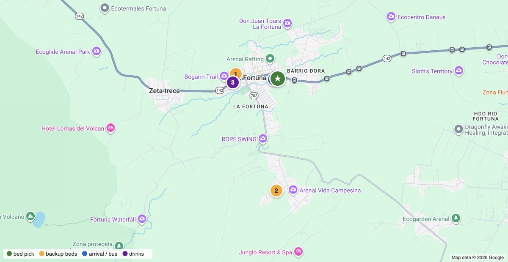
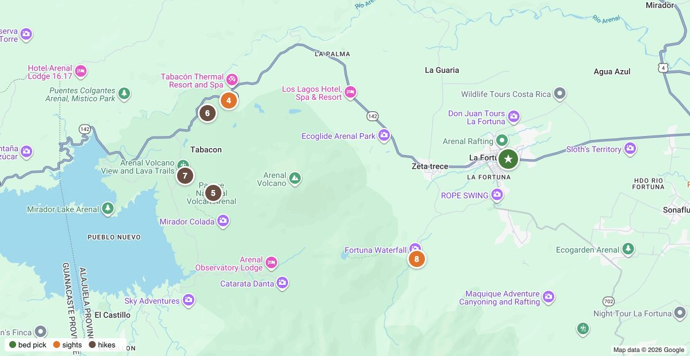

# 🇨🇷 La Fortuna / Arenal

Part of the [LatAm itinerary](../itinerary.md) · region notes: [Costa Rica + Nicaragua](costa-rica-nicaragua.md) · ← [Monteverde](monteverde.md) · [Liberia / Rincón de la Vieja](rincon-de-la-vieja.md) →

> **Stop 30 · Mon 15 → Thu 18 Feb 2027 · 3 nights** 
> 🏞️ Town under the Arenal volcano: a free hot river, lava-flow trails and a day trip to Río Celeste 
> 🛏️ **Ceiba Hostel**, capsule in an 8-bed dorm, $39 for 3 nights 
> 🚐 **In:** jeep-boat-jeep from Monteverde, Mon 08:00 · **Out:** buses via Tilarán and Cañas to Liberia, Thu morning

Volcán Arenal from the national park. Photo: Google Maps.

## 🗺️ Map

**In town:** ★ **[Ceiba Hostel](https://www.google.com/maps?ftid=0x8fa00d211f0120dd:0x6d32c1fc206e9ace)** (the pick, [book](https://www.booking.com/searchresults.html?ss=Ceiba+Hostel+&checkin=2027-02-15&checkout=2027-02-18&group_adults=1&no_rooms=1&selected_currency=USD)) · **B** [bus terminal](https://www.google.com/maps?ftid=0x8fa00d0aef06d4c9:0x9d4857be7750c35e) · **1** [Alpha Arenal](https://www.google.com/maps?ftid=0x8fa00d99bd1fb577:0x74d506821600fcc6) (backup, [book](https://www.booking.com/searchresults.html?ss=Alpha+Arenal+&checkin=2027-02-15&checkout=2027-02-18&group_adults=1&no_rooms=1&selected_currency=USD)) · **2** [Casa Paraíso](https://www.google.com/maps?ftid=0x8fa00cfa57547e51:0x9b468350f631006d) (private alt, 2.5 km out, [book](https://www.booking.com/hotel/cr/alinnas-house.html?checkin=2027-02-15&checkout=2027-02-18&group_adults=1&no_rooms=1&group_children=0&selected_currency=USD)) · **3** [La Fortuna Pub](https://www.google.com/maps?ftid=0x8fa00c8bc2a0449d:0xcb3b226a5317fa3e) [🚶 17 min](https://www.google.com/maps/dir/?api=1&origin=10.4712581,-84.640129&destination=10.4705006,-84.6491963&travelmode=walking)

**Around:** ★ La Fortuna · **4** [El Chollín, the free hot river](https://www.google.com/maps?ftid=0x8fa0092d019e3609:0xd6f77ac9a8779e42) [🚕 ≈ 17 min](https://www.google.com/maps/dir/?api=1&origin=10.4712581,-84.640129&destination=10.4885115,-84.7235614&travelmode=driving) (by Tabacón) · **5** [Parque Nacional Volcán Arenal](https://www.google.com/maps?ftid=0x8fa00e962bb51111:0x1062d8c68ecdfecf) [🚕 ≈ 28 min](https://www.google.com/maps/dir/?api=1&origin=10.4712581,-84.640129&destination=10.4612136,-84.7281487&travelmode=driving) · **6** [Mirador El Silencio](https://www.google.com/maps?ftid=0x8fa00ed53ed247b3:0x15ff71f715caa8e6) [🚕 ≈ 20 min](https://www.google.com/maps/dir/?api=1&origin=10.4712581,-84.640129&destination=10.4847789,-84.7298402&travelmode=driving) · **7** [Arenal 1968](https://www.google.com/maps?ftid=0x8fa00f2181292643:0xa51a38e41efd244c) [🚕 ≈ 23 min](https://www.google.com/maps/dir/?api=1&origin=10.4712581,-84.640129&destination=10.4662751,-84.7365904&travelmode=driving) · **8** [La Fortuna Waterfall](https://www.google.com/maps?ftid=0x8fa00db4da5826ab:0x3c6ad4ac1b7a026) [🚕 ≈ 11 min](https://www.google.com/maps/dir/?api=1&origin=10.4712581,-84.640129&destination=10.441772,-84.6673775&travelmode=driving) · off the map to the north-west: [Río Celeste](https://www.google.com/maps?ftid=0x8f7553fb2547cc07:0xb4a92195a676dd53) (Volcán Tenorio NP)

🧭 The time after each place is from the ★ bed (Google Maps, 26 Nov): 🚶 walk · 🚌 bus · 🚕 taxi · 🚗 by road (tour or bus). Click it for the route.

**Open the live map:** [town](https://www.google.com/maps/@10.465,-84.645,15z) · [area](https://www.google.com/maps/@10.47,-84.69,12z)

## 📅 Day by day

| Day | Plan |
|---|---|
| **Mon 15 Feb** | 🚐 **08:00 jeep-boat-jeep** from Santa Elena (~3½–4 h), for a full afternoon in La Fortuna: ♨️ **El Chollín** in daylight. |
| **Tue 16 – Wed 17 Feb** | Two full days: 🌋 a **volcano hike** (Arenal NP, El Silencio or Arenal 1968; viewpoints are clearest at dawn) and 💧 **Río Celeste** by tour (no public transport). The **hot river** again if you like. |
| **Thu 18 Feb** | 🚌 Leave early for **Liberia** via Tilarán and Cañas. Or see Río Celeste on the way north via Bijagua (a long day). |

## 🔖 Book (one click)

Dates and 1 adult are pre-filled. The first channel listed was the cheapest when checked on 24 Nov. ⚠️ = time-sensitive.

**Beds** (15 → 18 Feb, 3 nights)

| | Where | Total | Location | From the bus terminal | Book |
|---|---|---:|:---:|---|---|
| ⭐ **Pick** | **Ceiba Hostel** · capsule in an 8-bed dorm | **$39** | 9.1 *(HW)* | 🚶 2 min (140 m); centre 10 min on foot · [route](https://www.google.com/maps/dir/?api=1&origin=10.4710996,-84.6408778&destination=10.4712581,-84.640129&travelmode=walking) | [Booking (search)](https://www.booking.com/searchresults.html?ss=Ceiba+Hostel+&checkin=2027-02-15&checkout=2027-02-18&group_adults=1&no_rooms=1&selected_currency=USD) · [Hostelworld](https://www.hostelworld.com/hostels/p/330861/ceiba-hostel/?from=2027-02-15&to=2027-02-18&guests=1) |
| Backup | **Alpha Arenal** · basic 8-bed mixed dorm | $45 | 9.5 *(HW)* | 🚶 15 min (1.0 km) (taxi ≈ 4 min); centre 6 min on foot · [route](https://www.google.com/maps/dir/?api=1&origin=10.4710996,-84.6408778&destination=10.4721914,-84.6485847&travelmode=walking) | [Booking (search)](https://www.booking.com/searchresults.html?ss=Alpha+Arenal+&checkin=2027-02-15&checkout=2027-02-18&group_adults=1&no_rooms=1&selected_currency=USD) · [Hostelworld](https://www.hostelworld.com/hostels/p/317195/alpha-arenal/?from=2027-02-15&to=2027-02-18&guests=1) |
| Private alt | **Casa Paraíso – La Fortuna** · double room | $182 | 9.7 | ⚠️ 🚕 ≈ 7 min (walk 51 min, 3.5 km); **45 min walk to the centre, no bus in Google Maps** · [route](https://www.google.com/maps/dir/?api=1&origin=10.4710996,-84.6408778&destination=10.448872536342,-84.640383350087&travelmode=driving) | [Booking](https://www.booking.com/hotel/cr/alinnas-house.html?checkin=2027-02-15&checkout=2027-02-18&group_adults=1&no_rooms=1&group_children=0&selected_currency=USD) |

**Transport and tickets**

| | Leg | When | Price | Book |
|---|---|---|---:|---|
| In | **Green Road** shared jeep-boat-jeep · Santa Elena → La Fortuna | **Mon 15 Feb 08:00** (or 14:00, $50) | **$45** | greenroadcr.com (or ask Monteverde Backpackers: $29–35 ≈) |
| ⚠️ Tickets | Río Celeste and Arenal NP (SINAC, online only) | before the day | $13.56 / $16.95 | [SINAC](https://serviciosenlinea.sinac.go.cr/) |
| Out | La Fortuna → Tilarán → Cañas → Liberia | **Thu 18 Feb**, from ≈ 07:30–08:00 | ≈ $12–14 | details in the [Liberia guide](rincon-de-la-vieja.md) |

How to read these tables

- **Location** is the guests' location score on Booking.com. The target is 9.0 or higher, and ⚠️ would mark one below 9.0. *(HW)* means Hostelworld's location rating, used where a property isn't on Booking.
- **From the bus terminal** comes from Google Maps on 24 Nov: the property found on Maps and routed from where you arrive at midday on the check-in date.
- Symbols: 🚶 walk · 🚌 public transport · 🚕 taxi/rideshare · 🥾 hike only · ⚠️ far from the centre with no bus · ℹ️ outside the centre but on a bus line.

## 🚐 Getting here: jeep-boat-jeep from Monteverde, Mon 15 Feb

- **Route:** hotel pickup in Santa Elena → jeep to Lake Arenal → boat across → jeep to La Fortuna, ~3½–4 h.
- **Green Road shared: dep 08:00 $45, 14:00 $50** (all fees included) ✅ greenroadcr.com.
- Hostels and aggregators quote $29–35 for the same transfer (≈; ask Monteverde Backpackers on arrival).
- **Take the 08:00** for a full afternoon in La Fortuna.

## 🛏️ Where to sleep

All live-checked on 24 Nov.

### ⭐ Pick: Ceiba Hostel
- **Room:** capsule in an 8-bed dorm.
- **Price:** **$39 on Booking** (card $13 × 3; IVA treatment unchecked) vs $56.00 on Hostelworld ($49.56 + 13 % IVA).
- **Reviews:** HW **9.0 (420; 7.3 % < 7)**, newest 91–100 (Oct–Nov 2026); Booking 8.7 (229).
- **Where:** ~0.6 km from the centre.
- **Checks:** **bunks with curtains, lights and outlets** (property text + reviews); fully equipped kitchen with cooker; "social without being party-focused"; **small new pool** (quiet, not a pool-party place; Booking also flags a happy hour).

### Backup: Alpha Arenal
- **Room:** basic 8-bed mixed dorm.
- **Price:** **$45 on Booking** (card $15 × 3) vs $47.46 on Hostelworld ($42 + IVA).
- **Reviews:** HW **9.1 (483; 10.7 % < 7)**; Booking 8.5 (281).
- **Where:** ~0.6 km from the centre.
- **Checks:** kitchen with cooker; **bed curtains + a fan per bed**; "social without being party-ish"; no pool; a few cleanliness complaints.
- **Avoid:** Arenal Backpackers Resort (pool resort; 29 % of recent reviews < 7), Poshtel (pool, many noise mentions), Blackout Party Hostel.

### Private alt (location first): Casa Paraíso – La Fortuna
- Double room · Booking location **9.7** (score 9.8, 32 reviews, 0 % bad) · **$182 for 3 nights** (room table) · Booking.com · ⚠️ 2.5 km from the centre (walk/taxi).
- Flora Glamping de Abuela (location 9.5, 170 reviews) chalet $202, 3.1 km out.
- **Central and cheaper (Hostelworld):** Fortuna Pink Hostel twin, shared bath, HW 9.3/217 (0.8 % < 7), **$66 for 3 nights**, ~1 km from the centre; Alpha Arenal twin ensuite $135.60 incl. IVA.

## 🌳 Things to do (free and outdoors first)

<table>
<tr>
<td width="50%" valign="top"> <b><a href="https://www.google.com/maps?ftid=0x8fa0092d019e3609:0xd6f77ac9a8779e42">El Chollín</a></b> (El Choyín) · free · <a href="https://www.google.com/maps/dir/?api=1&origin=10.4712581,-84.640129&destination=10.4885115,-84.7235614&travelmode=driving">🚕 ≈ 17 min</a> A thermal jungle stream behind the yellow gate next to Tabacón. No staff or lockers; go in daylight.</td>
<td width="50%" valign="top"> <b><a href="https://www.google.com/maps?ftid=0x8fa00e962bb51111:0x1062d8c68ecdfecf">Parque Nacional Volcán Arenal</a></b> · ≈ $16.95 · 08:00–16:00 · <a href="https://www.google.com/maps/dir/?api=1&origin=10.4712581,-84.640129&destination=10.4612136,-84.7281487&travelmode=driving">🚕 ≈ 28 min</a> Las Coladas across the 1992 lava flow, then the El Ceibo loop to the Mirador. The pick of the three.</td>
</tr>
<tr>
<td width="50%" valign="top"> <b><a href="https://www.google.com/maps?ftid=0x8fa00ed53ed247b3:0x15ff71f715caa8e6">Mirador El Silencio</a></b> · ≈ from $10 · <a href="https://www.google.com/maps/dir/?api=1&origin=10.4712581,-84.640129&destination=10.4847789,-84.7298402&travelmode=driving">🚕 ≈ 20 min</a> Fewer people and harder trails (LP).</td>
<td width="50%" valign="top"> <b><a href="https://www.google.com/maps?ftid=0x8fa00f2181292643:0xa51a38e41efd244c">Arenal 1968</a></b> · ≈ from $25 · <a href="https://www.google.com/maps/dir/?api=1&origin=10.4712581,-84.640129&destination=10.4662751,-84.7365904&travelmode=driving">🚕 ≈ 23 min</a> A private reserve next to the park, with three trail levels across the 1968 lava flow.</td>
</tr>
<tr>
<td width="50%" valign="top"> <b><a href="https://www.google.com/maps?ftid=0x8f7553fb2547cc07:0xb4a92195a676dd53">Río Celeste</a></b> (Volcán Tenorio NP) · ≈ $13.56 · day trip The blue river, bluest in the February dry season. No public transport to the park.</td>
<td width="50%" valign="top"> <b><a href="https://www.google.com/maps?ftid=0x8fa00db4da5826ab:0x3c6ad4ac1b7a026">La Fortuna Waterfall</a></b> · ≈ $20 (LP) · <a href="https://www.google.com/maps/dir/?api=1&origin=10.4712581,-84.640129&destination=10.441772,-84.6673775&travelmode=driving">🚕 ≈ 11 min</a> Only if the hot river and the volcano trails aren't enough.</td>
</tr>
</table>

- **El Chollín (El Choyín), the free hot river:** thermal water in a jungle stream, entered through the **yellow gate next to Tabacón** (≈ 12 km west of town; Tabacón-direction bus or taxi ≈ ₡5,000). **Free, no ticket booth, no staff or lockers** (TripAdvisor 4.5/1,151 and 2026 local guides). Go in daylight with sandals and nothing valuable.
- **Volcano hikes, three price levels:**
  - **Parque Nacional Volcán Arenal** (SINAC **$15 + IVA ≈ $16.95**, daily 08:00–16:00, pay at the gate ✅ sinac.go.cr park page / LP; **Cerro Chato's crater-lake trail is still closed**, costarica-spirit.com Apr 2026): Las Coladas trail across the 1992 lava flow (2 km) + El Ceibo loop (3 km) to the Mirador.
  - **Mirador El Silencio** (≈ from $10, LP; fewer people, harder trails).
  - **Arenal 1968** (private reserve next to the park, ≈ from $25 per LP; its site shows three trail levels across the 1968 lava flow but no price without the booking widget).
  - Pick **the national park** unless the cheaper El Silencio is the better view on the day: all three show the same volcano.
- **Río Celeste (Parque Nacional Volcán Tenorio)** day trip: SINAC **$12 + IVA ≈ $13.56**, entry 08:00–14:00, stay until 16:00 ✅ sinac.go.cr (tickets online on SICORE; same account as Chirripó).
  - **No public transport to the park** (LP), so it's either a tour from La Fortuna (≈ $80–100 incl. entry and lunch, AI lead) or, cheaper, a stop on the way north.
  - **On the way north:** 18 Feb La Fortuna → Tilarán → Cañas → **bus Cañas → Bijagua** → taxi ~9 km to the park → back to Cañas → Liberia the same evening (long; check the Cañas–Upala bus times locally).
  - The bluest water is in the dry season, i.e. February.
- **La Fortuna Waterfall** ≈ $20 (LP); only if the hot river and the volcano trails aren't enough.

## 🍽️ Eat and drink

<table>
<tr>
<td width="50%" valign="top"> <b><a href="https://www.google.com/maps?ftid=0x8fa00c8bc2a0449d:0xcb3b226a5317fa3e">La Fortuna Pub</a></b> · craft beer · <a href="https://www.google.com/maps/dir/?api=1&origin=10.4712581,-84.640129&destination=10.4705006,-84.6491963&travelmode=walking">🚶 17 min</a> Tico craft beers, including their own brews (LP).</td>
<td width="50%" valign="top"> <b>Casado</b> at the sodas · ≈ ₡4,000–5,500 Sodas off the main street. Generic photo, not from La Fortuna.</td>
</tr>
</table>

- **Sodas** off the main street: casado ≈ ₡4,000–5,500 ($9–12) ≈.
- **Craft beer:** **La Fortuna Pub** (Tico craft beers incl. their own brews; LP).

## ℹ️ Good to know
- **Thursday 18 Feb leaves early** for Liberia.
- **Most volcano viewpoints are clearest at dawn.**

## 🚌 Leaving: La Fortuna → Tilarán → Cañas → Liberia, Thu 18 Feb

- No direct bus: La Fortuna → Tilarán (≈ 08:00, 12:15, 17:30 or 07:30/12:30/17:00) → Cañas → Liberia, ≈ 4½–5½ h and $12–14.
- Times, the shuttle alternative and the Río Celeste detour are in the [Liberia guide](rincon-de-la-vieja.md) and above.

---
Photos: Google Maps contributors (Parque Nacional Volcán Arenal ×2, El Chollín, Mirador El Silencio, Arenal 1968, Río Celeste, La Fortuna Waterfall, La Fortuna Pub). Wikimedia Commons: <a href="https://commons.wikimedia.org/wiki/File:Casado_tipico_Costa_Rica.jpg">Casado tipico Costa Rica</a> (Jmillan325, CC BY-SA 4.0).
