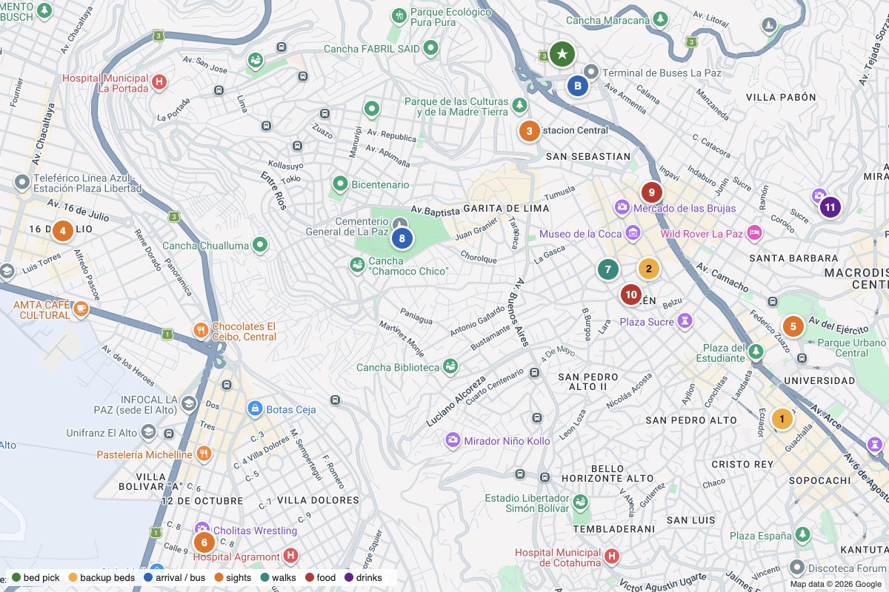
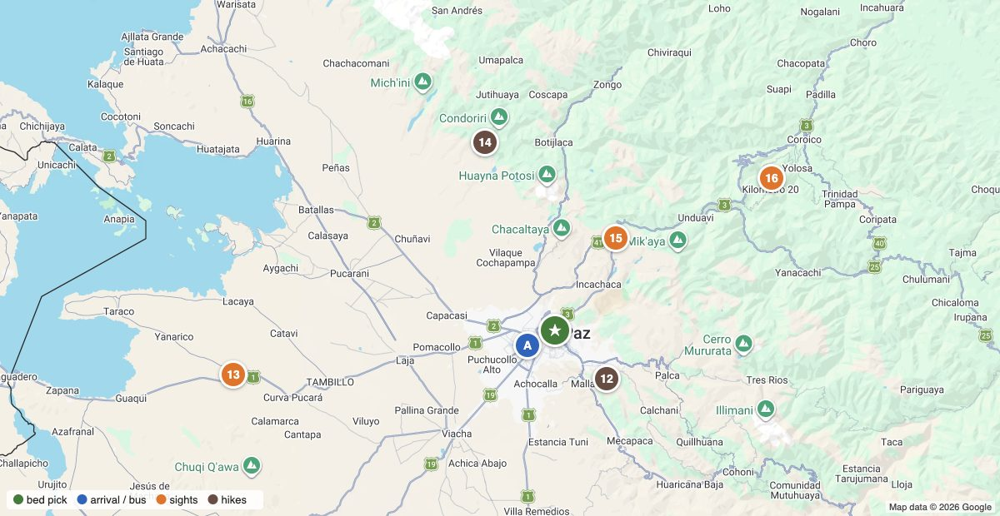

# 🇧🇴 La Paz

Part of the [LatAm itinerary](../itinerary.md) · region notes: [Chile + Bolivia](chile-bolivia.md) · ← [Sucre](sucre.md) · [Copacabana + Isla del Sol](copacabana-isla-del-sol.md) →

> **Stop 20 · Sun 24 → Wed 27 Jan 2027 (days 48–51) · 3 nights · Alasitas fair opens on the 24th** 
> 🏞️ A canyon city at 3,640 m under Illimani: cable cars, markets, and big days out to Tiwanaku, Pico Austria or the Death Road 
> 🛏️ **La Casa Bonita**, a bed in a 4-bed mixed dorm, $23.70 for 3 nights (Agoda), 90 m from the bus terminal 
> ✈ **In:** BoA Sucre → La Paz via Cochabamba, Sun 09:05 → 11:25 · 🚌 **Out:** bus to Copacabana, Wed 07:30

La Paz and Illimani from <a href="https://www.google.com/maps?ftid=0x915f206c399293b5:0xeeccaa41dc4e12f0">Mirador Killi Killi</a>. Photo: Google Maps.

## 🗺️ Map

**In town:** ★ **[La Casa Bonita](https://www.google.com/maps?ftid=0x915f217003de40d9:0xb5fd7f2fa25b9fef)** (the pick, [book](https://www.agoda.com/partners/partnersearch.aspx?hid=23739894&checkin=2027-01-24&checkout=2027-01-27&NumberofAdults=1&Rooms=1)) · **1** [Hotel Martí](https://www.google.com/maps?ftid=0x915f216b292d68e3:0xf4e1ff688aa626df) (backup, [book](https://www.hostelworld.com/hostels/p/335481/hotel-marti/?from=2027-01-24&to=2027-01-27&guests=1)) · **2** [Hotel Nuevo Sol](https://www.google.com/maps?ftid=0x915f2076ca3cdea9:0xcff01ab9c3f98623) (private alt, [book](https://www.booking.com/hotel/bo/nuevo-sol-la-paz.html?checkin=2027-01-24&checkout=2027-01-27&group_adults=1&no_rooms=1&group_children=0&selected_currency=USD)) · **B** [main bus terminal](https://www.google.com/maps?ftid=0x915f200a5e717817:0x1b4009ee4ecb0cb2) (Copacabana buses) · **3** [Mi Teleférico, Línea Roja, Estación Central](https://www.google.com/maps?ftid=0x915edff540c05e71:0x473363a5899d81ff) · **4** [Feria 16 de Julio](https://www.google.com/maps?ftid=0x915edfb8a9cc93a1:0xfede2c30b92be122), El Alto · **5** [Alasitas, Campo Ferial Bicentenario](https://www.google.com/maps?ftid=0x915f206f8a7e909b:0x2e293bc33c6fb345) · **6** [Cholitas wrestling](https://www.google.com/maps?ftid=0x915edf9ef816aa07:0xa37771021bcd72c5), El Alto · **7** [Calle Sagárnaga](https://www.google.com/maps?ftid=0x915f2076f5291f01:0x48db720b94821c5e) · **8** [Cementerio General](https://www.google.com/maps?ftid=0x915edf8c494106d9:0x6f1f19800540ccfd) (Tiwanaku minibuses) · **9** [Mercado Lanza](https://www.google.com/maps?ftid=0x915f20747f2c08ad:0xe0886b55d5ae0b05) · **10** [Mercado Rodríguez](https://www.google.com/maps?ftid=0x915f2077032c4643:0x4e25264c32849214) · **11** [DT Brew House Mirador](https://www.google.com/maps?ftid=0x915f217756ddf8a9:0xafb967aaa9118562)

**Around:** ★ La Paz · **A** [El Alto airport](https://www.google.com/maps?ftid=0x915edfad500264a3:0xd57a8a6cf6dc4526) · **12** [Muela del Diablo](https://www.google.com/maps?ftid=0x915f26a50b0fd8b7:0xff835f20cdfe0cfb) · **13** [Tiwanaku](https://www.google.com/maps?ftid=0x915ebd095b253df7:0xb8501935a205e22a) (and [Puma Punku](https://www.google.com/maps?ftid=0x915ebd09530150f9:0x8b4468411a7f066d)) · **14** [Pico Austria](https://www.google.com/maps?ftid=0x915ef93ec3cf40f7:0xfdf911e32fda2ef) (Condoriri massif) · **15** [Laguna Estrellani at La Cumbre](https://www.google.com/maps?ftid=0x915f1b892dd68059:0x9e32b1db5ca84b5d), where Death Road rides start · **16** [the Death Road](https://www.google.com/maps?ftid=0x915f72c790f54159:0xd84b2c3f8def4d38) (North Yungas Road)

**Open the live map:** [town](https://www.google.com/maps/@-16.4990,-68.1480,14z) · [area](https://www.google.com/maps/@-16.40,-68.30,9z)

## 📅 Day by day

| Day | Plan |
|---|---|
| **Sun 24 Jan** · Alasitas opens | ✈ **BoA 09:05** Sucre → Cochabamba → El Alto **11:25**. Taxi Bs 80–150 to the hostel (≈ 40 min). Afternoon: **Feria 16 de Julio** in El Alto (Thu + Sun only, so this is your one chance; LP says it runs to ≈ 15:00, so go straight from the airport) *or* **Alasitas**, which opens at noon. Cholitas wrestling runs on Sunday afternoons in El Alto *(lead)*. |
| **Mon 25 Jan** | 🏔️ One big day, chosen by the 48-h mountain forecast: **Pico Austria** (1-day) if it looks clear, or 🚵 **Death Road** if it's the wetter day. Or 🏛️ **Tiwanaku**. |
| **Tue 26 Jan** | The other big day, or ⛰️ **Muela del Diablo** in the morning (not alone) plus a 🚡 **Mi Teleférico** ride. Alasitas is still on. Withdraw ≈ Bs 600 for Copacabana and Isla del Sol. |
| **Wed 27 Jan** | 🚌 **07:30 Vicuña Travel** to Copacabana from the main terminal, 90 m from the hostel ([next guide](copacabana-isla-del-sol.md)). |

## 🔖 Book (one click)

Dates and 1 adult are pre-filled. The first channel listed was the cheapest when checked on 24 Nov. ⚠️ = time-sensitive.

**Beds** (24 → 27 Jan, 3 nights)

| | Where | Total | Location | From El Alto airport | Book |
|---|---|---:|:---:|---|---|
| ⭐ **Pick** | **La Casa Bonita** · bed in a 4-bed mixed dorm | **$23.70** | 9.2 | 🚕 ≈ 29 min from El Alto airport; Google has no bus data here, so local minibus/colectivo (ask locally); centre 18 min on foot · [route](https://www.google.com/maps/dir/?api=1&origin=-16.510379,-68.1882265&destination=-16.4869368,-68.1425539&travelmode=driving) | [Agoda](https://www.agoda.com/partners/partnersearch.aspx?hid=23739894&checkin=2027-01-24&checkout=2027-01-27&NumberofAdults=1&Rooms=1) · [Hostelworld](https://www.hostelworld.com/hostels/p/310839/casa-de-huespedes-la-casa-bonita/?from=2027-01-24&to=2027-01-27&guests=1) |
| Backup | **Hotel Martí** · bed in a 10-bed ensuite dorm | $42.90 | ⚠️ 8.9 *(HW)* | ⚠️ 🚕 ≈ 33 min from El Alto airport; Google has no bus data here, so local minibus/colectivo (ask locally); **34 min walk to the centre, no bus in Google Maps** · [route](https://www.google.com/maps/dir/?api=1&origin=-16.510379,-68.1882265&destination=-16.5071892,-68.1297937&travelmode=driving) | [Hostelworld](https://www.hostelworld.com/hostels/p/335481/hotel-marti/?from=2027-01-24&to=2027-01-27&guests=1) |
| Private alt | **Hotel Nuevo Sol** · Double or Twin, breakfast | $120 | 9.9 | 🚕 ≈ 32 min from El Alto airport; Google has no bus data here, so local minibus/colectivo (ask locally); centre 16 min on foot · [route](https://www.google.com/maps/dir/?api=1&origin=-16.510379,-68.1882265&destination=-16.4988642,-68.1375382&travelmode=driving) | [Booking](https://www.booking.com/hotel/bo/nuevo-sol-la-paz.html?checkin=2027-01-24&checkout=2027-01-27&group_adults=1&no_rooms=1&group_children=0&selected_currency=USD) |

**Transport**

| | Leg | When | Price | Book |
|---|---|---|---:|---|
| In | ✈ **BoA** · Sucre → La Paz via Cochabamba | **Sun 24 Jan 09:05 → 11:25** (2 h 20) | **$56** | [Google Flights](https://www.google.com/travel/flights/search?tfs=GhoSCjIwMjctMDEtMjRqBRIDU1JFcgUSA0xQQkABSAGYAQI&curr=USD&hl=en) · [BoA](https://www.boa.bo/) |
| Check first | ✈ **EcoJet** · Sucre → La Paz nonstop | "new route from 4 December", no schedule shown | — | flyecojet.aero |
| Out | 🚌 **Vicuña Travel** · La Paz → Copacabana (semi-cama) | **Wed 27 Jan 07:30 → ≈ 11:30** | ≈ $7 on Tickets Bolivia (the counter is cheaper) | at the terminal; see the [Copacabana guide](copacabana-isla-del-sol.md) |

How to read these tables

- **Location** is the guests' location score on Booking.com. The target is 9.0 or higher, and ⚠️ marks one below 9.0. *(HW)* means Hostelworld's location rating, used where a property isn't on Booking.
- **From El Alto airport** comes from Google Maps on 24 Nov: the property found on Maps and routed from where you arrive at midday on the check-in date. The **route** link opens the same route.
- Symbols: 🚶 walk · 🚌 public transport · 🚕 taxi/rideshare · 🥾 hike only · ⚠️ far from the centre with no bus · ℹ️ outside the centre but on a bus line.
- Prices move, so compare the channels shown.

## ✈ Getting here: Sucre → La Paz, Sun 24 Jan (Day 48)

- ✅ **Google Flights, live 24 Nov** (a real search page): no nonstop on Sunday. **BoA via Cochabamba:**
  - **09:05 → 11:25 (2 h 20), US$56**, the pick;
  - 20:45 → 23:05, US$50;
  - via Santa Cruz, 12:00 → 14:50, US$91.
- **Buy** on boa.bo or Google Flights' BoA link (cash fare; a checked bag is normally included on BoA domestic, ≈).
- **Nonstop options:** BoA's restored SRE–LPB nonstop started 17 Nov 2026 and runs **3× a week**: ≈ OB 561 07:35 on Wed/Thu and OB 567 21:30 on Tue/Wed (FlightsFrom/AI-summary lead), never Sunday.
- ✅ **EcoJet** announces a "new route Sucre–La Paz from 4 December" on flyecojet.aero, but no schedule is shown. **Check EcoJet for a Sunday nonstop before buying the BoA connection.**
- **Ground option:** overnight bus Sat 23 Jan 19:30–20:00 → La Paz 06:30–07:00, ≈ Bs 150–250 (US$13–21, cama with El Dorado or Trans Copacabana; AI-summary lead). It costs the last Sucre night, so the US$56 flight is better.
- **Sucre's Alcantarí airport** is ≈ 30 km out (taxi ≈ Bs 80–100, ≈; leave town by 07:30).
- **At El Alto:** official taxi **Bs 80–150** to the centre (Bolivian Life, Nov 2026), ≈ 40 min to the hostel, or minibus 212 for ≈ Bs 3.
  - LP: the minibus has a "Minibus Cotranstur" sign just outside arrivals, runs ≈ 07:00–20:00 to Plaza Isabel la Católica (B$3.80 in LP) and drops anywhere along El Prado. LP's radio-taxi fare was ≈ B$70 (LP).

## 🛏️ Where to sleep

All live-checked on 24 Nov.

### ⭐ Pick: La Casa Bonita
- **Unit:** Casa de huéspedes; a bed in a 4-bed mixed dorm.
- **Price:** **US$23.70 for 3 nights on Agoda** (signed-in price). That's Agoda's cheapest unit, presumably the dorm bed, so confirm the room type at checkout. **Booking US$36** (pay at the property, free cancellation to 23 Jan) = Hostelworld US$36 + fee.
- **Reviews:** Hostelworld 9.5 (275; 5% below 70 in the last 12 months). Booking 161 reviews, **8.7% below 7**, location 9.2.
- **Where:** **90 m from the main bus terminal** (the Copacabana buses leave from there on the 27th). 1.3 km from Sagárnaga, uphill on the way back.
- **Checks:** ✅ full kitchen with stove · quiet, homely, social in the evenings ("not a party hostel") · roof terrace · curtains not mentioned.
- ⚠️ The upstairs dorms are cold and there are only 2 showers.
- ⚠️ One June 2026 review complains about the hostel's cash exchange rate and card surcharge: **pay in bolivianos**.

### Backup: Hotel Martí
- **Unit:** hostel; 10-bed ensuite dorm. **US$42.90** on Hostelworld.
- **Reviews:** Hostelworld 9.0 (53; 10% below 70).
- **Where:** 1.4 km from Sagárnaga, near El Prado's south end.
- **Checks:** ✅ **curtains, light and socket per bunk**; café/coworking; heated rooms.
- ⚠️ Kitchen reports conflict ("best kitchen" vs "the stove doesn't work", Apr 2026), and street-side rooms are noisy.
- Not on Booking under this name.

**Avoid:** Wild Rover La Paz (9.2, but it is *the* party hostel, with 20-bed dorms and a bar).

### Private alt (location first): Hotel Nuevo Sol
- Double or Twin, breakfast. **US$120 for 3 nights** on Booking (room table).
- Booking location **9.9**, 89 reviews, 6.7% below 7.
- 0.2 km from Sagárnaga.
- ⚠️ Cash only (Apr 2026 review).
- **Next:** La Casona Hotel Boutique, location 9.5, 249 reviews, US$192.

## 🌳 Things to do (free and outdoors first)

<table>
<tr>
<td width="50%" valign="top"> <b><a href="https://www.google.com/maps?ftid=0x915edff540c05e71:0x473363a5899d81ff">Mi Teleférico</a></b> · ≈ Bs 3 + Bs 2 per transfer Roja up, Plateada along the El Alto rim, Amarilla/Verde down to the Zona Sur: the best city view for under US$1.</td>
<td width="50%" valign="top"> <b><a href="https://www.google.com/maps?ftid=0x915f26a50b0fd8b7:0xff835f20cdfe0cfb">Muela del Diablo</a></b> · free hike, a morning 1.5–2 h up from Pedregal to the "devil's molar" (≈ 3,800 m) with Illimani views. ⚠️ Don't go alone.</td>
</tr>
<tr>
<td width="50%" valign="top"> <b><a href="https://www.google.com/maps?ftid=0x915edfb8a9cc93a1:0xfede2c30b92be122">Feria 16 de Julio</a></b>, El Alto · free · Thu + Sun A huge flea market on the rim at 4,000 m. Sun 24 is your only chance.</td>
<td width="50%" valign="top"> <b><a href="https://www.google.com/maps?ftid=0x915f206f8a7e909b:0x2e293bc33c6fb345">Alasitas fair</a></b> · free · from Sun 24 Jan, noon La Paz's miniatures-and-Ekeko fair, ≈ a month long, at the Campo Ferial Bicentenario.</td>
</tr>
<tr>
<td width="50%" valign="top"> <b><a href="https://www.google.com/maps?ftid=0x915ebd095b253df7:0xb8501935a205e22a">Tiwanaku</a></b> · Bs 100, cash · day trip Pre-Inca ruins (Kalasasaya, Puma Punku, two museums) that nothing else on the route covers.</td>
<td width="50%" valign="top"> <b><a href="https://www.google.com/maps?ftid=0x915ef93ec3cf40f7:0xfdf911e32fda2ef">Pico Austria</a></b>, 5,320 m · ≈ US$80–115 (1 day) Non-technical summit in the Condoriri massif. Clear window ≈ 06:00–10:00 in January.</td>
</tr>
<tr>
<td width="50%" valign="top"> <b><a href="https://www.google.com/maps?ftid=0x915f72c790f54159:0xd84b2c3f8def4d38">Death Road</a></b> by mountain bike · ✅ US$85–154 64 km, 4,700 → 1,100 m. Runs daily in the rain: muddier, not cancelled.</td>
<td width="50%" valign="top"> <b><a href="https://www.google.com/maps?ftid=0x915edf9ef816aa07:0xa37771021bcd72c5">Cholitas wrestling</a></b>, El Alto · Sunday afternoons A show worth fitting in on arrival day <i>(lead)</i>.</td>
</tr>
</table>

**Mi Teleférico (almost free):**
- ≈ **Bs 3 the first line + Bs 2 per transfer** (≈ US$0.25 + 0.17; lapazteleferico.com). LP has the same fares.
- Ride Roja up, Plateada along the El Alto rim, then Amarilla/Verde down to the Zona Sur. That's the best city view for under US$1.
- Hours ≈ 06:00–23:00 Mon–Sat, 07:00–21:00 Sun (LP).

**More free things in town (LP):**
- **Mercado de las Brujas** (Witches' Market), on Jiménez and Linares between Sagárnaga and Av. Mariscal Santa Cruz: herbal remedies, amulets and offerings for Aymara spirits, among the craft shops (LP).
- **Calle Jaén**, the best-preserved colonial street, free to walk. Its four small museums share one ≈ B$20 ticket (bought at the Museo Costumbrista), Tue–Fri 09:00–12:30 and 15:00–19:00, Sat–Sun 09:00–13:00 (LP).
- **Parque Montículo** in Sopocachi for a free viewpoint over the city, then people-watching on Plaza Avaroa (LP). LP's other cheap picks: people-watching on Plaza Murillo and the quiet of the botanical garden.

**Paid, optional (LP):**
- **Museo de Etnografía y Folklore (MUSEF)**, Ingavi and Sanjinés: ritual masks and textiles from across Bolivia; ≈ B$20, Mon–Fri 09:00–12:30 and 15:00–19:00, Sat 09:00–16:30, Sun 09:00–12:30 (LP).
- **Museo de Textiles Andinos Bolivianos** (Plaza Benito Juárez 488, Miraflores): ≈ B$15, Mon–Sat; 90% of shop sales go to the weavers (LP).

**Muela del Diablo (free hike, no fee), a morning:**
- **Getting there:** minibus from Calle Murillo or the Zona Sur (lines 282/288, ≈ Bs 2.50–5), or Mi Teleférico Verde to Irpavi then a minibus, to **Pedregal**.
- **The walk:** ≈ 1.5–2 h up to the base of the "devil's molar" (≈ 3,800 m) with Illimani views, and back the same way.
- ⚠️ La Paz Life (Sep 2026) and Bus Hop advise **not hiking it alone**: there are occasional opportunistic robberies on these quiet edge-of-city trails. Go with someone from the hostel, leave valuables, or take a guided half day (≈ US$25–50; GetYourGuide from €40).

**Other DIY day hikes LP names:** the **Valle de la Luna** eroded badlands in the Zona Sur (≈ B$25, dawn to dusk; a short walk, not the Chilean one) and the **Valle de las Ánimas** rock spires on the south-eastern edge (LP). Same caution as the Muela: go in company.

**Sun 24 Jan, arrival day (pick one for the afternoon):**
- The plane lands at El Alto, which holds its huge **16 de Julio street market on Thursdays and Sundays**, and the **cholitas wrestling** show runs on Sunday afternoons in El Alto. Both are worth fitting in on the way down into La Paz *(leads)*.
- **El Alto's Feria 16 de Julio** (Thursdays and Sundays, so this is your only chance): a huge flea market on the rim at 4,000 m. Take Mi Teleférico's red line up to 16 de Julio station; carry little and watch pockets.
  - ⚠️ LP gives its hours as **≈ 06:00–15:00**. Landing at 11:25, go straight from the airport (it's in El Alto) and drop the bag later, or it will be winding down.
  - El Alto is also where Freddy Mamani's colourful *cholets* (Aymara mansions) stand; HanaqPacha Travel runs a tour inside them (≈ B$140 in LP) (LP).
- **Alasitas fair (free):** La Paz's miniatures-and-Ekeko fair **opens at noon on 24 Jan 2027** at the Campo Ferial Bicentenario, Parque Urbano Central, and runs ≈ a month (≈ Bolivian Life). You land at 11:25, so do Alasitas *or* the El Alto feria that afternoon; Alasitas is also open on the 25th–26th.

**Tiwanaku day trip (new 26 Nov):**
- Pre-Inca ruins (Kalasasaya, Puma Punku and two museums) that nothing else on the route covers.
- **Bs 100 for foreigners, cash only**; open daily ≈ 09:00–16:00/17:00.
- Minibuses leave when full from opposite the **Cementerio General** gate, Bs 15–25, 1½–2 h each way.
- *(Added 26 Nov from The Broke Backpacker, Lonely Planet, Nomadic Matt and Worldly Adventurer; facts are AI-summary leads, ≈, check on the day.)*
- **LP details:** tickets B$100, sold 09:00–16:00 at the office opposite the museums; the site stays open to 17:00. See the museums first, then the ruins (LP).
  - Local guides at the gate: ≈ B$150 in Spanish, B$180 in English, for a group of up to 6 (LP).
  - Agency day trips with transport and a bilingual guide run ≈ B$80–150, 08:30 → ≈ 16:00 (Diana Tours on Sagárnaga; Vicuña Travel at the main terminal). LP says most travellers go this way (LP).
  - A taxi there and back costs ≈ B$210–280 (LP).

**Optional big day 1: Pico Austria 5,320 m (Condoriri massif):**
- **1-day ≈ US$80–115** (GetYourGuide US$115, Expedia US$108, Tripadvisor from US$80).
- **2-day** with a night at Laguna Chiar Khota (4,600 m) **≈ US$190–270** shared, US$270–350 private solo (≈ AI-summary lead; agencies on Sagárnaga/Illampu and Altitud 6000, Latina Bolivia, Jiwaki). Park fee ≈ Bs 20.
- **January:** agencies still run it (non-technical), but the clear window is ≈ 06:00–10:00. After that come fog, sleet and wet snow above 5,000 m; microspikes are sometimes needed, and a "with view" summit is maybe 40–50% (≈).
- By the 25th you'll have spent a week above 3,600 m, which is ideal.
- **Do the 1-day version on 25 or 26 Jan**, choosing the day by the 48-h mountain forecast; a 2-day would eat the whole stop.
- **Cheaper high-summit alternative:** agencies run daily "hiking" trips to **Chacaltaya** (≈ 5,400 m, 30 km north), which LP calls an easy way to stand on a high peak without hard climbing (LP; price not given, ask on Sagárnaga). LP's best climbing season in the Cordillera Real is May–September, so January is a gamble either way (LP).

**Optional big day 2: Death Road by mountain bike** (64 km, 4,700 → 1,100 m):
- ✅ **Barracuda Biking US$85** (full suspension; their own web shop).
- ✅ **Gravity Bolivia US$154** (their own page; the premium operator).
- **January:** runs daily in the rain; mud, fog and waterfalls on the road make it more intense, not cancelled. It suits the wetter of your two days, since it's lower and not view-dependent.
- **LP's warnings:** there are **no minimum safety standards** for operators and some 27 cyclists have died on it, so this is not the place to save money; check the bikes' brakes and suspension (LP).
  - LP lists **Xtreme Downhill** (Sagárnaga 392) as a safety-focused cheaper option, B$400–600 depending on the bike (LP), besides Gravity.
  - A **≈ B$50 fee** to use the old road may not be in the price; ask (LP).
  - Pickup ≈ 07:00, back in La Paz ≈ 21:00. Bring sun cream and a swimsuit (some tours end with a pool and shower) (LP).
- **Beginners' alternative:** the Balcón Andino descent near the Zona Sur, a ≈ 2,400 m drop on a wide dirt road (LP).

**How it fits:** with 3 nights you can do one big day plus Muela del Diablo, or both big days.

**Not this trip:** Huayna Potosí (Jan–Mar is off-season; backlog note). Rurrenabaque pampas would need +3 days, and January flights cancel often.

## 🍽️ Eat and drink

<table>
<tr>
<td width="50%" valign="top"> <b><a href="https://www.google.com/maps?ftid=0x915f20747f2c08ad:0xe0886b55d5ae0b05">Mercado Lanza</a></b> · set almuerzo Bs 20–35 (US$1.70–3) Upstairs, 12:00–14:30, by Plaza San Francisco.</td>
<td width="50%" valign="top"> <b>Api con pastel</b> · Bs 8–15 Hot purple-corn drink + cheese pastry, early morning at <a href="https://www.google.com/maps?ftid=0x915f2077032c4643:0x4e25264c32849214">Mercado Rodríguez</a>.</td>
</tr>
<tr>
<td width="50%" valign="top"> <b>Salteñas</b> · Bs 7–12 08:30–11:30, in Sopocachi or the centre. Photo: salteñas in Santa Cruz (Commons).</td>
<td width="50%" valign="top"> <b><a href="https://www.google.com/maps?ftid=0x915f217756ddf8a9:0xafb967aaa9118562">DT Brew House Mirador</a></b> · craft beer with a view Modesta Sanjinés 1373, Sopocachi. Bolivian craft beers on tap.</td>
</tr>
</table>

- All ≈ AI-summary leads, Nov 2026.
- **Carry Bs 10/20 notes:** markets can't change Bs 100.
- **From LP** (prices are pre-2020, so treat them as relative):
  - **Popular Cocina Boliviana** (Murillo 826): a seasonal three-course lunch with a gourmet take on the market almuerzo, ≈ B$50, Mon–Sat 12:30–14:30. Expect a queue (LP).
  - **La Espinita** (Quintín Barrios 712, Sopocachi): fried lake fish with ispi, potato and mote, ≈ B$20–30, Tue–Sun 12:00–14:30 (LP).
  - **Mercado Lanza** is open ≈ 06:00–20:00; **Mercado Camacho** (Camacho and Bueno) is the other big food market (LP).
  - **Jallalla** (Indaburo 710 at Jaén): LP's top peña for live Andean music under Mamani Mamani's ceiling art, Tue, Thu, Fri and Sat 21:00–01:00, cover with a cocktail ≈ B$30–70. **Tue 26** fits (LP).
  - **Hallwright's** (Sánchez Lima 2235, Sopocachi): Bolivian wine bar with a 2-for-1 happy hour 18:00–19:30, Mon–Sat (LP).
  - **Reineke Fuchs** (Pasaje Jáuregui 2241, Sopocachi) brews its own pilsner, dunkel and amber (LP).

## ℹ️ Good to know
- **Rain:** 21 rain days in January (afternoons).
- **Altitude:** 3,640 m (El Alto 4,050 m). You're acclimatised by now.
- **Safety:** pickpockets on the teleférico, at the Feria and at the bus terminal. Express-kidnap warnings apply to unofficial taxis, so use radio taxis or apps.
  - LP: avoid **El Alto, San Pedro, the cemetery area and the higher neighbourhoods after dark**, and take extra care around the bus terminals. The hostel is next to the main terminal, so take a taxi there after ≈ 21:00 (LP).
  - Use **radio taxis with a roof light** showing their phone number, and agree the fare first; Uber also works (LP).
  - **Fake police** scams are on the rise: real officers wear uniform and won't make you get into a taxi, show your passport on demand or be searched in the street (LP).
  - Street money changers on Colón, Camacho and Mariscal Santa Cruz can pass fake notes; use a casa de cambio or an ATM (LP).
  - **Tourist police:** 24 h, Plaza del Estadio, Miraflores, with a kiosk in front of the main bus terminal. Get a written *denuncia* for insurance (LP).
- **Laundry:** the laundries along Illampu, at the top of Sagárnaga, charge ≈ B$10–15 per kg for same-day service (LP).
- **Cash:** ATMs are plentiful. **Withdraw enough bolivianos here for Copacabana and Isla del Sol** (≈ Bs 600).

## 🚌 Leaving: bus to Copacabana, Wed 27 Jan

- From the main bus terminal, 90 m from La Casa Bonita. **07:30 Vicuña Travel** (semi-cama, arr ≈ 11:30) is the pick; ≈ 4 h.
- LP: tourist buses from the main terminal cost ≈ B$30 and are worth it; cheaper minibuses (≈ B$20–25) leave when full from the Cementerio area, which LP warns about after dark; watch your bags there (LP).
- Full timetable, the Tiquina strait crossing and the Isla del Sol plan are in the [Copacabana + Isla del Sol guide](copacabana-isla-del-sol.md).

---
Photos: Google Maps contributors (Mirador Killi Killi, Muela del Diablo, Tiwanaku, Pico Austria, Death Road, Cholitas Wrestling, DT Brew House Mirador). Wikimedia Commons: <a href="https://commons.wikimedia.org/wiki/File:L%C3%ADnea_Roja_de_Mi_Telef%C3%A9rico_en_La_Paz,_Bolivia.jpg">Línea Roja de Mi Teleférico</a> (EEJCC, CC BY-SA 4.0), <a href="https://commons.wikimedia.org/wiki/File:Feria_16_de_julio_El_Alto_(1)_13.jpg">Feria 16 de julio</a> (Caleidoscopic, CC BY-SA 4.0), <a href="https://commons.wikimedia.org/wiki/File:Miniaturas_de_la_alasita.jpg">Miniaturas de la alasita</a> (Alhen, CC BY 2.5), <a href="https://commons.wikimedia.org/wiki/File:Titulo_del_mercado_Lanza,_La_Paz,_Bolivia.jpg">Mercado Lanza</a> (Alcyz, CC BY-SA 4.0), <a href="https://commons.wikimedia.org/wiki/File:Api_con_pastel.jpg">Api con pastel</a> (Caleidoscopic, CC BY-SA 4.0), <a href="https://commons.wikimedia.org/wiki/File:Salte%C3%B1as_in_Urbar%C3%AD_-_Santa_Cruz_de_la_Sierra,_Bolivia.jpg">Salteñas in Urbarí</a> (Ruditaly, CC BY-SA 4.0).
