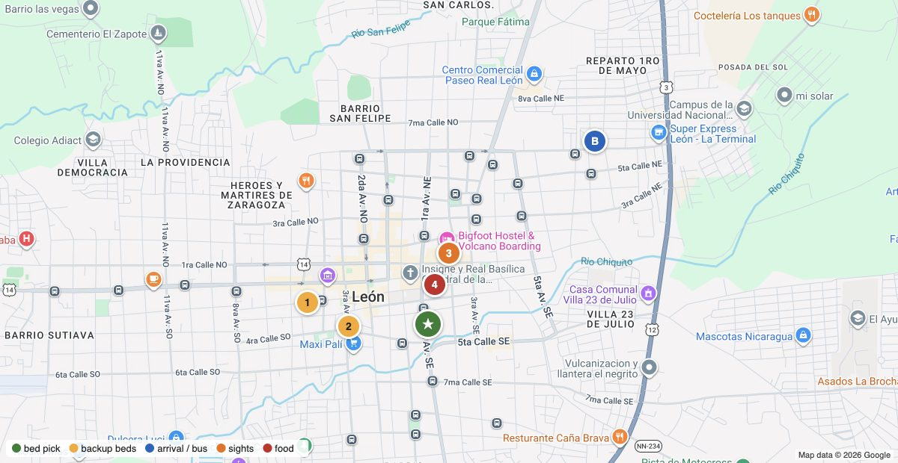
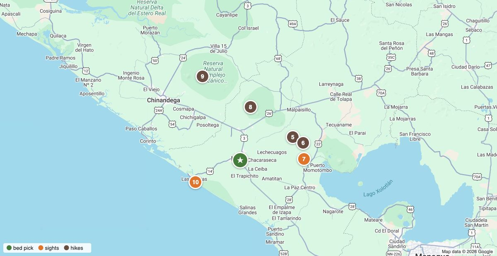

# 🇳🇮 León

Part of the [LatAm itinerary](../itinerary.md) · region notes: [Costa Rica + Nicaragua](costa-rica-nicaragua.md) · ← [Granada + Laguna de Apoyo](granada.md) · [Estelí](esteli.md) →

> **Stop 35 · Day 86 → 89 · 3 nights** 
> 🏞️ Hot colonial city below the Maribios volcano chain: board down Cerro Negro, camp on El Hoyo 
> 🛏️ **Casa Lula León Hostal**, a quiet mixed dorm with a kitchen, $33 for 3 nights 
> 🚌 **In:** microbuses from Granada via Managua, Day 86 · **Out:** 05:20 bus to Estelí, Day 89

Cerro Negro, the black-sand cone you board down. Photo: Google Maps.

## 🗺️ Map

**In town:** ★ **[Casa Lula León Hostal](https://www.google.com/maps?ftid=0x8f711f9220627a41:0x543702970b44123f)** (the pick, [book](https://www.booking.com/searchresults.html?ss=Casa+Lula+Le%C3%B3n+Hostal+Le%C3%B3n+Nicaragua&checkin=2027-03-03&checkout=2027-03-06&group_adults=1&no_rooms=1&selected_currency=USD)) · **1** [Hostal La Tortuga Booluda](https://www.google.com/maps?ftid=0x8f711fed1007e841:0x83d17344a5ade4fa) (backup, [book](https://www.booking.com/searchresults.html?ss=Hostal+La+Tortuga+Booluda+Le%C3%B3n+Nicaragua&checkin=2027-03-03&checkout=2027-03-06&group_adults=1&no_rooms=1&selected_currency=USD)) · **2** [Hostal el Sol](https://www.google.com/maps?ftid=0x8f711f25d97530a5:0x44489995e3f15430) (private alt, [book](https://www.booking.com/hotel/ni/el-sol-hostel.html?checkin=2027-03-03&checkout=2027-03-06&group_adults=1&no_rooms=1&group_children=0&selected_currency=USD)) · **B** [La Terminal](https://www.google.com/maps?ftid=0x8f711fa20700e937:0x9b4a6a79b346edaa) (bus) · **3** [Bigfoot](https://www.google.com/maps?ftid=0x8f711f9135f4c829:0x6fdb4e06eed4ec8e) [🚶 9 min](https://www.google.com/maps/dir/?api=1&origin=12.4328666,-86.8772251&destination=12.4368418,-86.8760037&travelmode=walking) (volcano tours) · **4** [Mercado Central](https://www.google.com/maps?ftid=0x8f711f917ca4ede7:0x55f2fe9015de8377) [🚶 5 min](https://www.google.com/maps/dir/?api=1&origin=12.4328666,-86.8772251&destination=12.4350924,-86.8768164&travelmode=walking)

**Around:** ★ León · **5** [Cerro Negro](https://www.google.com/maps?ftid=0x8f71172a910fb813:0xdf7b6a6ec825a478) [🚕 ≈ 53 min](https://www.google.com/maps/dir/?api=1&origin=12.4328666,-86.8772251&destination=12.5077778,-86.7022222&travelmode=driving) · **6** [El Hoyo](https://www.google.com/maps?ftid=0x8f7116a3b5a3ed39:0x85c56c3b0f0a7917) [🚕 ≈ 50 min](https://www.google.com/maps/dir/?api=1&origin=12.4328666,-86.8772251&destination=12.4894444,-86.6675&travelmode=driving) · **7** [Laguna Asososca](https://www.google.com/maps?ftid=0x8f71160bd1534a99:0xbb655caa8c368172) [🚕 ≈ 1 h 17 min](https://www.google.com/maps/dir/?api=1&origin=12.4328666,-86.8772251&destination=12.4362474,-86.6648861&travelmode=driving) · **8** [Telica](https://www.google.com/maps?ftid=0x8f7103357fbcfb09:0xf6e5cbdbe2ff2cb5) (closed) · **9** [San Cristóbal](https://www.google.com/maps?ftid=0x8f70f95d75881db9:0x66b0cda723e45a97) [🚗 ≈ 1 h 37 min by road](https://www.google.com/maps/dir/?api=1&origin=12.4328666,-86.8772251&destination=12.7052778,-87.0013889&travelmode=driving) · **10** [Las Peñitas](https://www.google.com/maps?ftid=0x8f70dcf0b3f38e1d:0xbc0a871b800095e6) [🚕 ≈ 31 min](https://www.google.com/maps/dir/?api=1&origin=12.4328666,-86.8772251&destination=12.3613673,-87.0252565&travelmode=driving) / [Poneloya](https://www.google.com/maps?ftid=0x8f70dd1fe18e8327:0xcbc6e2ae82b370be)

🧭 The time after each place is from the ★ bed (Google Maps, 26 Nov): 🚶 walk · 🚌 bus · 🚕 taxi · 🚗 by road (tour or bus). Click it for the route.

**Open the live map:** [town](https://www.google.com/maps/@12.4340,-86.8800,16z) · [area](https://www.google.com/maps/@12.50,-86.85,10z)

## 📅 Day by day

| Day | Plan |
|---|---|
| **Day 86** | 🚌 Granada → Managua (UCA) → **León** (≈ 3 h). Taxi ≈ 11 min from the bus terminal to Casa Lula (or a 28-min walk). Book the Bigfoot tours (online or at the hostel). |
| **Day 87** | 🌋 **Cerro Negro volcano boarding** with Bigfoot, **08:00 → ~13:00**. Take the morning tour: the black sand gets very hot. |
| **Day 88** | 🏕️ **El Hoyo** with Bigfoot (sunset or sunrise $45, camping overnight $70), or 🏖️ **Las Peñitas / Poneloya** by city bus for a Pacific sunset (free). |
| **Day 89** | 🚌 **05:20** bus to **Estelí** (C$110, ≈ 3 h). |

## 🔖 Book (one click)

Dates and 1 adult are pre-filled. The first channel listed was the cheapest when checked on 24 Nov. ⚠️ = time-sensitive.

**Beds** (Day 86 → 89, 3 nights)

| | Where | Total | Location | From the bus terminal | Book |
|---|---|---:|:---:|---|---|
| ⭐ **Pick** | **Casa Lula León Hostal** · bed in a mixed dorm | **$33** | 9.7 | 🚕 ≈ 11 min from the bus terminal (walk 28 min, 2.1 km); centre 5 min on foot · [route](https://www.google.com/maps/dir/?api=1&origin=12.4431297,-86.8676692&destination=12.432866599999999,-86.87722509999999&travelmode=driving) | [Booking (search)](https://www.booking.com/searchresults.html?ss=Casa+Lula+Le%C3%B3n+Hostal+Le%C3%B3n+Nicaragua&checkin=2027-03-03&checkout=2027-03-06&group_adults=1&no_rooms=1&selected_currency=USD) |
| Backup | **Hostal La Tortuga Booluda** · 4-bed mixed dorm | $39 | 9.1 | 🚕 ≈ 12 min from the bus terminal (walk 36 min, 2.6 km); centre 8 min on foot · [route](https://www.google.com/maps/dir/?api=1&origin=12.4431297,-86.8676692&destination=12.4340789,-86.88410689999999&travelmode=driving) | [Booking (search)](https://www.booking.com/searchresults.html?ss=Hostal+La+Tortuga+Booluda+Le%C3%B3n+Nicaragua&checkin=2027-03-03&checkout=2027-03-06&group_adults=1&no_rooms=1&selected_currency=USD) · [Hostelworld](https://www.hostelworld.com/hostels/p/277471/hostal-la-tortuga-booluda/?from=2027-03-03&to=2027-03-06&guests=1) |
| Private alt | **Hostal el Sol** · double room | ≈ $43 | 9.5 | 🚕 ≈ 12 min from the bus terminal (walk 35 min, 2.6 km); centre 7 min on foot · [route](https://www.google.com/maps/dir/?api=1&origin=12.4431297,-86.8676692&destination=12.4327159,-86.8817871&travelmode=driving) | [Booking](https://www.booking.com/hotel/ni/el-sol-hostel.html?checkin=2027-03-03&checkout=2027-03-06&group_adults=1&no_rooms=1&group_children=0&selected_currency=USD) |

**Transport and tours**

| | Leg | When | Price | Book |
|---|---|---|---:|---|
| In | Microbus Granada → Managua (UCA), then a León microbus or bus | **Day 86**, ≈ 3 h | ≈ $3–4 | — (door-to-door shuttle ≈ $15–25) |
| ⚠️ Tour | **Cerro Negro volcano boarding** (Bigfoot) | **Day 87 08:00** → ~13:00 | **$39.90** + $10 park fee | [Bigfoot volcano tours](https://www.bigfoothostelleon.com/volcano-boarding) |
| Tour | **El Hoyo** sunset/sunrise or camping (Bigfoot) | while Telica is shut | $45 / $70 | [Bigfoot volcano tours](https://www.bigfoothostelleon.com/volcano-boarding) |
| Out | **León → Estelí** direct bus, La Terminal → COTRAN Sur | **Day 89 05:20** (also 12:40, 15:00), ≈ 3 h | C$110, pay on board | [NicaBuses timetable](https://www.nicabuses.com/rutas/leon-esteli-ruteado) |

How to read these tables

- **Location** is the guests' location score on Booking.com. The target is 9.0 or higher, and ⚠️ marks one below 9.0. *(HW)* means Hostelworld's location rating, used where a property isn't on Booking.
- **From the bus terminal** comes from Google Maps on 24 Nov: the property found on Maps and routed from where you arrive at midday on the check-in date. The **route** link opens the same route.
- Symbols: 🚶 walk · 🚌 public transport · 🚕 taxi/rideshare · 🥾 hike only · ⚠️ far from the centre with no bus · ℹ️ outside the centre but on a bus line.

## 🚌 Getting here: Granada → Managua → León, Day 86

- **Microbus Granada → Managua (UCA),** ~1 h, ≈ C$40–60.
- **León microbus or bus from Managua** (UCA or Mercado Israel Lewites), ~1½–2¼ h, ≈ C$55–80.
- **Total ≈ 3 h, ≈ $3–4.** A door-to-door shuttle is ≈ $15–25 (≈).

## 🛏️ Where to sleep

### ⭐ Pick: Casa Lula León Hostal
- **Unit:** bed in a mixed dorm.
- **Price:** **$33 for 3 nights** (card $11 × 3) on Booking.com (not on Hostelworld).
- **Reviews:** Booking **9.3 (354; 5 % bad)**; "quiet" in 16 and the kitchen in 25 recent reviews. Live-checked 24 Nov.
- **Where:** ~0.3 km from the centre.
- One review says no bed curtains. Not a party place.

### Backup: Hostal La Tortuga Booluda
- Standard 4-bed mixed dorm. **$39 for 3 nights** (tax incl.) on Hostelworld. Booking lists it too (location 9.1) but it didn't show in Booking's hostel-filtered search, so its Booking link is a search.
- HW **9.2 (335; 5.1 % < 7)**. ~0.6 km west of Parque Central.
- "Relatively quiet… good chilled option away from the party hostels".
- Good kitchen (cooker listed), honour bar, breakfast, a cool small pool (not a party pool). Curtains in some dorms (reviews disagree).

### Curtain option: Poco a Poco Hostel
- Standard 8-bed mixed dorm. **$30 for 3 nights on Booking** (8.8/230; card $10 × 3) vs ≈ $40 on Hostelworld.
- HW **9.1 (1,928; 2.0 % < 7)**. ~0.3 km from the centre.
- **Bunks with curtains**, A/C dorms, kitchen with stove, nightly activities (trivia, salsa), **pool** ("social without being an insane party hostel").
- **Not as a base:** Bigfoot (party hostel: beer-pong tours, party bus). Book its volcano tours, don't sleep there.

### Private alt (location first): Hostal el Sol
- Double room. **≈ $43 for 3 nights** (room table) on Booking.com.
- Booking location **9.5** (score 9.4, 108 reviews, 0 % bad). 0.5 km from the centre.
- **Upgrade:** Hostal Fuente Castalia B&B (location 9.6, 95 reviews), single $163.

## 🌳 Things to do (free and outdoors first)

<table>
<tr>
<td width="50%" valign="top"> <b><a href="https://www.google.com/maps?ftid=0x8f70dcf0b3f38e1d:0xbc0a871b800095e6">Las Peñitas</a> / <a href="https://www.google.com/maps?ftid=0x8f70dd1fe18e8327:0xcbc6e2ae82b370be">Poneloya</a></b> · free + city bus ≈ C$15–20 The beach 30 min away, with a sunset over the Pacific.</td>
<td width="50%" valign="top"> <b><a href="https://www.google.com/maps?ftid=0x8f71172a910fb813:0xdf7b6a6ec825a478">Cerro Negro volcano boarding</a></b> · <b>$39.90</b> + $10 cash · <a href="https://www.google.com/maps/dir/?api=1&origin=12.4328666,-86.8772251&destination=12.5077778,-86.7022222&travelmode=driving">🚕 ≈ 53 min</a> 45–60 min hike up with the board, then slide down. <b>Day 87, 08:00.</b></td>
</tr>
<tr>
<td width="50%" valign="top"> <b><a href="https://www.google.com/maps?ftid=0x8f7116a3b5a3ed39:0x85c56c3b0f0a7917">El Hoyo</a></b> · $45, camping $70 · <a href="https://www.google.com/maps/dir/?api=1&origin=12.4328666,-86.8772251&destination=12.4894444,-86.6675&travelmode=driving">🚕 ≈ 50 min</a> A ridge over the Maribios chain. The camping tour swims in <a href="https://www.google.com/maps?ftid=0x8f71160bd1534a99:0xbb655caa8c368172">Laguna Asososca</a> (in the photo).</td>
<td width="50%" valign="top"> <b><a href="https://www.google.com/maps?ftid=0x8f70f95d75881db9:0x66b0cda723e45a97">San Cristóbal</a></b> (1,745 m) · ≈ $80–95 · <a href="https://www.google.com/maps/dir/?api=1&origin=12.4328666,-86.8772251&destination=12.7052778,-87.0013889&travelmode=driving">🚗 ≈ 1 h 37 min by road</a> Nicaragua's highest volcano. A full day with a 3–4 am start.</td>
</tr>
</table>

**Volcano tours with Bigfoot:**
- **Bigfoot** runs good volcano tours, but its León hostel is a party hostel (The Broke Backpacker): take the tours and sleep elsewhere, as planned.
- **Cerro Negro volcano boarding: $39.90** + **$10 (or C$370) park fee in cash** ✅ bigfoothostelleon.com.
  - Day tour daily **08:00 → ~13:00** (min 4 people, otherwise moved to the 12:30 sunset tour, which comes with a party bus and dinner); **sunrise tour 03:15**.
  - 45–60 min hike up with the board. Book online or at the hostel. Suggest **Day 87, 08:00**.
- **El Hoyo** (ridge over the Maribios chain; the camping tour swims in Laguna Asososca): Bigfoot sunset or sunrise **$45**, **camping overnight $70** ✅ bigfoothostelleon.com. This is the overnight to do while Telica is shut.

**Telica overnight: currently closed.**
- ⚠️ Bigfoot's Telica page says **"government authorities have temporarily prohibited access to Telica Volcano until further notice"** due to increased activity ✅ bigfoothostelleon.com (read 24 Nov 2026).
- INETER reported tremor and restricted crater access, and Infobae reported new explosive activity on 29 Jul 2026 (Google results; not opened).
- Bigfoot's Telica sunset/sunrise $45 and camping $70 are on hold.
- **Re-check in mid-February;** if it reopens, the overnight replaces El Hoyo.

**San Cristóbal (1,745 m, Nicaragua's highest volcano):** full day, 3–4 am start, ≈ $80–95 with local operators (AI lead; e.g. Volcano Day ≈ $95). Check whether it is open (Maribios activity).

**Quetzaltrekkers León** (volunteer-run non-profit; profits fund programmes for at-risk kids): ⚠️ **looks inactive.**
- quetzaltrekkers.com now shows only the Xela (Guatemala) branch, and the old León domain (quetzaltrekkers.org) redirects to an unrelated site.
- The @qt_leon Instagram bio still says the crises "challenge the very existence of Quetzaltrekkers León" (Google snippet; its recent posts are from Xela).
- Ask in town; if it has reopened, it ran small groups to El Hoyo, Telica and Cerro Negro (two board runs).

**Free:** Las Peñitas / Poneloya beach by city bus (≈ C$15–20, 30 min), sunset over the Pacific.

## 🍽️ Eat and drink

<table>
<tr>
<td width="50%" valign="top"> <b><a href="https://www.google.com/maps?ftid=0x8f711f917ca4ede7:0x55f2fe9015de8377">Mercado Central</a></b> and fritangas · ≈ C$80–150 ($2–4) ≈ · <a href="https://www.google.com/maps/dir/?api=1&origin=12.4328666,-86.8772251&destination=12.4350924,-86.8768164&travelmode=walking">🚶 5 min</a> Vigorón and nacatamal from the market and the street grills.</td>
<td width="50%" valign="top"> <b>Nacatamal</b> · ≈ C$80–150 ≈ A big pork-and-masa tamale steamed in a banana leaf. Generic photo.</td>
</tr>
<tr>
<td width="50%" valign="top"> <b>Vigorón</b> · ≈ C$80–150 ≈ Boiled yuca with chicharrón and cabbage salad. Generic photo.</td>
<td width="50%" valign="top"></td>
</tr>
</table>

Craft beer: check nearer the time.

## ℹ️ Good to know
- **León is the hottest stop** (mid-30s °C).
- **Cerro Negro's black sand gets very hot:** go on the morning tour.
- León is 3 nights (Day 82 → 85).

## 🚌 Leaving: León → Estelí, Day 89

- **Take the 05:20 bus to Estelí** (C$110, ≈ 3 h; also 12:40 and 15:00; [NicaBuses](https://www.nicabuses.com/rutas/leon-esteli-ruteado), checked 26 Nov), from La Terminal to COTRAN Sur. Pay on board.
- Then Managua's airport on Day 92 for the Day 93 07:00 flight home (see [Estelí](esteli.md) and [Flight home](flight-home.md)).

---
Photos: Google Maps contributors (Cerro Negro, Las Peñitas, Laguna Asososca, San Cristóbal, Mercado Central de León). Wikimedia Commons: <a href="https://commons.wikimedia.org/wiki/File:Nicaraguan_Nacatamal.jpg">Nicaraguan Nacatamal</a> (MiguelRamirez77, CC BY-SA 4.0), <a href="https://commons.wikimedia.org/wiki/File:VIGORON.JPG">Vigorón</a> (Nicaraguan food, public domain).
