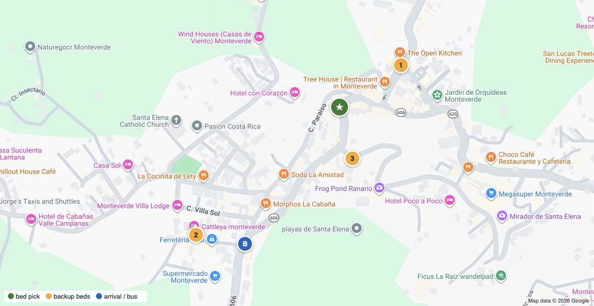
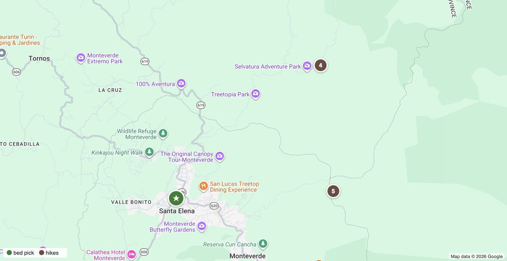

# 🇨🇷 Monteverde

Part of the [LatAm itinerary](../itinerary.md) · region notes: [Costa Rica + Nicaragua](costa-rica-nicaragua.md) · ← [Uvita](uvita.md) · [La Fortuna / Arenal](la-fortuna.md) →

> **Stop 29 · Day 72 → 74 · 2 nights** 
> 🏞️ Cool, windy cloud-forest town (Santa Elena): reserve trails at dawn, a fig tree you can climb inside, a hill with a view toward Arenal 
> 🛏️ **Monteverde Backpackers**, 6-bed ensuite dorm, $24 for 2 nights 
> 🚌 **In:** Uvita → Quepos → Puntarenas → Santa Elena, Day 72 (~11–12 h) · **Out:** jeep-boat-jeep to La Fortuna, Day 74 08:00

Mist in the canopy of the Reserva Bosque Nuboso Santa Elena. Photo: Google Maps.

## 🗺️ Map

**In town:** ★ **[Monteverde Backpackers](https://www.google.com/maps?ftid=0x8fa01978f5f77c49:0xdfc8493fb544bbda)** (the pick, [book](https://www.hostelworld.com/hostels/p/19204/monteverde-backpackers/?from=2027-02-17&to=2027-02-19&guests=1)) · **B** [Santa Elena bus stop](https://www.google.com/maps?ftid=0x8fa01b80f7bc7937:0x24a35d5bdc738b2) · **1** [OutBox Inn](https://www.google.com/maps?ftid=0x8fa01b882444e4e1:0x9acf7748d3d1d36c) (backup, [book](https://www.booking.com/hotel/cr/outbox-inn.html?checkin=2027-02-17&checkout=2027-02-19&group_adults=1&no_rooms=1&group_children=0&selected_currency=USD)) · **2** [Hostel Cattleya](https://www.google.com/maps?ftid=0x8fa01bdbd65b1177:0xaa41898629d1c128) (backup 2, [book](https://www.booking.com/hotel/cr/hostel-cattleya.html?checkin=2027-02-17&checkout=2027-02-19&group_adults=1&no_rooms=1&group_children=0&selected_currency=USD)) · **3** [Casa Geranios #2](https://www.google.com/maps?ftid=0x8fa01bd09b8811fb:0xeb4d86f71730a0a1) (sold out Day 72 → 74) · [Mi Casa Su Casa](https://www.google.com/maps?ftid=0x8fa01b494e386f05:0xecada9d1ebcb087c) (private alt since 27 Nov, not pinned, [book](https://www.booking.com/hotel/cr/mi-casa-su-casa-monteverde.html?checkin=2027-02-17&checkout=2027-02-19&group_adults=1&no_rooms=1&group_children=0&selected_currency=USD))

**Around:** ★ Santa Elena · **4** [Reserva Bosque Nuboso Santa Elena](https://www.google.com/maps?ftid=0x8fa01a5d0fae40ff:0xd59c9f082da5c1c9) [🚕 ≈ 17 min](https://www.google.com/maps/dir/?api=1&origin=10.3170834,-84.8254517&destination=10.3437168,-84.7961135&travelmode=driving) · **5** [Cerro Amigos](https://www.google.com/maps?ftid=0x8fa01a1800ea97af:0x358e224a5dd87b66) [🚕 ≈ 16 min](https://www.google.com/maps/dir/?api=1&origin=10.3170834,-84.8254517&destination=10.3184916,-84.7935568&travelmode=driving) · the Ficus tree isn't pinned (its location wasn't checked on a map)

🧭 The time after each place is from the ★ bed (Google Maps, 26 Nov): 🚶 walk · 🚌 bus · 🚕 taxi · 🚗 by road (tour or bus). Click it for the route.

**Open the live map:** [town](https://www.google.com/maps/@10.3160,-84.8260,17z) · [area](https://www.google.com/maps/@10.328,-84.808,14z)

## 📅 Day by day

| Day | Plan |
|---|---|
| **Day 72** | 🚌 **05:15** Uvita → Quepos, **07:30** → Puntarenas, **13:20 Transmonteverde** → Santa Elena ~16:30. Book the jeep-boat-jeep the day you arrive. |
| **Day 73** | 🥾 **07:00 Reserva Santa Elena** for birds and fewer people. Then the free **Ficus tree** and **Cerro Amigos** (a view toward Arenal on clear days). |
| **Day 74** | 🚐 **08:00 jeep-boat-jeep** to La Fortuna. |

## 🔖 Book (one click)

Dates and 1 adult are pre-filled. The first channel listed was the cheapest when checked on 24 Nov. ⚠️ = time-sensitive.

**Beds** (Day 72 → 74, 2 nights)

| | Where | Total | Location | From the Santa Elena bus stop | Book |
|---|---|---:|:---:|---|---|
| ⭐ **Pick** | **Monteverde Backpackers** · standard 6-bed mixed dorm, ensuite | **$24** | 9.4 | 🚶 6 min (450 m) · [route](https://www.google.com/maps/dir/?api=1&origin=10.3141672,-84.8275034&destination=10.3170834,-84.8254517&travelmode=walking) | [Hostelworld](https://www.hostelworld.com/hostels/p/19204/monteverde-backpackers/?from=2027-02-17&to=2027-02-19&guests=1) |
| Backup | **OutBox Inn** · 8-bed ensuite dorm, privacy curtains | $43 | 9.7 | 🚶 10 min (650 m); centre 8 min on foot · [route](https://www.google.com/maps/dir/?api=1&origin=10.3141672,-84.8275034&destination=10.317978,-84.82412&travelmode=walking) | [Booking](https://www.booking.com/hotel/cr/outbox-inn.html?checkin=2027-02-17&checkout=2027-02-19&group_adults=1&no_rooms=1&group_children=0&selected_currency=USD) |
| Backup 2 | **Hostel Cattleya** · standard 4-bed mixed dorm | $22 | ⚠️ 8.7 | 🚶 2 min (130 m) · [route](https://www.google.com/maps/dir/?api=1&origin=10.3141672,-84.8275034&destination=10.314357099999999,-84.8285722&travelmode=walking) | [Booking](https://www.booking.com/hotel/cr/hostel-cattleya.html?checkin=2027-02-17&checkout=2027-02-19&group_adults=1&no_rooms=1&group_children=0&selected_currency=USD) · [Hostelworld](https://www.hostelworld.com/hostels/p/285313/hostel-cattleya/?from=2027-02-17&to=2027-02-19&guests=1) |
| Private alt | **Mi Casa Su Casa** · economy double | $135 ✅ 27 Nov | 9.4 | 🚶 21 min (1.2 km); taxi ≈ 4 min · [route](https://www.google.com/maps/dir/?api=1&origin=10.3141672,-84.8275034&destination=10.3224077,-84.8225832&travelmode=walking) | [Booking](https://www.booking.com/hotel/cr/mi-casa-su-casa-monteverde.html?checkin=2027-02-17&checkout=2027-02-19&group_adults=1&no_rooms=1&group_children=0&selected_currency=USD) |
| ~~Private alt~~ | ~~**Casa Geranios #2**~~ · whole 1-bedroom apartment with kitchen | **sold out** ✅ 27 Nov | 9.6 | 🚶 5 min (350 m) · [route](https://www.google.com/maps/dir/?api=1&origin=10.3141672,-84.8275034&destination=10.315987164037,-84.825181419438&travelmode=walking) | [Booking](https://www.booking.com/hotel/cr/casa-geranios-2.html?checkin=2027-02-17&checkout=2027-02-19&group_adults=1&no_rooms=1&group_children=0&selected_currency=USD) |

**Transport and tickets**

| | Leg | When | Price | Book |
|---|---|---|---:|---|
| In | **Grupo Blanco** · Uvita → Quepos | **Day 72 05:15** → ~07:15 | ≈ ₡1,745 ($3.90) | on the bus |
| In | **Transportes Quepos–Puntarenas** · Quepos → Puntarenas | **07:30** → ~10:30 | ₡2,965 ($6.64) | tqpcr.com |
| ⚠️ In | **Transmonteverde route 625** · Puntarenas → Santa Elena | **13:20** (via Guacimal) → ~16:30 | ≈ ₡2,700–3,900 ($6–9) | [Transmonteverde](https://transmonteverde.com/) (seats sold online) |
| Out | **Green Road** jeep-boat-jeep · Santa Elena → La Fortuna | **Day 74 08:00** | $45 | greenroadcr.com, details in the [La Fortuna guide](la-fortuna.md) |
| Sight | Reserva Bosque Nuboso Santa Elena | no booking needed for self-guided walks | ₡10,000 ($22.40) | [reservasantaelena.org](https://reservasantaelena.org/) |

How to read these tables

- **Location** is the guests' location score on Booking.com. The target is 9.0 or higher, and ⚠️ marks one below 9.0. *(HW)* means Hostelworld's location rating, used where a property isn't on Booking.
- **From the Santa Elena bus stop** comes from Google Maps on 24 Nov: the property found on Maps and routed from where you arrive at midday on the check-in date.
- Symbols: 🚶 walk · 🚌 public transport · 🚕 taxi/rideshare · 🥾 hike only · ⚠️ far from the centre with no bus · ℹ️ outside the centre but on a bus line.

## 🚌 Getting here: Uvita → Quepos → Puntarenas → Santa Elena, Day 72

A long day: ~11–12 h door to door, ≈ $15.

1. **Uvita 05:15 → Quepos ~07:15** (Grupo Blanco; other departures 11:30, 14:30, 16:00; ≈ ₡1,745 / $3.90) ✅ times on uvita.info (2026 schedule).
2. **Quepos 07:30 → Puntarenas ~10:30** (Transportes Quepos–Puntarenas; also 04:35, 05:30, 11:00, 14:00, 15:30, 16:30, 18:00; **₡2,965 / $6.64**) ✅ tqpcr.com. If you miss the 07:30, the 11:00 arrives ~14:00.
3. **Puntarenas → Santa Elena (Monteverde), Transmonteverde route 625:** 08:30 (via Las Juntas), 13:20 (via Guacimal), 14:30 (via Las Juntas), 15:45 (via Lagartos), ~3–3½ h.
   - Seats sold online ✅ transmonteverde.com booking engine. Read again 27 Nov: the 13:20 via Guacimal runs midweek (listed for Wed 2 Dec, and Sat 5 / Sun 6 Dec too); Feb 2027 dates are not bookable yet.
   - Fare ≈ ₡2,700–3,900 ($6–9).
   - With the 07:30 from Quepos take the **13:20** → Santa Elena ~16:30.

- **Alternative:** a **shared shuttle Uvita → Monteverde ≈ $75–99**, 5–6 h, morning departures (AI lead, Roca Verde / Costa Rica Insider; not checked on the operators' sites).

## 🛏️ Where to sleep

All live-checked on 24 Nov.

### ⭐ Pick: Monteverde Backpackers
- **Room:** standard 6-bed mixed dorm, ensuite.
- **Price:** **$24 for 2 nights** (tax included) · Hostelworld (not in Booking's hostel results for these dates).
- **Reviews:** HW **8.7 (2,337; 5.2 % < 7)**, newest 91–100 (Oct–Nov 2026).
- **Where:** central Santa Elena, next to the supermarket, ~150 m from the bus stop.
- **Checks:** fully equipped kitchen; simple breakfast included; "chill, not a party hostel"; **no bed curtains** and thin walls (some noise complaints).

### Backup (location 9.7, from 25 Nov): OutBox Inn
- **Room:** 8-bed ensuite dorm with **privacy curtains**, lights and outlets.
- **Price:** **$43 on Booking** (free cancellation) vs $54.24 on Hostelworld incl. IVA.
- **Reviews:** Booking 8.8 (650; 3% below 7), location **9.7**; HW 9.6/962 (2.1 % < 7).
- **Where:** in Santa Elena, 600 m from the bus stop.
- **Checks:** **no guest stove** (microwave only); the beer garden next door plays music until ~22:30.

### Backup 2: Hostel Cattleya (⚠️ location 8.7)
- **Room:** standard 4-bed mixed dorm.
- **Price:** **$22 on Booking** (8.7/1,864; card $11 × 2, IVA treatment unchecked) vs $27.12 on Hostelworld ($24 + IVA).
- **Reviews:** HW **8.5 (656; 3.6 % < 7)**.
- **Where:** ~0.6 km from the centre.
- **Checks:** "huge, very nice kitchen" (cooker listed); "definitely not a party hostel"; building-site noise in the mornings.

### Private alt (location first, since 27 Nov): Mi Casa Su Casa
- Economy double in a guesthouse · Booking location **9.4** (243 reviews, 3 % below 7) · **$135 for 2 nights** ✅ 27 Nov (room table) · [Booking.com](https://www.booking.com/hotel/cr/mi-casa-su-casa-monteverde.html?checkin=2027-02-17&checkout=2027-02-19&group_adults=1&no_rooms=1&group_children=0&selected_currency=USD) · 1.2 km north-east of the bus stop (🚶 21 min, taxi ≈ 4 min).
- ~~**Casa Geranios #2**~~ (whole 1-bedroom apartment with kitchen, location 9.6, $125): **sold out for Day 72 → 74** ✅ 27 Nov (still $126 for Day 79 → 81).
- **Cheaper on Hostelworld:** Pension Santa Elena double, shared bath, $60.90 (centre, but 14.8 % < 7).

## 🌳 Things to do (free and outdoors first)

<table>
<tr>
<td width="50%" valign="top"> <b>The hollow Ficus tree</b> · free A strangler fig you can climb inside, off the road to the Monteverde reserve; ask for "el higuerón". The photo is a generic higuerón, not this tree.</td>
<td width="50%" valign="top"> <b><a href="https://www.google.com/maps?ftid=0x8fa01a1800ea97af:0x358e224a5dd87b66">Cerro Amigos</a></b> (1,842 m) · free · <a href="https://www.google.com/maps/dir/?api=1&origin=10.3170834,-84.8254517&destination=10.3184916,-84.7935568&travelmode=driving">🚕 ≈ 16 min</a> The TV-tower hill above town: a steep road walk to a view toward Arenal on clear days.</td>
</tr>
<tr>
<td width="50%" valign="top"> <b><a href="https://www.google.com/maps?ftid=0x8fa01a5d0fae40ff:0xd59c9f082da5c1c9">Reserva Bosque Nuboso Santa Elena</a></b> · ₡10,000 ($22.40) · 07:00–16:00 · <a href="https://www.google.com/maps/dir/?api=1&origin=10.3170834,-84.8254517&destination=10.3437168,-84.7961135&travelmode=driving">🚕 ≈ 17 min</a> Community-run cloud forest with self-guided trails. Go at 07:00.</td>
<td width="50%" valign="top"></td>
</tr>
</table>

- **Reserva Bosque Nuboso Santa Elena** (community-run, over Monteverde reserve per the hike backlog): **₡10,000 ($22.40) adult**, trails open 07:00–16:00, last entry 15:00, no booking needed for self-guided walks; guided 2½ h walk ₡20,000 ✅ reservasantaelena.org (2026 rates). Go at 07:00 for birds and fewer people.
- **Free:**
  - the hollow **strangler-fig "Ficus" tree** you can climb inside (off the road between Santa Elena and the Monteverde reserve; ask locally for "el higuerón");
  - **Cerro Amigos** (1,842 m, the TV-tower hill above town: a steep road walk up for a view toward Arenal on clear days).
  - Both ≈ from the hike backlog / general knowledge; locations not checked on a map.

## 🍽️ Eat and drink

<table>
<tr>
<td width="50%" valign="top"> <b>Casado</b> at the sodas · ≈ ₡4,500–6,000 The Tico set plate. Sodas around the Santa Elena bus stop. Generic photo, not from Monteverde.</td>
<td width="50%" valign="top"></td>
</tr>
</table>

- **Sodas** around the Santa Elena bus stop: casado ≈ ₡4,500–6,000 ($10–13) ≈.
- **Cook in the hostel kitchen:** Monteverde prices run high.
- **Craft beer:** check nearer the time.

## ℹ️ Good to know
- **Cold, windy nights** (~15 °C) in February; bring a fleece.
- **Book the jeep-boat-jeep** (next leg) the day you arrive.

## 🚐 Leaving: jeep-boat-jeep to La Fortuna, Day 74

- Hotel pickup in Santa Elena → jeep to Lake Arenal → boat across → jeep to La Fortuna, ~3½–4 h. **Green Road shared 08:00, $45.**
- Prices, the 14:00 departure and the cheaper hostel deals are in the [La Fortuna guide](la-fortuna.md).

---
Photos: Google Maps contributors (Reserva Santa Elena ×2, Cerro Amigos). Wikimedia Commons: <a href="https://commons.wikimedia.org/wiki/File:Ficus_tuerckheimii,_a_strangler_fig_or_Higueron_(11362278535).jpg">Ficus tuerckheimii, a strangler fig or Higueron</a> (Dick Culbert, CC BY 2.0), <a href="https://commons.wikimedia.org/wiki/File:Casado_Tico.jpg">Casado Tico</a> (Richie Diesterheft, CC BY 2.0).
