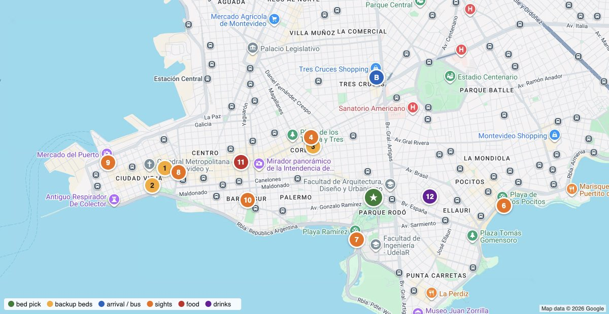
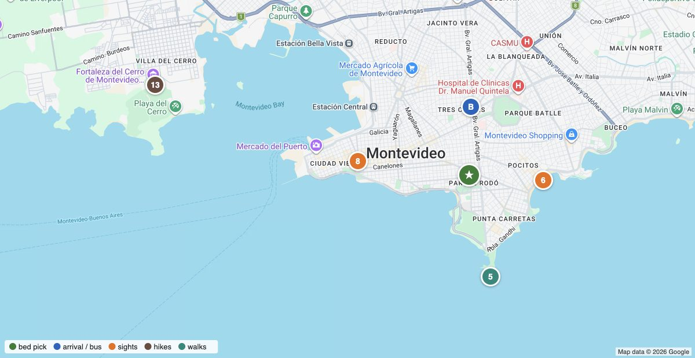

# 🇺🇾 Montevideo

Part of the [LatAm itinerary](../itinerary.md) · region notes: [Paraguay + Uruguay](paraguay-uruguay.md) · ← [Encarnación](encarnacion.md) · [Cabo Polonio](cabo-polonio.md) →

> **Stops 9 + 11 · Sun 27 → Mon 28 Dec and Wed 30 Dec 2026 → Fri 1 Jan 2027 · 1 + 2 nights · New Year's Eve** 
> 🏞️ A laid-back capital on a long waterfront Rambla, with city beaches, a Sunday flea market and a paper-throwing New Year's Eve 
> 🛏️ **MedioMundo Hostel**, a bed in a 6-bed dorm, $25 + $50 (no New Year premium) 
> 🚌 **In:** EGA overnight from Encarnación, Sun 27 07:15 · **Cabo Polonio:** Rutas del Sol out Mon 28 10:10, back Wed 30 20:10 · **Out:** COT to Colonia, Fri 1 Jan 09:30

Playa Pocitos and the Rambla, a 10–30-min walk from the hostel. Photo: Google Maps.

## 🗺️ Map

**In town:** ★ **[MedioMundo Hostel](https://www.google.com/maps?ftid=0x959f81a456ed8df9:0xeb2b6db7e1a9768b)** (the pick; Youki Haus, the 27 Dec backup, is on the same street, [book](https://www.booking.com/hotel/uy/mediomundo-hostel.html?checkin=2026-12-27&checkout=2026-12-28&group_adults=1&no_rooms=1&group_children=0&selected_currency=USD)) · **1** [Viajero Montevideo Hostel](https://www.google.com/maps?ftid=0x959f81d290a982e7:0x4d318138258d4c98) (New Year backup, [book](https://www.agoda.com/partners/partnersearch.aspx?hid=245581&checkin=2026-12-30&checkout=2027-01-01&NumberofAdults=1&Rooms=1)) · **2** [Circus Hotel](https://www.google.com/maps?ftid=0x959f7f800d93b873:0x8e35f88b89280ae7) (🎆 holiday backup, [book](https://www.booking.com/hotel/uy/circus-hostel-amp-montevideo.html?checkin=2026-12-30&checkout=2027-01-01&group_adults=1&no_rooms=1&group_children=0&selected_currency=USD)) · **3** [Apartamento céntrico](https://www.google.com/maps?ftid=0x959f81b4f4a4a39f:0x7454e0c6f5bafece) (private alt, beside 4, [book](https://www.booking.com/searchresults.html?ss=Guayabos+1790+Montevideo&checkin=2026-12-27&checkout=2026-12-28&group_adults=1&no_rooms=1&selected_currency=USD)) · **B** [Tres Cruces bus terminal](https://www.google.com/maps?ftid=0x959f80522ba3212b:0xdc820d37aaf2dd36) · **4** [Feria de Tristán Narvaja](https://www.google.com/maps?ftid=0x959f804b2d33107b:0x96c7b9f5e31dc82) · **6** [Playa Pocitos](https://www.google.com/maps?ftid=0x959f816c4983d23f:0x371de34edac4830d) · **7** [Playa Ramírez](https://www.google.com/maps?ftid=0x959f81bd2c0d85ad:0x5647ad7d1621b33d) · **8** [Plaza Independencia](https://www.google.com/maps?ftid=0x959f802b0e1d1f07:0x7d9cac3abf570af3) (Ciudad Vieja) · **9** [Mercado del Puerto](https://www.google.com/maps?ftid=0x959f7f8458a9a267:0xab03acd0858658d2) · **10** [Barrio Sur](https://www.google.com/maps/@-34.9109,-56.1882,16z) (candombe) · **11** [Bar Facal](https://www.google.com/maps?ftid=0x959f81ccd6fd326f:0x33d7855c66ecd541) · **12** [Montevideo Brew House](https://www.google.com/maps?ftid=0x959f810a3d223451:0x4bb459831cea35c8)

**Around:** ★ MedioMundo · **B** [Tres Cruces](https://www.google.com/maps?ftid=0x959f80522ba3212b:0xdc820d37aaf2dd36) · **5** [Punta Carretas lighthouse](https://www.google.com/maps?ftid=0x959f822a9e13a7ff:0x388c643a31dfaf62) (Rambla walk) · **6** [Playa Pocitos](https://www.google.com/maps?ftid=0x959f816c4983d23f:0x371de34edac4830d) · **8** [Ciudad Vieja](https://www.google.com/maps?ftid=0x959f7f81386face9:0x1f573a9cbda191d9) · **13** [Cerro de Montevideo, Fortaleza General Artigas](https://www.google.com/maps?ftid=0x959f7e27fa3bce81:0x91081c7cde3f56f0) (≈ 40 min by bus)

**Open the live map:** [town](https://www.google.com/maps/@-34.9070,-56.1780,14z) · [bay](https://www.google.com/maps/@-34.9050,-56.2000,13z)

## 📅 Day by day

| Day | Plan |
|---|---|
| **Sun 27 Dec** | 🚌 EGA arrives at Tres Cruces 07:15. Drop the bag at MedioMundo by 07:45. 🛍️ **Feria de Tristán Narvaja** (≈ 09:00–14:00). 🌊 **Rambla walk** to Punta Carretas and Pocitos. 🥁 **Candombe drums** in Barrio Sur from ≈ 18:00–19:00 (lead). |
| **Mon 28 Dec** | 🚌 **10:10 Rutas del Sol** to [Cabo Polonio](cabo-polonio.md). |
| **Wed 30 Dec** | 🚌 Back from Cabo Polonio, Tres Cruces 20:10. Shop for New Year's Eve tonight or tomorrow morning. |
| **Thu 31 Dec** · New Year's Eve | Morning: ⛰️ **Cerro de Montevideo** (or shopping, before supermarkets close early). From late morning: 📄 **paper and water wars** in Ciudad Vieja and Centro, and the 🍺 **cider and beer fight** at the Mercado del Puerto. City buses stop at ≈ 18:30. Evening: hostel asado or shared dinner. 🎆 **Midnight:** fireworks along the Rambla, from Playa Ramírez or Pocitos. |
| **Fri 1 Jan** · New Year's Day | No city buses. 🚶 Walk 2.5 km (30 min) to Tres Cruces for the **09:30 COT** to [Colonia](colonia.md). |

## 🔖 Book (one click)

Dates and 1 adult are pre-filled. The first channel listed was the cheapest when checked on 24 Nov. ⚠️ = time-sensitive.

**Beds** (27 → 28 Dec, 1 night; 30 Dec → 1 Jan, 2 nights)

| | Where | Total | Location | From Tres Cruces | Book |
|---|---|---:|:---:|---|---|
| ⭐ **Pick**, 27 Dec | **MedioMundo Hostel** · bed in a 6-bed mixed dorm | **$25** | 9.4 | 🚌 18 min by bus 300; walk 30 min; ℹ️ outside the centre (46 min on foot, buses run) · [route](https://www.google.com/maps/dir/?api=1&origin=-34.8938383,-56.1663727&destination=-34.9105207,-56.166859599999995&travelmode=transit) | [Booking](https://www.booking.com/hotel/uy/mediomundo-hostel.html?checkin=2026-12-27&checkout=2026-12-28&group_adults=1&no_rooms=1&group_children=0&selected_currency=USD) · [Hostelworld](https://www.hostelworld.com/hostels/p/268049/mediomundo-hostel/?from=2026-12-27&to=2026-12-28&guests=1) · [Agoda](https://www.agoda.com/partners/partnersearch.aspx?hid=1271943&checkin=2026-12-27&checkout=2026-12-28&NumberofAdults=1&Rooms=1) |
| ⭐ **Pick**, New Year | **MedioMundo Hostel** · the same dorm, 30 Dec → 1 Jan | **$50** | 9.4 | 🚌 13 min by bus 407; walk 30 min; ℹ️ outside the centre (46 min on foot, buses run) · [route](https://www.google.com/maps/dir/?api=1&origin=-34.8938383,-56.1663727&destination=-34.9105207,-56.166859599999995&travelmode=transit) | [Booking](https://www.booking.com/hotel/uy/mediomundo-hostel.html?checkin=2026-12-30&checkout=2027-01-01&group_adults=1&no_rooms=1&group_children=0&selected_currency=USD) · [Hostelworld](https://www.hostelworld.com/hostels/p/268049/mediomundo-hostel/?from=2026-12-30&to=2027-01-01&guests=1) · [Agoda](https://www.agoda.com/partners/partnersearch.aspx?hid=1271943&checkin=2026-12-30&checkout=2027-01-01&NumberofAdults=1&Rooms=1) |
| Backup, 27 Dec | **Youki Haus Hostel** · bed in a 4-bed mixed dorm | $27 | 9.3 | 🚌 16 min: bus 174 → walk 6 min; walk 29 min; ℹ️ outside the centre (47 min on foot, buses run) · [route](https://www.google.com/maps/dir/?api=1&origin=-34.8938383,-56.1663727&destination=-34.910720999999995,-56.166360499999996&travelmode=transit) | [Booking](https://www.booking.com/hotel/uy/youki-haus-hostel.html?checkin=2026-12-27&checkout=2026-12-28&group_adults=1&no_rooms=1&group_children=0&selected_currency=USD) · [Hostelworld](https://www.hostelworld.com/hostels/p/316645/youki-haus-hostel/?from=2026-12-27&to=2026-12-28&guests=1) · [Agoda](https://www.agoda.com/partners/partnersearch.aspx?hid=56167397&checkin=2026-12-27&checkout=2026-12-28&NumberofAdults=1&Rooms=1) |
| Backup, New Year | **Viajero Montevideo Hostel** · 10-bed mixed ensuite dorm | $44.53 | 9.0 | 🚌 19 min: walk 4 min → bus 714 → walk 6 min; walk 54 min; centre 4 min on foot · [route](https://www.google.com/maps/dir/?api=1&origin=-34.8938383,-56.1663727&destination=-34.906412599999996,-56.202146299999995&travelmode=transit) | [Agoda](https://www.agoda.com/partners/partnersearch.aspx?hid=245581&checkin=2026-12-30&checkout=2027-01-01&NumberofAdults=1&Rooms=1) · [Hostelworld](https://www.hostelworld.com/hostels/p/37593/viajero-montevideo-hostel/?from=2026-12-30&to=2027-01-01&guests=1) · [Booking (search)](https://www.booking.com/searchresults.html?ss=Viajero+Montevideo+Hostel+&checkin=2026-12-30&checkout=2027-01-01&group_adults=1&no_rooms=1&selected_currency=USD) |
| Private alt | **Apartamento céntrico** (Guayabos 1790, Cordón) · 1-bed flat with a kitchen | $62 (27 Dec) · $140 (New Year) | 9.8 | — | [Booking (search)](https://www.booking.com/searchresults.html?ss=Guayabos+1790+Montevideo&checkin=2026-12-27&checkout=2026-12-28&group_adults=1&no_rooms=1&selected_currency=USD) (room table) |
| 🎆 Holiday backup, New Year | **Circus Hotel Montevideo** · bed in a 6-bed mixed dorm | $32 | 9.2 | 🚌 28 min by bus 407 (taxi 14 min); Plaza Independencia 8 min on foot · [route](https://www.google.com/maps/dir/?api=1&origin=-34.8938383,-56.1663727&destination=-34.908818,-56.204281&travelmode=transit) | [Booking](https://www.booking.com/hotel/uy/circus-hostel-amp-montevideo.html?checkin=2026-12-30&checkout=2027-01-01&group_adults=1&no_rooms=1&group_children=0&selected_currency=USD) |
| 🎆 Holiday backup, New Year (alt town) | **Casarão Sacramento Hostel**, **Colonia del Sacramento** · bed in an 8-bed mixed dorm | $40 | 9.8 | 🚶 7 min (450 m) from Colonia's bus terminal; old town 5 min on foot. Also removes the 1 Jan Montevideo → Colonia bus · [route](https://www.google.com/maps/dir/?api=1&origin=-34.4726414,-57.8425142&destination=-34.472580,-57.847469&travelmode=walking) | [Booking](https://www.booking.com/hotel/uy/casarao-sacramento-hostel-amp-suites.html?checkin=2026-12-30&checkout=2027-01-01&group_adults=1&no_rooms=1&group_children=0&selected_currency=USD) |

**Transport**

| | Leg | When | Price | Book |
|---|---|---|---:|---|
| In | **EGA** · Encarnación → Tres Cruces (see the [Encarnación guide](encarnacion.md)) | Sat 26 Dec 13:30 → **Sun 27 Dec 07:15** | $124 semi-cama | [EGA Paraguay shop](https://reservadirecta.sittnet.net/Commerce/egapy) |
| Out | **Rutas del Sol** · Tres Cruces → Cabo Polonio gate | **Mon 28 Dec 10:10 → 14:30** | UYU 1,003 ≈ $25 | [Rutas del Sol](https://www.rutasdelsol.com.uy/) |
| In | **Rutas del Sol** · Cabo Polonio → Tres Cruces | Wed 30 Dec 15:10 → **20:10** | UYU 1,003 ≈ $25 | [Rutas del Sol](https://www.rutasdelsol.com.uy/) |
| ⚠️ Out | **COT** · Tres Cruces → Colonia (see the [Colonia guide](colonia.md)) | **Fri 1 Jan 09:30 → 12:20** | UYU 579 ≈ $14 | [COT](https://www.cot.com.uy/) |

How to read these tables

- **Location** is the guests' location score on Booking.com. The target is 9.0 or higher, and ⚠️ marks one below 9.0. *(HW)* means Hostelworld's location rating, used where a property isn't on Booking.
- **From Tres Cruces** comes from Google Maps on 24 Nov: the property found on Maps and routed from where you arrive at midday on the check-in date. The **route** link opens the same route.
- Symbols: 🚶 walk · 🚌 public transport · 🚕 taxi/rideshare · 🥾 hike only · ⚠️ far from the centre with no bus · ℹ️ outside the centre but on a bus line.
- The holiday-backup totals ($32, $40) are from the itinerary's holiday table.

## 🚌 Getting here: Encarnación → Montevideo, Sat 26 → Sun 27 Dec

- **EGA arrives at Tres Cruces at 07:15** (the bus and ticket are in the [Encarnación guide](encarnacion.md)).
- MedioMundo is 2.5 km away (city bus or a 30-min walk).
- It has **24 h reception and free luggage storage**, so drop the bag at 07:45.

## 🛏️ Where to sleep

**Live-checked 24 Nov.**

### ⭐ Pick: MedioMundo Hostel (both stays)
- **Unit:** a bed in a 6-bed mixed dorm.
- **27 → 28 Dec:** **$25 for 1 night on Booking** (Agoda $26, HW $25.52).
- **30 Dec → 1 Jan:** **$50 for 2 nights on Booking** (Agoda $52, HW $50.48). **No New Year premium** ($25 a night, the same as 27 Dec). No minimum-stay rule triggered for 30 Dec → 1 Jan on HW or Booking.
- Its 4-bed dorm is $58 and its double with shared bath $117 (New Year dates).
- **Reviews:** Booking **9.2 (1,010; 0% below 7)**, **location 9.4**; HW 94 (775).
- **Where:** San Salvador 2211, Parque Rodó, 200 m from the Rambla and beach, 3 km from Ciudad Vieja.
- ✅ **Stove kitchen** (cooker, utensils, BBQ). ✅ **Bed curtains** (review: "las camas… tienen cortinas").
- Not a party hostel. The noise complaints are about street traffic and thin walls, not parties.

### Backup, 27 Dec: Youki Haus Hostel
- Same street, no. 2248. Bed in a 4-bed mixed dorm.
- **$27 on Booking** (Agoda $30.63, HW $30.52).
- Booking 8.8 (475; 4% below 7), location 9.3; HW 96 (89).
- Bunks with curtains, stove kitchen.
- ⚠ On a busy corner (traffic noise).

### Backup, New Year: Viajero Montevideo Hostel
- Ciudad Vieja. 10-bed mixed ensuite dorm.
- **$44.53 for 2 nights on Agoda** (HW $49.48).
- HW 87 (3,225).
- Privacy curtains on every bed (property text). Stove kitchen.
- ⚠ Rooftop bar and pool table, so it's social; recent reviews flag dusty rooms.
- Youki Haus and LocoAmor are **sold out** for these dates on Booking.

### Private alt (location first): Apartamento céntrico
- Guayabos 1790, Cordón. A one-bedroom flat with a kitchen.
- Booking **location 9.8** (9.7; 83 reviews; 0% below 7).
- **27 Dec: $62** (room table). **30 Dec → 1 Jan: $140 for 2 nights** (room table; $70 a night against $62 on 27 Dec). Booking.
- **27 Dec second choice:** [LocoAmor](https://www.google.com/maps?ftid=0x959f7f327b777319:0xc95112e6d5424ff7) in Ciudad Vieja, single room with private bath, location 9.5 (9.2 from 103 reviews), $45.
- **New Year alternative:** [Hotel London Palace](https://www.google.com/maps?ftid=0x959f81d2bbe5b89d:0xf0bdbe882d25eec9) (Centro, location 9.2; 8.6 from 1,823 reviews; 1% below 7), single room with breakfast, $126 for 2 nights.

### 🎆 Holiday backups (New Year's Eve)
- Only **5 hostels** rated ≥ 8 were left for 30 Dec → 1 Jan (itinerary check); MedioMundo was still $50.
- **Same city:** **Circus Hotel Montevideo**, a bed in a 6-bed mixed dorm, location 9.2 (2,865 reviews), **$32**. Plaza Independencia is 8 min on foot.
- **Another town:** New Year in **Colonia**: **Casarão Sacramento Hostel**, a bed in an 8-bed mixed dorm, location 9.8, **$40** (Colonia was 86% unavailable). It also removes the 1 Jan Montevideo → Colonia bus, which runs no published holiday timetable.

## 🌳 Things to do (free and outdoors first)

<table>
<tr>
<td width="50%" valign="top"> <b><a href="https://www.google.com/maps?ftid=0x959f804b2d33107b:0x96c7b9f5e31dc82">Feria de Tristán Narvaja</a></b> · free · Sun ≈ 09:00–14:00 The huge Sunday flea and food market in Cordón, 1.5 km from the hostel.</td>
<td width="50%" valign="top"> <b>Rambla walk</b> · free · ≈ 6 km Parque Rodó → <a href="https://www.google.com/maps?ftid=0x959f822a9e13a7ff:0x388c643a31dfaf62">Punta Carretas lighthouse</a> (pictured) → Pocitos beach, all waterfront.</td>
</tr>
<tr>
<td width="50%" valign="top"> <b>Ciudad Vieja</b> · free Plaza Independencia, the <a href="https://www.google.com/maps?ftid=0x959f802afe10cee1:0xb95846203de847c5">Puerta de la Ciudadela</a> (pictured), Peatonal Sarandí, and the Mercado del Puerto to look at.</td>
<td width="50%" valign="top"> <b>Candombe drums</b> · free · Sun ≈ from 18:00–19:00 On Sunday evenings the comparsas rehearse by parading through Barrio Sur and Palermo. A lead: ask at the hostel.</td>
</tr>
<tr>
<td width="50%" valign="top"> <b>31 Dec street parties</b> · free Paper and water wars in Ciudad Vieja and Centro, and the cider and beer fight at the <a href="https://www.google.com/maps?ftid=0x959f7f8458a9a267:0xab03acd0858658d2">Mercado del Puerto</a> (pictured).</td>
<td width="50%" valign="top"> <b><a href="https://www.google.com/maps?ftid=0x959f81bd2c0d85ad:0x5647ad7d1621b33d">Playa Ramírez</a></b> and <b><a href="https://www.google.com/maps?ftid=0x959f816c4983d23f:0x371de34edac4830d">Pocitos</a></b> · free A dip by day; New Year's fireworks from the sand at midnight, 10–30 min from the hostel.</td>
</tr>
<tr>
<td width="50%" valign="top"> <b><a href="https://www.google.com/maps?ftid=0x959f7e27fa3bce81:0x91081c7cde3f56f0">Cerro de Montevideo</a></b> · climb free; fort museum ≈ small fee A short climb to the Fortaleza General Artigas for the classic view back across the bay.</td>
<td width="50%" valign="top"> <b><a href="https://www.google.com/maps?ftid=0x959f80fe2cbd4047:0xbe0e3d9eab16a8a6">Museo Nacional de Artes Visuales</a></b> · free ≈ In Parque Rodó, 5 min from the hostel. Check the Sunday hours.</td>
</tr>
</table>

**Sunday 27 Dec:**
- **Feria de Tristán Narvaja:** the huge Sunday flea and food market in Cordón, ≈ 09:00–14:00. Free; 1.5 km from the hostel.
- **Rambla walk:** Parque Rodó → Punta Carretas lighthouse → Pocitos beach, ≈ 6 km of waterfront. Free.
- **Or the other way, to Ciudad Vieja:** [Plaza Independencia](https://www.google.com/maps?ftid=0x959f802b0e1d1f07:0x7d9cac3abf570af3), [Puerta de la Ciudadela](https://www.google.com/maps?ftid=0x959f802afe10cee1:0xb95846203de847c5), [Peatonal Sarandí](https://www.google.com/maps?ftid=0x959f7f80806f152b:0x6e2990084a9e2348), the Mercado del Puerto to look at. Also free.
- **Candombe drums:** the comparsas parade through Barrio Sur and Palermo (around Isla de Flores / Carlos Gardel streets), ≈ from 18:00–19:00. Free; this is a lead, so ask at the hostel.
- **Free museums:** the Museo Nacional de Artes Visuales in Parque Rodó, 5 min from the hostel ≈ (check the Sunday hours).
- Optional, for a keen hiker who speaks Spanish: **Sierra de las Ánimas** (see below). It is only open on weekends, so Sunday 27 Dec is the only possible day.

**New Year's Eve:**
- **31 Dec, from late morning: paper and water wars in Ciudad Vieja and Centro.** Office workers rip up their diaries and throw them out of the windows, and soak passers-by with buckets.
- Next door, the **cider and beer fight at the Mercado del Puerto** (24 and 31 Dec) is a huge wet street party.
- Both are free; wear clothes you don't mind soaking. (Guru'Guay, updated Sep 2025.)
- **Midnight on 31 Dec: fireworks near the Rambla.** Locals let them off all along the waterfront, so walk to Playa Ramírez or Pocitos beach (10–30 min from the hostel).
  - There is **no official city display**: none was announced as of Oct 2026, and private fireworks are thinning out year by year. Free; nothing to book.
- **31 Dec morning: Cerro de Montevideo** (you're only back from Cabo Polonio at 20:10 on 30 Dec), a short climb to the Fortaleza General Artigas for the classic view back across the bay (bus ≈ 40 min; the climb is free, the fort museum ≈ small fee).
- Rambla by bike or on foot; a dip at Playa Ramírez or Pocitos.

<b>Sierra de las Ánimas: does it work en route? Mostly no.</b> (✅ official site, sierradelasanimas.com)

[Cerro de las Ánimas](https://www.google.com/maps?ftid=0x95755acb0cc1dcf5:0x58b1134b33b776ea) summit. Photo: Google Maps.

- It is a private reserve on the Interbalnearia at **km 86** ("Parada Los Cardos", opposite Parador Los Cardos). Any Punta del Este or Rocha bus stops there, but not the Piriápolis buses.
- It is open **Saturdays and Sundays only ("not all of them")**, plus Carnival week and Easter week. **Mon 28 and Wed 30 Dec are closed.**
- Booking ahead is **mandatory, by WhatsApp text only** (094 419 891). They confirm whether that weekend is open and what kit is compulsory.
- Entry is **UYU 250 ≈ $6**. Walks: Cerro de las Ánimas summit (501 m) ≈ 4 h return; Cañadón de los Espejos ≈ 4 h; both together 7–8 h.
- **Foreigners who aren't fluent in Spanish must come with a Spanish speaker.**
- There is **no luggage storage** and no camping (closed).

So it can't be a stop on the way to Cabo Polonio with bags. The only fit is **Sun 27 Dec** as a day trip from Montevideo, straight off the night bus: leave bags at MedioMundo, take a ≈ 08:30 Rocha or Punta del Este bus from Tres Cruces (≈ 1 h 15; ≈ UYU 290–330, between COT's Peaje Solís and Pan de Azúcar fares), do the summit loop, and be back by ≈ 18:00.

**Recommendation: skip it** unless you speak Spanish and feel fresh after 18 h on the bus.

## 🍽️ Eat and drink

<table>
<tr>
<td width="50%" valign="top"> <b>Chivito</b> · ≈ UYU 600–900 ($15–22) ≈ Uruguay's steak sandwich, at <a href="https://www.google.com/maps?ftid=0x959f81ccd6fd326f:0x33d7855c66ecd541">Bar Facal</a> or <a href="https://www.google.com/maps?ftid=0x959f802a87be9e99:0x42f6525afae724cf">La Pasiva</a>. Generic photo.</td>
<td width="50%" valign="top"> <b><a href="https://www.google.com/maps?ftid=0x959f81ccd6fd326f:0x33d7855c66ecd541">Bar Facal</a></b> · chivito ≈ UYU 600–900 One of the two chivito picks, in Centro.</td>
</tr>
<tr>
<td width="50%" valign="top"> <b>Pizza + fainá</b> · ≈ UYU 150–200 ($4–5) ≈ By the slice in a pizzería. Generic photo.</td>
<td width="50%" valign="top"> <b><a href="https://www.google.com/maps?ftid=0x959f810a3d223451:0x4bb459831cea35c8">Montevideo Brew House</a></b> · craft beer ≈ (lead) Or Cervecería Mastra ≈ (lead).</td>
</tr>
</table>

- **Uruguay is expensive,** so cook at the hostel and buy at Tienda Inglesa, Disco or Devoto.
- **New Year:** shop on **30 Dec or the morning of 31 Dec**. Supermarkets close early on the 31st, and almost everything is shut on 1 Jan.
- A **hostel asado or shared dinner on the 31st** is the cheap way to do the night.

## ℹ️ Good to know
- **Weather:** Uruguay is mid-summer (≈ 28 °C) and sunny, with strong wind on the Rambla.
- **Safety:** Ciudad Vieja is dodgy late at night, so take the bus or Uber back.
- **Sunday arrival:** most shops are shut, but the market and the Rambla are lively.
- ⚠️ **City buses run until ≈ 18:30 on 31 Dec and not at all on 1 Jan** (Día del Transportista).
- Taxis get scarce from ≈ 16:00 on the 31st, and Uber is slow.
- Inter-city departures thin out after 18:00 on the 31st.
- Very few restaurants open on 24/25 and 31 Dec/1 Jan.

## 🚌 Leaving

**Mon 28 Dec → Cabo Polonio:** **Rutas del Sol 10:10** from Tres Cruces, arriving at the Cabo Polonio gate 14:30, UYU 1,003 ≈ $25. Details in the [Cabo Polonio guide](cabo-polonio.md).

**Fri 1 Jan → Colonia:** **walk** the 2.5 km (30 min) from the hostel to Tres Cruces for the **COT 09:30 → Colonia 12:20**, UYU 579 ≈ $14. Details and the holiday fallbacks are in the [Colonia guide](colonia.md).

---
Photos: Google Maps contributors (Pocitos, Feria de Tristán Narvaja, Punta Carretas lighthouse, Puerta de la Ciudadela, Mercado del Puerto, Playa Ramírez, Fortaleza del Cerro, Museo Nacional de Artes Visuales, Cerro de las Ánimas, Bar Facal, Montevideo Brew House). Wikimedia Commons: <a href="https://commons.wikimedia.org/wiki/File:Candombe_Montevideo_Uruguay.jpg">Candombe</a> (Larrycox54, CC0), <a href="https://commons.wikimedia.org/wiki/File:Chivito_al_pan_uruguayo.jpg">Chivito</a> (mattrubens on Flickr, CC BY-SA 2.0), <a href="https://commons.wikimedia.org/wiki/File:Fain%C3%A1_argentina.jpg">Fainá</a> (Tubby3, CC BY-SA 4.0).
