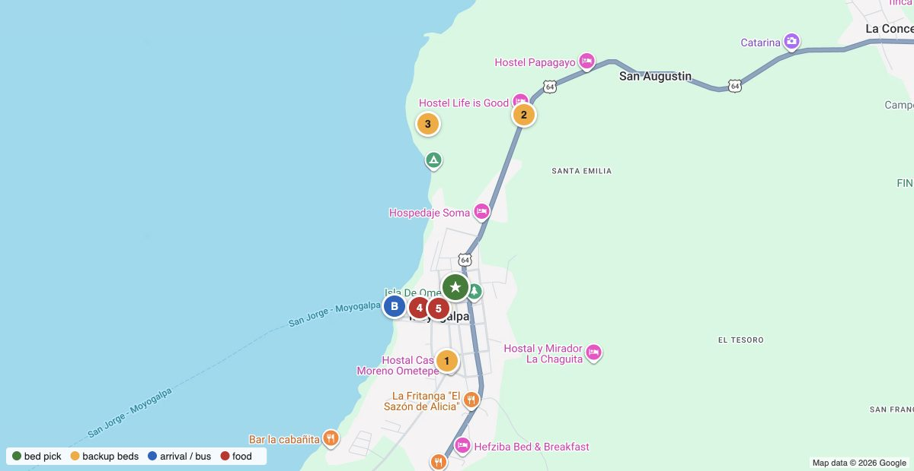
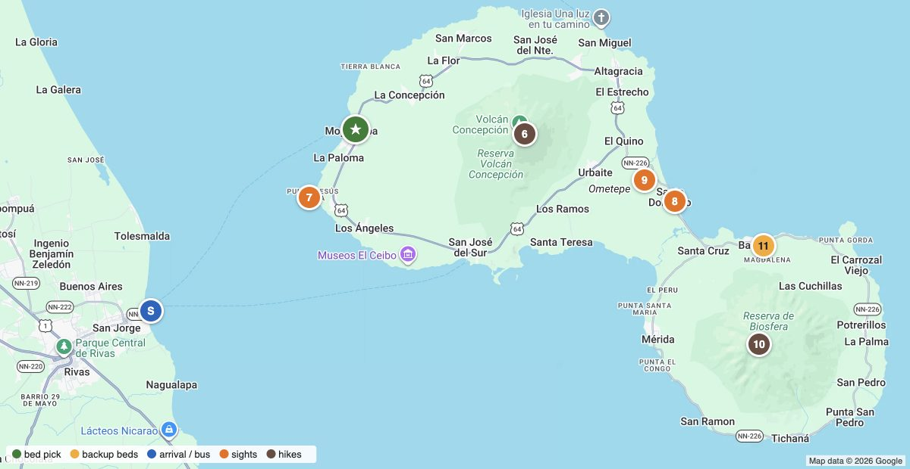

# 🇳🇮 Ometepe

Part of the [LatAm itinerary](../itinerary.md) · region notes: [Costa Rica + Nicaragua](costa-rica-nicaragua.md) · ← [San Juan del Sur / Playa Maderas](san-juan-del-sur.md) · [Granada + Laguna de Apoyo](granada.md) →

> **Stop 33 · Day 81 → 84 · 3 nights** 
> 🏞️ Twin-volcano island in Lake Nicaragua; climb Volcán Concepción from Moyogalpa 
> 🛏️ **Guest House Nena**, a private double 0.3 km from the port, $36 for 3 nights 
> 🚌 **In:** bus to Rivas + ferry San Jorge → Moyogalpa, Fri · **Out:** morning ferry to San Jorge, then the bus to Granada, Day 84

Volcán Concepción (1,610 m) from the lake. Photo: Google Maps.

## 🗺️ Map

**Moyogalpa:** ★ **[Guest House Nena](https://www.google.com/maps?ftid=0x8f745bcc5724a087:0xafb963db0c8581fa)** (the pick, [book](https://www.booking.com/hotel/ni/guest-house-nena.html?checkin=2027-02-26&checkout=2027-03-01&group_adults=1&no_rooms=1&group_children=0&selected_currency=USD)) · **1** [Nómadas Hostel](https://www.google.com/maps?ftid=0x8f745bfa77eaad6f:0x53da9ceed26216ac) (dorm backup, [book](https://www.booking.com/hotel/ni/nomadas-hostel.html?checkin=2027-02-26&checkout=2027-03-01&group_adults=1&no_rooms=1&group_children=0&selected_currency=USD)) · **2** [Hostel Life is Good](https://www.google.com/maps?ftid=0x8f745bcfd2c559b9:0x4207bebae83ae38c) (backup 2, [book](https://www.booking.com/searchresults.html?ss=Hostel+Life+is+Good+Ometepe&checkin=2027-02-26&checkout=2027-03-01&group_adults=1&no_rooms=1&selected_currency=USD)) · **3** [Rancho Tranquillo](https://www.google.com/maps?ftid=0x8f745baf46250ecf:0x976ac37055c801b0) (backup 3, [book](https://www.booking.com/searchresults.html?ss=Rancho+Tranquillo+Ometepe&checkin=2027-02-26&checkout=2027-03-01&group_adults=1&no_rooms=1&selected_currency=USD)) · **B** [ferry port](https://www.google.com/maps?ftid=0x8f745b686e6a826d:0xc0dad21a021a232a) · **4** [El Picante](https://www.google.com/maps?ftid=0x8f745bcb7d30f2a7:0xe0bd6ad15ddb380c) [🚶 4 min](https://www.google.com/maps/dir/?api=1&origin=11.541681,-85.6979299&destination=11.5405727,-85.699917&travelmode=walking) · **5** [The Cornerhouse](https://www.google.com/maps?ftid=0x8f745bcc8e46fc43:0x27b63ff86a15230c) [🚶 4 min](https://www.google.com/maps/dir/?api=1&origin=11.541681,-85.6979299&destination=11.5405247,-85.698882&travelmode=walking)

**Around:** ★ Moyogalpa · **S** [San Jorge port](https://www.google.com/maps?ftid=0x8f744fb82c59c11b:0x41b77c77a2ecd71b) (mainland) · **6** [Volcán Concepción](https://www.google.com/maps?ftid=0x8f74588ae68a7515:0xd80db4aa733c53e7) [🚕 ≈ 43 min](https://www.google.com/maps/dir/?api=1&origin=11.541681,-85.6979299&destination=11.5397222,-85.6213889&travelmode=driving) · **7** [Punta Jesús María](https://www.google.com/maps?ftid=0x8f745a63e35d0e15:0xbee2a3aa7c785c12) [🚕 ≈ 11 min](https://www.google.com/maps/dir/?api=1&origin=11.541681,-85.6979299&destination=11.5111962,-85.7186603&travelmode=driving) · **8** [Playa Santo Domingo](https://www.google.com/maps?ftid=0x8f74f7731750dd33:0x35d7eef1139f9226) [🚕 ≈ 40 min](https://www.google.com/maps/dir/?api=1&origin=11.541681,-85.6979299&destination=11.509545,-85.5530879&travelmode=driving) · **9** [Ojo de Agua](https://www.google.com/maps?ftid=0x8f74f7a3fa87ea09:0xdd8c18a1d8301286) [🚕 ≈ 37 min](https://www.google.com/maps/dir/?api=1&origin=11.541681,-85.6979299&destination=11.5190588,-85.5669624&travelmode=driving) · **10** [Volcán Maderas](https://www.google.com/maps?ftid=0x8f74fa2b58570c7b:0x2781ee7b008cacae) [🚕 ≈ 1 h 18 min](https://www.google.com/maps/dir/?api=1&origin=11.541681,-85.6979299&destination=11.446,-85.515&travelmode=driving) · **11** [La Urraca Loca](https://www.google.com/maps?ftid=0x8f74f0a9e7b911f3:0x3772949ae9da7ed4) (Balgüe, the Maderas base)

🧭 The time after each place is from the ★ bed (Google Maps, 26 Nov): 🚶 walk · 🚌 bus · 🚕 taxi · 🚗 by road (tour or bus). Click it for the route.

**Open the live map:** [Moyogalpa](https://www.google.com/maps/@11.5440,-85.6970,16z) · [island](https://www.google.com/maps/@11.50,-85.62,11z)

## 📅 Day by day

| Day | Plan |
|---|---|
| **Day 81** | 🚌 San Juan del Sur → Rivas → San Jorge → ⛴️ ferry to **Moyogalpa** (≈ 3 h). Walk 7 min to the guest house. **Book the Concepción guide today** for Tuesday. 🌅 Sunset at **Punta Jesús María** (free). |
| **Day 82** | 🌋 **Volcán Concepción** with a guide: meet ~04:00–05:00, 8–10 h return. Take 3 L of water. |
| **Day 83** | 🛵 Scooter day: **Ojo de Agua** spring pool (small fee) and **Playa Santo Domingo** (free). |
| **Day 84** | ⛴️ Morning ferry (≤ 09:00) to San Jorge → 🚌 Rivas → **Granada**. |

## 🔖 Book (one click)

Dates and 1 adult are pre-filled. The first channel listed was the cheapest when checked on 24 Nov (the beds were live-checked again on 25 Nov). ⚠️ = time-sensitive.

**Beds** (Day 81 → 84, 3 nights)

| | Where | Total | Location | From the ferry port | Book |
|---|---|---:|:---:|---|---|
| ⭐ **Pick** | **Guest House Nena** · private double | **$36** | 9.4 | 🚶 7 min (450 m) from Moyogalpa port; centre 5 min on foot · [route](https://www.google.com/maps/dir/?api=1&origin=11.540645,-85.7013423&destination=11.5416810327774,-85.6979298591614&travelmode=walking) | [Booking](https://www.booking.com/hotel/ni/guest-house-nena.html?checkin=2027-02-26&checkout=2027-03-01&group_adults=1&no_rooms=1&group_children=0&selected_currency=USD) |
| Backup (dorm) | **Nómadas Hostel** · bed in a mixed dorm | $31 | 9.2 | 🚶 9 min (600 m) from the Moyogalpa ferry pier; centre 4 min on foot · [route](https://www.google.com/maps/dir/?api=1&origin=11.540645,-85.7013423&destination=11.537611,-85.698511&travelmode=walking) | [Booking](https://www.booking.com/hotel/ni/nomadas-hostel.html?checkin=2027-02-26&checkout=2027-03-01&group_adults=1&no_rooms=1&group_children=0&selected_currency=USD) |
| Backup 2 (dorm) | **Hostel Life is Good** · 4-bed mixed dorm | $30 | ⚠️ 8.3 | 🚶 24 min (1.7 km) from Moyogalpa port; centre 21 min on foot · [route](https://www.google.com/maps/dir/?api=1&origin=11.540645,-85.7013423&destination=11.5512246,-85.69406459999999&travelmode=walking) | [Booking (search)](https://www.booking.com/searchresults.html?ss=Hostel+Life+is+Good+Ometepe&checkin=2027-02-26&checkout=2027-03-01&group_adults=1&no_rooms=1&selected_currency=USD) · [Hostelworld](https://www.hostelworld.com/hostels/p/270660/hostel-life-is-good/?from=2027-02-26&to=2027-03-01&guests=1) |
| Backup 3 (dorm) | **Rancho Tranquillo** · bed in a 6-bed mixed dorm | $27 | ⚠️ 8.7 | 🚶 20 min (1.4 km) from Moyogalpa port; centre 18 min on foot · [route](https://www.google.com/maps/dir/?api=1&origin=11.540645,-85.7013423&destination=11.5507324,-85.6994522&travelmode=walking) | [Booking (search)](https://www.booking.com/searchresults.html?ss=Rancho+Tranquillo+Ometepe&checkin=2027-02-26&checkout=2027-03-01&group_adults=1&no_rooms=1&selected_currency=USD) |

**Transport**

| | Leg | When | Price | Book |
|---|---|---|---:|---|
| In | Bus San Juan del Sur → Rivas, taxi to San Jorge, **ferry San Jorge → Moyogalpa** | **Day 81**, ferries 07:00–17:45 (~70 min) | ≈ $4–5 | [ferry timetable](https://www.ometepeislandinfo.com/) |
| ⚠️ Tour | **Volcán Concepción**, guide mandatory | **Day 82**, meet ~04:00–05:00 | ≈ $25–35 + ≈ $3 | hostels / local guides in Moyogalpa (book on arrival) |
| Out | **Ferry Moyogalpa → San Jorge**, then Rivas → Granada | **Day 84**, a morning ferry (≤ 09:00) | ≈ $4–6 | [ferry timetable](https://www.ometepeislandinfo.com/) |

How to read these tables

- **Location** is the guests' location score on Booking.com. The target is 9.0 or higher, and ⚠️ marks one below 9.0. *(HW)* means Hostelworld's location rating, used where a property isn't on Booking.
- **From the ferry port** comes from Google Maps on 24 Nov: the property found on Maps and routed from where you arrive at midday on the check-in date. The **route** link opens the same route.
- Symbols: 🚶 walk · 🚌 public transport · 🚕 taxi/rideshare · 🥾 hike only · ⚠️ far from the centre with no bus · ℹ️ outside the centre but on a bus line.

## 🚌 Getting here: San Juan del Sur → Rivas → San Jorge → Moyogalpa, Day 81

- **San Juan del Sur → Rivas** bus: frequent, ~45 min, ≈ C$30–40.
- **Rivas → San Jorge port:** taxi or colectivo, 5 km (≈ C$20–30 shared).
- **Ferry San Jorge → Moyogalpa,** ~70 min:
  - **07:00, 07:45, 08:30, 09:00, 10:30, 11:00 (lancha), 12:00, 12:30 (lancha), 13:30, 14:30, 15:30 (lancha), 16:00, 17:00 (lancha), 17:45**.
  - **C$50 ferry / C$35–45 lancha** (≈ $1–1.40) + a small port tax.
  - ≈ Source: ometepeislandinfo.com (third-party but detailed). A couple of lanchas don't run on Sundays.
  - Prefer the big ferries if the lake is windy (February afternoons).
- **Total ≈ 3 h, ≈ $4–5.**

## 🛏️ Where to sleep

**Base: Moyogalpa (or just north of it), not Balgüe/Mérida.**
- The ferry lands there, and Concepción's trailhead (La Flor / La Concepción hamlet) is ~15 min away (LP; Epic Hikes says stay in Moyogalpa for Concepción).
- Maderas is a long bus ride away, so do Maderas only if you skip Concepción.
- If you'd rather do Maderas + Ojo de Agua, base in Balgüe at **La Urraca Loca** (HW **9.8/645, 0 % < 7**, kitchen, curtains on lower bunks, quiet; $36 for 3 nights).

Beds live-checked 25 Nov, chosen for location.

### ⭐ Pick: Guest House Nena (Moyogalpa)
- **Unit:** private double room.
- **Price:** **$36 for 3 nights** (room table) on Booking.com; free cancellation to Day 76; breakfast $3.50.
- **Reviews:** Booking 8.6 (151 reviews; 4% below 7), location **9.4**.
- **Where:** 0.3 km from the port, 5 min on foot to the centre.
- **Why it fits:** family-run, very clean, free Wi-Fi 10, bike rental. The private costs only $5–6 more than the dorms below.
- ⚠️ A Jan 2026 review found the street-side room loud (motorbikes) and the family up from 6 am, so bring earplugs and ask for a back room.
- **Other ≥ 9.0:** Ometepe House (location 9.5, 359 reviews, 1 % bad), economy triple with shared bath, $60; Casa Caimana (location 9.0, 177 reviews, 0 % bad), double $26–27.
- **Nicer:** El Peregrino (9.5/310), $69, 1.5 km out.

### Backup (dorm, location 9.2, added 25 Nov): Nómadas Hostel (Moyogalpa)
- Bed in a mixed dorm. **$31 for 3 nights on Booking** (free cancellation).
- Booking 9.6-level sub-scores but only **25 reviews** (0 % bad; opened 2026), location **9.2**.
- 350 m from the centre.
- ✅ Kitchen, hammocks; host Antonio gives island tips. A rooster and dogs nearby.

### Backup 2 (dorm): Hostel Life is Good
- ⚠️ **Location 8.3**; it was the pick until 25 Nov.
- Standard 4-bed mixed dorm. **$30 for 3 nights** (tax incl.) on Hostelworld = **$30 on Booking** (9.0/45; card $10 × 3).
- HW **10.0 (809; 8.6 % < 7)**, newest 100 (Nov 2026).
- North of Moyogalpa: 24 min (1.7 km) on foot from the port and 21 min from the centre (Google Maps; the listing's "~600 m" understates it).
- Owners praised, restaurant kitchen (no guest-kitchen flag), bar. **No curtains**, rooms close to the common area ("bring earplugs"). Not a party place.

### Backup 3 (dorm): Rancho Tranquillo
- ⚠️ **Location 8.7.** Bed in a 6-bed mixed dorm, **$27 for 3 nights** (card $9 × 3) on Booking.com.
- Booking **9.6 (162; 3 % bad)**, "quiet" in 15 recent reviews.
- ~1 km north of Moyogalpa (20-min walk, like Life is Good).
- **In-town alternative:** Hospedaje Soma (HW 8.8/347, 3.4 % < 7; 5-bed dorm $34.50 incl. 15 % tax; quiet garden **pool**, restaurant, A/C).

## 🌳 Things to do (free and outdoors first)

<table>
<tr>
<td width="50%" valign="top"> <b><a href="https://www.google.com/maps?ftid=0x8f745a63e35d0e15:0xbee2a3aa7c785c12">Punta Jesús María</a></b> · free · <a href="https://www.google.com/maps/dir/?api=1&origin=11.541681,-85.6979299&destination=11.5111962,-85.7186603&travelmode=driving">🚕 ≈ 11 min</a> A sandbar near Moyogalpa; go for the sunset.</td>
<td width="50%" valign="top"> <b><a href="https://www.google.com/maps?ftid=0x8f74f7731750dd33:0x35d7eef1139f9226">Playa Santo Domingo</a></b> · free · <a href="https://www.google.com/maps/dir/?api=1&origin=11.541681,-85.6979299&destination=11.509545,-85.5530879&travelmode=driving">🚕 ≈ 40 min</a> A lake beach (see the area map); combine it with Ojo de Agua.</td>
</tr>
<tr>
<td width="50%" valign="top"> <b><a href="https://www.google.com/maps?ftid=0x8f74f7a3fa87ea09:0xdd8c18a1d8301286">Ojo de Agua</a></b> · small fee · <a href="https://www.google.com/maps/dir/?api=1&origin=11.541681,-85.6979299&destination=11.5190588,-85.5669624&travelmode=driving">🚕 ≈ 37 min</a> A spring pool, on a scooter day.</td>
<td width="50%" valign="top"> <b><a href="https://www.google.com/maps?ftid=0x8f74588ae68a7515:0xd80db4aa733c53e7">Volcán Concepción</a></b> (1,610 m) · ≈ $25–35 + ≈ $3 fee · <a href="https://www.google.com/maps/dir/?api=1&origin=11.541681,-85.6979299&destination=11.5397222,-85.6213889&travelmode=driving">🚕 ≈ 43 min</a> Guide mandatory. 8–10 h return, steep loose scree at the top. <b>Day 82.</b></td>
</tr>
<tr>
<td width="50%" valign="top"> <b><a href="https://www.google.com/maps?ftid=0x8f74fa2b58570c7b:0x2781ee7b008cacae">Volcán Maderas</a></b> (1,394 m) · ≈ $20–30 + C$100 · <a href="https://www.google.com/maps/dir/?api=1&origin=11.541681,-85.6979299&destination=11.446,-85.515&travelmode=driving">🚕 ≈ 1 h 18 min</a> The alternative: cloud forest and a crater lagoon (in the photo), muddy. 6–8 h.</td>
<td width="50%" valign="top"></td>
</tr>
</table>

**Volcán Concepción (1,610 m), guide mandatory:**
- **Price:** ≈ **$25–35 per person** in a small group from Moyogalpa (hostels/local guides; AI lead) + a small reserve fee (≈ $3).
- **Time:** **meet ~04:00–05:00**, 8–10 h return. Steep loose scree at the top.
- Guides check volcanic activity before leaving (Epic Hikes).
- **Book the day you arrive** for Day 82. Take 3 L of water.

**Volcán Maderas (1,394 m), the alternative:**
- Cloud forest and a crater lagoon, muddy. 6–8 h.
- Guide required, ≈ $20–30 pp in a group + C$100 trail fee (AI lead); Hola Hola Tours $50 pp, min 2 (LP).

**Free:** **Punta Jesús María** sandbar sunset (near Moyogalpa), Playa Santo Domingo. **Ojo de Agua** spring pool (small fee) on a scooter day.

## 🍽️ Eat and drink

<table>
<tr>
<td width="50%" valign="top"> <b><a href="https://www.google.com/maps?ftid=0x8f745bcb7d30f2a7:0xe0bd6ad15ddb380c">El Picante</a></b> · Mexican · <a href="https://www.google.com/maps/dir/?api=1&origin=11.541681,-85.6979299&destination=11.5405727,-85.699917&travelmode=walking">🚶 4 min</a> In Moyogalpa (LP). The photo shows its nachos.</td>
<td width="50%" valign="top"> <b><a href="https://www.google.com/maps?ftid=0x8f745bcc8e46fc43:0x27b63ff86a15230c">The Cornerhouse</a></b> · breakfasts · <a href="https://www.google.com/maps/dir/?api=1&origin=11.541681,-85.6979299&destination=11.5405247,-85.698882&travelmode=walking">🚶 4 min</a> In Moyogalpa (LP). The photo shows the café counter.</td>
</tr>
<tr>
<td width="50%" valign="top"> <b>Comedor plates</b> · ≈ C$150–250 ($4–7) ≈ Generic photo: gallo pinto (rice and beans) with eggs, a typical cheap plate.</td>
<td width="50%" valign="top"></td>
</tr>
</table>

Craft beer: none known.

## ℹ️ Good to know
- **Carry cash:** ATMs are only in Moyogalpa and Altagracia, and unreliable.
- **Take 3 L of water** up Concepción.
- **Windy lake:** prefer the big ferries to the lanchas on February afternoons.

## 🚌 Leaving: Moyogalpa → San Jorge → Rivas → Granada, Day 84

- **Ferry Moyogalpa → San Jorge:** 05:30, 06:00, 06:30 (lancha), 06:45, 07:00 (lancha), 09:00, 10:00, 11:00, 11:30, 12:30, 13:00 (lancha), 14:00, 15:00 (lancha), 16:00, 17:30 (≈ ometepeislandinfo.com).
- Take a **morning ferry (≤ 09:00)** for the better bus connections. Bus details are in the [Granada](granada.md) guide.

---
Photos: Google Maps contributors (Volcán Concepción, Punta Jesús María, Playa Santo Domingo, Ojo de Agua, El Picante, The Cornerhouse). Wikimedia Commons: <a href="https://commons.wikimedia.org/wiki/File:Laguna_de_Maderas_by_ET.jpg">Laguna de Maderas</a> (Wikiwanito, CC BY-SA 3.0), <a href="https://commons.wikimedia.org/wiki/File:Gallo_Pinto_at_breakfast.jpg">Gallo Pinto at breakfast</a> (James Diggans, CC BY 2.0).
