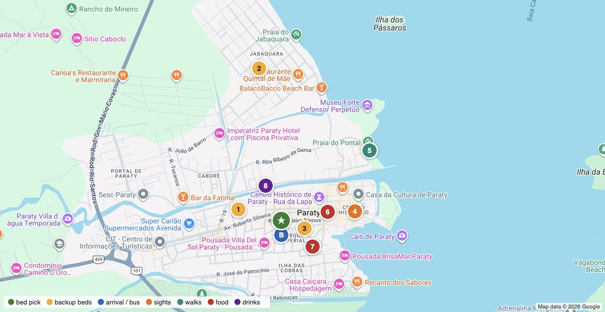
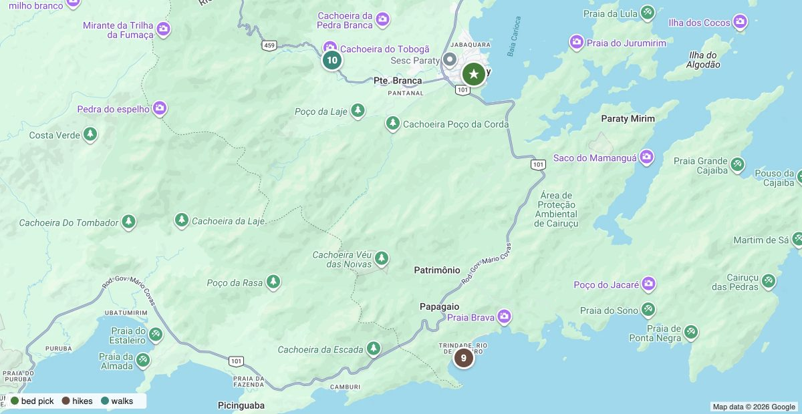

# 🇧🇷 Paraty

Part of the [LatAm itinerary](../itinerary.md) · region notes: [Brazil](brazil.md) · ← [Ilha Grande](ilha-grande.md) · [São Paulo](sao-paulo.md) →

> **Stop 3 · Day 7 → 8 · 1 night** 
> 🏞️ A colonial port with cobbled streets, and Trindade's beaches and rock pools a local bus away 
> 🛏️ **Girassol Hostel by Katita**, a bunk in a mixed dorm, $12 for 1 night 
> 🚌 **In:** Barcas ferry Abraão → Angra 10:00 + Colitur 12:40, Day 7 · **Out:** Reunidas 09:00 to São Paulo Tietê, Day 8

Rua do Comércio in the historic centre at dusk. Photo: Google Maps.

## 🗺️ Map

**In town:** ★ **[Girassol Hostel by Katita](https://www.google.com/maps?ftid=0x9d6d72fe746f21:0x94bffe19faff2c27)** (the pick, [book](https://www.booking.com/hotel/br/girassol-hostel-by-katita.html?checkin=2026-12-14&checkout=2026-12-15&group_adults=1&no_rooms=1&group_children=0&selected_currency=USD)) · **1** [Hostel Morada do Sol](https://www.google.com/maps?ftid=0x9d6d1e14e50239:0xd9051a233611aee9) (backup, [book](https://www.booking.com/hotel/br/morada-do-sol-paraty1.html?checkin=2026-12-14&checkout=2026-12-15&group_adults=1&no_rooms=1&group_children=0&selected_currency=USD)) · **2** [Hostel Oxê](https://www.google.com/maps?ftid=0x9d6d1932bbdb67:0x1c2d25ccbbed0f10) (backup 2, [book](https://www.hostelworld.com/hostels/p/337368/hostel-oxe/?from=2026-12-14&to=2026-12-15&guests=1)) · **3** [Casa Nossa Hospedagem Centro](https://www.google.com/maps?ftid=0x9d6d21ab31dfd1:0xbba1e4bf0a72147d) (private alt, [book](https://www.booking.com/hotel/br/vintage-paraty.html?checkin=2026-12-14&checkout=2026-12-15&group_adults=1&no_rooms=1&group_children=0&selected_currency=USD)) · **B** [Terminal Rodoviário](https://www.google.com/maps?ftid=0x9d6d203cde7cb7:0x19804df98bf3ef8a) · **4** [historic centre](https://www.google.com/maps?ftid=0x9d6d1f66cfa627:0x8599c16a8fd44eb1) [🚶 10 min](https://www.google.com/maps/dir/?api=1&origin=-23.220219,-44.719199&destination=-23.2194982,-44.7129314&travelmode=walking) · **5** [Praia do Pontal](https://www.google.com/maps?ftid=0x9d6d3afb60987b:0x7767723b1e5eea23) [🚶 20 min](https://www.google.com/maps/dir/?api=1&origin=-23.220219,-44.719199&destination=-23.2147408,-44.7116967&travelmode=walking) · **6** [Caramujo](https://www.google.com/maps?ftid=0x9d6d215a72d781:0x90f7f9607a55fe04) [🚶 6 min](https://www.google.com/maps/dir/?api=1&origin=-23.220219,-44.719199&destination=-23.2195492,-44.7152641&travelmode=walking) · **7** [Fino Sabor](https://www.google.com/maps?ftid=0x9d6d6f734a71d7:0xbf231a6470b7e41a) [🚶 7 min](https://www.google.com/maps/dir/?api=1&origin=-23.220219,-44.719199&destination=-23.222271,-44.7165614&travelmode=walking) · **8** [Cervejaria Caborê](https://www.google.com/maps?ftid=0x9d6d1b7f338b41:0x6ccd12d989f2f8bb) [🚶 7 min](https://www.google.com/maps/dir/?api=1&origin=-23.220219,-44.719199&destination=-23.2174932,-44.7205486&travelmode=walking)

**Around:** ★ Paraty · **9** Trindade: [Praia do Meio](https://www.google.com/maps?ftid=0x9d404728724acd:0x6816453017a418cb) [🚕 ≈ 38 min](https://www.google.com/maps/dir/?api=1&origin=-23.220219,-44.719199&destination=-23.3542,-44.724632&travelmode=driving), the [Cachadaço natural pool](https://www.google.com/maps?ftid=0x9d4144a7594cab:0x7011f1002b891e4) and [Pedra que Engole](https://www.google.com/maps?ftid=0x9d4047f72fe4c9:0x5c61424997460084) · **10** [Cachoeira do Tobogã](https://www.google.com/maps?ftid=0x9d6f28c075ea7b:0x11757d57b7da86f3) [🚕 ≈ 18 min](https://www.google.com/maps/dir/?api=1&origin=-23.220219,-44.719199&destination=-23.2134882,-44.7923124&travelmode=driving) (Penha)

🧭 The time after each place is from the ★ bed (Google Maps, 26 Nov): 🚶 walk · 🚌 bus · 🚕 taxi · 🚗 by road (tour or bus). Click it for the route.

**Open the live map:** [town](https://www.google.com/maps/@-23.2190,-44.7170,16z) · [area](https://www.google.com/maps/@-23.290,-44.750,12z)

## 📅 Day by day

| Day | Plan |
|---|---|
| **Day 7** | ⛴️ **10:00** ferry Abraão → Angra (~11:45), 🚌 **Colitur 12:40** → Paraty ~14:40. 🏖️ The **15:00** L25 bus to **Trindade**: Praia do Meio → **Cachadaço natural pool** and **Pedra que Engole**, back on the 18:00. Evening: the historic centre on foot. |
| **Day 8** | **(a) Recommended:** 🚌 the **09:00 Reunidas** to São Paulo (→ 15:40) for MASP's free Tuesday. **(b)** 💦 **Cachoeira do Tobogã** (L14 out 06:30, back 10:45), then the 13:40 bus. |

## 🔖 Book (one click)

Dates and 1 adult are pre-filled. The first channel listed was the cheapest when checked on 24 Nov. ⚠️ = time-sensitive.

**Beds** (Day 7 → 8, 1 night)

| | Where | Total | Location | From the bus terminal | Book |
|---|---|---:|:---:|---|---|
| ⭐ **Pick** | **Girassol Hostel by Katita** · bunk in a mixed dorm | **$12** | 9.7 | 🚶 4 min (260 m) from the bus station; centre 10 min on foot · [route](https://www.google.com/maps/dir/?api=1&origin=-23.2213543,-44.7191894&destination=-23.220219,-44.719199&travelmode=walking) | [Booking](https://www.booking.com/hotel/br/girassol-hostel-by-katita.html?checkin=2026-12-14&checkout=2026-12-15&group_adults=1&no_rooms=1&group_children=0&selected_currency=USD) |
| Backup | **Hostel Morada do Sol Paraty** · bed in an 8-bed mixed dorm | $17 | 9.1 | 🚶 10 min (700 m) from the bus station; centre 15 min on foot · [route](https://www.google.com/maps/dir/?api=1&origin=-23.2213543,-44.7191894&destination=-23.219339,-44.722859&travelmode=walking) | [Booking](https://www.booking.com/hotel/br/morada-do-sol-paraty1.html?checkin=2026-12-14&checkout=2026-12-15&group_adults=1&no_rooms=1&group_children=0&selected_currency=USD) |
| Backup 2 | **Hostel Oxê** · bed in a 7-bed mixed ensuite dorm | $15.96 + fee | 9.0 | ⚠️ 🚕 ≈ 8 min from the bus station (walk 31 min, 2.3 km); **30 min walk to the centre, no bus in Google Maps** · [route](https://www.google.com/maps/dir/?api=1&origin=-23.2213543,-44.7191894&destination=-23.2083075,-44.7210864&travelmode=driving) | [Hostelworld](https://www.hostelworld.com/hostels/p/337368/hostel-oxe/?from=2026-12-14&to=2026-12-15&guests=1) · [Agoda](https://www.agoda.com/partners/partnersearch.aspx?hid=83072444&checkin=2026-12-14&checkout=2026-12-15&NumberofAdults=1&Rooms=1) |
| Private alt | **Casa Nossa Hospedagem Centro** · economy double | $25 | 9.8 | 🚶 4 min (270 m) from the bus station; centre 7 min on foot · [route](https://www.google.com/maps/dir/?api=1&origin=-23.2213543,-44.7191894&destination=-23.2208649,-44.7172209&travelmode=walking) | [Booking](https://www.booking.com/hotel/br/vintage-paraty.html?checkin=2026-12-14&checkout=2026-12-15&group_adults=1&no_rooms=1&group_children=0&selected_currency=USD) |

**Transport**

| | Leg | When | Price | Book |
|---|---|---|---:|---|
| In | **Barcas Rio** ferry Abraão → Angra | **Day 7 10:00** → ~11:45 | R$ 20.50 | [Barcas Rio timetable](https://barcasrio.com.br/linhas-horarios-e-tarifas/) |
| In | **Colitur L101** Angra → Paraty | **Day 7 12:40** → ~14:40 | R$ 27.50 | [Colitur timetable](https://site.colitur.com.br/) |
| Day trip | **Colitur L25** Paraty → Trindade | Mon 14: out 15:00, back 18:00 | R$ 5.00 | [Colitur timetable](https://site.colitur.com.br/) |
| Out | **Reunidas Paulista** Paraty → São Paulo Tietê | **Day 8 09:00 → 15:40** | **R$ 118.48** ($19.89) | [Mobifácil](https://www.mobifacil.com.br/passagem-de-onibus/terminal-rodoviario-de-paraty/sao-paulo-todos-sp) |

How to read these tables

- **Location** is the guests' location score on Booking.com. The target is 9.0 or higher, and ⚠️ marks one below 9.0. *(HW)* means Hostelworld's location rating, used where a property isn't on Booking.
- **From the bus terminal** comes from Google Maps on 24 Nov: the property found on Maps and routed from where you arrive at midday on the check-in date. The **route** link opens the same route.
- Symbols: 🚶 walk · 🚌 public transport · 🚕 taxi/rideshare · 🥾 hike only · ⚠️ far from the centre with no bus · ℹ️ outside the centre but on a bus line.

## 🚌 Getting here: Ilha Grande → Paraty, Day 7

- **Barcas Rio ferry Abraão → Angra at 10:00** (daily), R$ 20.50 ✅ barcasrio. It arrives ~11:45; then walk or taxi 1.5 km to the rodoviária.
- **Colitur L101 Angra → Paraty, R$ 27.50, ~2 h** ✅ site.colitur.com.br.
  - Weekday departures from Angra: 04:40, 05:40, 07:00, 08:00, 09:20, 11:20, **12:40**, 14:00, 15:20, 16:40, 18:00, 20:00.
  - Take the **12:40**, arriving ~14:40.
- **Total R$ 48 ($8.06).** A shared boat + van is ≈ $65 (Trip.com listing) and about 3 h.

## 🛏️ Where to sleep

### ⭐ Pick: Girassol Hostel by Katita
- **Unit:** a bunk in a mixed dorm. Live-checked 25 Nov, chosen for location.
- **Price:** **$12 for 1 night on Booking** ("flexible to reschedule"; free cancellation costs $1 more). Not checked on Hostelworld or Agoda.
- **Reviews:** Booking 9.0 (297; **2% below 7**), location **9.7**.
- **Where:** 300 m (4 min on foot) from the rodoviária and 10 min from the historic centre.
- **Checks:** ✅ "good kitchen facilities, very clean, spacious bedrooms"; host Katita praised. It's on a busy street, so bring earplugs; there's little common space. No party reports.

### Backup: Hostel Morada do Sol Paraty
- **Unit:** a bed in an 8-bed mixed dorm.
- **Price:** **$17 for 1 night on Booking** ($18 with free cancellation).
- **Reviews:** Booking 9.1 (453; **2% below 7**), location **9.1**; Wi-Fi 9.9.
- **Where:** 10 min on foot from the rodoviária, 15 min from the historic centre.
- **Checks:** ✅ kitchen; "very quiet", silence kept after 22:00 (Nov 2026 reviews).

### Backup 2: Hostel Oxê
- **Unit:** a bed in a 7-bed mixed ensuite dorm. R. Frei Henrique de Coimbra 40, Jabaquara. The pick until 25 Nov; ⚠️ a 30-min walk from the centre with no bus.
- **Price:** **Hostelworld $15.96** + fee for 1 night. Booking $19 (free cancellation to Day 0, pay at the property); Agoda $19.93.
- **Reviews:** Booking 9.5 (105; **2% below 7**), location 9.0. Hostelworld 98% (29; all 11 written reviews are 80+).
- **Where:** ~1.4 km from the historic centre and the rodoviária, near Jabaquara beach.
- **Checks:**
  - AC and a full kitchen.
  - Small and quiet.
  - In early 2026 a dorm door didn't close properly, which let mosquitoes in. Bring repellent.
  - No curtains mentioned.

### Also: Hostel Agatha
- **Unit:** a bed in a 6-bed mixed dorm. R. André Rebouças 576, ~1 km from the centre. ⚠️ Location 8.5.
- **Price:** **$12 for 1 night on Booking**, breakfast included. Free cancellation **ends 26 Nov**, and you pay online. Hostelworld $17.00.
- **Reviews:** Booking 9.4 (103; **1% below 7**), location 8.5. Hostelworld 94% (7).
- **Checks:** kitchen; quiet. An Oct 2026 review calls the neighbourhood run-down.

### Private alt (location first): Casa Nossa Hospedagem Centro
- Economy double. Booking 9.2 (89; 6% below 7), location 9.8.
- **$25** from the room table, Booking (free cancellation to 26 Nov). ~300 m from the rodoviária and 500 m from the historic centre. No AC.
- **Next best:** Pousada Caravelas, double, **$27**, location 9.7 (471 reviews; 4.5% below 7). Partly refundable, pay at the property. One Nov 2026 review complains about cleanliness.

**Not chosen:** Casa Viva ($35, happy hour), Che Lagarto (party), Vibe and Leo's Clan (Hostelworld 71–76), Remo (8 km out).

## 🌳 Things to do (free and outdoors first)

<table>
<tr>
<td width="50%" valign="top"> <b><a href="https://www.google.com/maps?ftid=0x9d4144a7594cab:0x7011f1002b891e4">Cachadaço natural pool</a></b>, Trindade · free · Day 7 20 min of forest trail from Praia do Meio.</td>
<td width="50%" valign="top"> <b><a href="https://www.google.com/maps?ftid=0x9d404728724acd:0x6816453017a418cb">Praia do Meio</a></b>, Trindade · free · <a href="https://www.google.com/maps/dir/?api=1&origin=-23.220219,-44.719199&destination=-23.3542,-44.724632&travelmode=driving">🚕 ≈ 38 min</a> Colitur L25 from the rodoviária, R$ 5.00. The walk to Cachadaço starts here.</td>
</tr>
<tr>
<td width="50%" valign="top"> <b><a href="https://www.google.com/maps?ftid=0x9d4047f72fe4c9:0x5c61424997460084">Pedra que Engole</a></b>, Trindade · free A waterfall pool, on the same afternoon.</td>
<td width="50%" valign="top"> <b><a href="https://www.google.com/maps?ftid=0x9d6f28c075ea7b:0x11757d57b7da86f3">Cachoeira do Tobogã</a></b> · free · option (b), Day 8 · <a href="https://www.google.com/maps/dir/?api=1&origin=-23.220219,-44.719199&destination=-23.2134882,-44.7923124&travelmode=driving">🚕 ≈ 18 min</a> A natural rock waterslide. Colitur L14 "Penha", R$ 5.00.</td>
</tr>
<tr>
<td width="50%" valign="top"> <b><a href="https://www.google.com/maps?ftid=0x9d6d1f66cfa627:0x8599c16a8fd44eb1">Historic centre</a></b> on foot · free · <a href="https://www.google.com/maps/dir/?api=1&origin=-23.220219,-44.719199&destination=-23.2194982,-44.7129314&travelmode=walking">🚶 10 min</a> The cobbled streets flood at high tide.</td>
<td width="50%" valign="top"> <b><a href="https://www.google.com/maps?ftid=0x9d6d3afb60987b:0x7767723b1e5eea23">The Pontal</a></b> · free · <a href="https://www.google.com/maps/dir/?api=1&origin=-23.220219,-44.719199&destination=-23.2147408,-44.7116967&travelmode=walking">🚶 20 min</a> Sunset across the bay.</td>
</tr>
</table>

- **Day 7 afternoon: Trindade.** Colitur L25 from the rodoviária, **R$ 5.00** ✅ colitur. Weekdays it leaves hourly 05:15–17:00, then 19:00 and 22:30. Returns run hourly to 18:00, then 22:00 and 23:15.
  - Take the 15:00 out and come back on the 18:00.
  - Walk Praia do Meio → **Cachadaço natural pool** (20 min of forest trail) and see the **Pedra que Engole** waterfall pool. All free.
- **Day 8, pick one:**
  - **(a) Recommended:** the 09:00 bus to São Paulo, then MASP's free Tuesday (see [São Paulo](sao-paulo.md)).
  - **(b) Cachoeira do Tobogã** (a natural rock waterslide, free). Colitur L14 "Penha", R$ 5.00 ✅: out **06:30**, back **10:45** (the 08:00 runs only to Pantanal). Then take the 13:40 bus.
- **Historic centre on foot:** free. The cobbled streets flood at high tide; sunset at the Pontal.

**From Lonely Planet** (*South America on a Shoestring*):
- **Tobogã tips (LP):**
  - Get off the Penha bus by the church and follow the signs about 100 m downhill.
  - **Slide sitting down.** Signs warn against standing up, though local teenagers do it.
  - Bar do Tarzan is across the swing bridge.
- **Bay islands by schooner:** boats leave daily from the Cais de Turismo at the south-east edge of the centre, ≈ R$ 65 a person (LP). Paid; Trindade is the free beach option.
- **Backlog (LP):** Paraty Explorer, on Jabaquara beach, runs sea-kayak trips (from ≈ R$ 170) and guided hikes. Two of the hikes are to the Cachoeira Melancia in the Serra da Bocaina (≈ R$ 200) and to the Pão de Açúcar do Mamanguá above the Mamanguá fjord (≈ R$ 300). Neither fits in one night.
- **Evening:** Margarida Café on Praça do Chafariz has live music most nights (MPB, bossa nova, jazz) (LP); it's still on Google Maps.

## 🍽️ Eat and drink

<table>
<tr>
<td width="50%" valign="top"> <b><a href="https://www.google.com/maps?ftid=0x9d6d215a72d781:0x90f7f9607a55fe04">Restaurante Caramujo</a></b> · <a href="https://www.google.com/maps/dir/?api=1&origin=-23.220219,-44.719199&destination=-23.2195492,-44.7152641&travelmode=walking">🚶 6 min</a> "Monte seu prato" and the local <i>azul-marinho</i> fish stew. The photo shows a seafood stew at Caramujo, not necessarily the azul-marinho.</td>
<td width="50%" valign="top"> <b><a href="https://www.google.com/maps?ftid=0x9d6d6f734a71d7:0xbf231a6470b7e41a">Fino Sabor</a></b> · self-service · <a href="https://www.google.com/maps/dir/?api=1&origin=-23.220219,-44.719199&destination=-23.222271,-44.7165614&travelmode=walking">🚶 7 min</a> A quilo plate here is about R$ 35–45 ($6–8) ≈.</td>
</tr>
<tr>
<td width="50%" valign="top"> <b><a href="https://www.google.com/maps?ftid=0x9d6d1b7f338b41:0x6ccd12d989f2f8bb">Cervejaria Caborê</a></b> · craft beer · <a href="https://www.google.com/maps/dir/?api=1&origin=-23.220219,-44.719199&destination=-23.2174932,-44.7205486&travelmode=walking">🚶 7 min</a> Next to the rodoviária; brews its own beer (tasting flight).</td>
<td width="50%" valign="top"><b>Cachaça tastings</b> Cachaça shops in the centre give tastings ≈.</td>
</tr>
</table>

- **Fino Sabor** (self-service).
- **Restaurante Caramujo:** "monte seu prato" and the local *azul-marinho* fish stew.
- A quilo plate here is about R$ 35–45 ($6–8) ≈.
- **Cervejaria Caborê**, ≈ 450 m (6 min on foot) north of the rodoviária, brews its own beer (tasting flight).
- Cachaça shops in the centre give tastings ≈.

**Budget picks from LP** (both still on Google Maps, 26 Nov):
- **[Maria Fulô Bistrô](https://www.google.com/maps?ftid=0x9d6d21c052f8a5:0x38b4dff45f39a7b2)**, R. Presidente Pedreira, just outside the historic centre. It serves a healthy **prato feito at lunch (≈ R$ 26, LP)** and filled tapiocas in the evening. LP gives its hours as Mon–Sat 12:00–23:00, so Monday evening works.
- **[Quiosque Dito e Feito](https://www.google.com/maps?ftid=0x9d6d1f9f2c717d:0x924e63db16a92311)**, a beach kiosk on Praia do Pontal (10:00–18:00, LP). It's where locals send you for cheap fresh fish or a moqueca. Portions are huge, but **half portions** are available on request (LP), which suits a solo traveller.

## ℹ️ Good to know
- **Bus ticket:** Mobifácil's checkout fee and whether it needs a CPF are unknown. If it does, buy at the Paraty rodoviária counter with your passport on Monday evening.
- **Tides:** the historic centre's cobbled streets flood at high tide.
- **High season (LP):** from December to February rooms fill up and prices double. Your bed is already chosen, so book it.
- **ATMs (LP):** Bradesco and Banco do Brasil are two blocks north of the bus station on Av. Roberto Silveira.
- **Tourist office (LP):** the CIT is at Av. Roberto Silveira 1, at the entrance to the historic centre (09:00–21:00).

## 🚌 Leaving: Paraty → São Paulo Tietê, Day 8

**Reunidas Paulista** ✅ mobifacil.com.br (Reunidas' own sales site):

| Departure → arrival | Class | Fare |
|---|---|---|
| **09:00 → 15:40** | Convencional | **R$ 118.48 ($19.89)** |
| 13:40 → 20:20 | Semi-leito | R$ 130.12 ($21.84) |
| 14:40 → 21:20 | Semi-leito | R$ 130.12 ($21.84) |
| 22:40 → 05:20 | Semi-leito | R$ 130.12 |
| 23:10 → 05:50 | Leito | R$ 241.66 |

- The checkout fee and whether Mobifácil needs a CPF are unknown. If it does, buy at the Paraty rodoviária counter with your passport on Monday evening.
- Take the 09:00 for MASP's free Tuesday; the 13:40 if you do the Tobogã in the morning.

---
Photos: Google Maps contributors (Rua do Comércio, Cachadaço, Praia do Meio, Pedra que Engole, Cachoeira do Tobogã, Praia do Pontal, Caramujo, Fino Sabor, Cervejaria Caborê). Wikimedia Commons: <a href="https://commons.wikimedia.org/wiki/File:Rua_alagada_Centro_Hist%C3%B3rico_de_Paraty_RJ.jpg">Rua alagada, Centro Histórico de Paraty</a> (Nelson Alexandre Brolese, CC BY-SA 4.0).
