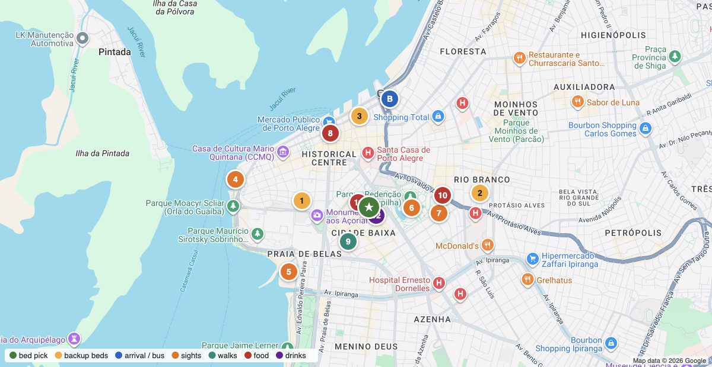
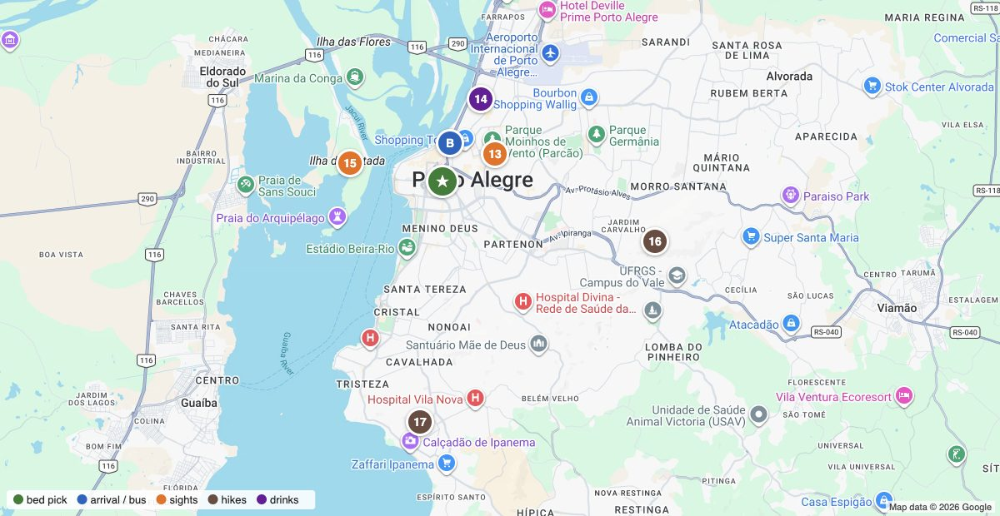

# 🇧🇷 Porto Alegre

Part of the [LatAm itinerary](../itinerary.md) · region notes: [Brazil](brazil.md) · ← [Florianópolis](florianopolis.md) · [Punta del Diablo](punta-del-diablo.md) →

> **Stop 8 · Day 17 → 19 · 2 nights · 🎄 Christmas** 
> 🏞️ Gaúcho capital on the Guaíba: a riverside promenade with big sunsets, leafy parks, a bohemian bar district and a craft-beer scene 
> 🛏️ **Nick Hostel Cidade Baixa**, a bed in a men-only dorm, $21 for 2 nights (location 9.1) 
> 🚌 **In:** Nordeste from Florianópolis, Day 17 08:00 → 14:25 · **Out:** Planalto night bus to Chuí, Day 19 23:30 → Day 20 09:00

Sunset over the Guaíba from Trecho 2 of the Orla (5 on the map). Photo: Google Maps.

## 🗺️ Map

**In town:** ★ **[Nick Hostel Cidade Baixa](https://www.google.com/maps?ftid=0x95197904f4d3a21d:0x3624790149d6e096)** (the pick, [book](https://www.booking.com/hotel/br/hostel-nick-guest-house-porto-alegre.html?checkin=2026-12-24&checkout=2026-12-26&group_adults=1&no_rooms=1&group_children=0&selected_currency=USD)) · **1** [Tao Station 752](https://www.google.com/maps?ftid=0x951979612397727d:0xb2a010fccd5171eb) (backup, [book](https://www.booking.com/hotel/br/tao-station-752.html?checkin=2026-12-24&checkout=2026-12-26&group_adults=1&no_rooms=1&group_children=0&selected_currency=USD)) · **2** [Espaço Semente Poa Lírio](https://www.google.com/maps?ftid=0x9519784c974b1555:0x4860c6de4de8fbb7) (private alt, [book](https://www.booking.com/hotel/br/espaco-semente-poa.html?checkin=2026-12-24&checkout=2026-12-26&group_adults=1&no_rooms=1&group_children=0&selected_currency=USD)) · **3** [Rede Andrade Mauá Express](https://www.google.com/maps?ftid=0x9519790970433c93:0xab37b741dc40fa2b) (private by the bus station, [book](https://www.booking.com/hotel/br/express-maua.html?checkin=2026-12-24&checkout=2026-12-26&group_adults=1&no_rooms=1&group_children=0&selected_currency=USD)) · **B** [Rodoviária (bus station)](https://www.google.com/maps?ftid=0x951979007841bbf1:0x18677d9ddd677e8a) · **4** [Orla Trecho 1 + Usina do Gasômetro](https://www.google.com/maps?ftid=0x951979c26ce10f0b:0xdbf2dec296e81745) [🚌 24 min (bus 3462)](https://www.google.com/maps/dir/?api=1&origin=-30.036673,-51.2222934&destination=-30.0331819,-51.2416117&travelmode=transit) · **5** [Orla Trecho 2](https://www.google.com/maps?ftid=0x95197988d0b82aeb:0xeb32f4b9ff3b2942) [🚌 24 min (bus 173)](https://www.google.com/maps/dir/?api=1&origin=-30.036673,-51.2222934&destination=-30.0448011,-51.2338546&travelmode=transit) · **6** [Parque Farroupilha (Redenção)](https://www.google.com/maps?ftid=0x951978534879152d:0xa9522f5e1a9af85b) [🚶 13 min](https://www.google.com/maps/dir/?api=1&origin=-30.036673,-51.2222934&destination=-30.0367666,-51.2160747&travelmode=walking) · **7** [Feira Ecológica do Bom Fim](https://www.google.com/maps?ftid=0x951979210349d995:0xb29bfd9b22469f83) [🚶 18 min](https://www.google.com/maps/dir/?api=1&origin=-30.036673,-51.2222934&destination=-30.0374579,-51.2121852&travelmode=walking) (Saturday mornings) · **8** [Mercado Público](https://www.google.com/maps?ftid=0x951978fd87d8621b:0xd0413b8f8b08637a) [🚶 23 min](https://www.google.com/maps/dir/?api=1&origin=-30.036673,-51.2222934&destination=-30.0274124,-51.2278518&travelmode=walking) · **9** [Rua João Alfredo](https://www.google.com/maps?ftid=0x951978fe149a32a1:0xa2bd22556c99d0c3) [🚶 9 min](https://www.google.com/maps/dir/?api=1&origin=-30.036673,-51.2222934&destination=-30.0409919,-51.2253161&travelmode=walking) (Cidade Baixa murals and bars) · **10** [Lancheria do Parque](https://www.google.com/maps?ftid=0x95197852b322c2ab:0x51312e5d5632d0b1) [🚶 19 min](https://www.google.com/maps/dir/?api=1&origin=-30.036673,-51.2222934&destination=-30.0351758,-51.2116156&travelmode=walking) · **11** [Cavanhas](https://www.google.com/maps?ftid=0x95197900fc1698f9:0xdb500fb85ff0b3f8) [🚶 4 min](https://www.google.com/maps/dir/?api=1&origin=-30.036673,-51.2222934&destination=-30.0360966,-51.2238678&travelmode=walking) · **12** [Mambembe Brewplace](https://www.google.com/maps?ftid=0x9519795b26b37fc5:0x56cc17ac31917be2) [🚶 4 min](https://www.google.com/maps/dir/?api=1&origin=-30.036673,-51.2222934&destination=-30.0377488,-51.2212537&travelmode=walking)

**Around:** ★ Nick Hostel · **B** Rodoviária · **13** [Parque Moinhos de Vento (Parcão)](https://www.google.com/maps?ftid=0x951979b57112987b:0x4df4b09c004aa2b0) [🚌 30 min (bus 264 + 50.2)](https://www.google.com/maps/dir/?api=1&origin=-30.036673,-51.2222934&destination=-30.027128,-51.2007469&travelmode=transit) · **14** [4Beer 4º Distrito taproom](https://www.google.com/maps?ftid=0x951979916c7f2c97:0x4fc56402bc10dd41) [🚌 24 min (bus 397 + Trensurb train)](https://www.google.com/maps/dir/?api=1&origin=-30.036673,-51.2222934&destination=-30.0074091,-51.2067595&travelmode=transit) (10 min by train to **B**) · **15** [Ilha da Pintada](https://www.google.com/maps?ftid=0x95197eca9751d393:0xd613f329e2408798) [🚌 1 h 1 min (bus 3462 + bus 718)](https://www.google.com/maps/dir/?api=1&origin=-30.036673,-51.2222934&destination=-30.0301585,-51.2605632&travelmode=transit) · **16** [Morro Santana trail](https://www.google.com/maps?ftid=0x95199d9ce0c7965b:0x8132d787a71c8c46) [🚌 1 h 14 min (bus 360)](https://www.google.com/maps/dir/?api=1&origin=-30.036673,-51.2222934&destination=-30.0582439,-51.1348577&travelmode=transit) · **17** [Morro do Osso park](https://www.google.com/maps?ftid=0x951983ad971440a3:0x43e0f11e99fb67de) [🚌 51 min (bus 2672)](https://www.google.com/maps/dir/?api=1&origin=-30.036673,-51.2222934&destination=-30.1226055,-51.231844&travelmode=transit)

🧭 The time after each place is from the ★ bed (Google Maps, 27 Nov): 🚶 walk · 🚌 bus or train · 🚕 taxi. Click it for the route. A city-bus fare was **R$5.30** in Google's routes.

**Open the live map:** [centre](https://www.google.com/maps/@-30.035,-51.222,14z) · [area](https://www.google.com/maps/@-30.05,-51.19,12z)

## 📅 Day by day

| Day | Plan |
|---|---|
| **Day 17** · 🎄 Christmas Eve | 🚌 **Nordeste 08:00** from Florianópolis, arriving 14:25. 🛒 Straight to the **Mercado Público** (open until ≈ 17:00 on Christmas Eve) for food for two days. 🌅 Sunset on the **Orla do Guaíba**, then cook a Christmas Eve dinner in the hostel kitchen. |
| **Day 18** · 🎄 Christmas Day | Most shops and restaurants shut; buses run the Sunday timetable. 🥾 **Morro Santana**, the city's highest hill (bus 360, 1 h 14 min), in the morning. Afternoon in **Redenção** park, sunset at the **Usina do Gasômetro** end of the Orla. |
| **Day 19** | 🥬 **Feira Ecológica do Bom Fim** (07:00–13:00) on the edge of Redenção, then 🌳 **Parcão** or the 🚌 bus to **Ilha da Pintada**. Check out at 12:00 (leave the bag; see Leaving). Evening: a xis in **Cidade Baixa** and a beer at **4Beer** or **Mambembe**, then 🚕 to the Rodoviária for the **23:30 Planalto** to Chuí. |

## 🔖 Book (one click)

Dates and 1 adult are pre-filled. Prices were checked on 27 Nov. ⚠️ = time-sensitive.

**Beds** (Day 17 → 19, 2 nights)

| | Where | Total | Location | From the bus station | Book |
|---|---|---:|:---:|---|---|
| ⭐ **Pick** | **Nick Hostel Cidade Baixa** · bed in a 6-bed **men-only** dorm, kitchen | **$21** | 9.1 | 🚌 26 min (bus 397) · 🚶 33 min (2.4 km) · 🚕 10 min · [route](https://www.google.com/maps/dir/?api=1&origin=-30.0230675,-51.2192743&destination=-30.036673,-51.2222934&travelmode=transit) | [Booking](https://www.booking.com/hotel/br/hostel-nick-guest-house-porto-alegre.html?checkin=2026-12-24&checkout=2026-12-26&group_adults=1&no_rooms=1&group_children=0&selected_currency=USD) · [Hostelworld](https://www.hostelworld.com/hostels/p/336342/nick-hostel-cidade-baixa/?from=2026-12-24&to=2026-12-26&guests=1) ($26.34) |
| Backup | **Tao Station 752** · bed in a mixed dorm, adults-only guesthouse, big kitchen | $29 | 9.5 | 🚌 23 min (bus 397) · 🚶 39 min (2.8 km) · 🚕 8 min · [route](https://www.google.com/maps/dir/?api=1&origin=-30.0230675,-51.2192743&destination=-30.0358851,-51.2319689&travelmode=transit) | [Booking](https://www.booking.com/hotel/br/tao-station-752.html?checkin=2026-12-24&checkout=2026-12-26&group_adults=1&no_rooms=1&group_children=0&selected_currency=USD) |
| Private alt | **Espaço Semente Poa Lírio** · single room with balcony, homestay, kitchen use | $29 | 10 | 🚌 25 min (bus 491) · 🚶 34 min (2.4 km) · 🚕 10 min · [route](https://www.google.com/maps/dir/?api=1&origin=-30.0230675,-51.2192743&destination=-30.0349373,-51.2062411&travelmode=transit) | [Booking](https://www.booking.com/hotel/br/espaco-semente-poa.html?checkin=2026-12-24&checkout=2026-12-26&group_adults=1&no_rooms=1&group_children=0&selected_currency=USD) |
| By the bus station | **Rede Andrade Mauá Express** · single room, breakfast, 24-h desk | $38 | 9.0 | 🚶 14 min (1.0 km) · [route](https://www.google.com/maps/dir/?api=1&origin=-30.0230675,-51.2192743&destination=-30.0252177,-51.2237105&travelmode=walking) | [Booking](https://www.booking.com/hotel/br/express-maua.html?checkin=2026-12-24&checkout=2026-12-26&group_adults=1&no_rooms=1&group_children=0&selected_currency=USD) |
| 🎄 Holiday backup | **Stay in Florianópolis over Christmas** and come on Day 19 | see [Florianópolis](florianopolis.md) | | NS da Penha 14:00 → 21:00, then the 23:30 Planalto | [ClickBus](https://www.clickbus.com.br/onibus/florianopolis-sc/porto-alegre-rs?departureDate=2026-12-26) |

**Transport**

| | Leg | When | Price | Book |
|---|---|---|---:|---|
| In | 🚌 **Nordeste** · Florianópolis (Rita Maria) → Porto Alegre Rodoviária, semi-leito | **Day 17 08:00 → 14:25** (6 h 25; 40 seats free) | **R$178.99** (≈ $30) | [ClickBus](https://www.clickbus.com.br/onibus/florianopolis-sc/porto-alegre-rs?departureDate=2026-12-24) |
| In (alt) | 🚌 **Solimões** semi-leito / **BrasilSul** leito | Day 17 08:30 → 14:55 / 08:45 → 14:50 | R$170.99 (≈ $28.70) / R$185.99 (≈ $31.20) | [ClickBus](https://www.clickbus.com.br/onibus/florianopolis-sc/porto-alegre-rs?departureDate=2026-12-24) |
| ⚠️ Out | 🚌 **Planalto RS** · Porto Alegre Rodoviária → Chuí | **Day 19 23:30 → Day 20 09:00** (9 h 30) | **R$267.95** convencional (≈ $45) · executivo R$347.95 (≈ $58.40) · leito R$455.15 | [ClickBus](https://www.clickbus.com.br/onibus/porto-alegre-rs/chui-rs?departureDate=2026-12-26) |

How to read these tables

- **Location** is the guests' location score on Booking.com (target 9.0 or higher).
- **From the bus station** comes from Google Maps (27 Nov), routed from the Rodoviária at 14:30 on Christmas Eve.
- Totals are Booking's own USD for 2 nights, 1 adult (27 Nov). Hostelworld is shown where it lists the property. Agoda wasn't checked.
- BRL → USD at ≈ R$5.96 per US$ (the rate the other guides use); ClickBus quotes only BRL.

## 🚌 Getting here: Florianópolis → Porto Alegre, Day 17 (Christmas Eve)

**Take a morning bus:** on Christmas Eve, shops close in the afternoon. All direct, from Florianópolis' Rita Maria bus station to Porto Alegre's Rodoviária, ✅ ClickBus (27 Nov):

| Leaves | Arrives | Operator · class | Fare | Seats free |
|---|---|---|---:|---:|
| 07:00 | 15:55 | BrasilSul · semi-leito (8 h 55, slow) | R$210.06 | 48 |
| **08:00** | **14:25** | **Nordeste · semi-leito** | **R$178.99** | 40 |
| 08:30 | 14:55 | Solimões · semi-leito (leito R$266.44) | **R$170.99** | ≈ 3–6 per segment |
| 08:45 | 14:50 | BrasilSul · leito (cama R$302.99) | R$185.99 | 23 |
| 10:30 | 16:55 | Nordeste · semi-leito | R$178.99 | 35 |
| 12:00 | 18:25 | Nordeste · semi-leito (individual R$224.99) | R$198.99 | 32 |
| 13:15 | 19:30 | BrasilSul · leito | R$204.99 | 23 |
| 13:30 | 19:55 | Nordeste · semi-leito | R$178.99 | 40 |
| 14:00 | 20:20 | Solimões · semi-leito | R$170.99 | ≈ 4–5 per segment |
| 15:10 | 21:15 | BrasilSul · leito | R$204.99 | 19 |

- **Pick: Nordeste 08:00 → 14:25.** From Pequi Hostel in Lagoa, bus 2120 to Rita Maria takes 44 min, so leave Lagoa by ≈ 07:00.
- **Overnight instead:** Expresso NS da Penha 00:30 → 07:00 (R$158.97, the cheapest) or Nordeste 01:45 → 08:25 (R$178.99). These cost a night's sleep in Florianópolis.
- **NS da Penha's 14:00** (R$164.59 on Day 19) **isn't on sale for Day 17**. Eucatur and Santo Anjo don't sell this route on ClickBus.
- **From the Rodoviária to the hostel:** 🚕 Uber ≈ 10 min, or bus 397 (26 min). Walking takes 33 min through the Centro; with a bag, take the car.

## 🛏️ Where to sleep

Porto Alegre has few hostels: 7 on Booking (none above 8.8) and 3 on Hostelworld with beds on these dates. On 27 Nov nothing was close to selling out: 71 places rated 8+ under ≈ $35 a night were free.

### ⭐ Pick: Nick Hostel Cidade Baixa
- **Unit:** bed in a **6-bed men-only dorm**. **$21 for 2 nights on Booking** (27 Nov); Hostelworld $26.34.
- **Reviews:** Booking **8.3** (356 reviews; 8 % below 7), **location 9.1**. The 25 newest reviews (Jul–Nov 2026) average 8.6, mostly 10s.
- **Party check:** reviews describe "a very quiet street" and "super calm" despite the bar district, with clear house rules. One 2025 review complained about loud talk in the kitchen.
- **Kitchen:** "fully equipped kitchen" (Booking); Hostelworld lists self-catering. ⚠️ **Privacy curtains aren't confirmed**, so ask.
- **Hours:** check-in 14:00–23:00, check-out by 12:00.
- **Where:** Rua Sofia Veloso 80, Cidade Baixa: 4 min from Cavanhas and Mambembe, 13 min from Redenção.

### Backup: Tao Station 752
- Bed in a mixed dorm, **$29** on Booking. **8.8** (288 reviews; 3 % below 7), **location 9.5**.
- An **adults-only guesthouse** in an old townhouse in the Centro Histórico (Rua Demétrio Ribeiro 752). Reviewers praise the big, equipped kitchen and the quiet.
- **No reception:** the host runs it by WhatsApp. Check-in 14:00–23:00, out by 11:30. One Sep 2026 review complained of mould.

### Private alt (location first): Espaço Semente Poa Lírio
- **Single room with a balcony, $29 for 2 nights** on Booking. **9.1** (35 reviews, none below 7), **location 10**.
- A homestay in Rio Branco, a block from Redenção and the Araújo Vianna auditorium. Guests mention the kitchen and coffee; quiet.
- Check-in 14:00–20:00 (tell the host your bus), out 08:00–11:00.
- **Closer to the night bus:** Rede Andrade Mauá Express, a single with breakfast, **$38**, 8.7 (622; 4 %), location 9.0, 14 min on foot from the Rodoviária.

**Not chosen:** POA Eco Hostel is the cheapest ($20 on Booking, $25.64 on Hostelworld; 8.2, 703 reviews, location 9.4; pool, 24-h desk). But 8 of its 25 newest reviews are below 7 (dirty bathrooms and kitchen), and reviewers note that the beds have no curtains. Altitude Hostel (7.6) has similar complaints. Man's Place (Hostelworld, 4 reviews) has no kitchen.

### 🎄 Holiday backups
- **Shifted dates:** keep the Florianópolis bed over Christmas and come on Day 19: **NS da Penha 14:00 → 21:00, R$164.59** (✅ ClickBus, 26 Nov), then the same 23:30 Planalto. That's 2 h 30 to change buses at the Rodoviária.
- **A hotel that won't sell out:** Mauá Express (above). On 27 Nov, Booking still had 71 places rated 8+ free for these dates.

## 🌳 Things to do (free and outdoors first)

<table>
<tr>
<td width="50%" valign="top"> <b><a href="https://www.google.com/maps?ftid=0x951979c26ce10f0b:0xdbf2dec296e81745">Orla do Guaíba + Usina do Gasômetro</a></b> · free · <a href="https://www.google.com/maps/dir/?api=1&origin=-30.036673,-51.2222934&destination=-30.0331819,-51.2416117&travelmode=transit">🚌 24 min (bus 3462)</a> The riverside promenade: Trecho 1 by the old power station, then Trecho 2 and Parque Jaime Lerner south. The city's sunset spot.</td>
<td width="50%" valign="top"> <b><a href="https://www.google.com/maps?ftid=0x951978534879152d:0xa9522f5e1a9af85b">Parque Farroupilha (Redenção)</a></b> · free · <a href="https://www.google.com/maps/dir/?api=1&origin=-30.036673,-51.2222934&destination=-30.0367666,-51.2160747&travelmode=walking">🚶 13 min</a> The big central park, with a lake, palms and shade. Open on Christmas Day.</td>
</tr>
<tr>
<td width="50%" valign="top"> <b><a href="https://www.google.com/maps?ftid=0x95199d9ce0c7965b:0x8132d787a71c8c46">Morro Santana</a></b> · free · self-guided trail · <a href="https://www.google.com/maps/dir/?api=1&origin=-30.036673,-51.2222934&destination=-30.0582439,-51.1348577&travelmode=transit">🚌 1 h 14 min (bus 360)</a> The highest hill in the city, with grassland and views over the east side. Start of the 80-km "Caminho dos Morros".</td>
<td width="50%" valign="top"> <b><a href="https://www.google.com/maps?ftid=0x95197eca9751d393:0xd613f329e2408798">Ilha da Pintada</a></b> · two bus fares · <a href="https://www.google.com/maps/dir/?api=1&origin=-30.036673,-51.2222934&destination=-30.0301585,-51.2605632&travelmode=transit">🚌 1 h 1 min (bus 3462 + bus 718)</a> A fishing island in the Jacuí delta, with the skyline across the water. The bus crosses the Guaíba bridges (≈).</td>
</tr>
<tr>
<td width="50%" valign="top"> <b><a href="https://www.google.com/maps?ftid=0x951979b57112987b:0x4df4b09c004aa2b0">Parque Moinhos de Vento (Parcão)</a></b> · free · <a href="https://www.google.com/maps/dir/?api=1&origin=-30.036673,-51.2222934&destination=-30.027128,-51.2007469&travelmode=transit">🚌 30 min (bus 264 + 50.2)</a> A smaller, leafy park in the smart Moinhos de Vento district.</td>
<td width="50%" valign="top"> <b><a href="https://www.google.com/maps?ftid=0x951978fe149a32a1:0xa2bd22556c99d0c3">Cidade Baixa: Rua João Alfredo</a></b> · free · <a href="https://www.google.com/maps/dir/?api=1&origin=-30.036673,-51.2222934&destination=-30.0409919,-51.2253161&travelmode=walking">🚶 9 min</a> Old painted townhouses and murals; the bar strip of the bohemian district at night.</td>
</tr>
<tr>
<td width="50%" valign="top"> <b><a href="https://www.google.com/maps?ftid=0x951979210349d995:0xb29bfd9b22469f83">Feira Ecológica do Bom Fim</a></b> · free to browse · Sat 07:00–13:00 · <a href="https://www.google.com/maps/dir/?api=1&origin=-30.036673,-51.2222934&destination=-30.0374579,-51.2121852&travelmode=walking">🚶 18 min</a> Organic farmers' market under the trees on the edge of Redenção, held on Saturdays, holidays included.</td>
<td width="50%" valign="top"> <b><a href="https://www.google.com/maps?ftid=0x951983ad971440a3:0x43e0f11e99fb67de">Parque Natural Morro do Osso</a></b> · free · <a href="https://www.google.com/maps/dir/?api=1&origin=-30.036673,-51.2222934&destination=-30.1226055,-51.231844&travelmode=transit">🚌 51 min (bus 2672)</a> Forest trails up to a viewpoint over the Guaíba in the south zone.</td>
</tr>
</table>

- **Orla do Guaíba (4, 5):** free, open all day; Trecho 2 ([🚌 24 min (bus 173)](https://www.google.com/maps/dir/?api=1&origin=-30.036673,-51.2222934&destination=-30.0448011,-51.2338546&travelmode=transit)) and Parque Jaime Lerner ([🚌 33 min (bus 173)](https://www.google.com/maps/dir/?api=1&origin=-30.036673,-51.2222934&destination=-30.0557628,-51.2338591&travelmode=transit)) are further south. The **Usina do Gasômetro** building reopened in Aug 2025 after its restoration (Prefeitura, 27 Aug 2025). In Nov 2026 the city's new operator had until 9 December to secure its reopening (GZH, 10 Nov 2026), so check before you go in. The waterfront outside is free either way.
- **Morro Santana (16):** a self-guided trail with no facilities, free (GoTrilha, leads). Wikiloc users call it easy and well marked, with a quarry and an old tower near the top, and suggest going with company. Take water and go in the morning; the bus runs the Sunday timetable on Christmas Day (≈).
- **Morro do Osso (17):** SEMA RS lists the park as open Tue–Sun 08:00–18:00, but the city posted trail hours of 14:00–16:00 on weekends and holidays (leads that disagree). Christmas Day hours are unknown, so Morro Santana, which has no gate, is the safer Day 18 hike.
- **Ilha da Pintada (15):** bus **718** starts on Av. Júlio de Castilhos 235 in the Centro, near the Mercado (Cittamobi, lead), so you can skip the first bus. Best late afternoon for the skyline.
- **The bridges:** the old vertical-lift Ponte do Guaíba and the new cable-stayed bridge carry the roads to the islands. The 718 ride is the cheap way to see them (≈).
- **Brique da Redenção** is the **Sunday** flea market on Av. José Bonifácio (Destino POA, lead), so you'll miss it. The Saturday market is the Feira Ecológica above.
- **Paid but optional:** the **CatSul catamaran** to Guaíba, R$19.15 each way since 29 Sep 2026 (GZH, Jornal do Comércio). Weekday departures from the centre run 09:10–19:30 (catsul.com.br); holiday times weren't checked.
- **Free museums (Day 19):** MARGS (Tue–Sun 10:00–19:00) and Casa de Cultura Mario Quintana (Tue–Sun 10:00–20:00) ✅ their own sites (27 Nov). Neither publishes Christmas hours.
- **Missed by two days:** the free "Natal Alegre" shows at Cais Embarcadero (last date 20 Dec) and "Porto Alegre Encantada" in Parque Harmonia (3–23 Dec, a 30-m tree and Christmas market) end before you arrive (GZH and the city's Instagram, Nov 2026).

## 🍽️ Eat and drink

<table>
<tr>
<td width="50%" valign="top"> <b><a href="https://www.google.com/maps?ftid=0x95197900fc1698f9:0xdb500fb85ff0b3f8">Cavanhas</a></b> · xis salada ≈ R$30 ($5) · <a href="https://www.google.com/maps/dir/?api=1&origin=-30.036673,-51.2222934&destination=-30.0360966,-51.2238678&travelmode=walking">🚶 4 min</a> The 40-year-old classic for <b>xis</b>, Porto Alegre's pressed burger-in-a-bun with mayo, corn and peas. Opens 17:00.</td>
<td width="50%" valign="top"> <b><a href="https://www.google.com/maps?ftid=0x95197852b322c2ab:0x51312e5d5632d0b1">Lancheria do Parque</a></b> · xis salada with egg ≈ R$27 ($4.50) · <a href="https://www.google.com/maps/dir/?api=1&origin=-30.036673,-51.2222934&destination=-30.0351758,-51.2116156&travelmode=walking">🚶 19 min</a> An old-school diner facing Redenção, locals' pick for value; plate of the day ≈ R$43.</td>
</tr>
<tr>
<td width="50%" valign="top"> <b><a href="https://www.google.com/maps?ftid=0x951978fd87d8621b:0xd0413b8f8b08637a">Mercado Público</a></b> · buffet by weight ≈ R$10.99 per 100 g · <a href="https://www.google.com/maps/dir/?api=1&origin=-30.036673,-51.2222934&destination=-30.0274124,-51.2278518&travelmode=walking">🚶 23 min</a> The old market hall by the port: stalls, butchers and lunch counters. Shop here on Christmas Eve.</td>
<td width="50%" valign="top"> <b><a href="https://www.google.com/maps?ftid=0x951979916c7f2c97:0x4fc56402bc10dd41">4Beer 4º Distrito</a></b> · brewery taproom · <a href="https://www.google.com/maps/dir/?api=1&origin=-30.036673,-51.2222934&destination=-30.0074091,-51.2067595&travelmode=transit">🚌 24 min</a> Factory bar with 41 taps in the old industrial 4th District; 10 min by train to the Rodoviária.</td>
</tr>
<tr>
<td width="50%" valign="top"> <b><a href="https://www.google.com/maps?ftid=0x9519795b26b37fc5:0x56cc17ac31917be2">Mambembe Brewplace</a></b> · craft beer · <a href="https://www.google.com/maps/dir/?api=1&origin=-30.036673,-51.2222934&destination=-30.0377488,-51.2212537&travelmode=walking">🚶 4 min</a> Cidade Baixa brewpub with a 17:00–20:00 "dose dupla" (two-for-one) offer.</td>
<td width="50%" valign="top"> <b><a href="https://www.google.com/maps?ftid=0x9519790077f17139:0x59ffda9e47f0f627">Birosca 4x3</a></b> · craft beer · <a href="https://www.google.com/maps/dir/?api=1&origin=-30.036673,-51.2222934&destination=-30.0418844,-51.2251301&travelmode=walking">🚶 11 min</a> Small bar on Rua João Alfredo with local taps (Zapata, Devaneio, Rótula) and specials until 21:00.</td>
</tr>
</table>

- **Christmas Eve and Day:** buy food at the Mercado Público before it closes (≈ 17:00 on the 24th) and cook at the hostel. Most restaurants shut on the 25th.
- **Xis prices** come from the menu photos on Google Maps (undated): Cavanhas xis salada R$30, xis frango R$27; Lancheria do Parque xis salada with egg R$27. A Reddit thread a year ago put Lancheria at R$24 and called it the best value. Cavanhas (Rua General Lima e Silva 274) opens Sun–Thu 17:00–00:00 and Fri–Sat 17:00–01:00 (cavanhas.com.br); Christmas hours aren't published.
- **Mercado Público lunch:** Bar Chopp 26 posted **R$10.99 per 100 g** for its by-weight buffet and R$53.90 for all-you-can-eat without sushi (its Instagram, ≈ 2025; lead).
- **Craft beer on Day 19 (a Saturday):**
  - **4Beer 4º Distrito** (Av. Polônia 200): Mon–Sat 11:30–00:00 (POA Film Commission listing); Google shows Saturdays 11:30–23:15. The best last stop before the night bus: the Trensurb train or a 9-min taxi takes you to the Rodoviária.
  - **Mambembe** (Rua General Lima e Silva 594): Fri–Sat 12:00–02:00 (its Instagram).
  - Neither has posted hours for 26 December, so check Google Maps on the day (≈).

## ℹ️ Good to know

- **Christmas Eve (24 Dec):** last year the **Mercado Público** opened **07:30–17:00** on the 24th (city hall, GZH, Sul21, Dec 2025); expect the same. Supermarkets also close early (≈). City buses ran the **normal weekday timetable on the 24th and 26th** and the **Sunday/holiday timetable on the 25th** (city hall, Dec 2025, lead). Day 19 is a Saturday.
- **Christmas Eve plans:** no free public event was found for the 24th, and no hostel advertises a *ceia* (Christmas Eve dinner) online. Ask Nick Hostel whether guests cook together; otherwise shop at the Mercado and cook in the hostel kitchen.
- **Christmas Day (25 Dec):** the Mercado's own site gives Sundays and holidays as 08:00–13:00 with stalls opening at their own choice ✅ (27 Nov), so expect most of it shut. The parks and the Orla stay open.
- **Getting around:** a bus fare is R$5.30 (Google Maps, 27 Nov). Uber is cheap for 2–4 km hops (Rodoviária → hostel ≈ 10 min).
- **Safety (≈):** the Centro Histórico and the streets around the Rodoviária empty out at night and over the holiday. After dark take an Uber rather than walking, especially with your bag. Leave the Orla by the main avenues after sunset.
- **Heat:** late-December afternoons are hot; do hikes in the morning.

## 🚌 Leaving: Porto Alegre → Chuí, Day 19 23:30

- **Planalto RS 23:30 → Chuí 09:00 on Day 20** (9 h 30). Convencional **R$267.95** (≈ $45, 40 seats free), executivo R$347.95 (16), leito R$455.15 (6) ✅ [ClickBus](https://www.clickbus.com.br/onibus/porto-alegre-rs/chui-rs?departureDate=2026-12-26) (27 Nov). A daytime bus also runs at 10:00 → 19:30 at the same fares.
- **⚠️ The bag:** the Rodoviária's left-luggage desk charges **R$10 per bag per day** and is open Mon–Fri 08:00–22:00 but only **08:00–20:00 on Saturdays, Sundays and holidays** (the Rodoviária's own Instagram, lead). On Day 19 you must collect it by 20:00. Better: ask the hostel to keep your bag after the 12:00 check-out, and pick it up in the evening.
- **Evening:** dinner in Cidade Baixa, then 🚕 Uber from the hostel to the Rodoviária (7 min, 2.4 km) by ≈ 22:45. The walk is 30 min through the empty Centro, so skip it. From 4Beer, the Trensurb train or a taxi takes ≈ 10 min.
- **Where to wait:** inside the Rodoviária, by the departure platforms (it has a boarding lounge ≈). Keep your passport handy: at Chuí you need the **Brazil exit stamp** before the Uruguay entry stamp. Then on to [Punta del Diablo](punta-del-diablo.md).

---
Photos: Google Maps contributors (Orla Trecho 2, Orla Trecho 1 and the Usina, Redenção, Ilha da Pintada, Parcão, Rua João Alfredo, Feira Ecológica do Bom Fim, Morro do Osso, Cavanhas, Lancheria do Parque, Mercado Público, 4Beer, Mambembe, Birosca 4x3). Wikimedia Commons: <a href="https://commons.wikimedia.org/wiki/File:Zona_Leste_de_Porto_Alegre_vista_do_Morro_Santana_04.jpg">Zona Leste de Porto Alegre vista do Morro Santana</a> (Otávio Astor Vaz Costa, CC0).
