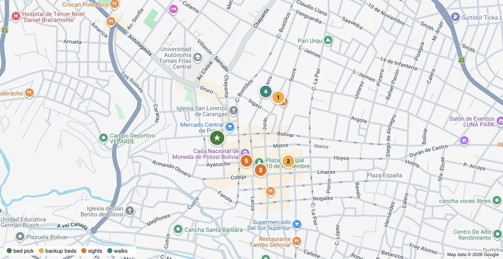
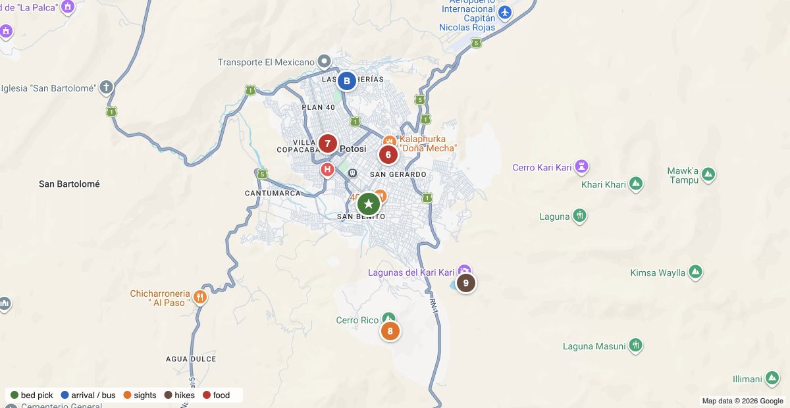

# 🇧🇴 Potosí

Part of the [LatAm itinerary](../itinerary.md) · region notes: [Chile + Bolivia](chile-bolivia.md) · ← [Jeep tour San Pedro → Uyuni](uyuni-jeep-tour.md) · [Sucre](sucre.md) →

> **Stop 18 · Wed 20 → Thu 21 Jan 2027 (days 44–45) · 1 night** 
> 🏞️ Colonial mining city at 4,070 m under the Cerro Rico: a UNESCO centre and a live mine 
> 🛏️ **Los Faroles Hostal**, a private family room with shared bathroom, US$28 with breakfast (no well-rated dorm in town) 
> 🚌 **In:** bus from Uyuni after the tour, Wed 15:00–19:00 · **Out:** bus to Sucre after lunch, Thu

The Cerro Rico above Potosí. Photo: Google Maps.

## 🗺️ Map

**In town:** ★ **[Los Faroles Hostal](https://www.google.com/maps?ftid=0x93f94f251bd89b39:0xf0959b0a4d0ce012)** (the pick, [book](https://www.booking.com/hotel/bo/los-faroles-hostal.html?checkin=2027-01-20&checkout=2027-01-21&group_adults=1&no_rooms=1&group_children=0&selected_currency=USD)) · **1** [The Koala Den](https://www.google.com/maps?ftid=0x93f94e7102f3861f:0xd5afa03f5d1aa500) (backup, [book](https://www.hostelworld.com/hostels/p/317982/the-koala-den-hostel/?from=2027-01-20&to=2027-01-21&guests=1)) · **2** [Hostal Colonial](https://www.google.com/maps?ftid=0x93f94f0066cbdc3f:0x955b0bb446cc40d8) (private alt, [book](https://www.booking.com/searchresults.html?ss=Hostal+Colonial+Potos%C3%AD&checkin=2027-01-20&checkout=2027-01-21&group_adults=1&no_rooms=1&selected_currency=USD)) · **3** [Plaza 10 de Noviembre](https://www.google.com/maps?ftid=0x93f94e7a0cd112b5:0x53f0d2e9d9362068) · **4** [Calle Quijarro](https://www.google.com/maps?ftid=0x93f94e70e1143653:0x7fe6d6a92e5c7b02) · **5** [Casa Nacional de Moneda](https://www.google.com/maps?ftid=0x93f94e7a742dc163:0xf0943a56bebdf962)

**Around:** ★ the centre · **B** [Nueva Terminal](https://www.google.com/maps?ftid=0x93f94dffe77531af:0xd4f16bd24e90785c) (Av. Las Banderas; buses from Uyuni and to Sucre) · **6** [Kalaphurka "Doña Mercedes"](https://www.google.com/maps?ftid=0x93f94f75c3763815:0xc4efaaf48ddf4ee6) · **7** [Salteñas Chikis](https://www.google.com/maps?ftid=0x93f94de180f89787:0xff94b6c4e4939df6) · **8** [Cerro Rico](https://www.google.com/maps?ftid=0x93f94e98331792cf:0x83b0bf8449a74267) · **9** [Lagunas del Kari Kari](https://www.google.com/maps?ftid=0x93f94fc2db264dd1:0x589e40bfe216fa82) (Google's pin; the lagoon walk needs a full day)

**Open the live map:** [town](https://www.google.com/maps/@-19.5880,-65.7540,16z) · [area](https://www.google.com/maps/@-19.5900,-65.7500,13z)

## 📅 Day by day

| Day | Plan |
|---|---|
| **Wed 20 Jan** | 🚙 The jeep tour ends in Uyuni ≈ 13:00–15:00. 🚌 **Uyuni → Potosí**, ≈ 4 h (e.g. 15:00 → 19:00). 🚕 Taxi from the Nueva Terminal (≈ Bs 15–20). 🌆 Walk the centre at dusk. |
| **Thu 21 Jan** | 🌅 The centre again at 08:00. ⛏️ **Cerro Rico mine tour** at 09:00, 3–4 h (optional). 🍲 Calapurca for lunch. 🚌 **Potosí → Sucre** after lunch (13:00 or 14:00). |

## 🔖 Book (one click)

Dates and 1 adult are pre-filled. Prices move, so compare the channels shown (first = cheapest when checked on 24 Nov). ⚠️ = time-sensitive.

**Beds** (20 → 21 Jan, 1 night)

| | Where | Total | Location | From the bus terminal | Book |
|---|---|---:|:---:|---|---|
| ⭐ **Pick** | **Los Faroles Hostal** · family room, shared bathroom, for 1, breakfast | **US$28** | 9.6 | 🚕 ≈ 19 min from the new bus terminal (walk 1 h 9 min, 4.2 km); centre 6 min on foot · [route](https://www.google.com/maps/dir/?api=1&origin=-19.557541099999998,-65.7613217&destination=-19.5877093,-65.7557628&travelmode=driving) | [Booking](https://www.booking.com/hotel/bo/los-faroles-hostal.html?checkin=2027-01-20&checkout=2027-01-21&group_adults=1&no_rooms=1&group_children=0&selected_currency=USD) |
| Backup | **The Koala Den** · private double with bathroom | US$30 | 9.3 *(HW)* | 🚕 ≈ 20 min (walk 1 h 8 min, 4.1 km); centre 7 min on foot · [route](https://www.google.com/maps/dir/?api=1&origin=-19.557541099999998,-65.7613217&destination=-19.585739699999998,-65.7526159&travelmode=driving) | [Hostelworld](https://www.hostelworld.com/hostels/p/317982/the-koala-den-hostel/?from=2027-01-20&to=2027-01-21&guests=1) |
| Private alt | **Hostal Colonial** · small single, breakfast | US$60 | 9.8 | 🚕 ≈ 21 min (walk 1 h 15 min, 4.5 km); centre 3 min on foot · [route](https://www.google.com/maps/dir/?api=1&origin=-19.557541099999998,-65.7613217&destination=-19.588839999999998,-65.7521033&travelmode=driving) | [Booking (search)](https://www.booking.com/searchresults.html?ss=Hostal+Colonial+Potos%C3%AD&checkin=2027-01-20&checkout=2027-01-21&group_adults=1&no_rooms=1&selected_currency=USD) |

**Transport**

| | Leg | When | Price | Book |
|---|---|---|---:|---|
| In | Bus **Uyuni → Potosí**, semi-cama, ≈ 4 h | **Wed 20 Jan**, 15:00 → 19:00 (Trans ATL Grevalug) up to 19:00 → 23:00; later 19:30, 20:30, 21:00 | US$11–15 on Tickets Bolivia (the counter is cheaper) | at the Uyuni terminal |
| Soft day | Night bus **Uyuni → Sucre** (Emperador / 6 de Octubre) | 21:30 → 05:30 | ≈ US$25 on Tickets Bolivia | if the tour runs a day late |
| Tour | **Cerro Rico mine tour** (optional) | Thu 21 Jan 09:00, 3–4 h | ≈ Bs 100–150 (US$8.50–13) in person + Bs 20–40 of gifts | in person (GetYourGuide/Viator Bs 200–350) |
| Out | Bus **Potosí → Sucre**, ≈ 3–4 h | **Thu 21 Jan 13:00 or 14:00** | US$7–8 | Nueva Terminal; see the [Sucre guide](sucre.md) |

How to read these tables

- **Location** is the guests' location score on Booking.com. The target is 9.0 or higher, and ⚠️ would mark one below 9.0. *(HW)* means Hostelworld's location rating, used where a property isn't on Booking.
- **From the bus terminal** comes from Google Maps on 24 Nov: the property found on Maps and routed from where you arrive at midday on the check-in date. The **route** link opens the same route.
- Google has no bus data here, so the 🚕 time is Google's driving estimate; local minibuses/colectivos run (ask locally).
- Symbols: 🚶 walk · 🚌 public transport · 🚕 taxi/rideshare · 🥾 hike only · ⚠️ far from the centre with no bus · ℹ️ outside the centre but on a bus line.

## 🚌 Getting here: Uyuni → Potosí, Wed 20 Jan

Bus Uyuni → Potosí, ≈ 4 h, semi-cama, from Uyuni's bus terminal. The schedule below is from Tickets Bolivia's route page (24 Nov), a reseller; its fares run above the terminal counter price. Departures after a 13:00–14:00 tour finish:

| Dep → arr | Company | Tickets Bolivia fare |
|---|---|---|
| 15:00 → 19:00 | Trans ATL Grevalug | US$11 |
| 16:30 → 20:30 | Expreso 11 de Julio | US$13 |
| 17:00 → 21:00 | Trans Quijarro | US$15 |
| 18:30 → 22:30 | Trans Turismo ZC American | US$14 |
| 19:00 → 23:00 | Línea Emperador | US$13 |

- Later buses run at 19:30, 20:30 and 21:00.
- **Buy at the Uyuni terminal** when the tour drops you; nothing needs pre-booking unless a blockade has just lifted.
- **Withdraw bolivianos in Uyuni first.**
- You arrive at Potosí's **Nueva Terminal** (Av. Las Banderas), ≈ 2.7 km from the plaza: taxi ≈ Bs 15–20 (≈).
- **Soft day:** if the tour is delayed a day (Hito Cajón closure), drop Potosí and go Uyuni → Sucre direct on the night bus (Emperador / 6 de Octubre, 21:30 → 05:30, ≈ US$25 on Tickets Bolivia).

## 🛏️ Where to sleep

Live-checked 24 Nov. **No dorm:** Potosí has no well-rated dorm (Hostelworld lists 5 places; the only dorm, Hostal Carlos V, has no reviews), so the pick is the best-value private.

### ⭐ Pick: Los Faroles Hostal
- **Unit:** Family Room with shared bathroom (sold to 1 adult).
- **Price:** **US$28 for 1 night incl. breakfast** (Booking room table, free cancellation to 19 Jan).
- **Reviews:** Booking 8.7, 707 reviews, **5.9% below 7**, location 9.6.
- **Where:** 0.3 km from Plaza 10 de Noviembre.
- **Checks:** quiet ✅; ✗ no guest kitchen; ⚠ no heating ("very cold at night", bring the tour layers).

### Backup: The Koala Den
- **Unit:** private double with bathroom. **US$30** on Hostelworld (not found on Booking).
- **Reviews:** Hostelworld 8.1 (382; 13% below 70 in the last 12 months).
- **Where:** 0.4 km from the plaza.
- **Checks:** kitchen with stove; famous breakfast; lobby noise until midnight; in-house Koala Tours for the mine.

### Private alt (location first): Hostal Colonial (Colonial Hotel Boutique)
- Small Single Room, breakfast. **US$60** (Booking = Agoda US$60).
- Booking location **9.8**, 321 reviews, 2.8% below 7.
- 0.1 km from the plaza, heated colonial building.

## 🌳 Things to do (free and outdoors first)

<table>
<tr>
<td width="50%" valign="top"> <b><a href="https://www.google.com/maps?ftid=0x93f94e7a0cd112b5:0x53f0d2e9d9362068">Plaza 10 de Noviembre</a></b> · free The heart of the UNESCO centre. Best at dusk and at 08:00.</td>
<td width="50%" valign="top"> <b><a href="https://www.google.com/maps?ftid=0x93f94e70e1143653:0x7fe6d6a92e5c7b02">Calle Quijarro</a></b> · free The balconied colonial street.</td>
</tr>
<tr>
<td width="50%" valign="top"> <b><a href="https://www.google.com/maps?ftid=0x93f94e98331792cf:0x83b0bf8449a74267">Cerro Rico mine tour</a></b> · ≈ Bs 100–150 + gifts Optional and unique: a live, dangerous workplace. Go with ex-miners.</td>
<td width="50%" valign="top"> <b><a href="https://www.google.com/maps?ftid=0x93f94e7a742dc163:0xf0943a56bebdf962">Casa Nacional de Moneda</a></b> · ≈ Bs 40 + Bs 20 photos The colonial mint museum, with a 2-h guided tour. Optional.</td>
</tr>
<tr>
<td width="50%" valign="top"> <b><a href="https://www.google.com/maps?ftid=0x93f94fc2db264dd1:0x589e40bfe216fa82">Kari Kari lagoons</a></b> · doesn't fit A full day plus a guide or taxi (hike backlog).</td>
<td width="50%" valign="top"></td>
</tr>
</table>

- **Free:** walk the UNESCO centre at dusk and at 08:00: Plaza 10 de Noviembre, the balconied Calle Quijarro, and the view of Cerro Rico from the centre. At 4,070 m it's higher than anything since the tour, so walk slowly.
- **Cerro Rico mine tour (paid, unique, optional), Thu 21 Jan 09:00, 3–4 h.**
  - **Price:** ≈ **Bs 100–150 (US$8.50–13)** booked in person, against Bs 200–350 on GetYourGuide/Viator; plus **Bs 20–40 of gifts** at the miners' market (coca leaves, juice or soda, work gloves).
  - Skip the dynamite: ethical guides discourage it.
  - Go with an operator run by **ex-miners**: Big Deal Tours, Koala Tours or Real Deal (≈ AI-summary leads; check the newest Tripadvisor reviews).
  - **Ethics:** it's a live, dangerous workplace in cooperative tunnels with silica dust, not a museum. The case for going is that ex-miner operators put tour money into miners' pockets. The case against is voyeurism, and minors still work at the margins of some cooperatives (good guides keep away and don't stage anything).
  - **Skip it** if you're claustrophobic, have asthma, or would rather not watch people work in those conditions. It's the only paid sight in Potosí worth the money.
- **Casa Nacional de Moneda** (colonial mint museum): ≈ **Bs 40** with a 2-h guided tour, + Bs 20 photo permit (Tripadvisor and packlightly.es; Tue–Sat). Optional.
- **Kari Kari lagoons** (hike backlog) needs a full day plus a guide or taxi: it doesn't fit one night. Add a night only if the tour runs early and the weather's dry.
- Then take the **Potosí → Sucre** bus after lunch (stop 19).

## 🍽️ Eat and drink

<table>
<tr>
<td width="50%" valign="top"> <b>Calapurca</b> · ≈ Bs 20 (US$1.70) Corn and meat soup heated with a red-hot stone, at <a href="https://www.google.com/maps?ftid=0x93f94f75c3763815:0xc4efaaf48ddf4ee6">Kalaphurka "Doña Mercedes"</a> (Chayanta 330).</td>
<td width="50%" valign="top"> <b>Salteñas</b> · Bs 8–11 (≈ US$0.70–0.95) The morning pastry, e.g. at <a href="https://www.google.com/maps?ftid=0x93f94de180f89787:0xff94b6c4e4939df6">Salteñas Chikis</a>.</td>
</tr>
</table>

These are ≈ AI-summary leads, Nov 2026.

## ℹ️ Good to know
- **Cold:** the coldest night of the section indoors (Jan low 4 °C, no heating).
- **Rain:** 18 rain days in January: afternoon storms.
- **Altitude:** 4,070 m, higher than anything since the tour, so walk slowly.

## 🚌 Leaving: Potosí → Sucre, Thu 21 Jan

- Potosí's buses to Sucre also leave from the **Nueva Terminal**.
- After a morning mine tour, take the **13:00 or 14:00**. Times, fares and the blockade warning are in the [Sucre guide](sucre.md).

---
Photos: Google Maps contributors (Cerro Rico, Plaza 10 de Noviembre, Calle Quijarro, Casa Nacional de Moneda, Kari Kari, Kalaphurka Doña Mercedes, Salteñas Chikis).
