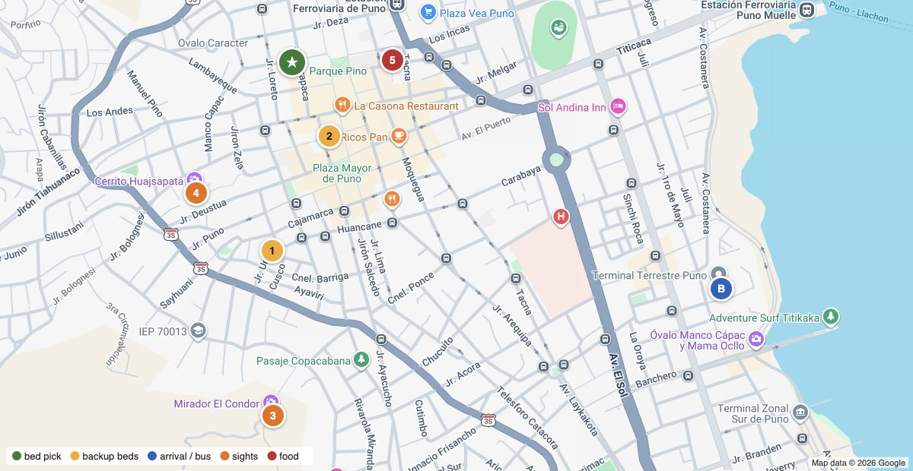

# 🇵🇪 Puno

Part of the [LatAm itinerary](../itinerary.md) · region notes: [Southern Peru + Panama](peru-panama.md) · ← [Copacabana + Isla del Sol](copacabana-isla-del-sol.md) · [Colca Canyon](colca-canyon.md) →

> **Stop 22 · Day 56 → 57 · 1 night · transit · Candelaria festival weeks** 
> 🏞️ One evening on Lake Titicaca's Peruvian shore at 3,830 m, between the border and the Colca bus 
> 🛏️ **Kantaya Hostel**, a bed in a 10-bed mixed ensuite dorm, $10.50 (✅ 27 Nov; ⚠️ book now: Candelaria is selling Puno out) 
> 🚌 **In:** Titicaca Bolivia Bus from Copacabana, Mon 13:30 · **Out:** 4M Express to Chivay, Tue pickup 05:50–06:10

Puno and Lake Titicaca from the <a href="https://www.google.com/maps?ftid=0x915d69ed9ad4f677:0xc77330e7fa9a440b">Kuntur Wasi (condor) viewpoint</a>. Photo: Google Maps.

## 🗺️ Map

**In town:** ★ **[Kantaya Hostel](https://www.google.com/maps?ftid=0x915d69ea8a067b63:0x9f5f42eee31642e6)** (the pick, [book](https://www.hostelworld.com/hostels/p/84925/kantaya-hostel/?from=2027-02-01&to=2027-02-02&guests=1)) · **1** [Urpi Wasi Backpackers](https://www.google.com/maps?ftid=0x915d69007f9b8173:0x8887d42497a03b83) (old backup, sold out for Day 56, [book](https://www.booking.com/hotel/pe/urpi-wasi.html?checkin=2027-02-01&checkout=2027-02-02&group_adults=1&no_rooms=1&group_children=0&selected_currency=USD)) · **2** [Tierra Viva Puno Plaza](https://www.google.com/maps?ftid=0x915d69eb1bedc8e1:0xb60edbdb02af863) (private alt, on the [Plaza de Armas](https://www.google.com/maps?ftid=0x915d69eb4013ddbd:0xde99b3eca4371e4b), [book](https://www.booking.com/hotel/pe/tierra-viva-puno-plaza.html?checkin=2027-02-01&checkout=2027-02-02&group_adults=1&no_rooms=1&group_children=0&selected_currency=USD)) · **B** [Terminal Terrestre](https://www.google.com/maps?ftid=0x915d6991146e1df7:0x207220d2f7951a10) (bus arrival; the walking routes start here) · **3** [Mirador Kuntur Wasi](https://www.google.com/maps?ftid=0x915d69ed9ad4f677:0xc77330e7fa9a440b) [🚶 21 min](https://www.google.com/maps/dir/?api=1&origin=-15.8375858,-70.0294303&destination=-15.8471962,-70.0299667&travelmode=walking) · **4** [Cerro Huajsapata](https://www.google.com/maps?ftid=0x915d69ebe173627f:0xe002096b4f76a085) [🚶 12 min](https://www.google.com/maps/dir/?api=1&origin=-15.8375858,-70.0294303&destination=-15.8411467,-70.032118&travelmode=walking) · **5** [Mercado Central](https://www.google.com/maps?ftid=0x915d69eab4e2357b:0x7068c827b19b5d8f) [🚶 4 min](https://www.google.com/maps/dir/?api=1&origin=-15.8375858,-70.0294303&destination=-15.8375222,-70.0265946&travelmode=walking) · [Jr. Lima](https://www.google.com/maps?ftid=0x915d69eb5827e2c5:0x796ad8664da7a977) runs from the Plaza

🧭 The time after each place is from the ★ bed (Google Maps, 26 Nov): 🚶 walk · 🚌 bus · 🚕 taxi · 🚗 by road (tour or bus). Click it for the route.

**Open the live map:** [town](https://www.google.com/maps/@-15.8410,-70.0270,16z)

## 📅 Day by day

| Day | Plan |
|---|---|
| **Day 56** | 🚌 **18:00 Titicaca Bolivia Bus** from Copacabana via the Kasani / Yunguyo border, arriving ≈ 21:00 (Peru is 1 h behind Bolivia). 🚕 Taxi ≈ 10 min to Kantaya (tell the hostel you arrive late). Dinner and bed: the 4M Express picks up at 05:50. 🎭 Tonight is the eve of Candelaria's central day, so expect bands and fireworks late (earplugs). If you took the 13:30 bus instead (no ridge walk), the daylight Plaza de Armas → Jr. Lima → Mirador Kuntur Wasi walk below still fits. |
| **Day 57** | 🚌 **4M Express pickup 05:50–06:10** at the hostel, on to Chivay ([Colca guide](colca-canyon.md)). |

## 🔖 Book (one click)

Dates and 1 adult are pre-filled. The first channel listed was the cheapest when checked on 24 Nov. ⚠️ = time-sensitive.

**Beds** (Day 56 → 57, 1 night)

| | Where | Total | Location | From the bus terminal | Book |
|---|---|---:|:---:|---|---|
| ⭐ **Pick** | **Kantaya Hostel** · bed in a 10-bed mixed ensuite dorm | **$10.50** · ⚠️ book now | 9.6 *(HW)* | 🚕 ≈ 10 min from the bus terminal (walk 28 min, 1.9 km); centre 6 min on foot · [route](https://www.google.com/maps/dir/?api=1&origin=-15.8437497,-70.0173287&destination=-15.8375858,-70.0294303&travelmode=driving) | [Hostelworld](https://www.hostelworld.com/hostels/p/84925/kantaya-hostel/?from=2027-02-01&to=2027-02-02&guests=1) |
| Backup | **Iguana Hostel Puno** · bed in a 10-bed mixed ensuite dorm | $10.35 ✅ 27 Nov | 10.0 *(HW)* | 🚕 ≈ 10 min from the bus terminal; **the same building as Kantaya** (Jr. Santiago Giraldo 222), sold as a separate listing · [route](https://www.google.com/maps/dir/?api=1&origin=-15.8437497,-70.0173287&destination=-15.8375858,-70.0294303&travelmode=driving) | [Hostelworld](https://www.hostelworld.com/hostels/p/101428/iguana-hostel-puno/?from=2027-02-01&to=2027-02-02&guests=1) |
| Old backup | **Urpi Wasi Backpackers** · bed in an 8-bed mixed dorm | **SOLD OUT** ✅ 27 Nov (Booking, HW and Agoda; Candelaria) | 9.1 | 🚕 ≈ 8 min from the bus terminal (walk 26 min, 1.6 km); centre 5 min on foot · [route](https://www.google.com/maps/dir/?api=1&origin=-15.8437497,-70.0173287&destination=-15.8427017,-70.0299885&travelmode=driving) | [Booking](https://www.booking.com/hotel/pe/urpi-wasi.html?checkin=2027-02-01&checkout=2027-02-02&group_adults=1&no_rooms=1&group_children=0&selected_currency=USD) · [Hostelworld](https://www.hostelworld.com/hostels/p/320986/urpi-wasi-backpackers/?from=2027-02-01&to=2027-02-02&guests=1) · [Agoda](https://www.agoda.com/partners/partnersearch.aspx?hid=46704468&checkin=2027-02-01&checkout=2027-02-02&NumberofAdults=1&Rooms=1) |
| Private alt | **Tierra Viva Puno Plaza** · standard single, breakfast | $61 ✅ 27 Nov | 9.5 | 0.06 km from the Plaza | [Booking](https://www.booking.com/hotel/pe/tierra-viva-puno-plaza.html?checkin=2027-02-01&checkout=2027-02-02&group_adults=1&no_rooms=1&group_children=0&selected_currency=USD) |
| Private value | **Hotel T'ika** · twin, private bathroom | **SOLD OUT** ✅ 27 Nov (Candelaria; $39 on 25 Jan) | 9.3 | 0.38 km | [Booking](https://www.booking.com/hotel/pe/t-39-ika.html?checkin=2027-02-01&checkout=2027-02-02&group_adults=1&no_rooms=1&group_children=0&selected_currency=USD) |

**Transport**

| | Leg | When | Price | Book |
|---|---|---|---:|---|
| In | 🚌 **Titicaca Bolivia Bus** (Marcopolo G7 double-decker) · Copacabana → Puno | **Day 56 18:00 → ≈ 21:00** (or 13:30 → 16:30 if you skip the Isla del Sol ridge walk) | **$9** (13:30: $10) | [Titicaca Bolivia Bus](https://titicacaboliviabus.com/trip/copacabana-puno/) (WhatsApp form) |
| ⚠️ Out | 🚌 **4M Express** · Puno → Chivay | **Tue 2 Feb** (Candelaria's central day), pickup 05:50–06:10, dep ≈ 06:15 → Chivay 12:15–12:45 | **$54** | [4M Express](https://www.4m-express.com/) (confirm by WhatsApp; closes 3 days before) |

How to read these tables

- **Location** is the guests' location score on Booking.com. The target is 9.0 or higher, and ⚠️ would mark one below 9.0. *(HW)* means Hostelworld's location rating, used where a property isn't on Booking.
- **From the bus terminal** comes from Google Maps on 24 Nov: the property found on Maps and routed from where you arrive at midday on the check-in date. The **route** link opens the same route. For the two private rooms, the distance to the Plaza from the Booking listing is shown instead.
- Symbols: 🚶 walk · 🚌 public transport · 🚕 taxi/rideshare · 🥾 hike only · ⚠️ far from the centre with no bus · ℹ️ outside the centre but on a bus line.
- Prices move, so compare the channels shown.

## 🚌 Getting here: Copacabana → Puno, Day 56

- **Bus via the Kasani / Yunguyo border.**
- **Titicaca Bolivia Bus** (Marcopolo G7 double-decker): **13:30 → 16:30, US$10**, or 18:00 → ~21:00, US$9. Daily. Their page says about 3 h including the border.
- ✅ titicacaboliviabus.com/trip/copacabana-puno/ (the old /rutas/ address now redirects): prices and times are on the page; you book by WhatsApp form.
- ⚠️ **Which clock?** The page doesn't say. Peru is 1 h behind Bolivia, so you probably reach Puno about 15:30 Peru time.
- **Border:** get the Bolivian exit stamp at Kasani, walk about 200 m, then the Peruvian entry at Kasani/Yunguyo. US passport: no visa, no fee. Peru has no yellow-fever entry rule.
- **Other operators** also run the route (≈ Bs 40–80; check in Copacabana the day before): Turisbus, Huayruro, Panamericano, Vicuña. Not verified.
- **Fallback if the buses are full (LP):** combi Copacabana → Kasani (≈ Bs 3), cross on foot, a triciclo to Yunguyo, then a local micro to Puno's Terminal Zonal. Slower and more hassle.
- **Don't carry coca leaves** across the border: LP says taking them over international borders is illegal.
- **On arrival:** the Terminal Terrestre has an ATM and an iPerú desk (LP), so you can get soles before the taxi.

## 🛏️ Where to sleep

Live-checked on 24 Nov (Hostelworld API).

⚠️ **Book Kantaya now.** Re-checked 27 Nov for 1 → 2 Feb, inside the Candelaria: Kantaya is still $10.50, but Booking shows **no hostel with beds** in Puno that night, Hostelworld has **10 bookable places against 18 on 25 Jan**, and both old backups (Urpi Wasi, Hotel T'ika) are sold out.

### ⭐ Pick: Kantaya Hostel
- **Unit and price:** 10-bed mixed ensuite dorm · **US$10.50** for the night · Hostelworld. Add Hostelworld's small booking fee.
- **Rating:** 9.2 (1,300 reviews); 6% of the last 107 reviews are below 7.
- **Where:** Jr. Santiago Giraldo 220, 0.33 km from the Plaza de Armas.
- **Checks:** a Mar 2026 review says "dorms have lockers and curtains on beds" (a 2024 review said none, so they were probably added). Full kitchen ("fully functional"). Pool table; free breakfast; reviews call it calm and warm. Not a party hostel.
- **Pickup:** it's central, so it should be inside 4M Express's pickup zone. Confirm when you book 4M.
- **Channels:** Kantaya isn't on Booking (a name search returns Urpi Wasi) and isn't among Agoda's first 49 Puno results, so Hostelworld is the only channel found.
- ⚠️ Kantaya, Koala and Iguana are **one hostel under three Hostelworld listings** (Jr. Santiago Giraldo 220/222; reviews from 2024 to Jan 2026 say so). Each listing sells its own beds, so Iguana still works as the backup when Kantaya's listing fills, but it's the same building.

### Backup: Iguana Hostel Puno (new 27 Nov)
- **Unit and price:** 10-bed mixed ensuite dorm · **US$10.35** ✅ 27 Nov · Hostelworld. Not on Booking that night, so there's no Booking location score.
- **Rating:** Hostelworld 9.3 (971 reviews), location 10.0. It beats the other twin listing, Koala Hostel Puno ($10.26; 9.1 from 411, location 9.7).
- **Where:** Jr. Santiago Giraldo 222, the Kantaya building, 0.63 km from the Plaza on Hostelworld's map.
- **Checks:** kitchen ✅; quiet ("not a super social hostel", Oct 2026; "don't expect … to party", 2025); pancake breakfast. Lockers are small, and some ground-floor dorms have no window (2024 complaints of a musty smell). Bunk curtains aren't mentioned.
- **Old backup Urpi Wasi Backpackers:** **sold out** on Booking, Hostelworld and Agoda for Day 56 (✅ 27 Nov; still $9 on Booking on Day 49).

### Private alt (location first, Booking room table)
- **Tierra Viva Puno Plaza** · standard single · **US$61** ✅ 27 Nov incl. breakfast (was US$53) · Booking. Location 9.5, 855 reviews, **3% below 7**, 0.06 km from the Plaza.
- **Value:** Hotel T'ika · twin with private bathroom · **sold out** for Day 56 (✅ 27 Nov; US$39 on Day 49) · [Booking](https://www.booking.com/hotel/pe/t-39-ika.html?checkin=2027-02-01&checkout=2027-02-02&group_adults=1&no_rooms=1&group_children=0&selected_currency=USD). Location 9.3, 237 reviews, 3% below 7, 0.38 km.

## 🌳 Things to do (free first; you have one evening)

<table>
<tr>
<td width="50%" valign="top"> <b><a href="https://www.google.com/maps?ftid=0x915d69ed9ad4f677:0xc77330e7fa9a440b">Mirador Kuntur Wasi</a></b> · free · ⚠️ daylight only · <a href="https://www.google.com/maps/dir/?api=1&origin=-15.8375858,-70.0294303&destination=-15.8471962,-70.0299667&travelmode=walking">🚶 21 min</a> The condor statue, about 600 steps up. Walk there via the Plaza de Armas and the Jr. Lima pedestrian street. Robberies are reported here (see below).</td>
<td width="50%" valign="top"> <b><a href="https://www.google.com/maps?ftid=0x915d69ebe173627f:0xe002096b4f76a085">Cerro Huajsapata</a></b> · free · <a href="https://www.google.com/maps/dir/?api=1&origin=-15.8375858,-70.0294303&destination=-15.8411467,-70.032118&travelmode=walking">🚶 12 min</a> The Manco Cápac statue, 10 minutes from the Plaza: the shorter alternative.</td>
</tr>
</table>

- **The walk:** Plaza de Armas → Jr. Lima pedestrian street → **Mirador Kuntur Wasi** (the condor statue, about 600 steps, free). Go up by ≈ 16:30 for the late light and be back down before dark (sunset ≈ 18:30).
- ⚠️ **Lookout safety.** LP advises against the hill lookouts it calls Condor and Inca (Kuntur Wasi and, most likely, Huajsapata with its Inca statue) because of assaults and robberies, even on groups. It's still current: in Jul 2026 residents of Alto Mañazo warned of robberies around Kuntur Wasi, blaming poor lighting and no patrols (Radio Onda Azul; checked 26 Nov).
  - Go in daylight, ideally with others from the hostel, and carry only a phone and a few soles.
  - Or skip it and stay on the Plaza and Jr. Lima.
- **Casa del Corregidor** (free, LP): one of Puno's oldest houses (17th century), now a fair-trade craft shop and café, just off the Plaza. Mon–Sat 09:00–21:00 (LP).
- **Museo Carlos Dreyer** (paid, optional): S/15 with an English-speaking guide (LP). Altiplano archaeology, three mummies and a full-size chullpa (funerary tower). Mon–Fri 09:00–19:00, and the guides leave an hour before closing, so arrive by 18:00 (LP).
- **Skip the Uros floating islands:** you already did the lake from Copacabana and Isla del Sol. The community ferry from Puno port (S/10 return, LP) runs only until ≈ 16:00 anyway.
- **Sleep early:** 4M picks you up at 05:50–06:10.

## 🍽️ Eat and drink

<table>
<tr>
<td width="50%" valign="top"> <b>Trucha frita</b> · ≈ S/10–15 (≈ $3–4) At the <a href="https://www.google.com/maps?ftid=0x915d69eab4e2357b:0x7068c827b19b5d8f">Mercado Central</a> or the side streets off Jr. Lima. Photo: a generic trucha frita (Commons).</td>
<td width="50%" valign="top"> <b>Quinoa soup menú</b> · ≈ S/10–15 Same places. Photo: a generic sopa de quinua (Commons).</td>
</tr>
</table>

- **Breakfast:** buy snacks the night before; 4M includes snacks and water.
- **Cheap dinner:** La Choza de Oscar, Jr. Libertad 354: a roast-chicken plate for ≈ S/11, Mon–Sat 14:00–22:00 (LP).
- **On the Plaza:** Mojsa, for trout dishes at ≈ S/22–30 a main, noon–21:30 (LP). Mareas (ceviche) closes at 16:00, so it's no good for dinner (LP).
- Peru's set lunch (*menú del día*) runs ≈ S/8–22 (LP).
- Other prices are ≈ unverified.

## ℹ️ Good to know
- **Altitude:** 3,830 m (the same as Copacabana).
- **Fiesta de la Candelaria 2027** (the Federación's calendar on vivecandelaria.com, ✅ 27 Nov): Sat 30 – Sun 31 Jan, the danzas originarias contest in the stadium; **the central day, Tue 2 Feb**, with Mass at the Santuario and the procession through the flower-carpeted streets of the centre; Sun 7 Feb, the trajes de luces contest; Mon 8 – Tue 9 Feb, the parade. Puno is busy and short of beds (see Where to sleep).
  - LP's rule: when Candlemas falls on a Sunday to Tuesday, the big celebrations start the Saturday before. Day 57 is a Tuesday, so they start Day 54, two days before you arrive, which matches the calendar. Your night is the eve of the central day: expect a loud, boozy Monday night (LP says the drinking is legendary).
- **Cash:** soles from the ATMs on Jr. Lima (BCP is there, LP) or at the bus terminal. Change leftover bolivianos at the border or in Copacabana.
- **Tourist info:** iPerú on the Plaza (corner of Jr. Lima and Deustua), Mon–Sat 09:00–18:00 (LP).
## 🚌 Leaving: 4M Express to Chivay, Day 57

- **Pickup from central Puno hotels 05:50–06:10**, departure about 06:15, Plaza de Chivay 12:15–12:45. **US$54**, with a guide, snacks and photo stops.
- ⚠️ Book by WhatsApp first; online bookings are processed only ≥ 3 days before travel.
- 🎭 **Candelaria on Tue 2 Feb:** the bus still runs (✅ "Día de salida: diario" on 4m-express.com, 27 Nov), and it leaves at ≈ 06:15, hours before the Mass and procession. Two catches:
  - **Seats:** festival week fills tourist services, so message 4M now, not at the 3-day cut-off (the last date for an online booking is Sat 30 Jan; the [Colca guide](colca-canyon.md) says to book 4 days ahead, so by Fri 29). A Tripadvisor review says a half-empty departure can be swapped for a van *(lead)*.
  - **Pickup:** streets around the Santuario and the Plaza close that day for the carpets and the procession *(≈)*, and the eve's bands can still be out at dawn. Ask 4M to confirm the pickup point (maybe a corner on a through street rather than Kantaya's narrow Jr. Santiago Giraldo) and be ready at reception at 05:50, as their page asks.
- All details are in the [Colca Canyon guide](colca-canyon.md).

---
Photos: Google Maps contributors (Mirador Kuntur Wasi, Cerro Huajsapata). Wikimedia Commons: <a href="https://commons.wikimedia.org/wiki/File:Fried_trout_Trucha_frita_con_papas_y_arroz_(31008005061).jpg">Fried trout Trucha frita con papas y arroz</a> (Lucerito Corrales, CC BY 2.0), <a href="https://commons.wikimedia.org/wiki/File:Sopa_de_Quinua,_plato_t%C3%ADpico_boliviano.jpg">Sopa de Quinua</a> (Q'orikenti, CC BY-SA 4.0).
