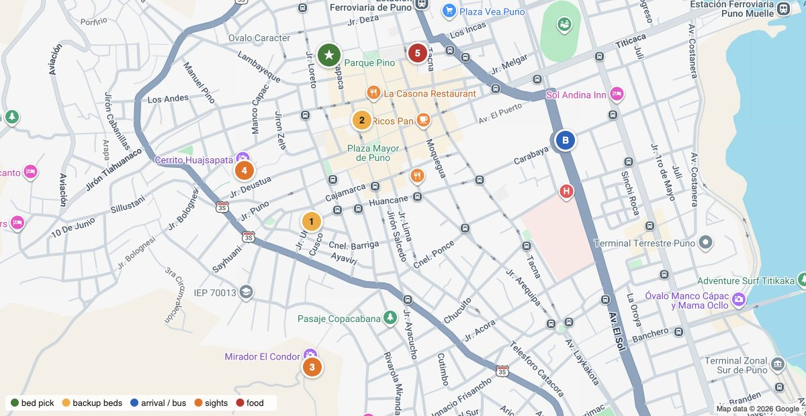

# 🇵🇪 Puno

Part of the [LatAm itinerary](../itinerary.md) · region notes: [Southern Peru + Panama](peru-panama.md) · ← [Copacabana + Isla del Sol](copacabana-isla-del-sol.md) · [Colca Canyon](colca-canyon.md) →

> **Stop 22 · Fri 29 → Sat 30 Jan 2027 (days 53–54) · 1 night · transit · Candelaria festival weeks**
> 🏞️ One evening on Lake Titicaca's Peruvian shore at 3,830 m, between the border and the Colca bus 
> 🛏️ **Kantaya Hostel**, a bed in a 10-bed mixed ensuite dorm, $10.50 
> 🚌 **In:** Titicaca Bolivia Bus from Copacabana, Fri 13:30 · **Out:** 4M Express to Chivay, Sat pickup 05:50–06:10

Puno and Lake Titicaca from the <a href="https://www.google.com/maps?ftid=0x915d69ed9ad4f677:0xc77330e7fa9a440b">Kuntur Wasi (condor) viewpoint</a>. Photo: Google Maps.

## 🗺️ Map

**In town:** ★ **Kantaya Hostel** (the pick) · **1** Urpi Wasi Backpackers (backup) · **2** Tierra Viva Puno Plaza (private alt, on the [Plaza de Armas](https://www.google.com/maps?ftid=0x915d69eb4013ddbd:0xde99b3eca4371e4b)) · **B** bus arrival (where the walking routes start; the [Terminal Terrestre](https://www.google.com/maps?ftid=0x915d6995299a381b:0x70f8d6f110dc71dd) is a few blocks south-east) · **3** [Mirador Kuntur Wasi](https://www.google.com/maps?ftid=0x915d69ed9ad4f677:0xc77330e7fa9a440b) · **4** [Cerro Huajsapata](https://www.google.com/maps?ftid=0x915d69ebe173627f:0xe002096b4f76a085) · **5** [Mercado Central](https://www.google.com/maps?ftid=0x915d69eab4e2357b:0x7068c827b19b5d8f) · [Jr. Lima](https://www.google.com/maps?ftid=0x915d69eb5827e2c5:0x796ad8664da7a977) runs from the Plaza

**Open the live map:** [town](https://www.google.com/maps/@-15.8410,-70.0270,16z)

## 📅 Day by day

| Day | Plan |
|---|---|
| **Fri 29 Jan** | 🚌 **13:30 Titicaca Bolivia Bus** from Copacabana via the Kasani / Yunguyo border, arriving ≈ 15:30 Peru time (probably). Walk 15 min to Kantaya. 🌅 Plaza de Armas → Jr. Lima → **Mirador Kuntur Wasi** for sunset ≈ 18:30. 🐟 Trout or quinoa soup for dinner. Buy breakfast snacks. Sleep early. |
| **Sat 30 Jan** | 🚌 **4M Express pickup 05:50–06:10** at the hostel, on to Chivay ([Colca guide](colca-canyon.md)). |

## 🔖 Book (one click)

Dates and 1 adult are pre-filled. The first channel listed was the cheapest when checked on 24 Nov. ⚠️ = time-sensitive.

**Beds** (29 → 30 Jan, 1 night)

| | Where | Total | Location | From the bus terminal | Book |
|---|---|---:|:---:|---|---|
| ⭐ **Pick** | **Kantaya Hostel** · bed in a 10-bed mixed ensuite dorm | **$10.50** | 9.6 *(HW)* | 🚶 walk 15 min (1.0 km) from the bus terminal; centre 6 min on foot · [route](https://www.google.com/maps/dir/?api=1&origin=-15.8402218,-70.0218805&destination=-15.8375858,-70.0294303&travelmode=walking) | [Hostelworld](https://www.hostelworld.com/hostels/p/84925/kantaya-hostel/?from=2027-01-29&to=2027-01-30&guests=1) |
| Backup | **Urpi Wasi Backpackers** · bed in an 8-bed mixed dorm | $9 | 9.1 | 🚶 walk 16 min (1.0 km) from the bus terminal; centre 5 min on foot · [route](https://www.google.com/maps/dir/?api=1&origin=-15.8402218,-70.0218805&destination=-15.8427017,-70.0299885&travelmode=walking) | [Booking](https://www.booking.com/hotel/pe/urpi-wasi.html?checkin=2027-01-29&checkout=2027-01-30&group_adults=1&no_rooms=1&group_children=0&selected_currency=USD) · [Hostelworld](https://www.hostelworld.com/hostels/p/320986/urpi-wasi-backpackers/?from=2027-01-29&to=2027-01-30&guests=1) · [Agoda](https://www.agoda.com/partners/partnersearch.aspx?hid=46704468&checkin=2027-01-29&checkout=2027-01-30&NumberofAdults=1&Rooms=1) |
| Private alt | **Tierra Viva Puno Plaza** · standard single, breakfast | $53 | 9.5 | 0.06 km from the Plaza | Booking |
| Private value | **Hotel T'ika** · twin, private bathroom | $39 | 9.3 | 0.38 km | Booking |

**Transport**

| | Leg | When | Price | Book |
|---|---|---|---:|---|
| In | 🚌 **Titicaca Bolivia Bus** (Marcopolo G7 double-decker) · Copacabana → Puno | **Fri 29 Jan 13:30 → 16:30** (or 18:00 → ~21:00) | **$10** (18:00: $9) | [Titicaca Bolivia Bus](https://titicacaboliviabus.com/trip/copacabana-puno/) (WhatsApp form) |
| ⚠️ Out | 🚌 **4M Express** · Puno → Chivay | **Sat 30 Jan**, pickup 05:50–06:10, dep ≈ 06:15 → Chivay 12:15–12:45 | **$54** | [4M Express](https://www.4m-express.com/) (confirm by WhatsApp; closes 3 days before) |

How to read these tables

- **Location** is the guests' location score on Booking.com. The target is 9.0 or higher, and ⚠️ would mark one below 9.0. *(HW)* means Hostelworld's location rating, used where a property isn't on Booking.
- **From the bus terminal** comes from Google Maps on 24 Nov: the property found on Maps and routed from where you arrive at midday on the check-in date. The **route** link opens the same route. For the two private rooms, the distance to the Plaza from the Booking listing is shown instead.
- Symbols: 🚶 walk · 🚌 public transport · 🚕 taxi/rideshare · 🥾 hike only · ⚠️ far from the centre with no bus · ℹ️ outside the centre but on a bus line.
- Prices move, so compare the channels shown.

## 🚌 Getting here: Copacabana → Puno, Fri 29 Jan

- **Bus via the Kasani / Yunguyo border.**
- **Titicaca Bolivia Bus** (Marcopolo G7 double-decker): **13:30 → 16:30, US$10**, or 18:00 → ~21:00, US$9. Daily. Their page says about 3 h including the border.
- ✅ titicacaboliviabus.com/rutas/copacabana-puno: prices and times are on the page; you book by WhatsApp form.
- ⚠️ **Which clock?** The page doesn't say. Peru is 1 h behind Bolivia, so you probably reach Puno about 15:30 Peru time.
- **Border:** get the Bolivian exit stamp at Kasani, walk about 200 m, then the Peruvian entry at Kasani/Yunguyo. US passport: no visa, no fee. Peru has no yellow-fever entry rule.
- **Other operators** also run the route (≈ Bs 40–80; check in Copacabana the day before): Turisbus, Huayruro, Panamericano, Vicuña. Not verified.

## 🛏️ Where to sleep

Live-checked on 24 Nov (Hostelworld API).

### ⭐ Pick: Kantaya Hostel
- **Unit and price:** 10-bed mixed ensuite dorm · **US$10.50** for the night · Hostelworld. Add Hostelworld's small booking fee.
- **Rating:** 9.2 (1,300 reviews); 6% of the last 107 reviews are below 7.
- **Where:** Jr. Santiago Giraldo 220, 0.33 km from the Plaza de Armas.
- **Checks:** a Mar 2026 review says "dorms have lockers and curtains on beds" (a 2024 review said none, so they were probably added). Full kitchen ("fully functional"). Pool table; free breakfast; reviews call it calm and warm. Not a party hostel.
- **Pickup:** it's central, so it should be inside 4M Express's pickup zone. Confirm when you book 4M.
- **Channels:** Kantaya isn't on Booking (a name search returns Urpi Wasi) and isn't among Agoda's first 49 Puno results, so Hostelworld is the only channel found.
- ⚠️ Koala and Iguana Hostel are the **same building** under separate listings (a Jan 2026 review says so; same address). Don't use them as the backup.

### Backup: Urpi Wasi Backpackers
- **Unit and price:** 8-bed mixed dorm · **US$9 on Booking** (Hostelworld $10.20, Agoda $11.80).
- **Rating:** Hostelworld 9.1 (143 reviews; 11% of the last 53 below 7); Booking 9.0 (838 reviews).
- **Where:** Jr. Huancané 806, 0.34 km from the Plaza.
- **Checks:** kitchen with a cooker; the listing mentions curtains; no party reports.

### Private alt (location first, Booking room table)
- **Tierra Viva Puno Plaza** · standard single · **US$53** incl. breakfast · Booking. Location 9.5, 855 reviews, **3% below 7**, 0.06 km from the Plaza.
- **Value:** Hotel T'ika · twin with private bathroom · **US$39** · Booking. Location 9.3, 237 reviews, 3% below 7, 0.38 km.

## 🌳 Things to do (free first; you have one evening)

<table>
<tr>
<td width="50%" valign="top"> <b><a href="https://www.google.com/maps?ftid=0x915d69ed9ad4f677:0xc77330e7fa9a440b">Mirador Kuntur Wasi</a></b> · free · sunset ≈ 18:30 The condor statue, about 600 steps up. Walk there via the Plaza de Armas and the Jr. Lima pedestrian street.</td>
<td width="50%" valign="top"> <b><a href="https://www.google.com/maps?ftid=0x915d69ebe173627f:0xe002096b4f76a085">Cerro Huajsapata</a></b> · free The Manco Cápac statue, 10 minutes from the Plaza: the shorter alternative.</td>
</tr>
</table>

- **The walk:** Plaza de Armas → Jr. Lima pedestrian street → **Mirador Kuntur Wasi** (the condor statue, about 600 steps, free). Go for sunset over the lake around 18:30.
- **Skip the Uros floating islands:** you already did the lake from Copacabana and Isla del Sol.
- **Sleep early:** 4M picks you up at 05:50–06:10.

## 🍽️ Eat and drink

<table>
<tr>
<td width="50%" valign="top"> <b>Trucha frita</b> · ≈ S/10–15 (≈ $3–4) At the <a href="https://www.google.com/maps?ftid=0x915d69eab4e2357b:0x7068c827b19b5d8f">Mercado Central</a> or the side streets off Jr. Lima. Photo: a generic trucha frita (Commons).</td>
<td width="50%" valign="top"> <b>Quinoa soup menú</b> · ≈ S/10–15 Same places. Photo: a generic sopa de quinua (Commons).</td>
</tr>
</table>

- **Breakfast:** buy snacks the night before; 4M includes snacks and water.
- Prices are ≈ unverified.

## ℹ️ Good to know
- **Altitude:** 3,830 m (the same as Copacabana).
- **Fiesta de la Candelaria:** the main day is 2 Feb 2027, and the festival weeks start in late January, so Puno is busier and pricier. Beds still showed at about $10 on 24 Nov.
- **Cash:** soles from the ATMs on Jr. Lima. Change leftover bolivianos at the border or in Copacabana.

## 🚌 Leaving: 4M Express to Chivay, Sat 30 Jan

- **Pickup from central Puno hotels 05:50–06:10**, departure about 06:15, Plaza de Chivay 12:15–12:45. **US$54**, with a guide, snacks and photo stops.
- ⚠️ Book by WhatsApp first; online bookings are processed only ≥ 3 days before travel.
- All details are in the [Colca Canyon guide](colca-canyon.md).

---
Photos: Google Maps contributors (Mirador Kuntur Wasi, Cerro Huajsapata). Wikimedia Commons: <a href="https://commons.wikimedia.org/wiki/File:Fried_trout_Trucha_frita_con_papas_y_arroz_(31008005061).jpg">Fried trout Trucha frita con papas y arroz</a> (Lucerito Corrales, CC BY 2.0), <a href="https://commons.wikimedia.org/wiki/File:Sopa_de_Quinua,_plato_t%C3%ADpico_boliviano.jpg">Sopa de Quinua</a> (Q'orikenti, CC BY-SA 4.0).
