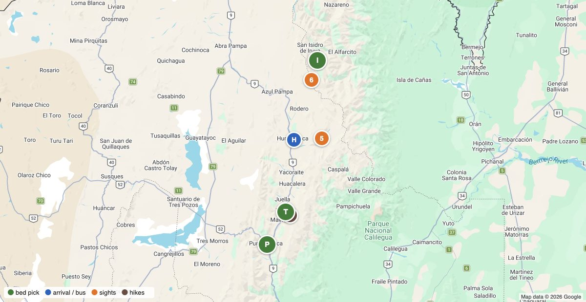
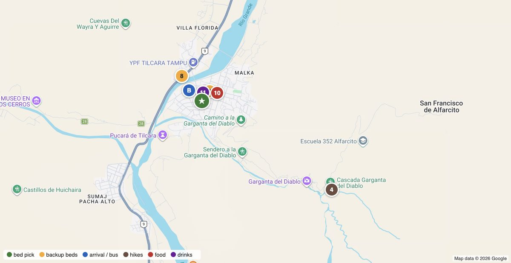
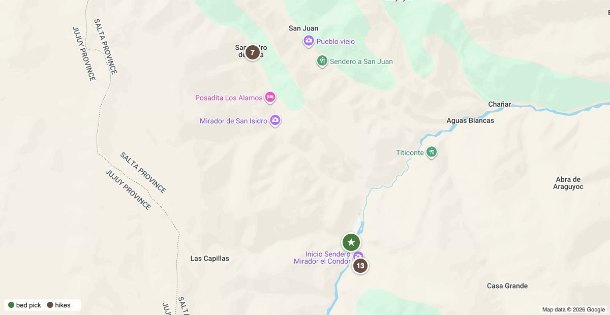
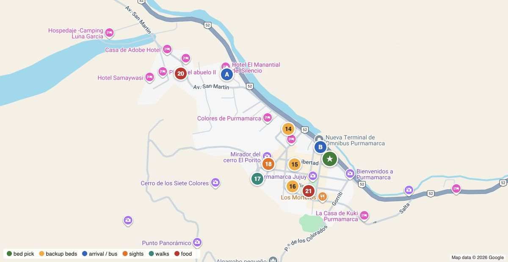

# 🇦🇷 Quebrada de Humahuaca (Tilcara + Iruya + Purmamarca)

Part of the [LatAm itinerary](../itinerary.md) · region notes: [Argentina](argentina.md) · ← [Salta](salta.md) · [San Pedro de Atacama](san-pedro-de-atacama.md) →

> **Stop 15 · Tue 12 → Fri 15 Jan 2027 · 3 nights: Tilcara, Iruya, Purmamarca (1 each)** 
> 🏞️ A high desert valley of striped mountains: hikes from Tilcara, the cliffside village of Iruya, the Hornocal "14 colours" and Purmamarca's red rocks 
> 🛏️ **Tilcara Mística** dorm $23 · **Hospedaje Ale**, Iruya (private; no dorms) $37 · **Giramundo** dorm, Purmamarca $17 
> 🚌 **In:** Salta → Jujuy, Tue 08:05, then Evelia to Tilcara · **Out:** ⚠️ Andesmar Purmamarca → San Pedro de Atacama, Fri 03:40

The Serranía de Hornocal ("14 colours", 4,350 m) above Humahuaca. Photo: Google Maps.

## 🗺️ Map

**The valley (terrain):** **T** Tilcara (night 1) · **I** Iruya (night 2) · **P** Purmamarca (night 3) · **H** Humahuaca terminal (buses to Iruya, Hornocal 4x4s) · **4** Garganta del Diablo (just behind T) · **5** [Hornocal viewpoint](https://www.google.com/maps?ftid=0x9404e7528f411655:0x7deefecb4c26c1e) · **6** [Abra del Cóndor](https://www.google.com/maps?ftid=0x9404f85adf1eec51:0x4ca19fb851c01238), the 4,000 m pass on the Iruya road. San Salvador de Jujuy (peak-season backup bed) is off the map to the south.

**Tilcara:** ★ **Tilcara Mística Hostel** (the pick) · **8** Hostel Casa Colores (backup) · **9** Casa Atelier (private alt) · **B** [bus terminal](https://www.google.com/maps?ftid=0x9404cb41ff1419e9:0xea554548abf4adf7) · **4** [Garganta del Diablo waterfall](https://www.google.com/maps?ftid=0x941b330060eddf03:0x569d3ef0eb37a246) · **10** [A La Payla](https://www.google.com/maps?ftid=0x9404cb42cc0504db:0x6a73b8ac8b5fc832) · **11** [El Molle Resto Bar](https://www.google.com/maps?ftid=0x941b0f3a5ab0e253:0x2403ee24b96bac24)

**Iruya (terrain):** ★ **Hospedaje Ale** (the pick; El Wichiku is next door) · **13** [Mirador del Cóndor trail start](https://www.google.com/maps?ftid=0x94045700466479c9:0x73df220e7268784f) · **7** [San Isidro](https://www.google.com/maps?ftid=0x940450f9fde74c69:0xd2c5e899b1b05e91), ≈ 8 km up the riverbed

**Purmamarca:** ★ **Giramundo Hostel** (the pick) · **14** Nido de Cóndores (private alt) · **15** MiskyPacha (peak-season backup) · **16** Hostería Los Morteros (runner-up private) · **B** Purmamarca bus terminal · **A** ≈ "Parador Purmamarca" on RN52, the 03:40 Andesmar stop (a lead: opposite [Hotel El Manantial del Silencio](https://www.google.com/maps?ftid=0x941b49ca833a1183:0x897de17cd130cd87); confirm it with Andesmar) · **17** [Paseo de los Colorados](https://www.google.com/maps?ftid=0x941b49b4e7e4fcfb:0x81cca36f34e3ff61) · **18** [Cerro El Porito lookout](https://www.google.com/maps?ftid=0x941b49b5a525e037:0xe54453fc4f8944ef) (the Cerro de los Siete Colores is labelled on the map) · **20** [Lo de Tere](https://www.google.com/maps?ftid=0x941b49b0d7d310c5:0x689508511deca031) · **21** [Lo de Mateo](https://www.google.com/maps?ftid=0x941b497db6c1e06f:0xff96e46d5befafe8)

**Open the live map:** [valley](https://www.google.com/maps/@-23.3000,-65.3000,9z) · [Tilcara](https://www.google.com/maps/@-23.5780,-65.3950,15z) · [Iruya](https://www.google.com/maps/@-22.7920,-65.2160,15z) · [Purmamarca](https://www.google.com/maps/@-23.7450,-65.5000,16z)

## 📅 Day by day

| Day | Plan |
|---|---|
| **Tue 12 Jan** · Tilcara | 🚌 Salta 08:05 → Jujuy 10:00, then Evelia or Balut to Tilcara (≈ 4 h door to door). 🥾 **Garganta del Diablo** in the afternoon if the sky is clear (≈ 3–3.5 h). |
| **Wed 13 Jan** · Iruya | 🚌 Evelia Tilcara 07:15 or 07:20 → Humahuaca 08:00, then **Transporte Iruya 08:20** → Iruya ≈ 11:20, over the 4,000 m Abra del Cóndor. 🥾 Afternoon: the riverbed walk to **San Isidro**, or the **Mirador del Cóndor** at sunset. 🎫 Book the return seat. |
| **Thu 14 Jan** · Purmamarca | 🚌 **06:00** Iruya → Humahuaca (≈ 09:00). 🏔️ **Hornocal** by shared 4x4 (≈ 3 h return). 🚌 Humahuaca → Purmamarca (≈ 1 h 15). 🥾 **Paseo de los Colorados** and **Cerro El Porito** at golden hour. Dinner, bed by 21:00. |
| **Fri 15 Jan** | ⏰ **03:40 Andesmar** from the RN52 stop → San Pedro de Atacama 11:30. |

## 🔖 Book (one click)

Dates and 1 adult are pre-filled. Prices move, so compare the channels shown (first = cheapest when checked on 24 Nov). ⚠️ = time-sensitive.

**Beds** (one night each: Tilcara 12 → 13, Iruya 13 → 14, Purmamarca 14 → 15 Jan)

| | Where | Total | Location | From the bus terminal | Book |
|---|---|---:|:---:|---|---|
| ⭐ **Tilcara** | **Tilcara Mística Hostel** · bed in a 4-bed mixed dorm | **$23** | 9.5 | 🚶 7 min (450 m) from the bus stop; centre 3 min on foot · [route](https://www.google.com/maps/dir/?api=1&origin=-23.5763341,-65.398639&destination=-23.5783375,-65.3960692&travelmode=walking) | [Booking (search)](https://www.booking.com/searchresults.html?ss=Tilcara+M%C3%ADstica+Hostel+&checkin=2027-01-12&checkout=2027-01-13&group_adults=1&no_rooms=1&selected_currency=USD) · [Hostelworld](https://www.hostelworld.com/hostels/p/67045/tilcara-mistica-hostel/?from=2027-01-12&to=2027-01-13&guests=1) · [Agoda](https://www.agoda.com/partners/partnersearch.aspx?hid=2820111&checkin=2027-01-12&checkout=2027-01-13&NumberofAdults=1&Rooms=1) |
| Tilcara backup | **Hostel Casa Colores** · bed in a mixed dorm | $11 | ⚠️ 8.8 | 🚶 12 min (900 m) from the bus stop; centre 11 min on foot · [route](https://www.google.com/maps/dir/?api=1&origin=-23.5763341,-65.398639&destination=-23.5737027,-65.4000606&travelmode=walking) | [Booking](https://www.booking.com/hotel/ar/casa-colores.html?checkin=2027-01-12&checkout=2027-01-13&group_adults=1&no_rooms=1&group_children=0&selected_currency=USD) · [Agoda](https://www.agoda.com/partners/partnersearch.aspx?hid=415708&checkin=2027-01-12&checkout=2027-01-13&NumberofAdults=1&Rooms=1) |
| Tilcara private alt | **Casa Atelier** · double room | $39 | 9.8 | 120 m from the plaza | on Booking (room table) · [map](https://www.google.com/maps?ftid=0x9404cb4293c069b5:0xd9ee36814b41a856) |
| ⭐ **Iruya** | **Hospedaje Ale** · triple room with bathroom, for 1 | **$37** | 9.5 | 🚶 7 min (450 m, uphill) from the Iruya bus terminal; the plaza is next door (Booking: 250 ft from downtown) · [route](https://www.google.com/maps/dir/?api=1&origin=-22.795178,-65.217954&destination=-22.7924488,-65.2167768&travelmode=walking) | [Booking](https://www.booking.com/hotel/ar/hospedaje-ale.html?checkin=2027-01-13&checkout=2027-01-14&group_adults=1&no_rooms=1&group_children=0&selected_currency=USD) |
| Iruya backup | **El Wichiku Residencial** · double with mountain view | $46 | 9.5 | 🚶 in the village, next to Hospedaje Ale | [Booking](https://www.booking.com/hotel/ar/el-wichiku-recidencial-resto-bar.html?checkin=2027-01-13&checkout=2027-01-14&group_adults=1&no_rooms=1&group_children=0&selected_currency=USD) |
| ⭐ **Purmamarca** | **Giramundo Hostel Purmamarca** · single bed in a dorm | **$17** | 9.6 | 🚶 1 min (79 m) from the Purmamarca bus terminal · [route](https://www.google.com/maps/dir/?api=1&origin=-23.744945,-65.498925&destination=-23.745506499999998,-65.4984487&travelmode=walking) | [Booking](https://www.booking.com/hotel/ar/giramundo-hostel-purmamarca.html?checkin=2027-01-14&checkout=2027-01-15&group_adults=1&no_rooms=1&group_children=0&selected_currency=USD) · [Agoda](https://www.agoda.com/partners/partnersearch.aspx?hid=25415036&checkin=2027-01-14&checkout=2027-01-15&NumberofAdults=1&Rooms=1) |
| Purmamarca private alt (quiet) | **Nido de Cóndores** · double with terrace | $65 | 9.6 | 🚶 3 min (220 m) from the Purmamarca bus terminal · [route](https://www.google.com/maps/dir/?api=1&origin=-23.744945,-65.498925&destination=-23.7440988,-65.50054229999999&travelmode=walking) | [Booking](https://www.booking.com/hotel/ar/nido-de-condores.html?checkin=2027-01-14&checkout=2027-01-15&group_adults=1&no_rooms=1&group_children=0&selected_currency=USD) · [Agoda](https://www.agoda.com/partners/partnersearch.aspx?hid=37730393&checkin=2027-01-14&checkout=2027-01-15&NumberofAdults=1&Rooms=1) |
| Peak-season backup | **MiskyPacha**, Purmamarca · double room with bathroom | $31 *(itinerary, 25 Nov)* | 9.6 | 🚶 3 min (240 m) from the Purmamarca bus terminal · [route](https://www.google.com/maps/dir/?api=1&origin=-23.7449451,-65.4989252&destination=-23.745779,-65.500291&travelmode=walking) | [Booking](https://www.booking.com/hotel/ar/miskypacha.html?checkin=2027-01-14&checkout=2027-01-15&group_adults=1&no_rooms=1&group_children=0&selected_currency=USD) |
| Peak-season backup (alt town) | **El Balcón de la Tata Hostel**, San Salvador de Jujuy · bed in a 6-bed dorm | $21 *(itinerary, 25 Nov)* | 9.9 | 🚶 10 min (700 m) from Jujuy's bus terminal, where the same Andesmar bus starts at 02:45 · [route](https://www.google.com/maps/dir/?api=1&origin=-24.183796,-65.2989954&destination=-24.186552,-65.303439&travelmode=walking) | [Booking](https://www.booking.com/hotel/ar/el-balcon-de-la-tata.html?checkin=2027-01-14&checkout=2027-01-15&group_adults=1&no_rooms=1&group_children=0&selected_currency=USD) |

**Transport**

| | Leg | When | Price | Book |
|---|---|---|---:|---|
| In | ✅ **20 de Junio** · Salta → Jujuy | **Tue 12 Jan 08:05 → 10:00** (or Balut 09:30 → 11:45) | ARS 20,000 ≈ $12 (Balut 18,000 ≈ $11) | Plataforma10 |
| In | **Evelia / Balut** · Jujuy → Tilcara | e.g. 10:30 → 12:10 or 12:00 → 13:15 *(Dec timetable)* | ARS 9,000–9,500 ≈ $6 | [Evelia](https://eveliatransporte.com.ar/) |
| To Iruya | ✅ **Evelia** Tilcara → Humahuaca, then **Transporte Iruya** | **Wed 13 Jan** 07:15 or 07:20 → 08:00; **08:20** → ≈ 11:20 (also 10:30, 16:00) | ARS 4,500 + ≈ ARS 9,500–12,000 (≈ $6–8) | Humahuaca terminal *(leads)* |
| Back | Iruya → Humahuaca | **Thu 14 Jan 06:00** → ≈ 09:00 (no Sunday service) | — | Iruya ticket office, on arrival |
| Hornocal | Shared 4x4 from the Humahuaca terminal | Thu 14 Jan, leaves when full, ≈ 3 h return | ≈ ARS 20,000 + ARS 2,000 (≈ $13) *(leads)* | at the terminal |
| On | **Evelia / Balut** · Humahuaca → Purmamarca | Thu 14 Jan, ≈ 1 h 15 | — | [Evelia](https://eveliatransporte.com.ar/) |
| ⚠️ Out | **Andesmar** · Purmamarca Acceso → San Pedro de Atacama | **Fri 15 Jan 03:40 → 11:30** | **ARS 120,000 ≈ $75** semicama (38 seats on 26 Nov) | [Andesmar shop](https://shop.andesmar.com/) · [Plataforma10](https://www.plataforma10.com.ar/servicios/buscar-pasajes/Purmamarca-Acceso/San-Pedro-de-Atacama/4891/2777/15-01-2027/_/1/0/0) |

How to read these tables

- **Location** is the guests' location score on Booking.com. The target is 9.0 or higher, and ⚠️ marks one below 9.0. *(HW)* means Hostelworld's location rating, used where a property isn't on Booking.
- **From the bus terminal** comes from Google Maps on 24 Nov: the property found on Maps and routed from where you arrive at midday on the check-in date (here, each town's bus stop). The **route** link opens the same route.
- Symbols: 🚶 walk · 🚌 public transport · 🚕 taxi/rideshare · 🥾 hike only · ⚠️ far from the centre with no bus · ℹ️ outside the centre but on a bus line.
- The two peak-season backup prices come from the itinerary's holiday-backup table (25 Nov), not from this guide's own check.

## 🚌 Getting here: Salta → Jujuy → Tilcara, Tue 12 Jan

- **Salta → Jujuy:** ✅ 20 de Junio 08:05 → 10:00 (ARS 20,000 ≈ $12) or Balut 09:30 → 11:45 (ARS 18,000 ≈ $11).
- **Jujuy → Tilcara:** Evelia or Balut, e.g. 10:30 → 12:10 or 12:00 → 13:15 (ARS 9,000–9,500 ≈ $6) *(Dec timetable)*.
- About **4 h door to door for ≈ $17**.
- The only direct Salta → Tilcara bus is Andesmar's 04:40 → 08:15 (ARS 28,000), which is too early to be worth it.

## 🛏️ Where to sleep

**Which base? Split it:** **Tilcara Tue 12 → Wed 13, Iruya Wed 13 → Thu 14, then Purmamarca Thu 14 → Fri 15.** Iruya was added on 26 Nov (Worldly Adventurer, Broke Backpacker); its night comes out of San Pedro, so nothing after 18 Jan moves.
- **Tilcara is the better hiking base.** It sits on the RN9 bus spine, with ~20 buses a day to Humahuaca (45 min) and 11 a day to Purmamarca (25–35 min). The Garganta del Diablo trail starts from town, and it has 7 hostels on Booking plus 4 on Hostelworld for these dates.
- **Purmamarca is where the San Pedro bus stops.** Andesmar's shop lists "Parador Purmamarca" at 03:40, and the bus doesn't call at Tilcara (Tilcara is 25 km up RN9, past the RN52 turn-off). No local bus runs between 23:45 and 05:35, so from Tilcara you would need a remís booked for ≈ 02:50.
- **So yes, sleep the last night in Purmamarca.** It's the sunset Colorados walk, then bed by 21:00 and a short walk to the stop. The 1-night bag move costs ARS 2,500 (≈ $1.50) and 30 min on Evelia.
- **Jujuy city** (02:45 departure) has no advantage; it's 1 h further back and has weaker hostels (Hostelworld 55–60 or tiny review counts).

### ⭐ Pick, Tilcara (Tue 12 → Wed 13): Tilcara Mística Hostel
Live-checked 24 Nov; moved up on 25 Nov for location.
- **Where:** Padilla 575, 160 m from the plaza.
- **Unit:** a bed in a 4-bed mixed dorm.
- **Price:** **$23 for 1 night on Booking** (room table, 25 Nov); Hostelworld $22.87; Agoda $29.70.
- **Reviews:** Booking 8.7 (262 reviews; 6% below 7), **location 9.5**; Hostelworld 85 (111 reviews, none below 70 in the newest 11); Agoda 8.9 (259).
- **Checks:** ✅ kitchen and a bar; calm, "community vibe" reviews.
- **Avoid:** Tilcara Rústica (Booking 8.1, **19% below 7**, bathroom and breakfast complaints, location 8.7).

### Backup, Tilcara: Hostel Casa Colores
- **Unit:** a bed in a mixed dorm. **$11 for 1 night on Booking** (room table). Agoda $14; it isn't on Hostelworld.
- **Reviews:** Booking 9.3 (203 reviews; 5% below 7); Agoda 9.7 (197).
- **Where:** ≈ 0.8 km from the plaza (⚠️ Booking location 8.8), across the railway line from the road; reviews say it's "tricky to find the first time".
- **Checks:** ✅ a fully equipped kitchen. Big indoor and outdoor common areas, quiet; few sockets by the beds. Curtains not confirmed. No pool.
- **Also ≥ 9.0:** Tierra Andina (location 9.5, 6-bed dorm $12, but Booking 8.3 with 6% below 7; not vetted).

### ⭐ Pick, Iruya (Wed 13 → Thu 14): Hospedaje Ale
Live-checked 26 Nov.
- **Unit:** a triple room with private bathroom, for 1. **$37 for 1 night on Booking.** Iruya has no dorm beds on Booking or Hostelworld for these dates.
- **Reviews:** Booking 8.7 (192 reviews; 2% below 7), **location 9.5**.
- **Backup:** El Wichiku Residencial (also location 9.5; 252 reviews, 3% below 7), double with mountain view, $46.
- **Why Iruya:** a cliffside village of ≈ 1,000 people at 2,780 m, 54 km down a gravel road off RN9, with free walks to San Isidro and the Mirador del Cóndor. It also helps you acclimatise before Hornocal (4,350 m) and Jama (4,200 m).
- ⚠️ **January rains:** the gravel road (RP 13 / RP 133) runs through riverbeds and can wash out for hours or days after storms. Ask at the Humahuaca terminal before you go. **If it's closed,** stay a 2nd night in Tilcara (Tilcara Mística, $23 for 13 → 14 Jan, checked 26 Nov) and do Hornocal on Wednesday instead.

### ⭐ Pick, Purmamarca (Thu 14 → Fri 15): Giramundo Hostel Purmamarca
- **Unit:** a single bed in a dorm. **$17 on Booking**; Agoda $17.41.
- **Reviews:** Booking 8.4 (410 reviews; ⚠️ **15% below 7**); Agoda 8.5 (415).
- **Location:** 9.6, 100 m from the plaza.
- **It's the village's only hostel.** Reviews flag a **restaurant next door with live music until late** and patchy cleaning. With a 03:00 alarm, earplugs are a must.
- **Backup = the private below.** For an early night before the 03:40 bus, the private is the better buy.

### Private alt (location first)
- **Tilcara:** **Casa Atelier** · double room · Booking location **9.8** (110 reviews, 2% below 7) · **$39 on Booking** (room table) · 120 m from the plaza.
- **Purmamarca:** **Nido de Cóndores** · double with terrace · Booking location **9.6** (404 reviews, 3% below 7) · **$65 on Booking** (room table; Agoda $87.12).
  - Runner-up: Hostería Los Morteros (location 9.7, 101 reviews, 4% below 7), $74 on Booking or Agoda.

### Peak-season backups (Purmamarca, 14 → 15 Jan)
- **Same town:** **MiskyPacha**, double room with bathroom, location 9.6, 3 min from the Purmamarca bus terminal.
- **Another town:** **El Balcón de la Tata Hostel** in San Salvador de Jujuy, a bed in a 6-bed dorm, location 9.9. It's 10 min on foot from Jujuy's bus terminal, where the same Andesmar bus starts at 02:45.
- Prices and links are in the beds table above.

## 🌳 Things to do (free and outdoors first)

<table>
<tr>
<td width="50%" valign="top"> <b><a href="https://www.google.com/maps?ftid=0x940450f9fde74c69:0xd2c5e899b1b05e91">San Isidro</a></b> from Iruya · free A smaller village ≈ 8 km up the riverbed, ≈ 3–4 h return.</td>
<td width="50%" valign="top"> <b><a href="https://www.google.com/maps?ftid=0x94045700466479c9:0x73df220e7268784f">Mirador del Cóndor</a></b>, Iruya · free The climb above the village, at sunset.</td>
</tr>
<tr>
<td width="50%" valign="top"> <b><a href="https://www.google.com/maps?ftid=0x941b49b5a525e037:0xe54453fc4f8944ef">Cerro El Porito</a></b> lookout, Purmamarca · free The view of the Cerro de los Siete Colores. Best at golden hour, 10–15 min up.</td>
<td width="50%" valign="top"> <b><a href="https://www.google.com/maps?ftid=0x941b49b4e7e4fcfb:0x81cca36f34e3ff61">Paseo de los Colorados</a></b>, Purmamarca · small or no fee A 3 km dirt loop through red-rock spires behind the village, ≈ 1 h.</td>
</tr>
<tr>
<td width="50%" valign="top"> <b><a href="https://www.google.com/maps?ftid=0x941b330060eddf03:0x569d3ef0eb37a246">Garganta del Diablo</a></b>, Tilcara · ≈ ARS 5,000–6,000 8–9 km return from town, +≈ 420 m, ≈ 3–3.5 h. Community fee in cash at the top.</td>
<td width="50%" valign="top"> <b><a href="https://www.google.com/maps?ftid=0x9404e7528f411655:0x7deefecb4c26c1e">Serranía de Hornocal</a></b> ("14 colours", 4,350 m) · ≈ $13 by shared 4x4 From the Humahuaca terminal, ≈ 3 h return. Late morning gives the best light.</td>
</tr>
</table>

**Tue 12, afternoon, Tilcara: the Garganta del Diablo gorge**, if the sky is clear.
- 8–9 km return from town on a dirt road and then the canyon path, +≈ 420 m, ≈ 3–3.5 h.
- It's on Comunidad Ayllu Mama Qolla land; they charge a cash entry fee at the top, ≈ ARS 5,000–6,000 (≈ $3–4) *(fee not published; amount from leads)*.
- Don't enter the gorge if a storm is building (flash floods). If it's raining, swap it with Wednesday morning.

**Wed 13: Iruya.** ✅ Evelia Tilcara 07:15 or 07:20 → Humahuaca 08:00 (ARS 4,500), then **Transporte Iruya 08:20** (also 10:30 and 16:00, not Saturdays at 16:00) → Iruya ≈ 11:20, over the 4,000 m Abra del Cóndor (≈ ARS 9,500–12,000 ≈ $6–8; buy at the Humahuaca terminal) *(times and fares from leads; confirm at the terminal)*.
- **Afternoon (free):** walk the riverbed to **San Isidro**, a smaller village ≈ 8 km up the valley (≈ 3–4 h return), or climb to the **Mirador del Cóndor** above the village at sunset.
- **Book your return seat** at the Iruya ticket office when you arrive.

**Thu 14, morning: Serranía de Hornocal** ("14 colours", 4,350 m).
- Take the **06:00 bus** Iruya → Humahuaca (arrives ≈ 09:00; no Sunday service). Leave the bag at the terminal's luggage office (ask) or with the 4x4 driver.
- Shared 4x4s leave the Humahuaca terminal when full, ≈ 3 h return, ≈ ARS 20,000 + ARS 2,000 community fee (≈ $13 total) *(leads)*. Late morning gives the best light before the storms.
- Then Evelia or Balut Humahuaca → Purmamarca (≈ 1 h 15), arriving early afternoon.

**Thu 14, late afternoon, Purmamarca:**
- The **Paseo de los Colorados**: a 3 km dirt loop through red-rock spires behind the village, ≈ 1 h, small or no community fee.
- The **Cerro El Porito** lookout for the Cerro de los Siete Colores: best at golden hour, 10–15 min up.
- Then dinner and bed by 21:00.

**Skip:** the Pucará de Tilcara (a paid, reconstructed fort; the Andes ahead have better ruins) and Salinas Grandes tours (Uyuni is the salt flat; the Jama bus crosses Salinas Grandes before dawn).

## 🍽️ Eat and drink

<table>
<tr>
<td width="50%" valign="top"> <b><a href="https://www.google.com/maps?ftid=0x9404cb42cc0504db:0x6a73b8ac8b5fc832">A La Payla</a></b>, Tilcara (Rivadavia 425) · ARS 16,000–18,000 (≈ $10) Cazuela de llama or milanesa; empanadas de carne or llama.</td>
<td width="50%" valign="top"> <b><a href="https://www.google.com/maps?ftid=0x941b0f3a5ab0e253:0x2403ee24b96bac24">El Molle Resto Bar</a></b>, Tilcara (Belgrano 417) · ARS 5,500 (≈ $3.30) a pint Pours Cerveza Artesanal Tilcara (Golden, Yacoraite, IPA, stout) by the 500 cc pint, against ARS 9,500 at tourist restaurants.</td>
</tr>
<tr>
<td width="50%" valign="top"> <b><a href="https://www.google.com/maps?ftid=0x941b49b0d7d310c5:0x689508511deca031">Lo de Tere</a></b>, Purmamarca · ARS 7,000–9,000 (≈ $5) Andean counter food: llama tacos and empanadas, off the pricier plaza.</td>
<td width="50%" valign="top"><b><a href="https://www.google.com/maps?ftid=0x941b497db6c1e06f:0xff96e46d5befafe8">Lo de Mateo</a></b>, Purmamarca · a meal under ARS 10,000 Empanadas, also off the pricier plaza.</td>
</tr>
</table>

These are AI Mode leads; prices are ≈.

## ℹ️ Good to know
- ⚠️ **Iruya road in January:** the gravel road can wash out for hours or days after storms. Ask at the Humahuaca terminal the day before; the fallback is a 2nd night in Tilcara (see Where to sleep).
- **Altitude:** Iruya (2,780 m) helps you acclimatise before Hornocal (4,350 m) and Jama (4,200 m).
- **Enero Tilcareño:** Tilcara's January festival (folk music, gaucho games, mostly at weekends) can fill beds and add noise *(dates not verified)*.
- **Border food rules:** Chile's SAG bans fresh fruit, vegetables, meat, dairy, honey, seeds and **coca leaves**. Declare any food or bin it before the border.

## 🚌 Leaving: Andesmar Purmamarca → San Pedro de Atacama, Fri 15 Jan 03:40

✅ Plataforma10 on 26 Nov: **Andesmar 03:40 from "Purmamarca Acceso" → San Pedro 11:30, semicama ARS 120,000 ≈ $75, 38 seats.** Andesmar's own shop listed ARS 120,000–145,000 for the 14th.
- **Where it stops:** Andesmar calls the stop "**Parador Purmamarca**". Leads say it's the roadside pull-off on **RN52 at the village entrance** (opposite Hotel El Manantial del Silencio), not the little terminal by the plaza: a 15–25 min unlit walk, or ask your host to book a remís. **Confirm the exact spot** with Andesmar (Jujuy or Salta office, or WhatsApp) before you go.
- **Buy the ticket ahead.** It's Andesmar's only Jama departure that day, and there's **no Saturday bus that week**. Andesmar's shop is the cheapest seller (the 120,000 semicama promo); Plataforma10 and Busbud also sell it.
- **Border:** Paso de Jama (4,200 m), joint Argentine–Chilean control. Chile's SAG bans fresh fruit, vegetables, meat, dairy, honey, seeds and **coca leaves**. Declare any food or bin it before the border.
- **Comfort:** bring warm layers (dawn on the Puna is near freezing), water and snacks.

---
Photos: Google Maps contributors (Hornocal, Mirador del Cóndor, Cerro de los Siete Colores, Paseo de los Colorados, Garganta del Diablo, A La Payla, El Molle, Lo de Tere). Wikimedia Commons: <a href="https://commons.wikimedia.org/wiki/File:Camino_a_San_Isidro.JPG">Camino a San Isidro</a> (Juansonde, CC BY-SA 3.0).
