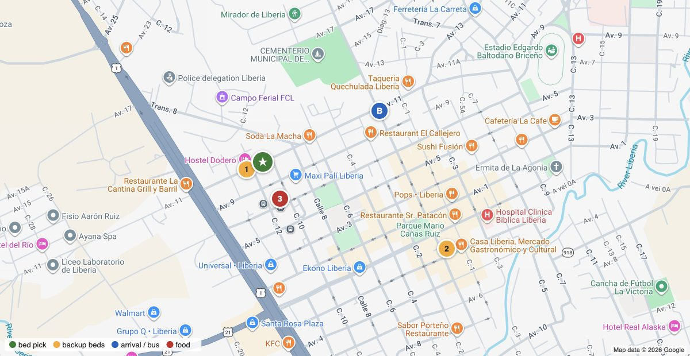
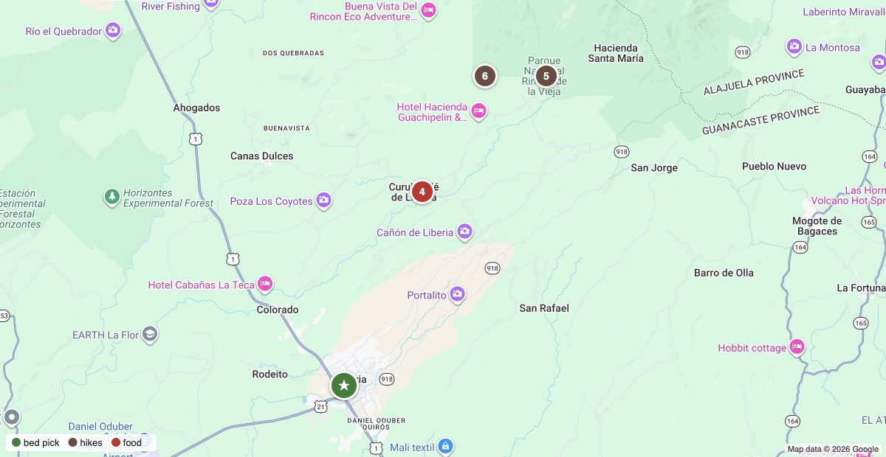

# 🇨🇷 Liberia / Rincón de la Vieja

Part of the [LatAm itinerary](../itinerary.md) · region notes: [Costa Rica + Nicaragua](costa-rica-nicaragua.md) · ← [La Fortuna / Arenal](la-fortuna.md) · [San Juan del Sur / Playa Maderas](san-juan-del-sur.md) →

> **Stop 31 · Thu 18 → Sat 20 Feb 2027 · 2 nights** 
> 🏞️ Hot, dry Guanacaste town; the base for the mud pots, fumaroles and waterfalls of Rincón de la Vieja 
> 🛏️ **Hostel Pura Vida en Liberia**, 10-bed mixed dorm, $28 for 2 nights 
> 🚌 **In:** La Fortuna → Tilarán → Cañas → Liberia, Thu · **Out:** bus to the Nicaraguan border, Sat

Mud pools and dry forest in Parque Nacional Rincón de la Vieja. Photo: Google Maps.

## 🗺️ Map

**In town:** ★ **Hostel Pura Vida en Liberia** (the pick) · **B** Pulmitan bus terminal (as routed by Google) · **1** Hospedaje Dodero (backup) · **2** Hotel Liberia (private alt) · **3** [Mercado Municipal de Liberia](https://www.google.com/maps?ftid=0x8f757d29ee555555:0x9419781315a6eb17)

**Around:** ★ Liberia · **4** [Soda Curubanda](https://www.google.com/maps?ftid=0x8f75651d584d014f:0x3b3b3cff32a451a5) in [Curubandé](https://www.google.com/maps?ftid=0x8f7564e272a5f9e3:0xe50def219ea99440), where the bus stops · **5** [Parque Nacional Rincón de la Vieja](https://www.google.com/maps?ftid=0x8f757d1636b1ee43:0x1a60c9435d695090), Sector Las Pailas · **6** [La Cangreja waterfall](https://www.google.com/maps?ftid=0x8f756f859e640b81:0x114fe135e1df195c)

**Open the live map:** [town](https://www.google.com/maps/@10.6316,-85.4410,16z) · [area](https://www.google.com/maps/@10.70,-85.40,12z)

## 📅 Day by day

| Day | Plan |
|---|---|
| **Thu 18 Feb** | 🚌 La Fortuna → Tilarán → Cañas → Liberia (≈ 4½–5½ h). Buy the park ticket online and book a shuttle. |
| **Fri 19 Feb** | 🌋 **Rincón de la Vieja, Sector Las Pailas.** Leave by **07:00** to be at the gate at opening. The **Las Pailas loop**, then the **La Cangreja waterfall** or the Cataratas Escondidas. Carry 3 L of water. |
| **Sat 20 Feb** | 🚌 Bus to the Nicaraguan border; pay the **$8 exit tax online** first. |

## 🔖 Book (one click)

Dates and 1 adult are pre-filled. The first channel listed was the cheapest when checked on 24 Nov. ⚠️ = time-sensitive.

**Beds** (18 → 20 Feb, 2 nights)

| | Where | Total | Location | From the Pulmitan bus terminal | Book |
|---|---|---:|:---:|---|---|
| ⭐ **Pick** | **Hostel Pura Vida en Liberia** · mixed 10-bed dorm | **$28** | 9.5 | 🚶 7 min (500 m) · [route](https://www.google.com/maps/dir/?api=1&origin=10.6341273,-85.4398195&destination=10.6322397,-85.4441777&travelmode=walking) | [Booking (search)](https://www.booking.com/searchresults.html?ss=Hostel+Pura+Vida+en+Liberia+&checkin=2027-02-18&checkout=2027-02-20&group_adults=1&no_rooms=1&selected_currency=USD) |
| Backup | **Hospedaje Dodero** · standard 6-bed mixed dorm, ensuite | $30 | 9.1 *(HW)* | 🚶 8 min (600 m) · [route](https://www.google.com/maps/dir/?api=1&origin=10.6341273,-85.4398195&destination=10.631971,-85.4447684&travelmode=walking) | [Booking (search)](https://www.booking.com/searchresults.html?ss=Hospedaje+Dodero+&checkin=2027-02-18&checkout=2027-02-20&group_adults=1&no_rooms=1&selected_currency=USD) · [Hostelworld](https://www.hostelworld.com/hostels/p/51177/hospedaje-dodero/?from=2027-02-18&to=2027-02-20&guests=1) |
| Private alt | **Hotel Liberia** · single room | $151 | 9.6 | 🚶 11 min (800 m) · [route](https://www.google.com/maps/dir/?api=1&origin=10.6341273,-85.4398195&destination=10.6290625,-85.43731249999999&travelmode=walking) | [Booking](https://www.booking.com/hotel/cr/liberia-liberia.html?checkin=2027-02-18&checkout=2027-02-20&group_adults=1&no_rooms=1&group_children=0&selected_currency=USD) |

**Transport and tickets**

| | Leg | When | Price | Book |
|---|---|---|---:|---|
| In | La Fortuna → Tilarán → Cañas → Liberia (no direct bus) | **Thu 18 Feb**, ≈ 08:00 or 07:30 | ≈ $12–14 | at the La Fortuna terminal (check the day before) |
| ⚠️ Ticket | **Rincón de la Vieja, Las Pailas** (SINAC, online only; no cash or card at the gate) | **Fri 19 Feb** (closed Mondays) | ≈ $16.95 | [SINAC](https://serviciosenlinea.sinac.go.cr/) |
| Park | Round-trip shuttle Liberia → the park gate | Fri 19 Feb, leave by 07:00 | ≈ $25–40 | Liberia hostels/agencies |
| ⚠️ Out | **Costa Rica land exit tax** | online, before leaving Liberia | $8 | see the [San Juan del Sur guide](san-juan-del-sur.md) |

How to read these tables

- **Location** is the guests' location score on Booking.com. The target is 9.0 or higher, and ⚠️ would mark one below 9.0. *(HW)* means Hostelworld's location rating, used where a property isn't on Booking.
- **From the Pulmitan bus terminal** comes from Google Maps on 24 Nov: the property found on Maps and routed from where you arrive at midday on the check-in date.
- Symbols: 🚶 walk · 🚌 public transport · 🚕 taxi/rideshare · 🥾 hike only · ⚠️ far from the centre with no bus · ℹ️ outside the centre but on a bus line.

## 🚌 Getting here: La Fortuna → Tilarán → Cañas → Liberia, Thu 18 Feb

No direct bus.
- **La Fortuna → Tilarán:** ≈ 08:00, 12:15, 17:30 or 07:30/12:30/17:00; ~2 h, ≈ ₡3,500 / $7.80.
- **Tilarán → Cañas:** frequent, 30–60 min, ≈ ₡700 / $1.60.
- **Cañas → Liberia:** frequent, ~1–1½ h, ≈ ₡2,000 / $4.50.
- **In all:** ≈ 4½–5½ h and $12–14 (AI lead + LP route; check the La Fortuna terminal the day before).
- **Shuttle:** shared La Fortuna → Liberia ≈ $45–65, ~3 h (≈).
- **Río Celeste on the way:** see the [La Fortuna guide](la-fortuna.md) (Cañas → Bijagua, long).

## 🛏️ Where to sleep

**Base: Liberia, not the park.** Liberia has the hostels, the cheap bus to the Nicaraguan border (20 Feb) and supermarkets. The lodges near the park (Curubandé, Hacienda Guachipelín, Rinconcito) still need a car or shuttle to the gate and cost more. With one park day, stay in Liberia and buy a shuttle.

All live-checked on 24 Nov.

### ⭐ Pick: Hostel Pura Vida en Liberia
- **Room:** mixed 10-bed dorm.
- **Price:** **$28 for 2 nights** (card $14 × 2; IVA treatment unchecked) · Booking.com (not on Hostelworld).
- **Reviews:** Booking **9.0 (347; 9 % bad)**.
- **Where:** ~1 km from downtown.
- **Checks:** kitchen mentioned in 14 recent reviews; **no party mentions**; a couple of curtain mentions; the hall A/C unit is loud for some.

### Backup: Hospedaje Dodero
- **Room:** standard 6-bed mixed dorm, ensuite.
- **Price:** **$30 on Booking** (8.3/903; card $15 × 2) vs **$33.90 on Hostelworld** ($30 + IVA).
- **Reviews:** HW **8.7 (2,456; 12.4 % < 7)**, newest 94–100 (Nov 2026).
- **Where:** 100 m north of the main bus terminal.
- **Checks:** shared kitchen with cooker; A/C rooms; **no bed curtains**; road noise on the street side.
- **Hostelworld's other Liberia hostels:** Casa Mar (8.3/68, $45.20 incl. IVA), Sunset House (9.4 but 23 reviews, pool, 2.6 km out).

### Private alt (location first): Hotel Liberia
- Single room · Booking location **9.6** (score 8.8, 239 reviews, 3 % bad) · **$151 for 2 nights** (room table) · Booking.com · 0.65 km from the centre.
- **Cheaper:** Casa Binisa, whole 2-bedroom townhouse with kitchen, location 9.1 (114 reviews, 1 % bad), **$119**, 1.7 km out; Hospedaje Dodero's single (shared bath) $45.20 incl. IVA on Hostelworld.

## 🌳 Things to do (outdoors first)

<table>
<tr>
<td width="50%" valign="top"> <b><a href="https://www.google.com/maps?ftid=0x8f757d1636b1ee43:0x1a60c9435d695090">Las Pailas loop</a></b> · ≈ $16.95 · ~3.5–4 km Mud pots, fumaroles and the Volcancito. Tue–Sun 08:00–15:00; tickets online only.</td>
<td width="50%" valign="top"> <b><a href="https://www.google.com/maps?ftid=0x8f756f859e640b81:0x114fe135e1df195c">La Cangreja waterfall</a></b> · same ticket · ≈ 10 km return The longer trail after the loop; or the Cataratas Escondidas.</td>
</tr>
</table>

- **Parque Nacional Rincón de la Vieja, Sector Las Pailas** (Fri 19 Feb): **$15 + IVA ≈ $16.95**, Tue–Sun 08:00–15:00, **closed Mondays** ✅ sinac.go.cr park page. **Tickets online only** on SINAC's SICORE (no cash or card at the gate; LP).
  - The **Las Pailas loop (~3.5–4 km)**: mud pots, fumaroles, the Volcancito.
  - Then the **La Cangreja waterfall** trail (≈ 10 km return) or the Cataratas Escondidas.
  - The crater trail is closed (active volcano; hike backlog + LP).
- **Getting to the gate without a car:**
  - Public bus Liberia → Curubandé 3×/day (≈ 06:00–06:45, 12:00, 17:15; ≈ ₡1,130 / $2.50) stops ~10 km short of the gate (LP: "your accommodation can arrange further transport").
  - Hacienda Guachipelín charges $1.60/person to use its private road (LP).
  - **Practical:** a **round-trip shuttle from Liberia** (≈ $25–40, sold by Liberia hostels/agencies) or a taxi (≈ $40–50 each way). Leave by 07:00 to be at the gate at opening.

## 🍽️ Eat and drink

<table>
<tr>
<td width="50%" valign="top"> <b><a href="https://www.google.com/maps?ftid=0x8f757d29ee555555:0x9419781315a6eb17">Sodas at the central market</a></b> · casado ≈ ₡3,500–5,000 The cheap lunch in town.</td>
<td width="50%" valign="top"> <b><a href="https://www.google.com/maps?ftid=0x8f75651d584d014f:0x3b3b3cff32a451a5">Soda Curubanda</a></b> (Curubandé) Casados, tacos and fresh juices (LP), if you stop there. The photo shows its casado.</td>
</tr>
</table>

- **Sodas** around the Liberia central market: casado ≈ ₡3,500–5,000 ($8–11) ≈.
- **Soda Curubanda** in Curubandé (casados, tacos, fresh juices; LP) if you stop there.
- **Craft beer:** check nearer the time.

## ℹ️ Good to know
- **Guanacaste in February is hot and dry** (low 30s °C): start early, carry 3 L of water.
- ⚠️ Pay the **CR land exit tax ($8) online** before leaving Liberia (stop 32).

## 🚌 Leaving: Liberia → the Nicaraguan border, Sat 20 Feb

- The cheap bus to the border leaves from Liberia. Times, the border crossing and the onward leg are in the [San Juan del Sur guide](san-juan-del-sur.md).
- Pay the **$8 land exit tax online** first.

---
Photos: Google Maps contributors (Parque Nacional Rincón de la Vieja ×2, La Cangreja waterfall, Mercado Municipal de Liberia, Soda Curubanda).
