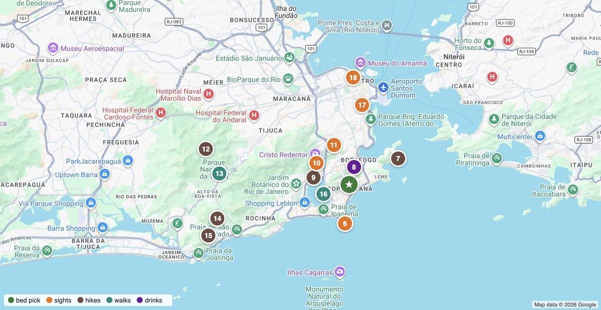

# 🇧🇷 Rio de Janeiro

Part of the [LatAm itinerary](../itinerary.md) · region notes: [Brazil](brazil.md) · [Ilha Grande](ilha-grande.md) →

> **Stop 1 · Tue 8 → Sat 12 Dec 2026 · 4 nights · first stop**
> 🏞️ Granite peaks, rainforest trails and city beaches, with a base in Copacabana 
> 🛏️ **Copacabana Central Hostel**, a bed in an 8-bed mixed dorm, $49 for 4 nights 
> ✈️ **In:** Alaska award SEA → GIG (AA lands 09:25), then BRT + metro to Copacabana · 🚌 **Out:** Costa Verde bus 05:00 to Mangaratiba + ferry to Ilha Grande, Sat 12 Dec

The Lagoa and Ipanema from Mirante do Sacopã, a free 15-minute forest walk up from Parque da Catacumba. Photo: Google Maps.

## 🗺️ Map

**Copacabana:** ★ **Copacabana Central Hostel** (the pick) · **1** Cocos Hostel Rio (backup) · **2** Studio da Lu (private alt) · **M** [Siqueira Campos metro](https://www.google.com/maps?ftid=0x9bd55b012ed4c7:0xf761ab206b7d8270) · **3** [Morro do Leme fort](https://www.google.com/maps?ftid=0x99800ed91498a1:0xf639d75d266abc97) + [Caminho dos Pescadores](https://www.google.com/maps?ftid=0x99800f5636df5b:0xc7f79983208fbe87) · **4** [Aipo e Aipim](https://www.google.com/maps?ftid=0x9bd5512ce5c2fd:0x3d7d4c9ed939dd7d) · **5** [Companhia do Garfo](https://www.google.com/maps?ftid=0x9980002f673de1:0xc342a77d782f6080)

**Around Rio:** ★ Copacabana · **6** [Arpoador rock](https://www.google.com/maps?ftid=0x9bd523a8c55c7d:0xc97bba8924651150) · **7** Urca: [Pista Cláudio Coutinho](https://www.google.com/maps?ftid=0x998010a8c5f185:0xc645387f2ee1b97f), [Morro da Urca trail](https://www.google.com/maps?ftid=0x998015efee2c47:0x88e6505c09a99959), [Sugarloaf](https://www.google.com/maps?ftid=0x9980409039f845:0x8075d7bcdfbcb48c) · **8** [Hocus Pocus DNA](https://www.google.com/maps?ftid=0x997fe4ce05463b:0x56b434368ff80fca) · **9** [Parque Lage](https://www.google.com/maps?ftid=0x9bd5783c4b0e7f:0x24e4aac202dbc423) (trail to the Christ) · **10** [Christ the Redeemer](https://www.google.com/maps?ftid=0x997fd5984aa13f:0x9dc984d7019502de) · **11** [Trem do Corcovado, Cosme Velho station](https://www.google.com/maps?ftid=0x997e2bc2331757:0x2a060bea445d622c) · **12** [Pico da Tijuca](https://www.google.com/maps?ftid=0x9bd6342f65f88d:0x541a6f853f1b1979) + [Tijuca Mirim](https://www.google.com/maps?ftid=0x9bd63118b3bc7d:0x1c076ef24444edec) · **13** [Cascatinha Taunay](https://www.google.com/maps?ftid=0x9bd65b4b78895d:0x1c1b06949f5c290c) · **14** [Pedra Bonita](https://www.google.com/maps?ftid=0x9bd6c27da98e43:0x9e176b90d4e85785) · **15** [Pedra da Gávea](https://www.google.com/maps?ftid=0x9bd6d13e950037:0x2c49dc1b12837f3f) · **16** [Mirante do Sacopã](https://www.google.com/maps?ftid=0x9bd572e5772df3:0xc7f912955980f871) above the [Lagoa](https://www.google.com/maps?ftid=0x9bd574afbc853f:0x20a26959ca6918cd) · **17** [Escadaria Selarón](https://www.google.com/maps?ftid=0x997f7b55fe685d:0x76011e047b252c35) · **18** [Pedra do Sal](https://www.google.com/maps?ftid=0x997f44be6b690b:0xa9c2718d55fc25e)

**Open the live map:** [Copacabana](https://www.google.com/maps/@-22.9680,-43.1780,15z) · [Rio](https://www.google.com/maps/@-22.950,-43.220,12z) · [GIG airport](https://www.google.com/maps?ftid=0x99798f3b16364f:0xcfa9dfbf2f584512)

## 📅 Day by day

| Day | Plan |
|---|---|
| **Tue 8 Dec** | ✈️ AA lands at GIG 09:25. 🚇 BRT + metro to Siqueira Campos (≈ 1 h 20), reaching Copacabana ~11:00. Beach, then **Arpoador rock for sunset** (free). |
| **Wed 9 Dec** | 🥾 **Pico da Tijuca** (1,021 m, backlog): Uber to Bom Retiro, ≈ 1 h 30 up. **Tijuca Mirim** and **Cascatinha Taunay** on the way down. |
| **Thu 10 Dec** | 🥾 **Pedra Bonita** (696 m) at sunrise. Or, if clear, **Pedra da Gávea** (844 m) with a guide. |
| **Fri 11 Dec** | 🌅 Morning: **Morro do Leme** fort + **Caminho dos Pescadores**. ⛰️ Afternoon: **Urca** (Cláudio Coutinho → Morro da Urca trail; Sugarloaf optional). 🍺 Hocus Pocus DNA in Botafogo. 🎶 Evening: **Pedra do Sal** (Friday roda ≈). |
| **First clear morning** | ⛰️ **Christ the Redeemer**: the Parque Lage trail (free, platform R$ 58) or the Trem do Corcovado (R$ 139). |
| **Sat 12 Dec** | 🚌 Uber to Novo Rio ~04:15 for the **05:00 Costa Verde** bus → ferry to Ilha Grande. |

## 🔖 Book (one click)

Dates and 1 adult are pre-filled. The first channel listed was the cheapest when checked on 24 Nov. ⚠️ = time-sensitive.

**Beds** (8 → 12 Dec, 4 nights)

| | Where | Total | Location | From the metro | Book |
|---|---|---:|:---:|---|---|
| ⭐ **Pick** | **Copacabana Central Hostel** · bed in an 8-bed mixed dorm | **$49** | 9.3 | 🚶 walk 13 min (1.0 km) from Cardeal Arcoverde metro; centre 10 min on foot · [route](https://www.google.com/maps/dir/?api=1&origin=-22.9645,-43.1806&destination=-22.9655401,-43.1882969&travelmode=walking) | [Booking](https://www.booking.com/hotel/br/copacabana-central-hostel-1.html?checkin=2026-12-08&checkout=2026-12-12&group_adults=1&no_rooms=1&group_children=0&selected_currency=USD) · [Hostelworld](https://www.hostelworld.com/hostels/p/339185/copacabana-central-hostel/?from=2026-12-08&to=2026-12-12&guests=1) · [Agoda](https://www.agoda.com/partners/partnersearch.aspx?hid=85737944&checkin=2026-12-08&checkout=2026-12-12&NumberofAdults=1&Rooms=1) |
| Backup | **Cocos Hostel Rio** · bed in a 6-bed mixed dorm, privacy panels | $105 | 9.8 | 🚶 walk 16 min (1.1 km) from Cardeal Arcoverde metro; centre 9 min on foot · [route](https://www.google.com/maps/dir/?api=1&origin=-22.9645,-43.1806&destination=-22.9704156,-43.188045699999996&travelmode=walking) | [Booking](https://www.booking.com/hotel/br/cocos-hostel-rio.html?checkin=2026-12-08&checkout=2026-12-12&group_adults=1&no_rooms=1&group_children=0&selected_currency=USD) · [Hostelworld](https://www.hostelworld.com/hostels/p/336326/cocos-hostel-rio/?from=2026-12-08&to=2026-12-12&guests=1) |
| Private alt | **Studio da Lu** · whole 1-bedroom flat | $154 | 9.9 | 🚌 15 min by public transport from Cardeal Arcoverde metro: walk 3 min → bus 100 or 457; walk 26 min; centre 19 min on foot · [route](https://www.google.com/maps/dir/?api=1&origin=-22.9645,-43.1806&destination=-22.9754926,-43.192932&travelmode=transit) | [Booking](https://www.booking.com/hotel/br/studio-da-lu.html?checkin=2026-12-08&checkout=2026-12-12&group_adults=1&no_rooms=1&group_children=0&selected_currency=USD) |

**Transport**

| | Leg | When | Price | Book |
|---|---|---|---:|---|
| In | ✈ **Alaska award** SEA → GIG | **Mon 7 Dec** (AA lands 09:25) | 60k miles, business | [Alaska](https://www.alaskaair.com/search/results?A=1&O=SEA&D=GIG&OD=2026-12-07&OT=Anytime&RT=false&UPG=none&ShoppingMethod=onlineaward&awardType=MilesOnly) |
| In | BRT TransCarioca + Metrô · GIG → Siqueira Campos | ≈ 1 h 20 (BRT 04:00–00:00) | R$ 9.70 ($1.63) | pay at the gates (foreign cards at the BRT gate ≈; carry R$ 20 cash) |
| Out | Costa Verde Novo Rio → Mangaratiba, then Barcas Rio ferry → Abraão | **Sat 12 Dec 05:00 → 07:10**; ferry 08:00 → ~09:50 | R$ 78.49 ($13.17) + Uber | [ClickBus](https://www.clickbus.com.br/onibus/rio-de-janeiro-novo-rio-rj/mangaratiba-rj?departureDate=2026-12-12) · [Barcas Rio timetable](https://barcasrio.com.br/linhas-horarios-e-tarifas/) |

**Sights:** Sugarloaf cable car (optional, R$ 205): [bondinho.com.br](https://bondinho.com.br/)

How to read these tables

- **Location** is the guests' location score on Booking.com. The target is 9.0 or higher, and ⚠️ would mark one below 9.0. *(HW)* means Hostelworld's location rating, used where a property isn't on Booking.
- **From the metro** comes from Google Maps on 24 Nov: the property found on Maps and routed from where you arrive at midday on the check-in date (Cardeal Arcoverde metro). The **route** link opens the same route.
- Symbols: 🚶 walk · 🚌 public transport · 🚕 taxi/rideshare · 🥾 hike only · ⚠️ far from the centre with no bus · ℹ️ outside the centre but on a bus line.

## ✈️ Getting here: GIG airport → Copacabana, Tue 8 Dec

- **Flight:** Alaska award SEA → GIG, Mon 7 Dec (60k, business); **AA lands 09:25**.
- **BRT + metro, R$ 9.70 ($1.63):**
  - **BRT TransCarioca** (Galeão service) from the T1/T2 stations to **Vicente de Carvalho**, R$ 5.00. It runs 04:00–00:00.
  - Then **Metrô L2 → L1** to **Siqueira Campos**, Copacabana; the integrated fare is R$ 9.70. About **1 h 20 min** ✅ riogaleao.com (Galeão is now run by Aena).
  - MetrôRio takes contactless bank cards. Whether the BRT gate takes a foreign card is ≈, so carry R$ 20 in cash.
- **Uber/99:** about **R$ 60–100 ($10–17)** ≈, 35–60 min. The pickup point is on the arrivals level, turn left ✅.

## 🛏️ Where to sleep

All three were live-checked on 24 Nov.

### ⭐ Pick: Copacabana Central Hostel
- **Unit:** a bed in an 8-bed mixed dorm. Travessa Santa Margarida 23, Copacabana.
- **Price:** **$49 for 4 nights on Booking** (non-refundable, dates changeable; $54 with free cancellation to 3 Dec). Agoda $51.78; Hostelworld $58.84 + fee.
- **Reviews:** Booking 9.2 (110 reviews; **5% below 7**), location 9.3. Hostelworld 96% (18 ratings; the 5 written reviews since Jul 2026 are all 80+). Opened 2025–26.
- **Where:** ~230 m from Siqueira Campos metro, ~700 m to the beach.
- **Checks:**
  - Kitchen yes.
  - No bed curtains mentioned.
  - Not a party hostel (no bar).
  - Some street noise at night, so bring earplugs.

### Backup: Cocos Hostel Rio
- **Unit:** a bed in a 6-bed mixed dorm, Copacabana.
- **Price:** **$105 for 4 nights on Booking** (free cancellation to 26 Nov, pay online; breakfast +$4). Hostelworld $117.92.
- **Reviews:** Booking 9.4 (246; **3% below 7**), location 9.8. Hostelworld 98% (33).
- **Where:** ~500 m from Siqueira Campos metro.
- **Checks:**
  - **Beds have privacy panels: "half box, half curtain"** (Oct 2026 review).
  - Kitchen yes.
  - Family vibe; some street noise at night.
  - This is the "curtains" upgrade at about twice the pick's price.
- **Cheaper backup:** **Rio Waves Hostel Copacabana**, 8-bed mixed. Booking 9.3 (76; 8% below 7), location 9.8. **$78**, free cancellation to 5 Dec, pay at the property. ~250 m from Siqueira Campos.

### Private alt (location first): Studio da Lu
- A whole 1-bedroom flat ~160 m from Cantagalo metro (Copacabana Posto 5–6).
- Booking 9.8 (69 reviews; **0% below 7**), location 9.9.
- **$154 for 4 nights** from the room table (non-refundable), Booking.
- **Cheaper:** Brazil Cozy and Comfortable, a double room in a hosted flat. Booking 9.0 (114; 8% below 7), location 9.5. **$140**, near Siqueira Campos.

**Not chosen:**
- **Bamboo Rio:** pool-party vibe (earlier notes) and a 2026 bed-bug report.
- **CabanaCopa:** Booking 7.8, 26% below 7.
- **Discovery (Glória):** $76, 8% below 7, away from the beach.
- **Books Hostel and Castelo dos Tucanos:** party hostels.
- **Ipanema hostels:** $37–46 a night.

## 🌳 Things to do (free and outdoors first)

<table>
<tr>
<td width="50%" valign="top"> <b><a href="https://www.google.com/maps?ftid=0x9bd5783c4b0e7f:0x24e4aac202dbc423">Parque Lage → Christ the Redeemer trail</a></b> · free trail, R$ 58 at the top ≈ 3.5–4 km each way with rock scrambles and short ladders. ⚠️ Don't go alone (robberies on the lower section).</td>
<td width="50%" valign="top"> <b><a href="https://www.google.com/maps?ftid=0x9bd6342f65f88d:0x541a6f853f1b1979">Pico da Tijuca</a></b> (1,021 m) · free · Wed 9 About 1 h 30 up from Bom Retiro, finishing on rock-cut steps.</td>
</tr>
<tr>
<td width="50%" valign="top"> <b><a href="https://www.google.com/maps?ftid=0x9bd6c27da98e43:0x9e176b90d4e85785">Pedra Bonita</a></b> (696 m) · free · Thu 10 at sunrise About 1 h return from the hang-glider ramp road.</td>
<td width="50%" valign="top"> <b><a href="https://www.google.com/maps?ftid=0x9bd6d13e950037:0x2c49dc1b12837f3f">Pedra da Gávea</a></b> (844 m) · guide ≈ from $60 If clear, instead of Pedra Bonita. An exposed rock pitch: the one paid hike worth it.</td>
</tr>
<tr>
<td width="50%" valign="top"> <b><a href="https://www.google.com/maps?ftid=0x9bd523a8c55c7d:0xc97bba8924651150">Arpoador rock</a></b> · free Sunset on Tue 8, and any evening.</td>
<td width="50%" valign="top"> <b><a href="https://www.google.com/maps?ftid=0x998015efee2c47:0x88e6505c09a99959">Morro da Urca trail</a></b> · free · Fri 11 About 30–40 min steep from Pista Cláudio Coutinho. Free, and the bay view is nearly as good as from the top.</td>
</tr>
<tr>
<td width="50%" valign="top"> <b><a href="https://www.google.com/maps?ftid=0x99800ed91498a1:0xf639d75d266abc97">Morro do Leme fort</a></b> · R$ 10 ≈ · Fri 11 morning Army-run fort above Leme, plus the free <a href="https://www.google.com/maps?ftid=0x99800f5636df5b:0xc7f79983208fbe87">Caminho dos Pescadores</a> sea walk.</td>
<td width="50%" valign="top"> <b><a href="https://www.google.com/maps?ftid=0x9bd572e5772df3:0xc7f912955980f871">Mirante do Sacopã</a> and the <a href="https://www.google.com/maps?ftid=0x9bd574afbc853f:0x20a26959ca6918cd">Lagoa</a></b> · free Parque da Catacumba → Sacopã is 15 min of forest; the Lagoa loop is 7.5 km.</td>
</tr>
<tr>
<td width="50%" valign="top"> <b><a href="https://www.google.com/maps?ftid=0x997f7b55fe685d:0x76011e047b252c35">Escadaria Selarón</a></b> · free Go before 10:00, ahead of the crowds.</td>
<td width="50%" valign="top"> <b><a href="https://www.google.com/maps?ftid=0x997f44be6b690b:0xa9c2718d55fc25e">Pedra do Sal</a></b> · free · Fri 11 evening The free samba classic is on Mondays (missed); a Friday roda from ~19:00 is ≈. Uber back.</td>
</tr>
<tr>
<td width="50%" valign="top"> <b><a href="https://www.google.com/maps?ftid=0x9980409039f845:0x8075d7bcdfbcb48c">Sugarloaf cable car</a></b> · R$ 205 ($34), optional Hikers buy at the Morro da Urca kiosk: Pão de Açúcar return R$ 140.</td>
<td width="50%" valign="top"> <b><a href="https://www.google.com/maps?ftid=0x997fd5984aa13f:0x9dc984d7019502de">Christ the Redeemer</a></b> · train R$ 139 ($23), paid once By the <a href="https://www.google.com/maps?ftid=0x997e2bc2331757:0x2a060bea445d622c">Trem do Corcovado</a> or the Parque Lage trail. Go on the first clear morning.</td>
</tr>
</table>

**Hiking weather:** December is hot (~30 °C) with storms after ~13:00, so start hikes at 07:00. All trails are free.

**Christ the Redeemer from Parque Lage** (free trail, new 26 Nov):
- ≈ 3.5–4 km each way with rock scrambles and short ladders.
- Sign the ranger logbook at the trail gate (open 08:00, last start 15:00), then pay **R$58** at the top for the statue platform.
- Go down by the Corcovado train (≈ R$35–37) or the same trail.
- ⚠️ **Robberies on the lower forest section:** don't go alone; start 09:00–10:30 with other hikers, or hire a guide.
- Tijuca National Park closes the trail after heavy rain *(leads via Nomadic Matt and an AI summary)*.

**Christ the Redeemer by train (paid, once):** Trem do Corcovado **R$ 139 ($23)** ✅ tremdocorcovado.rio. Go on the first clear morning; it is often in cloud in the afternoon. The Paineiras van price is unverified.

**Wed 9: Pico da Tijuca (1,021 m), backlog.** Uber to Bom Retiro (Floresta da Tijuca), then about 1 h 30 up, finishing on rock-cut steps. Add Tijuca Mirim and Cascatinha Taunay on the way down.

**Thu 10:** **Pedra Bonita** (696 m) at sunrise, about 1 h return from the hang-glider ramp road. Or, if clear, **Pedra da Gávea** (844 m): it has an exposed rock pitch, so go with a guide (≈ from $60). This is the one paid hike worth it.

**Fri 11:**
- **Morning:** **Morro do Leme** fort (R$ 10 ≈, Army-run) plus the free **Caminho dos Pescadores** sea walk.
- **Afternoon, Urca:**
  - Walk Pista Cláudio Coutinho, then the **Morro da Urca trail**, about 30–40 min steep. Free, and the bay view is nearly as good as from the top.
  - **Sugarloaf by cable car is now R$ 205 ($34)** for the full ticket. It runs Mon–Fri 08:30–21:00, last boarding 19:30 ✅ bondinho.com.br.
  - Hikers buy at the Morro da Urca kiosk: Pão de Açúcar return **R$ 140**, or the ride down only R$ 65 ≈ (not on the official page).
  - Free option: sunset on Morro da Urca, then walk down before dark.
- **Evening:** Pedra do Sal samba. The free classic is **Mondays** ✅ (official account), which this stay misses. A Friday roda from ~19:00 is ≈ (Instagram), so check on the day. Take an Uber back.

**Daily, free:** Arpoador rock for sunset; the 7.5 km Lagoa loop; Parque da Catacumba → Mirante do Sacopã (15 min of forest); Escadaria Selarón before 10:00.

## 🍽️ Eat and drink

<table>
<tr>
<td width="50%" valign="top"> <b><a href="https://www.google.com/maps?ftid=0x9bd5512ce5c2fd:0x3d7d4c9ed939dd7d">Aipo e Aipim</a></b> · por quilo, ≈ R$ 35–40 ($6–7) a plate Self-service lunch by weight, Copacabana.</td>
<td width="50%" valign="top"> <b><a href="https://www.google.com/maps?ftid=0x9980002f673de1:0xc342a77d782f6080">Companhia do Garfo</a></b> · por quilo, ≈ R$ 35–40 ($6–7) The other por-quilo lunch pick, in Copacabana.</td>
</tr>
<tr>
<td width="50%" valign="top"> <b><a href="https://www.google.com/maps?ftid=0x997fe4ce05463b:0x56b434368ff80fca">Hocus Pocus DNA</a></b> · craft beer R. Dezenove de Fevereiro 186, Botafogo. Pair it with Urca on Friday.</td>
<td width="50%" valign="top"> <b>Prato feito</b> · ≈ R$ 30–40 ($5–7) The set plate at any boteco, for dinner. Generic photo (Belém), not a Rio place.</td>
</tr>
</table>

- **Por quilo lunch:** about R$ 35–40 ($6–7) a plate ≈. Companhia do Garfo (Copacabana) or Aipo & Aipim.
- **Prato feito** at a boteco for dinner: R$ 30–40 ($5–7) ≈.
- **Craft beer:** **Hocus Pocus DNA**, R. Dezenove de Fevereiro 186, Botafogo (pair it with Urca on Friday); BeerLab in Copacabana (not found on Google Maps).
- Prices unverified.

## ℹ️ Good to know
- **Safety:** carry little on the beach at night and use Uber after dark. Avoid Lapa and Centro side streets late. Hike in the morning on busy trails. Ask the hostel before Dois Irmãos via Vidigal.
- **Money:** use ATMs inside banks or malls. Cards work almost everywhere; Pix needs a Brazilian account.
- **Events:** **Sat 12 Dec, Henrique & Juliano play Maracanã** (sold out; seen in a Google snippet ≈). You leave that morning, so the effect is small. Nothing else big found for 8–11 Dec.
- **Optional +2 days first:** [Teresópolis / Serra dos Órgãos](teresopolis.md), straight from GIG; Rio would then move to Thu 10 → Mon 14 Dec.

## 🚌 Leaving: Rio → Ilha Grande, Sat 12 Dec

- **Recommended (option A in the [Ilha Grande guide](ilha-grande.md)):** Uber to Novo Rio at ~04:15 (≈ R$ 35; the metro opens 05:00).
- **Costa Verde 05:00 → Mangaratiba 07:10** (R$ 57.99 ≈, ClickBus listing), then the **Barcas Rio ferry Mangaratiba → Abraão 08:00** (R$ 20.50, up to 110 min ✅ barcasrio.com.br). Arrive ~09:50.
- **Total R$ 78.49 ($13.17)** + Uber. It gives you all of Saturday for the Lopes Mendes trail.
- Three other options (a later bus via Angra, the Jacareí flex boat, a door-to-door van) are in the Ilha Grande guide.

---
Photos: Google Maps contributors (Mirante do Sacopã, Parque Lage, Pico da Tijuca, Pedra Bonita, Pedra da Gávea, Arpoador, Morro da Urca, Forte Duque de Caxias, Escadaria Selarón, Pedra do Sal, Sugarloaf, Christ the Redeemer, Aipo e Aipim, Companhia do Garfo, Hocus Pocus DNA). Wikimedia Commons: <a href="https://commons.wikimedia.org/wiki/File:Prato_Feito_em_Bel%C3%A9m.jpg">Prato Feito em Belém</a> (Los viajes del Cangrejo, CC BY 2.0).
