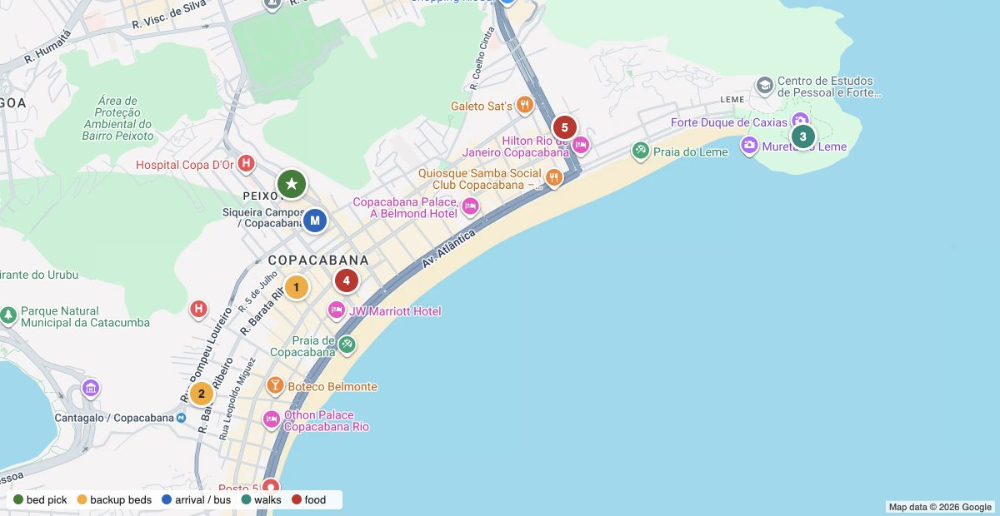

# 🇧🇷 Rio de Janeiro

Part of the [LatAm itinerary](../itinerary.md) · region notes: [Brazil](brazil.md) · [Ilha Grande](ilha-grande.md) →

> **Stop 1 · Tue 8 → Sat 12 Dec 2026 · 4 nights · first stop** 
> 🏞️ Granite peaks, rainforest trails and city beaches, with a base in Copacabana 
> 🛏️ **Copacabana Central Hostel**, a bed in an 8-bed mixed dorm, $49 for 4 nights 
> ✈️ **In:** Alaska award SEA → GIG (AA lands 09:25), then BRT + metro to Copacabana · 🚌 **Out:** Costa Verde bus 07:00 to Conceição de Jacareí + flex boat 09:30 to Ilha Grande, Sat 12 Dec

The Lagoa and Ipanema from Mirante do Sacopã, a free 15-minute forest walk up from Parque da Catacumba. Photo: Google Maps.

## 🗺️ Map

**Copacabana:** ★ **[Copacabana Central Hostel](https://www.google.com/maps?ftid=0x9bd5d66a7fa1a9:0xd0ae10b9943f7a49)** (the pick, [book](https://www.booking.com/hotel/br/copacabana-central-hostel-1.html?checkin=2026-12-08&checkout=2026-12-12&group_adults=1&no_rooms=1&group_children=0&selected_currency=USD)) · **1** [Cocos Hostel Rio](https://www.google.com/maps?ftid=0x9bd550d30d78ff:0x53532bb3c686d821) (backup, [book](https://www.booking.com/hotel/br/cocos-hostel-rio.html?checkin=2026-12-08&checkout=2026-12-12&group_adults=1&no_rooms=1&group_children=0&selected_currency=USD)) · **2** [Studio da Lu](https://www.google.com/maps?ftid=0x9bd5403609603f:0x3cd17fa909632393) (private alt, [book](https://www.booking.com/hotel/br/studio-da-lu.html?checkin=2026-12-08&checkout=2026-12-12&group_adults=1&no_rooms=1&group_children=0&selected_currency=USD)) · **M** [Siqueira Campos metro](https://www.google.com/maps?ftid=0x9bd55b012ed4c7:0xf761ab206b7d8270) · **3** [Morro do Leme fort](https://www.google.com/maps?ftid=0x99800ed91498a1:0xf639d75d266abc97) [🚌 52 min (bus 539)](https://www.google.com/maps/dir/?api=1&origin=-22.9655401,-43.1882969&destination=-22.9632598,-43.1619625&travelmode=transit) + [Caminho dos Pescadores](https://www.google.com/maps?ftid=0x99800f5636df5b:0xc7f79983208fbe87) · **4** [Aipo e Aipim](https://www.google.com/maps?ftid=0x9bd5512ce5c2fd:0x3d7d4c9ed939dd7d) [🚶 10 min](https://www.google.com/maps/dir/?api=1&origin=-22.9655401,-43.1882969&destination=-22.9701059,-43.1854558&travelmode=walking) · **5** [Companhia do Garfo](https://www.google.com/maps?ftid=0x9980002f673de1:0xc342a77d782f6080) [🚶 24 min](https://www.google.com/maps/dir/?api=1&origin=-22.9655401,-43.1882969&destination=-22.9628334,-43.1742477&travelmode=walking)

**Around Rio:** ★ Copacabana · **6** [Arpoador rock](https://www.google.com/maps?ftid=0x9bd523a8c55c7d:0xc97bba8924651150) [🚌 31 min (bus 456 / 457)](https://www.google.com/maps/dir/?api=1&origin=-22.9655401,-43.1882969&destination=-22.9903829,-43.1909875&travelmode=transit) · **7** Urca: [Pista Cláudio Coutinho](https://www.google.com/maps?ftid=0x998010a8c5f185:0xc645387f2ee1b97f) [🚌 1 h 13 min (subway L1, L4 + bus 167)](https://www.google.com/maps/dir/?api=1&origin=-22.9655401,-43.1882969&destination=-22.9492586,-43.1545757&travelmode=transit), [Morro da Urca trail](https://www.google.com/maps?ftid=0x998015efee2c47:0x88e6505c09a99959), [Sugarloaf](https://www.google.com/maps?ftid=0x9980409039f845:0x8075d7bcdfbcb48c) · **8** [Hocus Pocus DNA](https://www.google.com/maps?ftid=0x997fe4ce05463b:0x56b434368ff80fca) [🚌 19 min (subway L1, L4)](https://www.google.com/maps/dir/?api=1&origin=-22.9655401,-43.1882969&destination=-22.9547077,-43.1847392&travelmode=transit) · **9** [Parque Lage](https://www.google.com/maps?ftid=0x9bd5783c4b0e7f:0x24e4aac202dbc423) [🚌 33 min (subway L1, L4 + bus SV319)](https://www.google.com/maps/dir/?api=1&origin=-22.9655401,-43.1882969&destination=-22.961123,-43.2127151&travelmode=transit) (trail to the Christ) · **10** [Christ the Redeemer](https://www.google.com/maps?ftid=0x997fd5984aa13f:0x9dc984d7019502de) [🚌 1 h 12 min (subway L1, L4 + bus 422 + funicular Trem)](https://www.google.com/maps/dir/?api=1&origin=-22.9655401,-43.1882969&destination=-22.951916,-43.2104872&travelmode=transit) · **11** [Trem do Corcovado, Cosme Velho station](https://www.google.com/maps?ftid=0x997e2bc2331757:0x2a060bea445d622c) [🚌 39 min (subway L1, L4 + bus 422 / 583)](https://www.google.com/maps/dir/?api=1&origin=-22.9655401,-43.1882969&destination=-22.94073,-43.1985&travelmode=transit) · **12** [Pico da Tijuca](https://www.google.com/maps?ftid=0x9bd6342f65f88d:0x541a6f853f1b1979) [🚕 ≈ 47 min](https://www.google.com/maps/dir/?api=1&origin=-22.9655401,-43.1882969&destination=-22.9430556,-43.2863889&travelmode=driving) + [Tijuca Mirim](https://www.google.com/maps?ftid=0x9bd63118b3bc7d:0x1c076ef24444edec) · **13** [Cascatinha Taunay](https://www.google.com/maps?ftid=0x9bd65b4b78895d:0x1c1b06949f5c290c) [🚌 1 h 26 min (subway L1, L4 + bus 301 / 645)](https://www.google.com/maps/dir/?api=1&origin=-22.9655401,-43.1882969&destination=-22.95877,-43.2772583&travelmode=transit) · **14** [Pedra Bonita](https://www.google.com/maps?ftid=0x9bd6c27da98e43:0x9e176b90d4e85785) [🚕 ≈ 29 min](https://www.google.com/maps/dir/?api=1&origin=-22.9655401,-43.1882969&destination=-22.9872222,-43.2786111&travelmode=driving) · **15** [Pedra da Gávea](https://www.google.com/maps?ftid=0x9bd6d13e950037:0x2c49dc1b12837f3f) [🚕 ≈ 23 min](https://www.google.com/maps/dir/?api=1&origin=-22.9655401,-43.1882969&destination=-22.9978723,-43.2847223&travelmode=driving) · **16** [Mirante do Sacopã](https://www.google.com/maps?ftid=0x9bd572e5772df3:0xc7f912955980f871) [🚌 59 min (bus 473)](https://www.google.com/maps/dir/?api=1&origin=-22.9655401,-43.1882969&destination=-22.971783,-43.2057373&travelmode=transit) above the [Lagoa](https://www.google.com/maps?ftid=0x9bd574afbc853f:0x20a26959ca6918cd) · **17** [Escadaria Selarón](https://www.google.com/maps?ftid=0x997f7b55fe685d:0x76011e047b252c35) [🚌 27 min (subway L1, L4)](https://www.google.com/maps/dir/?api=1&origin=-22.9655401,-43.1882969&destination=-22.9152923,-43.1792036&travelmode=transit) · **18** [Pedra do Sal](https://www.google.com/maps?ftid=0x997f44be6b690b:0xa9c2718d55fc25e) [🚌 36 min (subway L1, L4 + bus 521D)](https://www.google.com/maps/dir/?api=1&origin=-22.9655401,-43.1882969&destination=-22.8979788,-43.185326&travelmode=transit)

🧭 The time after each place is from the ★ bed (Google Maps, 26 Nov): 🚶 walk · 🚌 bus · 🚕 taxi · 🚗 by road (tour or bus). Click it for the route.

**Open the live map:** [Copacabana](https://www.google.com/maps/@-22.9680,-43.1780,15z) · [Rio](https://www.google.com/maps/@-22.950,-43.220,12z) · [GIG airport](https://www.google.com/maps?ftid=0x99798f3b16364f:0xcfa9dfbf2f584512)

## 📅 Day by day

| Day | Plan |
|---|---|
| **Day 1** · Tue 8 Dec | ✈️ AA lands at GIG 09:25. 🚇 BRT + metro to Siqueira Campos (≈ 1 h 20), reaching Copacabana ~11:00. Beach, then **Arpoador rock for sunset** (free). Or, if you'd rather be out of the sun: **MAR is free on Tuesdays** ✅, next to the Boulevard Olímpico murals (LP). |
| **Day 2** · Wed 9 Dec | 🥾 **Pico da Tijuca** (1,021 m, backlog): Uber to Bom Retiro, ≈ 1 h 30 up. **Tijuca Mirim** and **Cascatinha Taunay** on the way down. |
| **Day 3** · Thu 10 Dec | 🥾 **Pedra Bonita** (696 m) at sunrise. Or, if clear, **Pedra da Gávea** (844 m) with a guide. |
| **Day 4** · Fri 11 Dec | 🌅 Morning: **Morro do Leme** fort + **Caminho dos Pescadores**. ⛰️ Afternoon: **Urca** (Cláudio Coutinho → Morro da Urca trail; Sugarloaf optional). 🍺 Hocus Pocus DNA in Botafogo. 🎶 Evening: **Pedra do Sal** (Friday roda ≈). |
| **First clear morning** | ⛰️ **Christ the Redeemer**: the Parque Lage trail (free, platform R$ 58) or the Trem do Corcovado (R$ 139). |
| **Day 5** · Sat 12 Dec | 🚇 Metro + VLT to Novo Rio by ~06:40 for the **07:00 Costa Verde** bus → Conceição de Jacareí → 🚤 flex boat 09:30 to Ilha Grande. |

## 🔖 Book (one click)

Dates and 1 adult are pre-filled. The first channel listed was the cheapest when checked on 24 Nov. ⚠️ = time-sensitive.

**Beds** (8 → 12 Dec, 4 nights)

| | Where | Total | Location | From the metro | Book |
|---|---|---:|:---:|---|---|
| ⭐ **Pick** | **Copacabana Central Hostel** · bed in an 8-bed mixed dorm | **$49** | 9.3 | 🚶 6 min (400 m) from Siqueira Campos metro; centre 10 min on foot · [route](https://www.google.com/maps/dir/?api=1&origin=-22.96727,-43.18711&destination=-22.9655401,-43.1882969&travelmode=walking) | [Booking](https://www.booking.com/hotel/br/copacabana-central-hostel-1.html?checkin=2026-12-08&checkout=2026-12-12&group_adults=1&no_rooms=1&group_children=0&selected_currency=USD) · [Hostelworld](https://www.hostelworld.com/hostels/p/339185/copacabana-central-hostel/?from=2026-12-08&to=2026-12-12&guests=1) · [Agoda](https://www.agoda.com/partners/partnersearch.aspx?hid=85737944&checkin=2026-12-08&checkout=2026-12-12&NumberofAdults=1&Rooms=1) |
| Backup | **Cocos Hostel Rio** · bed in a 6-bed mixed dorm, privacy panels | $105 | 9.8 | 🚶 7 min (500 m) from Siqueira Campos metro; centre 9 min on foot · [route](https://www.google.com/maps/dir/?api=1&origin=-22.96727,-43.18711&destination=-22.9704156,-43.188045699999996&travelmode=walking) | [Booking](https://www.booking.com/hotel/br/cocos-hostel-rio.html?checkin=2026-12-08&checkout=2026-12-12&group_adults=1&no_rooms=1&group_children=0&selected_currency=USD) · [Hostelworld](https://www.hostelworld.com/hostels/p/336326/cocos-hostel-rio/?from=2026-12-08&to=2026-12-12&guests=1) |
| Private alt | **Studio da Lu** · whole 1-bedroom flat | $154 | 9.9 | 🚶 17 min (1.2 km) from Siqueira Campos metro (taxi ≈ 4 min); centre 19 min on foot · [route](https://www.google.com/maps/dir/?api=1&origin=-22.96727,-43.18711&destination=-22.9754926,-43.192932&travelmode=walking) | [Booking](https://www.booking.com/hotel/br/studio-da-lu.html?checkin=2026-12-08&checkout=2026-12-12&group_adults=1&no_rooms=1&group_children=0&selected_currency=USD) |

**Transport**

| | Leg | When | Price | Book |
|---|---|---|---:|---|
| In | ✈ **Alaska award** SEA → GIG | **Mon 7 Dec** (AA lands 09:25) | 60k miles, business | [Alaska](https://www.alaskaair.com/search/results?A=1&O=SEA&D=GIG&OD=2026-12-07&OT=Anytime&RT=false&UPG=none&ShoppingMethod=onlineaward&awardType=MilesOnly) |
| In | BRT TransCarioca + Metrô · GIG → Siqueira Campos | ≈ 1 h 20 (BRT 04:00–00:00) | R$ 9.70 ($1.63) | pay at the gates (foreign cards at the BRT gate ≈; carry R$ 20 cash) |
| Out | Costa Verde Novo Rio → Conceição de Jacareí, then Porto Real flex boat → Abraão | **Sat 12 Dec 07:00** → ≈ 09:00; boat **09:30** → 09:50 | ≈ R$ 135 ($23) | [Costa Verde timetable](https://www.costaverdetransportes.com.br/linhas-horarios) · [Porto Real boat](https://portorealilhagrande.com.br/travessias-flex-boat) |

**Sights:** Sugarloaf cable car (optional, R$ 205): [bondinho.com.br](https://bondinho.com.br/)

How to read these tables

- **Location** is the guests' location score on Booking.com. The target is 9.0 or higher, and ⚠️ would mark one below 9.0. *(HW)* means Hostelworld's location rating, used where a property isn't on Booking.
- **From the metro** comes from Google Maps on 24 Nov: the property found on Maps and routed from where you arrive at midday on the check-in date (Siqueira Campos metro, where the arrival directions end). The **route** link opens the same route.
- Symbols: 🚶 walk · 🚌 public transport · 🚕 taxi/rideshare · 🥾 hike only · ⚠️ far from the centre with no bus · ℹ️ outside the centre but on a bus line.

## ✈️ Getting here: GIG airport → Copacabana, Tue 8 Dec

- **Flight:** Alaska award SEA → GIG, Mon 7 Dec (60k, business); **AA lands 09:25**.
- **BRT + metro, R$ 9.70 ($1.63):**
  - **BRT TransCarioca** (Galeão service) from the T1/T2 stations to **Vicente de Carvalho**, R$ 5.00. It runs 04:00–00:00.
  - Then **Metrô L2 → L1** to **Siqueira Campos**, Copacabana; the integrated fare is R$ 9.70. About **1 h 20 min** ✅ riogaleao.com (Galeão is now run by Aena).
  - MetrôRio takes contactless bank cards. Whether the BRT gate takes a foreign card is ≈, so carry R$ 20 in cash.
- **Uber/99:** about **R$ 60–100 ($10–17)** ≈, 35–60 min. The pickup point is on the arrivals level, turn left ✅.

## 🛏️ Where to sleep

All three were live-checked on 24 Nov.

### ⭐ Pick: Copacabana Central Hostel
- **Unit:** a bed in an 8-bed mixed dorm. Travessa Santa Margarida 23, Copacabana.
- **Price:** **$49 for 4 nights on Booking** (non-refundable, dates changeable; $54 with free cancellation to 3 Dec). Agoda $51.78; Hostelworld $58.84 + fee.
- **Reviews:** Booking 9.2 (110 reviews; **5% below 7**), location 9.3. Hostelworld 96% (18 ratings; the 5 written reviews since Jul 2026 are all 80+). Opened 2025–26.
- **Where:** ~230 m from Siqueira Campos metro, ~700 m to the beach.
- **Checks:**
  - Kitchen yes.
  - No bed curtains mentioned.
  - Not a party hostel (no bar).
  - Some street noise at night, so bring earplugs.

### Backup: Cocos Hostel Rio
- **Unit:** a bed in a 6-bed mixed dorm, Copacabana.
- **Price:** **$105 for 4 nights on Booking** (free cancellation to 26 Nov, pay online; breakfast +$4). Hostelworld $117.92.
- **Reviews:** Booking 9.4 (246; **3% below 7**), location 9.8. Hostelworld 98% (33).
- **Where:** ~500 m from Siqueira Campos metro.
- **Checks:**
  - **Beds have privacy panels: "half box, half curtain"** (Oct 2026 review).
  - Kitchen yes.
  - Family vibe; some street noise at night.
  - This is the "curtains" upgrade at about twice the pick's price.
- **Cheaper backup:** **Rio Waves Hostel Copacabana**, 8-bed mixed. Booking 9.3 (76; 8% below 7), location 9.8. **$78**, free cancellation to 5 Dec, pay at the property. ~250 m from Siqueira Campos.

### Private alt (location first): Studio da Lu
- A whole 1-bedroom flat ~160 m from Cantagalo metro (Copacabana Posto 5–6).
- Booking 9.8 (69 reviews; **0% below 7**), location 9.9.
- **$154 for 4 nights** from the room table (non-refundable), Booking.
- **Cheaper:** Brazil Cozy and Comfortable, a double room in a hosted flat. Booking 9.0 (114; 8% below 7), location 9.5. **$140**, near Siqueira Campos.

**Not chosen:**
- **Bamboo Rio:** pool-party vibe (earlier notes) and a 2026 bed-bug report.
- **CabanaCopa:** Booking 7.8, 26% below 7.
- **Discovery (Glória):** $76, 8% below 7, away from the beach.
- **Books Hostel and Castelo dos Tucanos:** party hostels.
- **Ipanema hostels:** $37–46 a night.

## 🌳 Things to do (free and outdoors first)

<table>
<tr>
<td width="50%" valign="top"> <b><a href="https://www.google.com/maps?ftid=0x9bd5783c4b0e7f:0x24e4aac202dbc423">Parque Lage → Christ the Redeemer trail</a></b> · free trail, R$ 58 at the top · <a href="https://www.google.com/maps/dir/?api=1&origin=-22.9655401,-43.1882969&destination=-22.961123,-43.2127151&travelmode=transit">🚌 33 min (subway L1, L4 + bus SV319)</a> ≈ 3.5–4 km each way with rock scrambles and short ladders. ⚠️ Don't go alone (robberies on the lower section).</td>
<td width="50%" valign="top"> <b><a href="https://www.google.com/maps?ftid=0x9bd6342f65f88d:0x541a6f853f1b1979">Pico da Tijuca</a></b> (1,021 m) · free · Wed 9 · <a href="https://www.google.com/maps/dir/?api=1&origin=-22.9655401,-43.1882969&destination=-22.9430556,-43.2863889&travelmode=driving">🚕 ≈ 47 min</a> About 1 h 30 up from Bom Retiro, finishing on rock-cut steps.</td>
</tr>
<tr>
<td width="50%" valign="top"> <b><a href="https://www.google.com/maps?ftid=0x9bd6c27da98e43:0x9e176b90d4e85785">Pedra Bonita</a></b> (696 m) · free · Thu 10 at sunrise · <a href="https://www.google.com/maps/dir/?api=1&origin=-22.9655401,-43.1882969&destination=-22.9872222,-43.2786111&travelmode=driving">🚕 ≈ 29 min</a> About 1 h return from the hang-glider ramp road.</td>
<td width="50%" valign="top"> <b><a href="https://www.google.com/maps?ftid=0x9bd6d13e950037:0x2c49dc1b12837f3f">Pedra da Gávea</a></b> (844 m) · guide ≈ from $60 · <a href="https://www.google.com/maps/dir/?api=1&origin=-22.9655401,-43.1882969&destination=-22.9978723,-43.2847223&travelmode=driving">🚕 ≈ 23 min</a> If clear, instead of Pedra Bonita. An exposed rock pitch: the one paid hike worth it.</td>
</tr>
<tr>
<td width="50%" valign="top"> <b><a href="https://www.google.com/maps?ftid=0x9bd523a8c55c7d:0xc97bba8924651150">Arpoador rock</a></b> · free · <a href="https://www.google.com/maps/dir/?api=1&origin=-22.9655401,-43.1882969&destination=-22.9903829,-43.1909875&travelmode=transit">🚌 31 min (bus 456 / 457)</a> Sunset on Tue 8, and any evening.</td>
<td width="50%" valign="top"> <b><a href="https://www.google.com/maps?ftid=0x998015efee2c47:0x88e6505c09a99959">Morro da Urca trail</a></b> · free · Fri 11 About 30–40 min steep from Pista Cláudio Coutinho. Free, and the bay view is nearly as good as from the top.</td>
</tr>
<tr>
<td width="50%" valign="top"> <b><a href="https://www.google.com/maps?ftid=0x99800ed91498a1:0xf639d75d266abc97">Morro do Leme fort</a></b> · R$ 10 ≈ · Fri 11 morning · <a href="https://www.google.com/maps/dir/?api=1&origin=-22.9655401,-43.1882969&destination=-22.9632598,-43.1619625&travelmode=transit">🚌 52 min (bus 539)</a> Army-run fort above Leme, plus the free <a href="https://www.google.com/maps?ftid=0x99800f5636df5b:0xc7f79983208fbe87">Caminho dos Pescadores</a> sea walk.</td>
<td width="50%" valign="top"> <b><a href="https://www.google.com/maps?ftid=0x9bd572e5772df3:0xc7f912955980f871">Mirante do Sacopã</a> and the <a href="https://www.google.com/maps?ftid=0x9bd574afbc853f:0x20a26959ca6918cd">Lagoa</a></b> · free Parque da Catacumba → Sacopã is 15 min of forest; the Lagoa loop is 7.5 km.</td>
</tr>
<tr>
<td width="50%" valign="top"> <b><a href="https://www.google.com/maps?ftid=0x997f7b55fe685d:0x76011e047b252c35">Escadaria Selarón</a></b> · free · <a href="https://www.google.com/maps/dir/?api=1&origin=-22.9655401,-43.1882969&destination=-22.9152923,-43.1792036&travelmode=transit">🚌 27 min (subway L1, L4)</a> Go before 10:00, ahead of the crowds.</td>
<td width="50%" valign="top"> <b><a href="https://www.google.com/maps?ftid=0x997f44be6b690b:0xa9c2718d55fc25e">Pedra do Sal</a></b> · free · Fri 11 evening · <a href="https://www.google.com/maps/dir/?api=1&origin=-22.9655401,-43.1882969&destination=-22.8979788,-43.185326&travelmode=transit">🚌 36 min (subway L1, L4 + bus 521D)</a> The free samba classic is on Mondays (missed); a Friday roda from ~19:00 is ≈. Uber back.</td>
</tr>
<tr>
<td width="50%" valign="top"> <b><a href="https://www.google.com/maps?ftid=0x9980409039f845:0x8075d7bcdfbcb48c">Sugarloaf cable car</a></b> · R$ 205 ($34), optional Hikers buy at the Morro da Urca kiosk: Pão de Açúcar return R$ 140.</td>
<td width="50%" valign="top"> <b><a href="https://www.google.com/maps?ftid=0x997fd5984aa13f:0x9dc984d7019502de">Christ the Redeemer</a></b> · train R$ 139 ($23), paid once · <a href="https://www.google.com/maps/dir/?api=1&origin=-22.9655401,-43.1882969&destination=-22.951916,-43.2104872&travelmode=transit">🚌 1 h 12 min (subway L1, L4 + bus 422 + funicular Trem)</a> By the <a href="https://www.google.com/maps?ftid=0x997e2bc2331757:0x2a060bea445d622c">Trem do Corcovado</a> or the Parque Lage trail. Go on the first clear morning.</td>
</tr>
</table>

**Hiking weather:** December is hot (~30 °C) with storms after ~13:00, so start hikes at 07:00. All trails are free.

**Christ the Redeemer from Parque Lage** (free trail, new 26 Nov):
- ≈ 3.5–4 km each way with rock scrambles and short ladders.
- Sign the ranger logbook at the trail gate (open 08:00, last start 15:00), then pay **R$58** at the top for the statue platform.
- Go down by the Corcovado train (≈ R$35–37) or the same trail.
- ⚠️ **Robberies on the lower forest section:** don't go alone; start 09:00–10:30 with other hikers, or hire a guide.
- Tijuca National Park closes the trail after heavy rain *(leads via Nomadic Matt and an AI summary)*.

**Christ the Redeemer by train (paid, once):** Trem do Corcovado **R$ 139 ($23)** ✅ tremdocorcovado.rio. Go on the first clear morning; it is often in cloud in the afternoon. The Paineiras van price is unverified.

**Day 2 (Wed 9 Dec): Pico da Tijuca (1,021 m), backlog.** Uber to Bom Retiro (Floresta da Tijuca), then about 1 h 30 up, finishing on rock-cut steps. Add Tijuca Mirim and Cascatinha Taunay on the way down.

**Day 3 (Thu 10 Dec):** **Pedra Bonita** (696 m) at sunrise, about 1 h return from the hang-glider ramp road. Or, if clear, **Pedra da Gávea** (844 m): it has an exposed rock pitch, so go with a guide (≈ from $60). This is the one paid hike worth it.

**Day 4 (Fri 11 Dec):**
- **Morning:** **Morro do Leme** fort (R$ 10 ≈, Army-run) plus the free **Caminho dos Pescadores** sea walk.
- **Afternoon, Urca:**
  - Walk Pista Cláudio Coutinho, then the **Morro da Urca trail**, about 30–40 min steep. Free, and the bay view is nearly as good as from the top.
  - **Sugarloaf by cable car is now R$ 205 ($34)** for the full ticket. It runs Mon–Fri 08:30–21:00, last boarding 19:30 ✅ bondinho.com.br.
  - Hikers buy at the Morro da Urca kiosk: Pão de Açúcar return **R$ 140**, or the ride down only R$ 65 ≈ (not on the official page).
  - Free option: sunset on Morro da Urca, then walk down before dark.
- **Evening:** Pedra do Sal samba. The free classic is **Mondays** ✅ (official account), which this stay misses. A Friday roda from ~19:00 is ≈ (Instagram), so check on the day. Take an Uber back.

**Daily, free:** Arpoador rock for sunset; the 7.5 km Lagoa loop; Parque da Catacumba → Mirante do Sacopã (15 min of forest); Escadaria Selarón before 10:00.

**More from Lonely Planet** (*South America on a Shoestring*; free first):
- **Free walking tour of Centro** (LP): Free Walker Tours' downtown loop takes in Travessa do Comércio, Praça XV, Cinelândia, the Arcos da Lapa and the Selarón steps, about 2½–3 h, tips only (LP thinks R$ 50 is fair). It meets at the Largo da Carioca clock tower, Mon–Fri 10:30 and 15:00, Sat 10:30 ≈ (Google summary of the operator's listings). It's an easy way to fit in Selarón.
- **Boulevard Olímpico** (free, LP): the rebuilt port promenade by Praça Mauá, lined with huge murals. The highlight is Eduardo Kobra's 190 m *Etnias*.
- **Museu de Arte do Rio (MAR):** **free on Tuesdays** ✅ museudeartedorio.org.br (otherwise R$ 20). LP's tip is to start with the 6th-floor bay view and work down. **Tue 8** is your arrival day: Praça Mauá + MAR + the Boulevard make a good jet-lag afternoon.
- **Museu do Amanhã:** LP's free Tuesday no longer applies. It's now **R$ 40, closed Wednesdays**, but **R$ 10 on the 10th of every month** ✅ museudoamanha.org.br, which is **Thu 10 Dec**. Paid, so it's optional.
- **Parque Lage** (free, LP): English-style gardens and a mansion with free art shows, open 08:00–18:00 Dec–Mar (LP). It's the start of the Christ trail anyway.
- **Santa Teresa bonde:** the last historic tram, R$ 20 return (LP; Google summary of the state operator agrees ≈). It runs from the Carioca station (R. Lélio Gama) over the Arcos da Lapa to Largo do Guimarães, about every 15–20 min (LP).
- **Bike the flat paths** (LP): the Copacabana–Ipanema seafront, the Lagoa and the Aterro do Flamengo all have bike lanes. Bike Rio share bikes or the Lagoa rental stands (≈ R$ 20/h, LP).
- **Live samba near the hostel:** **[Bip Bip](https://www.google.com/maps?ftid=0x9bd53f113df54f:0xf57dccdb9545e414)** (R. Almirante Gonçalves 50, Copacabana) is a tiny bar with a roda de samba around a table from ~19:00, Sun–Fri (LP). Entry is free, but buy a drink. LP also lists **Pedra do Sal on Mondays and Fridays** from 20:00, which backs up the Friday plan.
- **Hang-gliding off Pedra Bonita:** a tandem flight is ≈ R$ 490–520 (LP). Watching the launch ramp on the way to the Pedra Bonita trail is free.
- **Backlog (LP):** the Prainha → Grumari coastal walk in Rio's wild far west. LP lists it as a guided hike.
- **Skip:** the **Jardim Botânico** now costs **R$ 80 for foreigners** ≈ (Google summary of gov.br; LP had R$ 15), and Curitiba's botanical garden is free. LP's Maracanã stadium tour is ≈ R$ 50–60 (LP).

## 🍽️ Eat and drink

<table>
<tr>
<td width="50%" valign="top"> <b><a href="https://www.google.com/maps?ftid=0x9bd5512ce5c2fd:0x3d7d4c9ed939dd7d">Aipo e Aipim</a></b> · por quilo, ≈ R$ 35–40 ($6–7) a plate · <a href="https://www.google.com/maps/dir/?api=1&origin=-22.9655401,-43.1882969&destination=-22.9701059,-43.1854558&travelmode=walking">🚶 10 min</a> Self-service lunch by weight, Copacabana.</td>
<td width="50%" valign="top"> <b><a href="https://www.google.com/maps?ftid=0x9980002f673de1:0xc342a77d782f6080">Companhia do Garfo</a></b> · por quilo, ≈ R$ 35–40 ($6–7) · <a href="https://www.google.com/maps/dir/?api=1&origin=-22.9655401,-43.1882969&destination=-22.9628334,-43.1742477&travelmode=walking">🚶 24 min</a> The other por-quilo lunch pick, in Copacabana.</td>
</tr>
<tr>
<td width="50%" valign="top"> <b><a href="https://www.google.com/maps?ftid=0x997fe4ce05463b:0x56b434368ff80fca">Hocus Pocus DNA</a></b> · craft beer · <a href="https://www.google.com/maps/dir/?api=1&origin=-22.9655401,-43.1882969&destination=-22.9547077,-43.1847392&travelmode=transit">🚌 19 min (subway L1, L4)</a> R. Dezenove de Fevereiro 186, Botafogo. Pair it with Urca on Friday.</td>
<td width="50%" valign="top"> <b>Prato feito</b> · ≈ R$ 30–40 ($5–7) The set plate at any boteco, for dinner. Generic photo (Belém), not a Rio place.</td>
</tr>
</table>

- **Por quilo lunch:** about R$ 35–40 ($6–7) a plate ≈. Companhia do Garfo (Copacabana) or Aipo & Aipim.
- **Prato feito** at a boteco for dinner: R$ 30–40 ($5–7) ≈.
- **Craft beer:** **Hocus Pocus DNA**, R. Dezenove de Fevereiro 186, Botafogo (pair it with Urca on Friday); BeerLab in Copacabana (not found on Google Maps). LP's Copacabana pick, Escondido, isn't on Google Maps any more either.
- Prices unverified.

**Cheap local spots from LP** (all still on Google Maps, 26 Nov):
- **[Pavão Azul](https://www.google.com/maps?ftid=0x9bd55a7629357f:0xb9af38b1c42aae05)**, Hilário de Gouveia 71, Copacabana: a classic boteco with pavement crowds, cold chope and cheap *pataniscas* (cod fritters) (LP).
- **[Galeto Sat's](https://www.google.com/maps?ftid=0x997fffa2ea2d29:0x24abb43bf0e8e120)**, Barata Ribeiro 7, Leme end of Copacabana: spit-roast chicken since 1962, with lunch specials ≈ R$ 34 (LP). Open very late.
- **[Rotisseria Sírio Libaneza](https://www.google.com/maps?ftid=0x997f8682a3afd1:0x3c8b9b4d350404cf)**, Largo do Machado 29 (Galeria Condor): cheap kibe, hummus, kafta and juices (LP).
- **[Bar do Mineiro](https://www.google.com/maps?ftid=0x997f7635666643:0x52f6199ba2541139)**, Santa Teresa: feijoada every day; the weekday lunch special is ≈ R$ 22–35 (LP). It pairs with the bonde.
- **Juice bars** are everywhere: a big *suco* is ≈ R$ 12–20 (LP).
- **Self-catering:** LP points to the **Zona Sul** supermarket chain.

## ℹ️ Good to know
- **Safety:** carry little on the beach at night and use Uber after dark. Avoid Lapa and Centro side streets late. Hike in the morning on busy trails. Ask the hostel before Dois Irmãos via Vidigal.
- **Beach theft (LP):** gangs sometimes sweep a stretch of sand robbing everyone (*arrastão*). Take nothing of value to the beach. If you must, locals bury it in a plastic bag under their towel. Don't walk on the beaches late at night.
- **More LP safety tips:**
  - Avoid city buses after dark.
  - Centro is deserted, and unsafe, on Sundays (not on these dates).
  - Check the latest before any favela visit.
  - If you are robbed, hand things over calmly.
  - Robbery reports for insurance go to the 24-h tourist police in Leblon (LP).
- **Money:** use ATMs inside banks or malls. Cards work almost everywhere; Pix needs a Brazilian account.
  - LP reports a wave of **card cloning** in Rio and singles out **Bradesco ATMs** to avoid. **Banco do Brasil** inside a branch is the safe default (Copacabana: Av. N. S. de Copacabana 1274, LP).
- **Getting around (LP):** Uber is ≈ 30% cheaper than a yellow taxi. The Novo Rio bus station sits in a run-down area, so arrive and leave by Uber and wait inside.
- **Airport alternative (LP):** the **Premium bus 2018** runs from GIG along the beachfront to Copacabana and Ipanema every 30–40 min, ≈ R$ 16 in LP (now more). The BRT + metro above is cheaper.
- **Medical:** Clínica Galdino Campos, Av. N. S. de Copacabana 492, is open 24 h with multilingual doctors (LP).
- **Events:** **Day 5 (Sat 12 Dec), Henrique & Juliano play Maracanã** (sold out; seen in a Google snippet ≈). You leave that morning, so the effect is small. Nothing else big found for 8–11 Dec.
- **Optional +2 days first:** [Teresópolis / Serra dos Órgãos](teresopolis.md), straight from GIG; Rio would then move to Thu 10 → Mon 14 Dec.

## 🚌 Leaving: Rio → Ilha Grande, Sat 12 Dec

- **Recommended (option A in the [Ilha Grande guide](ilha-grande.md)):** metro to Central, then the VLT or a 10-min walk to Novo Rio by ~06:40.
- **Costa Verde 07:00** (the Rio–Paraty bus; ask to get off at **Conceição de Jacareí**, ≈ 2 h), then **Porto Real's flex boat at 09:30** (R$ 65, 20 min; book ahead). Arrive Abraão ~09:50, the same time as the old 05:00 plan, for ≈ $10 more.
- **Cheapest:** the 05:00 bus to Mangaratiba + the 08:00 state ferry, R$ 78.49 ($13), but it means an Uber at 04:15. **Easiest:** Top Transfer's shared van + speedboat from the hostel, $44. Details and the Angra option are in the Ilha Grande guide.

---
Photos: Google Maps contributors (Mirante do Sacopã, Parque Lage, Pico da Tijuca, Pedra Bonita, Pedra da Gávea, Arpoador, Morro da Urca, Forte Duque de Caxias, Escadaria Selarón, Pedra do Sal, Sugarloaf, Christ the Redeemer, Aipo e Aipim, Companhia do Garfo, Hocus Pocus DNA). Wikimedia Commons: <a href="https://commons.wikimedia.org/wiki/File:Prato_Feito_em_Bel%C3%A9m.jpg">Prato Feito em Belém</a> (Los viajes del Cangrejo, CC BY 2.0).
