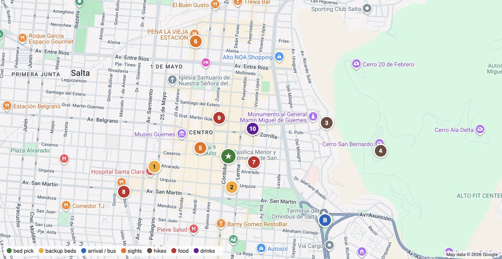
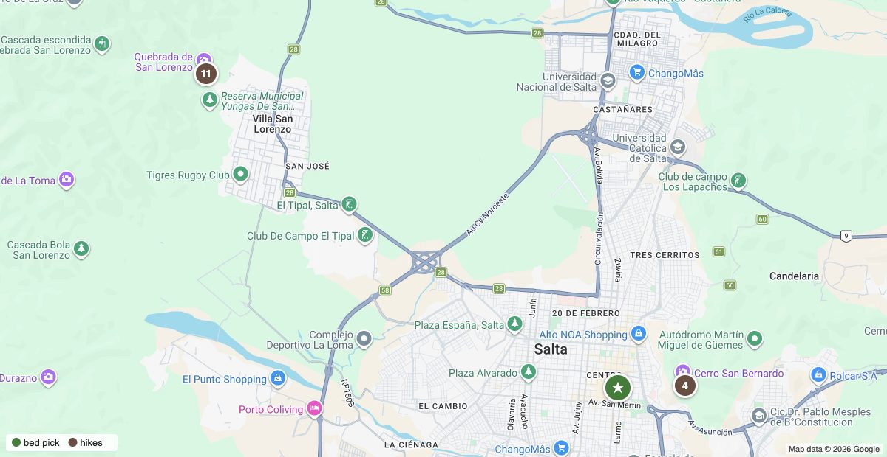

# 🇦🇷 Salta

Part of the [LatAm itinerary](../itinerary.md) · region notes: [Argentina](argentina.md) · ← [Cafayate](cafayate.md) · [Quebrada de Humahuaca (Tilcara + Iruya + Purmamarca)](quebrada-de-humahuaca.md) →

> **Stop 14 · Sun 10 → Tue 12 Jan 2027 · 2 nights** 
> 🏞️ Colonial city in a green valley, with a hill to climb and peñas at night; the last big ATM town before Chile 
> 🛏️ **Clivias Hostel**, a bed in a 4–6-bed mixed dorm, $30 for 2 nights 
> 🚌 **In:** Flecha Bus from Cafayate, Sun 11:30 · **Out:** 20 de Junio to Jujuy, Tue 08:05, then on to Tilcara

Salta and the Lerma valley from the Cerro San Bernardo path. Photo: Google Maps.

## 🗺️ Map

**In town:** ★ **[Clivias Hostel](https://www.google.com/maps?ftid=0x941bc3e06129a1ad:0x66d2460e9631db06)** (the pick, [book](https://www.booking.com/hotel/ar/clivias-hostel.html?checkin=2027-01-10&checkout=2027-01-12&group_adults=1&no_rooms=1&group_children=0&selected_currency=USD)) · **1** [Casa Puka](https://www.google.com/maps?ftid=0x941bc398f43ca9ed:0x27f3f30fe3e8f35f) (backup, [book](https://www.hostelworld.com/hostels/p/339659/casa-puka/?from=2027-01-10&to=2027-01-12&guests=1)) · **2** [La Cara Oculta B&B](https://www.google.com/maps?ftid=0x941bc3a3adfcffff:0x412c365456c74072) (private alt, [book](https://www.booking.com/hotel/ar/la-cara-oculta-de-salta-bed-and-breakfast.html?checkin=2027-01-10&checkout=2027-01-12&group_adults=1&no_rooms=1&group_children=0&selected_currency=USD)) · **B** [bus terminal](https://www.google.com/maps?ftid=0x941bc39c2d17a0ff:0x29485b2452663942) · **3** [Cerro San Bernardo steps](https://www.google.com/maps?ftid=0x941bc390b23194c9:0x47e2f0762698e640) [🚶 21 min](https://www.google.com/maps/dir/?api=1&origin=-24.78978,-65.4081522&destination=-24.7866469,-65.3980644&travelmode=walking) (behind the Güemes monument) · **4** [Cerro San Bernardo top](https://www.google.com/maps?ftid=0x941bc3872150d647:0x20527e4797f2b19d) [🚌 55 min (bus 2A)](https://www.google.com/maps/dir/?api=1&origin=-24.78978,-65.4081522&destination=-24.7892723,-65.3925136&travelmode=transit) · **5** [MAAM](https://www.google.com/maps?ftid=0x941bc3bb5a8a42eb:0xfb17e28e96770f08) [🚶 5 min](https://www.google.com/maps/dir/?api=1&origin=-24.78978,-65.4081522&destination=-24.789012,-65.411038&travelmode=walking) · **6** [Peña La Vieja Estación](https://www.google.com/maps?ftid=0x941bc3b8a77392bf:0xf55bf9340c98a2c4) [🚶 21 min](https://www.google.com/maps/dir/?api=1&origin=-24.78978,-65.4081522&destination=-24.7790674,-65.4114888&travelmode=walking) (Calle Balcarce peñas) · **7** [La Salteñería](https://www.google.com/maps?ftid=0x941bc3d0efadb8b1:0x7c0ac20b622c36f7) [🚶 4 min](https://www.google.com/maps/dir/?api=1&origin=-24.78978,-65.4081522&destination=-24.7903273,-65.4055358&travelmode=walking) · **8** [Patio de la Empanada](https://www.google.com/maps?ftid=0x941bc3afb04852af:0x501173e4f6faa132) [🚶 20 min](https://www.google.com/maps/dir/?api=1&origin=-24.78978,-65.4081522&destination=-24.7930866,-65.4188869&travelmode=walking) · **9** [La Nueva Criollita](https://www.google.com/maps?ftid=0x941bc3bc8b427759:0x27d5720165d2da1a) [🚶 7 min](https://www.google.com/maps/dir/?api=1&origin=-24.78978,-65.4081522&destination=-24.7861806,-65.4090808&travelmode=walking) · **10** [La Birrería](https://www.google.com/maps?ftid=0x941bc3809928617d:0x465dbe654ecea2dd) [🚶 7 min](https://www.google.com/maps/dir/?api=1&origin=-24.78978,-65.4081522&destination=-24.787215,-65.405665&travelmode=walking) and [Temple Craft](https://www.google.com/maps?ftid=0x941bc3bd17e0daff:0x7b1d4678d74f1216)

**Around:** ★ Salta centre · **4** [Cerro San Bernardo](https://www.google.com/maps?ftid=0x941bc3872150d647:0x20527e4797f2b19d) [🚌 55 min (bus 2A)](https://www.google.com/maps/dir/?api=1&origin=-24.78978,-65.4081522&destination=-24.7892723,-65.3925136&travelmode=transit) · **11** [Quebrada de San Lorenzo](https://www.google.com/maps?ftid=0x941beaf40f353b95:0x325a328cb0242805) [🚌 1 h 1 min (bus 7SL)](https://www.google.com/maps/dir/?api=1&origin=-24.78978,-65.4081522&destination=-24.7234416,-65.5037872&travelmode=transit) (≈ 12 km, 30–40 min by SAETA bus)

🧭 The time after each place is from the ★ bed (Google Maps, 26 Nov): 🚶 walk · 🚌 bus · 🚕 taxi · 🚗 by road (tour or bus). Click it for the route.

**Open the live map:** [town](https://www.google.com/maps/@-24.7890,-65.4060,15z) · [area](https://www.google.com/maps/@-24.7600,-65.4500,12z)

## 📅 Day by day

| Day | Plan |
|---|---|
| **Sun 10 Jan** | 🚌 **11:30 Flecha Bus** from Cafayate through the Quebrada de las Conchas (sit on the left), arriving 15:20. Walk 20 min to Clivias. 🏛️ **MAAM** this afternoon (last entry 18:30): ✅ it's **closed on Mondays**. 🎶 Peñas on **Calle Balcarce** at night. |
| **Mon 11 Jan** | 🌳 **Quebrada de San Lorenzo** in the morning (best then). 🥾 **Cerro San Bernardo** on foot in the late afternoon, for the view at sunset. 🏧 Draw the pesos you need for the Quebrada. |
| **Tue 12 Jan** | 🚌 **08:05 20 de Junio** to Jujuy (or Balut 09:30), then Evelia or Balut to Tilcara. |

## 🔖 Book (one click)

Dates and 1 adult are pre-filled. Prices move, so compare the channels shown (first = cheapest when checked on 24 Nov). ⚠️ = time-sensitive.

**Beds** (10 → 12 Jan, 2 nights)

| | Where | Total | Location | From the bus terminal | Book |
|---|---|---:|:---:|---|---|
| ⭐ **Pick** | **Clivias Hostel** · bed in a 4–6-bed mixed dorm | **$30** | 9.9 | 🚶 20 min (1.4 km); centre 4 min on foot · [route](https://www.google.com/maps/dir/?api=1&origin=-24.7957444,-65.39821599999999&destination=-24.78978,-65.4081522&travelmode=walking) | [Booking](https://www.booking.com/hotel/ar/clivias-hostel.html?checkin=2027-01-10&checkout=2027-01-12&group_adults=1&no_rooms=1&group_children=0&selected_currency=USD) · [Hostelworld](https://www.hostelworld.com/hostels/p/331485/clivias-hostel/?from=2027-01-10&to=2027-01-12&guests=1) · [Agoda](https://www.agoda.com/partners/partnersearch.aspx?hid=68521137&checkin=2027-01-10&checkout=2027-01-12&NumberofAdults=1&Rooms=1) |
| Backup | **Casa Puka** · bed in an 8-bed mixed dorm, curtains | $23.50 | 9.9 *(HW)* | 🚌 17 min: bus 2E → walk 5 min (or walk 28 min); centre 10 min on foot · [route](https://www.google.com/maps/dir/?api=1&origin=-24.7957444,-65.39821599999999&destination=-24.7907492,-65.4157321&travelmode=transit) | [Hostelworld](https://www.hostelworld.com/hostels/p/339659/casa-puka/?from=2027-01-10&to=2027-01-12&guests=1) · [Booking](https://www.booking.com/hotel/ar/casa-puka-salta.html?checkin=2027-01-10&checkout=2027-01-12&group_adults=1&no_rooms=1&group_children=0&selected_currency=USD) |
| Private alt | **La Cara Oculta de Salta B&B** · double, shared bathroom | $56 | 9.8 | 🚶 16 min (1.1 km); centre 8 min on foot · [route](https://www.google.com/maps/dir/?api=1&origin=-24.7957444,-65.39821599999999&destination=-24.7926678,-65.4077933&travelmode=walking) | [Booking](https://www.booking.com/hotel/ar/la-cara-oculta-de-salta-bed-and-breakfast.html?checkin=2027-01-10&checkout=2027-01-12&group_adults=1&no_rooms=1&group_children=0&selected_currency=USD) |

**Transport**

| | Leg | When | Price | Book |
|---|---|---|---:|---|
| In | **Flecha Bus** · Cafayate → Salta | **Sun 10 Jan 11:30 → 15:20** (also 08:30, 16:00, 19:45) | ARS 29,000 ≈ $18 | [Flecha Bus](https://www.flechabus.com.ar/) (not on Plataforma10) |
| Out | **20 de Junio** · Salta → Jujuy | **Tue 12 Jan 08:05 → 10:00** (or Balut 09:30 → 11:45) | ARS 20,000 (Balut 18,000) | on Plataforma10 |
| Out | **Evelia / Balut** · Jujuy → Tilcara | every 30–60 min, 1 h 15–1 h 45 *(Dec timetable)* | ARS 9,000–9,500 | [Evelia](https://eveliatransporte.com.ar/) |

How to read these tables

- **Location** is the guests' location score on Booking.com. The target is 9.0 or higher, and ⚠️ would mark one below 9.0. *(HW)* means Hostelworld's location rating, used where a property isn't on Booking.
- **From the bus terminal** comes from Google Maps on 24 Nov: the property found on Maps and routed from where you arrive at midday on the check-in date. The **route** link opens the same route.
- Symbols: 🚶 walk · 🚌 public transport · 🚕 taxi/rideshare · 🥾 hike only · ⚠️ far from the centre with no bus · ℹ️ outside the centre but on a bus line.

## 🚌 Getting here: Cafayate → Salta, Sun 10 Jan

- **Flecha Bus Cafayate → Salta**, 3 h 45–3 h 50, through the Quebrada de las Conchas.
- **Sit on the left** (the cliffs, Los Castillos and the widest views).
- ✅ **Flecha Bus's own site, Sun 10 Jan 2027, from the "(CFY) Cafayate" terminal:** 08:30 → 12:20, **11:30 → 15:20**, 16:00 → 19:50, 19:45 → 23:30.
- **Común seat, ARS 29,000 ≈ $18**, 12–15 seats left on 24 Nov.
- The same buses from the "(CFYP) Pueblo Nuevo Cafayate" stop (5 min later) cost ARS 33,500, so board at the main terminal.
- **Take the 11:30** for midday light in the canyon (or the 08:30). The 19:45 crosses it in the dark.
- Buy on flechabus.com.ar. It isn't on Plataforma10.

## 🛏️ Where to sleep

Live-checked 24 Nov.

### ⭐ Pick: Clivias Hostel
- **Where:** Deán Funes 14. 220 m from Plaza 9 de Julio, 1.0 km from the bus terminal.
- **Unit:** a bed in a 4–6-bed mixed dorm.
- **Price:** **$30 for 2 nights on Booking** (room table). Others: Hostelworld $32.88, Agoda $33.62.
- **Reviews:** Booking 9.6 (425 reviews; **1% below 7**; location 9.9); Hostelworld 96 (87, none below 70); Agoda 9.7 (406).
- **Checks:** ✅ a "well stocked and organized" kitchen with a cooker; AC; "social but not a party", a hotel-like calm. Curtains: not confirmed. No pool.

### Backup: Casa Puka
- **Where:** Alvarado 1029. 560 m from the plaza, 1.7 km from the terminal.
- **Unit:** a bed in an 8-bed mixed dorm.
- **Price:** **$23.50 on Hostelworld** ($11.75 a night).
- **Reviews:** Hostelworld **99** (54 reviews since Aug 2026, none below 70). Booking has only 3 reviews and showed no beds.
- **Checks:** ✅ **curtains on the beds** and ✅ kitchen (both in several reviews). The owners host asado nights and family breakfasts; one review mentions "lots of music", but it's social rather than a party hostel.
- **Also live:** Pacha Hostel Backpack (Agoda 9.6, 571 reviews, $27.61 for 2 nights on Agoda).

### Private alt (location first): La Cara Oculta de Salta B&B
- Double with shared bathroom. **$56 on Booking** (room table; Agoda $56.28); a private-bathroom double is $70.
- Booking location **9.8** (304 reviews, 3% below 7). 450 m from the plaza.
- **With a kitchen:** **"Hermoso apartamento céntrico"**, a whole 1-bedroom flat, location 9.8 (150 reviews, 2% below 7), **$78** on Booking. Recent reviews complain about a tired mattress.

## 🌳 Things to do (free and outdoors first)

<table>
<tr>
<td width="50%" valign="top"> <b><a href="https://www.google.com/maps?ftid=0x941bc3872150d647:0x20527e4797f2b19d">Cerro San Bernardo</a></b> on foot · free · <a href="https://www.google.com/maps/dir/?api=1&origin=-24.78978,-65.4081522&destination=-24.7892723,-65.3925136&travelmode=transit">🚌 55 min (bus 2A)</a> About 1,000 stone steps from behind the Güemes monument; ≈ 45 min up for the view over the valley.</td>
<td width="50%" valign="top"> <b><a href="https://www.google.com/maps?ftid=0x941beaf40f353b95:0x325a328cb0242805">Quebrada de San Lorenzo</a></b> · free · <a href="https://www.google.com/maps/dir/?api=1&origin=-24.78978,-65.4081522&destination=-24.7234416,-65.5037872&travelmode=transit">🚌 1 h 1 min (bus 7SL)</a> Riverside paths through the yungas cloud forest just outside the city. Morning is best.</td>
</tr>
<tr>
<td width="50%" valign="top"> <b><a href="https://www.google.com/maps?ftid=0x941bc3bb5a8a42eb:0xfb17e28e96770f08">MAAM</a></b>, Museo de Arqueología de Alta Montaña · paid, unique · Sun 10 · <a href="https://www.google.com/maps/dir/?api=1&origin=-24.78978,-65.4081522&destination=-24.789012,-65.411038&travelmode=walking">🚶 5 min</a> The Inca children of Llullaillaco, the best-preserved high-altitude mummies anywhere; one is on show at a time. Closed Mondays.</td>
<td width="50%" valign="top"> <b>Peñas on Calle Balcarce</b> · free entry or a cover Live folk music at night; you pay for food and drinks. Photo from <a href="https://www.google.com/maps?ftid=0x941bc3b8a77392bf:0xf55bf9340c98a2c4">Peña La Vieja Estación</a>.</td>
</tr>
</table>

- **Cerro San Bernardo on foot (free).** About 1,000 stone steps from behind the Güemes monument, 15 min east of the plaza; ≈ 45 min up for the view over the valley. The cable car (from Parque San Martín) is paid; ride it down only if your knees want to. At the top there's a cascade garden and craft stalls (LP).
- **Quebrada de San Lorenzo (free).** Riverside paths through the yungas cloud forest just outside the city. It's 30–40 min by SAETA city bus, which needs a SAETA card from kiosks by the plaza *(≈ lead)*. Morning is best.
- **MAAM, Museo de Arqueología de Alta Montaña (paid, unique).** It holds the Inca children of Llullaillaco (a 6,739 m volcano), the best-preserved high-altitude mummies anywhere. No later stop does this.
  - ✅ **Hours** (maam.gob.ar, 26 Nov): Tue–Sun 11:00–19:00, last entry 18:30; **closed Mondays**. So go on **Sun 10** after the bus.
  - ✅ **One child at a time:** for conservation, only one of the three is on show, in rotation ("La niña del rayo" in Nov 2026).
  - Fee: some museums charge foreigners more than Argentines (LP); check at the door.
- **Peñas on Calle Balcarce at night.** Live folk music; you pay for food and drinks. The peña zone is the two blocks of Balcarce north of Alsina (LP). Some are free to enter; others add a cover charge, e.g. **Nora Julia** (Balcarce 887), with costumed singers and dancers (LP).
- **Skip:** the Tren a las Nubes and Salinas Grandes tours. The Paso de Jama bus and the Uyuni tour cover the high Puna and the salt flats better. LP also calls the train famously unreliable.

## 🍽️ Eat and drink

<table>
<tr>
<td width="50%" valign="top"> <b><a href="https://www.google.com/maps?ftid=0x941bc3d0efadb8b1:0x7c0ac20b622c36f7">La Salteñería</a></b> (Catamarca 7) · ARS 1,750 (≈ $1) an empanada · <a href="https://www.google.com/maps/dir/?api=1&origin=-24.78978,-65.4081522&destination=-24.7903273,-65.4055358&travelmode=walking">🚶 4 min</a> Clay-oven empanadas de carne cortada a cuchillo; humita ARS 7,500.</td>
<td width="50%" valign="top"> <b><a href="https://www.google.com/maps?ftid=0x941bc3afb04852af:0x501173e4f6faa132">Patio de la Empanada</a></b> (San Martín & Esteco) · ARS 1,200–1,800 an empanada · <a href="https://www.google.com/maps/dir/?api=1&origin=-24.78978,-65.4081522&destination=-24.7930866,-65.4188869&travelmode=walking">🚶 20 min</a> A municipal court of family stalls; locro or humita ARS 7,000–10,000 (≈ $4–6).</td>
</tr>
<tr>
<td width="50%" valign="top"> <b><a href="https://www.google.com/maps?ftid=0x941bc3bc8b427759:0x27d5720165d2da1a">La Nueva Criollita</a></b> (Zuviría 326) · ARS 1,200–1,500 an empanada · <a href="https://www.google.com/maps/dir/?api=1&origin=-24.78978,-65.4081522&destination=-24.7861806,-65.4090808&travelmode=walking">🚶 7 min</a> Empanadas, and tamales ARS 5,000–7,000.</td>
<td width="50%" valign="top"> <b>Craft beer</b> · ARS 6,000–6,900 (≈ $4) a pint <a href="https://www.google.com/maps?ftid=0x941bc3809928617d:0x465dbe654ecea2dd">La Birrería</a> (Belgrano 223) or <a href="https://www.google.com/maps?ftid=0x941bc3bd17e0daff:0x7b1d4678d74f1216">Temple Craft</a> (Belgrano 213); about half price at happy hour. Photo from Temple Craft.</td>
</tr>
</table>

These are AI Mode leads; prices are ≈.

**Lonely Planet picks (LP):**
- **La Tacita** (Caseros 396): baked empanadas, among the city's best, in a no-frills room; open daily.
- **Chirimoya** (España 211): a vegan kitchen LP rates the most inventive in the region; Mon–Sat, lunch and dinner. Pricier ($$).
- The cafés on the west side of Plaza 9 de Julio have tables on the square for a coffee or a beer.

## ℹ️ Good to know
- **Cash:** Salta is the last big ATM town before Chile, so draw the pesos you need for the Quebrada (Hornocal 4x4, fees, food) here.
- **Bus terminal:** it has ATMs, left luggage and a tourist desk (LP).

## 🚌 Leaving: Salta → Jujuy → Tilcara, Tue 12 Jan

- ✅ **20 de Junio 08:05 → Jujuy 10:00** (ARS 20,000), or **Balut 09:30 → 11:45** (ARS 18,000), on Plataforma10.
- Then **Evelia/Balut Jujuy → Tilcara**, every 30–60 min, 1 h 15–1 h 45, ARS 9,000–9,500 *(Dec timetable)*.
- Details are in the [Quebrada de Humahuaca guide](quebrada-de-humahuaca.md).

---
Photos: Google Maps contributors (Cerro San Bernardo, Quebrada de San Lorenzo, MAAM, Peña La Vieja Estación, La Salteñería, Patio de la Empanada, La Nueva Criollita, Temple Craft).
