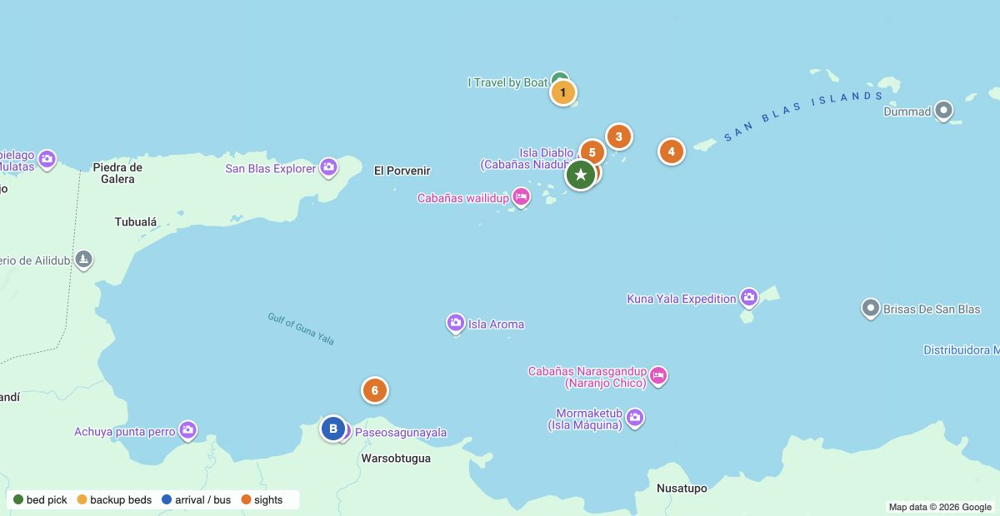
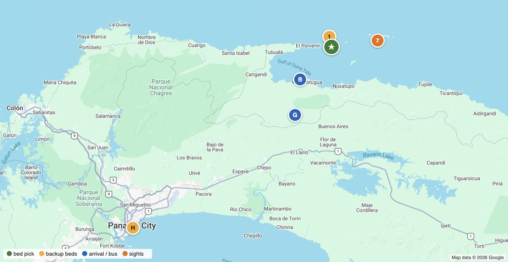

# 🇵🇦 San Blas (Guna Yala)

Part of the [LatAm itinerary](../itinerary.md) · region notes: [Peru + Panama](peru-panama.md) · ← [Panama City](panama-city.md) · [Boquete](boquete.md) →

> **Stop 26 · Day 62 → 63 · 1 night · 🎭 Carnaval weekend** 
> 🏞️ Palm-topped coral islets in the self-governing Guna Yala comarca: a shipwreck to snorkel off the beach, a starfish sandbar and a night with no city light 
> 🛏️ **Isla Perro Chico, private room** (shared bathroom) with **Panama San Blas Tours**: **$192.85** for 1 adult with all meals, the 4×4, the boat and an island hop, + **$25 cash** in fees 
> 🚙 **In:** 4×4 pickup at the Panama City hostel **05:20 on Day 62** · **Out:** back at the hostel **≈ 12:00 on Day 63** (≈ 19:00 with the late check-out)

Isla Perro Chico (Assudub Bibbi), the ★ on the map, seen from the wreck side. Photo: Google Maps.

## 🗺️ Map

**The islands:** ★ **[Isla Perro Chico (Assudub Bibbi)](https://www.google.com/maps?ftid=0x8e54e50035ae4db9:0x7989d3b8594bce30)** (the pick, [book](https://widgets.bokun.io/online-sales/cbade9ea-8cde-4244-a4aa-befdd27fc406/experience-calendar/245757)) and the [shipwreck](https://www.google.com/maps?ftid=0x8e54e5711a0b3d11:0xacfdbb0c7657e41f) 🏊 off its beach · **1** [Chichime](https://www.google.com/maps?ftid=0x8e54e4ff63baa0ed:0x382044154a76e27f) (backup, [book](https://www.seasanblas.com/chichime-island/)) ⛵ 3.8 km · **B** [Cartí port](https://www.google.com/maps?ftid=0x8e54ea2b92487dd5:0x305657f4e9bc62be) ⛵ 16 km · **2** [Isla Diablo](https://www.google.com/maps?ftid=0x8e54e576b753d7dd:0xd259037adaedce70) 🏊 0.4 km (the next island; its pin sits under the ★) · **3** [Natural pool](https://www.google.com/maps?ftid=0x8e54e5d13b0aef65:0x69a291d0cd17a212) ⛵ 2.4 km · **4** [Isla Misdub](https://www.google.com/maps?ftid=0x8e54e50024fc6fbb:0xf1035ee822f2be52) ⛵ 4.2 km · **5** Isla Pelícano ⛵ 1.1 km (where the Cayos upgrade sleeps) · **6** [Gardi Sugdub](https://www.google.com/maps?ftid=0x8e54e96f8e45cb01:0x9b078086b0da1dab) (Guna village by the port) ⛵ 13.5 km

**The way in:** **H** El Machico Hostel, Panama City (see [Panama City](panama-city.md)) → 🚙 ≈ 2.5 h → **G** [Guna Yala checkpoint](https://www.google.com/maps?ftid=0x8e549512800eb917:0x6b7253767d0d9b70) (passport + fee) → **B** Cartí port → ⛵ ≈ 30 min → ★ · **7** [Cayos Holandeses](https://www.google.com/maps?ftid=0x8e54f99f44580983:0xf332ebd1d89232c7) (Islas Maqui) ⛵ 16.6 km, ≈ 1 h by boat (the upgrade)

🧭 Distances are straight lines from ★ Perro Chico (Google Maps coordinates). Every hop is by the tour's boat: ⛵ boat · 🏊 swim. Boat times are the operators' (port → islands 20–40 min; Pelícano → Cayos ≈ 1 h).

**Open the live map:** [islands](https://www.google.com/maps/@9.55,-78.89,13z) · [Panama City → San Blas](https://www.google.com/maps/@9.27,-79.12,10z)

## 📅 Day by day

| Day | Plan |
|---|---|
| **Day 62** · 🎭 Carnaval | 🚙 **05:20** pickup at the Panama City hostel; leave the big pack there. ≈ 2.5 h over the hills on the El Llano–Cartí road, a breakfast stop (not included), then the passport check and the **cash entry fee** at the Guna Yala checkpoint. ⛵ ≈ 30 min boat to **Isla Perro Chico**. 🤿 Snorkel the **shipwreck** off the beach (free). Lunch, then the included boat trip to the **natural pool** (starfish sandbar), **Isla Misdub** and **Isla Diablo**. Sunset and dinner on Perro Chico after the day-trippers leave. |
| **Day 63** · 🎭 Carnaval | 🌅 Early swim and a second go at the wreck before the day boats arrive. Breakfast, then the boat and 4×4 back: **≈ 12:00** at the hostel. Or add the **late check-out** (lunch on the island, leave at 15:30, back ≈ 19:00). Night in Panama City; Day 64 is the 07:15 Air Panama flight to David (see [Boquete](boquete.md)). |

## 🔖 Book (one click)

Prices are the operators' own, for **1 adult, 1 night, Day 62 → 63**, read from their booking systems on 27 Nov. None adds a Carnaval surcharge. The booking pages don't take a date in the link, so pick Day 62 (Carnaval Sunday) in the calendar.

**Island stays**

| | Tour · where you sleep | Total | Back in Panama City | Cancellation | Book |
|---|---|---:|---|---|---|
| ⭐ **Pick** | **Panama San Blas Tours · Perro Chico**, **private room** with a shared bathroom; 3 meals; boat trip to the natural pool, Misdub and Diablo | **$192.85** | ≈ 12:00 (late check-out to 15:30: + $20 in the booking widget, "$10" in the tour text) | free until 7 days before; 50% from 6 days; 100% inside 48 h | [Bókun calendar](https://widgets.bokun.io/online-sales/cbade9ea-8cde-4244-a4aa-befdd27fc406/experience-calendar/245757) · [tour page](https://panamasanblastours.com/tour/snorkeling-lovers-perro-chico-island/) |
| Private alt | **Same tour**, a **cabaña with its own bathroom** on Perro Chico | $223.30 | ≈ 12:00 | same | [Bókun calendar](https://widgets.bokun.io/online-sales/cbade9ea-8cde-4244-a4aa-befdd27fc406/experience-calendar/245757) |
| Backup | **Sea San Blas · Chichime**, shared cabin (6–8 beds), adults only; Day 63 trip to 2–3 islands and the natural pool | $187.25 ($175 + 7% tax) | ≈ 19:00–19:30 | 90% back until 5 days before, 50% at 3–4 days, then nothing | [seasanblas.com](https://www.seasanblas.com/chichime-island/) |
| Backup 2 | **Guna Yala Explorer · Chichime (Cabañas Wissudub)**, dorm for up to 10; Day 62 afternoon trip to the **Perro Chico wreck** and the natural pool | $200 (+ 7% on the 50% card deposit) | Day 63 afternoon | Carnaval: the deposit comes back only if you cancel ≥ 30 days ahead | [page](https://www.gunayalaexplorer.com/isla-chichime-overnight.html) · WhatsApp +507 6912-7272 |
| Also | **Guna Yala Explorer · Perro Chico**, private room in the concrete building (from 1 guest) | $190 (+ 7% on the 75% card deposit) | Day 63 afternoon | as above | [page](https://www.gunayalaexplorer.com/isla-perro-chico-overnight.html) · WhatsApp |
| Budget | **San Blas Tours PTY · "Noche Estrellada" 2D/1N**, beach cabin; the island is assigned by the operator | $190 (+ 7% if paid online by card) | ≈ 15:00 | free until 72 h before | [sanblastourspty.com](https://sanblastourspty.com/en/tours/noche-estrellada-2-dias) |
| Day trip only | **AMPA Tours · Full Day** (fallback if no night is free) | $148, **entry fee included** | same evening | | [ampatours.com](https://www.ampatours.com/san-blas-islands/) |

How to read this table, and what was checked

- **Live checks (27 Nov):** the Bókun calendar showed Day 62 **AVAILABLE** at $192.85 (room) and $223.30 (cabaña) for 1 adult, the same price every day of Carnaval week. Sea San Blas' booking API quoted $187.25 for Chichime with 12 of 12 places free. San Blas Tours PTY's calendar showed 50 of 50 places free. Guna Yala Explorer books by WhatsApp only, so its availability is unchecked.
- **Solo rules:** Sea San Blas' Perro Chico cabins, Chichime private cabins and Aguja private cabins need 2 guests, and its Aguja private room (solo OK) was **closed** for all of Carnaval week, so none of those appear above.
- **Deposit:** Panama San Blas Tours' text asks a **$100 deposit, the balance in cash** on the day; check what the Bókun checkout charges before you pay.
- **Resellers:** Viator and Tripadvisor list Panama San Blas Tours' Perro Chico stay (product 75405) from **$249** (lead); book direct on Bókun instead.

## 🏝️ Upgrade: the Cayos Holandeses (3 days / 2 nights, needs +1 day)

The outer Cayos Holandeses (Dutch Cays) are the prettiest part of San Blas, ≈ 1 h by boat beyond the inner islands. No 2D/1N reaches them, so this means **Day 62 → 64** and moving Boquete one day later (the Day 64 Air Panama flight would move to Day 65).

| | Tour | Total, 1 adult | Notes | Book |
|---|---|---:|---|---|
| ⭐ | **Sea San Blas · Cayos Holandeses 3D/2N**, group cabin; **both nights on Pelícano** (1.1 km from Perro Chico); the Cayos day (guided snorkel, lunch at Ibin's on Banedup) on Day 63 | **$319.93** ($299 + 7%), live quote for Day 62 → 64 | Back in Panama City ≈ 12:00–13:00 on Day 64. Private cabin $350 + 7% (2 people minimum). 90% refund until 5 days before | [seasanblas.com](https://www.seasanblas.com/cayos-holandeses/) |
| | **San Blas Tours PTY · Cayos Holandeses day trip** | $225 | Same-day return: one long day instead of a night | [sanblastourspty.com](https://sanblastourspty.com/en/tours/cayos-holandeses-premium) |
| | **San Blas Tours PTY · Guna Explorer 3D/2N** ("remote cays", not named) | $275 | Island assigned on the day | [sanblastourspty.com](https://sanblastourspty.com/en/tours/guna-explorer-3-dias) |

Sleeping *in* the Dutch Cays (Morodub, Anaimar, Ibin, via Guna Yala Explorer) needs **2 people minimum** ($430 per person on Morodub), so it doesn't work solo. The extra cost over the pick is ≈ **$127** plus one more Panama-side day.

## 🚙 Getting here: Panama City → Perro Chico, Day 62

- **05:20** pickup at the hostel in a shared 4×4 (6 passengers). Other operators collect from 04:45–05:30.
- **The road:** Pan-American Highway east, then the **El Llano–Cartí road** over the mountains: steep, one tight curve after another, ≈ 40 min of ups and downs. Only 4×4s are allowed through. ≈ 2.5 h in all (San Blas Tours PTY's road guide).
- **The checkpoint** at the top: every passenger shows an **original passport** (copies are refused) and pays the entry fee **in cash** (some operators' drivers take a card).
- **Cartí port:** life jacket on, then 20–40 min by open speedboat to the islands. Put your phone and passport in a dry bag; the boats get spray.
- **Seasick?** Take a motion-sickness pill **30–60 min before the curves**, not once they start. Sit up front if you can (Panama San Blas Tours sells a reserved front seat for $30).

## 🌳 Things to do (free and outdoors first)

<table>
<tr>
<td width="50%" valign="top"> <b><a href="https://www.google.com/maps?ftid=0x8e54e5711a0b3d11:0xacfdbb0c7657e41f">The Isla Perro wreck</a></b> · free · 🏊 off the beach A sunken boat in shallow, clear water a few strokes from this beach (no good photo of the wreck itself): San Blas' best-known snorkel. Go early or after 15:00, when the day boats have left.</td>
<td width="50%" valign="top"> <b><a href="https://www.google.com/maps?ftid=0x8e54e5d13b0aef65:0x69a291d0cd17a212">Natural pool</a></b> · in the tour · ⛵ 2.4 km A waist-deep sandbar in open sea with starfish. Look, don't lift them out of the water.</td>
</tr>
<tr>
<td width="50%" valign="top"> <b><a href="https://www.google.com/maps?ftid=0x8e54e50024fc6fbb:0xf1035ee822f2be52">Isla Misdub</a></b> · in the tour · ⛵ 4.2 km A small island of over-water cabins on stilts and a long dock; a stop on the Day 62 boat trip.</td>
<td width="50%" valign="top"> <b><a href="https://www.google.com/maps?ftid=0x8e54e4ff63baa0ed:0x382044154a76e27f">Chichime</a></b> · backup island · ⛵ 3.8 km A long palm island with reefs close to shore; the travellers' other favourite for a quiet night.</td>
</tr>
<tr>
<td width="50%" valign="top"> <b><a href="https://www.google.com/maps?ftid=0x8e54f99f44580983:0xf332ebd1d89232c7">Cayos Holandeses</a></b> · the upgrade · ⛵ 16.6 km The outer cays: reef channels, sandbanks and anchored yachts. Only on the 3D/2N or the $225 day trip.</td>
<td width="50%" valign="top"> <b><a href="https://www.google.com/maps?ftid=0x8e54e96f8e45cb01:0x9b078086b0da1dab">Gardi Sugdub</a></b> · Guna village · ⛵ 13.5 km An island packed edge to edge with Guna homes, by Cartí port. Some tours stop at a Guna community; ask first and expect a small fee.</td>
</tr>
<tr>
<td width="50%" valign="top"> <b>Molas</b> · Guna textile art Hand-stitched layered panels from women's blouses, sold by the women who sew them. Small "molitas" ≈ $15, full panels much more (leads). Photo: a museum mola.</td>
<td width="50%" valign="top"> <b>Island meals</b> · included Whole fried fish (or chicken) with coconut rice or fries and salad, served on Perro Chico. Lobster lunch is a $30 add-on in season.</td>
</tr>
</table>

- **Snorkel gear:** Panama San Blas Tours doesn't list gear as included, and Guna Yala Explorer lists "snorkel gear rental" as extra. **Bring your own mask** if you have one.
- **Free, no boat:** swim and snorkel around Perro Chico, swim the 0.4 km to **Isla Diablo** only if the water is calm (boats pass between them), sunset and the night sky.
- **Paid spots must be unique:** this is the trip's only Caribbean coral-island stop, so the tour is worth it.
- **Guna culture (please):** Guna Yala governs itself. Ask before you photograph people, dress modestly on community islands, take your rubbish back to the mainland, and don't take shells, starfish or coral.

## ℹ️ Good to know

- **Fees (cash only):** the **Guna Yala entry fee is $20 + a $3 port fee** for foreigners, paid at the checkpoint (Guna Yala Explorer); San Blas Tours PTY, Sea San Blas and AMPA quote **$22**. Panama San Blas Tours adds **$3** in island fees. Under-10s are free.
- **Cash:** there are **no ATMs or shops** on the islands. Bring ≈ **$60–80** in small notes: ≈ $25 in fees, ≈ $5–10 for the roadside breakfast, **drinking water and beer ≈ $2 each** (water isn't included on Perro Chico), tips and a reserve for a mola. Add **$93** if Panama San Blas Tours takes only the $100 deposit online and the balance in cash.
- **Luggage:** one soft bag or daypack; AMPA gives **13 kg** on shared transport, and Sea San Blas charges **$50** for oversized luggage. Leave the big pack at El Machico in Panama City.
- **Power and signal:** generator or solar power for part of the day only; Wi-Fi, where there is any, stops when the generator does. Mobile signal varies by island. Bring a **power bank** and a **head torch**.
- **Showers** are basic, from treated sea water (Sea San Blas). Bring a towel and toiletries.
- **Bring:** passport (original), cash, reef-safe sunscreen, a hat, a dry bag, drinking water, seasickness pills, a long sleeve for the boat.
- **Weather (early February):** the dry season, warm (28–29 °C by day, 25–26 °C at night). Open-Meteo for a sea point among the islands (10 years, Days 56–69) shows a little rain (≥ 1 mm) on ≈ 63% of days but **≥ 10 mm on almost none**: mean 1.8 mm a day, so passing showers. Operators call February sunny and dry but **windy**: the trade winds peak, and the open-water crossings get **choppy** (AMPA, Panama San Blas Tours, San Blas Adventures; 27 Nov). Anchorages stay calm. Tours cancelled for weather are rebooked or refunded.
- **Carnaval (Sat 6 – Tue 9 Feb 2027):** the three operators with online calendars (Panama San Blas Tours, Sea San Blas, San Blas Tours PTY) showed **Carnaval Sunday open** on 27 Nov, at normal prices. Guna Yala Explorer says Christmas, New Year, **Carnival** and Holy Week are the busiest dates and advises booking ≈ 4 months ahead; AMPA says charters cost ≈ 20% more then. Perro Chico has only a few rooms (Guna Yala Explorer: 6 rooms, 3 beach cabins, 1 over-water), so **book soon**. Expect more Panamanian day-trippers on the islands by day (≈).

## 🚙 Leaving: Perro Chico → Panama City, Day 63

- Breakfast, then the boat to Cartí and the 4×4 back: **≈ 12:00** at the hostel (Panama San Blas Tours). With the late check-out (lunch on the island, boat at 15:30) it's ≈ 19:00.
- The drop-off can be any Panama City address; tell the driver if you've moved hostel. Sea San Blas also drops at Albrook airport or the Albrook bus terminal for free.
- **Day 64:** Air Panama 07:15 Albrook → David, so stay near Albrook or book an early taxi. Then on to [Boquete](boquete.md).

---
Photos: Google Maps contributors (Isla Perro Chico and its wreck, the natural pool, Isla Misdub, Chichime, Gardi Sugdub, the fish lunch on Perro Chico). Wikimedia Commons: <a href="https://commons.wikimedia.org/wiki/File:Cayos_Holandeses_-_Guna_Yala_-_San_Blas_-_Panam%C3%A1_.jpg">Cayos Holandeses - Guna Yala - San Blas - Panamá</a> (Garcia.dennis, CC BY-SA 4.0), <a href="https://commons.wikimedia.org/wiki/File:Mola_(blouse_panel),_Cuna_(Kuna)_Indians,_Honolulu_Museum_of_Art,_3735.1.JPG">Mola (blouse panel), Honolulu Museum of Art</a> (Hiart, CC0).
