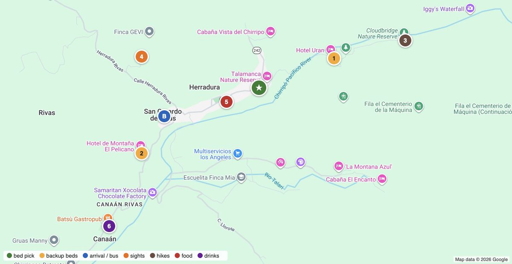
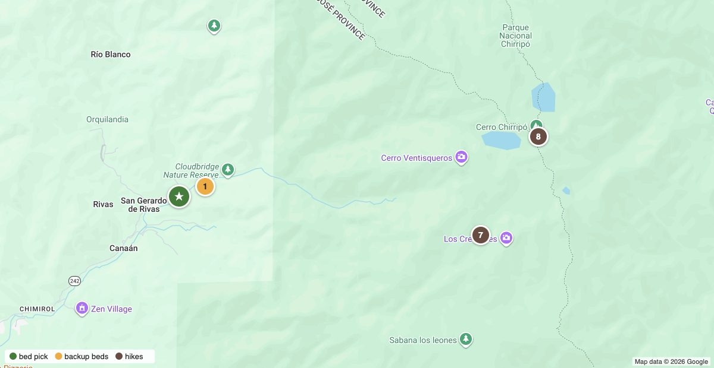

# 🇨🇷 San Gerardo de Rivas (Chirripó)

Part of the [LatAm itinerary](../itinerary.md) · region notes: [Costa Rica + Nicaragua](costa-rica-nicaragua.md) · ← [Boquete](boquete.md) · [Uvita](uvita.md) →

> **Stop 28 · Day 67 → 71 · 4 nights (+1 on 27 Nov), one of them at Base Crestones** · ⚠️ SINAC showed no Chirripó permits on sale for February (27 Nov) 
> 🏞️ Mountain village at the Chirripó trailhead: 14.5 km and ~2,100 m up to the Crestones hut, then the 3,820 m summit 
> 🛏️ **Casa Colibri Chirripó**, single bed in a mixed dorm, $121 for 3 nights (11 → 13 and 14 → 15), around a bunk at **Base Crestones** on 13 → 14 ($46.68) 
> 🚌 **In:** Boquete → David → Paso Canoas border → Tracopa → San Isidro → San Gerardo, Day 67 (10–11 h) · **Out:** 06:30 bus to San Isidro, then on to Uvita, Day 71

A lake in the páramo below Cerro Chirripó's summit. Photo: Google Maps.

## 🗺️ Map

**In the village:** ★ **[Casa Colibri Chirripó](https://www.google.com/maps?ftid=0x8fa14be9e786fcf9:0xc3f5df853c3b0e9f)** (the pick, [book](https://www.booking.com/hotel/cr/casa-colibri-chirripo-san-gerardo.html?checkin=2027-02-12&checkout=2027-02-14&group_adults=1&no_rooms=1&group_children=0&selected_currency=USD)) · **B** [village bus stop](https://www.google.com/maps?ftid=0x8fa14ac81e02a64f:0xe81f894db35c0801), with the [SINAC check-in office](https://www.google.com/maps?ftid=0x8fa14ac83b7ec6bb:0xbec2e5b86499be7a) next to it · **1** [Casa Mariposa](https://www.google.com/maps?ftid=0x8fa6b5494f7752a9:0x45c337b98b79f68a) (backup, by the trailhead), with [Uran Restaurant](https://www.google.com/maps?ftid=0x8fa6b54ec565dd39:0x64bfba6936d27a68) next door · **2** [Hotel de Montaña El Pelícano](https://www.google.com/maps?ftid=0x8fa14ac6278fd73f:0xb11898c12cdbaa6e) (private alt, [book](https://www.booking.com/searchresults.html?ss=Hotel+de+Monta%C3%B1a+El+Pel%C3%ADcano+San+Gerardo+de+Rivas&checkin=2027-02-12&checkout=2027-02-14&group_adults=1&no_rooms=1&selected_currency=USD)) · **3** [Cloudbridge Nature Reserve](https://www.google.com/maps?ftid=0x8fa6b545dd89b5cf:0x304767c03c3cdf90) [🚕 ≈ 8 min](https://www.google.com/maps/dir/?api=1&origin=9.467468,-83.5923371&destination=9.4721509,-83.5776278&travelmode=driving) · **4** [Gevi hot springs](https://www.google.com/maps?ftid=0x8fa14aba172ed569:0xbba33ed673c85af) [🚕 ≈ 6 min](https://www.google.com/maps/dir/?api=1&origin=9.467468,-83.5923371&destination=9.4705247,-83.6041641&travelmode=driving) · **5** [Robino's Foodies](https://www.google.com/maps?ftid=0x8fa14bd086421e43:0x6e9263c1af1e622b) [🚶 5 min](https://www.google.com/maps/dir/?api=1&origin=9.467468,-83.5923371&destination=9.4660449,-83.5956074&travelmode=walking) · **6** [Batsú Gastro-Pub](https://www.google.com/maps?ftid=0x8fa14b24df35ce87:0x783739e8688852e5) [🚕 ≈ 6 min](https://www.google.com/maps/dir/?api=1&origin=9.467468,-83.5923371&destination=9.4536973,-83.6074001&travelmode=driving)

**The climb:** ★ San Gerardo · **1** [trailhead](https://www.google.com/maps?ftid=0x8fa6b5492bab739b:0xb82f4ed102b48b3c) (Casa Mariposa is 50 m from it) · café at km 7, Llano Bonito (not pinned) · **7** [Base Crestones](https://www.google.com/maps?ftid=0x8fa6b70072b7c863:0x411f793d5bee2237) (3,400 m, km 14.5) · **8** [Cerro Chirripó summit](https://www.google.com/maps?ftid=0x8fa6c9e1e637d8a1:0x37a9ca71a5b33772) (3,820 m, 5.5 km beyond) · off the map, 15 min down the valley: [Sendero Los Gigantes](https://www.google.com/maps?ftid=0x8fa14bdeab9250f5:0xd49b929146c0331a)

🧭 The time after each place is from the ★ bed (Google Maps, 26 Nov): 🚶 walk · 🚌 bus · 🚕 taxi · 🚗 by road (tour or bus). Click it for the route.

**Open the live map:** [village](https://www.google.com/maps/@9.464,-83.596,15z) · [the climb](https://www.google.com/maps/@9.472,-83.540,13z)

## 📅 Day by day

The plan: climb **Day 69 → 70** if a permit turns up (see the permit note under Getting here).

| Day | Plan |
|---|---|
| **Day 67** | 🚌 **05:30** Boquete → David → Paso Canoas, border on foot, **08:00 Tracopa** → San Isidro, Hernández Solís bus → San Gerardo. Costa Rica is 1 h behind Panama. |
| **Day 68** | 📝 Register at the **SINAC office, then the Consorcio office, by 16:00** (passport; bag drop for portage). 🥾 Warm-up hike: **Cloudbridge Nature Reserve**. |
| **Day 69** | 🥾 Start walking **~04:00**: 14.5 km and ~2,100 m up to **Base Crestones** (3,400 m), café at km 7 (Llano Bonito). Night at Crestones; power off at 20:00. |
| **Day 70** | ⛰️ **Summit (3,820 m)** at dawn, 5.5 km beyond Crestones, then down to San Gerardo by **~12:00**. ♨️ Afternoon at the **Gevi hot springs** (≈ $7) for the legs; night in the village. |
| **Day 71** | 🚌 **06:30 Hernández Solís** → San Isidro, then **Grupo Blanco 09:00** → Uvita ≈ 11:00 (no taxi needed now). |

## 🔖 Book (one click)

Dates and 1 adult are pre-filled. The first channel listed was the cheapest when checked on 24 Nov. ⚠️ = time-sensitive.

**Beds** (village 11 → 13 and Day 70 → 71, 3 nights; Crestones Day 69 → 70)

| | Where | Total | Location | From the village bus stop | Book |
|---|---|---:|:---:|---|---|
| ⭐ **Pick** | **Casa Colibri Chirripó** · single bed in a mixed dorm | **$121** (11 → 13 $82 + 14 → 15 $39; ✅ 27 Nov; all 4 nights $163 if there is no permit) | 9.8 | 🚶 21 min (1.2 km) · [route](https://www.google.com/maps/dir/?api=1&origin=9.464616,-83.60187499999999&destination=9.467468,-83.5923371&travelmode=walking) | [Booking 11 → 13](https://www.booking.com/hotel/cr/casa-colibri-chirripo-san-gerardo.html?checkin=2027-02-12&checkout=2027-02-14&group_adults=1&no_rooms=1&group_children=0&selected_currency=USD) · [Booking 14 → 15](https://www.booking.com/hotel/cr/casa-colibri-chirripo-san-gerardo.html?checkin=2027-02-15&checkout=2027-02-16&group_adults=1&no_rooms=1&group_children=0&selected_currency=USD) |
| ⛰️ Mountain night | **Base Crestones** · 4-bed bunk room, Day 69 → 70 | **$46.68** bed + $49.63 meals | — | 🥾 14.5 km and ~2,100 m up from the trailhead | [Consorcio info](https://chirripo.org/info-util/), after the SINAC permit below |
| Backup | **Casa Mariposa Nature Lodge** · ask for a bed in a shared room | no online price | — | 50 m from the Chirripó trailhead (not routed) | [casamariposachirripo.net](https://casamariposachirripo.net/) (email booking) |
| Private alt | **Hotel de Montaña El Pelícano** · double room | ❌ sold out for 3–4 nights (27 Nov); 11 → 13 only a $264 suite | not returned | 🚶 9 min (500 m) · [route](https://www.google.com/maps/dir/?api=1&origin=9.464616,-83.60187499999999&destination=9.460934,-83.604143&travelmode=walking) | [Booking (search)](https://www.booking.com/searchresults.html?ss=Hotel+de+Monta%C3%B1a+El+Pel%C3%ADcano+San+Gerardo+de+Rivas&checkin=2027-02-12&checkout=2027-02-14&group_adults=1&no_rooms=1&selected_currency=USD) |

**Transport and permits**

| | Leg | When | Price | Book |
|---|---|---|---:|---|
| ⚠️ Permit | **Chirripó admission, SINAC** (reCAPTCHA + SICORE account) | buy before; for Day 69 → 70. ⚠️ **0 places** on every February night (SINAC calendar, 27 Nov): watch for cancellations | $21/day, ≈ **$42** | [SINAC](https://serviciosenlinea.sinac.go.cr/) |
| ⚠️ Permit | **Base Crestones** lodging and meals (Consorcio) | emailed after the SINAC admission | $46.68 + $49.63 | [chirripo.org](https://chirripo.org/info-util/) |
| ⚠️ Entry | Bus ticket out of Costa Rica (proof of onward travel), e.g. **Tica Bus San José → Managua** | buy before Day 67 | $33 online | Tica Bus |
| In | **Tracopa** · Paso Canoas → San Isidro | **Day 67 08:00** (also 04:20, 11:00, 16:30) | ≈ ₡6,000–6,500 | [Tracopa](https://www.tracopacr.com/) |
| In | **Hernández Solís** · San Isidro → San Gerardo | **14:30** (also 09:30, 18:15) | ≈ ₡1,000–1,500 | [timetable](https://perezzeledon.com/bus-routes-schedules-perez-zeledon) |
| Out | **Hernández Solís** San Gerardo → San Isidro, then **Grupo Blanco** → Uvita | **Day 71 06:30** → San Isidro ≈ 07:20; **09:00** → Uvita ≈ 11:00 | ≈ ₡1,000 + ₡2,500 | details in the [Uvita guide](uvita.md) |

How to read these tables

- **Location** is the guests' location score on Booking.com. The target is 9.0 or higher, and ⚠️ would mark one below 9.0. *(HW)* means Hostelworld's location rating, used where a property isn't on Booking.
- **From the village bus stop** comes from Google Maps on 24 Nov: the property found on Maps and routed from where you arrive at midday on the check-in date.
- Symbols: 🚶 walk · 🚌 public transport · 🚕 taxi/rideshare · 🥾 hike only · ⚠️ far from the centre with no bus · ℹ️ outside the centre but on a bus line.

## 🚌 Getting here: Boquete → David → Paso Canoas → San Isidro → San Gerardo de Rivas, Day 67

| Step | How | Time (local) | Cost | Source |
|---|---|---|---|---|
| Boquete → David terminal | Coopsemautranchiri bus from the park, every 20–30 min from ≈ 05:00 | **05:30 → 06:20** (PA) | $1.75–2.00 | ≈ |
| David → Paso Canoas | "Frontera" buses from the David terminal, every ≈ 10–20 min | 06:30 → ≈ 07:45 (PA) = **06:45 CR** | ≈ $2–3 | ≈ |
| Panama exit stamp → walk across → **Costa Rica entry** | DGME Paso Canoas, open 06:00–22:00 on normal days (≈, DGME Facebook) | ≈ 45–60 min | Panama exit ≈ free (≈ unverified); CR entry free | |
| **Paso Canoas → San Isidro de El General** | **Tracopa**, "Cerro de la Muerte" route (the Paso Canoas → San José run via San Isidro) | **08:00** (also 04:20, 11:00, 16:30) → **≈ 13:00** (Tracopa's estimated stop time) | ≈ ₡6,000–6,500 (≈ $13–15) | ✅ times: tracopacr.com timetable for **Day 64** (rechecked 26 Nov); fare ≈ (the site lists San Isidro → Río Claro ₡5,540, one stop short) |
| **San Isidro → San Gerardo de Rivas** | **Hernández Solís** bus | **14:30** (Mon–Sat; also 09:30, 18:15) → ≈ 15:15–15:30 (40–50 min) | ≈ ₡1,000–1,500 (≈ $2–3) | ✅ hernandezsolis.com (read 26 Nov) (Sun/holidays only 07:30 and 13:30) |

- **Fallback:** if you miss the 08:00 Tracopa, take the **11:00 → San Isidro ≈ 16:00, then the 18:15 Hernández Solís** (San Gerardo ≈ 19:00). Or a taxi from San Isidro, ≈ ₡15,000–20,000 ($34–45; perezzeledon.com).
- **Total ≈ $20–25**, 10–11 h door to door. Costa Rica is **1 h behind** Panama.
- **Panama exit:** stamp at Migración in Paso Canoas. No exit tax found. Costa Rica's $8 land **exit** tax applies later, when you leave for Nicaragua.
- 8 Feb is Carnaval Monday in Panama, so expect a busier border than usual. Costa Rica has no holiday that day.

**Costa Rica entry requirements** (✅ visitcostarica.com "Entry requirements"; Tica Bus migration page):
- **Return or onward ticket out of Costa Rica.** By law it must be a pre-purchased bus ticket out of the country, a flight out, or cruise passage. Your MGA → SEA flight leaves from Nicaragua, so it doesn't prove you'll leave Costa Rica. Buy a **Tica Bus San José → Managua ticket ($33 online, daily 06:00 / 07:30)**, or another cheap bus ticket out of CR, before Day 64.
- **Proof of funds:** US$100 per month of stay (a card is fine).
- **Yellow-fever certificate:** required from people arriving from Peru, Bolivia, Brazil, etc. (CDC; Tica Bus). You left Peru on Day 58, so carry the card.
- **Stay:** up to 180 days for US passports (CR "first group").

### ⚠️ Timing vs the 16:00 check-in
- To climb on Day 68 you must register in San Gerardo **before 16:00 on Day 67**. That only works with the **08:00 Tracopa from Paso Canoas** (San Isidro ≈ 13:00 by Tracopa's estimate, then the 14:30 Hernández Solís, San Gerardo ≈ 15:15), i.e. leaving Boquete ~05:00 and clearing both borders by ~07:45. The 11:00 bus arrives too late.
- **The plan since 27 Nov: climb Day 69 → 70.** Arrive Day 67, register on Day 68 with Cloudbridge as the warm-up, descend by noon on Day 70, and take Monday's 06:30 bus to Uvita.
- ⚠️ **Permits:** SINAC's availability calendar showed **0 overnight places** for every night from 28 Nov to mid-May (1 Jun and 1 Jul showed 20), so the dry season looks sold out. Places return when someone cancels ≥ 15 days ahead (permits can't be moved, only cancelled). Check the calendar often; a permit for Day 68 → 69 also works if you register on arrival day.
- **No permit:** the days become Cloudbridge ($12), Sendero Los Gigantes (₡2,000) and the hot springs, or the one-day **"Diario"** summit permit (≈ 40 km, ~2,500 m up) if SINAC sells one. Then 2 nights here are enough, and the spare days can move north.

The same leg in the stop notes (other timetable sources)

- Boquete → David local bus (~1 h, ≈ $2) → David → Paso Canoas bus (~1¼ h, ≈ $3) → walk the border (Panama exit, Costa Rica entry; CR asks for proof of onward travel).
- **Tracopa Paso Canoas → San Isidro de El General** (Cerro de la Muerte line, continues to San José): dep **04:20 / 08:00 / 11:00 / 16:30** → San Isidro **~09:00 / ~13:00 / ~16:00 / ~20:30** (≈ 4½–5 h). Fare ≈ ₡6,500 (≈ $15; Tracopa lists San Isidro → Río Claro at ₡5,540, Paso Canoas is one stop further). ✅ Times on tracopacr.com (the Day 64 timetable is loaded; stop times are Tracopa's estimates). Buy at the window or on tracopacr.com.
- **San Isidro → San Gerardo:** Hernández Solís local bus from the Terminal Municipal (40–50 min, ≈ ₡1,000 / $2.25). Operator timetable ✅ hernandezsolis.com (read 26 Nov): **Mon–Sat** San Isidro → San Gerardo **09:30, 14:30, 18:15**; San Gerardo → San Isidro **06:30, 11:00, 16:00**. **Sundays and holidays:** up 07:30, 13:30; down 09:00, 15:00. (perezzeledon.com lists six different runs from San Gerardo, 05:15–18:45; the operator's own page wins.)
- Taxi San Isidro → San Gerardo ≈ ₡15,000–20,000 ($34–45).

## 🛏️ Where to sleep

Live-checked on 24 Nov: 2 village nights, Day 64 → 66, with the recommended 10 → 11 climb. Hostelworld lists nothing here, and Booking files the village under "Herradura".

### ⭐ Pick: Casa Colibri Chirripó
- **Room:** single bed in a mixed dorm.
- **Price:** **$77 for 2 nights** (room table). Pricey for a dorm: the 4-bed dorm is $108.
- **Reviews:** Booking **9.8 (62)**.
- **Channel:** Booking.com only (not on Hostelworld; Agoda's "San Gerardo" is a different town).
- **Where:** in San Gerardo, ~0.6 km from the village centre and ~1 km from the trailhead.
- **Checks:** kitchen, curtains and party not verifiable (Booking returned no review text); small and quiet by location.

### Backup: Casa Mariposa Nature Lodge
- 50 m from the Chirripó trailhead; 5 rooms for up to 18 people; hiker-oriented (bag storage, Chirripó ticket help).
- Books by email (contact@casamariposachirripo.net) or WhatsApp. **No online price**, and no seller prices on Google Maps for Feb 2027.
- Ask for a bed in a shared room.

### Private alt (location first): Hotel de Montaña El Pelícano
- Double room · Booking **9.1 (349)** · ≈ **$164 for 2 nights** (card $82/night; room table not fetched) · ~1.5 km below the trailhead.
- **Cheaper:** the **Cloudbridge Nature Reserve** apartment on Booking (9.2/11, card $48/night; the reserve's own tariff is $60/night double, 2-night minimum ✅ cloudbridge.org), right at the trailhead.
- Location scores weren't returned for these.

### ⛰️ The mountain night: Base Crestones
- 4-bed bunk rooms, sheets, pillow and 2 blankets supplied, cold showers, power off at 20:00, Wi-Fi in the dining room. Details and costs below.
- Leave your big bag at the village lodge while you sleep at Crestones (ask when booking).

## 🌳 Things to do (outdoors first)

<table>
<tr>
<td width="50%" valign="top"> <b><a href="https://www.google.com/maps?ftid=0x8fa6c9e1e637d8a1:0x37a9ca71a5b33772">Cerro Chirripó</a></b> (3,820 m) · ≈ $89 minimum, ≈ $138 with meals Two days: 14.5 km up to Crestones, then the summit 5.5 km beyond. ⚠️ Permit availability isn't verified yet.</td>
<td width="50%" valign="top"> <b><a href="https://www.google.com/maps?ftid=0x8fa6b70072b7c863:0x411f793d5bee2237">Base Crestones</a></b> (3,400 m) · $46.68 a night The hut at km 14.5: 4-bed bunk rooms, cold showers, lights out at 20:00.</td>
</tr>
<tr>
<td width="50%" valign="top"> <b><a href="https://www.google.com/maps?ftid=0x8fa6b545dd89b5cf:0x304767c03c3cdf90">Cloudbridge Nature Reserve</a></b> · $12 · a morning · <a href="https://www.google.com/maps/dir/?api=1&origin=9.467468,-83.5923371&destination=9.4721509,-83.5776278&travelmode=driving">🚕 ≈ 8 min</a> Self-guided cloud-forest trails to waterfalls, next to the Chirripó trailhead. The warm-up on Day 68.</td>
<td width="50%" valign="top"> <b><a href="https://www.google.com/maps?ftid=0x8fa14bdeab9250f5:0xd49b929146c0331a">Sendero Los Gigantes</a></b> · ₡2,000 ($4.50) · 6 km loop Up a river through moss forest to a lookout over the Valle de El General.</td>
</tr>
<tr>
<td width="50%" valign="top"> <b><a href="https://www.google.com/maps?ftid=0x8fa14aba172ed569:0xbba33ed673c85af">Aguas Termales Gevi</a></b> · ≈ $7 (LP) · <a href="https://www.google.com/maps/dir/?api=1&origin=9.467468,-83.5923371&destination=9.4705247,-83.6041641&travelmode=driving">🚕 ≈ 6 min</a> Hot springs for the legs after the descent.</td>
<td width="50%" valign="top"><b>"Art n' Culture" walk</b> · free · 3–7 h Self-guided, with a map from Casa Mariposa: ridge lines, country roads and river swimming holes. No photo.</td>
</tr>
</table>

### ⛰️ Chirripó: availability and rules
- **Availability (SINAC portal): NOT verified.** SINAC's public calendar (serviciosenlinea.sinac.go.cr → "Disponibilidad de Parques Nacionales" → Parque Nacional Chirripó) sits behind a Google reCAPTCHA tick, and buying needs a SICORE account. I didn't tick the captcha or create an account (see Open issues).
- Base Crestones (Consorcio CRC Chirripó, chirripo.org) publishes no calendar: you buy the SINAC admission first, then the Consorcio emails lodging/meal payment instructions ✅ chirripo.org "Info útil" + casamariposachirripo.net "How to get tickets".
- **How tight it is:** 52 overnight permits a day (Lonely Planet); weekends Jan–Apr sell out months ahead; weekdays are easier (LP; AI lead says Feb weekday beds go "moderately" fast). 9/Day 66 are Tue/Wed. Tickets are released on a rolling basis up to ~6 months ahead, so Feb 2027 dates should already be on sale.
- **Two permit types** ✅ casamariposachirripo.net:
  - an **overnight** permit (entry and exit dates differ, tied to a Crestones bed);
  - a **"Diario" day permit** (same entry/exit date, no bed): the ultra-fit option of summit-and-back in one day (≈ 40 km, ~2,500 m up). It is the fallback if Crestones is full.
- **Costs (1 night at Crestones)** ✅ chirripo.org (2026 rates):
  - admission **$21/day for foreigners** (SINAC's park page lists $18; with 13 % IVA that's $20.34), so 2 days ≈ **$42**;
  - Crestones bed **₡20,847 ($46.68)/night** (4-bed bunk rooms, sheets, pillow and 2 blankets supplied, cold showers, power off at 20:00, Wi-Fi in the dining room);
  - meal package (breakfast + lunch + dinner) **₡22,166 ($49.63)/night**;
  - horse portage **₡2,461 ($5.51)/kg** each way.
  - **Minimum ≈ $89, with meals ≈ $138.** Gas stoves, alcohol, tents and hammocks are banned in the park, so it's either the meal package or cold food.
- **Check-in:** register in person the day before, **by 16:00**, at the SINAC office and then at the Consorcio office, with your passport (and the bag drop for portage, by 16:00).
- **The climb:** start walking ~04:00; it's 14.5 km and ~2,100 m up to Crestones (3,400 m), with a café at km 7 (Llano Bonito). Summit (3,820 m) is 5.5 km beyond. On the way down, leave Crestones early and be back in San Gerardo by ~12:00 ✅ chirripo.org.
- **Race closure:** the Carrera Internacional Chirripó 2027 is **Wed 3 Mar 2027**, 07:00 from San Gerardo's football field (34K to Crestones and back, plus the 12K "al Límite") ✅ inscripcionenlinea.com/ev_chirripo2027 + carrerachirripo.com. The park closes to hikers over that last weekend of February (LP). It doesn't touch 9–11 Feb.
- The Herradura–Urán (Tue/Thu/Sun) and San Jerónimo (Mon/Wed/Fri) routes need a mandatory guide ✅ chirripo.org.

### If Crestones is full (day hikes)
- **Cloudbridge Nature Reserve** (next to the Chirripó trailhead): **$12 foreigners** (2026 tariff ✅ cloudbridge.org/prices), self-guided marked trails in 444 acres of cloud forest, waterfalls (Catarata Pacífica, Las Gemelas) and the Río Chirripó. A full morning.
- **Sendero Los Gigantes** (San José de Rivas, 15 min down the valley): a **6 km loop** (3 km up a river through moss forest to the La Piedra de Lucas lookout over the Valle de El General, 3 km back by road), "beginner" grade, **₡2,000 ($4.50)**, open daily 06:00–17:00 ✅ perezzeledon.com (updated 13 Oct 2026) / chirripocostarica.com. Note: it's a river-and-forest circuit to a lookout, not a high ridge.
- The **Chirripó "Diario" permit** (summit in a day), if SINAC sells one for your date.
- **Free:** the self-guided "Art n' Culture" walk (map from Casa Mariposa): ridge lines, country roads and river swimming holes, 3–7 h.
- **After the descent:** Aguas Termales Gevi hot springs (LP: ≈ $7) for the legs.

## 🍽️ Eat and drink

<table>
<tr>
<td width="50%" valign="top"> <b><a href="https://www.google.com/maps?ftid=0x8fa6b54ec565dd39:0x64bfba6936d27a68">Uran Restaurant</a></b> · casado ≈ ₡4,000–6,000 By the trailhead: casados and burgers (LP).</td>
<td width="50%" valign="top"> <b><a href="https://www.google.com/maps?ftid=0x8fa14bd086421e43:0x6e9263c1af1e622b">Robino's Foodies</a></b> · <a href="https://www.google.com/maps/dir/?api=1&origin=9.467468,-83.5923371&destination=9.4660449,-83.5956074&travelmode=walking">🚶 5 min</a> Pizza on the square (LP).</td>
</tr>
<tr>
<td width="50%" valign="top"> <b><a href="https://www.google.com/maps?ftid=0x8fa14b24df35ce87:0x783739e8688852e5">Batsú Gastro-Pub</a></b> · craft beer · <a href="https://www.google.com/maps/dir/?api=1&origin=9.467468,-83.5923371&destination=9.4536973,-83.6074001&travelmode=driving">🚕 ≈ 6 min</a> Brews its own (Casa Mariposa's page); La Estrella bakery next door at weekends.</td>
<td width="50%" valign="top"> <b>Crestones meal package</b> · ₡22,166 ($49.63) a night Breakfast, lunch and dinner at the hut; no stoves allowed, so it's this or cold food. Photo from Base Crestones.</td>
</tr>
</table>

- **Uran Restaurant** by the trailhead (casados and burgers; LP).
- **Robino's Foodies** pizza on the square (LP).
- **Craft beer:** **Batsú Gastro-Pub** brews its own (Casa Mariposa's page; La Estrella bakery next door at weekends).
- **Prices:** casado ≈ ₡4,000–6,000 ($9–13) ≈.

## ℹ️ Good to know
- **Get colones in San Isidro** (I couldn't confirm an ATM in San Gerardo) for the Crestones extras, bag portage and buses.
- **Night temperatures at Crestones go near 0 °C** in the dry season; bring a warm layer, gloves, hat and headlamp.
- **Leave your big bag** at the lodge while you sleep at Crestones (ask when booking).

## 🚌 Leaving: San Gerardo → San Isidro → Uvita, Day 71

- With the extra night (27 Nov) you leave the morning after the descent, so no taxi is needed. **Hernández Solís 06:30** (also 11:00 and 16:00; Mon–Sat, ✅ hernandezsolis.com, read 26 Nov) → San Isidro ≈ 07:20.
- Then **Grupo Blanco 09:00** direct → Uvita ≈ 11:00 (≈ ₡2,500), or the 13:30 Dominical bus + the local bus to Uvita (20 min). Details in the [Uvita guide](uvita.md).

---
Photos: Google Maps contributors (Cerro Chirripó ×2, Base Crestones ×2, Cloudbridge Nature Reserve, Sendero Los Gigantes, Gevi hot springs, Uran Restaurant, Robino's Foodies, Batsú Gastro-Pub).
