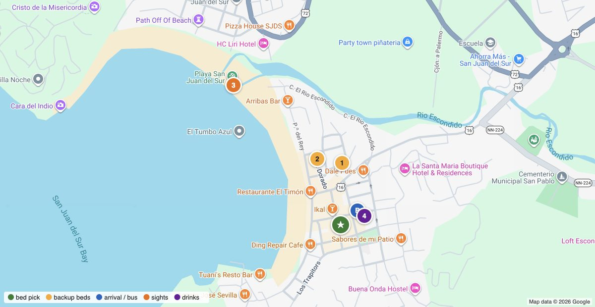
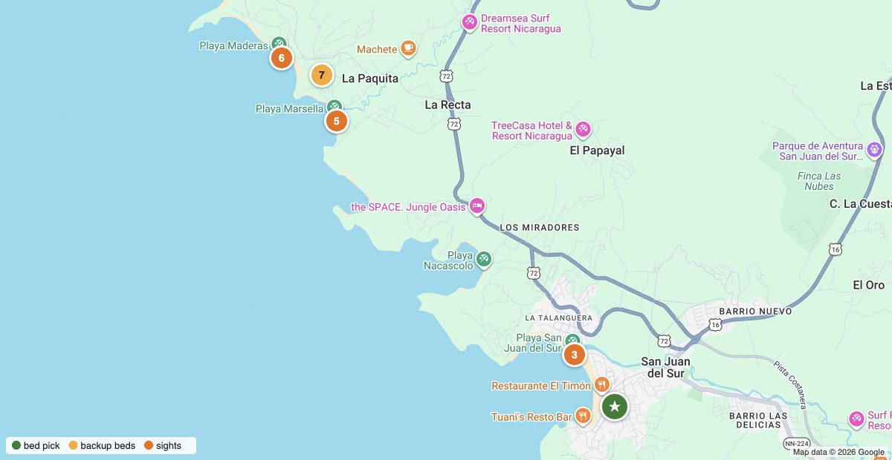

# 🇳🇮 San Juan del Sur / Playa Maderas

Part of the [LatAm itinerary](../itinerary.md) · region notes: [Costa Rica + Nicaragua](costa-rica-nicaragua.md) · ← [Liberia / Rincón de la Vieja](rincon-de-la-vieja.md) · [Ometepe](ometepe.md) →

> **Stop 32 · Sat 20 → Mon 22 Feb 2027 · 2 nights · border crossing** 
> 🏞️ Surf town on a horseshoe Pacific bay, with Playa Maderas 20 min north 
> 🛏️ **Nalu Nalu Hostal**, a 6-bed mixed dorm one street from the beach, $18 for 2 nights 
> 🚌 **In:** buses from Liberia via the Peñas Blancas border, Sat (leave by ~08:00) · **Out:** bus to Rivas and the ferry to Ometepe, Mon 22 Feb

The horseshoe bay of San Juan del Sur from the hill above town. Photo: Google Maps.

## 🗺️ Map

**In town:** ★ **Nalu Nalu Hostal** (the pick) · **1** Hostel SaltWater (backup) · **2** ORÍGENES Guest House (private alternative; the private alt Lobolira isn't on Google Maps) · **B** market bus stop · **3** [Playa San Juan del Sur](https://www.google.com/maps?ftid=0x8f75b4451cc4d32d:0xfc2b50e17b970570) · **4** [San Juan del Sur Cervecería](https://www.google.com/maps?ftid=0x8f75b442150eed3f:0x573fe8233f326a84)

**Around:** ★ San Juan del Sur · **3** town beach · **5** [Playa Marsella](https://www.google.com/maps?ftid=0x8f75b5116913965d:0x2e7191453066fa63) · **6** [Playa Maderas](https://www.google.com/maps?ftid=0x8f75b54038624191:0x92f74c2c6d670e3d) (Playa Majagual is further on) · **7** [Hush Maderas](https://www.google.com/maps?ftid=0x8f75b515df13f18f:0x2622f9739bac056c) (Playa Maderas bed option)

**Open the live map:** [town](https://www.google.com/maps/@11.2555,-85.8700,16z) · [area](https://www.google.com/maps/@11.2750,-85.8900,13z)

## 📅 Day by day

| Day | Plan |
|---|---|
| **Sat 20 Feb** | 🚌 Leave Liberia by ~08:00 → **Peñas Blancas** border (Saturday lines 1–2 h) → Rivas → San Juan del Sur, ≈ 3½–4½ h. Walk 13 min to the hostel. 🌅 Sunset on the main beach (free). |
| **Sun 21 Feb** | 🏄 Coastal walk or shuttle to **Playa Maderas** (20 min north), on to Playa Majagual; Playa Marsella. 🎉 **Sunday Funday** pool crawl is today (paid ticket): fine as a day out, not as a base. |
| **Mon 22 Feb** | 🚌 Bus to Rivas → San Jorge → ⛴️ ferry to **Ometepe** (see Leaving). |

## 🔖 Book (one click)

Dates and 1 adult are pre-filled. The first channel listed was the cheapest when checked on 24 Nov (the beds were live-checked again on 25 Nov). ⚠️ = time-sensitive.

**Beds** (20 → 22 Feb, 2 nights)

| | Where | Total | Location | From the bus stop | Book |
|---|---|---:|:---:|---|---|
| ⭐ **Pick** | **Nalu Nalu Hostal** · 6-bed mixed dorm, breakfast | **$18** | 9.6 | 🚶 2 min (130 m) from the market bus stop; centre 18 min on foot · [route](https://www.google.com/maps/dir/?api=1&origin=11.2536479,-85.8704495&destination=11.2530333,-85.8711678&travelmode=walking) | [Booking](https://www.booking.com/hotel/ni/nalu-nalu-hostel.html?checkin=2027-02-20&checkout=2027-02-22&group_adults=1&no_rooms=1&group_children=0&selected_currency=USD) · [Hostelworld](https://www.hostelworld.com/hostels/p/332428/nalu-nalu-hostal/?from=2027-02-20&to=2027-02-22&guests=1) |
| Backup | **Hostel SaltWater** · basic 6-bed mixed dorm, ensuite | $28.60 | ⚠️ 8.7 | 🚶 7 min (500 m) from the market bus stop; centre 15 min on foot · [route](https://www.google.com/maps/dir/?api=1&origin=11.2536479,-85.8704495&destination=11.2556725,-85.8711053&travelmode=walking) | [Hostelworld](https://www.hostelworld.com/hostels/p/323210/hostel-saltwater/?from=2027-02-20&to=2027-02-22&guests=1) |
| Private alt | **Lobolira** · whole 1-bedroom cabin | $44 | 9.6 | 📍 not found on Google Maps (the listing says "3 blocks from the beach") | [Booking (search)](https://www.booking.com/searchresults.html?ss=Lobolira+San+Juan+del+Sur&checkin=2027-02-20&checkout=2027-02-22&group_adults=1&no_rooms=1&selected_currency=USD) |

**Transport and border**

| | Leg | When | Price | Book |
|---|---|---|---:|---|
| ⚠️ Before | **Costa Rica exit tax** (BCR, pay online) | any time before the border | **$8** | [bancobcr.com](https://www.bancobcr.com/) |
| ⚠️ Before | **Nicaragua advance registration** (Migración) | **by Sat 13 Feb** (≥ 7 days ahead) | free | [solicitudes.migob.gob.ni](https://solicitudes.migob.gob.ni/) |
| In | Liberia → Peñas Blancas → Rivas → San Juan del Sur, local buses | **Sat 20 Feb**, leave Liberia by ~08:00; ≈ 3½–4½ h | ≈ $8 + fees | — |
| Out | San Juan del Sur → Rivas → San Jorge → ferry to Moyogalpa | Mon 22 Feb | ≈ $4–5 | [ferry timetable](https://www.ometepeislandinfo.com/) |

How to read these tables

- **Location** is the guests' location score on Booking.com. The target is 9.0 or higher, and ⚠️ marks one below 9.0. *(HW)* means Hostelworld's location rating, used where a property isn't on Booking.
- **From the bus stop** comes from Google Maps on 24 Nov: the property found on Maps and routed from where you arrive at midday on the check-in date. The **route** link opens the same route.
- Symbols: 🚶 walk · 🚌 public transport · 🚕 taxi/rideshare · 🥾 hike only · ⚠️ far from the centre with no bus · ℹ️ outside the centre but on a bus line.

## 🚌 Getting here: Liberia → Peñas Blancas → San Juan del Sur, Sat 20 Feb

- **Liberia terminal → Peñas Blancas** bus: frequent, ~1–1½ h, ≈ ₡2,000–2,500 / $5 (LP: "frequent public buses… 60–90 min").
- **Border post open 06:00–24:00** (LP). Walk through both sides.
- **On the Nicaraguan side**, either:
  - the bus to **Rivas** (≈ 45 min, ≈ C$30–40 / $1), then the Rivas → San Juan del Sur bus (≈ 45 min, ≈ C$30–40); or
  - get off at the **La Virgen** junction for the San Juan del Sur bus; or
  - a shared taxi from the border straight to San Juan del Sur, ≈ $25–35.
- **Total ≈ 3½–4½ h, ≈ $8 plus fees.** ⚠️ **Leave Liberia by ~08:00**: Saturday lines at Peñas Blancas can take 1–2 h.

**Border fees and paperwork**
- **Costa Rica exit: $8 per person** ($5 tax + $2 phytosanitary + $1 SENASA).
  - Pay **online at bancobcr.com** (any Visa/Mastercard, PDF receipt, no surcharge, valid until the exit is recorded) or at the BCR window at Peñas Blancas.
  - Costa Rica charges nothing to enter by land; anyone asking for more than $8 is not collecting an official fee.
  - ≈ Source: Tico Times explainer (10 Aug 2026) citing BCR. bancobcr.com answered my browser with a bot-check captcha, so I couldn't confirm on BCR itself.
- **Nicaragua entry:** US citizens buy a **90-day tourist entry stamp for $10 cash** (exact change); passport valid 6+ months ✅ travel.state.gov Nicaragua page.
  - Land borders add a municipal/"alcaldía" charge (≈ $1–3) ≈.
  - Bring small, clean US$ bills.
- **Online pre-registration ("Solicitud de Ingreso y Egreso Ordenado, Ágil y Seguro"): submit it anyway, by Sat 13 Feb (≥ 7 days ahead).**
  - It's free, at solicitudes.migob.gob.ni or by email to solicitudes@mint.gob.ni, with the passport bio page. Keep the confirmation on your phone.
  - The evidence:
    - State Dept says only that "for **non-tourist** visitors the Government of Nicaragua **recommends** that you pre-register" ✅ travel.state.gov.
    - A San Juan del Sur hotel's Oct 2026 guide (surfranch.co) says land and sea arrivals must file it ≥ 7 days ahead and wait for the authorisation.
    - Residents on r/nicaraguatravel (Aug–Sep 2026) say it's aimed at visa nationalities and rarely checked, and one who filed it was asked the same questions at the border anyway.
    - Disposición 002-2026 (in force 16 Feb 2026) moved Mexicans and Peruvians into the visa-required Category C; US citizens still get the $10 tourist entry (consortiumlegal.com, 19 Feb 2026).
  - The official mint.gob.ni page wasn't readable from here, so this stays ≈.

## 🛏️ Where to sleep

Live-checked 25 Nov, chosen for location.

### ⭐ Pick: Nalu Nalu Hostal
- **Unit:** standard 6-bed mixed dorm.
- **Price:** **$18 for 2 nights on Booking** (breakfast included, free cancellation to 19 Feb, pay at the property) vs $20 on Hostelworld.
- **Reviews:** Booking **8.2 (231; 5% below 7)**, location **9.6**; HW 8.4 (59; 9.5 % < 7).
- **Where:** one street from the beach, ~0.1 km from the centre.
- **Why it fits:** ✅ shared kitchen ("equipped kitchen"), "nice quiet hostel", "definitely isn't a party hostel".
- Thin walls: noise carries up from the social area.
- ⚠️ A Nov 2026 review says the 6-bed dorm has no AC and almost no airflow ("so hot I couldn't sleep"), so consider the **4-bed mixed dorm ($24)** and ask for a fan.

### Backup: Hostel SaltWater
- Town, calm; ⚠️ **location 8.7**. It was the pick until 25 Nov.
- Basic 6-bed mixed dorm, ensuite. **$28.60 for 2 nights** ($26 + 10 % tax) on Hostelworld.
- HW **8.9 (151; 13.2 % < 7)**. ~0.2 km from the centre and the bus stop.
- "Great chill hostel… a good place to get some rest away from the partying". Hammocks and a sunset deck, fully equipped shared kitchen (property text), A/C.
- **Only partial curtains** (top bunks have none). No pool.
- **Avoid as a base:** Pachamama (party, pool), Hola Ola (party, pool), Surf Town (pool, many noise mentions), Sohla Rooftop (24.5 % < 7, party/pool), Casa Oro (32.6 % < 7).
- **Playa Maderas option:** **Hush Maderas** (HW 9.7/116, 6-bed ensuite $70 for 2 nights, pool + bar, jungle lodge right above the beach).

### Private alt (location first): Lobolira
- **Lobolira cabin ("1 bedroom cabin, 3 blocks from beach")**, a whole cabin. **$44 for 2 nights** (room table) on Booking.com.
- Booking location **9.6** (score 9.4, 32 reviews, 0 % bad).
- 0.6 km from the centre, on a quiet street.
- Alternative: **ORÍGENES Guest House** double, location 9.4 (79 reviews, 3 % bad), $60, 0.4 km.

## 🌳 Things to do (free and outdoors first)

<table>
<tr>
<td width="50%" valign="top"> <b><a href="https://www.google.com/maps?ftid=0x8f75b54038624191:0x92f74c2c6d670e3d">Playa Maderas</a></b> · free (shuttle or coastal walk) 20 min north of town: surf, yoga and sunsets (LP). Carry on to Playa Majagual.</td>
<td width="50%" valign="top"> <b><a href="https://www.google.com/maps?ftid=0x8f75b5116913965d:0x2e7191453066fa63">Playa Marsella</a></b> · free Just south of Maderas (see the area map), on the way there.</td>
</tr>
<tr>
<td width="50%" valign="top"> <b><a href="https://www.google.com/maps?ftid=0x8f75b4451cc4d32d:0xfc2b50e17b970570">Sunset on the main beach</a></b> · free The town beach, one street from the hostel (LP).</td>
<td width="50%" valign="top"><b>Sunday Funday</b> · paid ticket A weekly pool crawl; this week it's on <b>Sun 21 Feb</b> (LP). Fine as a day out, not as a base.</td>
</tr>
</table>

- **Coastal walk or shuttle to Playa Maderas** (20 min north; surf, yoga, sunsets; LP) and on to Playa Majagual; Playa Marsella.
- **Sunset on the main beach** (free; LP).
- **Sunday Funday** pool crawl is on **Sun 21 Feb** (weekly; LP).

## 🍽️ Eat and drink

<table>
<tr>
<td width="50%" valign="top"> <b>Fish and seafood plates</b> · ≈ C$250–400 ($7–11) ≈ At the beach comedores. Generic photo of a beach fish plate (taken in Colombia).</td>
<td width="50%" valign="top"> <b><a href="https://www.google.com/maps?ftid=0x8f75b442150eed3f:0x573fe8233f326a84">San Juan del Sur Cervecería</a></b> · craft beer LP: "your go-to craft-beer spot". 10:00–24:00, <b>closed Tue</b>.</td>
</tr>
</table>

## ℹ️ Good to know
- **Advisory:** State Dept **Level 3 – Reconsider travel** (issued 14 May 2026) ✅ travel.state.gov:
  - wrongful-detention risk and arbitrary enforcement;
  - **drones are illegal**;
  - public photography of government buildings and police is restricted;
  - phones may be searched.
  - Keep your phone free of political content and don't photograph police or officials.
- **Decline drug offers** (LP: up to 3 years' prison for 20 g of cannabis).
- **Money:** ATMs in town take US cards; US$ are widely accepted.

## 🚌 Leaving: San Juan del Sur → Ometepe, Mon 22 Feb

- **Bus to Rivas** (frequent, ~45 min, ≈ C$30–40) → taxi or colectivo 5 km to the **San Jorge** port → **ferry to Moyogalpa** (~70 min). ≈ 3 h, ≈ $4–5 in all.
- Ferry times, fares and the windy-lake advice are in the [Ometepe](ometepe.md) guide.

---
Photos: Google Maps contributors (San Juan del Sur bay, Playa Maderas, Playa Marsella, Playa San Juan del Sur, San Juan del Sur Cervecería). Wikimedia Commons: <a href="https://commons.wikimedia.org/wiki/File:Comida_de_la_Playa_de_Santa_Ver%C3%B3nica.jpg">Comida de la Playa de Santa Verónica</a> (PapiPijuan, CC BY-SA 4.0).
