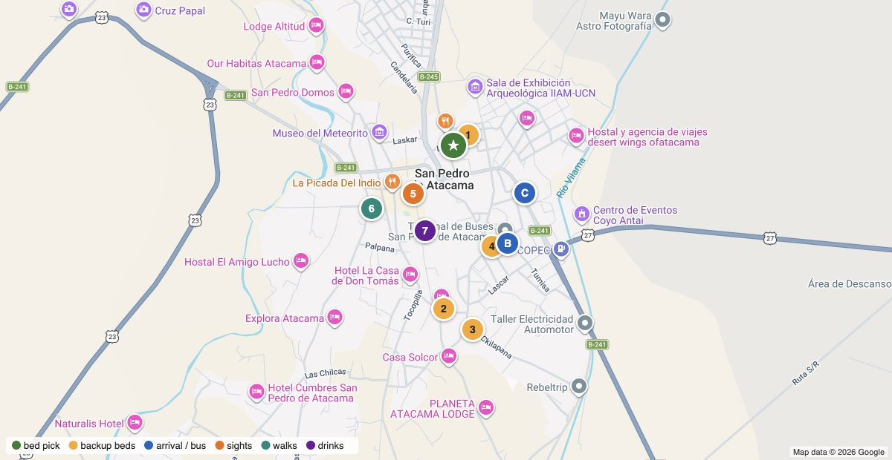
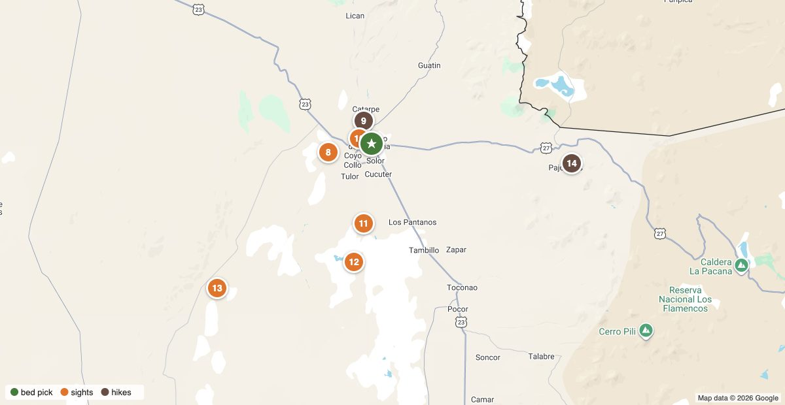

# 🇨🇱 San Pedro de Atacama

Part of the [LatAm itinerary](../itinerary.md) · region notes: [Chile + Bolivia](chile-bolivia.md) · ← [Quebrada de Humahuaca (Tilcara + Iruya + Purmamarca)](quebrada-de-humahuaca.md) · [Jeep tour San Pedro → Uyuni](uyuni-jeep-tour.md) →

> **Stop 16 · Fri 15 → Mon 18 Jan 2027 · 3 nights** (one night moved to Iruya on 26 Nov) 
> 🏞️ Adobe oasis town in the Atacama desert: moon-like valleys by bike, salt lagoons, a 5,604 m volcano and dark skies 
> 🛏️ **Hostal Lackuntur**, a bed in a 4-bed mixed dorm, US$55 for 3 nights 
> 🚌 **In:** Andesmar from Purmamarca over Paso de Jama, Fri 03:40 → ≈ 11:30 · **Out:** the 3-day jeep tour to Uyuni, Mon morning

The big dune in the Valle de la Luna, west of town. Photo: Google Maps.

## 🗺️ Map

**In town:** ★ **Hostal Lackuntur** (the pick) · **1** Backpackers San Pedro (backup) · **2** Casa Voyage Hostel (backup 2) · **3** Aji Verde (cheapest decent) · **4** Hostal Ayni (private alt) · **B** [Terminal de Buses](https://www.google.com/maps?ftid=0x96a974ff051501b3:0x872ecffad0ba7dfc) · **C** [border and customs post](https://www.google.com/maps?ftid=0x96a97598d3a10b17:0xbe3becc299021b42) (immigration and the SAG check on arrival) · **5** [Plaza](https://www.google.com/maps?ftid=0x96a97457b18828f3:0x7bf1d074228e27c9) · **6** [Caracoles](https://www.google.com/maps?ftid=0x96a974578b716aed:0x709cbd7d12a29da4) (bike hire, casas de cambio) · **7** [Cervecería St. Peter](https://www.google.com/maps?ftid=0x95a02b40eae5f02b:0x8197efe8cd91c5e1). [La Picada del Indio](https://www.google.com/maps?ftid=0x96a97457bd5b4b85:0x27092be076626eb8) is labelled on the map, by the plaza.

Note: the walking routes in the beds table start from a different Google "bus terminal" point, ≈ 500 m north-west of **B** (next to the ★).

**Around (terrain):** ★ San Pedro · **8** [Valle de la Luna](https://www.google.com/maps?ftid=0x96a972ff8dc8582d:0x7ad176d2c4b12f43) · **9** [Garganta del Diablo, Quebrada de Catarpe](https://www.google.com/maps?ftid=0x96a9769f5503f07d:0x5438fa2d5ebae766) · **10** [Valle de Marte](https://www.google.com/maps?ftid=0x96a9746dd28b6975:0x5cd239e0b1f62c22) · **11** [Laguna Cejar](https://www.google.com/maps?ftid=0x96a90974c9e42811:0x3e2a69f6c145d5f7) · **12** [Ojos del Salar](https://www.google.com/maps?ftid=0x96a908ac64837e35:0xee6838bb6d8f8395) and [Laguna Tebinquiche](https://www.google.com/maps?ftid=0x96a90f434a387447:0x7eacb3ae92a7fa47) · **13** [Lagunas Escondidas de Baltinache](https://www.google.com/maps?ftid=0x96a91800fd163967:0x9ad84752bb8237ee) · **14** [Cerro Toco](https://www.google.com/maps?ftid=0x96a9bf76dbedd6f1:0xae7a69a68938ccf2)

**Open the live map:** [town](https://www.google.com/maps/@-22.9110,-68.1980,15z) · [area](https://www.google.com/maps/@-23.0000,-68.1500,10z)

## 📅 Day by day

| Day | Plan |
|---|---|
| **Fri 15 Jan** | 🚌 Andesmar from Purmamarca arrives ≈ 11:30; immigration and the SAG food check on arrival. A rest day after 4,200 m on Jama: walk Caracoles and the river edge. ✨ **Free stargazing** out of town (darkest 00:00–04:00). |
| **Sat 16 Jan** | 🚲 **Valle de la Luna by rented bike** (bikes may enter only 09:00–11:00). Afternoon (or Sun): the short bike loop north to the **Garganta del Diablo** and the **Valle de Marte** dunes. Optional: **Laguna Cejar**. |
| **Sun 17 Jan** | 🏔️ **Cerro Toco** 5,604 m (optional guided walk-up, 06:00 → ≈ 13:30), if you feel fine. 💱 Change ≈ Bs 250 in small notes for the tour. |
| **Mon 18 Jan** | 🚙 Jeep tour pickup at the hostel ≈ 06:00–06:30 → Uyuni ([tour guide](uyuni-jeep-tour.md)). |

## 🔖 Book (one click)

Dates and 1 adult are pre-filled. Prices move, so compare the channels shown (first = cheapest when checked on 24 Nov). ⚠️ = time-sensitive.

**Beds** (15 → 18 Jan, 3 nights)

| | Where | Total | Location | From the bus terminal | Book |
|---|---|---:|:---:|---|---|
| ⭐ **Pick** | **Hostal Lackuntur** · bed in a 4-bed mixed dorm | **US$55** | 9.4 | 🚶 12 min (850 m); centre 9 min on foot · [route](https://www.google.com/maps/dir/?api=1&origin=-22.9134859,-68.1947174&destination=-22.908264,-68.197843&travelmode=walking) | [Booking](https://www.booking.com/hotel/cl/hostal-lackuntur.html?checkin=2027-01-15&checkout=2027-01-18&group_adults=1&no_rooms=1&group_children=0&selected_currency=USD) |
| Backup | **Backpackers San Pedro** · 4-bed mixed dorm | ≈ US$62.55 | 9.6 *(HW)* | 🚶 12 min (800 m); centre 13 min on foot · [route](https://www.google.com/maps/dir/?api=1&origin=-22.9134859,-68.1947174&destination=-22.907743,-68.1969659&travelmode=walking) | [Hostelworld](https://www.hostelworld.com/hostels/p/47324/backpackers-san-pedro/?from=2027-01-15&to=2027-01-18&guests=1) · [Agoda](https://www.agoda.com/partners/partnersearch.aspx?hid=78398178&checkin=2027-01-15&checkout=2027-01-18&NumberofAdults=1&Rooms=1) |
| Backup 2 | **Casa Voyage Hostel** · bed in a 10-bed mixed dorm, curtains | US$48 | ⚠️ 8.8 | 🚶 11 min (850 m); centre 11 min on foot · [route](https://www.google.com/maps/dir/?api=1&origin=-22.9134859,-68.1947174&destination=-22.916985099999998,-68.19840649999999&travelmode=walking) | [Agoda](https://www.agoda.com/partners/partnersearch.aspx?hid=21962859&checkin=2027-01-15&checkout=2027-01-18&NumberofAdults=1&Rooms=1) · [Hostelworld](https://www.hostelworld.com/hostels/p/304202/casa-voyage-hostel/?from=2027-01-15&to=2027-01-18&guests=1) |
| Private alt | **Hostal Ayni** · single room | US$135 | 9.7 | 🚶 4 min (250 m); centre 10 min on foot · [route](https://www.google.com/maps/dir/?api=1&origin=-22.9134859,-68.1947174&destination=-22.913666499999998,-68.1955863&travelmode=walking) | [Booking](https://www.booking.com/hotel/cl/hostal-familiar-ayni.html?checkin=2027-01-15&checkout=2027-01-18&group_adults=1&no_rooms=1&group_children=0&selected_currency=USD) |

**Transport and tickets**

| | Leg | When | Price | Book |
|---|---|---|---:|---|
| In | **Andesmar** · Purmamarca → San Pedro, over Paso de Jama | **Fri 15 Jan 03:40 → ≈ 11:30** | ARS 120,000 ≈ $75 | see the [Quebrada guide](quebrada-de-humahuaca.md) |
| Ticket | **Valle de la Luna** entry (bikes 09:00–11:00) | Sat 16 Jan | ✅ CLP 10,800 ≈ US$10.50 | [valledelaluna.com/shop](https://valledelaluna.com/shop) (card at the gate; no cash) |
| Ticket | **Laguna Cejar** (optional, timed slots, online only) | Sat 16 or Sun 17 Jan | ✅ CLP 15,000 ≈ US$14.65 | [lagunacejar.com](https://lagunacejar.com/) |
| Tour | **Cerro Toco** (optional, guided) | Sun 17 Jan 06:00 → ≈ 13:30 | ✅ Vulcano CLP 85,000 ≈ US$83 · Nomades CLP 75,000 ≈ US$73 | from the operators |
| ⚠️ Out | **Jeep tour → Uyuni** (Estrella del Sur, pick) | Mon 18 Jan, pickup ≈ 06:00–06:30 | US$260–280 + park fees | [jeep tour guide](uyuni-jeep-tour.md) |

How to read these tables

- **Location** is the guests' location score on Booking.com. The target is 9.0 or higher, and ⚠️ marks one below 9.0. *(HW)* means Hostelworld's location rating, used where a property isn't on Booking.
- **From the bus terminal** comes from Google Maps on 24 Nov: the property found on Maps and routed from where you arrive at midday on the check-in date. The **route** link opens the same route.
- Symbols: 🚶 walk · 🚌 public transport · 🚕 taxi/rideshare · 🥾 hike only · ⚠️ far from the centre with no bus · ℹ️ outside the centre but on a bus line.
- CLP 1,024 = US$1.

## 🚌 Getting here: Purmamarca → San Pedro de Atacama, Fri 15 Jan

- **Andesmar Purmamarca 03:40 → San Pedro bus terminal ≈ 11:30**, over Paso de Jama (4,200 m). Times and price are in the [Quebrada guide](quebrada-de-humahuaca.md).
- **Chilean immigration and the SAG food check** happen at the San Pedro customs post on arrival: declare or eat all fruit, meat and cheese beforehand.

## 🛏️ Where to sleep

### ⭐ Pick: Hostal Lackuntur
Live-checked 25 Nov, chosen for location.
- **Unit:** a bed in a 4-bed mixed dorm.
- **Price:** **US$55 for 3 nights on Booking** (rechecked 26 Nov for 15 → 18 Jan; Genius price; free cancellation to 13 Jan, pay the property before arrival). Not on Hostelworld for these dates.
- **Reviews:** Booking **9.3 (1,228 reviews; 1% below 7)**, location **9.4**.
- **Where:** 12 min (850 m) on foot from the bus terminal, 0.65 km from the plaza.
- **Checks:** ✅ shared kitchen ("amazing view of the volcano from the kitchen"). "Perfectly chilled vibes, far from a party environment"; beds and rooms cleaned daily. Outdoor pool (facility list; no pool-party reports). ✗ no bunk curtains (a 2025 review asks for them). No AC, and the private rooms are thin-walled (Nov 2026).
- **Why it won:** it beats the approved swap to Backpackers San Pedro: cheaper (on 25 Nov, $74 vs $84.80 for the then 4 nights; now $55 vs ≈ $62.55 for 3) and scored by 1,228 Booking guests rather than Hostelworld.

### Backup: Backpackers San Pedro
- **Unit:** 4-bed mixed dorm.
- **Price:** **≈ US$62.55 for 3 nights** on Hostelworld (26 Nov; US$84.80 for the old 4 nights). Booking's separate listing US$84, only 8 reviews; Agoda US$99.88.
- **Reviews:** Hostelworld 9.7 (2,789; 5% below 7 in the last 12 months).
- **Where:** 0.5 km to the plaza, the most central.
- **Checks:** several kitchens with stoves ("great cooking facilities"). ✗ no bunk curtains (window curtains only). Not a party hostel, but garden music sometimes past 23:00. No pool.

### Backup 2: Casa Voyage Hostel
The pick until 25 Nov. ⚠️ Location 8.8.
- **Unit:** bed in a 10-bed mixed dorm (8-bed also free).
- **Price:** **US$48 for 3 nights on Booking** (26 Nov; HW ≈ US$54.93). Older 4-night prices (before 26 Nov): **US$64.68 on Agoda** (signed-in price; Agoda 8.9 on 2,488 reviews) ≈ **Booking US$65** (non-refundable, pay before arrival; US$80 with free cancellation); Hostelworld US$74.48 + its booking fee.
- **Reviews:** Hostelworld 9.6 (799); Booking 1,225 reviews, **6.0% below 7**.
- **Where:** 0.7 km to the plaza, 11 min (850 m) on foot from the bus terminal (quiet side, 10 min from Caracoles).
- **Checks:**
  - ✅ **privacy curtains**, reading light and socket per bunk (Hostelworld reviews Jan–Nov 2026).
  - ✅ **full kitchen with stove** ("plentiful appliances", busy at dinner time).
  - Social, not a party hostel ("social but not too much party"; one complaint about late noise in 165 recent Hostelworld reviews).
  - ⚠ **small pool + gym** (pool described as "colder than the Antarctic", no pool-party reports).
  - ⚠ **bed bugs in March 2026** (three reviews, one private room) and one itchy-bites report in Sep 2026; reviews since then are clean, but read the newest ones before booking.

### Cheapest decent: Aji Verde
- 10-bed dorm. **US$62.80** on Hostelworld (Booking US$78, Agoda US$77.80).
- Hostelworld 9.1 (1,293); Booking 694 reviews, 9.7% below 7.
- Kitchen with stove (small, queues). No curtains. Pool + bar whose music sometimes runs past midnight.

### Private alt (location first): Hostal Ayni
- **Single Room** (shared kitchen; family-run, Claudio and Rossana). **US$135 for 3 nights** (room table, 26 Nov; free cancellation to 13 Jan) on Booking.
- Booking location **9.7**, 295 reviews, 4.1% below 7.
- 0.5 km to the plaza, ≈ 0.2 km to the terminal.
- **Next:** Hostal Casa Flores, twin, location 9.3, 524 reviews, US$189.
- **Other ≥ 9.0 dorms on Booking (25 Nov):** Hostal Campo Base 9.1, $102; Mamatierra 9.3, $122; Anka 9.9, $136 (all 1–2% below 7); La Casa EcoExplor 9.4, $54 (52 reviews, 6% below 7, Wi-Fi 5.0).

## 🌳 Things to do (free and outdoors first)

<table>
<tr>
<td width="50%" valign="top"> <b>Free stargazing</b> · free Walk 1.5–2 km out of town with a red light. Darkest 00:00–04:00.</td>
<td width="50%" valign="top"> <b><a href="https://www.google.com/maps?ftid=0x96a972ff8dc8582d:0x7ad176d2c4b12f43">Valle de la Luna</a></b> by bike · CLP 10,800 ≈ US$10.50 + bike Bikes enter only 09:00–11:00. ≈ 30–35 km round trip on sand and washboard.</td>
</tr>
<tr>
<td width="50%" valign="top"> <b><a href="https://www.google.com/maps?ftid=0x96a9769f5503f07d:0x5438fa2d5ebae766">Garganta del Diablo</a></b>, Catarpe · ≈ CLP 5,000 cash A narrow canyon north of town, rideable by bike.</td>
<td width="50%" valign="top"> <b><a href="https://www.google.com/maps?ftid=0x96a9746dd28b6975:0x5cd239e0b1f62c22">Valle de Marte</a></b> (Valle de la Muerte) · ≈ CLP 7,500 Dunes 2 km from town.</td>
</tr>
<tr>
<td width="50%" valign="top"> <b><a href="https://www.google.com/maps?ftid=0x96a90974c9e42811:0x3e2a69f6c145d5f7">Laguna Cejar</a></b> · CLP 15,000 ≈ US$14.65 The one thing the Uyuni tour lacks: floating. 28 km out.</td>
<td width="50%" valign="top"> <b><a href="https://www.google.com/maps?ftid=0x96a91800fd163967:0x9ad84752bb8237ee">Lagunas Escondidas de Baltinache</a></b> · ≈ CLP 10,000 Seven floatable turquoise pools, ≈ 1 h south on a rough road.</td>
</tr>
<tr>
<td width="50%" valign="top"> <b><a href="https://www.google.com/maps?ftid=0x96a908ac64837e35:0xee6838bb6d8f8395">Ojos del Salar</a></b> + <a href="https://www.google.com/maps?ftid=0x96a90f434a387447:0x7eacb3ae92a7fa47">Laguna Tebinquiche</a> · ≈ CLP 5,000–6,000 Swim in the Ojos; sunset reflections at Tebinquiche.</td>
<td width="50%" valign="top"> <b><a href="https://www.google.com/maps?ftid=0x96a9bf76dbedd6f1:0xae7a69a68938ccf2">Cerro Toco</a></b> 5,604 m · ≈ US$73–83 guided 4x4 to ≈ 5,200 m, then ≈ 400 m up scree in 2–3 h.</td>
</tr>
</table>

**Fri 15 (arrival, rest day).** Take it easy after 4,200 m on Jama. Walk Caracoles and the river edge, then stars.
- **Free stargazing:** walk 1.5–2 km out of town (the Ayllu roads east or the Toconao road) with a red light.
- The moon (37%) sets around midnight, so 00:00–04:00 on 14–15 Jan is the darkest window.
- Paid astronomy tours are cancelled often in January cloud and aren't needed.

**Sat 16: Valle de la Luna by rented bike** (the cheap version of the most-sold tour).
- ✅ Bikes may enter only **09:00–11:00** (valledelaluna.com, Sep–Mar).
- ✅ Entry **CLP 10,800 ≈ US$10.50** (Viator/SanPedroAtacama.com/Horizonte quoting CONAF). Buy online at valledelaluna.com/shop (card at the gate; no cash).
- Bike hire ≈ CLP 8,000–10,000 for the half day (Caracoles shops, helmet included, ≈).
- ≈ 30–35 km round trip on sand and washboard. Carry 2 L of water; you're back before the afternoon heat.
- The Piedra del Coyote (Ckari) sunset viewpoint is reported closed (≈).

**Sat 16, afternoon, or Sun 17: short bike loop north.**
- **Garganta del Diablo** canyon in Quebrada de Catarpe (gate ≈ CLP 5,000 cash, tur.com).
- The **Valle de Marte** (Valle de la Muerte) dunes 2 km from town (≈ CLP 7,500, June 2026 post).
- Both are rideable from town in 2–4 h.

**Laguna Cejar (optional, the one thing the Uyuni tour lacks: floating).**
- ✅ CLP 15,000 ≈ US$14.65 on lagunacejar.com (13–59 y; timed slots, online only; you float in Laguna Piedra next door).
- It's 28 km out: tours ≈ CLP 30,000 + CLP 20,000 of entries (Cejar + Tebinquiche sunset), so ≈ US$49 all-in (tuki.cl, Aug 2026).
- **Alternatives:** Lagunas Escondidas de **Baltinache** (≈ CLP 10,000 at the gate, seven floatable turquoise pools, ≈ 1 h south on a rough road, so a tour or a shared car) or **Ojos del Salar + Laguna Tebinquiche** (≈ CLP 5,000–6,000; swim in the Ojos, sunset reflections at Tebinquiche; on the Cejar road).
- Or simply skip it: the jeep tour has the Polques hot pool, flamingo lagoons and the salt flat.

**Sun 17: Cerro Toco 5,604 m** (optional guided walk-up; Iruya, Hornocal and Jama make good acclimatisation for it). Guide mandatory (it's inside a park).
- ✅ **Vulcano Expediciones CLP 85,000 ≈ US$83** group (06:00 → ≈ 13:30; 4x4 to ≈ 5,200 m, then ≈ 400 m of ascent on scree in 2–3 h; WFR guide, poles, warm layers, oxygen; full refund or reschedule if weather stops it; private CLP 290,000).
- ✅ **Nomades CLP 75,000 ≈ US$73** (7 h, free reschedule ≥ 48 h). Atacama Chile Tours from US$110.
- **Acclimatisation:** operators want 2–3 days in San Pedro plus something above 3,500 m first. You arrive from Purmamarca (2,300 m) over Jama (4,200 m), so the 17th is day 4 and OK if you feel fine on the 15th–16th. It also pre-acclimatises you for the tour's 4,300–4,900 m. Skip it if you have a headache or poor sleep.
- **January:** Vulcano warns of afternoon storms and sudden snow Jan–Mar and confirms each departure on the day's forecast; the snow track can stop short of 5,000 m.

**Skip (paid, done better on the tour):** El Tatio geysers, Piedras Rojas / Miscanti–Miñiques altiplanic lagoons, and Valle del Arcoíris tours. Sol de Mañana, Lagunas Verde, Blanca and Colorada and the Polques pool come on days 1–2 of the jeep tour.

## 🍽️ Eat and drink

You have the shared kitchen at Lackuntur, so cook most nights; Chile is the expensive end of this section.

<table>
<tr>
<td width="50%" valign="top"> <b>Baked empanadas</b> · CLP 2,500–4,000 (US$2.50–4) A generic Chilean empanada de pino (Wikimedia Commons), not from a San Pedro shop.</td>
<td width="50%" valign="top"> <b><a href="https://www.google.com/maps?ftid=0x95a02b40eae5f02b:0x8197efe8cd91c5e1">Cervecería St. Peter</a></b> (Toconao 479) · ≈ CLP 4,000–5,500 a glass Local brews on tap.</td>
</tr>
</table>

- **Locals' lunch:** the **menú del día / colación, CLP 7,000–8,500 (≈ US$7–8)** for soup, main and dessert, a few blocks off Caracoles: **[La Picada del Indio](https://www.google.com/maps?ftid=0x96a97457bd5b4b85:0x27092be076626eb8)** (Tocopilla 418) or the simple places by the bus terminal and artisan market on Licancabur.
- Prices are AI-summary leads, Nov 2026, ≈.

## ℹ️ Good to know
- **Book ahead:** January is Chile's summer high season, so book the bed and the jeep tour a week or more ahead.
- **Invierno altiplánico:** the town itself stays dry (4 mm in January), but storms close **Hito Cajón** and Jama for 1–3 days at a time. The El Loa delegation usually announces it the evening before. Tours then wait or reroute via Ollagüe (≈ AI-summary leads, 2026 examples). Keep 18 → 20 Jan flexible by a day; Potosí and Sucre can absorb it.
- **Cash for Bolivia:** change CLP/USD into **≈ Bs 250 in small notes** for the tour before leaving (casas de cambio on Caracoles).
- **Money:** CLP 1,024 = US$1.

## 🚙 Leaving: jeep tour to Uyuni, Mon 18 Jan

- The agency's minibus collects you from the hostel at ≈ 06:00–06:30, then the Chilean exit stamp and Hito Cajón.
- Operators, prices, park fees and January conditions are in the [jeep tour guide](uyuni-jeep-tour.md).

---
Photos: Google Maps contributors (Valle de la Luna, Garganta del Diablo, Valle de Marte, Laguna Cejar, Baltinache, Ojos del Salar, Cerro Toco, Cervecería St. Peter). Wikimedia Commons: <a href="https://commons.wikimedia.org/wiki/File:Atacama_Milky_Way_panorama_(uhd_img_3803p-cc).jpg">Atacama Milky Way panorama</a> (ESO/B. Tafreshi, CC BY 4.0), <a href="https://commons.wikimedia.org/wiki/File:Empanada_de_pino.jpg">Empanada de pino</a> (J B from Champaign, IL, USA, CC BY 2.0).
