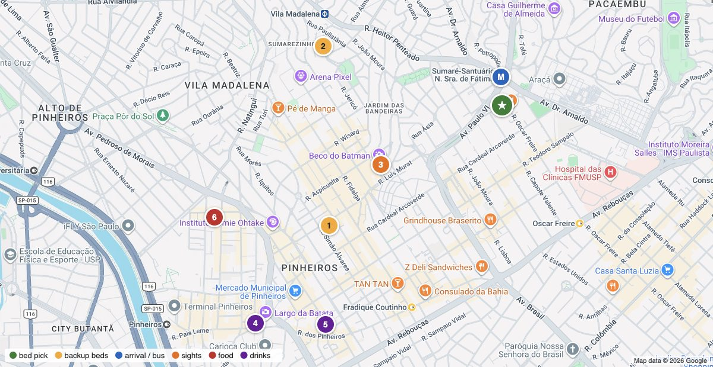
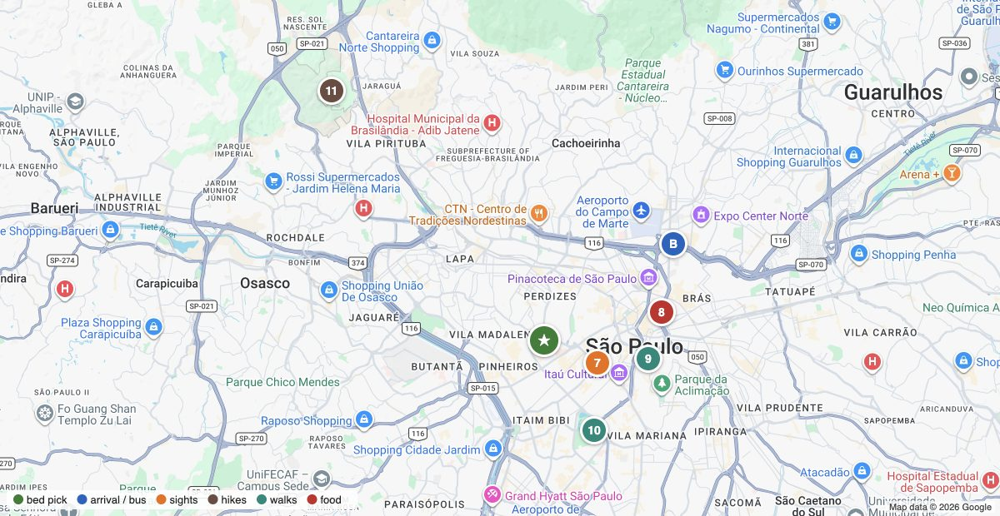

# 🇧🇷 São Paulo

Part of the [LatAm itinerary](../itinerary.md) · region notes: [Brazil](brazil.md) · ← [Paraty](paraty.md) · [Curitiba + Serra Verde](curitiba.md) →

> **Stop 4 · Day 8 → 10 · 2 nights · MASP's free Tuesday** 
> 🏞️ Brazil's biggest city: art, a forest peak on the city edge and craft beer, with a base in Pinheiros 
> 🛏️ **Lamparina Hostel**, a bed in a 10-bed mixed dorm with privacy curtains, $27 for 2 nights 
> 🚌 **In:** Reunidas from Paraty 09:00 → Tietê 15:40, Day 8 · **Out:** Penha 07:30 Tietê → Curitiba 14:00, Day 10

The lake in Parque Ibirapuera, with the city's towers behind. Photo: Google Maps.

## 🗺️ Map

**Pinheiros / Vila Madalena:** ★ **[Lamparina Hostel](https://www.google.com/maps?ftid=0x94ce5783fa866b7f:0x548c44590aac730a)** (the pick, [book](https://www.booking.com/searchresults.html?ss=Lamparina+Hostel+S%C3%A3o+Paulo&checkin=2026-12-15&checkout=2026-12-17&group_adults=1&no_rooms=1&selected_currency=USD)) · **1** [O de Casa Hostel Bar](https://www.google.com/maps?ftid=0x94ce57a27c618cf9:0xc6e6302994c4db64) (backup, [book](https://www.booking.com/searchresults.html?ss=O+de+Casa+Hostel+Bar+S%C3%A3o+Paulo&checkin=2026-12-15&checkout=2026-12-17&group_adults=1&no_rooms=1&selected_currency=USD)) · **2** [Zen Hostel Brasil](https://www.google.com/maps?ftid=0x94ce57bff617bb65:0x3140b77de7631091) (private alt, [book](https://www.booking.com/hotel/br/zen-hostel-brasil.html?checkin=2026-12-15&checkout=2026-12-17&group_adults=1&no_rooms=1&group_children=0&selected_currency=USD)) · **M** [Sumaré metro](https://www.google.com/maps?ftid=0x94ce578ef82bb161:0xc2abad00ecdf5009) (L2) · **3** [Beco do Batman](https://www.google.com/maps?ftid=0x94ce575858b6a5b9:0xc5b1a9636043ff22) [🚶 20 min](https://www.google.com/maps/dir/?api=1&origin=-23.5526464,-46.6778234&destination=-23.5566009,-46.686579&travelmode=walking) · **4** [Hocus Pocus SP](https://www.google.com/maps?ftid=0x94ce572f97f8a5bd:0x146e29efffa504ec) [🚌 14 min (bus 778J-41)](https://www.google.com/maps/dir/?api=1&origin=-23.5526464,-46.6778234&destination=-23.567134,-46.6956496&travelmode=transit) · **5** [Ambar](https://www.google.com/maps?ftid=0x94ce57a008afe231:0x7e0fb44700acfd83) [🚌 15 min (bus 778J-41)](https://www.google.com/maps/dir/?api=1&origin=-23.5526464,-46.6778234&destination=-23.5672239,-46.6905498&travelmode=transit) · **6** [Bráz Pizzaria, Pinheiros](https://www.google.com/maps?ftid=0x94ce57ba988914f5:0xda326d2de19c90ff) [🚌 22 min (bus 209P-1)](https://www.google.com/maps/dir/?api=1&origin=-23.5526464,-46.6778234&destination=-23.5601089,-46.698589&travelmode=transit)

**Across the city:** ★ Lamparina · **B** [Tietê bus terminal](https://www.google.com/maps?ftid=0x94ce588f87a60cc9:0x8a26cc25feaa6909) · **7** [MASP](https://www.google.com/maps?ftid=0x94ce59ceb1eb771f:0xe904f6a669744da1) [🚌 17 min (subway Linha 2)](https://www.google.com/maps/dir/?api=1&origin=-23.5526464,-46.6778234&destination=-23.561414,-46.6558819&travelmode=transit) · **8** [Mercadão](https://www.google.com/maps?ftid=0x94ce5f8c61020205:0x9ae474c606fef4) [🚌 39 min (bus 701A-10)](https://www.google.com/maps/dir/?api=1&origin=-23.5526464,-46.6778234&destination=-23.5420217,-46.6294111&travelmode=transit) ([Bar do Mané](https://www.google.com/maps?ftid=0x94ce58f8d4143a63:0x32b7685f282c668e)) · **9** [Liberdade](https://www.google.com/maps?ftid=0x94ce59a6f830f72b:0xf004c5957d68938d) [🚌 37 min (subway Linha 2 + subway Linha 1)](https://www.google.com/maps/dir/?api=1&origin=-23.5526464,-46.6778234&destination=-23.5596324,-46.6349487&travelmode=transit) · **10** [Parque Ibirapuera](https://www.google.com/maps?ftid=0x94ce59f1069d11d1:0xcb936109af9ce541) [🚌 43 min (subway Linha 2 + bus 5178-10)](https://www.google.com/maps/dir/?api=1&origin=-23.5526464,-46.6778234&destination=-23.5867833,-46.6571881&travelmode=transit) ([Marquise](https://www.google.com/maps?ftid=0x94ce59e7f60bef85:0xa0dd80fbc0271331)) · **11** [Pico do Jaraguá](https://www.google.com/maps?ftid=0x94cefc6ae642f6e9:0x8ee77220162d411a) [🚕 ≈ 44 min](https://www.google.com/maps/dir/?api=1&origin=-23.5526464,-46.6778234&destination=-23.458333,-46.765278&travelmode=driving) ([Parque Estadual do Jaraguá](https://www.google.com/maps?ftid=0x94cefc156ebae91d:0xb0e90674a6fdbabe))

🧭 The time after each place is from the ★ bed (Google Maps, 26 Nov): 🚶 walk · 🚌 bus · 🚕 taxi · 🚗 by road (tour or bus). Click it for the route.

**Open the live map:** [Pinheiros](https://www.google.com/maps/@-23.5580,-46.6870,15z) · [city](https://www.google.com/maps/@-23.530,-46.680,11z)

## 📅 Day by day

| Day | Plan |
|---|---|
| **Day 8** | 🚌 **Reunidas 09:00** Paraty → Tietê 15:40, then Metrô L1 → L2 to Sumaré (~40 min). 🖼️ **MASP is free on Tuesdays** (10:00–20:00, last entry 19:00; **book a free slot online**). |
| **Day 9** | 🥾 **07:00 Pico do Jaraguá** via the Trilha do Pai Zé (2–2.5 h, free). Afternoon: 🥪 lunch at the **Mercadão**, the **Liberdade** streets, then **Ibirapuera** or **Beco do Batman** at sunset. 🍺 Hocus Pocus SP or Ambar. |
| **Day 10** | Leave the hostel ~06:45 for the 🚌 **07:30 Penha** from Tietê to Curitiba. The metro opens at 04:40. |

## 🔖 Book (one click)

Dates and 1 adult are pre-filled. The first channel listed was the cheapest when checked on 24 Nov. ⚠️ = time-sensitive.

**Beds** (Day 8 → 10, 2 nights)

| | Where | Total | Location | From the bus terminal | Book |
|---|---|---:|:---:|---|---|
| ⭐ **Pick** | **Lamparina Hostel** · bed in a 10-bed mixed dorm, privacy curtains | **$27** | 9.5 | 🚌 42 min by public transport from Tietê bus terminal: subway Linha 1 → subway Linha 2 → walk 6 min; centre 8 min on foot · [route](https://www.google.com/maps/dir/?api=1&origin=-23.5162053,-46.6247707&destination=-23.5526464,-46.6778234&travelmode=transit) | [Booking (search)](https://www.booking.com/searchresults.html?ss=Lamparina+Hostel+S%C3%A3o+Paulo&checkin=2026-12-15&checkout=2026-12-17&group_adults=1&no_rooms=1&selected_currency=USD) · [Hostelworld](https://www.hostelworld.com/hostels/p/308736/lamparina-hostel/?from=2026-12-15&to=2026-12-17&guests=1) |
| Backup | **O de Casa Hostel Bar** · bed in a fan dorm | $37 | 9.6 | 🚌 42 min by public transport from Tietê bus terminal: subway Linha 1 → walk 3 min → subway Linha 4 → walk 4 min → bus 847P-42; ℹ️ outside the centre (37 min on foot, buses run) · [route](https://www.google.com/maps/dir/?api=1&origin=-23.5162053,-46.6247707&destination=-23.5606513,-46.690293499999996&travelmode=transit) | [Booking (search)](https://www.booking.com/searchresults.html?ss=O+de+Casa+Hostel+Bar+S%C3%A3o+Paulo&checkin=2026-12-15&checkout=2026-12-17&group_adults=1&no_rooms=1&selected_currency=USD) · [Hostelworld](https://www.hostelworld.com/hostels/p/46144/o-de-casa-hostel-bar/?from=2026-12-15&to=2026-12-17&guests=1) |
| Private alt | **Zen Hostel Brasil** · economy private room, shared bathroom | $42 | 9.7 | 🚌 42 min by public transport from Tietê bus terminal: subway Linha 1 → subway Linha 2 → walk 4 min; centre 28 min on foot · [route](https://www.google.com/maps/dir/?api=1&origin=-23.5162053,-46.6247707&destination=-23.5487057,-46.6907425&travelmode=transit) | [Booking](https://www.booking.com/hotel/br/zen-hostel-brasil.html?checkin=2026-12-15&checkout=2026-12-17&group_adults=1&no_rooms=1&group_children=0&selected_currency=USD) |

**Transport**

| | Leg | When | Price | Book |
|---|---|---|---:|---|
| In | **Reunidas Paulista** · Paraty → São Paulo Tietê | **Day 8 09:00 → 15:40** | R$ 118.48 ($19.89) | [Mobifácil](https://www.mobifacil.com.br/passagem-de-onibus/terminal-rodoviario-de-paraty/sao-paulo-todos-sp) |
| In | Metrô L1 → L2 · Tietê → Sumaré | about 40 min | ≈ R$ 5.40 | at the gate |
| Out | **Expresso NS Penha** · Tietê → Curitiba Rodoferroviária | **Day 10 07:30 → 14:00** | R$ 116.99 ($19.60) | [ClickBus](https://www.clickbus.com.br/onibus/sao-paulo-tiete-sp/curitiba-pr?departureDate=2026-12-17) |

**Sights:** MASP (free on Tuesdays, with a booked slot): [masp.org.br](https://masp.org.br/)

How to read these tables

- **Location** is the guests' location score on Booking.com. The target is 9.0 or higher, and ⚠️ would mark one below 9.0. *(HW)* means Hostelworld's location rating, used where a property isn't on Booking.
- **From the bus terminal** comes from Google Maps on 24 Nov: the property found on Maps and routed from where you arrive at midday on the check-in date (Tietê). The **route** link opens the same route.
- Symbols: 🚶 walk · 🚌 public transport · 🚕 taxi/rideshare · 🥾 hike only · ⚠️ far from the centre with no bus · ℹ️ outside the centre but on a bus line.

## 🚌 Getting here: Paraty → São Paulo, Day 8

- **Reunidas Paulista 09:00 → Tietê 15:40**, convencional, R$ 118.48 ($19.89) ✅ mobifacil.com.br. The later departures are in the [Paraty guide](paraty.md).
- **Tietê → the hostel:** Metrô L1 to Paraíso and L2 to **Sumaré**, about 40 min, ≈ R$ 5.40.

## 🛏️ Where to sleep

All live-checked on 24 Nov.

### ⭐ Pick: Lamparina Hostel
- **Unit:** a bed in a 10-bed mixed dorm. R. Galeno de Almeida 166, Pinheiros.
- **Price:** **$27 for 2 nights on Booking** (non-refundable, dates changeable; $35 with free cancellation to Day 1; pay the property before arrival). Hostelworld $28.22 + fee. Not on Agoda's first results page.
- **Reviews:** Booking 9.4 (470; **4% below 7**), location 9.5. Hostelworld 98% (309); of the last 100, 3% are below 60% (dirty bathrooms in Mar–Apr 2026, before a renovation that Nov 2026 reviews praise).
- **Where:** 250 m from Sumaré metro (L2). Av. Paulista and MASP are 2 stops away.
- **Checks:** the only bed in Brazil that ticks every box.
  - **Privacy curtains** that block light (8 Hostelworld mentions, latest Nov 2026).
  - AC.
  - **Kitchen with a gas stove** (Nov 2026 review).
  - Social but calm; not a party hostel.

### Backup: O de Casa Hostel Bar
- **Unit:** a bed in a fan dorm. R. Inácio Pereira da Rocha 385, Vila Madalena edge.
- **Price:** **$37 for 2 nights on Booking** (economy fan dorm, non-refundable); an 8-bed with AC is $41–43. Hostelworld $46.78.
- **Reviews:** Booking 1,626 reviews (**6% below 7**), location 9.6. Hostelworld 97% (4,994).
- **Checks:**
  - **It has a bar and a small heated pool.** It's social, but not a pool-party place.
  - No stove.
  - One Nov 2025 review reports cash stolen inside.

### Private alt (location first): Zen Hostel Brasil
- Economy private room with a shared bathroom, Vila Madalena, ~225 m from Vila Madalena metro (L2).
- Booking 9.3 (745; **2% below 7**), location 9.7.
- **$42 for 2 nights** from the room table, Booking (free cancellation to Day 6, pay at the property). Reviewers call it "an oasis of calm".
- The v4 pick (Quarto individual na Vila Madalena) shows no rooms for Days 8–10.
- Lamparina's own double is $83.

## 🌳 Things to do (free and outdoors first)

<table>
<tr>
<td width="50%" valign="top"> <b><a href="https://www.google.com/maps?ftid=0x94cefc6ae642f6e9:0x8ee77220162d411a">Pico do Jaraguá</a></b> (1,135 m) · free · Day 9, 07:00 · <a href="https://www.google.com/maps/dir/?api=1&origin=-23.5526464,-46.6778234&destination=-23.458333,-46.765278&travelmode=driving">🚕 ≈ 44 min</a> The Trilha do Pai Zé: about 3.5–5.5 km and 2–2.5 h.</td>
<td width="50%" valign="top"> <b><a href="https://www.google.com/maps?ftid=0x94ce59f1069d11d1:0xcb936109af9ce541">Parque Ibirapuera</a></b> · free · Day 9 · <a href="https://www.google.com/maps/dir/?api=1&origin=-23.5526464,-46.6778234&destination=-23.5867833,-46.6571881&travelmode=transit">🚌 43 min (subway Linha 2 + bus 5178-10)</a> Niemeyer's <a href="https://www.google.com/maps?ftid=0x94ce59e7f60bef85:0xa0dd80fbc0271331">Marquise</a> and the lake.</td>
</tr>
<tr>
<td width="50%" valign="top"> <b><a href="https://www.google.com/maps?ftid=0x94ce575858b6a5b9:0xc5b1a9636043ff22">Beco do Batman</a></b> · free · Day 9 at sunset · <a href="https://www.google.com/maps/dir/?api=1&origin=-23.5526464,-46.6778234&destination=-23.5566009,-46.686579&travelmode=walking">🚶 20 min</a> Graffiti alley in Vila Madalena, 15 min from the hostel.</td>
<td width="50%" valign="top"> <b><a href="https://www.google.com/maps?ftid=0x94ce59ceb1eb771f:0xe904f6a669744da1">MASP</a></b> · free on Tuesdays (otherwise R$ 85) · Day 8 · <a href="https://www.google.com/maps/dir/?api=1&origin=-23.5526464,-46.6778234&destination=-23.561414,-46.6558819&travelmode=transit">🚌 17 min (subway Linha 2)</a> Book a free slot online, even on free days. On Av. Paulista, 2 metro stops from Sumaré.</td>
</tr>
</table>

- **Day 8 (after the 09:00 bus): MASP is free on Tuesdays,** 10:00–20:00 (last entry 19:00) ✅ masp.org.br. **You must book a free slot online, even on free days.** Otherwise R$ 85; closed Mondays. It is on Av. Paulista, 2 metro stops from Sumaré.
- **Day 9, 07:00: Pico do Jaraguá (1,135 m)** via the **Trilha do Pai Zé.**
  - About 3.5–5.5 km and 2–2.5 h, free.
  - The trail is in use in 2026 (AllTrails reviews, Nov 2026 ≈); hours are ≈ Tue–Sun 07:00–16:00.
  - Take CPTM Line 7 to Vila Aurora, then a short Uber or bus to the gate.
- **Day 9 afternoon (all free):**
  - Lunch at the Mercadão in Centro, then the Liberdade streets. Liberdade's street fair is weekend-only.
  - Parque Ibirapuera (Niemeyer's Marquise and the lake), or Beco do Batman graffiti alley in Vila Madalena (15 min from the hostel) at sunset.
- **Day 10:** leave the hostel ~06:45 for the 07:30 Penha bus from Tietê, which gives you Curitiba's afternoon. The metro opens at 04:40.
- **Skip:** the Pinacoteca (R$ 40; free only on Saturdays ✅) and the Sesc Paulista rooftop, which is **closed for works** ✅ sescsp.org.br.

**From Lonely Planet** (*South America on a Shoestring*):
- **SP Free Walking Tour, "Old Downtown"** (tips only; LP's pick). It starts by the tourist booth on **Praça da República** and ends about 3 h later at Largo São Bento, covering the Centro Velho with a break.
  - LP had Mon/Wed/Fri/Sat 11:30. It's now **Mon, Thu and Sat at 11:00 in English** ≈ (Google summary of the operator's site; GuruWalk also shows Wed and Fri 11:00 ≈).
  - **Day 10** is a bus day, so it fits only on **Day 9 instead of Jaraguá** (if it rains, say), and only if a Wednesday tour runs. Check on the operator's site.
- **Centro Velho on foot** (free, LP): the pedestrian maze between Praça da Sé, Luz and Praça da República. LP's tip is to look above the ground-floor shops at the old façades. It's on the way from the Mercadão.
- **Edifício Copan** (Niemeyer's wave-shaped tower, Av. Ipiranga 200): the ground-floor arcade is free at any time (LP).
  - LP's free weekday rooftop visits have ended. Since Sep 2026 the rooftop is a **guided visit on Fri–Sun only, R$ 50, booked on edificiocopan.com.br** ≈ (G1 / Melhores Destinos, Sep 2026), so it **doesn't fit Tue–Thu**.
  - Bar da Dona Onça, in the arcade, is an LP pick for food and drinks.
- **Museu Afro Brasil** in Parque Ibirapuera (LP: Tue–Sun, free on Saturdays): five centuries of African Brazil, if you're in the park anyway. Price unverified.
- **Weekend-only (not on these dates):** the Liberdade fair (Sun), the Benedito Calixto fair in Pinheiros (Sat), the MASP antiques fair (Sun) (LP).

## 🍽️ Eat and drink

<table>
<tr>
<td width="50%" valign="top"> <b><a href="https://www.google.com/maps?ftid=0x94ce58f8d4143a63:0x32b7685f282c668e">Mercadão mortadella sandwich</a></b>, Bar do Mané · ≈ R$ 54 ($9) Enough for two. The <i>pastel de bacalhau</i> is the smaller option.</td>
<td width="50%" valign="top"> <b>Pizza paulistana</b>: <a href="https://www.google.com/maps?ftid=0x94ce57ba988914f5:0xda326d2de19c90ff">Bráz</a> or <a href="https://www.google.com/maps?ftid=0x94ce591d4453eced:0xb932834178e7662e">Castelões</a> · ≈ R$ 120–160 a whole pizza Share it. Photo from Bráz, Pinheiros.</td>
</tr>
<tr>
<td width="50%" valign="top"> <b><a href="https://www.google.com/maps?ftid=0x94ce572f97f8a5bd:0x146e29efffa504ec">Hocus Pocus SP</a></b> · craft beer · <a href="https://www.google.com/maps/dir/?api=1&origin=-23.5526464,-46.6778234&destination=-23.567134,-46.6956496&travelmode=transit">🚌 14 min (bus 778J-41)</a> Pinheiros, 18 taps; ~15 min from Lamparina.</td>
<td width="50%" valign="top"> <b><a href="https://www.google.com/maps?ftid=0x94ce57a008afe231:0x7e0fb44700acfd83">Ambar</a></b> · craft beer · <a href="https://www.google.com/maps/dir/?api=1&origin=-23.5526464,-46.6778234&destination=-23.5672239,-46.6905498&travelmode=transit">🚌 15 min (bus 778J-41)</a> Pinheiros, 15 Brazilian taps; ~15 min from Lamparina.</td>
</tr>
</table>

- **Mercadão mortadella sandwich** at Bar do Mané: ≈ R$ 54 ($9), enough for two. The *pastel de bacalhau* is the smaller option.
- **Pizza paulistana:** Bráz or Castelões. A whole pizza is ≈ R$ 120–160, so share it.
- **Craft beer:** **Hocus Pocus SP** (Pinheiros, 18 taps) and **Ambar** (Pinheiros, 15 Brazilian taps), both ~15 min from Lamparina.

**More from LP** (all still on Google Maps, 26 Nov):
- **[Bar e Lanches Estadão](https://www.google.com/maps?ftid=0x94ce590138000001:0xd43132a04c7b59ed)**, Viaduto 9 de Julho 193, Centro. It's open 24 h, and its **pernil** (roast pork) sandwich with provolone and onions is one of LP's São Paulo "musts" (≈ R$ 7–33 in LP). Good on the Mercadão/Centro afternoon.
- **[Lamen Kazu](https://www.google.com/maps?ftid=0x94ce60634b15b77d:0x3ef5dadc70308629)**, Tomás Gonzaga 51, Liberdade: ramen with a mostly Japanese clientele, ≈ R$ 29–47 in LP. LP recommends the spicy *kara misso*. Closed 15:00–18:00.
- **Solo-sized pizza:** **[Leggera Pizza Napoletana](https://www.google.com/maps?ftid=0x94ce57fcbd3be967:0xd7243156cd2f3968)** (Diana 80, Vila Pompeia) makes about 20 individual uncut pies (≈ R$ 34–42 in LP), so you don't have to share a whole paulistana pizza. **[Carlos Pizza](https://www.google.com/maps?ftid=0x94ce57963d57a14f:0x38046f94c36c5603)** (Harmonia 501, Vila Madalena) is the other LP pick near the hostel.
- **[Cervejaria Dogma](https://www.google.com/maps?ftid=0x94ce5838ae31f803:0x1130893b91c1b0bd)**, Fortunato 236, Santa Cecília: LP calls it the city's best microbrewery for hop fans, with ~20 taps and taproom-only beers. LP gives Wed–Fri 17:00–23:00, so **Day 9 evening** works; check the current hours.
- **Mercadão:** open Mon–Sat 06:00–18:00 (LP). LP also names **Hocca Bar** for the mortadella sandwich, and the *pastéis*.

## ℹ️ Good to know
- **Phone snatching** (often from bikes) is common on Paulista, in Centro and around Luz. Use Uber at night.
- **More LP safety tips:**
  - Pickpockets work the buses, Praça da Sé, and **Metrô Line 1 (blue) and Line 3 (red)**. Line 1 is your Tietê line, so keep the pack in front.
  - Be extra careful in Centro at night and at weekends, when it empties.
  - Rarely, armed gangs rob a whole restaurant at once (*arrastão*). Tourists aren't usually targeted.
- **ATMs (LP):** use machines inside banks, to avoid cloning. Most close 22:00–06:00.
- **Tourist info (LP):** CIT booths at Tietê bus station (06:00–22:00), Praça da República and Av. Paulista 1853.
- **Events:** Slayer play Allianz Parque on Day 10 (≈ Instagram); minor price effect.

## 🚌 Leaving: São Paulo → Curitiba, Day 10

- **Pick: Expresso NS Penha 07:30 Tietê → 14:00 Curitiba Rodoferroviária**, semi-leito, 6 h 30, **R$ 116.99 ($19.60)** ✅ ClickBus.
- Leave the hostel ~06:45; the metro opens at 04:40.
- Cheaper and earlier options, and where to buy, are in the [Curitiba guide](curitiba.md).

---
Photos: Google Maps contributors (Parque Ibirapuera, Pico do Jaraguá, Marquise do Ibirapuera, Beco do Batman, MASP, Bar do Mané, Bráz Pizzaria, Hocus Pocus SP, Ambar).
