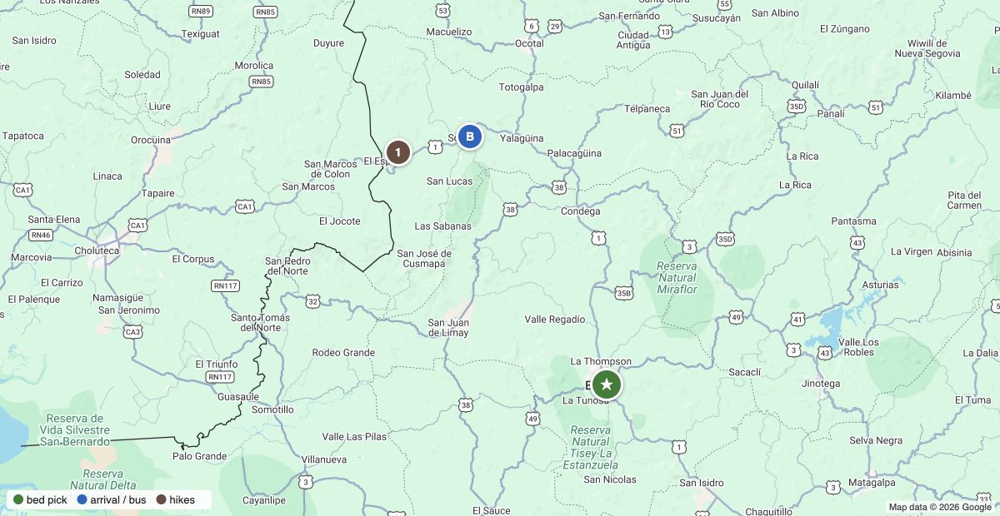

# 🇳🇮 Somoto Canyon (day trip from Estelí)

Part of the [LatAm itinerary](../itinerary.md) · region notes: [Costa Rica + Nicaragua](costa-rica-nicaragua.md)

> **In the plan since 27 Nov · a day trip from Estelí · Day 92 · no extra night (you sleep in [Estelí](esteli.md))** 
> 🏞️ A narrow granite canyon of the Río Coco by the Honduran border: hike in, then float, swim and jump 
> 🛏️ Sleep in Estelí (Melody 78); the tour company also rents $8 cabin beds near the canyon (WhatsApp only) 
> 🚌 **In:** 05:30 *ruteado* COTRAN Norte, Estelí → Somoto, Day 92 · **Out:** back to Estelí 13:40–17:00; Managua on Day 93, ✈ Day 94

<table>
<tr>
<td width="50%" valign="top"> <b><a href="https://www.google.com/maps?ftid=0x8f71d936aa883ba9:0xdca39303054c100f">Cañón de Somoto</a></b> · <a href="https://www.google.com/maps/dir/?api=1&origin=13.0889274,-86.3568541&destination=13.462561,-86.6988082&travelmode=driving">🚗 ≈ 1 h 45 min by road</a> The narrows: you float and swim through here.</td>
<td width="50%" valign="top"> <b>The Río Coco in the canyon</b> Hike in along the rocks, then into the water.</td>
</tr>
</table>

## 🗺️ Map

**Around:** ★ Estelí (Melody 78) · **B** [Somoto bus terminal](https://www.google.com/maps?ftid=0x8f71dfd8603dcb3d:0xa5ca2531557910f) · **1** [Cañón de Somoto](https://www.google.com/maps?ftid=0x8f71d936aa883ba9:0xdca39303054c100f) [🚗 ≈ 1 h 45 min by road](https://www.google.com/maps/dir/?api=1&origin=13.0889274,-86.3568541&destination=13.462561,-86.6988082&travelmode=driving)

🧭 The time after each place is from the ★ bed (Google Maps, 26 Nov): 🚶 walk · 🚌 bus · 🚕 taxi · 🚗 by road (tour or bus). Click it for the route.

**Open the live map:** [area](https://www.google.com/maps/@13.30,-86.50,10z)

## 📅 Day by day

Since 27 Nov this is **Day 92**, during the [Estelí](esteli.md) stay, a day trip with no extra night (✅ times and prices checked 27 Nov).

| Day | Plan |
|---|---|
| **Day 92** | 🚌 **05:30** *ruteado* from **COTRAN Norte**, Estelí (or 06:30, 07:30; listed 2 h 50, C$46) → Somoto terminal ≈ 08:15. 🛶 **Somoto Canyon Tours** 4-h standard tour from the terminal ≈ 08:30–12:30 (**$30**: lunch, entry, boat fee, life jacket, dry bag, river shoes, ride to the trailhead). 🚌 Back on the 13:40, 14:45, 16:00 or **17:00 (last)** *ruteado* to COTRAN Norte (C$50–60, ≈ 1 h 30). |

- **Why Day 92 (a Tuesday):** the buses run daily, but the guides' site doesn't say whether they work Sundays, and Day 90 is the Sunday. Confirm on WhatsApp (+505 5791 9556, English) and keep **Day 91** as the backup.
- **Sleeping by the canyon instead:** Somoto Canyon Tours' cabins are $8 per person per night (dorm cabins or private doubles, kitchen use; WhatsApp only). Keep one Estelí night if you do it.

## 🔖 Book (one click)

| | Leg | When | Price | Book |
|---|---|---|---|---|
| In | **Estelí → Somoto** *ruteado*, COTRAN Norte | **Day 92 05:30** (17 a day, 05:30–18:10) | C$46 | [NicaBuses](https://nicabuses.com/rutas/esteli-somoto-ruteado) |
| Tour | **Somoto Canyon Tours**, 4-h standard (3-h $25, 6-h $35, rim walk from $15) | Day 92 ≈ 08:30–12:30 | **$30** | [somotocanyontours.org](https://www.somotocanyontours.org/tours) · WhatsApp +505 5791 9556 |
| Out | **Somoto → Estelí** *ruteado* | 13:40, 14:45, 16:00, 17:00 (last) | C$50–60 | [NicaBuses](https://nicabuses.com/rutas/somoto-esteli-ruteado) |
| ✈ | Flight home | **Day 94** | 25k + $94.42 | see [Flight home](flight-home.md) |

## 🛶 The canyon

- **What:** Cañón de Somoto, a narrow granite canyon of the Río Coco near the Honduran border. Hike in, then float, swim and jump down it with a local guide (lifejacket supplied).
- **Price:** **local guides from Somoto town ≈ $25–45 per person + canyon entrance ≈ $5–10** (pack-lightly.com; Viator lists "from $35"). Half-day or full-day versions.
- **Guide:** ✅ Somoto Canyon Tours publishes its prices and inclusions on its own site (27 Nov). Juan Ordóñez is another name travellers recommend (Backpackers Nicaragua group; not verified).
- **Why pay:** it's the only canyon-swim on the route, so it passes the "pay only if unique" test.

## ℹ️ Good to know
- Re-check the Somoto bus times on [NicaBuses](https://www.nicabuses.com/) before you go.

---
Photos: Google Maps contributors (Cañón de Somoto). Wikimedia Commons: <a href="https://commons.wikimedia.org/wiki/File:SomotoCanyon_01.jpg">SomotoCanyon 01</a> (BluesyPete, CC BY-SA 3.0).
