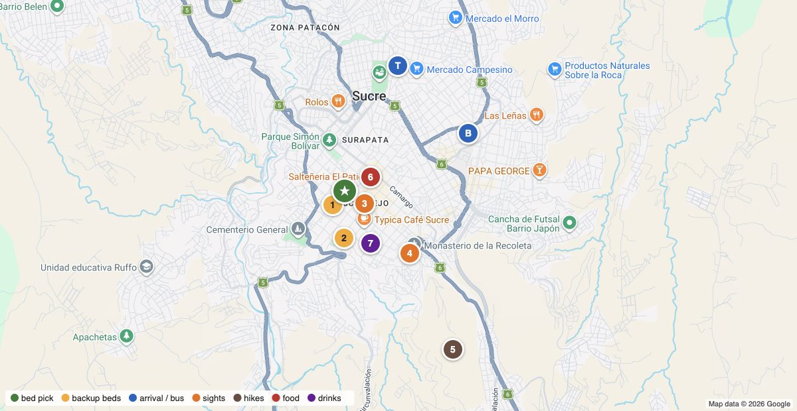
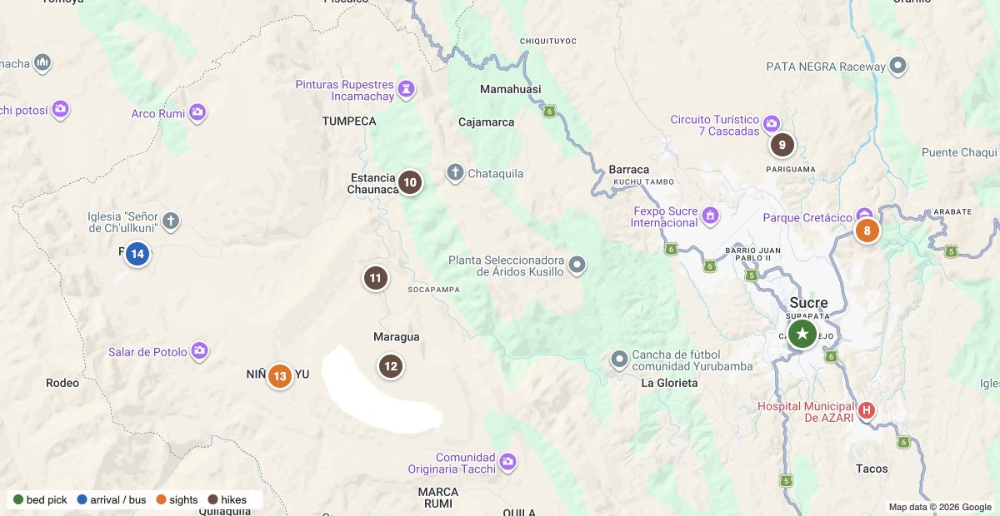

# 🇧🇴 Sucre

Part of the [LatAm itinerary](../itinerary.md) · region notes: [Chile + Bolivia](chile-bolivia.md) · ← [Potosí](potosi.md) · [La Paz](la-paz.md) →

> **Stop 19 · Day 49 → 52 · 3 nights** 
> 🏞️ The white colonial city, the warmest stop of the section, and the base for a 2-day Inca-trail hike into the Maragua crater 
> 🛏️ **Villa Oropeza Hostel**, a bed in a 6-bed mixed dorm with curtains, US$16.95 for 3 nights 
> 🚌 **In:** bus from Potosí, Mon 13:00 or 14:00 · **Out:** ✈ BoA to La Paz, Thu 09:05 (see the [La Paz guide](la-paz.md))

Sucre from the hillside above the centre. Photo: Dan Lundberg, Wikimedia Commons (CC BY-SA 2.0).

## 🗺️ Map

**In town:** ★ **[Villa Oropeza Hostel](https://www.google.com/maps?ftid=0x93fbcf4a055700cf:0x29b6aa704df67dc4)** (the pick, [book](https://www.agoda.com/partners/partnersearch.aspx?hid=1114745&checkin=2027-01-25&checkout=2027-01-28&NumberofAdults=1&Rooms=1)) · **1** [Holis](https://www.google.com/maps?ftid=0x93fbcf15d2e851bd:0x8997dd622a82b885) (backup, [book](https://www.hostelworld.com/hostels/p/330736/holis/?from=2027-01-25&to=2027-01-28&guests=1)) · **2** [Los Balcones](https://www.google.com/maps?ftid=0x93fbcff17e3c212f:0x2f84f68e0188d1c0) (private alt, [book](https://www.booking.com/hotel/bo/los-balcones.html?checkin=2027-01-25&checkout=2027-01-28&group_adults=1&no_rooms=1&group_children=0&selected_currency=USD)) · **B** [bus terminal](https://www.google.com/maps?ftid=0x93fbcf2cd33087db:0x737fd9bca6262b76) (Av. Ostria Gutiérrez) · **T** trufis to Chataquila (Calle Tomás Frías, near [Plaza San Juanillo](https://www.google.com/maps?ftid=0x93fbc8cf344c6489:0x6a1a059edb4fca06)) · **3** [Plaza 25 de Mayo](https://www.google.com/maps?ftid=0x93fbcf36656fb06b:0x5e4f23584d3c808f) [🚶 5 min](https://www.google.com/maps/dir/?api=1&origin=-19.0466826,-65.2626675&destination=-19.0482651,-65.2600836&travelmode=walking) · **4** [Mirador de la Recoleta](https://www.google.com/maps?ftid=0x93fbcf3a4b73bf57:0xc81656ad53e4deaf) [🚶 22 min](https://www.google.com/maps/dir/?api=1&origin=-19.0466826,-65.2626675&destination=-19.0543297,-65.2542511&travelmode=walking) · **5** [Cerro Churuquella](https://www.google.com/maps?ftid=0x93fbcf19b5642f45:0x3e8a7e08508301fa) [🚕 ≈ 13 min](https://www.google.com/maps/dir/?api=1&origin=-19.0466826,-65.2626675&destination=-19.066122,-65.2486047&travelmode=driving) · **6** [Mercado Central](https://www.google.com/maps?ftid=0x93fbcf35b496e193:0x760cd620ffd463c2) [🚶 7 min](https://www.google.com/maps/dir/?api=1&origin=-19.0466826,-65.2626675&destination=-19.0450131,-65.2592749&travelmode=walking) · **7** [Brewcraft](https://www.google.com/maps?ftid=0x93fbcf08008594e5:0xb6f47aff8c42c48d) [🚶 15 min](https://www.google.com/maps/dir/?api=1&origin=-19.0466826,-65.2626675&destination=-19.0531559,-65.2593121&travelmode=walking)

**Around (terrain):** ★ Sucre · **8** [Parque Cretácico](https://www.google.com/maps?ftid=0x93fbc91d45c60ef1:0x2f5b7ae02b6c455a) [🚕 ≈ 21 min](https://www.google.com/maps/dir/?api=1&origin=-19.0466826,-65.2626675&destination=-19.006464,-65.2362161&travelmode=driving) · **9** [Siete Cascadas](https://www.google.com/maps?ftid=0x93fbc7faf79f18e5:0x80c3966285362242) [🚕 ≈ 27 min](https://www.google.com/maps/dir/?api=1&origin=-19.0466826,-65.2626675&destination=-18.9729385,-65.270977&travelmode=driving) · the Chataquila pass, where the trail starts, is labelled on the map · **10** [Chaunaca](https://www.google.com/maps?ftid=0x93fbc09a859a53fd:0x4a0aa22b70ea2c11) [🚕 ≈ 1 h 17 min](https://www.google.com/maps/dir/?api=1&origin=-19.0466826,-65.2626675&destination=-18.9875407,-65.4244574&travelmode=driving), the foot of the Inca trail · **11** [Chaunaca → Maragua path](https://www.google.com/maps?ftid=0x93fbc19ec24c9831:0x4f9b253a3ae51201) [🚕 ≈ 1 h 55 min](https://www.google.com/maps/dir/?api=1&origin=-19.0466826,-65.2626675&destination=-19.0249938,-65.4384652&travelmode=driving) up the Río Ravelo canyon · **12** [Maragua crater](https://www.google.com/maps?ftid=0x93fbc10073cd99af:0x72c1f4ed3a6ddfb) [🚕 ≈ 1 h 47 min](https://www.google.com/maps/dir/?api=1&origin=-19.0466826,-65.2626675&destination=-19.0592681,-65.4323927&travelmode=driving) ([Nativus Hostel](https://www.google.com/maps?ftid=0x93fbc11e51ccaeb1:0xa957648fad260e5c) is here) · **13** ≈ [Niñu Mayu](https://www.google.com/maps?ftid=0x93fbea07ba095d13:0xb0276320750e73d4) 🥾 on the Maragua trek (no road) dinosaur tracks · **14** [Potolo](https://www.google.com/maps?ftid=0x93fbeb18963b7015:0x55d2fa28fd925adb) (minibus back to Sucre)

🧭 The time after each place is from the ★ bed (Google Maps, 26 Nov): 🚶 walk · 🚌 bus · 🚕 taxi · 🚗 by road (tour or bus). Click it for the route.

**Open the live map:** [town](https://www.google.com/maps/@-19.0480,-65.2580,15z) · [area](https://www.google.com/maps/@-19.0200,-65.3900,11z)

## 📅 Day by day

| Day | Plan |
|---|---|
| **Day 49** | 🚌 Potosí **14:00** (after the Cerro Rico mine tour; 13:00 without it) → Sucre ≈ 17:00–18:00. Micro or taxi to the hostel (≈ Bs 10–15). 🌇 The **Recoleta** viewpoint at sunset if there's light. |
| **Day 50** | 🥾 **Maragua, day 1:** trufi to **Chataquila** (≈ 1.5 h), the Inca trail 6.5 km down to **Chaunaca**, then 10 km up the Río Ravelo canyon into the **crater**. Sleep in Maragua (Nativus Hostel, Bs 50 with dinner and breakfast). |
| **Day 51** | 🥾 **Maragua, day 2:** 16.5 km over the crater wall, past the **Niñu Mayu** dinosaur tracks, to **Potolo**. 🚐 Minibus back to Sucre (hourly until ≈ 16:00 on weekdays, and this is a Wednesday; ⚠️ it leaves when full, so reach Potolo by ≈ 13:00; ask in Maragua the evening before, fallback a shared camioneta or taxi). Waning moon (full on 22 Jan). |
| **Day 52** | ✈ **BoA 09:05** Sucre → La Paz via Cochabamba (see the [La Paz guide](la-paz.md)). |

Not hiking? Swap Tue–Wed for **Siete Cascadas**, **Parque Cretácico**, the **Mercado Central** and **Cerro Churuquella**, plus LP's town picks (Mercado Campesino, the Casa de la Libertad, the ASUR textile museum; all open on weekdays).

## 🔖 Book (one click)

Dates and 1 adult are pre-filled. Prices move, so compare the channels shown (first = cheapest when checked on 24 Nov). ⚠️ = time-sensitive.

**Beds** (Day 49 → 52, 3 nights)

| | Where | Total | Location | From the bus terminal | Book |
|---|---|---:|:---:|---|---|
| ⭐ **Pick** | **Villa Oropeza Hostel** · bed in a 6-bed mixed dorm, curtains on most beds | **US$16.95** | 9.8 | 🚕 ≈ 12 min (walk 31 min, 2.2 km); centre 5 min on foot · [route](https://www.google.com/maps/dir/?api=1&origin=-19.039653899999998,-65.2466877&destination=-19.0466826,-65.26266749999999&travelmode=driving) | [Agoda](https://www.agoda.com/partners/partnersearch.aspx?hid=1114745&checkin=2027-01-25&checkout=2027-01-28&NumberofAdults=1&Rooms=1) · [Hostelworld](https://www.hostelworld.com/hostels/p/101313/villa-oropeza-hostel/?from=2027-01-25&to=2027-01-28&guests=1) |
| Backup | **Holis** · 12-bed ensuite dorm | US$18.24 | 9.6 | 🚕 ≈ 13 min (walk 34 min, 2.5 km); centre 8 min on foot · [route](https://www.google.com/maps/dir/?api=1&origin=-19.039653899999998,-65.2466877&destination=-19.048383899999997,-65.264147&travelmode=driving) | [Hostelworld](https://www.hostelworld.com/hostels/p/330736/holis/?from=2027-01-25&to=2027-01-28&guests=1) · [Agoda](https://www.agoda.com/partners/partnersearch.aspx?hid=69299472&checkin=2027-01-25&checkout=2027-01-28&NumberofAdults=1&Rooms=1) |
| Private alt | **Los Balcones** · budget twin room | US$50 | 9.9 | 🚕 ≈ 13 min (walk 36 min, 2.6 km); centre 9 min on foot · [route](https://www.google.com/maps/dir/?api=1&origin=-19.039653899999998,-65.2466877&destination=-19.0524884,-65.2626841&travelmode=driving) | [Booking](https://www.booking.com/hotel/bo/los-balcones.html?checkin=2027-01-25&checkout=2027-01-28&group_adults=1&no_rooms=1&group_children=0&selected_currency=USD) · [Hostelworld](https://www.hostelworld.com/hostels/p/338257/los-balcones-de-moral-y-santa-catalina/?from=2027-01-25&to=2027-01-28&guests=1) · [Agoda](https://www.agoda.com/partners/partnersearch.aspx?hid=78760415&checkin=2027-01-25&checkout=2027-01-28&NumberofAdults=1&Rooms=1) |

**Transport**

| | Leg | When | Price | Book |
|---|---|---|---:|---|
| ⚠️ In | Bus **Potosí → Sucre**, ≈ 3–4 h | **Day 49 14:00** (Trans Emperador), after the mine tour; or **13:00** (Transtin Dil Rey) | US$8 / US$7 | Potosí's Nueva Terminal (listed on Tickets Bolivia) |
| Hike | Trufi **Sucre → Chataquila**, ≈ 1.5 h | Day 50, morning | ≈ Bs 25 | Calle Tomás Frías, near Plaza San Juanillo |
| Hike | **Nativus Hostel**, Maragua | Day 50 night | Bs 50 with dinner and breakfast | WhatsApp, no booking needed |
| Hike | Minibus **Potolo → Sucre**, 2–2.5 h | Day 51, ≈ hourly until ≈ 16:00, ⚠️ when full | Bs 30 | on the spot |
| Out | ✈ **BoA** Sucre → La Paz via Cochabamba | **Day 52 09:05 → 11:25** | $49 | see the [La Paz guide](la-paz.md) |

How to read these tables

- **Location** is the guests' location score on Booking.com. The target is 9.0 or higher, and ⚠️ would mark one below 9.0. *(HW)* means Hostelworld's location rating, used where a property isn't on Booking.
- **From the bus terminal** comes from Google Maps on 24 Nov: the property found on Maps and routed from where you arrive at midday on the check-in date. The **route** link opens the same route.
- Google has no bus data here, so the 🚕 time is Google's driving estimate; local minibuses/colectivos run (ask locally).
- Symbols: 🚶 walk · 🚌 public transport · 🚕 taxi/rideshare · 🥾 hike only · ⚠️ far from the centre with no bus · ℹ️ outside the centre but on a bus line.

## 🚌 Getting here: Potosí → Sucre, Day 49

- **Bus, ≈ 3–4 h**, from Potosí's Nueva Terminal to Sucre's terminal (Av. Ostria Gutiérrez).
- Tickets Bolivia lists **13 daily departures, 06:00–19:00**: Trans Emperador 10:00, 12:30, 14:00 (US$7) and Transtin Dil Rey 09:45, 13:00 (US$8), all regular buses.
- After the Monday-morning mine tour in Potosí, take the **14:00** to arrive ≈ 17:00–18:00.
- Shared taxis are faster (≈ 2.5 h, ≈ Bs 50–70, ≈ unverified). LP gives ≈ B$50 and 2¼ h, with a hostel pickup (LP); companies are in the [Potosí guide](potosi.md).
- From the Sucre terminal it's 1.8 km to the plaza: micro or taxi ≈ Bs 10–15 (≈). LP calls it a 3-km uphill walk and gives **micros A or 3** along Ravelo, B$1.50; with a big bag a taxi is easier (LP).
- The terminal has **no ATM** and charges a small terminal tax (B$2.50 in LP) (LP).
- ⚠ This is the road the Chuquisaca drivers blockaded in Nov 2026.

## 🛏️ Where to sleep

Live-checked 24 Nov.

### ⭐ Pick: Villa Oropeza Hostel
- **Unit:** a bed in a 6-bed mixed dorm (8-bed also free).
- **Price:** **US$16.95 for 3 nights on Agoda** (signed-in) ≈ Booking US$17 (pay at the property) ≈ Hostelworld US$17.46 (8-bed US$16.92) + Hostelworld's fee.
- **Reviews:** Hostelworld 9.6 (1,179; 0% below 70 in the last 12 months); Booking 356 reviews, **2.8% below 7**, location 9.8.
- **Where:** 0.3 km from Plaza 25 de Mayo.
- **Checks:**
  - ✅ **curtains on most beds** ("lots of the beds have curtains", Hostelworld).
  - ✅ **two kitchens** (Apr 2026: only 2 of 5 hobs worked upstairs).
  - Big garden with hammocks.
  - **Not a party hostel** ("chill… the true social hostel in Sucre"); the yellow dorm by the hangout area and the street-side rooms are louder, so ask for an inner room.

### Backup: Holis
- **Unit:** 12-bed ensuite dorm. **US$18.24** on Hostelworld (Agoda US$18.89; Booking card ≈ US$6/night, Booking 9.3).
- **Reviews:** Hostelworld 9.5 (207; 4% below 70 in the last 12 months).
- **Where:** 0.5 km from the plaza.
- **Checks:** spacious kitchen. Lively bar in the evening, which isn't a party but volunteers talk until late. ✗ no bunk curtains. One bed-bug report (Apr 2026).

### Private alt (location first): Los Balcones
- **Budget Twin Room.** **US$50 for 3 nights** (room table; double US$59) on Booking (Agoda US$55.20).
- Booking location **9.9**, 54 reviews, 1.9% below 7.
- 0.6 km from the plaza.
- **Next:** Hospedaje Sarabia, location 9.8, 827 reviews, US$89 incl. breakfast.

## 🌳 Things to do (free and outdoors first)

<table>
<tr>
<td width="50%" valign="top"> <b><a href="https://www.google.com/maps?ftid=0x93fbc7faf79f18e5:0x80c3966285362242">Siete Cascadas</a></b> · free · <a href="https://www.google.com/maps/dir/?api=1&origin=-19.0466826,-65.2626675&destination=-18.9729385,-65.270977&travelmode=driving">🚕 ≈ 27 min</a> A chain of waterfalls and pools, ≈ 2.3 km out-and-back from the end of micro line 12. Best in the rainy season.</td>
<td width="50%" valign="top"> <b><a href="https://www.google.com/maps?ftid=0x93fbcf3a4b73bf57:0xc81656ad53e4deaf">Mirador de la Recoleta</a></b> · free · <a href="https://www.google.com/maps/dir/?api=1&origin=-19.0466826,-65.2626675&destination=-19.0543297,-65.2542511&travelmode=walking">🚶 22 min</a> The arcaded viewpoint over the white city, at sunset.</td>
</tr>
<tr>
<td width="50%" valign="top"> <b><a href="https://www.google.com/maps?ftid=0x93fbcf19b5642f45:0x3e8a7e08508301fa">Cerro Churuquella</a></b> · free · <a href="https://www.google.com/maps/dir/?api=1&origin=-19.0466826,-65.2626675&destination=-19.066122,-65.2486047&travelmode=driving">🚕 ≈ 13 min</a> A walk up the hill behind the Recoleta.</td>
<td width="50%" valign="top"> <b><a href="https://www.google.com/maps?ftid=0x93fbc09a859a53fd:0x4a0aa22b70ea2c11">Chataquila → Chaunaca Inca trail</a></b> · Bs 25 community fee · <a href="https://www.google.com/maps/dir/?api=1&origin=-19.0466826,-65.2626675&destination=-18.9875407,-65.4244574&travelmode=driving">🚕 ≈ 1 h 17 min</a> Maragua day 1: a pre-Hispanic paved trail, 6.5 km and −800 m.</td>
</tr>
<tr>
<td width="50%" valign="top"> <b><a href="https://www.google.com/maps?ftid=0x93fbc10073cd99af:0x72c1f4ed3a6ddfb">Maragua crater</a></b> · ≈ Bs 140 for the whole trek · <a href="https://www.google.com/maps/dir/?api=1&origin=-19.0466826,-65.2626675&destination=-19.0592681,-65.4323927&travelmode=driving">🚕 ≈ 1 h 47 min</a> Sleep inside the crater, then 16.5 km over its wall to Potolo.</td>
<td width="50%" valign="top"> <b><a href="https://www.google.com/maps?ftid=0x93fbea07ba095d13:0xb0276320750e73d4">Niñu Mayu</a></b> dinosaur tracks · Bs 20 · 🥾 on the Maragua trek (no road) On Maragua day 2. The photo is from Google's Maragua crater listing.</td>
</tr>
<tr>
<td width="50%" valign="top"> <b><a href="https://www.google.com/maps?ftid=0x93fbc91d45c60ef1:0x2f5b7ae02b6c455a">Parque Cretácico</a></b> · Bs 30 (foreigners) · <a href="https://www.google.com/maps/dir/?api=1&origin=-19.0466826,-65.2626675&destination=-19.006464,-65.2362161&travelmode=driving">🚕 ≈ 21 min</a> The Cal Orck'o wall with thousands of dinosaur tracks. Optional.</td>
<td width="50%" valign="top"></td>
</tr>
</table>

**Maragua crater via the Chataquila Inca trail, unguided, 2 days (hike backlog), Day 50 → 51.** Logistics from una-noche-mas.com, updated Feb 2026:
- **Getting out:** trufi from Calle Tomás Frías near Plaza San Juanillo to **Chataquila**, ≈ 1.5 h, ≈ Bs 25 for foreigners (hikers' updates on the same page, Feb–Mar 2026; it was Bs 15).
- **Day 50:** pre-Hispanic paved trail **6.5 km, −800 m** down to Chaunaca (community fee **Bs 25**), then 10 km up the Río Ravelo canyon into the crater. Sleep in Maragua: Nativus Hostel **Bs 50 with dinner and breakfast** (WhatsApp, no booking needed), or Samary Wasi.
- **Day 51:** 16.5 km over the crater wall, past the **Niñu Mayu dinosaur tracks (Bs 20)**, to **Potolo**. Minibus back to Sucre hourly until ≈ 16:00, **Bs 30**, 2–2.5 h.
  - ⚠️ **It leaves when full**, and no source gives different weekday times. A hiker who reached Potolo at 12:10 got a 13:00 colectivo (Nov 2025); one who arrived at 14:00 was told at 18:30 that the bus wouldn't fill, and her group paid for the empty seats (Bs 100 each; Sep 2026, comments on una-noche-mas.com). Start early from Maragua and aim for Potolo by ≈ 13:00.
- **Totals:** 33 km, top ≈ 3,650 m, ≈ Bs 140 ≈ US$12 plus food and water.
- **In January:** it's the rainy season (148 mm), so start early and expect afternoon storms. River crossings below Chaunaca and Maragua rise after rain; don't ford a brown, fast river. Download Mapy.cz/Maps.me offline. Spanish helps.
- **The bed:** keep the Villa Oropeza bed for Day 50 with the big bag in it (US$5.64), or book 25→26 and 27→28 only.
- **Guided option:** Sucre agencies such as Condor Trekkers sell 1–2-day Maragua trips with transport (price not verified; ask in town).
  - ⚠️ **LP strongly advises a guide** in the Cordillera de los Frailes: the villages speak Quechua, and a good guide smooths relations with the Jal'qa communities and helps avoid local hostility. LP's prices were ≈ B$650 for 3 days and B$800 for 4 per person, and it rates Condor Trekkers (Calvo and Bolívar; part of its earnings go to social projects) highly; add your name to its whiteboard to share the cost (LP).
  - Our 2026 sources walk it unguided without trouble, so it's a judgement call. If you go alone, pay every community fee, ask before taking photos, and ask at Condor Trekkers about the current mood on the trail.
  - **Samary Wasi** (Irupampa, ≈ 1 km from Maragua village; stone lodge with heavy blankets, a shower and charging points) was ≈ B$152 for a single in LP (LP).
- **Shorter free version:** the Inca trail alone, Chataquila → Chaunaca, a half day, then the bus back from Chaunaca.

**More:**
- **Siete Cascadas (free):** micro line 12 from opposite the Mercado Central to the end of Barrio Alegría, then ≈ 2.3 km out-and-back to a chain of waterfalls and pools. They flow best in the rainy season (Tripadvisor/AllTrails; ≈).
- **Free in town:** the Recoleta viewpoint plaza (arcaded mirador over the white city) at sunset, and a walk up Cerro Churuquella behind it. The Mercado Central is for eating.
- **Parque Cretácico (paid, optional):** the Cal Orck'o wall with thousands of dinosaur tracks, **Bs 30** for foreigners (Parque Cretácico's Facebook, 2026). If you do Maragua you see tracks at Niñu Mayu anyway; the wall is bigger.

**If you don't hike (or on Day 51 if you get back early), from LP's picks:**
- **Mercado Campesino (free):** a huge maze of a local market (food, housewares, everything), 06:00–19:00; micro 7 or G northbound from the centre (LP).
- **Cementerio Municipal (free):** colonial families' mausoleums among clipped poplar arches and palms, 8 blocks south of the plaza along Junín. Mon–Fri 08:00–11:30 and 14:00–17:30, Sat 08:00–17:30 (LP).
- **The best view in town:** ask the police office inside the Prefectura de Chuquisaca (next to the cathedral) about climbing its cupola; independence murals line the stairs (LP).
- **Casa de la Libertad** (Plaza 25 de Mayo 11), where Bolivia's independence was signed in 1825. ✅ casadelalibertad.org.bo (26 Nov 2026): **Bs 50** for foreigners, guided visits every hour, Mon–Fri 08:30–16:30, Sat–Sun 09:00–13:00, **closed on public holidays** (none falls in this stay). LP's figure was B$15.
- **Museo de Arte Indígena (ASUR)** (Pasaje Iturricha 314, near the Recoleta): Jal'qa and Tarabuco weaving, with weavers at work; the Jal'qa are the Maragua communities, so it's good context for the hike. ≈ B$22, Mon–Fri 09:00–12:30 and 14:30–18:00, Sat 09:00–12:00 and 14:30–18:00 (LP).
- **Doesn't fit:** Tarabuco's Sunday textile market (micros 06:30–09:30 from Av. de las Américas and Mendoza, B$10, 1½ h; LP): this stay is Mon–Thu, with no Sunday.

## 🍽️ Eat and drink

<table>
<tr>
<td width="50%" valign="top"> <b><a href="https://www.google.com/maps?ftid=0x93fbcf35b496e193:0x760cd620ffd463c2">Mercado Central</a></b> · juice Bs 8, lunch Bs 15–25 · <a href="https://www.google.com/maps/dir/?api=1&origin=-19.0466826,-65.2626675&destination=-19.0450131,-65.2592749&travelmode=walking">🚶 7 min</a> Fresh juice downstairs (US$0.70); set lunches upstairs (US$1.30–2.10).</td>
<td width="50%" valign="top"> <b>Chorizo chuquisaqueño</b> · Bs 15–25 The city's sausage plate; at the market, stall 7 Lunares. Generic photo (Wikimedia Commons).</td>
</tr>
<tr>
<td width="50%" valign="top"> <b><a href="https://www.google.com/maps?ftid=0x93fbcf08008594e5:0xb6f47aff8c42c48d">Brewcraft</a></b> · 2-for-1 pints on Friday evenings (≈; no Friday in this stay) · <a href="https://www.google.com/maps/dir/?api=1&origin=-19.0466826,-65.2626675&destination=-19.0531559,-65.2593121&travelmode=walking">🚶 15 min</a> Five house beers, 11 min from Plaza 25 de Mayo.</td>
<td width="50%" valign="top"></td>
</tr>
</table>

- **Mid-morning salteñas** Bs 7–10.
- The hostel kitchen covers dinners and the Maragua picnic.
- These are ≈ AI-summary leads, Nov 2026.
- **From LP:**
  - **Mercado Central** (Ravelo and Junín): Mon–Sat 07:00–19:30, **Sun only to 11:00**. Try jugo de tumbo; LP had juices at B$7 (LP).
  - **El Paso de los Abuelos** (Bustillos 216): salteñas ≈ B$8, 08:00–13:00; they sell out, so go early (LP).
  - **Prem** (San Alberto 54): a tiny vegan place with a set lunch, ≈ B$25 in LP (LP).
  - **Café Gourmet Mirador** at the Recoleta viewpoint: deck chairs over the rooftops, a coffee with the sunset view (LP).
  - **Goblin Brew Pub** (Grau 246): family-run with its own craft beers, Thu–Sat from 20:00, so it doesn't fit: your evenings are Mon–Wed (LP).

## ℹ️ Good to know
- **The 22 Jan holiday** (Día del Estado Plurinacional) now falls on the Uyuni tour, before you arrive, so nothing is shut for it during this stay.
- **Safety:** LP calls Sucre one of Bolivia's safest towns; the tourist police are at Plazuela Zudáñez (Dalence 1) (LP).
- **Laundry:** ≈ B$9–12 per kg, but most need half a day or more and nearly all close on Sundays (LP), so laundry dropped after the hike on Wed afternoon won't be back before the Thursday 09:05 flight: wash at the hostel.
- **Weather:** Sucre is the warmest stop of the section (21 °C days). January is the rainy season (148 mm): afternoon storms.
- **Cash:** ATMs work in Sucre: top up here before La Paz.
- **Moon:** full on 22 Jan; on the Maragua night (26 Jan) it's waning and rises late in the evening (≈).
- ⚠ **Blockades:** the Potosí → Sucre road was blockaded by the Chuquisaca drivers in Nov 2026.

## ✈ Leaving: Sucre → La Paz, Day 52

- **BoA 09:05** Sucre → Cochabamba → La Paz (El Alto) **11:25**, **$49** (✅ Google Flights, 27 Nov; no nonstop that day).
- Flight options, the EcoJet check and the overnight-bus alternative are in the [La Paz guide](la-paz.md).
- **To Alcantarí airport** (30 km south): LP gives a taxi at ≈ B$50 (40 min at night, longer by day), a shared taxi (2+ people) for ≈ B$60 from Plaza Tréveris, or a micro for ≈ B$8 from near Plaza Camargo that leaves when full. The airport has an ATM but no exchange desk (LP).

---
Photos: Google Maps contributors (Siete Cascadas, Cerro Churuquella, Chataquila–Chaunaca trail, Maragua crater listing (dinosaur tracks), Mercado Central, Brewcraft). Wikimedia Commons: <a href="https://commons.wikimedia.org/wiki/File:20170805_Bolivia_1128%2B31_Pano_crop_Sucre_sRGB_(37926300676).jpg">Sucre panorama</a> (Dan Lundberg, CC BY-SA 2.0), <a href="https://commons.wikimedia.org/wiki/File:Mirador_de_la_Recoleta_IMG_1445.jpg">Mirador de la Recoleta</a> (AbbyCF12, CC BY-SA 4.0), <a href="https://commons.wikimedia.org/wiki/File:Mar%C3%A1gua_-_Sucre.jpg">Marágua</a> (Yulacha, CC BY-SA 4.0), <a href="https://commons.wikimedia.org/wiki/File:Cal_Orcko_fossil_tracks_2.jpg">Cal Orck'o tracks</a> (John Martin Perry, CC BY-SA 4.0), <a href="https://commons.wikimedia.org/wiki/File:ChorizoChuquisaque%C3%B1o.jpg">Chorizo chuquisaqueño</a> (Akizia, CC BY-SA 4.0).
