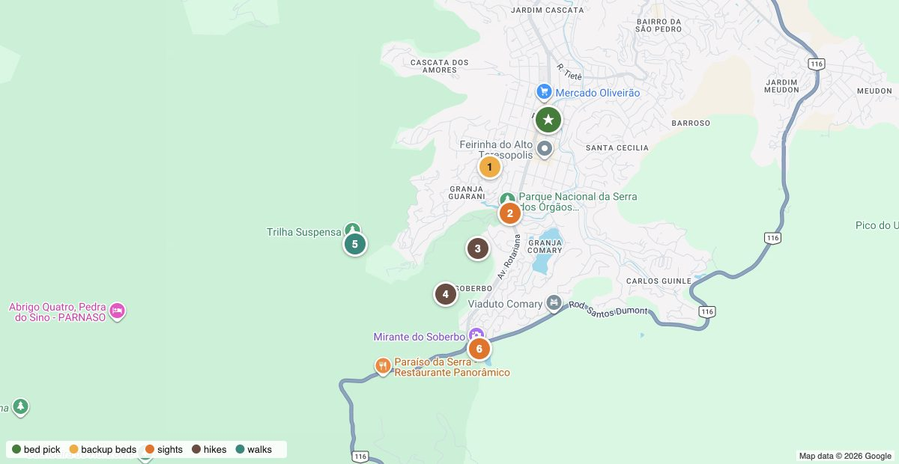
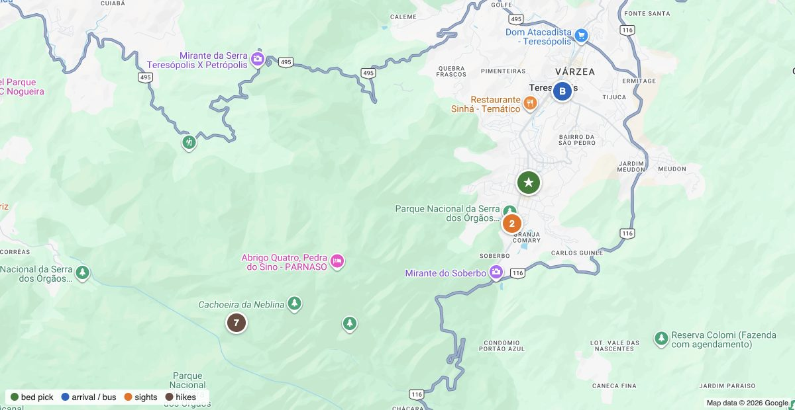

# 🇧🇷 Teresópolis / Serra dos Órgãos (optional)

Part of the [LatAm itinerary](../itinerary.md) · region notes: [Brazil](brazil.md)

> **Optional +2 (Stop 0) · Day 1 → 3 · 2 nights · straight from GIG** 
> 🏞️ Granite spires and Atlantic-forest trails in the Serra dos Órgãos national park (PARNASO) 
> 🛏️ **Estúdio 325 Teresópolis**, a studio flat with a kitchen, $79 for 2 nights 
> 🚌 **In:** GIG → Novo Rio, then Viação Teresópolis 11:30 or 13:00, Day 1 · **Out:** Viação Teresópolis back to Novo Rio (e.g. 12:00), Day 3

The Serra dos Órgãos skyline, with the Dedo de Deus spire, from the free Mirante do Soberbo by the park gate. Photo: Google Maps.

## 🗺️ Map

**By the park gate:** ★ **[Estúdio 325 Teresópolis](https://www.google.com/maps?ftid=0x99b31fbdba9e21:0x846c08c3c91a68d7)** (the pick, [book](https://www.booking.com/hotel/br/estudio-325-teresopolis.html?checkin=2026-12-08&checkout=2026-12-10&group_adults=1&no_rooms=1&group_children=0&selected_currency=USD)) · **1** [Pousada Matitaterê](https://www.google.com/maps?ftid=0x99b2e49f0ff9e1:0x3ed6f007f69325a5) (with breakfast, closest to the gate) · **2** [PARNASO, Sede Teresópolis](https://www.google.com/maps?ftid=0x99b2fc4e7ae71d:0xa560f33c6b47710e) [🚶 19 min](https://www.google.com/maps/dir/?api=1&origin=-22.4385109,-42.978981&destination=-22.4484323,-42.9833762&travelmode=walking) (gate and visitor centre) · **3** [Mirante Mozart Catão](https://www.google.com/maps?ftid=0x99b2f8eeb99207:0x863dba74e6d630a0) [🚌 32 min (bus 1600)](https://www.google.com/maps/dir/?api=1&origin=-22.4385109,-42.978981&destination=-22.4521324,-42.9870335&travelmode=transit) · **4** [Trilha Cartão Postal](https://www.google.com/maps?ftid=0x99b355903ab05b:0x1351408e06b75ae2) [🚌 46 min (bus 1600)](https://www.google.com/maps/dir/?api=1&origin=-22.4385109,-42.978981&destination=-22.4569926,-42.9907502&travelmode=transit) · **5** [Trilha Suspensa](https://www.google.com/maps?ftid=0x99b39eaf18d56d:0x634a788a75a54c38) [🚌 1 h 16 min (bus 1600)](https://www.google.com/maps/dir/?api=1&origin=-22.4385109,-42.978981&destination=-22.4516315,-43.0011126&travelmode=transit) · **6** [Mirante do Soberbo](https://www.google.com/maps?ftid=0x99b255ea11616f:0xb866292d4260d02b) [🚌 25 min (bus 1600)](https://www.google.com/maps/dir/?api=1&origin=-22.4385109,-42.978981&destination=-22.4627542,-42.986913&travelmode=transit)

**Around:** ★ Estúdio 325 · **B** [Teresópolis rodoviária](https://www.google.com/maps?ftid=0x984cd36d641059:0x4ff30410d8f55b7d) · **2** [PARNASO gate](https://www.google.com/maps?ftid=0x99b2fc4e7ae71d:0xa560f33c6b47710e) [🚶 19 min](https://www.google.com/maps/dir/?api=1&origin=-22.4385109,-42.978981&destination=-22.4484323,-42.9833762&travelmode=walking) · **7** [Pedra do Sino](https://www.google.com/maps?ftid=0x99ae7ee09be239:0xc680333e9f5d646a) [🚕 ≈ 1 h 33 min](https://www.google.com/maps/dir/?api=1&origin=-22.4385109,-42.978981&destination=-22.472222,-43.054722&travelmode=driving) (2,263 m). The [Petrópolis–Teresópolis traverse](https://www.google.com/maps?ftid=0x99af0ddb275041:0x589fc79e84b2e93f) crosses the park to the west.

🧭 The time after each place is from the ★ bed (Google Maps, 26 Nov): 🚶 walk · 🚌 bus · 🚕 taxi · 🚗 by road (tour or bus). Click it for the route.

**Open the live map:** [park gate](https://www.google.com/maps/@-22.4500,-42.9870,15z) · [area](https://www.google.com/maps/@-22.445,-43.010,12z)

## 📅 Day by day

| Day | Plan |
|---|---|
| **Day 1** | ✈️ Land at GIG 09:25. 🚌 Mobi-Rio bus to Terminal Gentileza (by Novo Rio), then **Viação Teresópolis 11:30 → 13:30** (or 13:00 → 15:00). Afternoon: the park's **lower section** (entry 07:00–16:00, out by 17:00): Mozart Catão, Cartão Postal, and the Mirante do Soberbo. |
| **Day 2** | 🥾 **Pedra do Sino** (2,263 m), 8–10 h return ≈. Be at the gate at **07:00** (upper-section entry only 07:00–10:00; turn round by 14:00). |
| **Day 3** | An early viewpoint walk, then the 🚌 **12:00** bus → Novo Rio 14:00, and metro or VLT to Copacabana. |

## 🔖 Book (one click)

Dates and 1 adult are pre-filled. The first channel listed was the cheapest when checked on 24 Nov. ⚠️ = time-sensitive.

**Beds** (Day 1 → 3, 2 nights)

| | Where | Total | Location | From the bus terminal | Book |
|---|---|---:|:---:|---|---|
| ⭐ **Pick** | **Estúdio 325 Teresópolis** · studio flat with a kitchen | **$79** | 10.0 | 🚌 19 min by public transport from the bus station: bus 1600 → walk 4 min; walk 44 min; ℹ️ outside the centre (38 min on foot, buses run) · [route](https://www.google.com/maps/dir/?api=1&origin=-22.4165872,-42.970342599999995&destination=-22.4385109,-42.978981&travelmode=transit) | [Booking](https://www.booking.com/hotel/br/estudio-325-teresopolis.html?checkin=2026-12-08&checkout=2026-12-10&group_adults=1&no_rooms=1&group_children=0&selected_currency=USD) · [Agoda](https://www.agoda.com/partners/partnersearch.aspx?hid=35418791&checkin=2026-12-08&checkout=2026-12-10&NumberofAdults=1&Rooms=1) |

**Transport**

| | Leg | When | Price | Book |
|---|---|---|---:|---|
| In | Mobi-Rio "Galeão x Terminal Gentileza" · GIG T2 → Terminal Gentileza (by Novo Rio) | Day 1, after landing | R$ 15 ($2.52) | at the stop |
| In | **Viação Teresópolis** · Novo Rio → Teresópolis rodoviária (Várzea) | **Day 1 11:30 → 13:30** or 13:00 → 15:00 | **R$ 53.08** ($8.91) | [Viação Teresópolis shop (ClickBus)](https://teresopolis.clickbus.com.br/) |
| Out | **Viação Teresópolis** · Teresópolis → Novo Rio | **Day 3**, e.g. 12:00 → 14:00 | R$ 46.01 ($7.72) | [Viação Teresópolis shop (ClickBus)](https://teresopolis.clickbus.com.br/) |

How to read these tables

- **Location** is the guests' location score on Booking.com. The target is 9.0 or higher, and ⚠️ would mark one below 9.0. *(HW)* means Hostelworld's location rating, used where a property isn't on Booking.
- **From the bus terminal** comes from Google Maps on 24 Nov: the property found on Maps and routed from where you arrive at midday on the check-in date. The **route** link opens the same route.
- Symbols: 🚶 walk · 🚌 public transport · 🚕 taxi/rideshare · 🥾 hike only · ⚠️ far from the centre with no bus · ℹ️ outside the centre but on a bus line.

## 🚌 Getting here: GIG → Teresópolis, Day 1

- **No bus runs from GIG to Teresópolis.** riogaleao.com lists only Búzios, Macaé, Charitas and Gentileza ✅.
- **GIG → Rodoviária Novo Rio:** take the Mobi-Rio "Galeão x Terminal Gentileza" bus from T2 arrivals for **R$ 15 ($2.52)** ✅ riogaleao.com. Terminal Gentileza is a short walk from Novo Rio ≈. An Uber is ≈ R$ 40–60 and about 25 min.
- **Viação Teresópolis, Novo Rio → Teresópolis rodoviária (Várzea):**
  - 16 departures on Day 1, 06:00–22:00.
  - Realistic after landing at 09:25: the **11:30 → 13:30** or the **13:00 → 15:00**.
  - **2 h, R$ 53.08 ($8.91)**, convencional ✅ teresopolis.clickbus.com.br (the operator's own shop).

## 🛏️ Where to sleep

**Why a private:** Teresópolis has no usable hostel. Hostelworld lists none, and Booking's three are 8–10 miles out or rated 6.6. Live-checked 24 Nov.

### ⭐ Pick: Estúdio 325 Teresópolis
- **Unit:** a studio flat with a kitchen, in Alto.
- **Price:** **$79 for 2 nights** on Booking (free cancellation to 1 Dec, pay nothing until 29 Nov). Agoda $78.57.
- **Reviews:** Booking 9.6 (79 reviews; 1% below 7); **location 10**.
- **Where:** ~1.5 km from the PARNASO gate on Av. Rotariana; there is a supermarket opposite.

### Backup (cheaper): Apartamento aconchegante no centro (Várzea)
- Booking 9.1 (74; 11% below 7); location 9.9.
- **$54** on Booking (non-refundable). Agoda $54.18.
- 0.7 km from the rodoviária but ~5 km from the gate. Reviews say the street is noisy 24 h.

### Backup (with breakfast, closest to the gate): Pousada Matitaterê
- Double room for single use. Booking 8.7 (1,507; 8% below 7).
- **$73** non-refundable, breakfast included. ~1 km from the gate. No AC.

### If you take this option: Rio's bed for Day 3 → 7
- Copacabana Central Hostel on Hostelworld is $15.09 a night ($60.36), about the same price.
- Beds for the later stops were not re-checked for the shifted +2-day dates.

## 🌳 Things to do (free and outdoors first)

<table>
<tr>
<td width="50%" valign="top"> <b><a href="https://www.google.com/maps?ftid=0x99ae7ee09be239:0xc680333e9f5d646a">Pedra do Sino</a></b> (2,263 m) · free, 100 people a day · Day 2 · <a href="https://www.google.com/maps/dir/?api=1&origin=-22.4385109,-42.978981&destination=-22.472222,-43.054722&travelmode=driving">🚕 ≈ 1 h 33 min</a> The highest point of the range. About 11 km each way, 8–10 h return ≈.</td>
<td width="50%" valign="top"> <b><a href="https://www.google.com/maps?ftid=0x99b355903ab05b:0x1351408e06b75ae2">Trilha Cartão Postal</a></b> · free · Day 1 · <a href="https://www.google.com/maps/dir/?api=1&origin=-22.4385109,-42.978981&destination=-22.4569926,-42.9907502&travelmode=transit">🚌 46 min (bus 1600)</a> 1.2 km to a Dedo de Deus viewpoint at 1,320 m.</td>
</tr>
<tr>
<td width="50%" valign="top"> <b><a href="https://www.google.com/maps?ftid=0x99b2f8eeb99207:0x863dba74e6d630a0">Trilha Mozart Catão</a></b> · free · Day 1 · <a href="https://www.google.com/maps/dir/?api=1&origin=-22.4385109,-42.978981&destination=-22.4521324,-42.9870335&travelmode=transit">🚌 32 min (bus 1600)</a> 800 m, about 1 h return, to a viewpoint at 1,100 m.</td>
<td width="50%" valign="top"> <b><a href="https://www.google.com/maps?ftid=0x99b39eaf18d56d:0x634a788a75a54c38">Trilha Suspensa</a></b> · free · <a href="https://www.google.com/maps/dir/?api=1&origin=-22.4385109,-42.978981&destination=-22.4516315,-43.0011126&travelmode=transit">🚌 1 h 16 min (bus 1600)</a> One of the short lower-section trails, with 360 and the Circuito Juçara.</td>
</tr>
<tr>
<td width="50%" valign="top"> <b><a href="https://www.google.com/maps?ftid=0x99b255ea11616f:0xb866292d4260d02b">Mirante do Soberbo</a></b> · free · <a href="https://www.google.com/maps/dir/?api=1&origin=-22.4385109,-42.978981&destination=-22.4627542,-42.986913&travelmode=transit">🚌 25 min (bus 1600)</a> A roadside view of Dedo de Deus by the gate (Av. Rotariana).</td>
<td width="50%" valign="top"> <b><a href="https://www.google.com/maps?ftid=0x99b2fc4e7ae71d:0xa560f33c6b47710e">PARNASO, Sede Teresópolis</a></b> · free entry · <a href="https://www.google.com/maps/dir/?api=1&origin=-22.4385109,-42.978981&destination=-22.4484323,-42.9833762&travelmode=walking">🚶 19 min</a> The gate for every trail here. Closed Mondays; daily cap, first come first served.</td>
</tr>
</table>

Source for the park rules and trails: ✅ gov.br/icmbio PARNASO pages, updated 14 Aug 2026.

**Park entry:**
- **Free.** First come, first served up to a daily cap.
- **Closed Mondays.** Day 1 → 3 is fine.
- Bring your passport. The page asks for a CPF and photo ID; whether a passport alone is enough for a foreigner is ≈.

**Day 1 afternoon, lower section** (entry 07:00–16:00, out by 17:00):
- **Trilha Mozart Catão** (800 m, about 1 h return, viewpoint at 1,100 m).
- **Trilha Cartão Postal** (1.2 km, Dedo de Deus viewpoint at 1,320 m); lengths ≈ LP.
- Also Trilha Suspensa, 360 and the Circuito Juçara.
- **Mirante do Soberbo** by the gate (Av. Rotariana) is a free roadside view of Dedo de Deus.

**Wed 9: Pedra do Sino (2,263 m), the highest point of the range:**
- About 11 km each way, 8–10 h return ≈.
- **Upper-section entry only 07:00–10:00**, and you must turn round by **14:00**.
- **Cap of 100 people a day.** Fill in the TCRN risk form beforehand and show it at the visitor centre ✅.
- Start at 07:00: December storms come after about 13:00, and the summit is often in cloud.

**Thu 10:** an early viewpoint walk, then the 12:00 bus.

**Petrópolis–Teresópolis traverse (backlog):** 3 days with campsites to book ✅. It doesn't fit in 2 nights, and December is the wet season (LP: May–Oct is best). Save it for a dry-season return.

**Getting to the gate:** stay in **Alto/Soberbo**, near the gate (~4–6 km south of the centre). From the centre, take the "Alto" or "Soberbo" town bus (LP ≈) or a ~10-min Uber.

## 🍽️ Eat and drink

No restaurants were checked for Teresópolis. The pick has its own kitchen, with a supermarket opposite.

## ℹ️ Good to know
- **What this option changes:** if chosen, **Rio moves to Day 3 → 7** (4 nights), and every later stop shifts +2 days.
  - That gains Rio's Sunday (Day 6) car-free Av. Atlântica / Aterro do Flamengo.
  - You would still miss the Monday Pedra do Sal samba, because you leave Rio on Monday morning.
  - Beds for the later stops were not re-checked for the shifted dates.
- **Weather:** December storms come after about 13:00, so start hikes early.
- **ID:** bring your passport to the park gate.
- **What LP says** (*South America on a Shoestring*): it covers the park in two lines only. It names Serra dos Órgãos among Brazil's best hiking parks and says it draws climbers and mountaineers. It puts the best hiking season in the cooler months, **April–October (LP)**, so December means heat and afternoon storms. There is no Teresópolis write-up and no hostel listing; LP's Rio bus table lists only Petrópolis (1½ h, Única-Fácil).
- **Health (LP):** dengue occurs in Rio state, so use repellent in the forest. A **yellow-fever jab** isn't required to enter Brazil but LP strongly recommends it. Clinics at major airports and borders give it free.

## 🚌 Leaving: Teresópolis → Rio, Day 3

- **Viação Teresópolis, Teresópolis → Novo Rio:** 17 departures 04:00–20:00, 2 h, **R$ 46.01 ($7.72)** ✅.
- For example, the **12:00 arrives 14:00**; then metro or VLT to Copacabana.
- Continue with the [Rio de Janeiro guide](rio-de-janeiro.md) (Day 3 → 7 in this option).

---
Photos: Google Maps contributors (Mirante do Soberbo, Pedra do Sino, Trilha Cartão Postal, Mirante Mozart Catão, Trilha Suspensa, PARNASO Sede Teresópolis).
