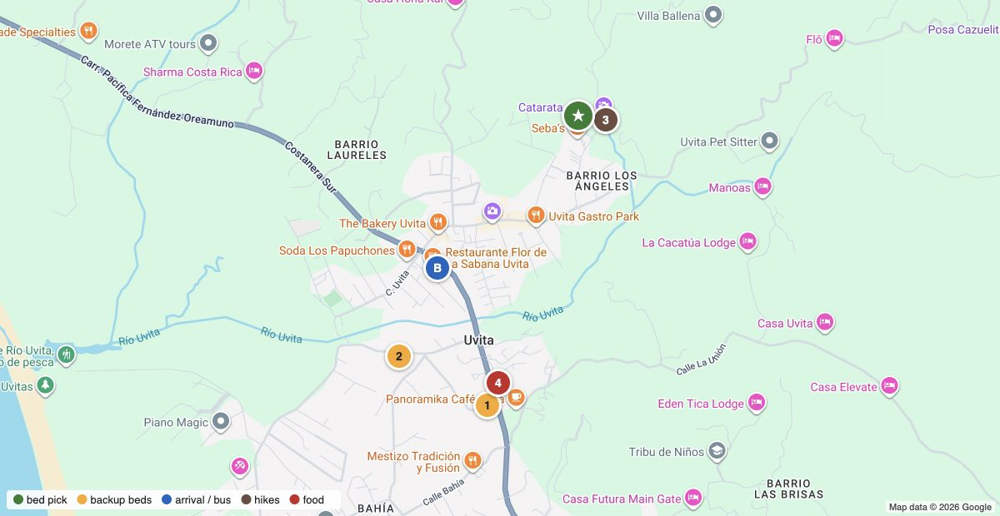
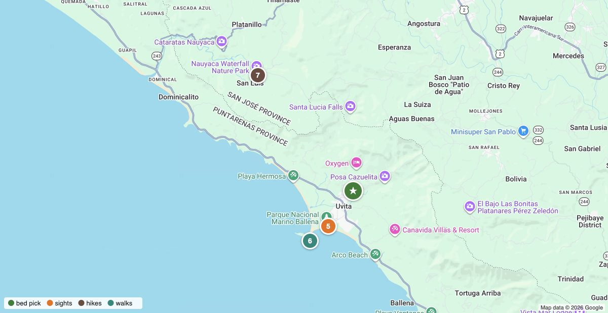

# 🇨🇷 Uvita

Part of the [LatAm itinerary](../itinerary.md) · region notes: [Costa Rica + Nicaragua](costa-rica-nicaragua.md) · ← [San Gerardo de Rivas (Chirripó)](san-gerardo-de-rivas.md) · [Monteverde](monteverde.md) →

> **Stop 28 · Thu 11 → Sat 13 Feb 2027 · 2 nights** 
> 🏞️ Pacific beach town by the "whale's tail" sandbar of Marino Ballena, with jungle waterfalls in the hills behind 
> 🛏️ **Hostel Cascada Verde**, 8-bed mixed dorm, $23 for 2 nights 
> 🚌 **In:** from San Gerardo via San Isidro (Grupo Blanco), Thu · **Out:** 05:15 Grupo Blanco to Quepos, on to Monteverde, Sat

The Punta Uvita sandbar, the "whale's tail" of Parque Nacional Marino Ballena, walkable only around low tide. Photo: Google Maps.

## 🗺️ Map

**In town:** ★ **[Hostel Cascada Verde](https://www.google.com/maps?ftid=0x8fa157a7e939cd1b:0x9895ba13d25b3c6a)** (the pick, [book](https://www.booking.com/hotel/cr/cascada-verde-hostel-at-the-waterfall.html?checkin=2027-02-11&checkout=2027-02-13&group_adults=1&no_rooms=1&group_children=0&selected_currency=USD)) · **B** [Costanera bus stop](https://www.google.com/maps?ftid=0x8fa157a2fcb7238d:0xc22aabc298db8921) · **1** [Shipwrecked Hostel](https://www.google.com/maps?ftid=0x8fa157c51f6107a5:0xb9534db3d7b3dcce) (backup, [book](https://www.booking.com/searchresults.html?ss=Shipwrecked+Hostel+&checkin=2027-02-11&checkout=2027-02-13&group_adults=1&no_rooms=1&selected_currency=USD)) · **2** [Hotel Sueños de María](https://www.google.com/maps?ftid=0x8fa1579695d26b37:0xf57a56eb6c7ae15f) (private alt, [book](https://www.booking.com/hotel/cr/cabinas-suenos-de-maria.html?checkin=2027-02-11&checkout=2027-02-13&group_adults=1&no_rooms=1&group_children=0&selected_currency=USD)) · **3** [Catarata Uvita](https://www.google.com/maps?ftid=0x8fa157a63b503e57:0x9762e0d305b5270e) [🚶 6 min](https://www.google.com/maps/dir/?api=1&origin=9.1788926,-83.7315213&destination=9.1786698,-83.7300983&travelmode=walking) · **4** [Marino Ballena Restaurant](https://www.google.com/maps?ftid=0x8fa157bb87aabd3d:0xe9b50a6f098d0315) [🚕 ≈ 6 min](https://www.google.com/maps/dir/?api=1&origin=9.1788926,-83.7315213&destination=9.1652997,-83.7356418&travelmode=driving)

**Around:** ★ Uvita · **5** [Parque Nacional Marino Ballena](https://www.google.com/maps?ftid=0x8fa15775aed4ed85:0xf6425ef4076a9af9) [🚕 ≈ 11 min](https://www.google.com/maps/dir/?api=1&origin=9.1788926,-83.7315213&destination=9.1549562,-83.7482717&travelmode=driving) (Uvita entrance), with [Restaurante Las Esferas](https://www.google.com/maps?ftid=0x8fa157ec94a872ad:0x21624ac36d024b86) by it · **6** [Punta Uvita, the whale's tail](https://www.google.com/maps?ftid=0x8fa15802839d8413:0x554a95f2982d2a91) [🚕 ≈ 11 min](https://www.google.com/maps/dir/?api=1&origin=9.1788926,-83.7315213&destination=9.1453348,-83.7604142&travelmode=driving) · **7** [Nauyaca Waterfalls](https://www.google.com/maps?ftid=0x8fa15ba03ead8717:0xd5d6ac59d475f34f) [🚕 ≈ 57 min](https://www.google.com/maps/dir/?api=1&origin=9.1788926,-83.7315213&destination=9.2563727,-83.795728&travelmode=driving) (Route 243)

🧭 The time after each place is from the ★ bed (Google Maps, 26 Nov): 🚶 walk · 🚌 bus · 🚕 taxi · 🚗 by road (tour or bus). Click it for the route.

**Open the live map:** [town](https://www.google.com/maps/@9.171,-83.735,15z) · [area](https://www.google.com/maps/@9.20,-83.77,12z)

## 📅 Day by day

| Day | Plan |
|---|---|
| **Thu 11 Feb** | 🚕 After the Chirripó descent: taxi San Gerardo → San Isidro (no bus until 16:00) → 🚌 **Grupo Blanco 16:00** → Uvita ~18:00. |
| **Fri 12 Feb** | 🥾 **Nauyaca Waterfalls** (half day; 06:00 bus, entry until 14:00). Or 🐋 **Marino Ballena** and the whale's tail at low tide, ≈ **13:05** (± 1 h). **Catarata Uvita** is by the hostel. |
| **Sat 13 Feb** | 🚌 **05:15** Grupo Blanco to Quepos, then on to Monteverde (a long day). |

## 🔖 Book (one click)

Dates and 1 adult are pre-filled. The first channel listed was the cheapest when checked on 24 Nov. ⚠️ = time-sensitive.

**Beds** (11 → 13 Feb, 2 nights)

| | Where | Total | Location | From the Costanera bus stop | Book |
|---|---|---:|:---:|---|---|
| ⭐ **Pick** | **Hostel Cascada Verde** · basic 8-bed mixed dorm | **$23** | 9.0 | 🚕 ≈ 5 min (walk 27 min, 1.7 km) · [route](https://www.google.com/maps/dir/?api=1&origin=9.1711447,-83.7387852&destination=9.1788926,-83.7315213&travelmode=driving) | [Booking](https://www.booking.com/hotel/cr/cascada-verde-hostel-at-the-waterfall.html?checkin=2027-02-11&checkout=2027-02-13&group_adults=1&no_rooms=1&group_children=0&selected_currency=USD) · [Hostelworld](https://www.hostelworld.com/hostels/p/271637/hostel-cascada-verde/?from=2027-02-11&to=2027-02-13&guests=1) |
| Backup | **Shipwrecked Hostel** · 8-bed mixed dorm in "cabins" | $50 | ⚠️ 8.8 | 🚶 13 min (1.0 km) · [route](https://www.google.com/maps/dir/?api=1&origin=9.1711447,-83.7387852&destination=9.1641613,-83.7361981&travelmode=walking) | [Booking (search)](https://www.booking.com/searchresults.html?ss=Shipwrecked+Hostel+&checkin=2027-02-11&checkout=2027-02-13&group_adults=1&no_rooms=1&selected_currency=USD) · [Hostelworld](https://www.hostelworld.com/hostels/p/317296/shipwrecked-hostel/?from=2027-02-11&to=2027-02-13&guests=1) |
| Private alt | **Hotel Sueños de María** · double with pool view | $80 | 9.6 | 🚶 13 min (1.0 km) · [route](https://www.google.com/maps/dir/?api=1&origin=9.1711447,-83.7387852&destination=9.1666557,-83.7407691&travelmode=walking) | [Booking](https://www.booking.com/hotel/cr/cabinas-suenos-de-maria.html?checkin=2027-02-11&checkout=2027-02-13&group_adults=1&no_rooms=1&group_children=0&selected_currency=USD) |

**Transport**

| | Leg | When | Price | Book |
|---|---|---|---:|---|
| In | 🚕 Taxi · San Gerardo → San Isidro | **Thu 11 Feb** ≈ 12:30 → ≈ 13:05 (Hernández Solís buses leave San Gerardo only at 06:30, 11:00, 16:00) | ≈ ₡15,000–20,000 ($34–45) | ask the San Gerardo hostel |
| In | **Grupo Blanco** · San Isidro → Uvita, direct | **16:00** → ~18:00 (or 09:00 → ~11:00) | ≈ ₡2,500 ($5.60) | cash on board |
| Out | **Grupo Blanco** · Uvita → Quepos | **Sat 13 Feb 05:15** → ~07:15 | ≈ ₡1,745 ($3.90) | the full leg is in the [Monteverde guide](monteverde.md) |
| Tides | Uvita tide table (the whale's tail needs low tide) | check a week before | free | [tablademareas.com](https://tablademareas.com/cr/costa-oceano-pacifico/uvita) |

How to read these tables

- **Location** is the guests' location score on Booking.com. The target is 9.0 or higher, and ⚠️ marks one below 9.0. *(HW)* means Hostelworld's location rating, used where a property isn't on Booking.
- **From the Costanera bus stop** comes from Google Maps on 24 Nov: the property found on Maps and routed from where you arrive at midday on the check-in date.
- Symbols: 🚶 walk · 🚌 public transport · 🚕 taxi/rideshare · 🥾 hike only · ⚠️ far from the centre with no bus · ℹ️ outside the centre but on a bus line.

## 🚌 Getting here: San Gerardo → San Isidro → Uvita, Thu 11 Feb

- **San Gerardo → San Isidro:** Hernández Solís buses leave San Gerardo at **06:30, 11:00 and 16:00** (Mon–Sat; ✅ hernandezsolis.com (read 26 Nov)), ≈ 40–50 min. After a noon Chirripó descent none fits, so take a **taxi** (≈ 35 min, ≈ ₡15,000–20,000 / $34–45).
- **Grupo Blanco direct San Isidro → Uvita, 09:00 or 16:00** (~2 h, ≈ ₡2,500 / $5.60) → Uvita ~11:00 (~18:00).
- **Or:** San Isidro → Dominical (05:00, 09:00, 13:30, 15:30) and the frequent Dominical → Uvita local bus (20 min).
- **Sources:** ≈ perezzeledon.com bus page (updated 18 Nov 2026) + uvita.info. Pay cash on board.
- **Total ≈ $8**, 3–4 h.

## 🛏️ Where to sleep

All live-checked on 24 Nov.

### ⭐ Pick: Hostel Cascada Verde
- **Room:** basic 8-bed mixed dorm.
- **Price:** **$23 for 2 nights on Booking** ("Cascada Verde Eco Lodge"; checked 25 Nov; IVA treatment unchecked) vs $26 on Hostelworld (tax included).
- **Reviews:** HW **9.5 (738; 6.9 % < 7)**, newest reviews 91–100 (Sep–Nov 2026); Booking 9.0/954, 2% below 7, **location 9.0**.
- **Where:** in the Bejuco hills above Uvita, ~1.7 km north of the Tracopa stop and ~3 km from the beach.
- **Checks:** "really big, fully equipped communal kitchen" (cooker listed); "NO party hostel, lights off 10 pm"; open-air jungle building (wildlife noise at dawn); no curtains mentioned; no pool.

### Backup: Shipwrecked Hostel
- **Room:** standard 8-bed mixed dorm in "cabins".
- **Price:** **$50 on Booking** (9.6/132; card $25 × 2, check whether IVA is added at checkout) vs **$56.50 on Hostelworld** ($50 + 13 % IVA).
- **Reviews:** HW **9.4 (133; 5.1 % < 7)**.
- **Where:** on the main road, ~0.8 km from the Tracopa stop.
- **Checks:** **blackout curtains on every bunk, A/C, reading lights**; "full kitchen with a stove and fridge" (review); chill; no pool.
- **Other options:** Tucan Hotel (9.7/135, pods, but **pool + bar**, no kitchen, $64 + tax); Karandi (8.1, 16-bed).

### Private alt (location first): Hotel Sueños de María
- Double room with pool view · Booking location **9.6** (score 9.2, 65 reviews, 3 % bad) · **$80 for 2 nights** (room table) · Booking.com · 0.5 km from the centre (pool).
- **Cheaper with a kitchen:** Apartamentos Equipados DMR #3, studio with kitchen, location 9.2 (123 reviews, 0 % bad), $104.
- **Hostelworld's cheapest private:** Cascada Verde double, shared bath, $84.

## 🌳 Things to do (free and outdoors first)

<table>
<tr>
<td width="50%" valign="top"> <b><a href="https://www.google.com/maps?ftid=0x8fa15775aed4ed85:0xf6425ef4076a9af9">Marino Ballena</a> and the <a href="https://www.google.com/maps?ftid=0x8fa15802839d8413:0x554a95f2982d2a91">whale's tail</a></b> · $6.78 · 07:00–16:00 Walk out on the Punta Uvita sandbar, only around low tide. Humpbacks are offshore Dec–Mar.</td>
<td width="50%" valign="top"> <b><a href="https://www.google.com/maps?ftid=0x8fa157a63b503e57:0x9762e0d305b5270e">Catarata Uvita</a></b> · ≈ ₡2,000–3,000 · <a href="https://www.google.com/maps/dir/?api=1&origin=9.1788926,-83.7315213&destination=9.1786698,-83.7300983&travelmode=walking">🚶 6 min</a> A waterfall with a natural slide and pool, 15 min on foot above town.</td>
</tr>
<tr>
<td width="50%" valign="top"> <b><a href="https://www.google.com/maps?ftid=0x8fa15ba03ead8717:0xd5d6ac59d475f34f">Nauyaca Waterfalls</a></b> · $10 (2026), $15 (2027) · half day · <a href="https://www.google.com/maps/dir/?api=1&origin=9.1788926,-83.7315213&destination=9.2563727,-83.795728&travelmode=driving">🚕 ≈ 57 min</a> Two big falls with a swimming pool; an 11 km return walk-in, no guide needed.</td>
<td width="50%" valign="top"><b>Bejuco hills</b> · free River pools and small waterfalls within walking distance of Cascada Verde (reviews). No photo.</td>
</tr>
</table>

- **Nauyaca Waterfalls (half day, new 26 Nov):** two big falls with a swimming pool, which Lonely Planet calls Costa Rica's best waterfall hike.
  - Walk in yourself from the ticket office on Route 243 (11 km return, no guide needed): **$10 in 2026, $15 from 2027** (≈ nauyacawaterfallscostarica.com, via AI summary).
  - Entry Mon–Sat 07:00–14:00, Sun 08:00–14:00; out by 15:30.
  - From Uvita take the **06:00 bus towards San Isidro** via Dominical and ask for *Cataratas Nauyaca*.
  - *(added 26 Nov from The Broke Backpacker, Lonely Planet, Nomadic Matt and Worldly Adventurer; facts are AI-summary leads, ≈, check on the day)*
- **Parque Nacional Marino Ballena:** **$6 + 13 % IVA (≈ $6.78)**, daily 07:00–16:00 ✅ sinac.go.cr park page (entrances Uvita, Colonia, Ballena, Piñuela). Walk the **Punta Uvita "whale's tail" tombolo only at low tide**: it is sand and rock exposed by the tide (tides below).
- **Tides for the whale's tail (≈, not a published table):**
  - No free tide table for Feb 2027 loaded from here. Estimate from tablademareas.com's Uvita reading (full moon 24 Nov 2026: low tides 07:55 and 20:05) shifted by moon age.
  - Low tide ≈ **12:15 on Thu 11 Feb, 13:05 on Fri 12 Feb, 13:55 on Sat 13 Feb** (± 1 h), i.e. midday, inside park hours.
  - These are **neap tides** (first quarter is 14 Feb), so the lows are shallower and the tombolo is less exposed than at springs: walk out within an hour of low tide and turn back as it rises.
  - Check tablademareas.com/cr/costa-oceano-pacifico/uvita a week before.
- **Catarata Uvita** (Uvita waterfall, natural slide and pool, 15 min walk above town; small community fee ≈ ₡2,000–3,000).
- **Whales:** humpbacks are off the coast Dec–Mar (LP). Free option: watch from Punta Uvita at low tide; paid boat tours ≈ $80–100 only if no later stop offers whales (none does on this route).
- **Free:** the hills behind Cascada Verde (Bejuco) have river pools and small waterfalls within walking distance (reviews).
- **Envision Festival:** there's no 2027 edition (its own website, per The Broke Backpacker check), so it won't fill Uvita's beds.

## 🍽️ Eat and drink

<table>
<tr>
<td width="50%" valign="top"> <b><a href="https://www.google.com/maps?ftid=0x8fa157ec94a872ad:0x21624ac36d024b86">Las Esferas</a></b> · casado ≈ ₡4,500–6,500 Big Tico plates, near the park's main entrance (LP).</td>
<td width="50%" valign="top"> <b><a href="https://www.google.com/maps?ftid=0x8fa157bb87aabd3d:0xe9b50a6f098d0315">Marino Ballena Restaurant</a></b> · <a href="https://www.google.com/maps/dir/?api=1&origin=9.1788926,-83.7315213&destination=9.1652997,-83.7356418&travelmode=driving">🚕 ≈ 6 min</a> Ranch-style, local and international (LP).</td>
</tr>
</table>

- **Las Esferas** (big Tico plates, near the park's main entrance; LP), **Marino Ballena Restaurant** (ranch-style, local and international; LP).
- **Prices:** casado ≈ ₡4,500–6,500 ($10–15) ≈.
- **Craft beer:** none confirmed in Uvita; Dominical (20 min) is the nearest place with taprooms (verify nearer the time).
- **Supermarket** by the bus stop for cooking.

## ℹ️ Good to know
- **Uvita is spread out** (LP: "not a walkable town"): the beach is ~3 km from the highway.
- **Buy colones in San Isidro.**

## 🚌 Leaving: Uvita → Quepos → Puntarenas → Monteverde, Sat 13 Feb

- **Uvita 05:15 → Quepos ~07:15** (Grupo Blanco), then Quepos → Puntarenas and the Transmonteverde bus up to Santa Elena; ~11–12 h door to door, ≈ $15.
- The full timetable and the shuttle alternative are in the [Monteverde guide](monteverde.md).

---
Photos: Google Maps contributors (Marino Ballena ×2, Catarata Uvita, Nauyaca Waterfalls, Las Esferas, Marino Ballena Restaurant).
