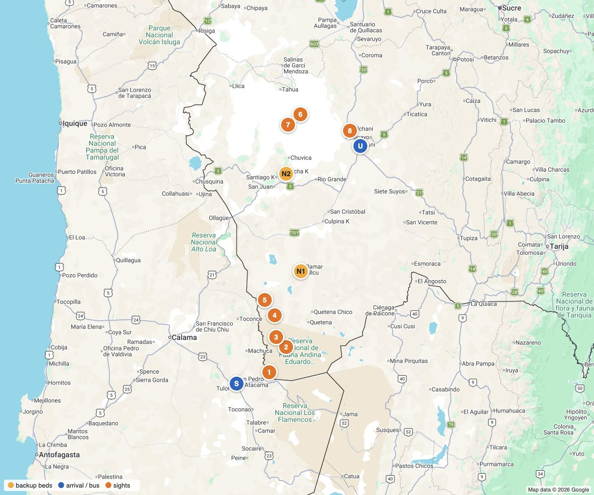

# 🇧🇴 Jeep tour San Pedro → Uyuni

Part of the [LatAm itinerary](../itinerary.md) · region notes: [Chile + Bolivia](chile-bolivia.md) · ← [San Pedro de Atacama](san-pedro-de-atacama.md) · [Potosí](potosi.md) →

> **Stop 17 · Mon 18 → Wed 20 Jan 2027 (days 42–44) · 2 nights in refugios** 
> 🏞️ Three days by Land Cruiser across the Bolivian altiplano: coloured lagoons, geysers, flamingos and the Uyuni salt flat at sunrise 
> 🛏️ **Expediciones Estrella del Sur**, US$280 with private bathrooms (US$260 shared); meals and lodging included, park fees extra 
> 🚙 **In:** pickup at the San Pedro hostel ≈ 06:00–06:30, Mon · **Out:** the tour ends in Uyuni town ≈ 13:00–15:00, Wed; then the bus to Potosí

Flamingos on Laguna Colorada, days 1–2 of the tour. Photo: Google Maps.

## 🗺️ Map

**The route (terrain):** **S** [San Pedro](https://www.google.com/maps?ftid=0x96a974ff051501b3:0x872ecffad0ba7dfc) (pickup) · **1** [Laguna Verde](https://www.google.com/maps?ftid=0x96a993ea5661f3cf:0x5fc118136c386a24) and [Laguna Blanca](https://www.google.com/maps?ftid=0x96a99363c22b3a2f:0xa5809636233ac3b4), just past the Hito Cajón border · **2** [Termas de Polques](https://www.google.com/maps?ftid=0x96a9f6138d7c7eb5:0xd6789a2483091e12), with the [Dalí desert](https://www.google.com/maps?ftid=0x96a9f3e2cb13949d:0x1ad4ac00c6136fe2) just south · **3** [Sol de Mañana](https://www.google.com/maps?ftid=0x96aa18a8d7c636ef:0xc9faf37134e28531) (≈ 4,900 m) · **4** [Laguna Colorada](https://www.google.com/maps?ftid=0x96aa3fc6825f40a1:0xddd3172cd23ada87) · **5** [Árbol de Piedra](https://www.google.com/maps?ftid=0x96aa44f50286cab7:0x45dd26d6202ffa9e) · **N1** [Villa Mar](https://www.google.com/maps?ftid=0x96aa8752c8044eb3:0x3c2bc8ca61428f92) (night 1 for Estrella del Sur and WWT) · **N2** [Hotel de Sal Cruz Andina](https://www.google.com/maps?ftid=0x915543a9f605877b:0x47d97b1d07d6cae9), next to [Colcha K](https://www.google.com/maps?ftid=0x915542218202cdab:0x72c94897efce2dd8) (night 2) · **6** [Salar de Uyuni](https://www.google.com/maps?ftid=0x915584b325e18bd7:0xce4183a158278b6) · **7** [Isla Incahuasi](https://www.google.com/maps?ftid=0x91559b99379fc3fd:0x1cc3d5a7edac2430) (usually skipped in January) · **8** [Colchani](https://www.google.com/maps?ftid=0x93ffb4f6759d7e3d:0xa6f9321aaa87ce2a), the salar edge · **U** [Uyuni](https://www.google.com/maps?ftid=0x93ffbad958d3f2bd:0x1455841e2c4e6653) (the tour ends)

**Open the live map:** [route](https://www.google.com/maps/@-21.6000,-67.5000,8z)

## 📅 Day by day

| Day | Plan |
|---|---|
| **Mon 18 Jan** · day 1 | 🚐 Pickup at the hostel ≈ 06:00–06:30 → Chilean exit stamp → **Hito Cajón** (Bolivian migración, 4,400 m; Bs 15) → change into a 6-seat Land Cruiser. Days 1–2 cover **Lagunas Blanca and Verde**, the **Dalí desert**, the **Polques** hot pool, **Sol de Mañana** (≈ 4,900 m), **Laguna Colorada** and the **Árbol de Piedra**. 🛏️ Night 1 at Villa Mar (3,990 m) with Estrella del Sur. Below freezing, no heating. |
| **Tue 19 Jan** · day 2 | 🏞️ The rest of the lagoons and the Árbol de Piedra (order depends on the operator). 🛏️ Night 2 at a salt hotel (Hotel de Sal Cruz Andina with Estrella del Sur). |
| **Wed 20 Jan** · day 3 | 🌅 **Salar de Uyuni at sunrise**; the mirror effect is likely in January. Isla Incahuasi is usually skipped. The tour ends in Uyuni town ≈ 13:00–15:00, then the 🚌 bus to Potosí. |

## 🔖 Book (one click)

Prices are from each operator's own page, 24 Nov. ⚠️ = time-sensitive.

**The tour** (18 → 20 Jan, 2 nights; shared tour, one way to Uyuni; meals and lodging included, park fees extra)

| | Operator | Total | Nights 1 / 2 | Ends in Uyuni | Book |
|---|---|---:|---|---|---|
| ⭐ **Pick** | **Expediciones Estrella del Sur** | **US$280** private bathroom (US$260 shared; US$300 single) | Villa Mar (3,990 m) / Hotel de Sal Cruz Andina, private bath both nights | ≈ 14:00 | [estrelladelsuruyuni.com](https://estrelladelsuruyuni.com/) (online, or the San Pedro office) |
| Backup | **World White Travel** (Caracoles 362-C) | US$275 (listed to 31 Dec 2026) | Villa Mar / Colcha K, private bath on night 2 | ≈ 13:00, with lunch | the San Pedro office |
| Cheapest | **Cordillera Traveller** (Caracoles 362-G) | CLP 245,000 ≈ US$239 (or US$260) | Huaylla Jara (≈ 4,300 m) *or* Villa Mar / Colcha K, private bath both nights | ≈ 15:00 | the San Pedro office |
| Cash | Park fees and border tax (not included) | ≈ Bs 210–250 ≈ US$18–21 | | | carry in small notes |

**Transport**

| | Leg | When | Price | Book |
|---|---|---|---:|---|
| In | Agency minibus, San Pedro hostel → Hito Cajón | **Mon 18 Jan ≈ 06:00–06:30** | in the tour | — |
| Out | Bus Uyuni → Potosí (≈ 4 h) | Wed 20 Jan, after the tour (15:00–19:00 departures) | US$11–15 on Tickets Bolivia | at the Uyuni terminal; see the [Potosí guide](potosi.md) |

How to read these tables

- **Prices** are per person, from each operator's own page on 24 Nov.
- **Nights 1 / 2** name the lodges each operator lists; agencies pool passengers, so ask in person which lodges you'll get.
- Bs 11.78 = US$1 for the park-fee total.

## 🚙 Getting here: San Pedro → Hito Cajón, Mon 18 Jan

- The agency's minibus collects you from the hostel at **≈ 06:00–06:30**.
- **Chilean exit stamp** at the San Pedro post.
- **Hito Cajón:** Bolivian migración, 4,400 m. ✅ **Bs 15** border tax per WWT's page.
- Then you change into a **6-seat Land Cruiser**.
- The tour ends in **Uyuni town at ≈ 13:00–15:00 on 20 Jan**.

## 🛏️ Where to sleep: the tour is the bed

The tour *is* the bed for 18 and 19 Jan. Nothing else to book.

**Operators compared** (all shared tours, 3 days / 2 nights, one way to Uyuni, meals and lodging included, park fees extra; prices from each operator's own page, 24 Nov):

| Operator (office) | Price p.p. | Rooms | Night 1 / Night 2 | Ends in Uyuni | Reviews |
|---|---|---|---|---|---|
| **Expediciones Estrella del Sur** | ✅ **US$280** private bathroom (US$260 shared bathroom; US$300 single room) | doubles/twins, private bath both nights | Hostal Amanecer, **Villa Mar (3,990 m)** / Hotel de Sal Cruz Andina | ≈ 14:00 | Tripadvisor 4.9 (224, Chile office) and 4.6 (596); Google 4.5 (81) |
| **World White Travel** (Caracoles 362-C) | ✅ **US$275** (page says valid to 31 Dec 2026) | doubles/triples; private bath on night 2 | Hostal Tierra Oculta, Villa Mar / Colcha K, private bath | ≈ 13:00, with a farewell lunch | Tripadvisor 4.6 (822) |
| **Cordillera Traveller** (Caracoles 362-G) | ✅ **CLP 245,000 ≈ US$239** (or US$260) | twin/double/triple, private bath both nights | Huaylla Jara (≈ 4,300 m, by Laguna Colorada) *or* Villa Mar / Hotel de Sal Andina Maypo, Colcha K | ≈ 15:00 | Tripadvisor 4.3 (753, Uyuni) and 4.6 (69, Chile); Google 4.2 (111) / 4.4 (343) |

### ⭐ Pick: Estrella del Sur, US$260–280
- **Best-reviewed** of the three, with private bathrooms in both lodges for US$280.
- **Night 1 at Villa Mar (3,990 m)** rather than 4,300 m: warmer, easier sleep.
- **Solo:** a solo traveller is normally paired in a twin; ask whether the US$280 or the US$300 single rate applies.
- ✅ **Booking:** estrelladelsuruyuni.com: book online (a WeTravel listing shows a US$100 deposit) or at the San Pedro office.
- ⚠️ **Cancellation:** its page lists two conflicting cancellation scales, one charging 100% within 30 days, so confirm the terms first and reserve ≈ 1–2 weeks ahead by WhatsApp rather than now.

### Backup: World White Travel, US$275
- Strong reviews, and it **finishes earliest** (13:00 with lunch), which suits the afternoon bus to Potosí.
- Its prices are listed only until 31 Dec 2026.

### Cheapest: Cordillera Traveller, CLP 245,000 (≈ US$239)
- If you pay in pesos. It has the weakest reviews, and night 1 may be at 4,300 m.

**How agencies work:** agencies on Caracoles mostly pool passengers into the same Bolivian jeeps. What differs is the driver, the vehicle and the lodges, so ask in person which lodges and whether the driver speaks English.

## 🌳 Things to do (free and outdoors first)

Everything here is on the tour route; the Reserva Eduardo Avaroa fee (Bs 150) covers the lagoons.

<table>
<tr>
<td width="50%" valign="top"> <b><a href="https://www.google.com/maps?ftid=0x96a993ea5661f3cf:0x5fc118136c386a24">Laguna Verde</a></b> and <a href="https://www.google.com/maps?ftid=0x96a99363c22b3a2f:0xa5809636233ac3b4">Laguna Blanca</a> · park fee The first lagoons, just past the border, under Licancabur.</td>
<td width="50%" valign="top"> <b><a href="https://www.google.com/maps?ftid=0x96a9f3e2cb13949d:0x1ad4ac00c6136fe2">Dalí desert</a></b> · park fee Bare sand below coloured hills, on days 1–2.</td>
</tr>
<tr>
<td width="50%" valign="top"> <b><a href="https://www.google.com/maps?ftid=0x96a9f6138d7c7eb5:0xd6789a2483091e12">Termas de Polques</a></b> · Bs 6–30 The hot pool. Bring swimwear.</td>
<td width="50%" valign="top"> <b><a href="https://www.google.com/maps?ftid=0x96aa18a8d7c636ef:0xc9faf37134e28531">Sol de Mañana</a></b> · park fee Geysers and mud pots at ≈ 4,900 m.</td>
</tr>
<tr>
<td width="50%" valign="top"> <b><a href="https://www.google.com/maps?ftid=0x96aa3fc6825f40a1:0xddd3172cd23ada87">Laguna Colorada</a></b> · park fee The red lagoon with flamingos (see the photo at the top).</td>
<td width="50%" valign="top"> <b><a href="https://www.google.com/maps?ftid=0x96aa44f50286cab7:0x45dd26d6202ffa9e">Árbol de Piedra</a></b> · park fee The wind-carved "stone tree", on days 1–2.</td>
</tr>
<tr>
<td width="50%" valign="top"> <b><a href="https://www.google.com/maps?ftid=0x915584b325e18bd7:0xce4183a158278b6">Salar de Uyuni</a></b> at sunrise · in the tour January–February is peak mirror season.</td>
<td width="50%" valign="top"> <b><a href="https://www.google.com/maps?ftid=0x91559b99379fc3fd:0x1cc3d5a7edac2430">Isla Incahuasi</a></b> · Bs 30, if visited ⚠️ Usually <i>not</i> visited in January–March.</td>
</tr>
</table>

**January realities** (AI-summary leads from salardeuyuni.com, Oct–Nov 2026, plus the operators' own notes):
- **Mirror effect: likely.** January–February is peak mirror season and San Pedro tours reach the salar at sunrise on day 3. Estrella del Sur and Cordillera both advertise the reflection for January–February.
- **Isla Incahuasi: usually *not* visited** in January–March. Deep water softens the crust and damages the jeeps, so drivers stay near the Colchani edge. The operators' itineraries still list it, with Cordillera's caveat that the route may change "only if necessary" in January–February. Expect to skip it and not pay the Bs 30.
- Days 1–2 (Lagunas Verde/Blanca, Dalí desert, Sol de Mañana at ≈ 4,900 m, Laguna Colorada, Árbol de Piedra) run normally, just muddier.
- If Hito Cajón is closed, tours wait or go via Ollagüe, reversing the route. That's why the dates have a soft day after (see Potosí).

## 🍽️ Eat and drink

- **Meals are included** in all three tours, along with the lodging.
- Bring **snacks and 2 L of water** (see the packing list below).

## ℹ️ Good to know

**Park fees and cash** (not included; carry ≈ Bs 250 in small notes; no ATMs or cards until Uyuni). ✅ From the WWT and Estrella del Sur pages:
- Border tax **Bs 15**.
- **Reserva Eduardo Avaroa Bs 150**.
- Polques hot springs **Bs 6–30** (the two operators quote different amounts).
- Isla Incahuasi **Bs 30** (if visited).
- Toilets ≈ Bs 5–6 per use.
- **Total ≈ Bs 210–250 ≈ US$18–21** at Bs 11.78.
- Optional sleeping-bag hire ≈ US$10 (≈).

**Altitude and cold.**
- You sleep at ≈ 4,000 m and cross ≈ 4,900 m.
- Night 1 drops below freezing, with no heating, and hot showers aren't guaranteed.
- **Bring:** the warmest layer, a buff, sun cream, 2 L water, snacks, toilet paper, swimwear for Polques and a headlamp.

## 🚌 Leaving: Uyuni → Potosí, Wed 20 Jan

- The tour ends in Uyuni town ≈ 13:00–15:00 (WWT ≈ 13:00 with lunch; Estrella del Sur ≈ 14:00; Cordillera ≈ 15:00).
- Buses to Potosí (≈ 4 h) leave the Uyuni terminal through the afternoon; times, fares and the soft-day plan are in the [Potosí guide](potosi.md).

---
Photos: Google Maps contributors (Laguna Colorada, Laguna Verde, Dalí desert, Termas de Polques, Sol de Mañana, Árbol de Piedra, Isla Incahuasi). Wikimedia Commons: <a href="https://commons.wikimedia.org/wiki/File:Reflection_on_the_Salar_de_Uyuni,_bolivia.jpg">Reflection on the Salar de Uyuni</a> (Christopher Crouzet, CC BY-SA 4.0).
